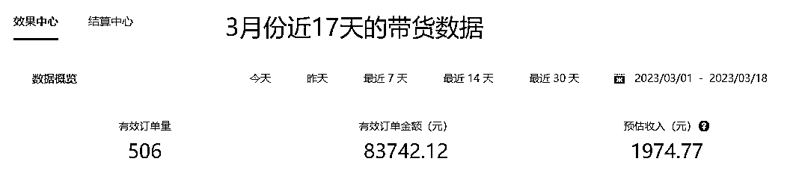
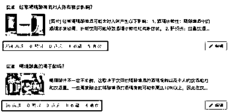

# 把知乎带货装进流水线：ChatGPT 负责写，RPA 负责跑

大家好，我是大胡子，坐标成都，日常工作是写代码。进赚钱有术之后，见过的副业路子不少，真正一路坚持下来的，还是知乎好物推荐——从 2020 年入场，断断续续做到了现在。

这个行当真正的门槛在内容产出。问答区里，写得多才可能被更多人看见，每多一条内容，就等于多递出一张名片。ChatGPT 出现之后，我试着让它负责起草，我再接手修改；RPA 则把那些来回点选的机械活儿接管过来。

具体跑法是：先挑出适合 AI 作答的提问，统一收进草稿区；然后用 RPA 脚本按顺序把题目逐条调出来，驱动 ChatGPT 生成应答；生成结果不会直接提交，都要经过我亲自确认、润色，再手动发出去。走完这一步，一个“AI 辅助带货”的最小闭环就成立了。

3 月份的收益记录请看下方截图，相关文章链接：[知乎好物](https://aqoyanyhfa.feishu.cn/docx/GhbsdeUAeo0lWdxwqcecdwx0nuh)

评论区里关于 RPA 的讨论还挺热闹：有人问哪家对新手更友好，有人提到阿里系，也有人安利影刀。我选的是 Automa，主要面向网页端，能把点击、录入这些步骤录制下来反复用。也有朋友说 Automa 装不进浏览器，多半是代理没开、外网连不上，调整下网络环境基本就能解决。

这套组合拳不会带来一夜暴富，不过作为一份副业，能满足细水长流的产出需求。想照着做的朋友，可以从一个小点切入：让 ChatGPT 先给内容框架，用 RPA 打通重复环节，再牢牢守住人工审核这一关。