# 《拆解一类赚钱的 AI 配音项目：文字转语音工具怎么做流量和变现？》

> 原文：[`www.yuque.com/for_lazy/thfiu8/akzpku895qqowzp6`](https://www.yuque.com/for_lazy/thfiu8/akzpku895qqowzp6)

## 《拆解一类赚钱的 AI 配音项目：文字转语音工具怎么做流量和变现？》

作者： 白杨 SEO 

日期：2023-03-23 

  

本文思路： 

1、文字转语音的 AI 配音项目本质是什么？ 

2、AI 配音为什么能成刚需？常见形态有哪些？ 

3、这类 AI 配音项目流量的打法有哪些？ 

4、这类项目通常怎么实现盈利？ 

文字转语音的 AI 配音项目本质是什么？ 

说白了，就是一个把输入的文字即时合成语音的工具。当有人有配音需求时，这个工具就有了商业价值，也就具备了项目属性。 

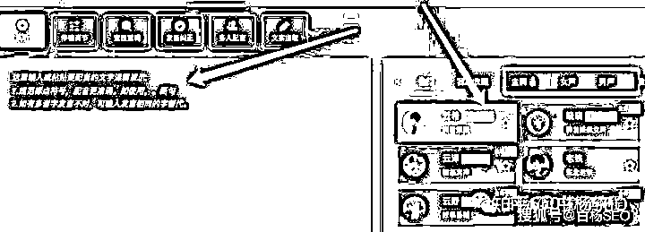  

AI 配音为什么是刚需？它的产品形态有哪些？ 

为什么 AI 配音能破圈？在我看来主要在三点：

1、这属于面向 C 端的个人消费工具，用户基数大，天花板自然高；
2、很多人对自己的声音没信心，但又想用配音来送祝福、做宣传，AI 配音刚好解决了这个痛点；
3、AI 配音很少是单一功能，基本都捆绑了提取字幕、去水印等周边功能。用户可能本是为了视频转文字或去图片水印而来，顺带用上配音。如图：

  

有人会问，市面上不是有不少免费的文字转语音或视频提取文案工具吗？确实存在。但免费版体验普遍打折，要么功能阉割，要么使用次数受限，对比付费版差距明显，如图：

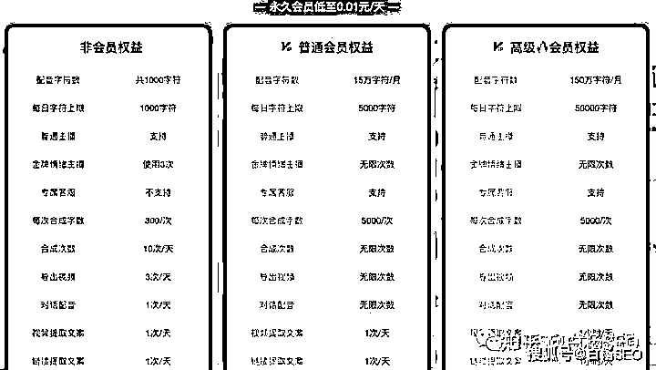  

AI 配音类产品的常见形态有哪些？ 

主要集中在两大载体：小程序和网站网页。小程序里以微信小程序为主，也有人尝试百度、支付宝、QQ、抖音等平台。

为何微信小程序占大头？因为微信的活跃人群最大，用起来最顺手。如今大家不在电脑前的时间，大多都在手机上，而手机使用场景就是抖音和微信双寡头。

AI 配音项目一般如何做推广？ 

前面提到，这类工具的载体要么是网站，要么是小程序，那流量怎么来？

先说网站的 SEO 路线，这是我做了十几年还在持续操作的打法。

工具类网站推广现在确实变难了，因为内容体量有限，靠内容堆权重拉排名获取自然流量难度增加，但依然有可操作空间。

1、先把基础 SEO 做好，让百度收录。没有收录一切免谈。就比如我这个学员的站点之前没收录，我自己的 SEO 工具导航就已经收录，如图：

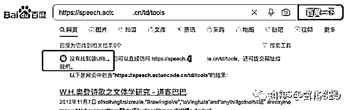  

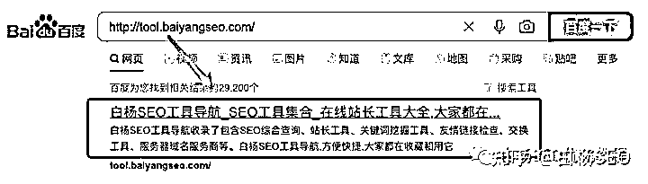  

2、丰富站点的内容体系。工具站并非不能写内容，可以围绕使用教程、操作技巧、场景案例来做内容矩阵，甚至可以用大模型辅助扩量。

3、做外链建设。核心就是交换友链、做高质量的外推，累积权重。

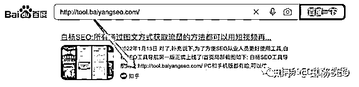  

微信小程序怎么引流呢？ 

我之前写过一篇《白杨 SEO：一文告诉你 16 条微信小程序推广渠道大全，实操举例【干货】》，这里精简三个核心方法：

1、小程序矩阵铺关键词。现在微信搜一搜很难让单个小程序靠内容收录，核心是靠名称排名抢占搜索位。所以要批量做小程序，用名字去截流。

很多人觉得注册十来个算多？我一个朋友团队旗下小程序多达几百上千个，日活接近百万。你起步至少准备三五十个，积少成多，小程序还能互相导流。

2、公众号矩阵引搜一搜。技术背景的同学会专门选词注册公众号，并在文章里布局长尾词，从而吃到搜一搜的精准搜索流量，如图：

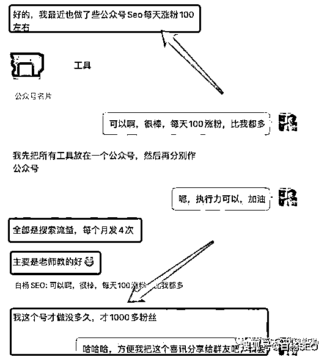  

搜一搜的精准流量被很多人忽视。找到蓝海词，用账号名承接就能稳定获流。除了公众号推小程序，还能把小程序挂在公众号文章里，通过视频号挂载公众号链接间接导流。

3、工具自带的裂变机制。几乎所有工具都会做邀请奖励、返现机制，用老用户拉新用户。这是行业标配，你也可以照搬。

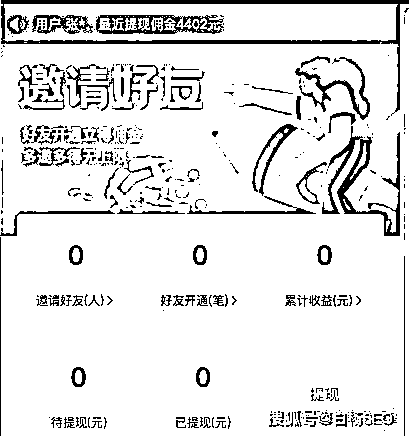  

AI 配音项目一般变现方式有哪些？ 

核心变现逻辑是会员付费。基础用户免费体验，高级用户付费解锁，如图：

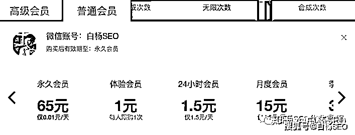  

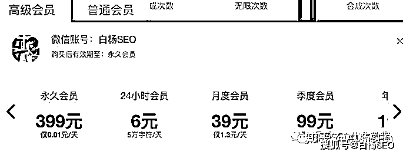  

微信小程序一旦日活起来，后续还能横向扩展。像我了解的一个技术团队，除了 AI 配音，还做了 AI 写作、AI 伪原创等产品线，如图：

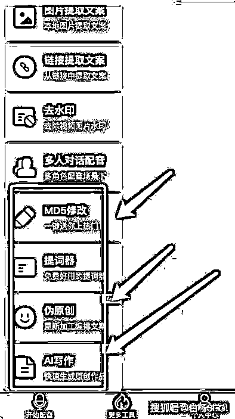  

你可能会说：这玩意技术门槛不高，我也能做？

没错，技术本身早已不算稀缺，不然也不会卷成这样。真正的难点是：你会不会推广？能不能找到前 100 个种子用户？能不能在搜一搜里找到尚未被占领的蓝海词？

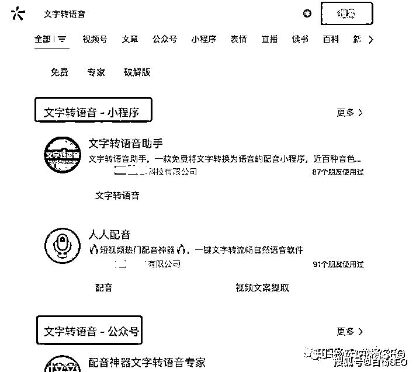  

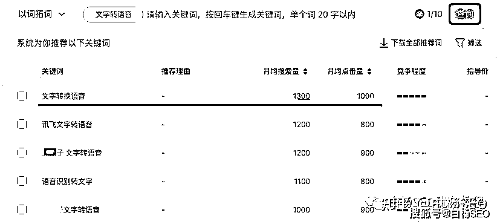该截图来自腾讯广告官方后台的搜一搜数据

关于搜一搜的投放数据，我在赚钱之前分享过，目前需要开户才能使用搜一搜功能。这张图是我借用学员账号查看的，他们是早期注册可免费用。拿到官方真实搜索数据，对选词至关重要。

作者简介： 

白杨 SEO，专注 SEO 十年，SEO 流量实战派，对全网精准搜索流量有深入研究。 

评论区： 

施霖终生学习者-链接 : 我有几个终身软件，APP，小程序都有，确实丝滑，还能快速配音，文字转语音，双向切换 白杨 SEO : 嗯 执着的启明星 : 对于个人来说，注册好几十公众号，太难，现在一个手机号只能管理知道公众号 皇冠一刻钟 : 这类小程序 有没有开放接口之类的 分佣返现 或者卖系统的 白杨 SEO : 分佣返现有，至于系统不太清楚，应该也有吧