# 《从 0 起步做家庭教育赛道，私域 2000+ 好友，课程营收净利 25W+》

> 原文：[`www.yuque.com/for_lazy/thfiu8/hz382crsb4az7gsv`](https://www.yuque.com/for_lazy/thfiu8/hz382crsb4az7gsv)

## 《从 0 开始做家庭教育赛道，累计私域好友 2000+，课程营收纯利润 25W+》

作者： 杨晶晶 
日期：2023-03-24 

当下越来越多的父母把孩子成长教育摆在首位，面对习惯养成、亲子关系、择校等现实困扰，多数家长并不具备专业的判断，天然会寻求可信赖的外部支持。

这正是家庭教育赛道的切入点：搭建一套能回应家长差异化需求的服务体系，以高客单的知识付费方式完成私域沉淀，系统化地解决养育过程中的具体难题。 当家长感知到服务价值后，转化便会自然发生。下面就以我的实操为例，分享从零起步的路径。

大家好，我是杨晶晶，一名家庭教育赛道的初创者，2022 年 418 加入赚钱。 此前长期关注知识付费却未真正进入，2021 年 10 月正式启动家庭教育创业，至今累计营收 25 万，基本做到纯利。 本文围绕五点展开：

1. 我为何选择家庭教育赛道
2. 产品与服务的构建思路
3. 流量获取方式
4. 转化与变现路径
5. 助力学员做副业的思路

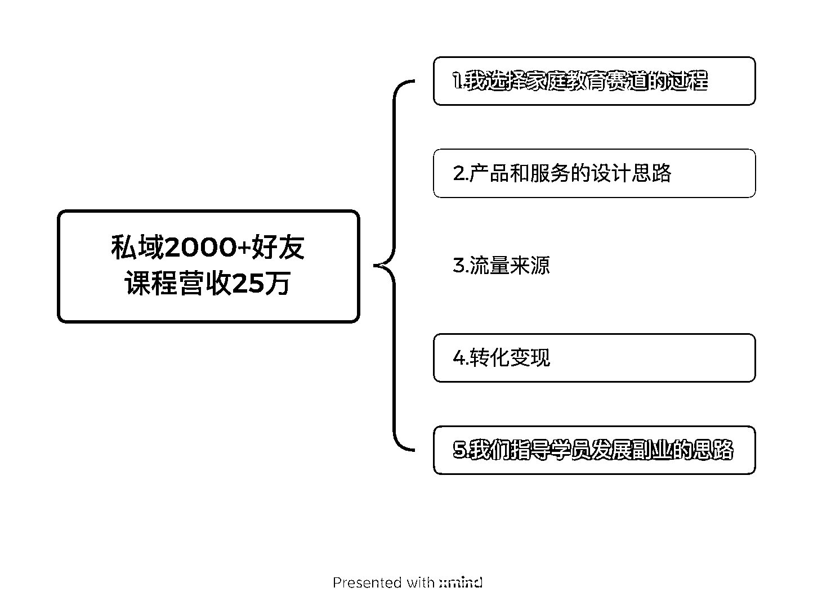

# 一、我选择家庭教育赛道的过程

## （1）起点：热爱驱动

我入局家庭教育的初衷非常单纯，就是喜欢。未为人母前，我就是身边师妹口中的“知心姐姐”。有了孩子后，我自发去研究疫苗安排、疾病护理、辅食搭配、营养组合，再延伸到绘本挑选和亲子共读经验分享。

后来开始系统学习更宽泛的家庭教育体系，与更多父母交流、答疑。那些不自觉就投入时间、金钱、精力的事情，往往就是真正的热爱。

正如赚钱日历去年 1 月 9 日的议题：如何找到使命与热情？ 判断是否真心热爱的两个参照：

1）从爱好中筛选出持续投入最久、最感兴趣的领域。
2）是否愿意为之自掏腰包。

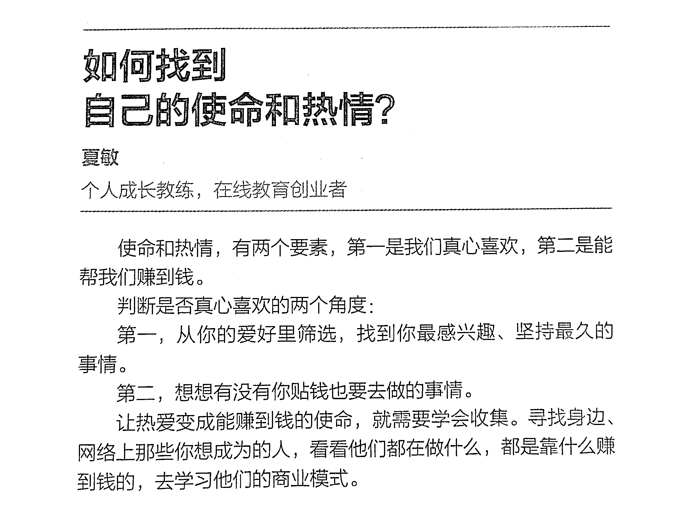

（图片来源于 2022 年《赚钱日历》）

随后关注知识付费后接触到三圈交集定位法，热爱已明确，下一步就是评估自身长板与市场缺口。

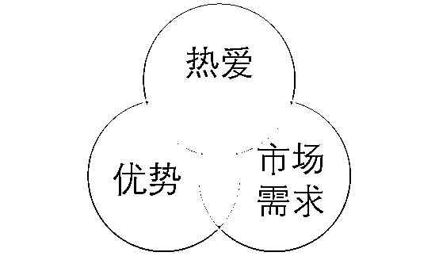

## （2）长板梳理

起初我对自身的优势总结得很笼统：985 本硕、学习能力强、做事细致靠谱。这些描述太泛，与能不能做家庭教育关联不大。

于是我做了盖洛普优势测评，整理近 20 年的成就事件，并持续记录优势观察日记。在复盘中，逐渐提炼出可落地的优势：

① 名校背景带来的初步信任感；
② 我天然偏爱讨论家庭教育话题，日常能持续产出内容并获得互动反馈，说明有听众愿意寻求帮助；
③ 在帮助父母改善养育焦虑、解决实际问题时获得的正向反馈，带来强烈的成就感与持续动力。比如孩子从睡前追动画到主动要绘本，夫妻因教育分歧冷战到放下焦虑，孩子写作业拖延从频繁发火到方法改善等；
④ 学习迁移能力强、细心，能把理论转化为实操。学员并非“听不懂”，多是方法用错，能做具体案例拆解与示范。

优势必须放在具体情境里才能判断有效性。最终我归纳为：

① 教育标签易建立信任；
② 学习与研究能力可转化为落地效果；
③ 多年沉淀在妈妈群的经验，具备问题解决能力；
④ 帮助他人获得的满足感高于其他事。

赚钱日历 2 月 22 日《怎样发现自己的优势》也提到四种发现优势的方法，供参考。

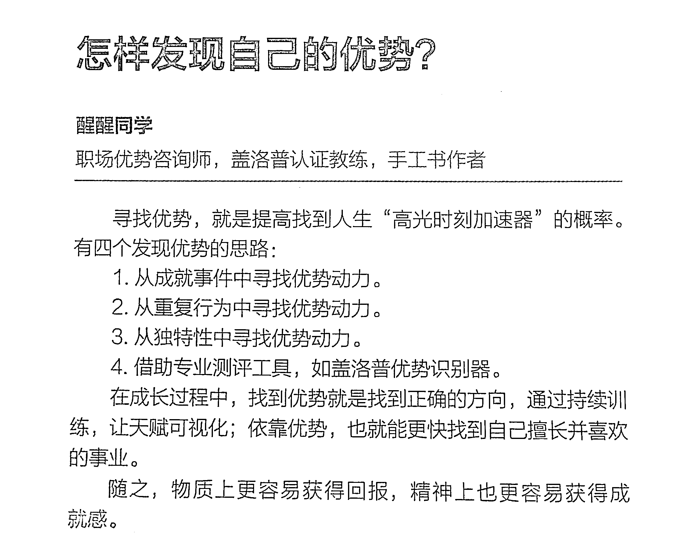

（图片来源于 2022 年《赚钱日历》）

## （3）市场验证

感性上看好家庭教育，理性上仍需数据支撑。我通过“发现报告”这一研报聚合平台做了行业调研。

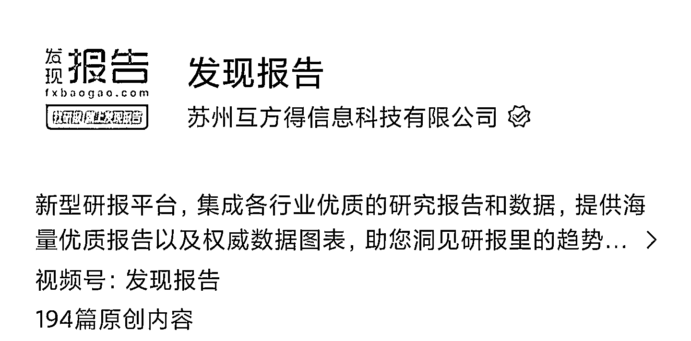

2022 年国家层面持续完善素质教育与家庭教育政策，家校社协同育人推进，“双减”落地、《家庭教育促进法》于 2022 年 1 月颁布，4 月发布《关于指导推进家庭教育的 5 年规划》。教育重心正从培养高分学生转向培养合格家长，最终实现素质教育目标。

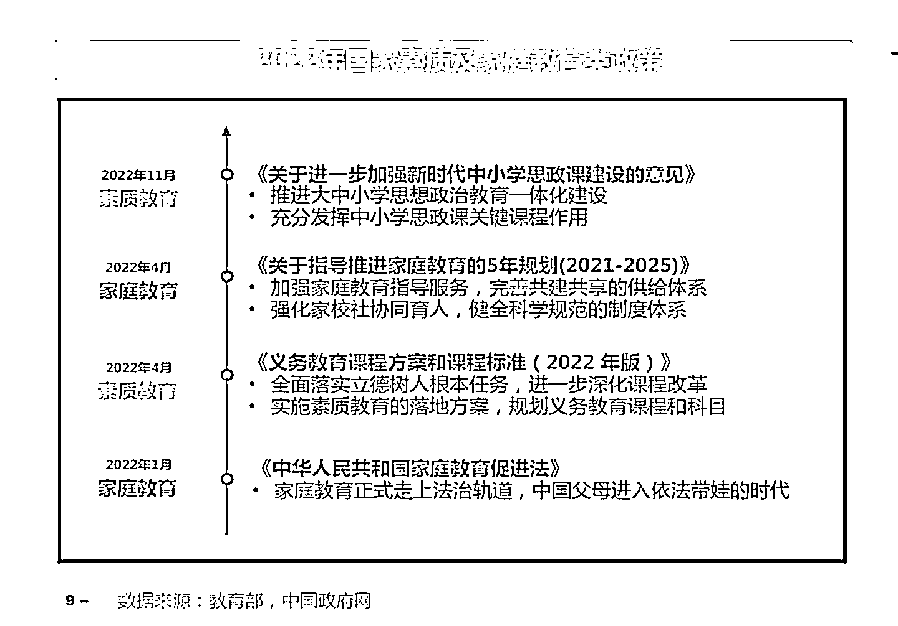

（图片来源于公众号《发现报告》）

数据显示，2021 年下半年起 38% 的家长提升了亲子陪伴时长，日均 1-2 小时。

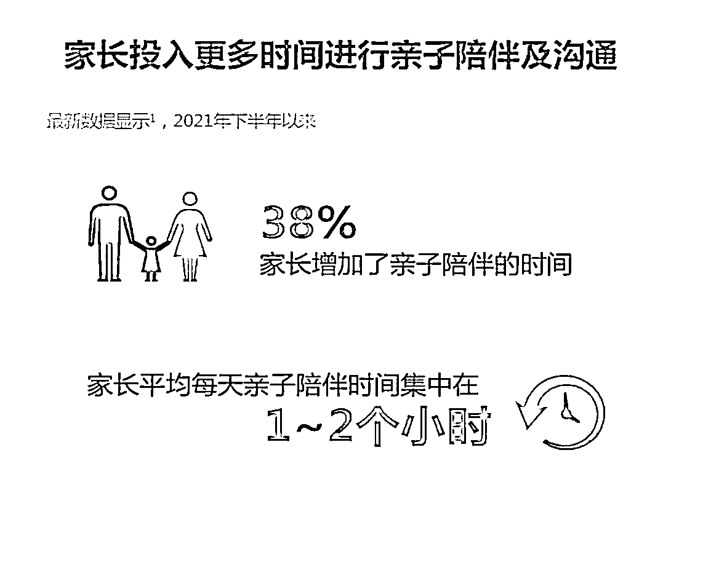

（图片来源于公众号《发现报告》）

生活场景改变后需求显现。陪伴时长提升意味着过去被校外机构掩盖的问题重新暴露。沟通只是表象，底层是家长对孩子心理素质、抗挫力、价值观、表达与社交、时间管理等教育目标的实现焦虑。陪伴时长增加后，家长对成长规律与沟通方法的学习需求随之放大。

从巨量算数看，“家庭教育”搜索热度持续攀升：

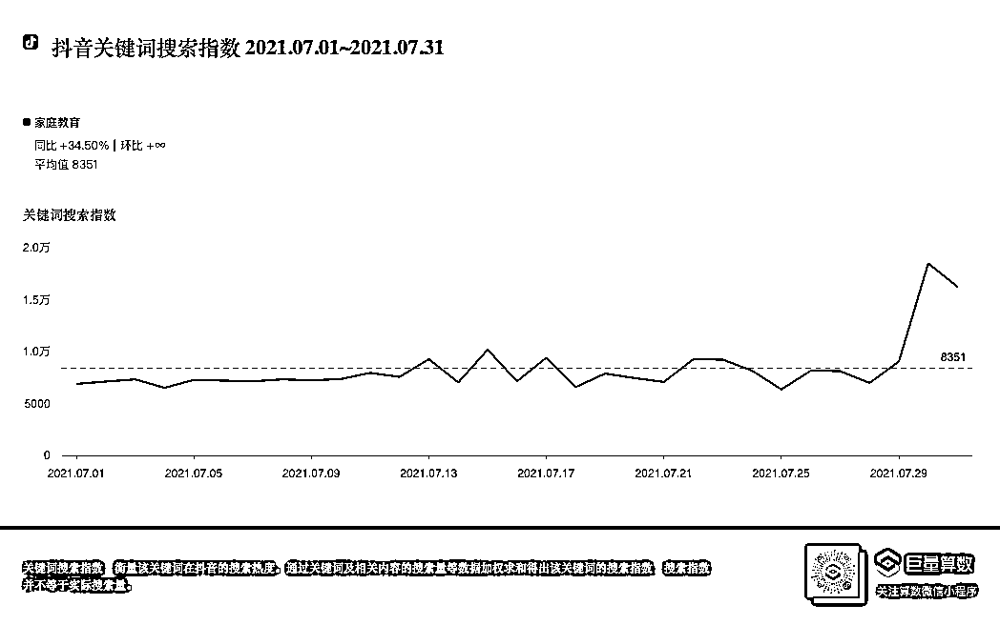

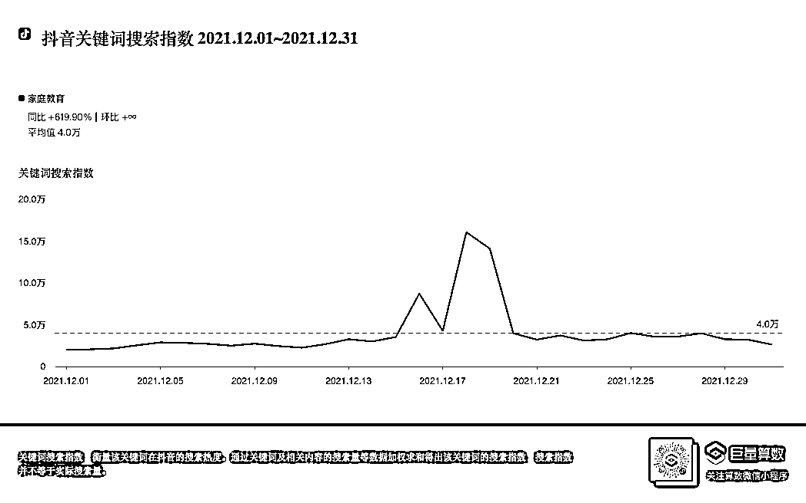

2021 年 1 月 5051
2021 年 7 月 8351
2021 年 8 月 1.1 万
2021 年 10 月 2.8 万
2021 年 12 月 4 万
2022 年 6 月 16.8 万
2022 年 12 月 18.7 万

2021 年 10 月我开始筹备，当时只有初步嗅到热度，借助政策与市场关注度启动尝试。两年间关键词指数增长约 37 倍。

# 二、产品与服务设计

核心问题是：家长什么情况下愿意付费？家长解决亲子陪伴与沟通问题的常用方式前五位为：关注家庭教育公众号、网络检索、阅读书籍、向同辈请教、咨询专业人士。

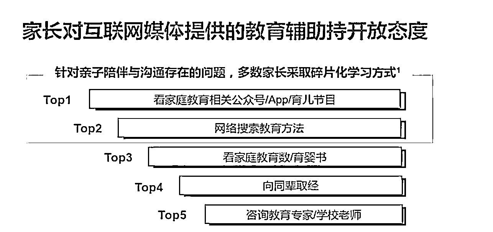

（图片来源于公众号《发现报告》）

结合妈妈群观察与学员沟通，我总结三类家长：

① 自助型，习惯百度、社群、小红书、公众号求解，日常小事不愿付费，付费习惯弱；
② 学习型，有课程消费习惯，接受百元至千元级课程，追求“学全学多”，结果意识偏弱；
③ 高觉知型，愿意为孩子未来投资，对当下养育痛点敏感，如厌学、亲子冲突、自身情绪失调，需要系统学习+陪伴指导。

因此产品定位为：聚焦第三类，兼顾第二类，提供“可咨询的专家+高质量同辈交流圈”。主打产品为：系统精简的课程体系+长期陪伴解决问题的服务，必要时对接认证。

## （1）形态

① 录播课程：5 门家庭教育体系课+1 门心理学基础课，含积极养育、沟通、青春期父母、父母自我疗愈、教育规划、心理学通识。
② 社群陪伴：固定时段直播答疑、每周收集养育反思并一对一反馈、不定期导师一对一通话，高频解决并持续跟进。
③ 认证服务：按需对接心理咨询师、高级教育指导师认证，非核心业务，主要是学员询问后顺带提供省事省钱方案。

高客单市场，完整的服务闭环是差异化关键。

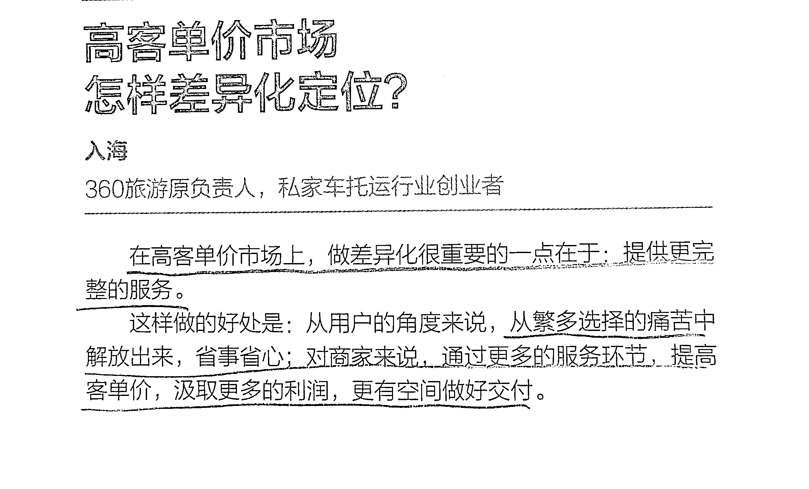

（图片来源于 2022 年《赚钱日历》）

## （2）差异化

1）别人缺少的我们补齐
家庭教育高度个性化。同一问题“作业拖延”，有的孩子缺任务与时间管理能力，需建立习惯；有的孩子是亲子关系紧张下的对抗行为，需关系修复。我的方案用三模块协同：学员周报问题导师语音拆解、周直播互动个案分析、按需一对一私密通话。真正实现从认知到行动，问题不堆积、不偏离，直至改善。

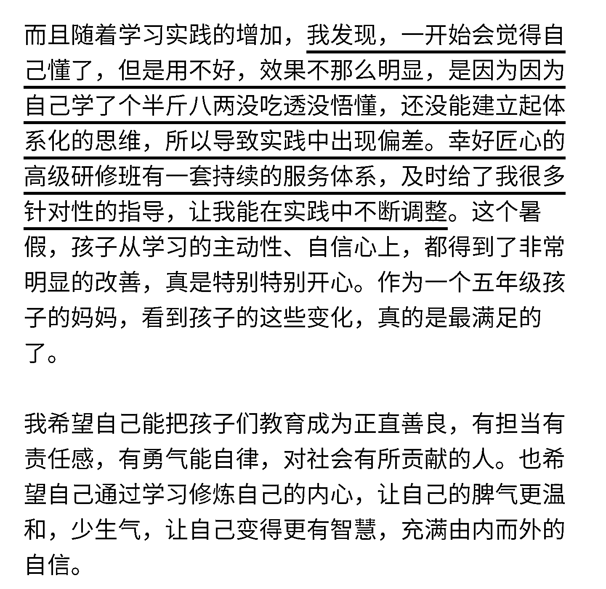

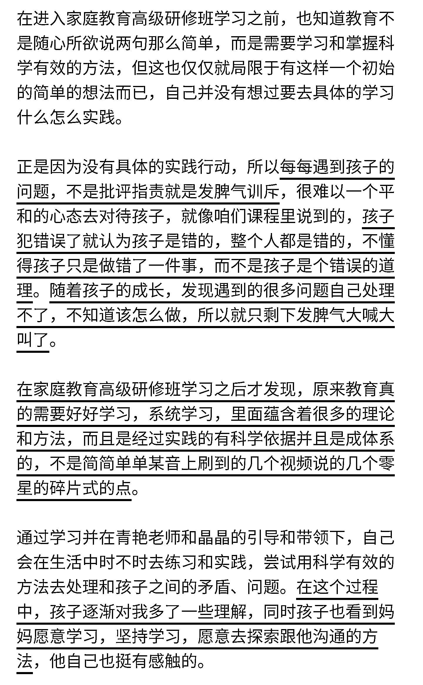

目前市场较少见到此深度服务。

2）别人有的我们更经济
市面多为单点课程：情绪课、沟通课、学习力课。家长学得碎片化，复用差，成本更高。我的课程主干是：认知孩子、认知父母、理解家庭互动、做好教育规划。

- 积极养育课：底层逻辑与心理发展规律；
- 智慧父母课：自我成长与疗愈，看清“原件”对“复印件”的影响；
- 高情商沟通课：以亲子沟通为载体掌握实操；
- 青春期父母必修课：专项应对青春期挑战，兼顾父母自身遗留议题疗愈；
- 教育规划课：“双减”后家庭教育责任回流的刚需；
- 心理学通识课：夯实理论底座。

单课市价 1000+ 至 5000+，打包+陪伴指导定价 12800，且课程不限时长，一年、两年均可学习，契合孩子成长周期。学员反馈：两个月学习抵过去一年零散学习，且串联了过往碎片。

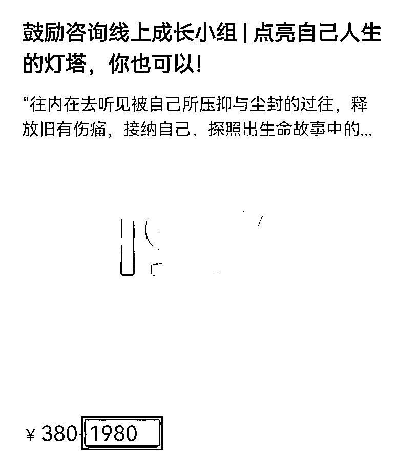

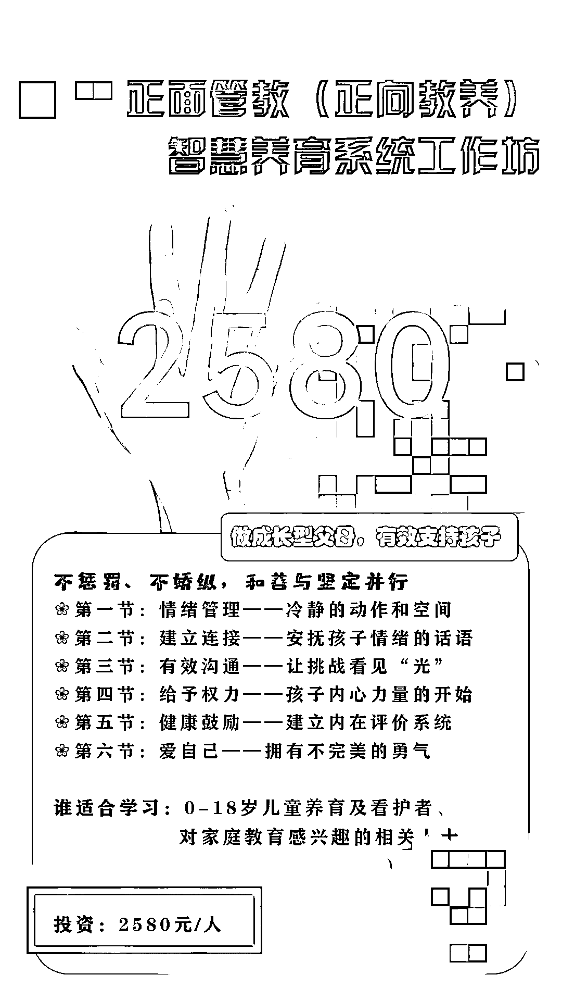

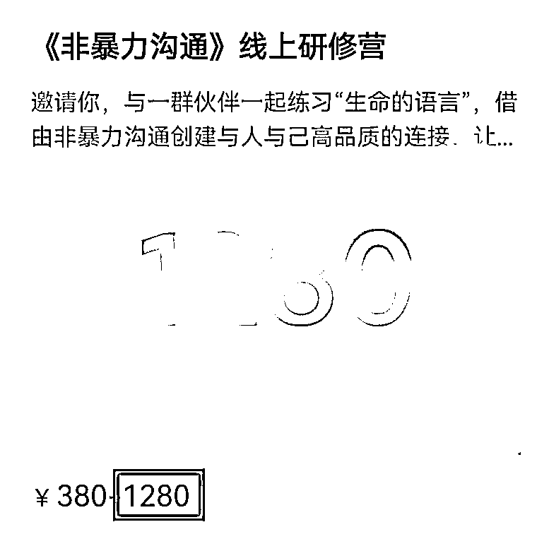

部分家长无暇听全程，同样可用提问+答疑解决核心痛点，按节奏选听。

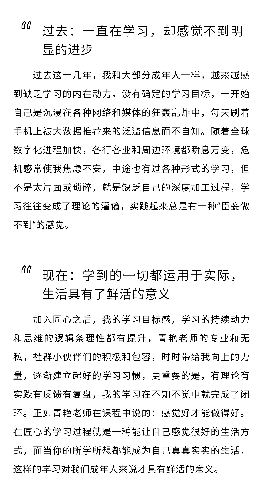

3）高客单形成
高利润产品多为高客单。当服务聚焦高觉知家长时，价格具备支撑力。实际运营中，价格本身筛选了无效流量，咨询者多具备支付能力，匹配度高成交顺畅，学员素质整体较好。

# 三、流量来源

## （1）私域 2000+ 人实现 25 万营收的基础

私域体量不大但信任度高：

第一，过去线下课程与沙龙积累的首批用户；
第二，孩子出生后运营的妈妈群，持续分享实操经验并产生转介绍；
第三，长期朋友圈沉淀，围绕家庭教育学习感悟持续输出，形成成长陪伴感。

## （2）付费社群引流质量高

后续引流以高价付费社群与视频号为主。如教育规划师助教岗位，5000+ 付费社群，成员付费意愿已验证，引流质量优。

# 四、转化与变现

很多人问我，家庭教育赛道到底能不能赚到钱？我的答案是能，但要用对方法。过去一年，我们亲手跑通了高客单价产品，核心不是靠花哨的营销套路，而是一套环环相扣的“免费动作+信任经营”。今天我把这些实操经验完整拆出来，希望能给你一些启发。

## 一、所谓的“免费咨询”，其实是一次问题梳理

一次咨询解决不了长期积累的问题。所以免费咨询的真正价值，不是给出答案，而是帮对方把问题看清楚：问题是怎么来的、卡在哪里、继续下去会怎样。

我的沟通逻辑一般是这几步：
1. 先听对方讲，他最近到底遇到了什么养育难题；
2. 再问这个问题已经持续多久了；
3. 引导他讲一个最让他难受的细节，把痛点拉出来；
4. 问他之前做过哪些努力，再分析为什么这些方法不奏效，让他看到自己能力上的短板；
5. 这时可以插一个学员案例：谁曾经和你很像，后来通过系统学习，状态发生了怎样的变化；
6. 然后聊“如果继续这样下去会怎样”，不改变带来的代价一旦说清，痛点自然被放大。对教育产品来说，这不算制造焦虑，因为教育的结果本来就发生在未来，这是客观事实；
7. 最后让他自己选：是保持现状，还是换个方式？推动他做出决定。

## 二、免费测评，比你说一百句“你有问题”都管用

与其直接指出对方有问题，不如借一份第三方的测评结果让客户自己看见问题。这样的说服力，比我们亲口说出来强太多。

我们有一个学员，做完亲子关系测评，听我解读完，她说：“你说得全对，感觉就像看到了我的潜意识。”就这样，她很快成交了12800元。

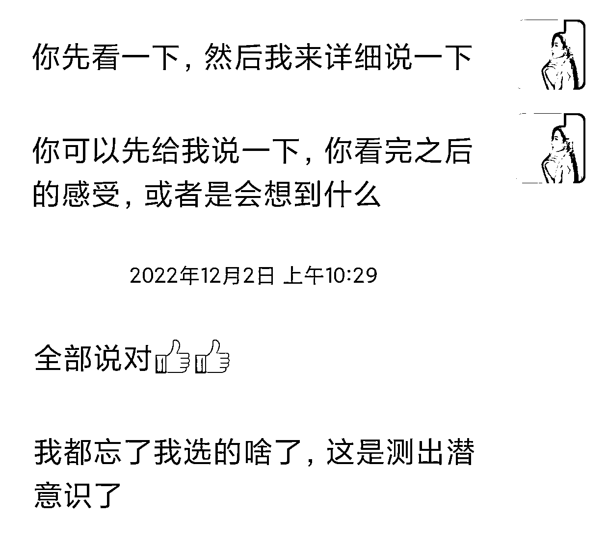

## 三、公开课，不是解决问题，是唤醒需求

我常在朋友圈发案例类内容，然后在评论区留一个钩子：“想学习如何培养高情商孩子，私信‘666’，免费送你一份高情商养育公开课。”有人留言后，我就把课程链接发过去，或者拉一个3-5天的快闪群，把人聚起来。

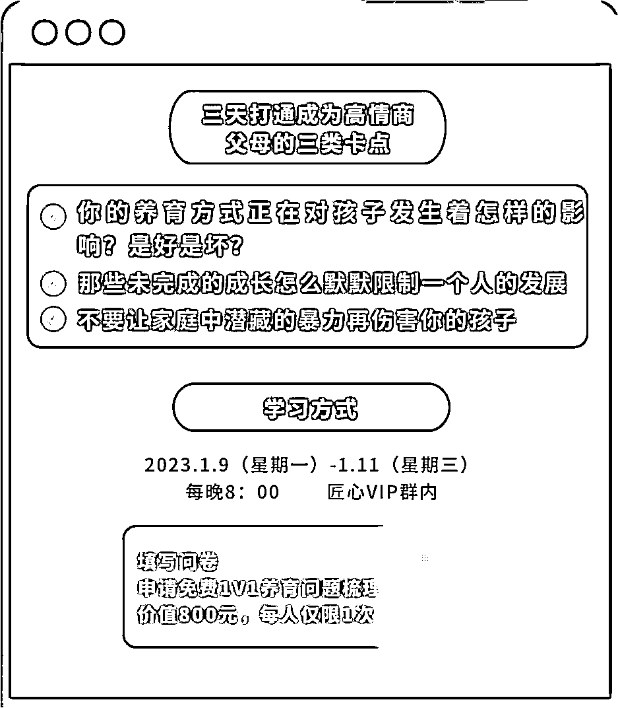
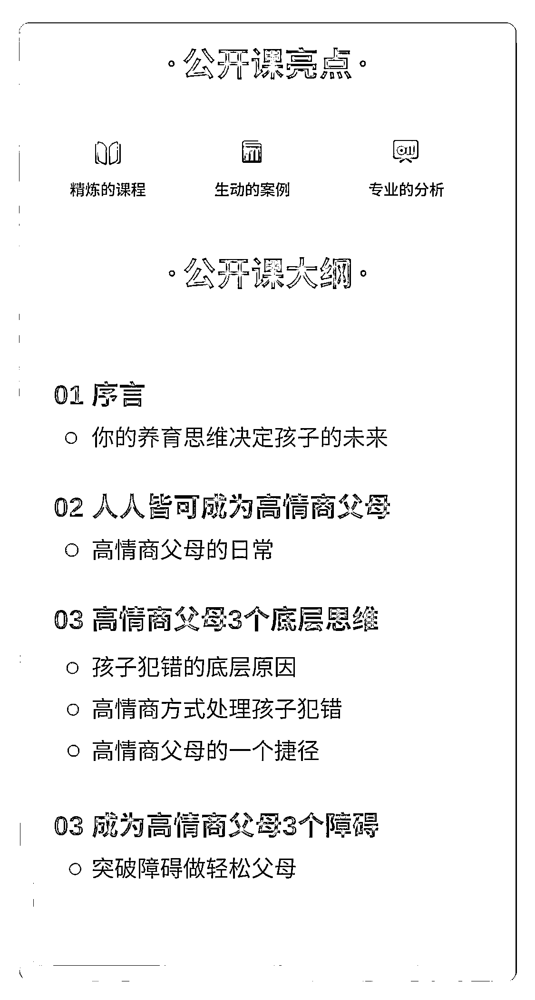

一节公开课，我重点讲三块内容：

第一块，呈现几个典型养育场景，让家长对号入座，再描绘高情商父母的理想状态，激发他们向上的期待；
第二块，拆解成为高情商父母常见的几个思维局限，用理论加案例，引导大家对照自己，发现原来问题出在这里；
第三块，亮出实力，讲品牌故事和学员成功案例，也会请老学员分享自己的真实收获。

整堂课里，理论、案例、干货都有。但公开课并不会直接解决问题，事实上也没法通过一节课解决。它的真正作用，是用一对多的方式，帮大家把问题看得更清楚，同时让大家知道：这个问题有办法解决。

下课后，我们会再送一次亲子关系测评，并结合学员在课上留下的作业，让痛点、需求、卡点全都浮出水面。这就会激发购买欲，至少会让人开始关注我们。

## 四、朋友圈不是广告墙，而是信任资产

做线上的家庭教育IP，朋友圈的运营方式直接决定了成交效率。我自己总结了三个心法：晒案例引发共鸣、持续输出建立信任、立体化链接感情。

**1. 晒案例，让真实痛点说话**
晒成交截图当然有用，但真正打动人的是案例。每个案例背后都是一个活生生的家庭，真实的痛点天然自带共鸣。有一回，我特别想打动一个潜在客户，那几天我就针对她的处境连续发案例，因为她正好处在一个纠结期。果然，其中一条案例精准戳中了她的心事，她当场报了名。

**2. 持续输出，让信任慢慢长出来**
线上交往比线下更难建立信任，而朋友圈的持续输出，就是最朴素的信任建设。我自己有了孩子之后，一直扎根家庭教育，从最初的知识分享者，慢慢长成了一个专业形象。第一批招募学员时，很多人非常主动，最快的甚至只通了20分钟电话就成交了。她们说得也很直接：“这些年看着你在家庭教育领域一路深耕，我相信你这个人。”还有一位妈妈说：“同样是当妈的，你一直在学习、实践、思考、迭代，我也想过成你的样子，所以我想跟着你学。”也有人只关注我几个月，但几乎把我每一条朋友圈都看过，觉得收获很大，于是想继续深入学。

**3. 立体化链接，超出知识和技巧本身**
一个知识IP，如果只贩卖知识和技巧，那和卖书、卖PPT没什么区别。知识IP真正要解决的，是帮客户把学到的内容啃透，并且真的用在自己身上，完成从知道到做到的跨越。所以，我们需要提供超出知识本身的附加价值，让客户有更好的体验感。

我平时会分享学习方法、时间管理、思维方式、生活方式等话题。这些内容会让大家感觉到，我确实是一个成长者角色。跟着这样的人学家庭教育，靠谱、丰富、走心，距离近了，信任也就深了。

**4. 用专栏思维经营朋友圈**
我朋友圈人数不算多，但能成交高客单价，靠的就是朋友圈内容有规划。我的朋友圈通常由四个专栏构成：
- 结合金句或热点事件，谈谈自己的看法和经验，传递教育观念；
- 专业和产品板块：课程解决什么痛点、学员反馈、成交截图等。如果一段时间没有新成交，我就会发专业相关的内容，比如最近读了什么书、上了什么课、和朋友探讨了什么话题；
- 生活圈：积极向上的生活状态、带娃日常，让人看到一个真实的人，也更容易产生情感链接；
- 附加价值：结合自己的优势以及客户需求塑造人设，比如学习方法、思维方式、时间管理等，持续提供价值，才会有感染力和影响力。

每天尽量覆盖这些专栏当然最好。但如果太忙，挑着发也可以，关键是心里要有这根弦。我的经验是：偶尔停下来没关系，但一定要记得重新开始。长期来看，你依然是持续的。

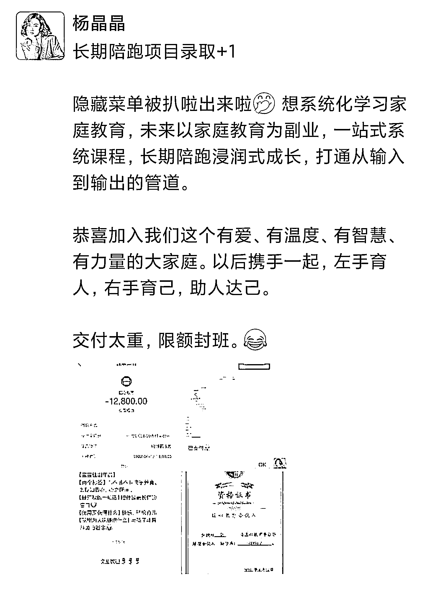
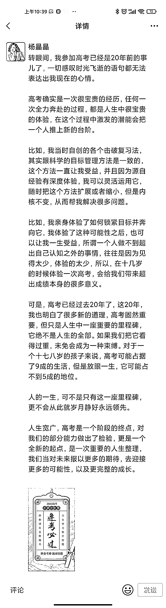

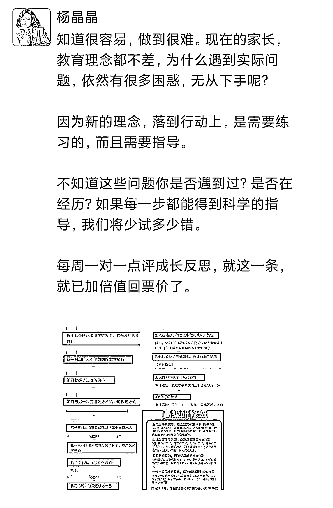
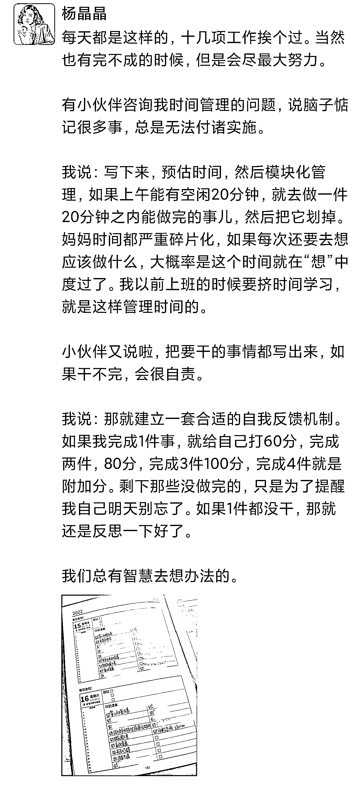
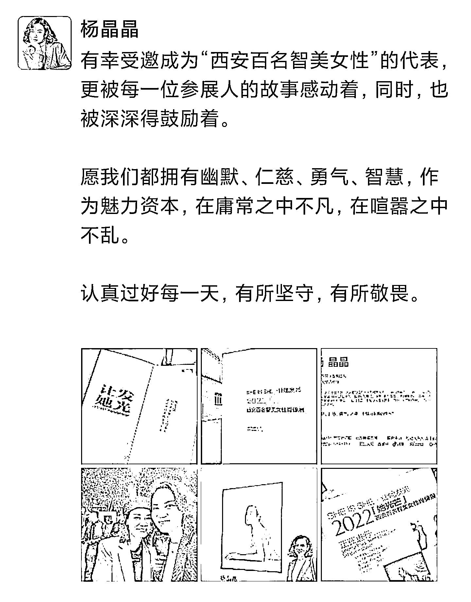

## 五、家庭教育赛道的门槛：低处不低，高处很高

总有人问，家庭教育赛道到底好不好进？现在各种“妈妈IP”“家庭教育IP”已经不少，还能赚钱吗？我的观察是：进入门槛不高，但想做成高客单价产品，门槛非常高。

**进入门槛不高，是因为**：现在大量宝妈本身就在学家庭教育，稍微有点学习能力，读几本书、把内容整理一下，再结合自己带娃的经验，做一个几百块的低价课或社群，并不难。而且很多宝妈混过各种妈妈群，天然有一些初始流量。

**但高客单价门槛很高，是因为**：家长愿意花上万元来付费，一定是有实际问题需要解决的。除了少数认知水平高、愿意为未来提前投资的家长，大部分人都是“救命式学习”——等到问题已经比较严重，才下定决心花钱。

在孩子和自己都没出大问题时，愿意付高价学习的家长并不多。家庭教育虽然被普遍看好，但市场还需要继续培养，从认知到行为改变，仍然需要时间。

教育的结果在未来。孩子心理成长和底层能力方面的问题，不是一天形成的，所以当问题不够痛时，家长就没有动力付高价。同样，问题一旦固定下来，解决也不是一两天的事，尤其当问题已经很严重，即时反馈就会不明显，人很容易失去耐心。

所以，愿意付费高价的家长基本分两类：一类是认知水平高，愿意为未来买单；另一类是问题已经严重到足够痛。但无论哪一类，都要求产品真有质量、真的能解决问题。

每一个家庭都不一样，每个孩子也不同，而每个家长身上又带着自己成长经历的影响。所以很多问题绝不是随便读几本书、上几门课就能解决的。比如我们有些学员，孩子在学校已经出现严重问题，她本人非常痛苦。后来通过学习，她自己的状态和孩子都有很大变化。这背后对我们的指导能力要求很高：课程要讲到本质，同时还要配合每周答疑和一对一点评作业，才能真正落地。

很多家长习惯“改孩子”，不想“改自己”。确实也有家长去给孩子找咨询师，但就算孩子做完咨询后有了变化，如果家长不改变，问题还是可能反复，甚至换一种形式反复。所以，一定会有一批家长选择先改变自己，让自己和孩子都获得长期有效的成长。

大咖们也有解决问题的能力，但他们不会做细致陪伴服务；就算做，普通人一般也支付不起。所以，像我们这样能给到实效的陪伴式指导，自然是有市场的。

说到底，持续迭代产品、解决各种实际问题的能力，就是高客单价那道真正的高门槛。

## 六、学员想发展副业，我的两条实在建议

如果专业积累足够，也具备持续一对一解决具体问题的能力，完全可以走“课程+服务”的模式，重点放在服务上，做高客单价产品。

如果专业积累还不够，“原创课程”和“深度服务”这两块都会比较吃力。针对这种情况，我建议两条路：
- 以成长者的角色去带货（课），赚佣金；
- 做二次加工类的课程，比如整理一本《青春期孩子常见问题100个》，从书里或听过的课里提炼100个真实案例，定价199元。如果能卖出一万份，收益也是相当可观的。

这也是我们今年准备帮助有需求的学员去做的事。

最后，想感谢在互联网上遇到的@梁靠谱 @醒醒 @芷蓝。从购买赚钱日历，到加入赚钱，我学到了很多；在醒谱大队和玩赚新媒，也收获了很多意想不到的惊喜。

以上是我们2022年跑通家庭教育赛道高客单价产品的实操经验总结，希望能给大家带来一点启发。能力所限，难免有不完善的地方，欢迎一起探讨指正。

祝大家一直龙哥盟。