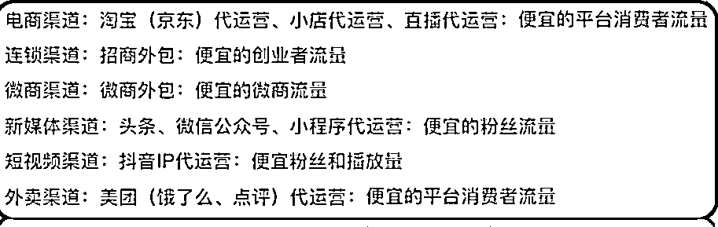

# ('进赚钱8个月，翻遍了所有的精华帖，盘点拆解赚钱的赚钱方法！', (2, 31))

在赚钱待了8个月，我几乎把每个角落都翻了个底朝天，今天想做一件事：把这几个月拆解出来的赚钱骨架，完整地摆到你面前。

先简单交代一下背景。我叫杨洋，2014年入行做医药圈职业教育培训，从业务一路做到招商经理，再到公司合伙人，最后因为行业线下滑离开。去年7月加入赚钱。教育培训这一行，成人学历的各种套路和深坑我基本都踩过，也亲手操盘过健康管理师证书项目，从立项、招代理、收资料、报名到拿证，全流程都走过。证书项目、网课项目、课程分销、代理模式、OEM招商这些，想聊随时找我。我们那会儿做OEM合作，营业额从2018年的700万，涨到2019年的1200万，再到2020年的1500万，本质上就是加了OEM这一条新路子。

进了赚钱以后，我陆续参加了5次航海，其中收获最大的是2月份那次ChatGPT+AI绘画。不仅吃透了ChatGPT+数字人的直播玩法，还认识了现在项目的合伙人。一边跑项目，一边拆解社区里的商业模式，越拆越觉得这是个宝库——外面卖大几千的培训课，里面的内容这儿基本全都有。你要真不想再做韭菜，就把这里的东西往深里啃，啃明白了，镰刀基本伤不着你。

接下来，我把最近拆出来的东西捋一遍。别被各种包装唬住，底下那根骨架，其实不复杂。

先看一个核心公式：目标收入 = 利润 × 单价 × 转化率 × 曝光人数。所有能赚钱的生意，跑不出这四件事。

拆解案例，为什么要拆？就三点：能上手，利润好，有搞头。怎么拆？重点看四件事：一，赚钱逻辑是什么；二，客户为什么掏钱，无非内容、工具、服务；三，产品和推广怎么搞定，产品要够硬，新用户靠免费流量，老用户靠留存；四，最强的营销手段，就是找到对标的同行，走他们走过的路。别人验证过的东西，拿来学、拿来抄、再想办法超越。先保质量，再提效率。研究、模仿、超越，一条线走完。找痛点，看谁在解决这些痛点，去看他什么时候注册的、收录怎么样、流量从哪来、靠什么赚钱。然后就模仿，模仿里带着自己的取舍和创新。

举个例子，小红书卖AI刺绣材料包，有博主靠这个赚钱。一份材料包卖168，毛利至少六成。这个模式好在哪？门槛低，容易落地执行。赚钱路径也很清晰：先用AI绘画生成刺绣成图，再找供应链生产，然后上快团团挂链接卖材料包。在小红书用好看的AI刺绣图做引流，跟工厂合作定制材料，再孵化自己的达人，多渠道卖货。客户为什么付钱？因为他们看到了机会——用这些材料做新奇产品直播卖钱，还能通过卖直播训练营、带达人、赚差价来变现。产品端就是自己画设计图、找厂家定制、组织达人培训、线上卖刺绣包。再往后还能叠加小红书电商培训、产品打包出售，走的其实还是微商那套逻辑。怎么复制？去小红书找对标账号，一个细节一个细节看，分析他们的设计风格和文案，自己做AI刺绣设计发布引流，用ChatGPT生成销售文案，然后把客户逐步引到私域。

再看一个：抖音卖婴儿奶粉，6个月做到85万利润。奶粉是硬刚需，小孩出生就得喝，复购极高。怎么做的？用免费领全套胎教音乐当诱饵，把人吸引进粉丝群，再用“加好友进孕妈福利群、羊毛群”的钩子，把人从公域转到微信。一天能引流100多个宝妈，一个月能卖8000箱。推广有四种打法：第一种，直接用软件做引流视频，把奶粉罐子和价格打上去，评论区引导加微信，或者建粉丝群，每天在群里发育儿知识建立信任；第二种，做胎教音乐引流，直播间循环播放，还是引导“免费领全套胎教音乐”，把人弄进私域；第三种，用黑科技软件主动加粉，批量导入宝妈群好友，一个微信加五六十人，一天能加300人；第四种，私域朋友圈持续运营，不断发圈引导新用户下单。变现也有两条路：一是做社群淘客，二是招代理。499门槛的代理，每买一箱减100；988级别的代理，一箱赚100到300；2888当合伙人，给价格表，还带上视频制作训练营。

还有机票代理人这个案例，2023年旅游回暖，国际机票有一波明显机会。核心逻辑就两条：把预订、改签、退票那套业务吃透，手里有机票产品；然后去小红书找散客和留学生，通通引到私域成交。

护肤祛斑赛道直播也有意思，要玩的话得准备水军、预算和自营小店。女装、美妆、减肥、茶叶、零食这些大类已经是红海，祛斑反而算小蓝海，退货率约30%，不算高，产品粘性强，适合私域。这行的核心逻辑：停留模型决定推流速度，成交模型决定推流模型。要拉高在线人数，用憋单的方式把人留住。硬件配齐：开抖音小店，备5000保证金，弄两个水军号，投抖币，做付费投流。直播的人货场要搭好，边讲祛斑的原理和方法，边演示操作，边回答弹幕问题。排品结构也要讲究：引流款9.9，爆款利润款299，正价附属品比如修复液99，再配一个点斑水59.8。整场直播就围绕停留时长、关注、加灯牌、互动、成交来做，中控专门配合水军节奏。客户有痛点就愿意为痛点持续付费。产品走一件代发就行，推广方式可以前期吃自然流，配合短视频，等到第七场再用小店随心推付费投放，200元左右基本就够了。直播得有人，免费流量、付费流量、短视频流量、产品流量四频共振，把人留住靠引流品讲福利，在线人数上来了就拿爆品做成交密度，打成交模型，把模型矫正过来，再用利润品实现盈利。自然流直播间经常遇到的问题是一个品最多爆半个月就卖不动，原因是账号标签太精准，同类人群被同行洗过了，想继续卖就得拓宽人群，投千川是个解决办法。

公考赛道则是高壁垒的知识付费。每年一两次考试，考生数以万计，教育培训高利润刚需，又能对接B端，这生意可持久。知识付费有两种变现方式：一种是卖别人的产品，销售权、定价权、所有权全在别人手里，收益天花板低；另一种是自己先学透、验证、总结、整理，再传授给学员，这套路耗时间长，但长期做壁垒越来越高。推广变现闭环也很清晰：先做公考面试培训变现，再通过小红书引流吸引有面试需求的粉丝，靠不断优化笔记做出差异化，然后用话术建立信任完成转化。小红书上怎么起号？持续发真题解析，在评论区解答题目，慢慢攒精准粉。营销最有效的路径就是小红书引流加私域成交。

再聊代运营。操盘手得有种全局思维，从品牌IP定位、内容制作、引流、转化成交，到产品交付、售后风险，全链路都得拿捏。打工的话年收入50万到100万也常见，但要真想上不封顶，就得创业跟项目深度绑定。代运营的底层逻辑是获取流量，有了流量才有后面的一切。

代运营的交付分四类：招商裂变、知识付费、创始人IP、垂直领域引流。转化路径无非是电话邀约、微信邀约，或者沙龙集中邀约——线下分享干货、交流资源、给体验。关键就三点：快，客户一有需求就第一时间联系；主场优势；高频逼单。电话邀约见面聊，成交率才上得来。

签约交付这块，交付的不是目标本身，而是从起点到目标之间每一步怎么走：第一步干什么，第二步干什么，第三步干什么。抖加预算多少，策划怎么做、多久更新一次，项目以什么方式呈现，推广预算多少，人力预算多少，全都要在方案里说清楚。

客户如果直接要方案，得分开应对：只做前端流量代运营的，给案例手册和口头思路就行，话术逻辑靠“案例牛、经历牛、成果牛”；全案代运营的，细节太多，不给方案确实说不清，那就得靠专业能力和服务价值来撑，方案和落地逻辑都要有，但必须收策划费或定金做门槛——我的诚意是拿出好方案，你的诚意是交一部分定金。前期价值体现越大，就越要出方案。

然后小红书无货源电商。今年小红书集中发力电商业务，平台给流量扶持，大批人涌进来，对普通人是个窗口期。玩法很简单：在小红书发笔记，拍下别家平台的商品，让那边发货，赚中间的差价。笔记曝光量主要来自两个入口：首页推荐和关键词搜索。能不能爆，就看图片够不够吸引人、文案有没有引导力。运营重点：布局长尾关键词，吃持续的自然搜索流量，找优质货源。选品有几个思路：别的平台火过的品，热点周边比如电视剧周边，细分垂直单品，或者直接锁定热门赛道——饰品服饰、家居家装、美妆护肤、食品。开店的话，账号垂直度很重要，发布的内容要围绕品类来做。找对标账号做像素级模仿，一帧一帧比，图片展示几乎做成同款去博流量，然后坚持发。

私域引流卖货那条链路也不复杂。公域引流加私域变现，是当下最稳定的成交模式，往后也有很大的存在空间。利用撰稿能力在小红书上持续输出高质量内容，把内容打磨成对用户真正有价值的东西，释放一半的价值，把另一半留给用户来找你。这样能吸粉600人，引流私域1000到2000人。还可以建群，引流到本地孕产妇交流群，一个群就能进500多人。微信私域里打标签，根据不同人群精准推送对应内容。

说了这么多案例，其实最底层的共性只有一个：所有好生意，本质都是流量生意。流量、转化、成交、交付、复购，老客户留存，新客户新增，一个好生意就这么来的。但这几个环节里，最核心的卡点就是流量。打开流量，拉新，是所有生意变好的起跑线。

怎么用流量思维赚钱？先看那些成功产品背后的流量玩法：永远是把流量搞定，生意才开始。盯紧正在崛起的大平台，平台成长期都会释放一波红利。以前的邮箱时代、百度竞价时代、阿里开店、公众号、拼多多初期、美团点评，每隔一两年就会出现新机会，拼的是速度和执行力。当下的机会在视频号和小红书两个平台。小平台也不容忽略，新闻里、应用商店排行榜上，短时间内也可能涌入大量用户，它们资源有限、漏洞多、技术对抗能力弱，可以薅羊毛。嗅觉要敏锐，有流量的平台，加上有流量的产品，配上快速执行力，就能赚到钱。等你看到别人分享的时候，多半已经晚了或门槛升高了，但方法可以平移到下一个流量池。

流量来了以后，怎么把价值最大化？有三种走向：如果你是流量高手但手里没有产品，卖别人的产品赚快钱，红利期一过就走人，这叫空手套白狼；如果自己有产品、能接住客户、平台也欢迎，就寄生在平台上做稳健生意；更高一级的玩法，是把流量引导并沉淀到自己的平台上，流量方只做助力方，靠口碑获客，这种能长成伟大的公司。

那到底怎么搞流量？买课没用，学了也白学。为什么小白还爱买？因为觉得这事实在太难，越复杂越像捷径。但真正拿到流量的，要么花钱买，要么靠苦力干。

六个方法论必须记住。第一，留好诱饵，好东西外面留一半，剩下那一半等用户来找你要。第二，留好钩子，持续地输出、持续地造势。第三，共情，先拿到用户的认同，认同你的人就是最精准的流量。第四，量变质，持续苦干，相信时间的力量，相信长尾效应。第五，持续打磨自己，人变厉害了，作品有了，影响力有了，流量就不是问题。第六，做好后端服务，让复购和裂变自然发生。

三个渠道：音频走喜马拉雅；视频做抖音、快手、视频号、B站、小红书；文章平台有知乎、公众号。把六个方法论放到三个渠道里，搞不来流量就没道理了。

最精准的流量怎么做？核心就两个字：价值。你的内容能吸引到人、能帮他们解决问题，流量就精准。做知识付费的人，把自己录的课标价1999，找课程贩子卖9.9，盗版传播得越广，流量反而越大——所有课程本质上都是诱饵。

内容怎么做？三条路：抄、杂交、原创。做流量就是比谁的输出价值多，输出多流量就多，输出少流量就少。要习惯性收集素材，锁定一个卖点，相关的素材往死里收集，收集多了赚钱跟捡钱一样。所有流量都来自优质内容，而优质内容就是实实在在地解决问题。动笔之前问自己：这个内容有没有价值？视频呢？音频呢？有价值流量就会有正循环，没价值就回去继续充电继续修炼。一年搞不到流量就做两年，赚钱是锁定一个阵地打持久战，不是打一枪换一个地方。少做一锤子买卖，少做一锤子流量，把产品做好、服务做好，二次裂变和内容自传播带来的粉丝效应是惊人的。

关于流量还有几个硬核认知。大平台的流量便宜、量大、优质，但前提是你得有优质的产品、内容、服务和技术去换。产生内容的能力，决定了流量成本的高低。爆过的内容值得反复做，至少拍十遍。要稳定出爆款，就得提前备好一万条行业选题、一百条爆款选题。爆款内容三要素：让用户看得下去，解决用户需求，打造获得感。小红书爆款套路这么多：测评报告、心得攻略、产品教程、避坑指南、知识科普、教程合集。视频比图文效率高，出镜比不出镜信任度高，而信任是转化的关键，这正是IP火的根本原因。替某类人群发声，替他们说出痛点，还能帮他们赚钱，这种共情力就是流量。直播方面，话术和产品比主播本身重要。做视频要靠数量和矩阵对抗平台的不确定性。标题要用心写，内容认真做，单靠一个关键词的SEO排名也能带来流量。流量的尽头是微信私域，私域管理要抓住培育、激活、转化、关怀、复购这条线。最简单的成交方式就是做客户的引领者。IP崛起要经历三个阶段：自说、他说、传说。做流量第一步永远是把卖点提炼清楚，提炼卖点是源头。

最后是两个认知误区。第一，内容永远是撬动流量最好的杠杆，好内容没有绝对标准，关键在于跟上用户审美进步的速度。早期抖音很多内容很low，因为平台增长太快，内容产出跟不上，仅此而已。第二，红海不取决于平台本身，而是用户头脑中的拥挤程度。公众号为什么难做了？不是平台不行了，是内容不好做了。用户一旦被好内容养刁了，就很难再回去看次品。

素材里还提到了视频号引流的“五频共振”，这个内容原文没有展开，但这条思路跟前面反复强调的多平台、多渠道打法是一致的：布局视频号，要和短视频、直播、私域、社群形成合力，五个频率一起共振，效果才会真正放大。

说到底，赚钱里面这些拆解案例，你一个个看过去，会发现翻来覆去就那么些底层的逻辑：要么有刚需产品，要么有流量获取能力，要么私域承接做得好。大多数赚钱的人不过是在某个点上做到了极致，然后复制、放大。

花了8个月把这里的帖子钻研了一遍，最大的感悟就是：想不被割韭菜，就别指望天上掉方法论，好东西都在自己一点一点挖出来的过程里。素材全都是骨架，骨架有了，你给它填上自己的肉，才是属于你的本事。

希望这些拆解对你有用，我们各自努力，山顶见。

想在该短视频渠道跑通生意闭环，别一上来就追求完美内容，这套从广度验证到精细运营再到裂变放大的路径更实用。

1. 初期做规模化号池搭建，30到60个号同时上线，采用低价搬运改编的形式快速出片，用内容撬动公域进入，然后在直播现场完成交易闭环。此阶段核心是借助最小投入、最快节奏去验证品类和玩法，筛出真正具备跑量潜力的商品。

1. 进入聚焦放大期后，挑出持续获得稳定曝光的号集中加码：换更好的人出镜、打磨话术体系、升级布景和互动节奏，让场内数据被做大。数据抬升后能换来平台侧的更多广场推荐，公域露出自然水涨船高。

1. 当自然盘趋稳后，要补上付费侧的长期投入。逐步抬高投放带来的进线占比，让整体结构更可控，摆脱对纯自然曝光的依赖，实现可复制的增长节奏。

1. 在获客与复购之间架桥，要同步做私域沉淀。将成交客户统一沉到个人微信，形成可复用的资产池。后续新号上线可直接借助社群动态预热，老号也能依托私域池反复激活消费，提升回购效率。

1. 最后进入产品驱动的裂变环节。持续迭代产品力和设计分享激励，例如引导用户把主页、短片或直播入口扩散到社交动态即可领取优惠码。借助老客的社交影响力实现口碑扩散，让增长从单点突破走向网络化滚动。

从测品、强化、投放、沉淀到裂变，五环相扣，每一环都是下一环的燃料，按序推进，方向是清晰的。