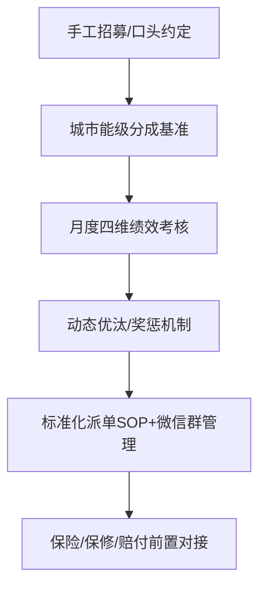
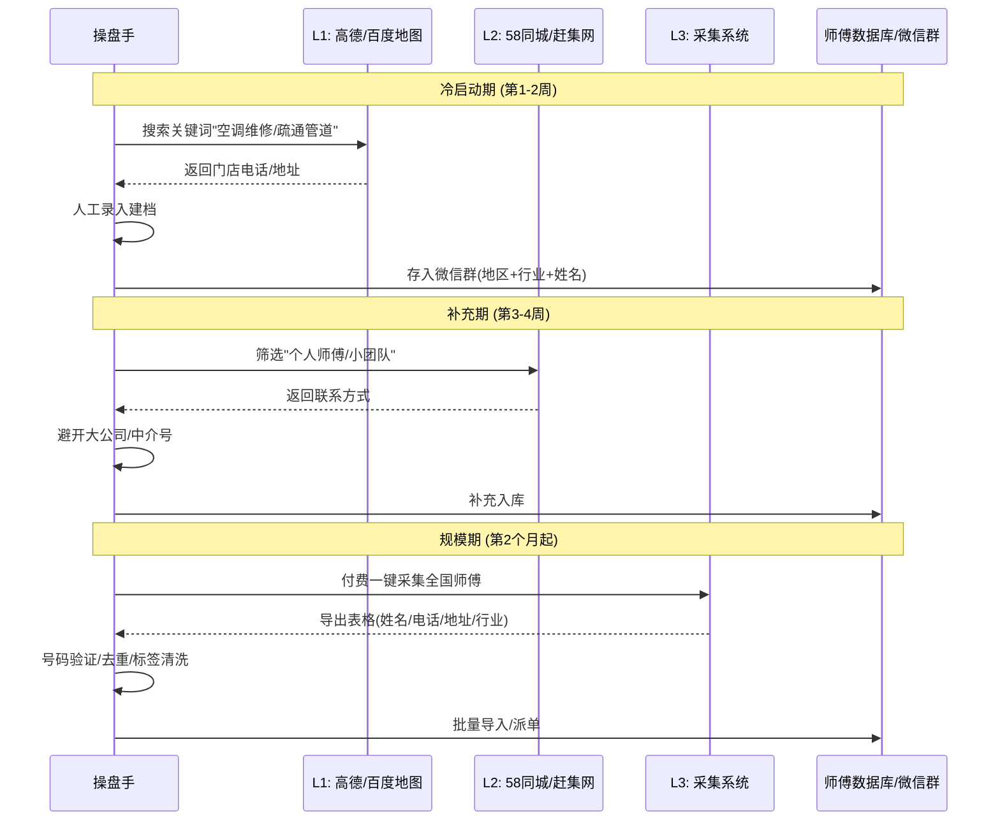

# 第 45 章 本地生活服务资源整合 —— 师傅分级分成、咸鱼矩阵地毯式发布、招聘平台借力裂变、私域信任闭环
作者：龙哥

## 学习目标

- 理解本地生活服务资源整合商的轻资产中介模式核心逻辑
- 掌握师傅分级分成模型中城市能级差异化定价与绩效考核机制
- 掌握咸鱼矩阵号地毯式发布法的账号搭建、地域覆盖、低价引流SKU及素材去重标准化流程
- 理解公域低价引流+私域高客单转化模型的流量分层与信任跃迁机制
- 掌握供给端三级采集体系（地图搜索、平台挖掘、采集系统）的效率跃迁路径
- 理解信息差与执行力构成的复利型护城河及其边界条件
- 掌握城市能级决定分成比例的市场定价规律与供给端利益绑定原则
- 能识别单人两月纯利30万案例的隐性投入、止损线与可复制性边界

## 45.1 生活类比

想象你是一个“外卖平台区域运营总监”，但你不雇骑手、不做饭：师傅 = 分散在城市各处的“外卖骑手/商家”，有手艺缺订单；咸鱼矩阵号 = 你在写字楼、小区门口铺满的“海量传单/广告牌”（地毯式覆盖、低价引流）；9.9元诱饵SKU = “新用户首单9.9元”的诱饵，只为让用户打开App、点进店；私域微信 = 你的“专属客服群/会员体系”，承接咨询、报真实价格、建信任、促复购；分成模型 = 按城市房租/人工成本给骑手分账：北上广五五分、三四线三七分，还要月考核（准时率/好评率/投诉率），表现好多派单、分成高；采集系统 = “一键爬取全城骑手信息”的超级雷达，替代人工逐个扫楼；执行力护城河 = 竞品也有骑手、也有传单，但你“发传单更密、回单更快、处理投诉更狠、迭代SOP更勤”，时间拉长形成护城河。就像外卖平台不做饭只做连接与调度，本地服务整合商也不修空调只整合师傅与流量。

## 45.2 概念地图

本地生活服务资源整合变现
├── 核心角色定位
│   └── 服务资源整合商（连接器而非生产者）  —— P001
├── 供给端体系
│   ├── 师傅资源三级采集体系（地图/平台/采集系统）  —— P005
│   ├── 师傅分级分成模型（城市能级+绩效考核双维度）  —— P002
│   └── 师傅管理SOP（建档/派单/奖惩/保修）  —— P002
├── 需求端体系
│   ├── 咸鱼矩阵号地毯式发布法（账号矩阵/地域/时间/素材/标题）  —— P003
│   ├── 低价引流SKU策略（9.9/19.9元诱饵+咨询客服话术）  —— P003, P004
│   └── 标准化话术库与自动回复体系  —— P004
├── 转化闭环
│   └── 公域低价引流+私域高客单转化模型（公域获量/私域提质/信任跃迁）  —— P004
├── 放大杠杆
│   ├── 招聘平台借力裂变法（BOSS直聘招兼职借号发布）  —— P003
│   └── 兼职裂变/账号矩阵突破实名上限  —— P003
├── 核心护城河
│   └── 信息差与执行力护城河（渠道信息差×标准化执行力×持续迭代）  —— P006
├── 定价规律
│   └── 城市能级决定分成比例（一线五五/二线四六/三线三七）  —— P007
└── 实证与边界
    ├── 单人两月纯利30万实证案例（隐性投入/关键节点/止损线）  —— P008
    ├── 咸鱼账号规模化运营边界（发布上限/实名上限/突破路径）  —— P008
    ├── 地图采集系统效率跃迁验证  —— P008
    └── 赛道红利窗口与合规风险预警  —— P008

## 45.3 服务资源整合商 —— 做资源的“连接器”而非“生产者”

### 为什么需要这个概念？

普通人创业缺技术、缺资金、缺团队，自建服务团队成本高、周期长、风险大。线下存在大量闲置的技术师傅资源（空调维修、疏通管道等），缺乏稳定客源。线上流量获取成本降低，但缺乏标准化服务履约能力，供需两端严重错位。需要一种“轻资产”中介模式，不生产服务，只整合资源，赚取信息差与管理溢价。

> "通过资源整合服务，有人两个月纯利 30 万+"
> 
> "这个方法有人操作了 2 个月，纯利润 30 万，是蓝狐身边的活生生的例子。"
> 
> ——《docs/202303/20230328_170.md》

> "下面蓝狐给大家讲一下如果通过刚需服务整合资源变现"
> 
> "我们主要是接单，所以让师傅多拿一点也是应该的"
> 
> ——《docs/202303/LSvldmb3QojJhSx1yk3cytnAn0f.md》

**核心定义**

- 定位：不直接提供技术服务，扮演“中间商/组织者”角色
- 核心动作：整合分散的线下师傅资源 + 对接线上集中流量入口
- 盈利模式：赚取中介差价（客户支付价格 - 师傅成交价 = 平台毛利）
- 典型品类：空调移机/维修/清洗、疏通管道、热水器清洗等刚需高频标准化服务

**关键性质**

- 低门槛：无需懂技术、无需固定资产投入、无需雇佣正式员工
- 高现金流：客户先付款、师傅后结算，资金沉淀在平台端
- 可复制：标准化SOP（找师傅、定分成、引流、派单）可跨城市、跨品类复制
- 核心壁垒：非技术壁垒，而是“供给端渠道信息差”+“需求端获客执行力”

**典型例子**

- 蓝狐案例：身边朋友操作空调/管道服务整合，2个月纯利30万+，团队仅1-2人
- 可迁移至：家电清洗、上门美甲、宠物洗护、除甲醛、开锁换锁等同模式赛道

**边界条件**

- 必须是“强刚需、高频次、标准化程度高、非标品牌化”的服务品类
- 师傅端管理极重：服务态度差、技术烂、跳单、坐地起价会直接砸招牌
- 平台规则风险：咸鱼/抖音等流量端规则收紧（如禁止引流、限制发布）会切断获客
- 法律合规：涉及特种作业（如高空作业、制冷剂操作）需核验师傅持证上岗

## 45.4 师傅分级分成模型 —— 城市能级决定分账，绩效考核定生死

### 为什么需要这个概念？

师傅是服务交付的核心，师傅不稳定、服务差、跳单，生意直接死掉。不同城市房租、人工、竞争强度不同，统一分成比例要么招不到师傅，要么利润被压缩。缺乏量化考核机制，无法筛选优质师傅、淘汰劣质师傅，导致服务质量不可控。

> "一线城市，五五分，一线城市费用高，竞争大，五五分双方都愿意；二线城市，四六分，师傅拿六成...三线城市，三七分，师傅拿七成，因为费用相对于偏低"
> 
> "奖惩措施，遇到上门不及时，或者造成客户投诉，先警告二次，最后还是不行的话，直接取消合作"
> 
> ——《docs/202303/LSvldmb3QojJhSx1yk3cytnAn0f.md》

> "一定要筛选出优质的师傅，和靠谱的人一起合作，往往会得心应手，事半功倍"
> 
> "群名称参考（地区名+行业+师傅名字）...派单参考格式如下：客户姓名：xxx..."
> 
> "我们可以按周期对师傅进行评估，比如一个月为周期，评估师傅的接单数，上门效率，客户投诉率，客户满意度...做好相关统计，进行打分"
> 
> ——《docs/202303/LSvldmb3QojJhSx1yk3cytnAn0f.md》

**核心定义**

- 城市能级分成基准：一线城市（费用高/竞争大）五五分；二线城市四六分（师傅6）；三线城市三七分（师傅7）
- 绩效考核四维指标（月度）：接单数、上门效率、客户投诉率、客户满意度（电话回访）
- 动态优汰机制：优质师傅优先派单+高分成；投诉/迟到警告两次后取消合作；私单直接拉黑
- 保障机制：前期对接好售后保修期限、保险覆盖、违规赔付标准

**关键性质**

- 供给端利益绑定优先：让利于师傅是保证链路闭环的前提，平台赚“管理费/信息差”
- 双维度动态调整：既按城市能级定基准，又按个人绩效定浮动，而非一刀切
- 标准化派单SOP：建立“地区+行业+师傅名”微信群，派单模板固化（姓名/电话/地址/项目/金额）

**典型例子**

- 一线城市：师傅日均单价高、竞争激烈，五五分双方心理平衡，平台靠量赚管理溢价
- 三线城市：单价低、师傅生存压力大，必须给七成才能留住人，平台靠极低成本跑量
- 实操细节：师傅群按“地区+行业+姓名”命名，派单模板标准化，便于规模化管理

**边界条件**

- 分成比例非绝对真理，需根据当地实际竞争环境微调，核心原则是“师傅愿意干、平台有利润”
- 考核指标需可量化、可追溯，主观印象分会导致内部矛盾和师傅流失
- 必须建立“私单拉黑”红线，否则平台流量会被师傅私吞，模式跑不通

### 方法演进图：师傅管理体系的进化路径

## 45.5 咸鱼矩阵号地毯式发布法 —— 用“账号矩阵+长尾词+低价SKU”撬动本地精准流量

### 为什么需要这个概念？

单个咸鱼账号发布数量有上限（普通号50条/Pro版500条），单人实名认证仅6个号，流量天花板低。本地服务客户搜索关键词极其碎片化（如“赣州章贡区空调移机”），单账号无法覆盖全地域长尾词。平台流量分发偏好低价商品，高客单价服务直接发布曝光极低，需设计“诱饵SKU”破局。

> "注册号账号，最好要芝麻信用分授权...养个两三天的号，打造专业人设"
> 
> "素材可以去tao宝，搜集一下图片和文案...用简单的作图软件进行处理...不怕检测抄袭"
> 
> "标题要尽量填满，需要包含一些关键词...尽量全面一些，增加曝光率"
> 
> "发布商品，要按照每个省、市、区/县这样分别发布，最小单位是区/县"
> 
> "我们要选择中午十二点和晚上七点左右发布"
> 
> "一个人可以注册6个咸鱼号...再慢慢地可以邀请为pro版，pro版可以发布500个商品"
> 
> "价格可以采取低价方式，比如9.9元，19.9元这样，这样的好处，可以增加曝光，但是要在文案中写明，具体价格咨询客服"
> 
> "这是一种yin流方式，就是通过一些招聘软件...发布一些jian职招聘...利用他们的咸鱼号...达到了双赢"
> 
> ——《docs/202303/LSvldmb3QojJhSx1yk3cytnAn0f.md》

**核心定义**

- 账号矩阵构建：单人实名6号 + 亲友身份借号 + 邀请升级Pro版（500商品/号）= 理论上限300-3000+商品槽位
- 地毯式地域覆盖：按“省-市-区/县”最小行政单位发布，如江西赣州需发18个商品覆盖全城
- 发布时间窗口：中午12点、晚7点两个高峰期，匹配用户下班/午休搜索习惯
- 低价引流SKU策略：9.9元/19.9元作为“诱饵价”获曝光，文案注明“具体价格咨询客服”规避风控
- 素材去重SOP：淘宝采集素材 → 美图秀秀/创客贴修改（裁剪/滤镜/水印） → 规避平台查重
- 标题关键词堆砌：塞满“上门/空调/维修/移机/清洗/加氟/柜机/挂机”等长尾词最大化曝光

**关键性质**

- 物理隔离与人设包装：每个号独立设备/网络/IP，打造“本地老师傅/专业服务商”人设提升信任
- 公域获量+私域提质：咸鱼只负责低价引流获咨询，转微信后靠专业话术/朋友圈背书成交高客单
- 可规模化复制：账号注册、养号、发布、回复全流程SOP化，可批量招募兼职/借号放大

**典型例子**

- 蓝狐实操：按区县发布、长尾词覆盖、低价引流、话术转微信，单日咨询量稳定，支撑团队日均百单履约
- 兼职裂变：在BOSS直聘招“咸鱼发布兼职”，利用他人账号/闲置时间发布，利润分成，零成本突破实名上限

**边界条件**

- 咸鱼平台严打“引流字眼”（微信/vx/电话），需用谐音/图片/引导主动问话术规避封号
- 低价SKU若不标注“咨询客服”，极易被判定“低价售假/诱导交易”导致降权封号
- 账号矩阵维护成本随规模上升（设备/网络/人工回复），需引入自动回复/话术库降本
- 仅适用于“决策链路短、客单价百元级、标准化强”的本地服务，高客单/重决策服务转化率极低

### 数据流图：咸鱼矩阵号发布与流量转化路径

## 45.6 公域低价引流+私域高客单转化模型 —— “公域撒网，私域收鱼”

### 为什么需要这个概念？

公域平台（咸鱼/抖音/小红书）流量大但规则严、信任低、不允许直接高客单成交。私域（微信）规则宽、信任高、支持复购转介绍，但无法自产生流量，必须靠公域导流。直接在公域挂高价服务 = 无曝光；直接在公域留微信 = 封号；必须设计“低价钩子+私域成交”二步走。

> "价格可以采取低价方式，比如9.9元，19.9元这样，这样的好处，可以增加曝光...具体价格咨询客服"
> 
> "流量有了，还需要有专业的接单客服微信号，朋友圈进行优化打造...提前整好话术...效率和转化率能有大大的提升"
> 
> "打造私域流量很重要...客户有需求第一还是会找到我们，还会转介绍"
> 
> "客户提问：你好，空调移机怎么收费？ 回复话术：你好，具体是看空调规格哦 挂机移机是280元..."
> 
> "也可以提前设置好自动回复，可以设置电话，这样没有及时回复客户会电话咨询，避免漏单"
> 
> ——《docs/202303/LSvldmb3QojJhSx1yk3cytnAn0f.md》

**核心定义**

- 公域端（咸鱼）：发布9.9/19.9元低价SKU获取曝光和咨询 → 话术引导加微信/打电话
- 过渡端：标准化自动回复/话术库（报价/高空费/加氟费/保修期）实现“无人值守”高转化接待
- 私域端（微信）：朋友圈打造专业人设（行业知识/客户反馈/施工现场/正能量）建立信任
- 成交端：私域一对一报价（几百元/单）成交 → 师傅上门服务 → 平台验收/保修 → 复购/转介绍

**关键性质**

- 流量分层：公域承担“获客成本”（低价引流），私域承担“利润率”（高客单/复购）
- 信任跃迁：从“平台信任（评分/保障）”跃迁至“人设信任（专业/真实/靠谱）”，溢价空间由此产生
- 闭环自洽：公域流量→私域沉淀→高客单成交→服务好→转介绍/复购→降低下一轮获客成本

**典型例子**

- 咸鱼9.9元引流 → 微信报价280元挂机移机 → 师傅上门服务 → 客户满意发朋友圈夸赞 → 邻居转介绍下单
- 话术库实测：预设“挂机移机280/柜机380/加氟50/高空100”标准回复，客服效率提升10倍，转化率显著提高

**边界条件**

- 私域运营能力弱（不会聊天、朋友圈不专业、售后推诿）会导致流量“进来即流失”，ROI为负
- 师傅端服务翻车（迟到/态度差/技术烂/乱收费）会直接引爆私域信任危机，导致品牌崩盘
- 微信生态风控收紧（加好友限制/群发封禁）会切断引流路径，需备多套备用号/企微方案

## 45.7 供给端三级采集体系 —— 从“手工找人”进化到“系统一键导出”

### 为什么需要这个概念？

师傅资源极其分散，隐藏在门店、平台、个人微信中，手工逐个搜集效率极低，无法支撑规模化业务。早期靠“地图搜/58同城找”勉强跑通冷启动，但单日新增师傅上限极低，成为业务扩张核心瓶颈。必须引入工具/系统实现“采集-清洗-入库-分发”自动化，将供给端建设从“人力密集型”转为“技术密集型”。

> "直接打开地图来，搜一下相关行业...上面都会有相关师傅的联系方式"
> 
> "我们可以去58同城，赶集网等一些服务类型的平台寻找"
> 
> "有专门的客户资源采集系统，可以一键采集全国的师傅联系方式，还可以导出表格"
> 
> "群名称参考（地区名+行业+师傅名字）...派单参考格式如下：客户姓名：xxx..."
> 
> "第三，可能上面两个方法效率会比较慢，那么有个最简单的办法，有专门的客户资源采集系统，可以一键采集全国的师傅联系方式，还可以导出表格"
> 
> ——《docs/202303/LSvldmb3QojJhSx1yk3cytnAn0f.md》

> "我们可以去58同城，赶集网等一些服务类型的平台寻找"
> 
> "有专门的客户资源采集系统，可以一键采集全国的师傅联系方式，还可以导出表格"
> 
> ——《docs/202303/20230328_170.md》

**核心定义**

- L1 地图搜索（冷启动期）：高德/百度地图搜“空调维修/疏通管道”关键词，获取门店电话/地址，人工录入建档
- L2 平台挖掘（补充期）：58同城/赶集网/鱼泡网筛选“个人师傅/小团队”联系方式，避开大公司/中介号
- L3 采集系统（规模期）：付费使用“地图采集软件/客户资源采集系统”，一键导出全国师傅表格（姓名/电话/地址/行业），批量导入微信群/CRM
- 建档标准：微信群命名“地区+行业+师傅名”，派单模板固定字段（客户姓名/电话/地址/项目/金额/备注）

**关键性质**

- 效率跃迁：L3采集系统效率是L1/L2的100倍+，是从“月入几万”跃迁到“月入百万”关键基建
- 数据资产化：采集来的师傅数据库本身即核心资产，可复用于新城市拓展、新品类切入、竞品对标
- 筛选前置：采集入库后，必须通过“视频面试/实地考核/试单观察”三步验证技术/态度/保险，再正式入池

**典型例子**

- 蓝狐早期：手工地图搜+58同城找，日均加10-20个师傅，累积200人支撑起步
- 蓝狐规模期：购买采集系统，单日导出5000+师傅数据，经清洗筛选入池500+，支撑多城市并行运营
- 竞品反查：在咸鱼/抖音搜同行广告/主页，反向获取其合作师傅联系方式（高阶玩法）

**边界条件**

- 采集系统数据质量参差不齐（重复/失效/虚假号码多），必须建立“号码验证/去重/标签”清洗流程
- 个人隐私保护法规收紧，批量采集/存储/使用手机号需合规授权，规避法律风险
- 核心师傅（技术顶尖/资源垄断/有独家渠道）往往不在公开渠道，仍需靠“人脉推荐/高薪挖角”获取

### 时序图：师傅资源采集的三级进化

## 45.8 信息差与执行力护城河 —— 老板会操作不等于没市场，执行力才是核心壁垒

### 为什么需要这个概念？

新手常陷入“这个项目门槛这么低，大家都会做，我还能赚钱吗？”的认知陷阱。误以为“知道怎么做”=“能做成”，忽视了从0到1、从1到100过程中海量琐碎执行细节的筛选力。真正的护城河不是“秘密配方”，而是“把公开的方法论跑通、跑细、跑久、跑大”的执行力体系。

> "难道老板自己不会操作吗？我们去做还有市场吗？...只要我们话术好，会沟通，懂yin流，懂信息差，执行力强，这都是我们的优势所在"
> 
> "很多人找项目，都想一口气吃成一个胖子，追求速成...哪有那么好的事呢？"
> 
> "很多大佬的背后，都暗藏着不为人知的艰苦奋斗。都说成功者不一定是聪明人，但肯定是勤奋的人，深以为然。"
> 
> "这个方法有人操作了2个月，纯利润30万，是蓝狐身边的活生生的例子"
> 
> "利用他们的空闲时间，也在咸鱼上发布...给他们一定的利润分成...相当于借用了他们的咸鱼号，达到了双赢"
> 
> ——《docs/202303/LSvldmb3QojJhSx1yk3cytnAn0f.md》
> 
> ——《docs/202303/20230328_170.md》

**核心定义**

- 信息差维度：掌握“师傅批量采集渠道（采集系统/竞品反查）”、“咸鱼矩阵发布SOP/话术库”、“私域成交/复购流程”等非公开细节
- 执行力体系：账号矩阵搭建（实名/设备/IP隔离）、兼职裂变招募（BOSS直聘发JD）、话术标准化（自动回复/电话兜底）、师傅绩效考核（月度打分/优汰）
- 核心公式：护城河 = （非公开渠道信息差） × （标准化SOP执行力） × （持续迭代时长）

**关键性质**

- 可复制但难模仿：方法论公开，但“全流程SOP细节+持续执行力+异常处理经验”极难被完整复制
- 复利效应：执行时间越长，师傅池越深、话术库越全、账号权重越高、私域信任越厚，边际成本递减
- 反脆弱性：平台规则变/师傅跑路/竞争对手进入，强执行力团队能快速迭代SOP存活，弱执行力团队直接死掉

**典型例子**

- 蓝狐感叹：“难道老板自己不会操作吗？我们去做还有市场吗？...只要我们话术好、会沟通、懂引流、懂信息差、执行力强，这都是优势”
- 同城竞品：同样做空调移机，有人月入3万（靠人工单干），有人月入30万（靠矩阵号/采集系统/话术库/兼职裂变），差距在执行力体系

**边界条件**

- 执行力≠盲目勤奋：必须是“在正确方向上、按标准化SOP、持续迭代优化”的有效执行
- 信息差有时效性：采集系统/发布技巧/话术库会随平台规则迭代失效，必须持续投入研发维护
- 规模临界点：单人/夫妻店模式（月入3-5万）靠个人苦干可达；突破百万级必须建立“管理层+执行层”组织架构，单人精力天花板不可破

## 45.9 城市能级决定分成比例 —— 一线五五、二线四六、三线三七的市场定价规律

### 为什么需要这个概念？

统一全国分成比例会导致：一线城市师傅嫌少不干、三线城市平台亏损无利润。房租/人工/广告/平台扣点等运营成本随城市能级指数级差异，分成模型必须内化这些结构性成本差。师傅议价能力源于“生存成本+替代选择权”，一线城市师傅选择多、成本高，话语权强。

> "一线城市，五五分，一线城市费用高，竞争大，五五分双方都愿意；二线城市，四六分...三线城市，三七分，师傅拿七成，因为费用相对于偏低"
> 
> "反映不同能级城市师傅议价能力与生存成本客观差异，供给端利益绑定优先：必须让利于师傅建立严格奖惩售后保修机制保证链路闭环避免砸招牌/私单/甩单"
> 
> "城市能级决定分成比例市场规律：一线高费用高竞争五五分、三线低费用三七分师傅七成"
> 
> ——《docs/202303/LSvldmb3QojJhSx1yk3cytnAn0f.md》

**核心定义**

- 一线城市（北上广深）：运营成本高、竞争激烈、客单价高 → 五五分（平台/师傅各50%），靠量赚管理溢价
- 二线城市（省会/强地级市）：成本中等、竞争中等 → 四六分（平台40%/师傅60%），平衡利润与师傅留存
- 三线城市（县城/弱地级市）：运营成本低、客单价低、师傅生存压力大 → 三七分（平台30%/师傅70%），平台薄利多销
- 核心逻辑：分成比例 = f(城市综合运营成本指数, 师傅替代机会成本, 平台边际贡献率)

**关键性质**

- 市场定价锚点：分成比例非平台单方面制定，而是供需双方博弈后的市场均衡价，强行偏离会导致供给端崩塌
- 动态调整机制：随城市经济发展/平台规模效应/师傅稀缺度变化，分成比例需每半年复盘微调
- 利润模型差异：一线靠“高频+高客单+规模效应”赚钱；三线靠“极低获客成本+极高师傅分成+薄利多销”赚钱

**典型例子**

- 蓝狐实操验证：一线城市按五五分招募师傅顺利，入池快；三线城市初期尝试五五分，师傅全拒绝，改三七分才招到人
- 竞品对标：美团/到家服务/各地本地生活平台，对骑手/师傅分成比例均隐性遵循此城市能级梯度

**边界条件**

- 仅适用于“标准化程度高、价格透明度高、师傅可替代性强”的服务品类（如搬运/清洗/维修）
- 非标/高技术/强人设服务（如名医挂号/大师设计/艺人演出）不适用，核心人才拥有绝对定价权
- 特殊时期（如疫情/极端天气/政策限制）会导致师傅供给冲击，需临时调整分成/补贴稳定供给

### 多源对照：分成比例的不同视角

**共识**：分成比例必须随城市能级动态调整，核心逻辑是供给端利益绑定优先。

**分歧**：

- 《docs/202303/LSvldmb3QojJhSx1yk3cytnAn0f.md》强调分成比例是市场博弈形成的均衡价，不可人为强行偏离
- 《docs/202303/20230328_170.md》更侧重“让利于师傅”是链路闭环的前提，平台赚的是管理溢价

## 45.10 实操验证与边界条件：单人两月纯利30万的真实性、可复制性与风险提示

### 为什么需要这个概念？

“月入百万/纯利30万”类标题极易引发幸存者偏差，新人照抄SOP却跑不通，核心在于区分“必现条件”与“加分项”。必须拆解真实案例中的隐性投入（时间/精力/资金/人脉/试错成本），还原项目真实ROI画像。识别模式失效边界（平台风控/师傅跑路/季节性淡旺季/政策变化），制定止损/转型预案。

> "这个方法有人操作了 2 个月，纯利润 30 万，是蓝狐身边的活生生的例子。"
> 
> "很多人找项目，都想一口气吃成一个胖子，追求速成...哪有那么好的事呢？"
> 
> "江南 style : 思路明确，可操作性强..."
> 
> "问逍 : 类似的思路可以用来做宠物洗护不"
> 
> "一个人可以注册6个咸鱼号...再慢慢地可以邀请为pro版，pro版可以发布500个商品"
> 
> "有专门的客户资源采集系统，可以一键采集全国的师傅联系方式，还可以导出表格"
> 
> "奖惩措施，遇到上门不及时，或者造成客户投诉，先警告二次，最后还是不行的话，直接取消合作，还有发现私自收米的，直接拉黑"
> 
> ——《docs/202303/20230328_170.md》
> 
> ——《docs/202303/LSvldmb3QojJhSx1yk3cytnAn0f.md》

**核心定义**

- 实证数据：蓝狐身边案例，操作2个月，纯利30万+，团队1-2人，核心动作：采集师傅→咸鱼矩阵发布→微信成交→派单履约
- 隐性投入：前期采集系统费用(几千元)、账号矩阵设备/流量成本(数千元)、话术库打磨时间(2周)、师傅试单/磨合成本(首月亏损/持平)、客服人工/兼职成本
- 关键节点：第1周跑通首单；第2周日稳单；第1月回本盈利；第2月规模化放大（矩阵号+兼职裂变）
- 止损线：单账号连续7天零咨询→弃号；单城市连续15天日均单量<5单→撤城；师傅投诉率>5%→全量审查

**关键性质**

- 非“躺赚”：日均处理咨询100+、派单协调50+、异常处理10+、账号维护/发布2小时，属高强度运营劳动
- 可复制性高：多位圈友反馈“思路清晰可操作”，已迁移至宠物洗护/除甲醛/开锁等同模式赛道跑通
- 现金流极佳：客户微信转账/平台担保支付T+0到账，师傅周结/月结，平台占用资金极少，现金流安全边际高

**典型例子**

- 正向案例：蓝狐朋友（非互联网从业者），执行力强、抗压性强、不嫌脏累，2个月跑通
- 反向案例：圈友尝试做“上门美甲”，因师傅管理难度大（非标/强人设/高投诉）、客单价低（复购周期长）、平台风控严，半年未跑通

**边界条件**

- 核心前提：操盘手必须具备“销售话术能力+抗压能力+细节管控能力+现金流意识”，缺一不可
- 赛道红利期：咸鱼/抖音本地生活/视频号同城等流量红利窗口约1-3年，红利期过后获客成本指数级上升
- 规模天花板：单城市单品类（如仅空调）年GMV上限约500-1000万，破局需“多品类扩展+多城市复制+自建品牌”
- 法律风险：未来平台/监管可能要求“中介平台资质/师傅持证备案/保险强制/资金托管”，合规成本将大幅上升

### 设计中的取舍

- 为什么不直接雇佣师傅做正式员工？
  - 正式雇佣意味着固定薪资+社保+管理成本，将“变动成本”变为“固定成本”，一旦业务波动现金流极易断裂。分成制让师傅与平台共担风险，利益绑定更紧密。

- 为什么不用抖音/视频号直播获客而选咸鱼？
  - 直播需要主播、场地、选品、投流，门槛高、启动慢；咸鱼用户自带“搜索意图+同城属性”，决策链路极短，发布即得流量，冷启动成本最低。

- 这种设计的 trade-off 是什么？
  - 换取了“极低启动成本+极快现金流”，代价是“高运营强度+平台规则依赖+师傅管控难度大”。一旦平台封号/限流，获客渠道瞬间归零，必须常备多平台备选方案。

## 45.11 动手练习

### 练习 1：设计一个城市的师傅分成方案

假设你要在『某二线省会城市』切入『空调移机/维修』业务，该城市平均客单价300元，师傅日均接单上限3单，房租/社保/广告等平台单单摊销成本约80元。

1. 参考『一线五五、二线四六、三线三七』规律，设定基础分成比例；计算平台与师傅单单毛利。
2. 设计月度绩效考核四维指标（接单数、上门效率、投诉率、满意度）的量化评分标准及对应的分成浮动幅度（如±5%）。
3. 列出『私单拉黑』的监测手段与『售后保修』的前置对接条款要点。

回答问题：
- 如果该城市突遭极端高温天气，师傅供给紧张导致平台单量下跌，你会如何临时调整分成/补贴策略？
- 为什么三线城市必须给师傅七成分成？如果强行五五分会发生什么？

### 练习 2：规划一个咸鱼账号矩阵冷启动计划

目标：在『江西赣州』推广『疏通管道』服务，单人实名上限6个咸鱼号，预算购买2台备用手机、办理4张流量卡。

1. 账号养成期（前3天）：人设定义、芝麻信用授权、浏览同城同行内容、不发布商品。
2. 发布矩阵设计：按『区/县』最小行政单位覆盖，赣州共18个区县，每个账号发几个商品？如何分配？Pro版邀请策略？
3. 素材与标题SOP：去淘宝采集素材→美图秀秀去重(裁剪/滤镜/水印)→标题塞满长尾词(上门/疏通/马桶/下水道/高压清洗/赣州/章贡区等)→定价9.9元诱饵SKU+文案『具体价格咨询客服』。
4. 发布节奏：每日中午12点、晚7点各发布一次，单日总发布量上限控制在多少避免风控？

回答问题：
- 咸鱼严禁『微信/vx/电话』等引流字眼，设计3个『引导用户主动问联系方式』的话术变体。
- 如果账号连续7天零咨询，按止损线弃号重来，如何快速复盘是『选品/标题/价格/账号权重/区域需求』哪个环节出问题？

### 练习 3：搭建供给端师傅采集与管理最小闭环

从0到1建立『家电清洗』品类的师傅资源池，目标首月入池50名有效师傅。

1. L1地图采集：高德地图搜『家电清洗/空调清洗』，人工录入门店/师傅电话，预估单日新增量？
2. L2平台挖掘：58同城/鱼泡网筛选『个人师傅/小团队』，避开『公司/中介』号，识别关键词特征？
3. L3采集系统引入时机：当日均人工新增<20且业务需求>50单/日时，评估采集系统ROI（系统费用/清洗成本/入池转化率）。
4. 入池验证三步法：视频面试(看工具/证件) → 实地试单(平台垫付/观察态度/技术/耗材) → 签协议(分成/保修/保险/私单拉黑)。
5. 派单标准化模板设计：微信群命名规则、派单字段(姓名/电话/地址/项目/金额/备注)、接单确认/到达/完工/客户验收四状态流转。

回答问题：
- 核心师傅(技术顶尖/有独家渠道)往往不在公开渠道，除采集系统外，还有哪2条获取路径？
- 采集系统导出数据重复率/失效率高，设计『号码验证/去重/标签』三步清洗流程。

### 练习 4：复盘『单人两月纯利30万』案例的真实ROI与可复制性

基于素材披露的信息，还原该案例的真实财务模型与隐性投入：

1. 显性收入：假设第2个月日均50单，客单价300元，平台分成40%，月流水45万，毛利18万。
2. 隐性成本清单：采集系统费用(3000元/年) → 摊销250元/月；账号矩阵设备/流量(2手机+6流量卡) → 约500元/月；话术库打磨(2周兼职客服) → 3000元；师傅试单/磨合亏损(首月日均5单亏损/持平) → 约1万；客服人工/兼职成本 → 6000元/月。
3. 计算：第1月净利润 = ?，第2月净利润 = ?，两个月累计净利 = ?，是否接近『纯利30万』？差距在哪？
4. 关键节点验证：第1周跑通首单 → 第2周日稳单 → 第1月回本 → 第2月放大(矩阵号+兼职裂变)。你的模型能跑通这些节点吗？

回答问题：
- 该模式现金流极佳(客户T+0付款、师傅周结/月结)，但『师傅垫资上门』风险如何对冲？
- 圈友迁移『宠物洗护』半年未跑通，核心失败原因可能是『非标/强人设/高投诉/客单价低/复购周期长/平台风控严』中的哪几项？如何预判新赛道可行性？

## 45.12 本章小结

这一章中我们学习了本地生活服务资源整合的完整商业闭环。首先，我们定义了服务资源整合商的核心角色——不做生产者，做连接器，通过整合闲置师傅资源对接线上流量，实现轻资产、高现金流、可复制的创业模式。其次，我们深度拆解了师傅分级分成模型，揭示城市能级决定分成基准（一线五五、二线四六、三线三七），并配合月度四维绩效考核实现动态优汰。接着，我们讲解了咸鱼矩阵号地毯式发布法，从账号矩阵搭建、地域最小单位覆盖、低价诱饵SKU、素材去重到发布时间窗口，构建了标准化获客流水线。然后，我们建立了公域低价引流+私域高客单转化模型，阐述公域承担获客成本、私域承担利润率的分层逻辑与信任跃迁机制。接着，我们对比了供给端三级采集体系（地图搜索→平台挖掘→采集系统）的效率跃迁路径，揭示工具系统是规模化关键基建。随后，我们论证了信息差与执行力构成的复利型护城河，指出方法论公开但全流程SOP细节难以复制。然后，我们验证了城市能级决定分成比例的市场定价规律，强调供给端利益绑定优先。最后，我们通过单人两月纯利30万案例的复盘，还原了隐性投入、关键节点、止损线与可复制性边界，给出赛道红利窗口与合规风险预警。

本章我们一起学习了以下概念：

| 概念 | 解释 |
|------|------|
| 服务资源整合商 | 不生产服务，整合闲置师傅资源对接线上流量，赚取中介差价与管理溢价 |
| 刚需高频本地服务 | 空调/管道/热水器等强刚需、高频、标准化、决策链路短的上门服务品类 |
| 师傅分级分成模型 | 城市能级定基准（一线五五/二线四六/三线三七）+ 绩效考核定浮动（四维指标月度打分/优汰） |
| 咸鱼矩阵号地毯式发布法 | 账号矩阵(实名6号+亲友+Pro版)×地域最小单位(区/县)×高峰时段(12点/19点)×低价诱饵SKU(9.9元)+长尾词标题×去重素材 |
| 低价引流SKU策略 | 公域发9.9/19.9元诱饵获曝光咨询，文案注明"具体价格咨询客服"规避风控，私域按真实报价成交 |
| 公域低价引流+私域高客单转化模型 | 公域承担获客成本(低价引流)，私域承担利润率(高客单/复购/转介绍)，实现信任跃迁与商业闭环 |
| 供给端三级采集体系 | L1地图搜索(冷启动)→L2平台挖掘(58同城等)→L3采集系统(规模期一键导出)，效率跃迁100倍+ |
| 招聘平台借力裂变法 | BOSS直聘招兼职借用他人咸鱼账号发布，提供话术培训按利润分成，零成本突破单人发布上限 |
| 信息差与执行力护城河 | 非公开渠道信息差(采集系统/竞品反查/话术库) × 标准化SOP执行力(矩阵搭建/考核/迭代) × 持续时长 = 复利型壁垒 |
| 城市能级决定分成比例 | 分成比例由城市运营成本指数、师傅替代机会成本、平台边际贡献率博弈形成的市场均衡价，强行偏离供给端崩塌 |
| 实证案例与边界条件 | 单人两月纯利30万(隐性投入:采集系统/设备/话术打磨/试单成本)，止损线(7天零咨询弃号/15天日单<5撤城)，赛道红利期1-3年 |

下一章中，我们将学习自我迭代底层思维与组合创新起号法 —— 改变>思考>学习、向有结果的人学习、微循环迭代。
