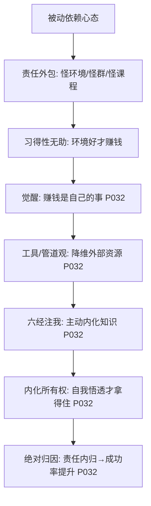

# 第 1 章 商业认知重构 —— 从“赚钱有罪”到“利他即赚钱”

## 学习目标

- 理解‘赚钱有罪’心理障碍的成因、表现及其对商业变现的阻碍作用
- 掌握‘商业利他定理’的底层逻辑：基于主观价值理论证明合法交易是双向价值创造的正和博弈
- 确立‘赚钱主体性’认知：将社群、课程、平台降维为‘工具/管道’，践行‘六经注我’实现认知内化与责任归属
- 学会‘用户筛选与价值匹配’实操策略：不追求普度众生，通过筛选‘值得帮’、‘适合’的用户实现高效利他与商业正向循环
- 能区分不同创业阶段的赚钱权重与成长权重，建立动态调整的阶段性策略
- 识别‘免费是最大的不负责任’的悖论，建立标准化收费流程与话术管理预期

## 1.1 生活类比

想象商业交易是一场**“双向奔赴的礼物交换”**：你（卖方）精心准备了一份礼物（产品/服务），成本是你的心力与资源；客户（买方）手里有钱，但缺的是你礼物里装的“解决方案/安全感/成长/爽感”；价格只是客户为了得到这份礼物，愿意付出的“入场券”。交易达成的那一刻：客户觉得“这礼物值了，我赚到了”；你觉得“这钱值了，我帮到了人”。心理障碍就像你觉得“收钱卖礼物不好意思，像在讹人”，于是不敢伸手要入场券，礼物烂在手里，客户也得不到帮助。用户筛选就像你只把礼物送给“真心需要、懂得珍惜、能用得上”的朋友，而不是大街上随便拉个人硬塞。就像送礼物要看对方需不需要、收不收得起、珍不珍惜，做生意也要筛选“值得帮”、“适合”的用户，才能双向奔赴、长久循环。

## 1.2 概念地图

- 商业认知重构
  - 赚钱心理障碍
    - 道德负罪感：赚别人钱不好意思 —— P008
    - 行为回避：不敢报价/推销/规模化 —— P008
    - 根源：将价值交换误读为单向索取 —— P008
  - 商业利他定理（核心支柱）
    - 主观价值理论：价值由交易双方主观评估决定 —— P008
    - 交易达成公式：买方感知价值 > 价格 > 卖方成本 —— P008
    - 正和博弈本质：双方均获益，无人买单自己觉得不值的东西 —— P008
    - 核心主张：赚钱过程即帮人过程，商业是最大的慈善 —— P008
  - 赚钱主体性
    - 绝对归因：赚钱是自己的事，与外部环境无关 —— P032
    - 工具/管道观：社群/课程/平台是工具非彼岸 —— P032
    - 六经注我：为我所用、我注解，非盲目跪拜 —— P032
    - 内化所有权：自己悟透才是自己的，别人给拿不住 —— P032
  - 用户筛选与价值匹配
    - 双向选择：卖方选买方，买方也选卖方 —— P008, P012
    - 价格即筛选器：合理定价天然过滤低匹配用户 —— P012
    - 正向循环：筛选优质用户 → 高质量交付 → 正向反馈 → 信心增强 —— P008, P012
    - 拒绝错位的钱：赚违背舒适区/价值观的钱长期必反噬 —— P012
  - 阶段性策略与收费心法 —— P012
    - 起步期：重赚钱建立信心（第一桶金即强心剂）
    - 稳定期：重成长追求自我实现（目的即手段，过程即目的）
    - 富足期：重筛选只赚对的钱（正向筛选法则）
    - 收费即责任与保护：建立契约倒逼专业、防白嫖内耗
    - 见识溢价：高价格信心源于高维见识的直接目击

## 1.3 赚钱心理障碍 —— 打破“赚钱有罪”的道德枷锁

### 为什么需要这个概念？

你是否曾有过这样的体验：明明产品做得很好，服务也很到位，但一到要钱的环节，喉咙仿佛被堵住了，不敢开口，或者报出的价格远低于价值？这不是谦虚，这是**赚钱心理障碍**在作祟。

普遍存在“赚别人钱不好意思”的道德负罪感，导致不敢报价、不敢推销、不敢规模化。这是商业变现的核心拦路虎，阻碍个体从打工思维向商业思维跃迁。只有消解“赚钱有罪”的错误认知，才能建立积极主动的商业心态。

### 核心定义

> **赚钱心理障碍**（来源：《亦仁：赚钱就是在帮别人，就是在利他》）

> 因认为盈利具有剥削性质，产生的道德负罪感与行为回避。表现为：不敢开口要钱、定价过低、推销时底气不足、抗拒规模化赚钱。

> ——《P008, p.1-2》

### 关键性质

- **根源于对交易本质的误解**：将“价值交换”误读为“单向索取”。
- **具有自我实现预言特性**：越觉得赚钱有罪，越不敢赚钱，越验证“赚钱难”。
- **可通过认知重构（理解交易的利他本质）实现彻底消解**。

### 典型例子

- 圈友不敢发朋友圈卖课，怕熟人觉得“割韭菜”
- 咨询师服务到位却只收微信红包随意，不敢报标准价
- 电商卖家明明产品优秀，却因“赚差价不好意思”压低利润

### 边界条件

- 仅适用于合法合规、无欺诈虚假宣传的正常商业交易场景
- 若交易涉及虚假宣传、强买强卖、庞氏骗局，则属违法犯罪而非心理障碍
- 认知重构后仍需配合“用户筛选”策略，避免陷入“普度众生”的无效利他

---

> "很多圈友，还是对赚钱存在偏见，觉得自己赚别人钱不好意思。"
> 
> ——《P008, p.1》

这段原文直接指出了问题的普遍性：心理障碍不是少数人的特例，而是大多数普通人进入商业领域时的共同起点。接下来我们要做的，就是从底层逻辑上拆解这个误区。

## 1.4 商业利他定理 —— 交易是双向价值创造的正和博弈

### 为什么需要这个概念？

我们需要从底层逻辑上证明“赚钱即利他”，为认知重构提供坚实理论基石。打破零和博弈思维（我赚=你亏），确立商业交易的价值创造本质。这不仅是心理建设，更是后续所有定价、销售、筛选策略的底层逻辑支撑。

### 核心定义

> **商业利他定理**（来源：《亦仁：赚钱就是在帮别人，就是在利他》）

> 在合法合规、无欺诈前提下，商业盈利的必要条件是为他人创造净价值增量。交易达成公式：买方感知价值 > 价格 > 卖方成本，双方均获益。赚钱过程 = 帮助他人解决问题（省钱/省时/赚钱/爽感/安全感）的过程。

> ——《P008, p.2-3》

### 关键性质

- **主观价值理论基石**：价值由交易双方主观评估决定，非第三方客观定价
- **排他性**：没有人会买自己觉得“不值”的东西，交易天然筛选有效价值
- **普适性**：适用于所有合法商业模式（电商、知识付费、服务、实体等）

### 典型例子

- 简历修改服务：提供者视角“小菜一碟”，求职者视角“改变职业生涯”，价值鸿沟即定价空间
- 保险销售：客户支付保费获得“安全感”与“风险兜底”，销售获得佣金，双赢
- 知识付费：学员付费购买“避坑指南/认知跃迁”，创作者获得收益与成就感

### 边界条件

- 前提：无虚假宣传、无违法违规、无信息不对称强迫交易
- 若产品无实际效用、或通过洗脑PUA成交，则不属于该定理保护范畴
- 利他不等于无偿：利他越深、覆盖越广、频次越高，合理盈利越高

---

> "在没有虚假宣传违法违规的前提下，任何交易都是在创造价值，都是在给社会做贡献，没有一个傻子会买自己觉得不值的东西。"
> 
> ——《P008, p.2》

> "只有对方认为他获得的价值高于他付出的金钱，交易才可能达成。"
> 
> ——《P008, p.2》

> "赚钱，就是在帮别人，就是在利他。"
> 
> ——《P008, p.3》

> "商业是最大的慈善，赚钱是最好的利他"
> 
> ——《P008, p.3》

这组原文构成了**商业利他定理**的完整论证链条：

1. **前提**：合法合规、无欺诈（排除零和/负和博弈的恶性交易）
2. **机制**：主观价值评估（买方感知价值 > 价格）
3. **结论**：交易达成即双赢，卖方盈利 = 买方获得净价值增量
4. **升华**：追求利润最大化 = 追求社会总价值贡献最大化

这个定理的核心公式可以表述为：

$$
\text{交易达成} \iff V_{\text{buyer}} > P > C_{\text{seller}}
$$

这个公式展示了三个关键不等式关系：
- $V_{\text{buyer}} > P$：买方获得消费者剩余，这是购买动力
- $P > C_{\text{seller}}$：卖方获得生产者剩余（利润），这是经营动力
- $V_{\text{buyer}} > C_{\text{seller}}$：社会总剩余为正，这是价值创造的证明

**这个公式揭示了：你的每一笔利润，都对应着客户获得的超额价值。赚钱越多，说明你帮客户解决的问题越大、覆盖人群越广。**

### 多源对照：关于“利他”的不同维度阐释

不同素材对“赚钱即利他”提供了互补的视角：

**共识**：合法商业交易的本质是双向价值创造，盈利过程即帮人过程。

**分歧/互补**：

| 来源 | 侧重点 | 关键论断 |
|------|--------|----------|
| P008 (亦仁) | 交易微观机制 | 单笔交易的主观价值评估机制：$V_{buyer} > P > C_{seller}$ |
| P012 (小冯妮儿) | 价值发现过程 | 价值非自我定义，而通过高频、多元客户碰撞被“需要”而确立；“小菜一碟”与“改变命运”的视角差即定价空间 |
| P032 (亦仁) | 责任归属 | 赚钱是自己的事，利他程度取决于个体主体性，而非外部环境 |

**P012 补充了关键的“价值发现”视角**：

> "如何才能越卖越贵，越卖越有底气？和这个世界更加激烈的碰撞。在我的眼里，价格=价值，价值不是被任何人定义出来的，而是当你接触到越来越多的人的时候发现自己「被需要」。"
> 
> ——《P012, p.4-5》

这段话告诉我们：**利他不是自我感动的单向输出，而是在市场碰撞中被外部需求“验证”、“确认”、“需要”的双向共振过程。** 你觉得自己“利他了”不算数，客户掏钱投票才算数。

## 1.5 赚钱主体性 —— 从“被动等待赋能”到“六经注我”

### 为什么需要这个概念？

普遍存在“责任外包”心理：将赚钱结果归因于社群、课程、大佬、工具等外部因素。依赖外部赋能导致习得性无助：环境好就赚钱，环境差就怪平台/群/老师。唯有确立“赚钱是自己的事”，才能激活内生动力，实现认知内化与所有权归属。

### 核心定义

> **赚钱主体性**（来源：《亦仁：赚钱是你自己的事情》）

> 个体深刻认知并接受“赚钱结果由自己唯一负责”这一事实。

> ——《P032, p.1》

> **工具/管道观**（来源：《亦仁：赚钱是你自己的事情》）

> 将社群、课程、平台、大佬定性为“工具/管道”而非“彼岸/救世主”。

> ——《P032, p.1》

> **六经注我**（来源：《亦仁：赚钱是你自己的事情》）

> 学习外部知识为我所用、我注解，而非盲目跪拜、教条遵循（我注六经）。

> ——《P032, p.1》

### 关键性质

- **绝对归因**：赚钱概率与承担责任程度正相关，责任内归是成功率提升的前提
- **内化所有权**：自己悟透才是自己的，别人给的（外部灌输）若无自悟则“拿不住”
- **非对抗性**：非否定外部资源价值，而是明确“资源上限取决于个体接纳度与执行力”

---

> "要真正的意识到赚钱是你自己的事情，和生财有术没关系。"
> 
> ——《P032, p.1》

> "生财，是工具，是管道，不是彼岸"
> 
> ——《P032, p.1》

> "六经注我，而非我注六经"
> 
> ——《P032, p.1》

> "自己悟到才是自己的，别人给也拿不住。"
> 
> ——《P032, p.1》

这组原文构成了**赚钱主体性**的完整认知闭环：

1. **归因重构**：赚钱结果 = f(自我认知、决策、行动)，而非 f(环境、社群、他人)
2. **资源定位**：外部资源 = 工具/管道（上限取决于你的用工水平），非彼岸/救世主
3. **学习范式**：六经注我（主动内化、为我所用）vs 我注六经（被动跪拜、教条遵循）
4. **所有权确认**：只有经过“实践验证”闭环（输入→实操→复盘→沉淀→迁移）的认知，才是真正属于你的资产

### 方法演进图：从被动依赖到主体性觉醒

### 典型例子

- 社恐成员：从“万事开头难、等大佬带” → “主动输出、复盘迭代、年入百万”
- 知识付费用户：从“买课不学、怪课程烂” → “六经注我、提炼SOP、实战变现”
- 创业者：从“缺资源/缺人脉/缺风口” → “盘点手中牌、匹配能力圈、小步快跑”

### 边界条件

- 不排斥付费学习/加入社群，但要求“付费=买工具/买环境/买时间”而非“买结果/买保证”
- 社群/工具的边界：提供信息差、同伴样本、实战训练、高密度周报，不承担执行责任
- 认知内化需经过“实践验证”闭环：输入→实操→复盘→沉淀→迁移，单纯听懂不算内化

---

### 多源对照：关于“主体性”的互补阐释

| 来源 | 核心概念 | 关键差异/互补 |
|------|----------|---------------|
| P032 (亦仁) | 绝对归因、工具/管道观、六经注我 | 强调认知层面的“去权威化”与责任内归 |
| P008 (亦仁) | 用户筛选、价值匹配 | 将主体性落地为具体的经营动作：筛选适合的用户 |
| P012 (小冯妮儿) | 天赋匹配、激情驱动、阶段性策略 | 将主体性具体化为“发挥天赋”、“跟随激情”、“动态调整权重”的执行策略 |

**共识**：个体是赚钱结果的唯一责任主体，外部资源仅为辅助。

**分歧/互补**：P032 给出“元认知”层面的定性（心态）；P008 给出“经营动作”层面的落地（筛选）；P012 给出“执行策略”层面的指导（天赋/激情/阶段）。

## 1.6 用户筛选与价值匹配 —— 不追求普度众生，只做精准利他

### 为什么需要这个概念？

“商业利他定理”不等于无条件利他。盲目普度众生会导致资源耗散、价值错配。只有筛选“值得帮”“适合”的用户，才能确保双方价值感知匹配，实现高效利他。筛选机制本质是保护提供者心力、提升交付质量、建立商业正向循环。

### 核心定义

> **价值匹配**（来源：《亦仁/小冯妮儿》）

> 买方感知价值与卖方提供价值在特定场景下高度重合。

> ——《P008, p.3; P012, p.6》

> **用户筛选**（来源：《亦仁/小冯妮儿》）

> 主动选择“能听懂、买得起、配合度高、反馈好”的目标客群。

> ——《P008, p.3; P012, p.6》

> **正向循环**（来源：《亦仁/小冯妮儿》）

> 筛选优质用户 → 高质量交付 → 正向反馈 → 信心增强 → 更好产品

> ——《P008, p.3; P012, p.6》

### 关键性质

- **双向选择**：不仅卖方选买方，买方也在选卖方，匹配度决定转化率与复购率
- **价格即筛选器**：合理定价天然过滤低匹配度用户，降低沟通成本与售后风险
- **拒绝“错位的钱”**：赚违背舒适区/价值观/预期管理的钱，长期必反噬

---

> "赚钱就是在帮助值得帮的人 。筛选适合的用户 。"
> 
> ——《P008, p.3》

> "当你不为生计发愁，有的钱让赚的你不舒服，我劝你宁可不赚。因为赚了不对的钱，后面极有可能反噬你。"
> 
> ——《P012, p.7》

> "只遇对的人，赚对的钱。"
> 
> ——《P012, p.7》

这组原文揭示了筛选的三个层次：
1. **起步期**：为了跑通闭环，可适当放宽标准（P012 阶段性策略）
2. **稳定期**：建立标准化筛选 SOP，价格作为核心筛选器（P012 收费边界协议）
3. **富足期**：主动拒绝“错位的钱”，保护心力与长期口碑（P012 正向筛选法则）

### 典型例子

- 保险销售：只服务“认可长期价值、配合健康告知、按时缴费”的客户，拒绝“只想买返佣/短期退保”者
- 知识付费：设置“作业打卡/面试/预习”门槛，筛选高意愿学员，提升结课率与口碑
- 咨询服务：付费前先“问题澄清/快速评估”，非匹配型需求直接分流免费资源/拒单

### 边界条件

- 起步期（缺案例/缺信心/缺现金流）可适当放宽筛选标准，以“跑通闭环”为第一要务
- 筛选不等于傲慢/冷漠：需建立“开门做生意基础解释成本”机制，接受必要的非精准咨询
- 核心标准：该用户的问题是否在我的能力圈内？解决后双方是否都爽？是否利于长期口碑？

---

## 1.7 设计中的取舍

### 为什么不用“普度众生”式的无条件利他？

因为**资源稀缺、心力有限、价值需匹配**。无差别利他会导致：
- 高匹配用户得不到足够精力（被低匹配用户挤占）
- 低匹配用户因预期错位产生负面评价（破坏口碑）
- 提供者陷入“白嫖内耗→交付质量下降→信心受挫”的死亡螺旋

### 这种设计的 trade-off 是什么？

| 维度 | 普度众生（无筛选） | 精准筛选（本章主张） |
|------|-------------------|---------------------|
| 短期流量 | 大（门槛低） | 小（门槛高） |
| 交付质量 | 低（精力分散） | 高（精力聚焦） |
| 客户满意度 | 两极分化（高匹配爽，低匹配骂） | 高（双向匹配） |
| 提供者心力 | 持续内耗 | 正向循环 |
| 长期复购 | 低 | 高 |
| 适用阶段 | 仅起步期验证期 | 全阶段（标准动态调整） |

**核心结论**：筛选不是傲慢，是对双方时间的尊重；价格不是门槛，是价值共振的验证器。

---

## 1.8 动手练习

### 练习1：拆解你的‘赚钱心理障碍’清单

1. 列出你在过往尝试变现（卖课、卖货、咨询、推销等）过程中，因‘不好意思’、‘怕被骂割韭菜’、‘觉得自己不配’而放弃或降价的 3-5 个具体场景。
2. 对每个场景，写下当时的核心念头（如：‘这也就值50块，卖500块良心过不去’）。
3. 用‘商业利他定理’逐条反驳：若客户买单，说明他感知价值>价格；你不卖，反而剥夺了他获得价值的机会。
4. 思考问题：如果不收钱，你能否长期坚持高质量交付？客户不付费，是否会珍视并用好你的产品？

### 练习2：绘制‘工具/管道’依赖图谱与‘六经注我’行动清单

1. 画一张思维导图，中心写‘我的赚钱目标’，分支列出你当前依赖的所有外部资源：社群、付费课程、大佬指导、软件工具、平台流量等。
2. 给每个资源打标签：是‘工具’（我主动用，如剪映）、‘管道’（我主动跑，如小红书）、还是‘彼岸’（我被动等，如‘进了这个群就能躺赚’、‘买了这课就能财富自由’）。
3. 针对所有‘彼岸’型依赖，制定‘六经注我’行动：本周我将如何‘为我所用’？（例：不再等大佬发作业，而是先按自己理解跑通MVP；不再全盘背诵课程，而是提炼1个SOP立即实操）。
4. 思考问题：若明天这些外部资源全部消失，我手里还剩下什么可复用的核心能力？

### 练习3：设计你的‘用户筛选标准化 SOP’

1. 定义你的核心产品/服务解决的具体问题（如：帮宝妈解决‘孩子不爱阅读’）。
2. 列出‘理想用户’的 5 个硬性指标（如：孩子3-6岁、妈妈认可绘本价值、愿投入每天15分钟陪读、预算500-2000元/年、愿意配合打卡反馈）。
3. 列出‘拒绝用户’的 3 个红线特征（如：只要免费资料/想速成不陪伴/孩子已有严重阅读障碍需医疗干预）。
4. 设计‘付费前筛选动作’：免费公开课/测评问卷/1对1 15分钟诊断沟通/预习作业，至少设置 1 道筛选关卡。
5. 设定‘退款/劝退话术’：服务中发现价值观严重不合或预期无法管理时，如何体面地结束合作并保护双方心力？
6. 思考问题：起步期现金流紧张时，你会放宽哪条标准？放宽后如何防止‘错位的钱’反噬？

---

## 1.9 本章小结

这一章中我们学习了商业认知重构的四大支柱。首先，我们拆解了**赚钱心理障碍**的成因——将“价值交换”误读为“单向索取”导致的道德负罪感，它让人不敢报价、不敢推销、不敢规模化。其次，我们从**主观价值理论**出发证明了**商业利他定理**：合法交易中买方感知价值>价格>卖方成本，双方均获益，赚钱过程即帮人利他过程。接着，我们确立了**赚钱主体性**：个体为赚钱结果唯一责任主体，将社群/课程/平台降维为“工具/管道”，践行“六经注我”实现认知内化与所有权归属。最后，我们掌握了**用户筛选与价值匹配**实操：不追求普度众生，通过价格与标准筛选“值得帮、适合”的用户，建立筛选→交付→反馈→信心的商业正向循环，并根据阶段动态调整赚钱与成长权重。

本章我们一起学习了以下概念：

| 概念 | 解释 |
|------|------|
| 赚钱心理障碍 | 因‘赚钱有罪’的道德负罪感导致不敢报价、推销、规模化，核心是将价值交换误读为单向索取 |
| 商业利他定理 | 合法交易基于主观价值评估，买方感知价值>价格>卖方成本，双方均获益，赚钱过程即帮人利他过程 |
| 主观价值理论 | 价值由交易双方主观决定，无第三方客观标准；没有人会买自己觉得不值的东西，交易天然筛选有效价值 |
| 赚钱主体性 | 个体为赚钱结果唯一责任主体；社群/课程/平台是工具管道非彼岸；践行六经注我，自我悟透才拥有所有权 |
| 工具/管道观 | 将外部资源定性为辅助手段，价值上限取决于个体接纳度与执行力，误视为救世主导致习得性无助 |
| 六经注我 | 学习外部知识为我所用、我注解，而非我注六经（盲目跪拜），体现认知内化与主体性思考的统一 |
| 用户筛选 | 主动选择‘能听懂、买得起、配合度高、反馈好’的目标客群，价格天然过滤低匹配用户 |
| 价值匹配 | 买方感知价值与卖方提供价值高度重合；拒绝错位的钱，只遇对的人、赚对的钱 |
| 正向循环 | 筛选优质用户 → 高质量交付 → 正向反馈 → 信心增强 → 更好产品，商业飞轮由此启动 |
| 阶段性权重分配 | 起步期重赚钱建信心，稳定期重成长求实现，富足期重筛选拒反噬，动态调整赚钱与成长权重 |
| 收费即责任与保护 | 收费建立责任契约倒逼专业交付，同时防止白嫖导致心理内耗，是对提供者最大的保护 |
| 见识溢价效应 | 高价格信心源于亲眼目睹高阶商业模式/定价锚点；主动买见识是打破认知天花板的最短路径 |
| 第一桶金认知价值 | 核心价值不在于金额，而在于建立‘我也能行’的自我效能感，作为对抗不确定性的强心剂 |
| 目的即手段，过程即目的 | 赚钱是驱动进化的手段，成长（对抗不确定性的能力迭代）才是目的，过程本身即奖赏 |
| 激情驱动耐力模型 | 意志力有限易耗竭，唯有‘不挣钱也甘愿做’的激情能穿越死亡谷，支撑长期主义 |
| 天赋优势区 | 无需意志力即可日常高频执行的行为模式，映射为业务核心动作可实现高绩效低阻力执行 |
| 价值共振定价观 | 价格源于外部需求的‘发现’而非自我定义；提供者视角的‘小菜一碟’与需方‘改变命运’的鸿沟即定价空间 |
| 免费的代价 | 免费缺乏契约约束导致提供者敷衍、接收者低估，双输；收费才能建立专业边界与高质量交付闭环 |

下一章中，我们将学习**提问与沟通技术**——如何让他人愿意为你思考，构建高效的认知协作与社交杠杆。
