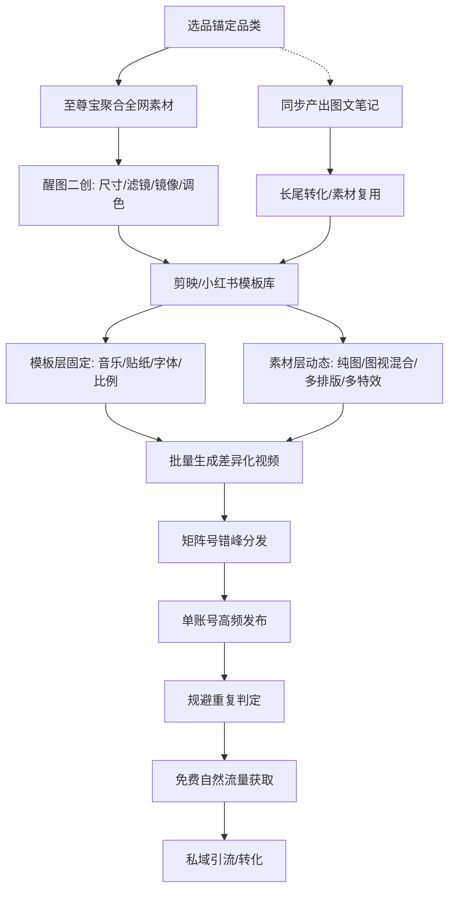
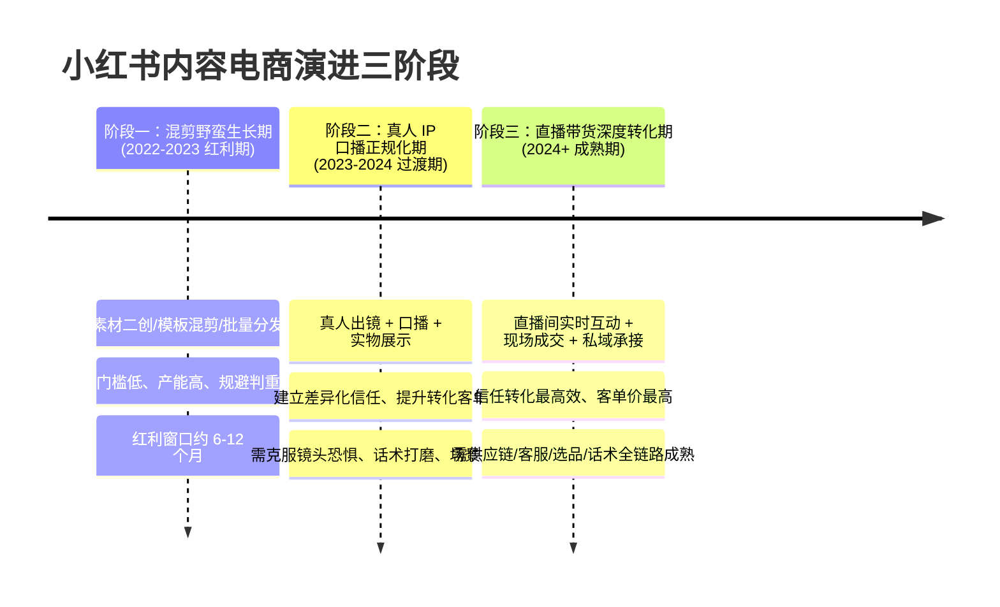

# 第 32 章 小红书无货源电商 —— 去中心化算法下的低门槛高利润实战体系

## 学习目标

- 理解小红书去中心化算法下无货源电商的核心优势与底层逻辑
- 掌握垂直细分选品策略与目的性养号打标的标准化操作流程
- 熟练应用拼多多货源三大坑点规避体系与退货地址动态规避设置
- 掌握视频笔记批量混剪生产法与爆款标题公式库的结构化内容创作方法
- 理解关键词三次高频布局原则与搜索流量获取的底层机制
- 能够构建私域沉淀复购飞轮并制定内容形态生命周期组合运营策略
- 掌握对标账号爆款挖掘法与每日复盘数据驱动迭代的实操闭环
- 了解兼职UGC矩阵放大与蓝海关键词占位的长期壁垒构建策略

## 32.1 生活类比

想象小红书无货源电商是一场**‘精准种草收割’的农耕游戏**：**平台算法** = 智能灌溉系统：不看你田地大小（粉丝量），只看种子好不好（内容质量），好种子自动得水（长尾流量）；**垂直选品** = 专用种子：针对特定土壤（女性/都市/高消费画像）育种，杂交种子（杂货铺）长不活；**目的性养号** = 土壤改良：播种前先按作物需求调土壤pH值（打标签），盲目施肥（刷量）只会烧苗；**拼多多货源** = 种苗供应商：有三大坑（面单暴露/短信骚扰/劣质苗），需签‘无痕/屏蔽/质保’三重合同；**视频混剪** = 快速扩繁：用母本（图文）通过组织培养（模板/特效/镜像）批量克隆幼苗，规避查重检疫；**关键词布局** = 埋设引诱剂：在田间地头（标题/正文/图片）各埋3个引诱剂，精准诱捕目标害虫（搜索流量）；**私域沉淀** = 建粮仓：收割（出单）后将粮食（用户）存入自家粮仓（微信），不靠收购站（平台），耐储存、可复种；**每日复盘** = 农事日志：记录播种/收成/虫害/天气数据，明年开春（迭代）才知咋种产量高。就像老农‘春种一粒粟，秋收万颗子’依靠的是对土地（算法）、种子（选品）、时令（趋势）、仓储（私域）的精准把控，而非盲目撒种碰运气。

## 32.2 概念地图

小红书无货源电商体系
├── 核心模式认知
│   ├── 去中心化种草算法  —— P001
│   ├── 高价值女性人群画像  —— P001
│   └── 零成本自然流量获客  —— P001,P002
├── 选品决策中枢
│   ├── 垂直细分选品策略  —— P002
│   ├── 选品验证三步法  —— P002
│   ├── 季节趋势驱动选品  —— P002
│   └── 同行爆款复制验证  —— P002
├── 账号冷启动体系
│   ├── 目的性养号与打标  —— P003
│   ├── 基础播放量分级标准  —— P003
│   └── 存量账号画像复盘  —— P003
├── 供应链风控体系
│   ├── 拼多多三大坑点规避  —— P004
│   ├── 无痕发货/短信屏蔽/质控  —— P004
│   ├── PDD退货包运费红利  —— P004
│   └── 货源渠道分级进阶  —— P004
├── 内容生产流水线
│   ├── 视频笔记批量混剪法  —— P005
│   ├── 模板化二创规避判重  —— P005
│   ├── 素材聚合与醒图二创  —— P005
│   ├── 爆款标题公式库  —— P006
│   ├── 关键词三次布局  —— P006
│   ├── 定价促销双层策略  —— P007
│   └── 退货地址动态规避  —— P007
├── 流量获取与转化
│   ├── 搜索流量主导论  —— P006,P008
│   ├── 长尾标签冷启动  —— P008
│   ├── 对标账号爆款挖掘  —— P008
│   ├── 赞藏比/阅赞比量化指标  —— P008
│   └── 评论权重最高运营  —— P008
├── 私域资产构建
│   ├── 私域沉淀复购飞轮  —— P009
│   ├── 朋友圈IP打造策略  —— P009
│   ├── 社群起盘预售四步法  —— P009
│   └── 私域承接容器分级  —— P009
├── 内容形态演进规律
│   ├── 图文长尾转化vs视频爆发获客  —— P010
│   ├── 三阶段演进趋势  —— P010
│   └── 真人IP溢价能力  —— P010
├── 规模化放大策略
│   ├── 兼职UGC矩阵代发  —— P011
│   ├── 蓝海关键词占位  —— P011
│   └── 品牌声量放大效应  —— P011
└── 迭代生存基本功
    ├── 每日复盘数据驱动迭代  —— P012
    ├── 过程即奖赏长期主义  —— P012
    └── 认知变现差缩小路径  —— P012

## 32.3 小红书无货源模式 —— 去中心化算法下的低门槛电商最优解

### 为什么需要这个概念？

- 传统电商需囤货、刷单、付费推广，启动资金高、试错成本大，普通人难以承担
- 小红书去中心化算法让内容而非粉丝决定流量，0粉也能出单，打破冷启动困局
- 平台90%女性、30岁左右都市人群付费意识强、客单价高，天然匹配种草转化模式

### 核心定义

**小红书无货源电商模式**（来源：《P001 小红书无货源电商保姆级教程》）

> "小红书无货源电商项目，目前属于蓝海中的蓝海，小红书跟抖音不一样，本身是种草平台，种草行为本身就附带电商属性。最关键的是全程不用刷单，也不需要开车，全部都是自然免费流量。可以说是除了保证金外和发货的成本，其他全部都是不用花钱，总的来说开店成本不高，投入低。"
> 
> ——《P001 小红书无货源电商保姆级教程》

这是一个**零库存、一件代发**的电商模式：利用小红书“种草”属性与免费自然流量，从上游（1688/拼多多）拿货转卖，核心成本仅含店铺保证金与发货成本，全程不用刷单、开车（付费推广），实现零推广成本获客。

这个模式的核心逻辑可以用一个公式表达：

$$
\text{利润} = (\text{售价} - \text{进货价} - \text{履约成本}) \times \text{订单量} - \text{固定成本}
$$

其中：
- **售价** 由“高原价+促销策略”锚定，常态化利润率可达 50%+
- **进货价** 通过 PDD 代发试错→直连商家→自有供应链三级进阶持续压降
- **履约成本** 仅含运费与包装，PDD 退货包运费补贴 7-10 元/单覆盖高退货风险
- **固定成本** 仅保证金（1000 元）+ 工具订阅费，边际成本趋近于零

这个公式展示了：无货源模式的本质是**用“内容生产能力”换取“免费流量”**，再用“供应链整合能力”锁定“利润差价”，将传统电商“流量买卖”重构为“内容种草+零成本履约”。

### 关键性质

**1. 去中心化长尾流量：优质笔记爆发后可持续吃长尾流量，生命周期长，非即时性消费**

> "另外小红书的算法机制极为优质，它的去中心化算法，可以说是互联网平台里的翘楚，一篇笔记爆了之后，可以吃长尾流量。"
> 
> ——《P001 小红书无货源电商保姆级教程》

**2. 内容即产品：笔记流量主导转化，商城自带流量极低，用户路径为“搜索/推荐笔记→种草→下单”**

> "商城流量是很低的，小红书的用户是不习惯在小红书商城买东西，更多的是搜索笔记，所以笔记流量是我们转化引流的重点。"
> 
> ——《JJQ0dfe6ho2qh7xalBXc3AG6nAb 小红书无货源电商实操教程》

**3. 选品决定成败：垂直细分选品是核心杠杆，笔记数量无法弥补选品劣势**

> "雯雯 : 我一个号只上产品，不发笔记，几乎每天能出单，一个号天天发十几篇笔记，选品，连续发了一个月，只出了一单。选到爆款，没那么容易。同样的笔记，有些能爆，有些爆不了。"
> 
> ——《P001 小红书无货源电商保姆级教程》

### 典型例子

- **新店 18 天验证**：卖 2630 单、日均 150 单、营业额 12.63 万、利润 6 万+，验证起量快、利润高、0 粉出单
- **细分品类高胜率**：细分女装、精致女鞋、国风饰品、提升生活质量类产品，匹配女性用户画像转化极高

### 边界条件

- 个体户主体存在多店开设资质限制（第二家店法人认证提示证件已被占用）
- 女装等高退货率类目利润侵蚀风险大，需纳入“退货率控制”维度选品
- 个人店不交 1000 元保证金无法开通微信支付、后期无法提现（当前支付宝支付占比仍高可暂缓观望）

---

### 多源对照

#### 共识

| 维度 | P001 蓝狐教程 | P002 JJQ 实操教程 | P003 25条玩法细节 |
|------|----------------|-------------------|-------------------|
| **核心优势** | 去中心化算法、免费流量、低成本 | 去中心化算法、种草属性、高转化女性人群 | 内容为王、流程化矩阵化、零推广成本 |
| **选品地位** | 重中之重、决定成败 | 核心杠杆、垂直细分胜过杂货铺 | 选品验证三步法、拒绝完美主义供应链 |
| **内容形态** | 笔记发布为核心获客手段 | 视频笔记曝光多于图文、承接免费流量 | 图文长尾转化、视频爆发获客、一键多发复用 |
| **供应链策略** | PDD 代发试错、淘宝搬家、自有品牌 | 1688优先→PDD代发→淘宝搬家→自有供应链 | PDD退货包运费红利、直连商家降本 10-15 元/单 |
| **私域价值** | 沉淀私域为巨大财富 | 分级话术引流、朋友圈 IP 打造、社群预售 | 10-20 条分层话术、店关人留、信任资产复利 |

#### 分歧

| 维度 | P001 蓝狐教程 | P002 JJQ 实操教程 | P003 25条玩法细节 |
|------|----------------|-------------------|-------------------|
| **视频 vs 图文** | 未明确区分优劣 | 断言视频笔记曝光更多、是主力载体 | 图文长尾转化高、视频爆发快、成熟期“图文主阵地+视频矩阵” |
| **养号必要性** | 作为标准流程第 6 步 | 必须在选品后“目的性养号”，核心指标基础播放 100-600 | 隐含在账号垂直度标签化推流机制中 |
| **工具依赖度** | 推荐灰豚/蝉小红提效 | 详细拆解后羿采集器、灰豚、蝉小红多工具组合 | GPT 作为辅助工具、需训练提示词不可完全替代 |
| **直播趋势** | 未提及 | 真人 IP+直播是未来主流趋势 | 内容演进三阶段：混剪→真人口播→直播带货 |

---

## 32.4 垂直细分选品策略 —— 精准匹配人群画像的转化核心杠杆

### 为什么需要这个概念？

- 杂货铺模式导致账号标签混乱、流量不精准、运营无重点、转化率低
- 小红书 90% 女性、30 岁左右都市白领画像决定了选品必须垂直细分才能精准获客
- 选品是无货源核心杠杆，选品质量决定出单上限，笔记数量无法弥补选品劣势

### 核心定义

**垂直细分选品策略**（来源：《JJQ0dfe6ho2qh7xalBXc3AG6nAb 小红书无货源电商实操教程》）

> "选品时要选更为细分的领域，要垂直领域去选品上架，不要服饰和首饰这些混着一起卖，卖内衣就卖内衣。我们要做细分垂直的领域商品，还要看季节来选择...找到我们的细分领域去做，这样我们可以精准化去运营店铺。账号垂直度非常重要，账号不垂直，流量是很低的，具体可以看看自己主页推荐的都是什么..."
> 
> ——《JJQ0dfe6ho2qh7xalBXc3AG6nAb 小红书无货源电商实操教程》

这是一个**“人群画像→品类锚定→季节趋势→同行验证”**的四步选品法：

$$
\text{选品成功率} = f(\text{人群匹配度}, \text{垂直深度}, \text{季节时效性}, \text{同行爆款验证})
$$

其中：
- **人群匹配度**：90% 女性 + 30 岁都市 + 高消费 = 精致女装/女鞋/饰品/家居
- **垂直深度**：“大码职场连衣裙” > “女装”；“玛丽珍单鞋” > “女鞋”
- **季节时效性**：夏季防晒、冬季保暖、开学季文具、节日礼品
- **同行爆款验证**：灰豚/蝉小红挖掘同类目大 V 爆款结构 → 复制创新而非盲目猜测

这个策略展示了：选品不是“猜”，而是“通过数据工具验证市场需求，再用垂直度放大转化效率”。

### 关键性质

**1. 垂直度决定推流精准度：账号主页推荐内容垂直程度决定系统推流精准度，垂直账号粉丝画像一致转化率显著更高**

> "账号垂直度非常重要，账号不垂直，流量是很低的，具体可以看看自己主页推荐的都是什么...你的主页发也一样会精准的推送给经常看到用户"
> 
> ——《P003 25条玩法细节》

**2. 季节性趋势驱动：必须看季节选择品类，提前布局应季爆款**

> "我们要做细分垂直的领域商品，还要看季节来选择...找到我们的细分领域去做，这样我们可以精准化去运营店铺。"
> 
> ——《JJQ0dfe6ho2qh7xalBXc3AG6nAb 小红书无货源电商实操教程》

**3. 同行爆款复制验证：观察同行爆款笔记形式/标题/文案/选品结构，建立素材库模仿创新**

> "选款一般是先看电商款在从小红书看种草不挂车笔记，如果不挂车笔记数据很棒这款一定要上，爆的几率会提高。"
> 
> ——《P003 25条玩法细节》

### 典型例子

- **细分女装**：大码/修身/职场连衣裙而非泛女装
- **精致女鞋**：玛丽珍单鞋/乐福鞋/芭蕾舞鞋细分款
- **国风饰品**：宋制珠宝/汉服配饰/新中式首饰
- **提升生活质量**：收纳神器/香氛/睡眠辅助/居家好物

### 边界条件

- 过度追求完美供应链导致机会成本极高（黄花菜都凉了），应采用“大胆问、多比较、先代发、快试错”
- 选品验证需三步走：电商平台筛选爆款候选 → 小红书搜“不挂车种草笔记”验证内容端需求 → PDD 免费拿样实测质量
- 需规避拼多多面单暴露、短信骚扰、质量参差三大坑点（详见 32.5 供应链风控体系）

---

## 32.5 目的性养号与账号打标 —— 以选品为锚点的算法标签构建术

### 为什么需要这个概念？

- 盲目养号刷流量导致标签混乱、权重稀释、推流不精准，浪费时间精力
- 账号权重直接决定基础播放量与爆款概率，基础播放 50-60 vs 打标成功 100-600，差距 10 倍
- 必须在选品确定后，针对性浏览同类目内容建立算法标签，而非盲目刷数据

### 核心定义

**目的性养号与账号打标**（来源：《JJQ0dfe6ho2qh7xalBXc3AG6nAb 小红书无货源电商实操教程》）

> "为什么养号要在选品之后进行呢？因为我们要有目的性，要把账号打上标签，所以不能一开始就盲目养号，乱刷笔记数据。发布一条内容，50~60播放量，就是基础播放。如果一发基础100~600播放量，就是账号打上标签了。"
> 
> ——《JJQ0dfe6ho2qh7xalBXc3AG6nAb 小红书无货源电商实操教程》

这是一个**“选品定向→行为模拟→标签固化→权重验收”**的标准化流程：

```
目的性养号标准化 SOP（3-7天）：
1. 选品锚定：确定主攻品类（如“精致女鞋/玛丽珍单鞋”）
2. 行为模拟：每日浏览 20-30 条同类目笔记/直播，点赞收藏评论高互动内容
3. 评论打标：在同类目高赞笔记下留“种草/求链接/同款”类高质量评论
4. 权重验收：发布测试笔记，基础播放量 ≥ 100 即判定打标成功
5. 存量账号接手：复盘历史高赞笔记反推粉丝画像 → 新内容符合阅读习惯激活首传播层
```

### 关键性质

**1. 目的性原则：养号必须在选品之后进行，因需要知道“给谁看”才能模拟“谁在看”**

> "为什么养号要在选品之后进行呢？因为我们要有目的性，要把账号打上标签，所以不能一开始就盲目养号，乱刷笔记数据。"
> 
> ——《JJQ0dfe6ho2qh7xalBXc3AG6nAb 小红书无货源电商实操教程》

**2. 标签即流量入场券：垂直标签让系统精准推送给目标人群，非垂直账号流量极低**

> "发布一条内容，50~60播放量，就是基础播放。如果一发基础100~600播放量，就是账号打上标签了。"
> 
> ——《JJQ0dfe6ho2qh7xalBXc3AG6nAb 小红书无货源电商实操教程》

**3. 评论区互动辅助打标：在同类目高赞笔记下留高质量评论，加速标签建模与权重积累**

### 典型例子

- **新号冷启动**：针对“精致女鞋”连续 3-5 天浏览/点赞/收藏/评论同类目内容，新号即可快速打标
- **存量账号接手**：教育赛道 5k 粉账号，历史高赞集中在“英语四级/大学忠告”，新内容必须符合此画像，首篇忽视此点仅得个位数赞

### 边界条件

- 养号非刷量：严禁购买粉丝/点赞/刷播放，平台风控极严，一旦判定作弊权重归零难恢复
- 新号养号周期通常 3-7 天，期间不发营销笔记，纯模拟真实用户行为建立人设
- 已有粉丝存量账号接手时，需先复盘历史高赞笔记反推粉丝画像，新内容必须符合阅读习惯激活首传播层

---

## 32.6 拼多多货源三大坑点规避体系 —— 无痕发货、短信屏蔽、质控选品的组合拳

### 为什么需要这个概念？

- 拼多多是低成本代发首选，但面单暴露源头、官方短信骚扰客户、产品质量参差不齐三大坑点直接导致退货率飙升、投诉封店
- 无痕发货沟通成本高、短信骚扰导致客户频频退货（行业级痛点）、质量差评导致店铺 DSR 下降限流
- 必须建立组合规避体系，将供应链风险降至最低，保障无货源模式长期稳定运行

### 核心定义

**拼多多货源三大坑点规避体系**（来源：《JJQ0dfe6ho2qh7xalBXc3AG6nAb 小红书无货源电商实操教程》）

> "面单问题...直接在找货源的时候就问商家，能不能无痕发货。拼多多短信...用逸淘拍单软件下单就可以了，他会让客户自动屏蔽拼多多短信。产品质量差...针对这个问题，就回到上文说到的看产品评论，找到差评较少的。"
> 
> ——《JJQ0dfe6ho2qh7xalBXc3AG6nAb 小红书无货源电商实操教程》

这是一个**“面单干净、短信静默、质量可控”**的三维防御体系：

| 坑点 | 症状 | 规避动作 | 核心工具/话术 |
|------|------|----------|---------------|
| **面单暴露** | 客户收货看到 PDD 面单/商家信息，知晓进货价、投诉退款 | 下单时直接问商家能否无痕发货，拒绝者直接 pass | 标准话术：“麻烦无痕发货，不体现拼多多/店铺任何信息” |
| **短信骚扰** | PDD 官方短信触达客户，引导比价/投诉/退货，行业级痛点 | 使用逸淘等拍单软件，自动屏蔽 PDD 官方短信触达客户 | 逸淘/拼多多商家版后台设置，虽非 100% 但能尽可能避免 |
| **质量参差** | 产品质量不稳定导致差评、退货、DSR 下降限流 | 回归商品评价体系，重点筛选差评少、实拍图好评多的商家 | 灰豚/蝉小红评论搜索 + 人工实测建立白名单 |

### 关键性质

**1. PDD 供给侧结构性红利：退货包运费单单补贴 7-10 元覆盖运费成本，高退货率品类反成避风港，免费拿样零成本质检**

> "做退换率比较高的产品也不用慌，因为 pdd 退货包运费一单补贴 7-10 元，你完全不会亏，后台即使开运费险也是有的赚，即使退货率很高你也能赚点辛苦费。拿样基本也是免费因为有退货包运费，直接后台让快递来退，不花钱。"
> 
> ——《P003 25条玩法细节》

这个机制创造了一个**“平台补贴 > 退货成本”**的套利窗口：

$$
\text{单单净收益} = \text{平台补贴}(7-10元) - \text{实际运费成本} - \text{包装损耗}
$$

当退货率极高时，只要单单补贴覆盖运费，卖家反而能“赚辛苦费”，这使得高退货率品类（如女装）成为低风险试错标的。

**2. 供应链进阶路径：前期 PDD 代发试错（零风险）→ 产品质量稳定后直连商家对接（单省 10-15 元）→ 自有品牌/IP 打造**

> "产品质量稳定就不走平台直接和商家对接一单能少 10-15 元。淘宝的店铺会比较精致，可以考虑从淘宝搬家在去加入自己制作的店铺介绍在第一张图提升转化率，淘宝一般都是加利润的即使不改价也能有利润。"
> 
> ——《P003 25条玩法细节》

**3. 货源渠道分层：1688 优先（源头价）→ PDD 代发（试错期）→ 淘宝搬家（素材精致溢价）→ 自有供应链（成熟期）**

### 典型例子

- **面单问题**：直接在找货源时问商家能否无痕发货，建立标准化沟通 SOP
- **短信骚扰**：去年行业炸锅，客户频频退货，逸淘软件成标配解法
- **质量控制**：看差评少的商家，实测淘宝店铺素材精致可直接搬运并加自有水印提升转化

### 边界条件

- 逸淘屏蔽短信非 100% 有效，只能尽可能避免，需配合售后话术安抚客户
- PDD 退货包运费补贴 7-10 元/单，若退货率极高仍可能亏损，需结合选品控制退货率
- 直连商家需量级支撑，前期单量小商家不配合，必须跑通验证后再谈降本

---

## 32.7 视频笔记批量混剪生产法 —— 模板化二创规避搬运判重的流水线

### 为什么需要这个概念？

- 图文笔记边际效用递减，视频笔记曝光推流更多，是承接免费自然流量的主力载体
- 原创拍摄成本高、周期长、难规模化，必须利用现成素材二创批量产出
- 平台搬运判重机制严格，直接搬运必限流，需标准化二创流程规避查重

### 核心定义

**视频笔记批量混剪生产法**（来源：《JJQ0dfe6ho2qh7xalBXc3AG6nAb 小红书无货源电商实操教程》）

> "用至尊宝一键搜图，就能找到这款商品所有平台的素材，视频和图片都有...找到 5 张左右的图片，然后利用醒图去修改尺寸，滤镜，和镜像，给我们的图片做二次剪辑。视频制作就直接利用小红书里面的模板去制作，或者在剪映上面的模板去直接套用...对素材进行不同的排版，套用不同的模板，加不同的特效，就能制作出很多视频作品。"
> 
> ——《JJQ0dfe6ho2qh7xalBXc3AG6nAb 小红书无货源电商实操教程》

这是一个**“素材聚合→二创去重→模板化套用→矩阵分发”**的标准化流水线：

```
视频笔记批量生产标准化流程：
【素材端】至尊宝一键搜全网图/视频素材（关键词：品类词+款式词+场景词）
    ↓
【二创端】醒图批量处理：改尺寸(3:4/9:16) → 加滤镜(胶片/复古/清新) → 镜像翻转 → 调色/锐化/饱和度微调
    ↓
【生产端】剪映/小红书自带模板套用：
    - 模板层固定：背景音乐/贴纸/字体/比例/转场预设
    - 素材层动态：纯图/图视混合/多排版/多特效组合排列组合
    - 单条制作压缩至 1 分钟级
    ↓
【分发端】矩阵号轮播：单账号长期高频发布 + 多账号错峰分发 + 素材池定期更新
```

### 关键性质

**1. 模板化生产：固定模板层 + 动态素材层，单条制作压缩至 1 分钟级**

> "视频制作就直接利用小红书里面的模板去制作，或者在剪映上面的模板去直接套用...对素材进行不同的排版，套用不同的模板，加不同的特效，就能制作出很多视频作品。"
> 
> ——《JJQ0dfe6ho2qh7xalBXc3AG6nAb 小红书无货源电商实操教程》

**2. 组合控制变量：对同一组素材套用不同模板/排版/特效/滤镜，批量生成差异化视频规避重复判定**

**3. 视频优于图文获流：实测视频笔记曝光推流多于图文，但图文转化率高、长尾长，成熟运营“图文主阵地+视频矩阵”**

> "输出形式内容图文的长尾流量是比视频长的，视频的曝光会比较高，但是转化没有图文高，图文可能这个月发的内容到下个月还有人通过本月发的链接去下单。完全可以先制作图文，再把图文生成内容，这样下来能多出 10 个左右的素材，可以开新号发视频，获取更多流量。"
> 
> ——《P003 25条玩法细节》

### 典型例子

- **5 张图 → N 条视频**：找到 5 张图用醒图改尺寸/滤镜/镜像 → 剪映套模板 → 纯图/图视混合/多排版/多特效组合 → 制作出大量视频长期发
- **至尊宝素材聚合**：一键搜全平台素材（视频和图片都有），素材聚合效率极高

### 边界条件

- 单账号长期高频发布易触发重复判定，需配合矩阵号分发、素材池定期更新
- 素材二创必须实质性修改（尺寸/镜像/滤镜/排版/特效），单纯加水印/裁剪无法过审
- 真人出镜+口播+实物展示是内容演进必然趋势，混剪仅为红利期过渡手段，中长期必须布局真人 IP

---

### 数据流图：视频笔记生产与分发流转



---

## 32.8 爆款笔记标题公式库与关键词三次布局 —— 搜索流量获取的结构化钩子

### 为什么需要这个概念？

- 标题决定分发上限（占 99% 权重），好标题是爆款前提，差标题好内容也沉底
- 搜索流量（主动需求）比推荐流量更精准、转化更高、生命周期更长，需通过关键词布局主动获取
- 核心关键词在标题/正文/图片三处累计 ≥ 3 次，强化系统语义识别，实测搜索流量从 1% 跃升至 61%

### 核心定义

**爆款标题三要素拆解法**（来源：《P002 韩北樱 7天 60% 爆文率实战》）

> "主体：大学生 事件：开学 强调点：开学所需物资——换成常用说法：开学要准备的东西（这个‘东西’怎么样？形容词：详细、贴心、必备、容易忘记、不能忘记、必须）"
> 
> ——《P002 韩北樱 7天 60% 爆文率实战》

**爆款标题公式库**（来源：《JJQ0dfe6ho2qh7xalBXc3AG6nAb 小红书无货源电商实操教程》）

> "标题公式：巨大反差+犀利观点，亮点+设置悬念，提问+解答，压迫感，数字冲击，名人案例+背书，紧跟热点，灵魂发问+分类整理，我和单品的故事+单品亮点+具体内容+适合人群。标题控制在 20 个字以内...16-18 个字 之间最佳...标题适当增加一些表情符号...标题适当加上数字会更受欢迎。"
> 
> ——《JJQ0dfe6ho2qh7xalBXc3AG6nAb 小红书无货源电商实操教程》

**关键词三次高频布局原则**（来源：《P002 韩北樱 7天 60% 爆文率实战》）

> "把笔记涵盖热词在文案中提上 3 遍，这样做主要是为了获得搜索流量。关键词在内容、标题、小文案三部分加起来至少提及三次。笔记涵盖的热词在标题、文案、图片内容中，提到不少于三次，更能获得搜索流量。"
> 
> ——《P002 韩北樱 7天 60% 爆文率实战》

### 爆款标题 9 大公式表

| 公式编号 | 公式结构 | 示例（以“玛丽珍单鞋”为例） | 适用场景 |
|----------|----------|----------------------------|----------|
| **F1** | 巨大反差 + 犀利观点 | "30 岁还穿玛丽珍？这才是显腿直的正确打开方式😱" | 认知重塑、反直觉选品 |
| **F2** | 亮点 + 设置悬念 | "这双鞋藏着显腿长秘密，最后一张图直接破防✨" | 视觉冲击强、细节丰富产品 |
| **F3** | 提问 + 解答 | "通勤鞋怎么选不累脚？玛丽珍单鞋实测避坑指南📝" | 功能性强、决策链路长产品 |
| **F4** | 压迫感 | "不买后悔一整个秋天！这双玛丽珍断货三次才抢到🔥" | 稀缺性强、季节性明显产品 |
| **F5** | 数字冲击 | "穿了 30 天不磨脚，199 元拿捏通勤全周期💰" | 高性价比、数据支撑强产品 |
| **F6** | 名人案例 + 背书 | "张小斐同款玛丽珍，显瘦 5 斤不花钱👗" | 明星/达人背书、粉丝经济产品 |
| **F7** | 紧跟热点 | "秋季穿搭趋势已变天，玛丽珍单鞋成显腿顶流🍂" | 季节节点、流行趋势驱动 |
| **F8** | 灵魂发问 + 分类整理 | "到底啥鞋显腿直？4 类通勤鞋横评，玛丽珍赢麻了🏆" | 多 SKU 对比、导购属性强 |
| **F9** | 我和单品故事 + 亮点 | "从拒绝穿裙子到天天穿玛丽珍，这双鞋治愈了我的腿型焦虑💕" | 情感共鸣强、人设 IP 账号 |

### 关键词三次布局标准化动作

```
关键词三次布局执行清单（以核心词"玛丽珍单鞋"为例）：

【标题】第 1 次：必须包含核心词 + 长尾词
    → "秋季通勤玛丽珍单鞋推荐：显腿直不磨脚✨"

【正文小文案】第 2 次：开头/结尾/段落间自然植入
    → 开头："最近疯狂种草玛丽珍单鞋..."
    → 中间："这双玛丽珍单鞋的鞋垫设计..."
    → 结尾："同款玛丽珍单鞋链接在左下角..."

【图片内容】第 3 次：封面图/详情图文字叠加/OCR 识别区
    → 封面图右上角贴纸："玛丽珍单鞋实测"
    → 详情图 2 文字叠加："玛丽珍单鞋侧面细节"
    → 详情图 4 文字叠加："玛丽珍单鞋上脚效果"
```

### 关键性质

**1. 自我参照效应选题：主体词精准定义受众（大学生/宝妈/职场人），点开者 99% 为目标人群，互动率极高**

> "主体：能够精准的获取流量，主体是大学生，那么点开笔记的 99% 都是大学生，受众精准用户就更容易对笔记做出点赞、评论、收藏的行为。"
> 
> ——《P002 韩北樱 7天 60% 爆文率实战》

**2. 三线选题筛选：时间线（近 30/7 天新发）、事件线（符合热点周期）、对标线（参考低粉素人爆文非大 V）**

> "时间线、事件线、对标线都需要考虑到。即标题和关键词在灰豚数据上查找，近 30 天、近 7 天按照赞数由高到低排序，最好参考低粉爆文笔记，进行对标模仿。"
> 
> ——《P002 韩北樱 7天 60% 爆文率实战》

**3. 标题批量改写：提取爆款标题三要素，替换同义词/调整语序生成标题库，实现标题化模仿创作**

### 典型例子

- **主体：大学生 事件：开学 强调点：开学所需物资** → 改写 "开学要准备的东西（详细/贴心/必备/容易忘记/不能忘记/必须）"
- **实测**：关键词三次布局后，万赞笔记搜索流量达 61%，触发平台“提炼重要信息提升曝光”提示

### 边界条件

- 标题党/夸大宣传违规：标题必须与内容强相关，反差感源于内容真实张力而非虚假营销
- 关键词堆砌风控：三次布局需自然融入语境，生硬堆砌会被判定营销笔记限流
- 大标签竞争激烈难收录：新号应“小标签抢收录、大标签定垂直”，长尾标签冷启动后反哺大流量池

---

## 32.9 定价-促销双层价格策略与退货地址动态规避 —— 利润保护与售后闭环的运营细节

### 为什么需要这个概念？

- 直接低价上品无促销空间、无价格锚定，转化率低且利润薄，无法应对大促/竞品价格战
- 一件代发多供应商退货地址不一致，默认地址会导致退货寄错、纠纷升级、店铺评分受损
- 需建立标准化定价促销体系与退货拦截机制，守住利润底线与售后体验

### 核心定义

**定价-促销双层价格策略**（来源：《JJQ0dfe6ho2qh7xalBXc3AG6nAb 小红书无货源电商实操教程》）

> "价格设置的话，这里面也有细节，你上品时候的价格是要高一点的。因为后期你可以设置营销策略来降价销售...建议参考同行，比他的原价贵一点，然后后期你的优惠力度大一点，这也是出单的小细节。"
> 
> ——《JJQ0dfe6ho2qh7xalBXc3AG6nAb 小红书无货源电商实操教程》

**退货地址动态规避设置法**（来源：《JJQ0dfe6ho2qh7xalBXc3AG6nAb 小红书无货源电商实操教程》）

> "系统会自动发送我们的默认地址过去的我们做的是无货源每个品的退货地址都是不同的，所以我们的地址不能统一所以我们的地址就需要改成（此地址错误请联系客服确认地址）这样我们避免客户退货，把货物给寄错了。"
> 
> ——《JJQ0dfe6ho2qh7xalBXc3AG6nAb 小红书无货源电商实操教程》

### 双层价格策略执行表

| 阶段 | 动作 | 目的 | 示例（成本 50 元，目标利润率 50%+） |
|------|------|------|-----------------------------------|
| **上品期** | 设高原价预留空间 | 建立价值锚定、应对大促、规避低价心智 | 原价 199 元（含 100%+ 溢价空间） |
| **日常期** | 配置优惠券/满减/薯券 | 制造价格锚定、捡漏冲动、提升转化 | 满 100 减 20、薯券抵扣 10 元 |
| **大促期** | 叠加平台补贴/限时折扣 | 冲量、清库存、权重提升 | 限时 7 折 + 平台红包 = 实付 129 元 |
| **清仓期** | 成本价/微利出清 | 回笼现金、腾库位、维护 DSR | 99 元清仓（仍保本） |

**价格锚定心理学公式**：

$$
\text{用户感知价值} = \frac{\text{原价} - \text{实付价}}{\text{原价}} \times \text{参照价}
$$

其中参照价为同品竞品原价。当 `原价 > 竞品原价` 且 `实付价 < 竞品实付价` 时，用户感知价值最大化。

### 退货地址动态规避 SOP

```
退货拦截与分发标准化流程：

1. 后台设置：退货地址 = "此地址错误请联系客服确认地址"
2. 客户发起退货 → 系统推送该地址 → 客户联系客服
3. 客服查单：订单 ID → 对应供应商 → 供应商退货地址
4. 客服回复：标准话术"亲，该商品退货地址为：[供应商地址]，麻烦修改一下哈~"
5. 映射表维护：建立《订单 ID - SKU - 供应商 - 退货地址 - 联系人 - 电话》在线表格（飞书/腾讯文档）
```

### 关键性质

**1. 价格锚定心理学：高原价建立价值感知，促销价制造捡漏冲动，利润率常态化 50%+（免费流量+低履约成本）**

**2. 售后话术标准化：订单完成后发送预设 10-20 条分层话术（利益诱导/服务关怀/人设强化）引导加微信沉淀私域**

> "出单之后客户收货之后，可以准备 10-20 条话术，通过私信发给对方，把对方沉淀到私域来..."
> 
> ——《JJQ0dfe6ho2qh7xalBXc3AG6nAb 小红书无货源电商实操教程》

**3. 退货包运费红利：PDD 单单补贴 7-10 元覆盖运费，高退货率品类反成低风险试错标的，免费拿样零成本质检**

### 典型例子

- **新店定价**：原价 199 元 → 设置满 100 减 20/薯券抵扣 → 实付 129 元，利润率超 50%，用户感知高性价比
- **退货拦截**：退货地址设为"错误请联系客服"，客户发起退货 → 客服查订单对应供应商 → 发正确退货地址 → 避免寄错零纠纷

### 边界条件

- 原价过高触发平台虚假价格风控，需参考同行合理区间设定，不可脱离市场认知
- 退货拦截增加客服工作量，单量大时需配置自动回复/工单系统分流，纯人工不堪重负
- 薯券/优惠券设置有平台门槛（如粉丝数/店铺等级），新店初期可能无法使用全套营销工具

---

## 32.10 对标账号与爆款挖掘法 —— 以数据工具降维打击替代主观臆造

### 为什么需要这个概念？

- 凭感觉创作爆款率极低，普通人最高效路径是利用数据工具获取已验证爆款样本，拆解重组“爆款基因”
- 选题必须通过“账号画像复盘”关卡，忽视存量粉丝偏好必死（首篇笔记仅得个位数赞的惨痛教训）
- 低粉素人爆文比大 V 更具可复制性，大 V 自带流量光环掩盖内容本身质量，素人爆文纯靠内容硬实力

### 核心定义

**三步走挖掘法**（来源：《JJQ0dfe6ho2qh7xalBXc3AG6nAb 小红书无货源电商实操教程》）

> "观察同行：观察他的爆款笔记形式，他是以图文还是视频，用到什么特别的点才爆，分析他的标题，文案，可以用表格记录下来。首先，在蝉小红平台上选择“评论搜索”功能，然后输入关键词，例如“在哪下单”等...勾选“带货笔记”选项...最后，导出相关的表格数据。"
> 
> ——《JJQ0dfe6ho2qh7xalBXc3AG6nAb 小红书无货源电商实操教程》

**灰豚四步法**（来源：《P002 韩北樱 7天 60% 爆文率实战》）

> "灰豚数据里面的达人分类顺序，是按照小红书的流量和热度来分的...教育类的头部达人目前我能看到的粉丝数在 245.8w，但时尚类就在 600w。1. 热词榜的周榜里可以查到最近一周的热词 2. 飙升榜是最近一周用户最关注的内容 3. 总量榜就是长期关注的热词。点击某篇笔记标题就可以查看笔记涵盖热词。笔记覆盖热词也就是标签问题，都已经被完美解决。"
> 
> ——《P002 韩北樱 7天 60% 爆文率实战》

**后羿采集器标题批量采集与拆解流程**（来源：《P002 韩北樱 7天 60% 爆文率实战》）

> "利用后羿采集器采集了 101 个#大学生 话题下的高赞笔记标题，通过对标题和赞数的归纳整理，我发现了很多相似点...采集导出 excel 表格形式后，对数据进行清晰，无关杂乱信息删掉可以整理到飞书表格。"
> 
> ——《P002 韩北樱 7天 60% 爆文率实战》

### 工具组合拳对照表

| 工具 | 核心功能 | 适用阶段 | 关键产出 |
|------|----------|----------|----------|
| **后羿采集器** | 话题页/笔记页二级采集，导出标题/赞数/用户主页 | 爆款标题批量采集与拆解 | Excel/飞书表格：标题三要素拆解库、改写标题库 |
| **灰豚数据** | 达人分类/热词榜(周/飙升/总量)/热词详情/笔记详情 | 选题趋势捕捉、关键词包提取 | 赛道天花板判断、趋势热词、非商业笔记筛选、标签体系 |
| **蝉小红** | 评论搜索（关键词+带货笔记筛选）/达人分析/竞品监控 | 验证带货真实性、导出带货笔记表格 | 高转化笔记清单、竞品选品结构、评论区关键词 |
| **至尊宝** | 全平台素材一键搜索聚合（图/视频） | 视频笔记素材批量获取 | 去重素材库、跨平台热门素材 |

### 关键性质

**1. 数据工具即员工：后羿/灰豚/蝉小红作为“员工”干活，老板（人）负责认知拆解重组与决策，工具不可替代人的判断**

> "全依靠工具是行不通的，没有船时我们也要能够游到河对面去...利用工具写爆款笔记，你就把所有的工具都想象成你的员工，你作为老板，是永远无法被替代的存在。"
> 
> ——《P002 韩北樱 7天 60% 爆文率实战》

**2. 存量账号冷启动三步走：复盘历史高赞定粉丝画像 → 筛选符合三线模型选题 → 执行关键词布局+评论运营监控指标迭代**

> "由于我当时是中途接手的一个 5k 粉的账号...我就进行了反思：该账号之前发的内容，高赞集中在 英语四级、大学忠告...按照这个逻辑，我找了一个对标账号，继续进行了测试。在第二篇测试当中，把文案部分也进行了优化，把笔记涵盖热词在文案中提上 3 遍。一定要在文案和内容中，引导读者评论，同时号主，也要在评论区多评论，多互动。"
> 
> ——《P002 韩北樱 7天 60% 爆文率实战》

**3. 评论区关键词验证带货力：“怎么买/在哪下单/链接”等询单词是高转化评论区典型特征，反向验证笔记真实带货能力**

> "怎样才能找到带货牛逼的笔记...只需要仔细观察评论区即可，看是否出现了许多“怎么买”、“在哪下单”等关键词。不要小瞧这些关键词，这些词往往是高转化的评论区的典型特征。"
> 
> ——《JJQ0dfe6ho2qh7xalBXc3AG6nAb 小红书无货源电商实操教程》

### 典型例子

- **教育赛道 7 天 60% 爆文率**：复盘粉丝爱英语四级/大学忠告 → 对标低粉爆文 → 关键词三次布局+评论引导
- **灰豚热词榜周榜/飙升榜/总量榜捕捉趋势**，蝉小红评论搜索导出带货笔记表格，工具显著提升对标分析效率

### 边界条件

- 全依靠工具行不通：无认知拆解的纯工具输出是垃圾，人作为老板永远无法被替代
- 对标账号需匹配自身阶段：新号参考低粉素人爆文，大号参考头部玩法，跨阶段对标必死
- 评论搜索功能依赖蝉小红等付费工具，免费渠道获取带货笔记效率极低，需计算工具 ROI

---

## 32.11 私域沉淀复购飞轮 —— 公域流量的最终归宿与长期资产

### 为什么需要这个概念？

- 公域流量不稳定、平台规则多变、获客成本上升，私域是可控、可复用、可长期运营的核心资产
- 单次交易利润有限，高 LTV 靠复购与裂变，私域信任基础下转化率远超公域冷流量
- 店铺关闭后私域用户仍可持续变现，是独立于平台的“巨大财富”

### 核心定义

**私域沉淀复购飞轮**（来源：《P003 25条玩法细节》）

> "出单之后客户收货之后，可以准备 10-20 条话术，通过私信发给对方，把对方沉淀到私域来，即使你以后不开店了你会发现你的私域也有很多人要找你买东西，可以说是一笔巨大的财富。"
> 
> ——《P003 25条玩法细节》

这是一个**“公域收割→私域沉淀→信任运营→复购裂变”**的闭环系统：

```
私域沉淀复购飞轮标准化 SOP：

【收割端】订单完成 → 触发售后私信自动/半自动发送
    ↓
【分层话术库】10-20 条预设话术：
    - 利益诱导类（3-5条）："加微信领专属优惠券/新品试用/会员价"
    - 服务关怀类（3-5条）："穿着舒服吗？尺码合不合？有问题随时找我"
    - 人设强化类（3-5条）："我是专做精致女鞋的 xx，朋友圈天天发穿搭干货"
    ↓
【承接容器分级】：
    L1 视频号/企微（资产可控，官方背书）
    L2 个人号/微信群（精细运营转化，高频触达）
    ↓
【运营动作】：
    - 朋友圈 IP 打造：早中晚 2-3 条真实感悟（去专家化/做朋友/高频低强度）
    - 社群起盘预售四步法：1v1建信任 → 打造钩子公开进度 → 点赞领资料+私信推销早鸟价筛选种子 → 计算转化率验证模型
    - 复购裂变：老客推荐返现/积分/礼品，新客首单立减
```

### 关键性质

**1. 利他性分层传播：高利他内容（干货/避坑/资源）转粉率高、粘性强、付费意愿高；高娱乐内容破圈快但转化低，需按比例配比**

> "核心逻辑：只需比用户废物朋友有见地一点点即显权威；早中晚 2-3 条真实感悟替代硬广截图...利用‘废物朋友对比效应’建立权威感转化高信任付费用户。"
> 
> ——《K4zfd2djsoEAdWxTaXrceSf9nLf 刘晨昊小红书个人 IP 变现实战》

**2. 朋友圈 IP 打造：去专家化、做朋友、高频低强度触达（早中晚 2-3 条真实感悟），利用“废物朋友对比效应”建立权威感**

**3. 社群起盘预售四步法：1v1 建信任 → 打造钩子公开进度 → 点赞领资料+私信推销早鸟价筛选种子 → 计算转化率验证模型**

> "Step1 1v1 建信任适当被白嫖；Step2 小册子进度公开预热；Step3 点赞领册子+私信推销早鸟价筛选种子；Step4 计算转化率验证模型（首期 50%→稳态 20%）。"
> 
> ——《K4zfd2djsoEAdWxTaXrceSf9nLf 刘晨昊小红书个人 IP 变现实战》

### 典型例子

- **孕晚期妈妈**：视频号 10 天涨粉 1000+ 引流私域
- **小红书 0 元建社群**：单月变现 8 万+
- **研报账号**：3 周 5000 粉引流私域 600+
- **量化流失模型**：粉丝 1600 → 好友 800 (50%) → 付费 <160 (20%)，反推日增 20 好友 → 出单 3 单

### 边界条件

- 私域引流避坑：新号养号/老号日通过 <200/朋友圈频次控制/拒绝微商式刷屏，违规限流导致公域断流→私域新增锐减
- 信任资产建设需时间：线下服务/社群分享/朋友圈持续输出，一旦形成支撑高客单快速成交（最快 20 分钟）且抗周期
- 免费咨询边际成本必须为零：重复性问题用沉淀标准化内容产品（文档/视频/课程）应对，而非定制化时间服务

---

## 32.12 内容形态生命周期差异与演进趋势 —— 图文长尾转化 vs 视频爆发获客，终局向真人 IP 进化

### 为什么需要这个概念？

- 单一内容形态无法覆盖全生命周期：视频爆发快但寿命短（日级）、图文转化高但爆发慢（月级），需组合运营
- 平台内容生态必然进化：混剪/拼图红利期 → 真人出镜口播正规化期 → 直播带货深度转化期，早享红利中必布局未来
- 真人 IP 建立差异化信任感，提升转化率与客单价，摆脱同质化价格战，是长期护城河

### 核心定义

**内容形态生命周期差异定律**（来源：《P003 25条玩法细节》）

> "输出形式内容图文的长尾流量是比视频长的，视频的曝光会比较高，但是转化没有图文高，图文可能这个月发的内容到下个月还有人通过本月发的链接去下单。"
> 
> ——《P003 25条玩法细节》

**内容演进必然趋势**（来源：《P003 25条玩法细节》与《JJQ0dfe6ho2qh7xalBXc3AG6nAb》）

> "真人出镜加口播加展示后面会成为带货的主流，目前还在野蛮生长阶段，所以混剪拼图还是能拿到流量，还处于红利期不用担心。直播带货目前流量虽然不大但是平台内容电商扶持起来之后下一个肯定是直播带货，所以真人带货还是未来的趋势。"
> 
> ——《P003 25条玩法细节》

### 三阶段演进路线图



### 关键性质

**1. 成熟运营策略：图文为主阵地沉淀转化，视频为矩阵放大获客，内容一键多发/素材复用（图文→视频→矩阵号）**

> "完全可以先制作图文，再把图文生成内容，这样下来能多出 10 个左右的素材，可以开新号发视频，获取更多流量。"
> 
> ——《P003 25条玩法细节》

**2. 真人 IP 溢价能力：打造原创品牌 IP/人设而非单纯申请商标，经常出现在粉丝视野建立差异化信任，提升转化率客单价**

> "想要利润高还是得有自己的一个原创品牌，这里不是让你去申请品牌，而是你要想一个 IP 或者人设，经常出现在粉丝的视野里，他们会觉得你和其他店铺不一样从而提升转化率。"
> 
> ——《P003 25条玩法细节》

**3. 直播带货趋势：平台内容电商扶持后下一个必是直播，真人带货是未来趋势，需提前布局真人出镜与直播能力**

### 典型例子

- **图文长尾**："这个月发的内容到下个月还有人通过本月发的链接去下单"
- **素材复用**：淘宝店铺素材精致可直接搬运并加自有店铺介绍/IP 水印提升转化，淘宝原价含利润空间即使不改价也能盈利

### 边界条件

- 混剪红利期窗口有限：平台打击搬运/去重算法升级，混剪生存空间压缩，必须向真人原创进化
- 真人出镜门槛高：需克服镜头恐惧、话术打磨、场景搭建，非一日速成，需在混剪期同步积累
- 直播带货对供应链/客服/话术/选品要求极高，前端流量不稳定无法支撑直播间转化，需公私域联动成熟后再上

---

## 32.13 兼职代发 UGC 矩阵与蓝海关键词占位 —— 低成本放大曝光与先发壁垒构建

### 为什么需要这个概念？

- 单账号内容产能有限，矩阵号注册成本高、养号周期长，兼职 UGC 零成本放大品牌声量
- 蓝海细分品类前期销量低但长尾价值高，提前占领核心关键词搜索排名建立先发壁垒
- 长尾关键词 SEO 覆盖需海量内容支撑，兼职代发精准解决长尾内容生产与分发难题

### 核心定义

**兼职代发 UGC 矩阵**（来源：《P003 25条玩法细节》）

> "兼职代发还是能提高品牌知名度和店铺曝光度，兼职可以直接在小红书这个领域里面的评论找，做长尾关键词优化非常有帮助。"
> 
> ——《P003 25条玩法细节》

**蓝海关键词占位战略**（来源：《P003 25条玩法细节》）

> "长期看好平台电商的可以布局蓝海细分产品了，虽然前期销量不高，但是你可以占领关键词把细分垂直的店铺都给占领了。"
> 
> ——《P003 25条玩法细节》

### 兼职代发招募与管理 SOP（补全版）

| 维度 | 执行标准 | 关键细节 |
|------|----------|----------|
| **招募渠道** | 小红书同品类评论区（求链接/高互动用户） | 筛选：近 30 天活跃、有发笔记习惯、粉丝 100-5000（KOC 层） |
| **任务标准** | 好物分享笔记 + @店铺 + 长尾关键词植入 | 必含：核心词 1 次 + 长尾词 2 次 + 真实上脚/佩戴图 + 避坑/对比内容 |
| **质控机制** | 发前审核（封面/标题/关键词/合规） | 违规赔付：封号/限流全额赔付；薪资：按条 5-10 元/按单 10% 佣金/包月 300-500 元 |
| **素材支持** | 提供：产品高清图/视频/卖点文案/标题库/标签包 | 定期更新：季节性素材/新品素材/爆款复刻素材 |

### 蓝海关键词占位年度布局

```
年度关键词占位策略（以"汉服"大类为例）：

Q1（1-3月）：元宵/春节汉服、早春宋制、毕业季学士服改良
    → 主号占大标签 #汉服 #宋制汉服 定垂直
    → 副号抢小标签 #马面裙穿搭 #宋制婚服 #毕业汉服 收录

Q2（4-6月）：夏季薄款汉元素、端午节宋制、毕业旅拍汉服
    → 矩阵号分工：主号出爆款视频/图文，副号覆盖长尾词
    → 内容节奏：周 3 视频 + 周 4 图文，错峰发布

Q3（7-9月）：中秋/教师节宋制、秋季新款、汉服出行穿搭
    → 蓝海词挖掘：灰豚热词飙升榜 + 后羿采集同行长尾标题
    → 占位逻辑：搜索量 500-5000、笔记量 <1000、商品挂车 <50

Q4（10-12月）：冬季加绒汉服、双十一大促款、跨年宋制婚服
    → 先发壁垒复利：排名前 3 稳定后极难被挤下
    → 品牌声量：UGC 矩阵形成"全网都在种草"假象
```

### 关键性质

**1. UGC 长尾覆盖：兼职笔记天然包含长尾关键词，优化搜索 SEO 覆盖面，单账号无法穷尽的长尾词由 UGC 矩阵补全**

**2. 品牌声量放大：大量 KOC 真实分享形成“全网都在种草”的声量假象，降低陌生用户决策门槛，提升主账号转化**

**3. 先发优势复利：关键词排名一旦建立极难被挤下，早期低成本占位换取长期免费精准搜索流量**

### 典型例子

- "兼职代发还是能提高品牌知名度和店铺曝光度，兼职可以直接在小红书这个领域里面的评论找，做长尾关键词优化非常有帮助"
- "长期看好平台电商的可以布局蓝海细分产品了，虽然前期销量不高，但是你可以占领关键词把细分垂直的店铺都给占领了"

### 边界条件

- 兼职管理 SOP 缺失：薪资结算标准（按条/按单/包月）原文未披露，质量把控、笔记合规性、账号安全需建立标准化管理流程
- UGC 内容质量参差不齐：可能出现低质/违规/虚假宣传笔记连累主账号，需建立审核机制与违规赔付条款
- 蓝海品类验证周期长：前期销量低需耐心坚持，现金流压力大时易动摇放弃，需有主业/其他项目兜底现金流

---

## 32.14 每日复盘数据驱动迭代法 —— 拒绝投机、拥抱长期主义的生存基本功

### 为什么需要这个概念？

- 运气型爆款不可复制，唯有将文案创作、选品验证、内容分发、私域运营标准化为 SOP，才能实现技能与财富复利增长
- "少研究爆款起店、日出百单，踏踏实实每天选款找素材发内容最实在也能积累实战经验"
- 数据复盘是连接“量变”到“质变”的桥梁，没有复盘的执行只是重复劳动而非刻意练习

### 核心定义

**每日复盘数据驱动迭代法**（来源：《P003 25条玩法细节》）

> "总结：内容电商的重点还是在于内容，不断的提升自己的文案能力和创作能力不管你在做哪个平台都是加分项，然后流程化矩阵化才能在自己积累财富的同时增长技能见识。每天复盘记录数据优化文案和选款是一个非常好的习惯随缘无上进心不容易做起来。少研究什么爆款起店什么日出百单踏踏实实的每天选款找素材发内容是最实在的也能积累更多实战经验。"
> 
> ——《P003 25条玩法细节》

这是一个**“数据→归因→假设→验证→固化 SOP”**的迭代闭环：

```
每日复盘标准化日报表模板：

【选品端】：
- 新上品数 / 下架品数 / 测款转化率 / 退货率 / 供应商响应时效
【内容端】：
- 发文数(图文/视频) / 曝光量 / 互动量(赞/藏/评) / 赞藏比 / 阅赞比 / 搜索流量占比
- 爆款笔记拆解：标题公式/关键词布局/封面构图/文案结构/标签组合
【转化端】：
- 访客数 / 下单转化率 / 客单价 / 利润率 / 私域引流数 / 社群转化率
【迭代端】：
- 归因结论：今天爆款/滞销的核心原因是什么？
- 假设验证：明天调整选品/标题/封面/发布时间/话术的具体动作
- SOP 固化：将验证有效的动作写入《选品 SOP vX.Y》《内容 SOP vX.Y》《私域 SOP vX.Y》
```

### 核心指标体系与判读标准

| 指标 | 计算公式 | 优秀基线 | 预警线 | 优化方向 |
|------|----------|----------|--------|----------|
| **赞藏比** | 收藏数 / 点赞数 | ≥ 2 : 1.4 | < 1.5 : 1 | 强化实用价值（干货/清单/教程/对比） |
| **阅赞比** | 曝光数 / 点赞数 | 6-8 : 1 (超级爆款) | > 15 : 1 | 优化封面/标题/前 3 秒钩子/内容节奏 |
| **搜索流量占比** | 搜索曝光 / 总曝光 | > 30% | < 10% | 关键词三次布局/长尾标签/标题主体词精准化 |
| **评论互动率** | 评论数 / 曝光数 | > 0.5% | < 0.1% | 文案设钩/号主回复/置顶评论/引导提问 |
| **私域引流率** | 加微信数 / 订单数 | > 30% | < 10% | 售后话术分层/朋友圈 IP/社群钩子优化 |
| **日均利润** | (营收-成本) / 天 | 正向且环比增长 | 连续 3 天亏损 | 选品/定价/供应链/流量结构全链路诊断 |

### 关键性质

**1. 过程即奖赏：聚焦过程（学技能、做内容、搭系统、解难题）本身带来的成长确定性，结果反而作为副产品自然到来**

> "过程即奖赏原则：过度关注结果导致焦虑与放弃；聚焦过程（学技能、做内容、搭系统、解难题）本身带来的成长确定性，结果反而作为副产品自然到来。"
> 
> ——《SUMMARY.md 认知重塑》

**2. 长期主义复利：在不确定环境下，坚持做难但正确的事（建立 IP、沉淀私域、练硬技能、做资源整合），时间会成为朋友**

> "长期主义复利论：在不确定环境下，坚持做难但正确的事...时间会成为朋友。见面会壁纸'人们真正注意到你时，是发现过了这么久你居然还在那里'是该定律的最佳注脚。"
> 
> ——《SUMMARY.md 认知重塑》

**3. 认知变现差缩小：同一信息/工具/趋势，认知高的人已变现，认知低的人还在围观；复盘沉淀方法论是缩小认知差核心路径**

> "认知变现差与缩小路径：同一信息/工具/趋势，认知高的人已变现，认知低的人还在围观。缩小认知差的方法：进高质量社群、付费买时间的复盘/教程、实战跑通 MVP、复盘沉淀方法论。"
> 
> ——《SUMMARY.md 认知重塑》

### 典型例子

- **教育赛道 7 天 60% 爆文率**：首篇失败复盘→发现忽视粉丝画像→第二篇优化文案布局关键词→第三篇引导评论互动→稳定出爆款
- "每天复盘记录数据优化文案和选款是一个非常好的习惯随缘无上进心不容易做起来"
- "少研究什么爆款起店什么日出百单踏踏实实的每天选款找素材发内容是最实在的也能积累更多实战经验"

### 边界条件

- 复盘陷阱：只记录数据不归因、只归因不验证、只验证不固化 SOP，均为伪复盘，无法沉淀可迁移方法论
- 指标失焦：盯着粉丝数/播放量等虚荣指标，忽视搜索流量/转化率/私域引流/ROI 等真实商业指标
- 执行力前提：复盘建立在高强度执行基础上（日更/日复盘/日迭代），无执行谈复盘是空中楼阁

---

## 32.15 设计中的取舍

**为什么不用抖音/快手做无货源，而选小红书？**

抖音/快手的兴趣电商模式对内容生产工业化要求极高（直播/短视频/投流三位一体），且流量向头部集中，新号冷启动需付费投流（千川/磁力金牛），获客成本高、利润率薄。小红书去中心化算法让内容质量直接决定流量分发，0 粉可出单，免费自然流量占比 90%+，用户画像高度匹配高客单价非标品（女装/饰品/家居），且种草属性自带购买意图，转化路径短（搜索笔记→种草→下单）。代价是单账号流量上限低于抖音，需矩阵化放大。

**为什么不用「刷单/开车」而全靠自然流量？**

刷单/开车属于「旁门左道」，平台风控升级后极易封号限流，且获客成本随竞争加剧持续上涨，利润率被压缩至个位数。自然流量虽慢但边际成本为零、长尾效应强、账号权重累积可复利。小红书算法对优质内容的长尾分发机制（一篇笔记吃半年流量）使得内容资产具有复利属性。代价是前期出单慢（新店 18 天首单）、对内容生产能力要求高、需长期主义心态支撑。

**为什么不做「杂货铺」而坚持「垂直细分」？**

杂货铺账号标签混乱导致推流不精准、粉丝画像不一、转化率极低，且运营精力分散无法建立专业护城河。垂直细分让算法精准推送目标人群（点开者 99% 为精准用户），粉丝画像高度一致便于私域运营与复购，且能建立细分领域专家人设溢价。代价是单品类天花板较低，需通过多品类矩阵或品类延展突破。

**为什么要「退货地址动态规避」而不是统一默认地址？**

一件代发模式下每个 SKU 对应不同供应商退货地址，统一默认地址会导致退货寄错、纠纷升级、DSR 下降。动态规虽增加客服工作量，但解决了零纠纷退货、保护店铺评分、避免供应商地址暴露的核心痛点。代价是需建立订单-供应商映射表、配置自动回复/工单系统分流，单量大时边际成本上升。

---

## 32.16 动手练习

### 练习 1：垂直选品实战推演

假设你要在小红书做无货源电商，目标人群为 30 岁左右都市女性：
1. 列出 3 个符合"垂直细分"原则的具体品类（如：大码职场连衣裙而非泛女装）
2. 针对其中 1 个品类，设计"选品验证三步法"的具体执行动作：
   - 电商平台筛选爆款候选的关键词与筛选标准
   - 小红书搜索"不挂车种草笔记"的验证指标
   - PDD 免费拿样质检的重点指标（退货率/差评率/实拍图比例）
3. 分析：为何"不发笔记仅上优品日均出单"而"日发十几篇笔记选品差一个月仅出一单"？核心变量是什么？

### 练习 2：账号冷启动与内容生产实操

新注册一个小红书账号，已确定主攻"精致女鞋"垂类：
1. 设计"目的性养号"的 3-7 天具体操作 SOP（浏览/点赞/收藏/评论的对象、频次、话术）
2. 判定养号成功的量化标准：发布测试笔记后基础播放量需达到多少？
3. 制作首批 10 条视频笔记的混剪流水线：
   - 素材源：至尊宝搜索关键词与筛选标准
   - 二创动作：醒图修改尺寸/滤镜/镜像的具体参数设置
   - 生产端：剪映/小红书模板的套用组合策略（纯图/图视混合/多排版/多特效）
   - 规避重复判定：单账号长期高频发布的矩阵分发与素材池更新节奏
4. 为某款"玛丽珍单鞋"撰写 3 个不同公式的爆款标题（引用 9 大公式中的任意 3 个），并标注核心关键词在标题/正文/图片的三次布局位置

### 练习 3：供应链风控与私域转化闭环设计

某无货源店铺主营"国风饰品"，对接 5 家拼多多供应商，近期遭遇退货地址混淆、短信骚扰投诉：
1. 设计"退货地址动态规避"的后台设置与客服处理 SOP：
   - 后台退货地址填写什么文案？
   - 客服收到退货申请后的分发动作与话术
   - 如何建立"订单-供应商-退货地址"映射表？
2. 配置"逸淘屏蔽短信"与"无痕发货沟通"的标准化执行清单
3. 制定"私域沉淀复购飞轮"的前 30 天运营计划：
   - 售后私信话术分层设计（利益诱导/服务关怀/人设强化各 3 条）
   - 朋友圈 IP 打造：早中晚 3 条内容的主题规划（去专家化/做朋友/高频低强度）
   - 社群起盘：从"1v1 建信任"到"预售验证模型"的四步法执行节点
4. 计算：若单品利润 30 元，获客成本 0 元(免费流量)，私域复购率 20%，客单价不变，单用户 LTV=? 私域引流成本上限=？

### 练习 4：数据驱动爆款复盘与迭代

某账号发布 5 篇教育赛道笔记，数据如下：
- 笔记 A：曝光 5000，赞 50，藏 30，评论 10，搜索流量 1% → 非爆款
- 笔记 B：曝光 2 万，赞 500，藏 300，评论 80，搜索流量 15% → 潜力款
- 笔记 C：曝光 10 万，赞 3000，藏 2000，评论 500，搜索流量 61% → 万赞爆款

1. 计算三篇笔记的赞藏比、阅赞比，判定哪些达标（赞藏比 ≥ 2:1.4，阅赞比 6-8:1）
2. 分析笔记 C 搜索流量 61% 的成因：关键词三次布局在标题/正文/图片的具体落位？长尾标签组合策略？
3. 笔记 A 失败复盘：对照"三线选题模型"（时间线/事件线/对标线）与"账号画像复盘"，定位核心失因
4. 制定下周迭代计划：基于笔记 C 的爆款基因（标题结构/关键词/标签/评论引导），生成 3 个新选题方向

### 练习 5：长周期规模化策略推演

某团队已在小红书跑通单店模型（日均 150 单、利润 6 万/月），拟规模化放大：
1. 设计"兼职 UGC 矩阵"招募与管理 SOP：
   - 招募渠道与目标人群画像（评论区求链接/高互动用户）
   - 任务标准：好物分享笔记 + @店铺 + 长尾关键词植入要求
   - 质控机制：发前审核/违规赔付/薪资结算标准（按条/按单/包月）
2. 规划"蓝海关键词占位"的年度布局：
   - 如何利用灰豚/蝉小红挖掘细分垂类长尾词（如"宋制汉服马面裙"vs"汉服"）？
   - 矩阵号分工：主号做大标签定垂直，副号抢小标签收录，内容分发节奏
3. 内容形态演进规划：从当前"混剪视频为主"向"真人 IP 口播+直播带货"过渡的 6 个月里程碑
4. 风控预案：平台打击搬运/去重算法升级/私域引流违规限流的三大风险应对方案

---

## 32.17 本章小结

这一章中我们系统学习了小红书无货源电商的全链路实战体系。首先，我们理解了**去中心化种草算法**让内容而非粉丝决定流量，0 粉也能出单，打破了传统电商冷启动困局；其次，掌握了**垂直细分选品策略**与**目的性养号打标**的标准化操作流程，明白选品是核心杠杆、账号标签是流量入场券；接着，我们熟练应用了**拼多多货源三大坑点规避体系**（无痕发货/短信屏蔽/质控选品）与**退货地址动态规避设置**，构建了供应链风控与售后闭环；然后，我们掌握了**视频笔记批量混剪生产法**与**爆款标题公式库**的结构化内容创作方法，以及**关键词三次高频布局原则**撬动搜索流量的底层机制；随后，我们学会了构建**私域沉淀复购飞轮**并制定**内容形态生命周期组合运营策略**（图文长尾转化+视频爆发获客）；接着，我们掌握了**对标账号爆款挖掘法**与**每日复盘数据驱动迭代**的实操闭环，拒绝投机拥抱长期主义；最后，我们了解了**兼职 UGC 矩阵放大**与**蓝海关键词占位**的长期壁垒构建策略。

本章我们一起学习了以下概念：

| 概念 | 解释 |
|------|------|
| 去中心化种草算法 | 内容分发不依赖粉丝量，优质笔记获长尾免费流量，0粉可出单 |
| 垂直细分选品策略 | 匹配90%女性/30岁都市画像，深耕单一品类（大码连衣裙）胜过杂货铺 |
| 目的性养号与打标 | 选品后针对性浏览同类目内容建标签，基础播放50-60→打标成功100-600 |
| 拼多多三大坑点规避 | 面单暴露/短信骚扰/质量参差 → 无痕发货/逸淘屏蔽/严选评价组合拳 |
| PDD退货包运费红利 | 单单补贴7-10元覆盖运费，高退货率品类反成低风险试错标的 |
| 视频笔记批量混剪法 | 至尊宝聚合素材→醒图二创(尺寸/滤镜/镜像)→剪映套模板组合生产 |
| 爆款标题公式库 | 9大公式(反差/悬念/提问/压迫/数字/名人/热点/灵魂/故事)+16-18字+表情/数字 |
| 关键词三次高频布局 | 核心词在标题/正文/图片三处累计≥3次，搜索流量从1%跃升至61% |
| 定价促销双层策略 | 高原价预留空间+优惠券/满减/薯券制造锚定，参考同行原价高实付低 |
| 退货地址动态规避 | 后台设"地址错误联系客服"强制人工审核，按订单分发供应商地址 |
| 搜索流量主导论 | 主动需求>被动分发，精准/高转化/长生命周期，关键词布局撬动精准获客 |
| 长尾标签冷启动 | 新号避大标签竞争，抢小标签收录获精准流量，大标签定垂直小标签抢入口 |
| 赞藏比/阅赞比量化指标 | 赞藏比≥2:1.4万赞稳定(收藏=实用值)；阅赞比6-8:1超级爆款(10:1普通) |
| 评论权重最高运营 | 权重排序:评论>收藏>赞，文案引导+号主回复撬动流量池层级跃迁 |
| 私域沉淀复购飞轮 | 售后10-20条分层话术引流微信→朋友圈/社群精细运营→复购裂变，店关人留 |
| 内容形态生命周期 | 图文:转化高/周期长(月级长尾,主阵地)；视频:曝光高/周期短(日级爆发,矩阵) |
| 三阶段演进趋势 | 混剪野蛮生长→真人出镜口播正规化→直播带货深度转化，早享红利中布局未来 |
| 兼职UGC矩阵放大 | 评论区招募发好物分享@店铺，覆盖长尾词SEO+品牌声量，零成本放大 |
| 蓝海关键词占位 | 红利期提前布局细分垂类占领搜索排名，先发壁垒极难被挤下，长期收割 |
| 每日复盘数据驱动迭代 | 记选款/发文/素材/供应链数据→归因→假设→验证→固化SOP，拒绝投机拥抱长期主义 |

下一章中，我们将学习**短视频生产力跃迁**，从“剪不动”到“单人日产 200 条”，拆解批量剪辑技术如何成为短视频带货创业的核心杠杆，以及标准化生产能力如何支撑账号矩阵构建与商业变现放大。
