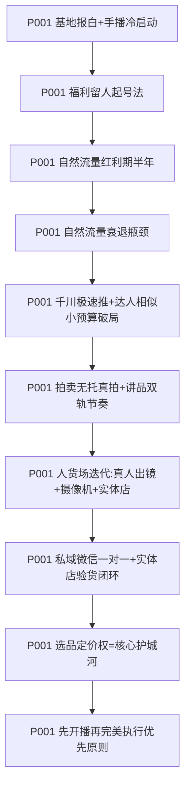

# 第 38 章 抖音鸡血石非标品直播六阶段进化 —— 福利留人、千川精准投流、拍卖无托建信、人货场迭代、私域实体双轨
作者：龙哥

## 学习目标

- 理解小众非标品直播的核心矛盾：信任构建难、留人难、成交频次低
- 掌握“福利留人→千川精准投流→拍卖建信→人货场迭代”六阶段进化路径的实操逻辑
- 了解非标品‘拍卖无托真拍+讲品双轨’玩法如何实现‘薄利引流、高利收割’
- 能识别高客单非标品业务的核心护城河：不可复制的上游资源积累与专家级定价权
- 学会‘先开播再完美’的执行心法，建立勤奋度优于筹备度的行动优先范式

## 38.1 生活类比

想象鸡血石直播间是一个**古董拍卖行的开业庆典**：基地证书 = 行业权威鉴定专家的签名背书，让买家敢于出价；福利印章 = 开业赠送的‘镇店之宝’小礼品，虽成本不菲但能聚拢第一批‘懂行’的老主顾；拍卖环节 = 以‘无保留价、绝不托儿’的规则拍卖入门级藏品，用‘有舍才有得’的豪气建立‘这里公平、靠谱’的口碑；讲品环节 = 拍卖会散场后，请老行家（父亲）在VIP室为意向客户讲解馆藏级珍品（几万至几十万），凭前场积累的信任成交大单；实体店/私域 = 旁边就是自家博物馆，客户随时可来‘验货、喝茶、当面交易’，解决‘隔屏买假’的终极恐惧。就像古董行‘以信立业、以货养信、以场聚信’，非标品直播也需‘证书建信、拍卖聚信、实体锁信’三位一体。

## 38.2 概念地图

鸡血石非标品直播六阶段进化
├── 核心属性与信任基建
│   ├── 非标品属性（唯一SKU、一物一价、送礼属性强） —— P001
│   ├── 基地报白质检机制（证书背书解决真伪信任） —— P001
│   └── 手播模式冷启动（极低成本、降低心理门槛） —— P001
├── 起号与流量突破
│   ├── 福利留人起号法（实打实送品、积累种子用户、精准标签） —— P002
│   ├── 冷启动自然流量红利（复用旧号、零投流、半年享受红利） —— P003
│   └── 千川小预算精准投流（极速推稳人气+达人相似引精准、日预算~1000元） —— P004
├── 玩法创新与信任转化
│   ├── 拍卖无托真拍（价高者得、坚决不设托、有舍才有得） —— P002
│   ├── 拍卖+讲品双轨节奏（前拍卖引流建信、后讲品高利收割） —— P004
│   └── 复购率提升机制（低价竞得满意→二次参与→购买高货） —— P004
├── 人货场协同迭代
│   ├── 主播人设进化（手播→真人出镜、增强人设IP） —— P001
│   ├── 选品组品策略（拍卖品薄利多销+讲品高客单利润） —— P004
│   └── 场景升级迭代（手机→摄像机、小房间→实体店/基地直播） —— P001
├── 私域与实体闭环
│   ├── 私域高客单成交（父亲微信一对一、累计百万复购） —— P005
│   ├── 实体店信任锚点（杭州艺术馆、实物验货当面交易） —— P005
│   └── 线上线下相互赋能（引流-服务-成交三位一体） —— P005
└── 核心定律与边界
├── 信任先行、玩法破局、场景迭代核心主张 —— P001
├── 选品定价权=核心护城河（专家把货+主播传文化+运营保履约） —— P001
├── 先开播再完美执行优先原则（勤奋度是核心考核指标） —— P001
└── 资源门槛与利润真相（综合利润30%、矿源不可复制、新人慎入） —— P001

## 38.3 鸡血石非标品直播 —— 小众赛道的信任构建与玩法进化

### 38.3.1 为什么需要这个概念？

你想过吗？为什么卖衣服、卖零食的直播间人气爆棚，卖鸡血石印章却总觉得“冷清”？
因为**鸡血石印章属于非标品** —— 每一枚印章的纹理、血色、雕工、品相都是独一无二的，没有统一的SKU，没有统一的标价。[P001, p.1-2]

这就导致了三个核心矛盾：
1.  **留人难**：用户进来看不懂，主播一枚枚讲解，节奏慢，用户听不住就划走了。
2.  **成交频次低**：客单价几千到几十万，决策周期长，冲动消费概率极低。
3.  **信任危机重**：高客单价非标品，买家最怕“买假”、“怕定价不透明”、“怕隔屏买到假货”。

传统标品直播那套“爆品+话术+促单”完全失效。你需要一套**专门适配非标属性**的运营方法论：**基地报白建信任（证书背书）+ 福利留人积累种子用户 + 拍卖玩法建信任 + 千川精准投流破瓶颈 + 人货场协同迭代（手播→真人/实体店）+ 私域/实体闭环高客单复购**。

---

### 38.3.2 核心定义与公式

> **非标品直播核心模型**（来源：《抖音鸡血石非标品直播六阶段进化》）
> 
> 信任资产累积 × 玩法适配度 × 场景迭代速度 = 非标品变现能力

这个公式展示了三个乘法关系：
- **信任资产累积**是地基：无基地证书/实体店/专家背书，高客单非标品根本无法成交；
- **玩法适配度**是杠杆：拍卖机制（无托真拍）完美匹配非标品“一物一价”属性，以“薄利引流”换“高利收割”；
- **场景迭代速度**是上限：人货场（主播/选品/场景）必须随阶段协同进化，静态配置必死。

---

### 38.3.3 关键性质拆解

#### 1. 信任前置性：证书、实体、专家三重背书
> "鸡血石在抖音属于特殊类目，是需要报白的……入驻的是抖音青田石雕基地……经抖音基地质检通过后是会出一张证书的，也是买卖双方做了一个保证。" ——《P001, p.2》

**直觉理解**：买几万块的石头，凭什么信你？凭平台认证的基地出具的证书。这是准入门槛，更是信任基石。后期基地质检收紧，驳回不符合类目要求的产品，反而倒逼供应链合规，保护了头部玩家的护城河。

#### 2. 玩法适配性：拍卖机制天生匹配非标品
> "我们一致决定是不设托，这样才会有客户愿意出价，愿意经常来出价……有舍才有得，格局要放大。" ——《P001, p.3》

**直觉理解**：非标品“一物一价”，怎么卖？**拍卖**——价高者得，天然公平。关键是**“无托真拍”**：哪怕亏本也要让利给用户，用“舍”建立极致信任。这不是慈善，是用拍卖品的“薄利”买来直播间的人气、停留、互动、信任标签，再反哺高货“讲品”的“高利收割”。

#### 3. 迭代必要性：人货场必须协同进化
> "直播就是人货场，我们也是尽力在完善，还有很多进步的空间。增强了主播的人设……打造新的直播场景，与同行之间形成差异化……在有成本预算的情况下，有一定的成果的前提下，要敢于做出改变。" ——《P001, p.4-5》

**直觉理解**：
- **人**：手播（不露脸）→ 真人出镜（增强人设IP） → 专家坐镇（父亲/掌柜）
- **货**：单一平播 → 拍卖品（薄利引流）+ 讲品（高利收割）组品结构
- **场**：手机+灯+小房间 → 专业摄像机/绿幕 → 实体店/基地直播（场景即信任）

每个阶段人货场都是**配套升级**的，单点突破无效。

#### 4. 资源壁垒性：核心护城河非技术/运营，是不可复制的上游资源
> "鸡血石是属于蓝海的，我们综合利润来说，是 30% 左右……就门槛来说还是比较高的，因为鸡血石是我们当地的矿产资源，政策原因封矿好多年了，之前是父辈线下做这个生意几十年了，有这个资源积累。难度最大在于选品……选品及售卖价格全是经父亲把控的。" ——《P001, p.5-6》

**直觉理解**：综合利润率仅30%，非暴利。核心壁垒是：**原产地矿源积累（政策封矿不可复制）+ 专家级选品定价权（几十年经验）**。主播/运营学不来，必须建立“专家把控货+主播传文化+运营保履约”的分工体系。

---

### 38.3.4 六阶段进化路径详解

#### 阶段一：基地入驻 + 手播冷启动（极低成本验证模型）
- **动作**：入驻青田石雕基地报白质检 → 复用父辈旧号（粉丝1000+） → 一台手机、两盏灯、15平米小房间开播
- **核心逻辑**：基地证书解决“信不信得过”；手播模式解决“不敢播、播不起”；旧号解决“冷启动权重”。
- **实测数据**：开播次日成交4000元，后续连续多日成交数千至上万，场观峰值3000+、平均在线30+，持续半年享受自然流量红利。[P001, p.2-3]

#### 阶段二：福利留人起号法（实打实成本换精准流量）
- **动作**：每场直播固定送3枚昌化石印章（开播/中途/下播各一），单枚成本200-300元，日均福利成本600-900元，坚持6个月。
- **核心逻辑**：**“直播间想要成交，一定是先想着怎么去留人”**。用高客单利润补贴获客成本，换取：自然流量权重提升 + 精准人群标签打造 + 第一批种子忠实粉丝池。[P001, p.2-3]
- **量化权衡**：6个月后因成本过高暂停，但已完成冷启动使命，为后续千川投流奠定模型基础。

#### 阶段三：流量瓶颈期 → 千川小预算精准投流破局
- **痛点**：22年初自然流量衰退（场观3000→1000+，在线30→10+，连续10天不出单），老粉占比过高，模型老化。[P001, p.3]
- **动作**：日预算~1000元，两条核心计划：
  1. **极速推计划**：稳定进场人气，维持直播间基础在线；
  2. **达人相似计划**：通过蝉妈妈/精选联盟筛选文玩垂类达人，引入精准人群。
- **实测数据**：配合原有自然流量模型，恢复日销1-5万稳定出单。近7天投流数据验证ROI为正。[P001, p.3-4]

#### 阶段四：拍卖+讲品双轨节奏（玩法创新的核心突破）
- **前半场·拍卖（薄利引流建信）**：
  - 拍品客单价~1000元，利润薄（薄利多销）
  - **核心铁律**：坚决不设托、不托底回购、秒拍秒付、“有舍才有得”
  - 作用：拉高在线人数/停留时长/互动率，建立“公平、靠谱”信任资产，训练精准人群模型
- **后半场·讲品（高利收割利润）**：
  - 讲解高客单非标品（几万至几十万），利润率高
  - 转化路径：拍卖用户复购 + 私域老客成交 + 现场冲动下单
- **实战成果**：复购率显著高于同行，22年9月达抖音石雕类目第一。[P001, p.3-4]

#### 阶段五：人货场协同迭代（从手播到真人/实体店）
- **主播进化**：女朋友（新手）→ 真人出镜强化人设 → 父亲（专家掌柜）坐镇讲高货
- **场景升级**：手机手播 → 专业摄像机/绿幕 → 杭州临安“石痴鸡血石艺术馆”实体店直播
- **组品策略**：拍卖品（昌化石印章，薄利引流）+ 讲品（鸡血石高货，高利收割）形成标准化SKU矩阵
- **核心原则**：**“在有成本预算、有一定成果前提下，敢于做出改变”**。[P001, p.4-5]

#### 阶段六：私域+实体双轨闭环（高客单成交的终极归宿）
- **私域成交**：3人团队无主动私域运营，靠客户主动添加 → 父亲微信一对一深度服务 → 高客单复购累计超百万。[P001, p.5]
- **实体店锚点**：杭州临安“石痴鸡血石艺术馆”提供实物验货、当面交易场景，解决“不见实物不敢下单”的终极信任难题。[P001, p.5]
- **三位一体**：线上引流（直播/短视频） → 私域深度服务（微信一对一） → 线下实体验货成交（艺术馆）。

---

### 38.3.5 方法演进图

---

### 38.3.6 多源对照：非标品直播的不同流派

本章核心素材来自单一实战复盘（P001），但我们可以对照行业通识进行**共识与分歧**分析：

#### 共识
- **非标品必须“信任前置”**：无论文玩、古董、翡翠、二手奢侈品，高客单非标品的成交前提都是真伪担保（基地/证书/专家/实体店）。
- **玩法必须适配属性**：标品靠“爆款+促单”，非标品靠“拍卖/竞价/一对一讲解”等匹配“一物一价”的机制。
- **私域是高客单非标品的终极归宿**：公域流量转化率低、信任建立慢，高客单成交必在私域/实体完成深度服务。

#### 分歧
| 维度 | 本章主张（鸡血石实战） | 行业常见流派（如翡翠/古董） |
|------|------------------------|---------------------------|
| **冷启动方式** | 福利留人（送实物印章，成本高但精准） | 低价引流款（9.9/99元标品，成本低但粉丝泛） |
| **投流策略** | 千川小预算（日千元），极速推+达人相似，依托自然流量模型 | 千川大预算（日万/十万），专业投手团队，纯付费起号 |
| **主播模式** | 手播→真人→专家（父亲）三阶段，家庭式分工 | 专业主播团队轮班，标准化话术SOP |
| **私域运营** | 极简：父亲微信一对一，无SOP、无社群、无自动化 | 标准化：社群运营+销售团队+CRM系统+精细化触达 |

**核心洞察**：鸡血石模式的特殊性在于**“家庭式微型组织+极致资源壁垒+非标准化高信任服务”**，适合有上游资源、无团队、追求高利润率而非规模化的小微玩家。想做大规模、标准化复制，需另寻路径。

---

### 38.3.7 设计中的取舍

#### 为什么不用“低价引流款+标品话术”而要“福利送印章+拍卖玩法”？
- **低价引流款**吸引的是“占便宜”人群，标签不精准，后续高货转化极低，且稀释品牌调性。
- **福利送印章**虽成本高（日均600-900元），但送的是**正品、同品类、有收藏价值**的产品，精准筛选“懂行、有购买力、认可价值”的种子用户，为后续千川模型、高货转化打下精准人群基础。
- **拍卖玩法**利用“价高者得”的公平机制，天然匹配非标品“一物一价”属性，用“薄利”买“信任”，是**“玩法即信任建设工具”**的典范。

#### “先开播再完美”在非标品高客单赛道的风险边界在哪里？
- **适用边界**：有基地证书背书、有专家（父亲）兜底选品定价、有实体店兜底售后。在这三重保护下，“丑/笨/拙”的直播反而显得真实、亲切，利于建立信任。
- **风险边界**：**无证书、无专家、无售后**的新人盲目照搬“先开播”，极大概率因专业度不足、假货风控、售后纠纷导致账号废弃。**“先开播”不等于“裸奔上阵”，核心是“最小可行性闭环（证书+专家+售后）跑通后，立即开播迭代”**。

---

## 38.4 动手练习

### 练习 1：复盘一次非标品直播间的冷启动决策
某新手想做玛瑙手串直播（非标品、客单价500-5000元），拥有产地矿源优势但无直播经验、无团队、预算有限：
1. 是否需要入驻基地报白？理由是什么？
2. 启动期设备投入多少合适？手播模式的优劣势？
3. 设计一套‘福利留人’方案：送什么、送几个、成本如何控制、预期指标是什么？
4. 面对‘自然流量衰退、连续不出单’的瓶颈期，如何判断是否该引入千川？千川预算如何设定、计划如何搭建？

**回答问题**：
- 为什么非标品直播‘选品定价权’是核心护城河？主播能否替代专家选品？
- ‘先开播再完美’在非标品高客单赛道是否适用？风险边界在哪里？

### 练习 2：拆解‘拍卖+讲品’双轨节奏的信任转化机制
观看一场文玩类直播回放（或复盘某头部账号直播切片），重点记录：
1. 拍卖环节：拍品客单价、拍卖时长、成交笔数、主播话术（强调无托、秒付）、互动数据（点赞/评论/在线峰值）
2. 过渡环节：如何从拍卖自然过渡到讲品？有无明确的仪式/话术节点？
3. 讲品环节：高货客单价、成交笔数、成交路径（公屏拍/私信/加微信）、复购客户占比

**回答问题**：
- 拍卖环节的‘薄利’具体薄在哪里？为何说‘有舍才有得’是建立信任的关键？
- 如果取消拍卖环节直接讲高货，转化率会发生什么变化？核心缺失是什么？
- 该模式能否迁移到‘古董家具’、‘原石翡翠’等其他非标品类目？关键适配条件是什么？

### 练习 3：推演‘私域+实体’双轨成交模型的单客经济账
假设某鸡血石账号：日均进直播间500人，拍卖成交20单（客单800元、利润率10%），讲品成交2单（客单3万元、利润率30%），其中1单来自拍卖用户复购，1单来自私域老客复购；私域维护成本：父亲每天微信沟通4小时，实体店租金人力月均5万元：
1. 计算单场直播的毛利贡献（拍卖毛利+讲品毛利）
2. 计算私域/实体分摊到单场直播的成本（按月均20场开播）
3. 单场直播净利润 = 毛利贡献 - 分摊成本，是否为正？
4. 若取消实体店、仅靠微信成交，信任度下降导致讲品成交率减半，净利润如何变化？

**回答问题**：
- 为什么说‘线上信任种草+私域深度服务+实体实物验货’是高客单非标品最优路径？缺一不可的环节是哪个？
- 父亲（专家）的微信一对一成交，能否用‘标准化话术+初级销售’替代？边界在哪里？

---

## 38.5 本章小结

这一章中我们学习了小众非标品（以鸡血石为例）在抖音直播带货中的六阶段进化路径。首先，我们拆解了非标品“留人难、成交频次低、信任危机重”的核心矛盾，确立了“信任前置、玩法破局、场景迭代”的核心主张。其次，我们详细复盘了从基地报白入驻、手播冷启动，到福利留人积累种子用户，再到自然流量红利期与瓶颈期，引入千川小预算精准投流破局的全过程。接着，我们深度解析了“拍卖无托真拍+讲品双轨”这一核心玩法创新，揭示了其“薄利引流建信任、高利收割转化利润”的信任转化机制。然后，我们讲解了人货场（主播/选品/场景）协同迭代的必要性，以及私域微信一对一服务与实体店验货交易构成的高客单成交闭环。最后，我们认清了该赛道综合利润率仅30%、核心护城河为不可复制的矿源资源与专家级定价权、新人入局门槛极高的真实边界，并内化了“先开播再完美、勤奋度优于筹备度”的执行心法。

本章我们一起学习了以下概念：

| 概念 | 解释 |
|------|------|
| 非标品属性 | 每枚印章唯一、需独立讲解定价，留人难、成交频次低，但具备一物一价、高客单、送礼属性强特点 |
| 基地报白质检 | 青田石雕基地出具证书背书真伪，解决高客单非标品买家信任痛点，是准入门槛与信任基石 |
| 福利留人起号法 | 单场送3枚昌化石印章（成本600-900元/天），坚持6个月以实打实成本换自然流量权重、精准人群标签、种子忠实粉丝池 |
| 千川小预算精准投流 | 日预算~1000元，极速推稳人气+达人相似引精准人群，配合前期自然流量模型恢复日销1-5万稳定出单 |
| 拍卖无托真拍 | 前半场拍卖~1000元中低客单品，坚决不设托、秒拍秒付，以“有舍才有得”建立极致信任，拉高在线/停留/互动 |
| 拍卖+讲品双轨 | 拍卖薄利引流建信任，讲品高利收割转化大单，形成“前场聚人气、后场做利润”闭环，做到石雕类目第一 |
| 人货场进化论 | 人(主播人设/真人出镜)、货(拍卖品+讲品组品)、场(手播→摄像机/实体店)随阶段协同迭代，静态配置必死 |
| 私域高客单闭环 | 3人团队靠父亲微信一对一深度服务成交百万高货复购，零主动运营靠客户主动添加 |
| 实体店信任锚点 | 杭州临安石痴鸡血石艺术馆提供实物验货与当面交易场景，解决高客单非标品“不见实物不敢下单”终极信任难题 |
| 选品定价权护城河 | 非标品无统一标价，选品定价权掌握在父辈/专家手中（几十年矿源积累+专家级鉴定），主播/运营难复制，是核心壁垒 |
| 先开播再完美 | 两盏灯一台手机15平米小房间即开播，勤奋度(开播时长/频次)是平台核心考核指标，行动力大于筹备度，每播一场积累一场经验 |
| 资源门槛与利润真相 | 综合利润率仅30%非暴利，核心护城河为原产地矿源积累(政策封矿不可复制)及专家级定价权，无类似资源者建议不入局 |

下一章中，我们将学习**短剧CPS低门槛高复制模式**，探讨如何通过搬运去重、矩阵号批量、爆款产出比2:1、止损试错机制，实现小白月入过万的蓝海项目可行性验证。
