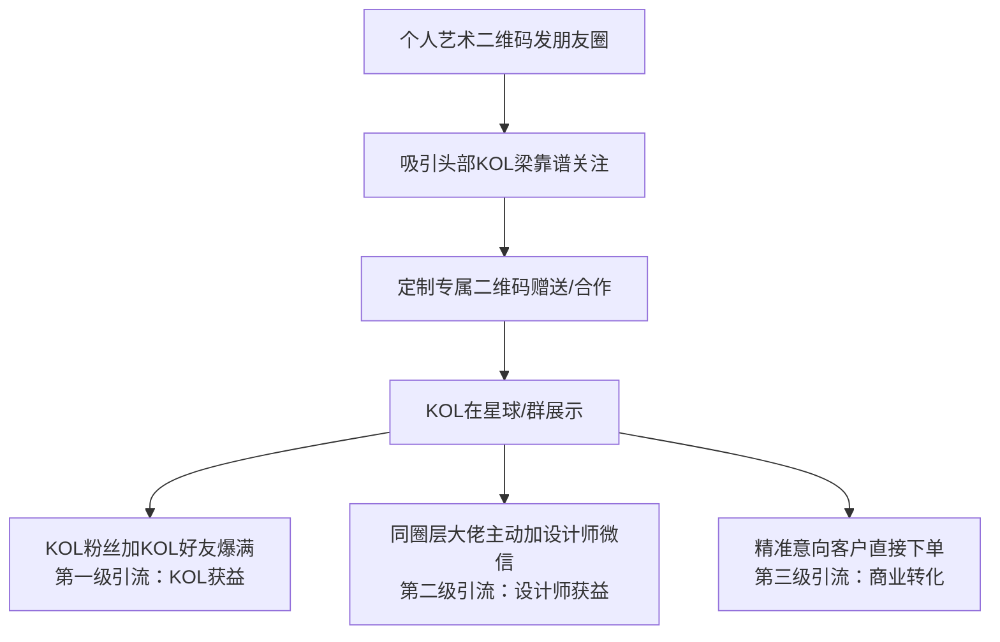

# 第 59 章 艺术二维码商业体系 —— 从“一张二维码”到“连锁引流商业闭环”

## 学习目标

- 理解IP审美溢价定理：艺术二维码的商业定价锚点在于其承载的IP商业价值而非制作成本
- 掌握艺术二维码引流杠杆定理：兼具社交货币属性与身份锚定属性，触发KOL粉丝加KOL→大佬加设计师→意向客户下单三级引流链条
- 理解跨平台生态割裂定律：微信二维码无法在抖音/小红书直接引流，仅限微信生态内及线下物理场景流通
- 掌握迭代测试保识别法：每增加一个视觉元素即跨设备/交互实测，将可识别性作为硬约束嵌入创作全程
- 了解圈层定向营销策略：精准锚定知识付费/自媒体IP圈层，将二维码重定义为引流工具与身份勋章
- 理解原创vs模板二维码优劣：模板类识别性不稳定无售后，原创类专属高识别承载IP价值

## 59.1 生活类比

想象艺术二维码是**一张会发光的VIP名片**：**IP审美溢价** = 普通人买名片纸(两位数)，大佬买定制金属名片(五位数)，价格锚点在于名片背后的人脉价值而非材料成本；**引流杠杆** = 就像会议上大佬展示名片，引发围观→同行互换→意向客户主动加微信，三级链条自动触发；**跨平台割裂** = 微信名片不能在抖音/小红书直接用，只能在微信生态及线下物理场景流通，限制了全域推广；**迭代测试** = 印名片前必须反复打样测试：字号能否看清、二维码能否扫出、安卓苹果都兼容，一处失效全盘作废；**圈层营销** = 不发传单给路人，只把名片塞给行业大佬和KOL，靠他们的背书引爆连锁反应。就像高端定制名片不靠材料取胜、靠背后的人设与圈层溢价，艺术二维码的商业本质也是：视觉锤包装IP价值，圈层渗透撬动流量。

## 59.2 概念地图

艺术二维码商业体系
├── 核心定理
│   ├── IP审美溢价定理  —— P104
│   ├── 艺术二维码引流杠杆定理  —— P104
│   ├── 跨平台生态割裂定律  —— P104
│   └── 迭代测试保识别法  —— P104
├── 商业化前提
│   ├── 功能性(识别率)>艺术性  —— P104
│   ├── 时效性约束：仅适用永久原始码  —— P104
│   └── 信息点覆盖原则  —— P104
├── 定价模型
│   ├── 分级定价：两位数至五位数(最高3万)  —— P104
│   └── 价格锚点：IP商业价值而非制作成本  —— P104
├── 营销策略
│   ├── 圈层定向：锚定知识付费/自媒体IP圈层  —— P104
│   ├── 社交货币属性+身份锚定属性  —— P104
│   └── 三级引流链条：KOL粉丝→大佬→意向客户  —— P104
└── 行业现状
    ├── 原创vs模板：原创专属/高识别/承载IP价值  —— P104
    ├── 发展停滞四大原因：传播载体弱/设计师缺营销/需求错位/生态割裂  —— P104
    └── 从业者稀缺：会制作原创艺术二维码设计师仅几千人  —— P104

## 59.3 IP审美溢价与引流杠杆 —— 艺术二维码的商业定价与三级引流链条

### 为什么需要这个概念？

普通设计师按工时定价(两位数)，无法向大IP收取溢价(五位数)，导致商业价值严重被低估。艺术二维码被视为"装饰品"而非"引流工具", 无法触发KOL背书与圈层裂变的连锁商业转化。缺乏"功能性>艺术性"的硬性约束, 导致牺牲识别率换艺术效果的败笔产品流入市场, 损害商业信誉。

> "一个小小的二维码，也能玩出花样帮助引流。"
> 
> "让我见识到了什么叫著名圈友梁靠谱的影响力，什么叫表达者红利，什么叫一键引流，什么叫圈层的重要性，什么叫我被大佬加微信的慌张。"
> 
> ——《吉果：艺术二维码引流复盘》

> "扫不出来是制作有问题。好的艺术二维码都是可扫可长按的。"
> 
> "商业价值和引流价值可能都没有发展明白吧。"
> 
> ——《吉果：艺术二维码引流复盘》

> "艺术二维码的价值来自于它承载的IP价值和创意价值。它不仅仅是一个身份识别的图案，还是一件包含设计艺术价值在内的艺术产品。"
> 
> "设计师是在有限的空间内，绘制了一幅有丰富想象力的图画。同时还要保证二维码的可识别性。所以艺术二维码是一件客单价很高的产品。"
> 
> "普通人只是为了好看和独特，一两千买个图片，他是不愿意的。但自媒体IP需要引流，尤其是那些全方位包装自己的大IP更需要引流。"
> 
> ——《吉果：艺术二维码商业化全拆解》

### 核心定义

**IP审美溢价定理**（来源：《吉果：艺术二维码商业化全拆解》）

艺术二维码的商业定价锚点在于其承载的IP商业价值与稀缺性，而非制作成本。大IP愿为差异化视觉资产支付溢价(边际收益远超成本)，普通用户仅付模板成本。

**艺术二维码引流杠杆定理**（来源：《吉果：艺术二维码商业化全拆解》）

兼具"社交货币属性"(新奇独特引发炫耀/分享)与"身份锚定属性"(专属元素强化IP辨识)，当被头部KOL在私域/社群展示时，触发"好奇-验证-连接"三级引流链条：KOL粉丝加KOL → 同圈层大佬加设计师 → 精准意向客户下单。

这个定理展示了艺术二维码如何从单纯的视觉装饰进化为商业引流工具：它不是靠广告投放，而是靠"被展示"本身自带传播动能。

### 关键性质

**价格阶梯**（来源：《吉果：艺术二维码商业化全拆解》）

- 基础换色/单一元素 → 两位数
- 3-5原创图案覆盖信息点 → 三位数
- 明确专属图案+大量信息/配海报 → 1-2千 / 3-5千
- 毕加索/2.5D高难度风格/含设计理念 → 五位数，最高3万

这个价格体系展示了：复杂度、原创元素数量、IP专属信息密度、衍生应用范围四个维度共同决定商业定价，而非单纯工时。

**识别性硬约束**（来源：《吉果：艺术二维码商业化全拆解》）

扫一扫/长按识别/跨系统兼容，一两个点绘制错误即导致不识别，牺牲识别率换艺术效果属于败笔无商业引流价值。

这个约束揭示了艺术二维码的工程本质：它是"在功能性约束下的视觉重构"，而非"带二维码功能的插画"。

**时效性边界**（来源：《吉果：艺术二维码商业化全拆解》）

仅适用永久有效原始码，临时码/换样式功能导致底码变更均失效。

这个边界条件直接决定了商业交付的风险控制：必须在合同中明确"原始码永久有效且不得更换"条款。

### 典型例子

吉果个人艺术二维码朋友圈发布 → 梁靠谱关注/转发 → 专属二维码出炉 → KOL星球/群展示 → 好友申请爆满(引流KOL) → 多位大佬主动加作者微信(引流设计师) → 2位大佬直接下单定制(商业转化)。全过程零广告投放，耗时数天。

这个案例完美演示了三级引流链条的自发触发机制：不需要设计师主动推销，KOL的"展示"行为本身就是最强营销。

### 边界条件

- 仅限微信生态内(群/朋友圈/👸号/视频号)及线下物理场景流通，抖音/小红书判定违规无法跨平台引流
- 核心价值锚点在于"可扫可长按"基础功能性，牺牲识别率换艺术效果的产品无商业引流价值
- 普通用户因无变现路径仅愿支付模板成本，自媒体IP因变现需求愿支付溢价，定价逻辑本质不同



---

## 59.4 迭代测试保识别法 —— 可识别性作为硬约束的工程化创作流程

### 核心定义

**迭代测试保识别法**（来源：《吉果：艺术二维码商业化全拆解》）

艺术二维码制作的核心工程化流程：在AI矢量软件中逐层绘制元素 → 每增加一个视觉元素即进行跨设备（iOS/Android/鸿蒙）、跨交互（扫一扫/长按识别）实测 → 定位识别失败点 → 微调信息点覆盖 → 循环直至全通过。该方法将"可识别性"作为硬性约束条件嵌入创作全过程。

> "所以为了保证识别性，在绘制的过程中，要不断地测试。简单来说，我加了一个花，二维码扫的出来吗？测一下。再加个草呢？再测测。"
> 
> "一个完美的艺术二维码，必须让你扫也扫的出来，长按也能按的出来。安卓鸿蒙的能识别，IOS也得能识别。"
> 
> ——《吉果：艺术二维码商业化全拆解》

这个方法揭示了艺术二维码创作的本质：**它是约束满足问题（CSP）的求解过程**，而非纯粹的艺术创作。每一个视觉元素的加入都是对识别率这个单一指标的"压力测试"。

### 关键推导：信息点覆盖原则的量化执行

**信息点覆盖原则**（来源：《吉果：艺术二维码商业化全拆解》）

艺术二维码设计的核心技术原理，即通过线条、图像合理覆盖二维码的关键信息点（功能模块），在视觉重构的同时必须保证扫码识别率。

$$
\text{识别率} = f(\text{定位点完整度}, \text{对齐点完整度}, \text{版本信息完整度}, \text{数据码字完整度}, \text{纠错等级冗余度})
$$

这个公式展示了：识别率取决于五大功能模块的完整度与纠错冗余度的联合作用。艺术设计只能利用纠错冗余度提供的"容错预算"。

**迭代测试算法伪代码**

```
输入：原始二维码矩阵 Q, 目标视觉元素集合 E = {e1, e2, ..., en}
输出：可识别的艺术二维码 A

A ← Q 的副本
FOR 每个元素 ei ∈ E:
    A' ← 在 A 上叠加/替换 ei
    IF 测试通过(A') == FALSE:
        微调 ei 的位置/形状/透明度
        重新测试直至通过
    A ← A'
RETURN A
```

这个算法展示了：创作过程实质是一个"加元素→测试→回滚/微调→再测试"的闭环迭代，识别率是唯一的硬性通过标准。

### 典型例子

作者制作梁靠谱专属二维码：周期5-7天，包含明确专属图案+大量信息。毕加索风格需1-2周，2.5D风格更久。顶级定制可达3万元/一个月。

这个时间成本分布印证了：识别性测试与微调是核心耗时瓶颈，而非绘制本身。

---

## 59.5 跨平台生态割裂定律 —— 微信生态内的商业闭环与破解路径

### 核心定义

**跨平台生态割裂定律**（来源：《吉果：艺术二维码商业化全拆解》）

艺术二维码的商业效用受限于平台生态壁垒：微信二维码无法在抖音/小红书直接引流（被判定违规），仅限微信生态内（群、朋友圈、👸号、视频号）及线下物理场景流通。这导致其无法成为全域流量入口，限制了商业模式的规模化复制。

> "设计一款二维码付出很多，但是无法跨平台使用。例如微信的二维码不能发到小红书或者抖音。会被判定引流。微信生态内可以使用，视频号能够发微信艺术二维码的视频。"
> 
> "当然好的艺术二维码，完全可以打印出来线下使用。"
> 
> ——《吉果：艺术二维码商业化全拆解》

这个定律揭示了私域流量工具的根本局限：它是微信生态的"内部货币"，无法直接兑换为公域流量。

### 破解策略对照表

| 破解路径 | 核心思路 | 典型场景 | 优势 | 局限 |
|----------|----------|----------|------|------|
| **线下物理场景** | 将二维码实体化，绕过平台数字壁垒 | 展会名牌/产品包装/门店海报/实体名片 | 真实接触、信任度高、无平台限制 | 触达范围受物理空间限制、成本较高 |
| **视频化传播** | 将制作过程/展示效果视频化发布公域，引流至私域 | 抖音/小红书发制作视频/成品展示 → 简介/评论区钩子引导加微信 | 借力公域算法分发、内容本身有传播价值 | 需规避"引流违规"判定、转化链路长 |
| **微信生态内闭环** | 深耕微信内部所有触点形成闭环 | 视频号挂载/👸号菜单/朋友圈海报/群工具/小程序码 | 链路最短、转化率最高、完全合规 | 流量上限受微信生态总量封顶 |

这个对照表展示了：单一工具无法打通全域，必须组合拳作战。

---

## 59.6 圈层定向营销策略 —— 精准锚定高客单价种子用户

### 核心方法

**圈层定向营销策略**（来源：《吉果：艺术二维码商业化全拆解》）

针对艺术二维码"高客单价、审美上层需求、非刚需"的特性，放弃大众普及营销，精准锚定"知识付费/自媒体IP"圈层：该群体具备付费能力、极度在意差异化包装、深谙流量价值，将艺术二维码从"装饰品"重新定义为"引流工具"与"身份勋章"。

> "艺术二维码的原创性，导致价格并不亲民...属于最上层的需求...不是所有人都能接受。"
> 
> "在知识付费领域、自媒体IP领域，大家更注重自己的差异性和账号的审美包装。定位和圈层对了，结果也就对了。"
> 
> "自媒体时代，流量最贵。每一个独特的点，都可能成为你吸引流量的奇招。"
> 
> ——《吉果：艺术二维码商业化全拆解》

这个策略的核心洞见：**产品的属性决定了营销的对象**。高客单、非标、强身份属性的产品，天然匹配"以身份认同为核心驱动力"的圈层。

### 分级定价模型映射圈层支付意愿

| 价格梯队 | 产品形态 | 目标圈层 | 核心价值主张 |
|----------|----------|----------|--------------|
| 两位数 | 基础换色/单一元素 | 普通用户/小白测试 | 好看、便宜、满足好奇心 |
| 三位数 | 3-5原创图案 | 成长期创作者 | 差异化、识别度高、性价比 |
| 1-5千 | 专属图案+信息密度大/配海报 | 成熟IP/商业化账号 | 强IP绑定、引流工具属性、配套物料 |
| 五位数(最高3万) | 毕加索/2.5D/含设计理念/全案授权 | 头部大IP/机构 | 顶级视觉锤、品牌资产、排他性授权 |

这个映射表展示了：价格不是成本加成，而是**目标圈层感知价值的函数**。

---

## 59.7 原创vs模板二维码 —— 商业化可行性的分水岭

### 多源对照

**共识**：艺术二维码需保证基础识别功能（扫一扫/长按识别），视觉重构不能破坏功能性。

**分歧**：

- **原创派（吉果）**：主张专属定制、逐元素测试、承载IP价值、高客单价、可作为品牌资产积累。核心观点："设计师是在有限的空间内，绘制了一幅有丰富想象力的图画。同时还要保证二维码的可识别性。所以艺术二维码是一件客单价很高的产品。"
- **模板派（市场主流）**：主张标准化模板、一键生成、低价/免费、满足基础美化需求。核心观点："这种二维码的优势在于便宜，甚至免费。可以用很低廉的价格，得到一个简单美化过的二维码。"

**关键差异点对照**：

| 维度 | 原创艺术二维码 | 模板艺术二维码 |
|------|----------------|----------------|
| **专属性** | 100%专属，含IP专属视觉符号/信息 | 模板有限，重复率高，无专属元素 |
| **识别性保障** | 逐元素迭代测试，跨设备/交互全通过，终身售后 | 识别性不稳定，无售后，"喜欢的样式不识别只能换样式" |
| **商业价值** | 承载IP品牌资产，可作为引流工具/身份勋章 | 仅作装饰，无商业引流价值 |
| **价格区间** | 三位数至五位数（最高3万） | 两位数甚至免费 |
| **适用圈层** | 自媒体大IP、知识付费头部、品牌方 | 普通用户、预算敏感型、测试需求 |

这个对照揭示了：模板类产品本质是"工具化的装饰品"，而原创类产品是"定制化的商业资产"，两者虽长得像，但商业逻辑完全不同。

---

## 59.8 设计中的取舍

- **为什么不用"全自动AI生成"替代"人工迭代测试"？**
  当前AI生成艺术二维码（如ControlNet）虽能快速出图，但识别率不可控，缺乏"逐元素微调-实测-再微调"的精细控制能力。商业交付要求100%识别通过，AI现阶段只能作辅助灵感源，不能替代人工工程化保障流程。

- **为什么不做"跨平台通用二维码"？**
  微信/抖音/小红书/支付宝各有独立的码制体系与识别器，且平台策略严禁跨平台引流。试图做"万能码"会陷入平台对抗的无限博弈，不如深耕微信生态内闭环，或通过视频化/线下物理化做跨平台桥接。

- **这种设计的 trade-off 是什么？**
  - **得**：高客单价、强IP绑定、圈层自传播、零广告获客
  - **失**：无法规模化标准化交付（每单非标定制）、跨平台受限、从业者极度稀缺（仅几千人）、制作周期长（天到周级）

---

## 59.9 动手练习

### 练习 1：艺术二维码识别性极限测试

选择一个复杂IP形象(如含渐变、透视、精细线条)，制作艺术二维码并测试：
1. 在iOS/Android/鸿蒙三系统分别测试扫一扫与长按识别
2. 在弱光/强光/反光环境下测试识别率
3. 打印不同材质(铜版纸/哑粉纸/PVC)测试物理识别
4. 记录首次识别失败时的元素覆盖位置，分析信息点冲突规律

回答问题：
- 哪类视觉元素(渐变/透视/精细线条)最易导致识别失效？
- 信息点覆盖原则在实操中如何量化执行？
- 印刷工艺对识别率的影响阈值是多少？

### 练习 2：圈层定向营销实战推演

假设你是艺术二维码设计师，目标锁定知识付费头部IP(如生财有术大佬)：
1. 分析目标圈层的核心诉求：差异化包装、流量变现、身份辨识
2. 设计专属二维码方案：包含IP专属视觉符号、引流落地页、数据埋点
3. 制定触达策略：通过弱关系网络(朋友圈/社群)将作品推送至强关系节点(KOL)
4. 设定分级定价：基础版(两位数)/专属版(三位数)/旗舰版(五位数含运营授权)

回答问题：
- 如何验证目标圈层对"身份勋章"属性的支付意愿？
- 专属二维码的"社交货币属性"如何量化转化为引流数据？
- 旗舰版包含的"运营授权"具体包含哪些商业权利？

### 练习 3：跨平台生态割裂破解方案设计

针对微信二维码无法在抖音/小红书直接引流的限制：
1. 设计线下物理场景应用方案：展会名牌/产品包装/门店海报/实体名片嵌入
2. 设计跨平台内容转化方案：将艺术二维码制作过程视频化发布至抖音/小红书，引流至微信私域
3. 设计微信生态内闭环方案：视频号挂载二维码/👸号菜单栏/朋友圈海报/群工具

回答问题：
- 哪种线下物理场景的转化率最高？如何测算？
- 视频化传播中如何规避平台"引流违规"判定？
- 微信生态内哪个入口(视频号/👸号/朋友圈/群)引流效率最高？

---

## 59.10 本章小结

这一章中我们学习了艺术二维码的完整商业体系：首先理解了IP审美溢价定理——定价锚点不在制作成本而在承载的IP商业价值；其次掌握了艺术二维码引流杠杆定理——兼具社交货币与身份锚定属性，触发三级引流链条；接着理解了跨平台生态割裂定律——微信二维码仅限微信生态及线下流通，无法直接跨平台引流；然后掌握了迭代测试保识别法——每加一元素即跨设备实测，将可识别性作为硬约束嵌入创作全程；接着了解了圈层定向营销策略——精准锚定知识付费/自媒体IP圈层，将二维码重定义为引流工具与身份勋章；最后理解了原创vs模板二维码的本质区别——原创类专属高识别承载IP价值，模板类识别性不稳定无售后。

本章我们一起学习了以下概念：

| 概念 | 解释 |
|------|------|
| 艺术二维码 | 将插画/设计融入二维码结构，在保持识别功能前提下实现审美升级与IP专属表达的视觉载体 |
| IP审美溢价定理 | 定价锚点不在制作成本而在承载的IP商业价值与稀缺性，大IP愿为差异化视觉资产付溢价 |
| 艺术二维码引流杠杆定理 | 兼具社交货币属性(新奇独特引发炫耀/分享)与身份锚定属性(专属元素强化IP辨识)，触发三级引流链条 |
| 跨平台生态割裂定律 | 微信二维码不可跨平台引流(抖音/小红书判违规)，仅限微信生态内及线下物理场景，限制商业模式规模化复制 |
| 迭代测试保识别法 | 制作流程中每加一元素即跨设备/交互实测，将可识别性作为硬约束嵌入创作全程 |
| 圈层定向营销策略 | 针对高客单/审美上层/非刚需特性，精准锚定知识付费/自媒体IP圈层，将二维码重定义为引流工具与身份勋章 |
| 原创vs模板二维码 | 模板类便宜但重复率高/识别性不稳定无售后；原创类专属/高识别/承载IP价值，商业化首选 |
| 行业发展四大停滞原因 | 传播载体弱/设计师缺营销/历史需求错位/平台生态割裂 |
| 从业者稀缺性 | 市场会制作原创艺术二维码的设计师仅几千人，构成知识付费教学的高门槛与高潜力 |

下一章中，我们将学习营业执照年报实操与合规避坑 —— 从"第三方收费乱象"到"零成本自主年报"，掌握个体户及小微企业自主完成年报的全流程标准化操作法，规避逾期处罚升级链条与第三方代理收费陷阱。
