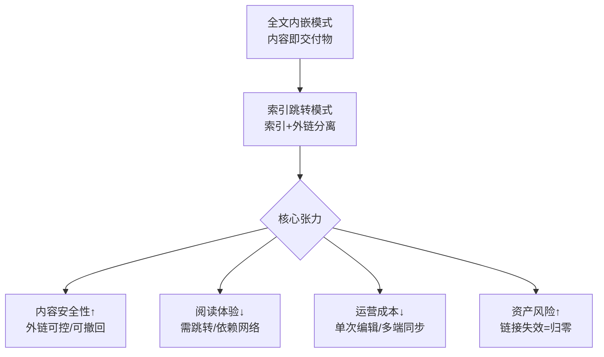

# 第 77 章 龙哥赚钱周报 —— 付费社群核心交付物的索引与分发

## 学习目标

- 理解付费社群核心交付物的设计逻辑与运营价值
- 掌握基于语雀平台的周度内容结构化组织与分发方法
- 掌握利用稀缺性机制与社交背书构建付费价值感知的策略
- 识别索引页空心化与外部链接依赖带来的知识资产管理风险
- 能够评估社群内容运营中『目录索引』与『实质内容』分离的利弊

## 77.1 生活类比

想象「龙哥赚钱周报」是一份高端会员制商业周刊的『精华目录索引页』：**语雀文档链接** = 杂志社档案库里的**全文稿件仓库**（核心资产所在地）；**周报索引页（本素材）** = 寄给会员的**仅含标题、分类、热度标签的『目录页』**（交付物形式）；**分类标签【中括号】** = 目录页的**栏目分类标签**（如『封面故事』『深度复盘』『工具箱』）；**点赞数/精华标识/评论图** = 目录页旁标注的**『编辑推荐』『读者热议』徽章**（社交背书）；**『请勿外流，防止失效』版权声明** = 封面上的**『仅限订阅者阅读，严禁复印转发』水印**（稀缺性构建）。就像读者拿到的只是目录页，想看全文必须登录档案库（点击语雀链接）；一旦档案库服务器迁移或链接失效，手中的目录页瞬间变成一张『空心化』的废纸——索引与实质分离，是知识资产管理的隐性雷区。

## 77.2 概念地图

龙哥赚钱周报
├── 核心定位
│   ├── 付费社群核心交付物      —— P001
│   ├── 龙哥风向标周度汇总载体  —— P001
│   └── 专属群留存与价值锚点    —— P001
├── 运营方法
│   ├── 语雀平台固定链接归档      —— P001
│   ├── 分类标签（中括号）结构化    —— P001
│   ├── 社交互动数据引用背书        —— P001
│   └── 版权声明控制传播范围        —— P001
├── 价值机制
│   ├── 稀缺性驱动付费价值感知      —— P001
│   └── 社交背书降低信任决策成本    —— P001
└── 结构性风险
    ├── 索引页空心化（无实质正文）    —— P001
    └── 核心内容外链依赖（语雀链接失效风险） —— P001

## 77.3 龙哥赚钱周报 —— 付费社群核心交付物的索引与分发

### 为什么需要这个概念？

你运营一个付费社群，成员每年付费几百上千元，最怕什么？最怕「交付物感知模糊」——钱交了，群里聊天记录一刷就没，干货沉底，新人进群看到的全是水群记录，老会员觉得「续费买个啥」。你需要一个**具象化、周期性、可累积**的核心交付物，把分散的高质量内容（风向标）结构化汇总，降低成员「去哪找干货」的检索成本；同时通过版权控制构建稀缺性，防止核心资产流出贬值，让「专属」真正值钱。

素材 P001 正是这种交付物的一个真实切片：生财有术社群的《龙哥赚钱周报》，每周更新，承载「龙哥风向标」核心内容的周度汇总载体，基于语雀文档固定链接归档，用中括号分类标签结构化组织，引用点赞数、精华帖标识、评论图片等社交互动数据增强可信度，并用「请勿外流、防止失效」的版权声明控制传播范围。

> "# 🍔230405 龙哥赚钱周报
> 每周更新，龙哥风向标另外文档分享。
> 
> > 原文：[`www.yuque.com/for_lazy/thfiu8/kwmmwmpst1l0rrak`](https://www.yuque.com/for_lazy/thfiu8/kwmmwmpst1l0rrak)
> 
> 【中括号】为分类，帖子内含点赞数和是否精华帖，带评论图片等。
> 
> 请勿外流，防止失效。如果感觉专属群有价值，可以邀请朋友进群。
> （文档除标题、链接、说明外，无后续具体周报条目内容）"
> 
> ——《P001, p.1-2》

这段原文展示了周报的「骨架」：固定链接指向语雀文档（核心内容仓库），中括号分类做结构化导航，点赞/精华/评论图做社交背书，版权声明做稀缺性锚点。但同时也暴露了核心痛点——**正文内容缺失，仅存索引**。

---

### 核心定义

> **龙哥赚钱周报 定义**（来源：《P001》）

$$
\text{WeeklyReport} = \langle \text{FixedLink}, \text{CategoryTags}, \text{SocialSignals}, \text{CopyrightNotice} \rangle
$$

这个公式展示了周报由四大要素组成：固定链接指向语雀全文仓库、中括号分类标签做结构化导航、点赞/精华/评论图等社交信号做背书、版权声明做稀缺性锚点。

- **周期性**：每周更新，形成固定预期与节奏感（来源：《P001, p.1》）。
- **索引性**：本体为目录索引，核心实质内容寄宿于外部语雀文档链接（来源：《P001, p.2》）。
- **稀缺性**：通过「请勿外流、防止失效」版权声明构建付费壁垒（来源：《P001, p.2》）。

---

### 关键运营方法：语雀平台周度内容分发法

> **语雀平台分发法**（来源：《P001》）

```
1. 固定链接归档：每期周报在语雀生成永久链接，作为唯一权威入口
2. 分类标签结构化：用【中括号】标注板块（如【AI工具】【私域运营】），支持按类检索
3. 社交互动数据背书：在索引条目旁显式标注点赞数、是否精华帖、评论图片
4. 版权声明控制传播：文末声明“请勿外流、防止失效”，构建心理威慑与契约边界
```

这段伪代码展示了周报从「内容生产」到「会员触达」的标准化动作序列：语雀做仓库、标签做导航、社交数据做信任背书、版权声明做价值锚点。四步缺一不可——少了固定链接找不到源头，少了标签找不到分类，少了社交数据新人不敢信，少了版权声明稀缺性塌陷。

---

### 价值机制双引擎：稀缺性 × 社交背书

#### 稀缺性驱动价值主张

> **稀缺性驱动价值主张 定理**（来源：《P001》）

$$
\text{PaidValue} \propto \text{Scarcity} \times \text{TrustSignal}
$$

其中 $\text{Scarcity}$ 由版权声明「请勿外流、防止失效」构建；$\text{TrustSignal}$ 由点赞数、精华标识、评论图等社交信号提供。这个公式展示了：付费价值感知 = 稀缺性 × 信任信号。版权声明制造「唯有此处可得」的独家感；社交信号制造「大家都在看、大佬都点赞」的从众感。两者相乘，将「免费获取」的边际成本推高，倒逼非会员付费入群。

#### 社交背书降低信任决策成本

> **社交背书增强可信度 定理**（来源：《P001》）

$$
\text{DecisionCost}_{\text{new member}} = \frac{\text{ContentQuality}_{\text{perceived}}}{\text{SocialProof}_{\text{visible}}}
$$

这个公式展示了：新成员的信任决策成本 = 感知内容质量 / 可见社交背书。当索引页显式标注「👍 128 💎精华 💬 评论 45 条」时，新成员无需打开全文即可完成质量预判，决策成本大幅降低。这就是为什么素材强调「帖子内含点赞数和是否精华帖，带评论图片等」——它们不是装饰，是**决策捷径**。

---

### 结构性风险：索引页空心化与外链依赖

#### 索引页空心化

> **文档结构完整性缺失 发现**（来源：《P001》）

素材明确标注：「文档除标题、链接、说明外，无后续具体周报条目内容」。这意味着：你手中的教科书章节只有一个目录页，每章标题下写着「详见第 X 页」，但第 X 页被撕走了。对于知识管理者，这是**灾难性**的——索引无法自证，无法直接提取商业案例、方法论细节、可复用模型。

#### 外链依赖风险

> **内容载体依赖外部链接 发现**（来源：《P001》）

核心内容寄宿于语雀外部链接 `www.yuque.com/for_lazy/thfiu8/kwmmwmpst1l0rrak`。语雀作为第三方 SaaS 平台，面临：账号注销、文档迁移、链接失效、平台倒闭、权限变更等不可控风险。一旦链接失效，周报索引页瞬间变为「死链接合集」，核心知识资产永久流失。素材中「防止失效」的焦虑，正是对该风险的直觉预判。

---

### 方法演进图：从「全文内嵌」到「索引跳转」的权衡



这个演进图揭示了社群内容运营的核心权衡：**索引跳转模式**在「内容安全性」「运营成本」上占优（只需维护语雀一份源文档，周报只改链接），但在「阅读体验」「资产自主性」上劣于「全文内嵌模式」。生财有术选择前者，本质是**以「运营效率」换「资产可控性」**的战略押注。

---

### 典型例子与边界条件

| 维度 | 表现 | 来源 |
|------|------|------|
| **周期性** | 2023年3月刊总目录：汇总四周精华帖，覆盖AI工具、跨平台运营、私域流量、电商变现、个人成长五大板块 | P001 |
| **索引性** | 第4周周报标题记录：仅提供单期报告文档标题与来源链接，作为深度研读定位锚点 | P001 |
| **边界-内容完整性** | 依赖外部链接：若语雀链接失效，索引页变空心化壳，核心知识资产永久流失 | P001 |
| **边界-功能定位** | 仅作检索入口：素材本身不含具体商业案例、方法论实操细节，不可直接用于教学案例拆解 | P001 |
| **边界-版权执行** | 无技术级 DRM：仅靠社群契约与「防止失效」心理威慑，无法物理阻止转发/截图 | P001 |

---

## 77.4 设计中的取舍

**为什么不用「全文内嵌模式」直接把正文发在群公告/文档里？**

因为社群内容更新频次高、板块多、协作者多。全文内嵌意味着每期周报都要在群文档/👸号/知识库里「二次排版、多端同步、权限维护」，运营成本随周期线性增长。索引跳转模式只需维护语雀一份源文档，周报只贴链接、改标签、贴热度数据，**边际运营成本趋近零**。生财有术作为「高频迭代」的实战社群，选择「运营效率优先」是理性的。

**这种设计的 trade-off 是什么？**

- **得**：运营轻量化、多端同步零成本、内容可随时撤回/修改（只改语雀源文档）、版权声明有心理威慑力。
- **失**：阅读体验割裂（需跳转语雀、需登录/授权）、资产自主性归零（语雀挂了周报全废）、离线归档困难（无法一键导出全库）、SEO 价值流失（内容不在自有域下）。

**什么场景该反向选「全文内嵌」？**

当社群进入「沉淀期」——内容产出频次降低、核心方法论固化、需构建长期知识资产护城河、需支持离线阅读/PDF 导出/站内搜索时，应将高价值内容「回迁」至自有知识库（如飞书/Notion/自建站），周报改为「摘要+站内链接」模式，兼得体验与资产。

---

## 77.5 动手练习

### 练习 1：设计付费社群周报交付物结构

**场景**：你负责运营一个年费 299 元的创业实战社群，需设计一份『周报』作为核心交付物。

1. 列出周报必须包含的 4 个结构化要素（参考『分类标签/互动数据/版权声明/固定链接』）并说明各自作用。
2. 你的核心内容（深度复盘/案例拆解）存放在飞书文档，周报仅作索引。请分析该模式的 2 个核心风险并给出对应规避方案。
3. 若要增强『稀缺性』，除版权声明外，还可在周报中植入哪 2 种『社交背书』元素？

### 练习 2：诊断索引页空心化案例

**某社群『周报』素材如下**：

```
# 第 10 期周报
> 原文：[yuque.com/xxx/yyy]
【AI工具】【私域运营】【选品思路】
请勿外流。
```

**问题**：

1. 该素材属于『索引页空心化』典型特征，若语雀链接失效，社群运营者应如何通过『最小可行性恢复』挽救知识资产？
2. 成员反馈『周报看不出干货』，运营者应如何在不改变『索引+外链』架构前提下，提升周报本身的『单次阅读价值』？
3. 对比『全文内嵌模式』与『索引跳转模式』在『内容安全性』『阅读体验』『运营成本』三维度的优劣势。

### 练习 3：拆解『社交背书增强可信』机制

**周报索引中某条目标注**：

```
【实战复盘】闲鱼无货源月入 2W+ 完整 SOP（👍 128 💎精华 💬 评论 45 条）
```

**问题**：

1. 该条目包含哪 3 类社交信号？分别对应『群体认可』『官方背书』『深度讨论』中的哪一类？
2. 若某新成员仅凭这 3 个信号决定『值得深读』，该决策路径属于『系统 1 思维』还是『系统 2 思维』？为何能降低信任决策成本？
3. 运营者发现『点赞数可刷、精华标识可人为指定』、如何设计『抗作弊的社交背书指标体系』？（提示：引入时间维度、行为维度、账号权重维度）

---

## 77.6 本章小结

这一章中我们学习了付费社群核心交付物「龙哥赚钱周报」的设计逻辑与运营实务。首先，我们拆解了它的四大核心要素：固定链接归档、分类标签结构化、社交互动数据背书、版权声明控制传播；其次，我们推导了双引擎价值机制——稀缺性驱动付费价值感知、社交背书降低信任决策成本，并给出了定量化的公式模型；接着，我们通过方法演进图对比了「索引跳转」与「全文内嵌」两种模式在内容安全性、阅读体验、运营成本、资产风险四维度的权衡取舍；然后，我们深度剖析了索引页空心化与外链依赖两大结构性风险，揭示了「防止失效」焦虑背后的资产脆弱性；最后，我们通过典型例子与边界条件表格，厘清了该模式的适用边界与演进方向。

本章我们一起学习了以下概念：

| 概念 | 解释 |
|------|------|
| 龙哥赚钱周报 | 付费社群核心交付物，承载风向标内容的周度索引载体 |
| 龙哥风向标 | 社群核心内容体系统称，周报为其定期呈现形式之一 |
| 专属群 | 提供周报的付费会员社群，具备准入门槛与版权保护机制 |
| 语雀平台分发法 | 固定链接归档+分类标签结构化+社交互动数据背书+版权声明控制传播 |
| 稀缺性驱动价值 | 通过『请勿外流、防止失效』版权控制构建内容稀缺性强化付费价值感知 |
| 社交背书增强可信 | 显式标注点赞/精华/评论图等群体信号作为内容质量外部背书降低信任成本 |
| 索引页空心化 | 素材仅含目录索引无实质正文，无法直接提取商业案例、方法论细节 |
| 外链依赖风险 | 核心内容寄宿语雀外部链接，链接失效将导致知识资产永久不可获取 |

下一章中，我们将学习 **第 78 章：生财认知与技能导航索引 —— 从“空链接”到“知识地图入口”**，拆解社群知识管理中「索引页空心化」与「核心内容外链依赖」的普遍现象，以及如何从这些结构性锚点出发重建完整知识地图。
