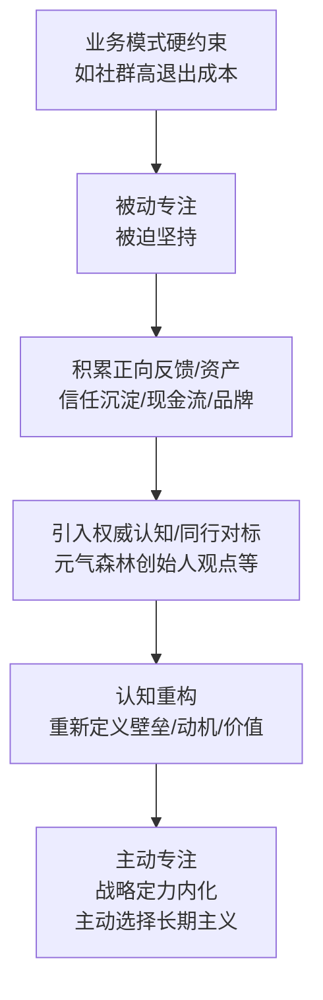

# 第 3 章 长期主义与复利思维 —— 坚持即稀缺，时间做朋友

## 学习目标

- 理解注意力获取的时间门槛定律：坚持即稀缺，初期曝光是噪音，长期存续才是信号
- 识别机会主义陷阱：敏锐度无法替代定力，频繁切换赛道导致无沉淀、无积累的负向循环
- 掌握业务模式对专注的倒逼机制：从“被动专注”（高退出成本倒逼）到“主动专注”（认知内化）的心理跃迁路径
- 确立抗压持久力为普通创业者的唯一核心壁垒：壁垒=比对手更能扛、活得更久、克服“自认为克服不了”的困难
- 重构创业动力层级：使命情怀>金钱驱动，过程价值（克服困难后的自己）>结果价值（赚钱）
- 辨析创业生存铁律：不存在“小而美”稳态，创业状态二元论（要么不做，要么All in Always Day 1）

## 3.1 生活类比

想象长期主义是一场**“马拉松式的露天烧烤”**：**初期曝光** = 刚点火时的浓烟：引人注目但让人皱眉（噪音），邻居只当你一时兴起；**坚持存续** = 烟熏火燎坚持3小时：邻居发现“这家伙居然还在烤”，香味飘远（信号），路人慕名而来；**机会主义** = 点火10分钟嫌烟大换煤气灶，再嫌慢换外卖：全程吃不到正宗烧烤味（无沉淀），邻居只记得你“爱折腾”；**业务模式倒逼** = 签了“包场承包合同”（高退出成本）：不烤满3小时违约赔偿，被迫坚持中意外练就控火绝活（被动专注→主动专注）；**抗压持久力** = 突降暴雨/食材不合格/邻居投诉：别人收摊走人，你撑伞调料补救（克服自认克服不了的困难），雨停后你成了全街唯一有烤串的（壁垒形成）；**使命情怀** = 不是为卖串钱（金钱边际递减），而是要证明“我能烤出全城最好吃的串”（克服困难后的自己），这股劲儿让你熬过暴雨、投诉、断货。

## 3.2 概念地图

长期主义与复利思维
├── 核心定律：注意力获取的时间门槛
│   ├── 坚持即稀缺  —— P001
│   ├── 初期曝光=噪音，长期存续=信号  —— P001
│   └── 时间复利效应：边际信任价值递增  —— P001
├── 反面模式：机会主义陷阱
│   ├── 敏锐度≠定力，频繁切换无积累  —— P001
│   ├── 负向循环：无沉淀→无壁垒→被复制→找新项目  —— P001
│   └── 短期现金流掩盖能力未成长风险  —— P001
├── 专注可行性：业务模式倒逼机制
│   ├── 被动专注：高退出成本业务（如社群）客观倒逼  —— P001, P003
│   ├── 主动专注：认知重构后的战略定力内化  —— P003
│   └── 阶段必经：被动→积累反馈→认知跃迁→主动  —— P003
├── 核心壁垒：抗压持久力
│   ├── 定义：比对手更能扛、活得更久  —— P004
│   ├── 克服“自认克服不了”的困难即构建壁垒  —— P004
│   └── 动态积累：每克服一层困难壁垒加厚一层  —— P004
├── 动力层级：使命情怀锚点
│   ├── 金钱边际效用递减，高压下失效  —— P004
│   ├── 使命/情怀具备无限续航力  —— P004
│   └── 终极动机：克服困难后的自己  —— P004
└── 生存铁律：无小而美/二元论
    ├── 低规模=低抗风险=必放弃  —— P003
    ├── 不扩张=持续被打压  —— P003
    └── Always Day 1：无中间值，持续迭代  —— P003

## 3.3 注意力获取的时间门槛定律 —— 坚持即稀缺，时间做朋友

### 为什么需要这个概念？

你是否有过这样的体验：刚开始做一个账号、一个社群、一个项目时，拼命发内容、投广告、搞活动，好不容易有了点曝光，却发现用户看完就走，留不住，更谈不上信任和复购？而那些你看不起的、内容平平甚至简陋的同行，只要活得够久，突然有一天你发现：大家都在转发他、信任他、向他下单。

这背后的逻辑，就是**注意力获取的时间门槛定律**。

> "人们真正注意到你的时候，不是第一眼看到你站在那里，而是发现过了这么久你居然还在那里。"
> 
> ——《P001, p.1》

这句金句来自航海家俱乐部成员李晨，它精准击中了长期主义的核心：**外界对你的真实高质量关注，存在一个时间门槛**。初期的曝光、流量、点赞，大多只是“噪音”；只有当你持续存在的时间超出了外界的预期（“过了这么久”），且状态未中断（“居然还在那里”），信号才会被真正接收。

**核心定义（来源：《P001》）**

$$
\text{真实关注度} = f(\text{持续时长}, \text{状态连续性}) \quad \text{s.t.} \quad t > T_{\text{threshold}}
$$

这个公式展示了：真实关注度是持续时长和状态连续性的函数，但有一个硬性约束——时间必须超过某个阈值 $T_{\text{threshold}}$。在这个阈值之前，所有的曝光都是低信噪比的噪音；只有跨过这个阈值，积累才转化为信号。

**关键性质**

- **时间复利效应**：持续投入时间越长，边际信任价值递增。第1天坚持和第100天坚持的边际收益完全不同，后者带来的是不可复制的竞争壁垒。
- **反脆弱性**：能熬过“至暗时刻”和“半山腰阶段”打压的存活者，自动获得退出竞争者留下的市场份额。
- **业务模式倒逇**：高退出成本业务（如社群“不能轻易撂挑子”）客观倒逼经营者从被动专注转向主动专注。

**典型例子**

- **亦仁运营生财有术社群连续七年**：从“被逼着要去专注”，到“主动选择去专注”，完成了心理与战略的双重转型，形成了核心资产。
- **作者作为用户的追随案例**：作者追随某博主从19年至今（跨度约4年），👸号“几乎每天都看”，星球“一路更新”且“还没断更”，亲身验证了“居然还在那里”对粉丝信任的决定性作用。
- **评论区用户Roy自述**：“辞职创业这么多年一直不被人理解...希望今年能开花结果”，印证金句精准击中长期主义践行者心理痛点。

**边界条件**

- 仅适用于“正向积累”赛道：若方向本质错误（如违规、伪需求），盲目坚持会放大损失。
- 需区分“战略坚持”与“战术死磕”：大方向不变的前提下，具体打法需快速迭代。
- 初期缺乏正反馈时极易产生自我怀疑，需引入同行对标或权威观点印证以维持心智稳定。

---

## 3.4 机会主义陷阱与无沉淀代价 —— 敏锐度无法替代定力

### 为什么需要这个概念？

很多创业者引以为傲的是自己的“敏锐度”：“我总能最先嗅到风口”、“我反应最快，别人还在犹豫我已经赚到了钱”。但素材残酷地揭示：**敏锐度≠定力，频繁切换赛道只能获得短期利益，无法形成沉淀与积累，陷入“不停找新项目”的负向循环。**

**核心定义（来源：《P001》）**

**机会主义**：因过度敏锐于外部机会、缺乏定力而频繁切换业务赛道的行为模式。表现为：每个月都看到更好机会并投入，不停切换，除了快速赚钱，无沉淀积累。

> "以我对机会的追逐能力和兴趣，很可能每个月都会看到更好的机会并投入进去，结果大概率是不停的切换下一个，除了快速赚到一些钱，没有沉淀和积累，然后继续不停的找新项目。"
> 
> ——《P001, p.2》

这个片段展示了机会主义的典型心理路径：**发现机会→投入→发现新机会→切换→零积累→继续找新机会**。

**关键性质**

- **负向循环**：无沉淀 → 无壁垒 → 易被复制/打压 → 必须找新项目 → 继续无沉淀。
- **核心矛盾**：敏锐度（发现机会能力）≠ 定力（深耕赛道能力），前者易得，后者稀缺。
- **短期现金流具有欺骗性**：掩盖了能力未成长、资产未积累的本质风险。

**典型例子**

- **作者自述**：以我对机会的追逐能力和兴趣，很可能每个月都会看到更好的机会并投入进去，结果大概率是不停的切换下一个。
- **社群成员繁星评论**："善变是人的天性。要做有积累的事"，点出人性弱点与长期主义的对立。

**边界条件**

- 探索期（0-1验证）需宽度搜索，验证后必须收敛深度，不可将探索态常态化。
- 赛道生命周期结束（如政策禁令、技术范式更迭）时，坚持即为固执，需果断止损切换。
- 资源极度匮乏（现金流断裂）时，生存优先，可暂时妥协做短期现金流项目过渡。

---

## 3.5 业务模式决定专注可行性 —— 从被动专注到主动专注的心理跃迁

### 为什么需要这个概念？

单纯靠意志力坚持是不可持续的。素材揭示了一个反直觉的真相：**业务模式的特性（如社群“不能轻易撂挑子”）会客观倒逼经营者形成长期主义行为，即“赛道自选人”，而非单纯依赖创始人意志力。**

**核心定义（来源：《P001, P003》）**

- **被动专注**：因业务模式特性（如社群“不能轻易撂挑子”、高退出成本）被迫坚持。
- **主动专注**：基于看到长期复利价值，内化为战略定力的主动选择。
- **转化路径**：业务模式倒逼坚持 → 积累正向反馈/资产 → 认知重构 → 主动选择长期主义。

> "做了社群这种不能轻易撂挑子的事，连续七年，从被逼着要去专注，到主动选择去专注"
> 
> ——《P001, p.2》

> "元气森林创始人最近发的视频号火了，大概讲的就是创业者其实都没什么壁垒，你会持续被打，你唯一的壁垒就是你比你对手能扛...当你克服了那些你认为克服不了的问题，你就有了壁垒了"
> 
> ——《P003, p.8》

> "然后我就释怀了...人生在世，主打一个比谁活的更久，比谁更能抗下去"
> 
> ——《P003, p.10》

这三段话串联起了完整的心理跃迁路径：**环境倒逼（社群高退出成本）→ 认知重构（引入权威观点）→ 定力内化（主动选择抗压）**。

**关键性质**

- **环境设计 > 意志力**：业务模式的“硬约束”（撂挑子成本高）比软性的“自我激励”更可靠。
- **阶段性必经**：所有人都从被动开始，关键在于能否完成到主动的认知跃迁。
- **社群类业务天然具备“不能撂挑子”属性**：用户信任沉淀需长周期，中途放弃沉没成本极高。

**典型例子**

- **亦仁社群七年**：从“被逼着要去专注”到“主动选择去专注”。
- **创业者刘晨昊**：因小红书限流/投诉遭遇至暗时刻，引入元气森林创始人观点后完成认知重构，从怀疑初衷转为“主打一个比谁活得更久”。

**边界条件**

- 仅当业务模式具备“长周期信任沉淀”特性时有效（如社群、IP、品牌），纯交易型/套利型业务不适用。
- 若业务模式本身违背长期主义（如依赖平台漏洞、灰色地带），倒逼机制会加速死亡。
- 需警惕“沉没成本陷阱”：因已投入大而不敢放弃，而非因看到未来价值而坚持。

**方法演进图：从被动专注到主动专注的认知跃迁**

---

## 3.6 抗压持久力：普通创业者的唯一核心壁垒 —— 比对手更能扛，活得更久

### 为什么需要这个概念？

普通创业项目缺乏技术护城河、专利壁垒，抄袭与打压是常态。素材重新定义了“壁垒”：**非静态资源占有，而是动态的生存韧性与克服困难的能力。克服自认为克服不了的困难，即构建了壁垒。**

**核心定义（来源：《P003》）**

**抗压持久力**：在持续被打压、遇到自认为克服不了的困难时，仍能坚持并最终克服的能力。

**核心壁垒公式**：

$$
\text{壁垒} = \sum_{i=1}^{n} \mathbb{1}(\text{克服困难}_i \land \text{竞争对手未克服}_i) \times \text{时间差价值}_i
$$

这个公式展示了：壁垒是每一个“克服了自认为克服不了的困难”并领先竞争对手的时间差价值之和。每克服一层，壁垒加厚一层。

> "元气森林创始人最近发的视频号火了，大概讲的就是创业者其实都没什么壁垒，你会持续被打，你唯一的壁垒就是你比你对手能扛。现在你遇到的所有困难，也是你竞争对手之后也会遇到的事，当你克服了那些你认为克服不了的问题，你就有了壁垒了"
> 
> ——《P003, p.8》

> "我们也许喜欢的都不是钱，是那个克服一个又一个困难的自己吧"
> 
> ——《P003, p.10》

> "我起初看到这个题目时我觉得无聊甚至无病呻吟...但是站在当下这个节点，我确实觉得我会先问一句：需要我具体付出多大代价？吃多少苦？掉多少头发？一夜不眠多少次？"
> 
> ——《P003, p.9》

这三段话揭示了创业动力的层级跃迁：**金钱驱动（边际效用递减）→ 使命情怀驱动（无限续航）→ 成长驱动（克服困难后的自己）**。

**关键性质**

- **动态积累**：每克服一个“自认为克服不了”的问题，壁垒加厚一层。
- **普适性**：竞争对手之后也会遇到相同困难，先克服者获得时间差红利。
- **心态前置**：将“被打”视为常态、“克服”视为日常，消除受害者心态。

**典型例子**

- **元气森林创始人**：指出创业者无壁垒常态，唯一壁垒是抗压持久力。
- **刘晨昊复盘**：遭遇小红书限流、恶意投诉、收入断崖式下跌，经自我怀疑后释怀：“人生在世，主打一个比谁活的更久，比谁更能抗下去”。
- **头部大V隐性成本**：40w粉大V坦言“付出远超想象，若知代价可能觉得吸引力不大”，印证高强度创业下金钱边际效用递减，唯有抗压力可持续。

**边界条件**

- 非盲目硬抗：需区分“可克服的困难”（技术、运营、认知层面）与“不可抗力”（政策禁令、物理法则）。
- 需配套“使命情怀锚点”：单纯抗压无意义，须有超越金钱的内在驱动力支撑长期主义。
- 团队层面：核心成员抗压力短板决定组织上限，招聘需筛选“成就型动机”而非“金钱型动机”人才。

---

## 3.7 多源对照：关于“长期主义”与“壁垒”的不同视角

本章核心观点由两篇核心素材支撑，形成互补与深化关系。

### 共识

- **坚持即稀缺**：时间门槛是验证价值的核心变量，初期曝光是噪音，长期存续是信号。
- **机会主义陷阱**：频繁切换赛道虽快速赚钱但无沉淀，敏锐度无法替代定力。
- **业务模式倒逼**：高退出成本业务（如社群）客观倒逼长期主义，从被动专注转向主动专注。
- **抗压持久力是核心壁垒**：普通创业者无技术护城河，唯一壁垒是“比对手更能扛、活得更久”。

### 分歧/深化

| 维度 | 《P001》视角（亦仁/社群运营者） | 《P003》视角（刘晨昊/超级个体创业者） |
|------|----------------------------------|----------------------------------------|
| **核心场景** | 社群运营、知识付费、用户信任沉淀 | 自媒体创业、平台算法博弈、至暗时刻生存 |
| **“被动→主动”触发点** | 业务模式硬约束（不能撂挑子）+ 七年时间复利 | 平台限流/投诉至暗时刻 + 权威观点引入（元气森林创始人） |
| **壁垒定义侧重** | 信任资产沉淀、品牌复利、用户粘性 | 生存韧性、克服“自认克服不了”的困难能力 |
| **动力层级** | 隐性：时间复利带来的不可替代性 | 显性：使命情怀>金钱，过程价值>结果价值 |
| **“小而美”态度** | 未显性讨论 | 显性否定：不存在小而美稳态，必须All in |

---

## 3.8 设计中的取舍

### 为什么不用“敏锐捕捉机会”作为核心竞争力？

因为敏锐度是**易得**的，定力是**稀缺**的。每个月都能看到新机会并切换，看似灵活，实则陷入“无沉淀→无壁垒→被复制→找新项目”的负向循环。短期现金流掩盖了能力未成长的风险，一旦风口消失，手中无资产、无技能、无品牌，只能重新开始。

### 为什么不用“意志力坚持”而是“业务模式倒逼”？

意志力是易耗品，受情绪、环境、身体状态波动大。业务模式的硬约束（如社群用户预付费、高信任维护成本、违约赔偿条款）是**客观存在的物理约束**，不依赖主观心智，抗干扰能力强得多。亦仁七年社群经历证明：环境设计 > 意志力。

### 这种设计的 trade-off 是什么？

- **机会成本**：长期主义要求放弃所有“看起来更好”的短期机会，承担选错赛道的沉没成本风险。
- **前期现金流牺牲**：深耕初期往往现金流为负或极低，需承受“不赚钱甚至亏钱”的焦虑期。
- **认知负荷**：必须持续对抗自我怀疑、外界不解、家人反对的心理压力，需要配套“使命情怀”锚点才能支撑。

---

## 3.9 动手练习

### 练习 1：复盘你的“坚持时间线”与“机会主义切换史”

1. 列出你过去3年投入超过3个月的项目/赛道，标注：持续时长、是否仍在做、核心沉淀资产（粉丝/技能/产品/人脉/现金流）。
2. 列出你因“看到更好机会”而切换放弃的项目，标注：切换原因、切换后是否复制了“无沉淀”模式、当时放弃的项目若坚持至今会是什么体量。
3. 对比两组数据：哪一组的“时间×深度”乘积更大？哪一组产生了真正的复利资产？

**回答问题**：
- 你的“机会敏锐度”是否在掩盖“定力不足”？
- 是否存在某个被你放弃的项目，其实具备“高退出成本”特性（如社群、IP、品牌），本可倒逼你完成“被动→主动”跃迁？

### 练习 2：设计你的“高退出成本”业务模式锚点

1. 审视当前主业/副业：是否具备“不能轻易撂挑子”的特性？（如：用户预付费/高信任沉淀/高违约成本/强情感连接）
3. 设定“止损线”与“坚持线”的区别：什么情况下是“战术迭代”？什么情况下是“战略止损”？写出3条具体判断标准。

**回答问题**：
- 你现在的业务模式，是让你“被动专注”还是“主动逃避”？
- 引入“硬约束”后，你的焦虑感会上升还是下降？为什么？

### 练习 3：压力测试：模拟“至暗时刻”的决策推演

假设发生以下三个“自认为克服不了”的打击（任选一项实况模拟）：
A. 核心流量平台永久封禁主账号，粉丝资产归零，月收入腰斩。
B. 核心合伙人/核心员工带走核心技术/客户资源出走创业，并恶意低价竞争。
C. 行业遭遇政策禁令/平台算法大换代，现有商业模式一夜失效，现金流仅能维持3个月。

请书面推演：
1. 第1周：你的情绪反应、现金流急救动作、核心团队沟通话术。
2. 第1月：你的业务模式转型方向（缩减/转型/死磕）、核心资源重组方案、给自己设定的“存活指标”。
3. 第3月：复盘此次打击中，你克服了哪些“自认克服不了”的困难？这些克服过程形成了什么新壁垒？

**回答问题**：
- 如果没有“使命情怀”锚点，你在第1周会选择放弃吗？
- 这次推演中，哪个环节最考验“抗压持久力”？如何刻意训练该环节能力？

### 练习 4：辨析“小而美”幻觉与“Always Day 1”现实

1. 找出3个你羡慕的“小而美”案例（年入百万、闲适、自主可控），深度调研或推演其真实运营细节：
   - 是否真无扩张压力？（如：私域复购是否在自然流失、内容生产是否在外包、团队是否在扩招）
   - 是否面临平台打压/同行抄袭/客户流失？如何应对？
   - 创始人是否真“不焦虑”？还是“强颜欢笑”？
2. 对比“Always Day 1”创业者的真实日程：每日新问题数量、迭代频次、焦虑时长、学习投入。
3. 写下你的结论：你想要的“小而美”，是“低风险高收益的稳态”，还是“不得不All in的动态平衡”？

**回答问题**：
- 为什么“小而美”在平台型/个体型创业中本质上不存在？
- 如果接受“Always Day 1”，你当下的生活作息、心理预期、技能储备需要做哪3项具体调整？

---

## 3.10 本章小结

这一章中我们学习了长期主义与复利思维的底层逻辑。首先，我们确立了**注意力获取的时间门槛定律**：真正的关注源于“过了这么久你居然还在那里”，初期曝光是噪音，长期存续才是信号，时间复利效应让边际信任价值递增。其次，我们识别了**机会主义陷阱**：敏锐度无法替代定力，频繁切换赛道导致无沉淀、无壁垒的负向循环。接着，我们揭示了**业务模式倒逼机制**：高退出成本业务（如社群）客观倒逼经营者从被动专注完成向主动专注的认知跃迁。然后，我们重新定义了**抗压持久力**为普通创业者的唯一核心壁垒：壁垒=比对手更能扛、活得更久，每克服一个“自认为克服不了”的困难，壁垒加厚一层。最后，我们重构了**创业动力层级**：使命情怀>金钱驱动，过程价值（克服困难后的自己）>结果价值（赚钱），并辨析了创业不存在“小而美”稳态，必须“Always Day 1”持续迭代的生存铁律。

本章我们一起学习了以下概念：

| 概念 | 解释 |
|------|------|
| 注意力获取的时间门槛定律 | 真正的关注源于“过了这么久你居然还在那里”，时间是验证价值的核心变量，初期曝光是噪音，长期存续是信号 |
| 坚持即稀缺/时间复利 | 持续投入时间越长，边际信任价值递增，形成不可复制的竞争壁垒，反脆弱性源于熬过至暗时刻 |
| 机会主义陷阱 | 频繁切换赛道虽快速赚钱但无沉淀积累，敏锐度无法替代定力，陷入“不停找新项目”负向循环 |
| 被动专注向主动专注转化 | 高退出成本业务（如社群）客观倒逼坚持，积累正向反馈后完成认知重构，从“被逼着专注”变“主动选择专注” |
| 抗压持久力壁垒 | 普通创业者唯一核心壁垒：比对手更能扛、活得更久；克服“自认为克服不了”的困难即构建壁垒 |
| 使命情怀锚点 | 金钱边际效用递减无法支撑高强度博弈，唯有虚无缥缈的使命/情怀具备无限续航力，支撑穿越至暗时刻 |
| 创业动力重构 | 终极动机非金钱，而是“克服一个又一个困难的自己”所带来的自我确认与成长感 |
| 无小而美生存铁律 | 低规模=低抗风险=低收益=必放弃；不扩张=持续被打压。生存倒逼必须持续进化做大，不存在舒适区中间值 |
| Always Day 1二元论 | 创业无兼职/半退休状态，一旦启动即进入持续迭代模式，每天被迫解决新问题、不断迭代自我，中间值不存在 |

下一章中，我们将学习**创业心法与成长动力** —— 过程即奖赏，使命穿越周期。我们将深入创业者内心世界，解构“小而美”生存幻觉，确立“Always Day 1”的二元状态论，重新定义赚钱与成长的辩证关系，确立“使命情怀”为穿越至暗时刻的锚点，最终指向“克服困难后的自己”这一终极动机。
