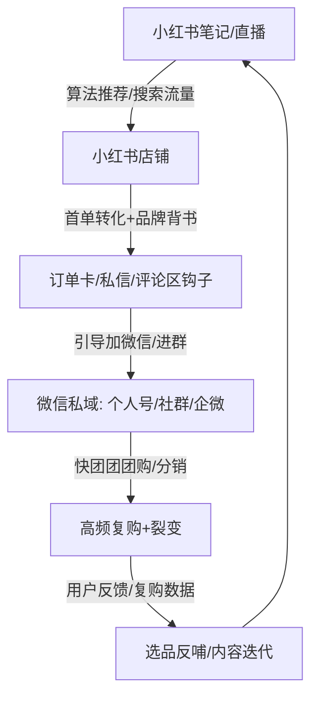
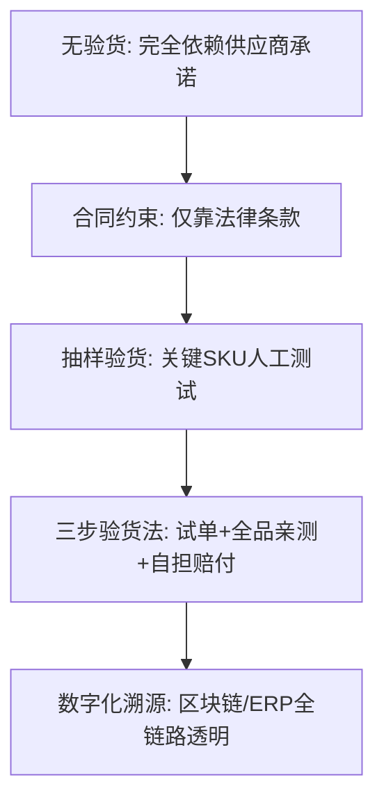
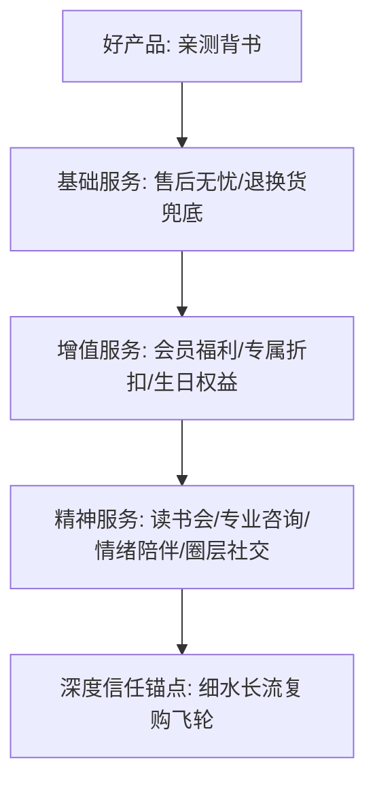

# 第 35 章 小红书店铺运营与快团团私域联动 —— IP驱动选品、有货源模式、公私域双轨

## 学习目标

- 理解个人IP在私域电商冷启动中的信任构建机制
- 掌握小红书店铺与快团团公私域联动的完整变现闭环设计
- 熟悉供应链‘三步验货法’及自担赔付兜底的风控实操体系
- 掌握熟人高频复购信任模型的核心要素与服务体系设计
- 能运用‘趋势×擅长×累积’公式评估创业项目的适配度
- 掌握快团团私域电商不同阶段的量化运营基准指标
- 理解公域引流作为必修硬技能的战略定位与执行方法
- 能设计客户全生命周期服务体系将交易升级为情感连接
- 掌握快团团半个月近四万销售额验证的微信端运营技巧
- 理解小红书店铺运营与快团团私域联动的完整商业闭环

## 35.1 生活类比

想象私域社交电商是一场**“自家院子里的邻里集市”**：
- **个人IP** = 院子主人‘老张’的‘金字招牌’（大家都知道老张为自家娃挑东西最讲究）
- **快团团** = 老张搭在院里的‘团购摊位’（邻里熟人凑单、免运费、比超市鲜）
- **三步验货法** = 老张自己先买三份尝尝、全家人轮流试吃、坏了自己先垫钱退给邻居
- **真心服务** = 老张不光卖菜，还帮邻居带娃、修家电、办读书会（非标服务筑情感护城河）
- **公域引流** = 老张在村口大喇叭/微信群里吆喝‘今儿新到的有机苹果，欢迎尝鲜’（技能化、常态化）
- **趋势适配** = 选‘卖生鲜/日用’这种高频刚需，不搞‘卖量子计算机’这种村里没人懂的生意
就像老张靠‘人品好、货真价实、服务周、常吆喝’把院子经营成全村最旺的集市，私域电商也靠‘真人设、真亲测、真服务、懂公域’跑通商业闭环。

## 35.2 概念地图

私域社交电商体系
├── 核心信任引擎
│   ├── 个人IP驱动选品（真实人设建立初始信任） —— P001
│   ├── 熟人高频复购信任模型（真心服务深化连接） —— P004
│   └── 供应链三步验货法（亲测背书+自担赔付） —— P003
├── 公私域双轮驱动模型
│   ├── 公域端：小红书/抖音种草引流（必修硬技能） —— P008
│   ├── 私域端：快团团/社群/朋友圈高频复购（LTV最大化） —— P002
│   └── 联动闭环：内容引流→店铺首单→私域留存→裂变复购 —— P002
├── 运营阶段量化基准
│   ├── 入门期（0-3月）：私域500-2000人/月销1-5万 —— P006
│   ├── 成长期（3-12月）：私域5000-2万/月销10-50万 —— P006
│   └── 成熟期（1年+）：私域10万+/月销200万/利润率20% —— P006
├── 创业决策适配性法则
│   ├── 成功概率 = 趋势适配度 × 自身擅长度 × 累积效应强度 —— P005
│   ├── 避坑：硬核技术/纯公域流量/无累积赛道 —— P005
│   └── 优选：私域社交电商/垂类知识付费/同城服务整合 —— P005
└── 客户全生命周期服务体系
    ├── 基础层：售后兜底/退换货无忧 —— P007
    ├── 增值层：会员福利/专属折扣/生日权益 —— P007
    └── 精神层：读书会/专业咨询/情绪陪伴/圈层社交 —— P007

## 35.3 个人IP驱动选品 —— 让信任感成为最好的带货剧本

### 为什么需要这个概念？

新店冷启动面临“无流量、无信任”双重困境，传统付费推广成本高、转化低。宝妈等普通创业者缺乏专业运营团队，需要低成本建立品牌辨识度。同质化选品导致价格战，需差异化人设重构产品价值感知。

### 核心定义

以“真实人生经历+垂直专业身份”绑定为核心叙事（如：为孩子做玩具的玩具设计师妈妈）。选品逻辑从“市场跟品”反向为“需求定品”：源自个人真实痛点的产品自带信任背书。人设贯穿内容生产、产品包装、售后服务全链路，形成一致性品牌心智。

> "我是结合个人 IP 卖货的，人设是玩具设计（为自己的孩子做一件玩具）"
> 
> ——《P001: 小红书店铺运营复盘》

**个人IP驱动选品**的核心在于将「真实人生经历」与「垂直专业身份」进行深度绑定。Jing 作为一位全职妈妈兼玩具设计师，她的核心叙事是「为自己的孩子做一件玩具」。这个人设不是营销包装出来的，而是源于她真实的生活痛点：作为专业玩具设计师，她深知市面上玩具的质量参差不齐；作为妈妈，她最在意孩子接触玩具的安全性与教育价值。这种「专业能力+母性初心」的双重身份，天然构建了信任护城河。

### 关键性质

- 信任转化率显著高于商业广告：熟人/同频人群天然降低防御心理
- 内容生产边际成本低：真实生活碎片即优质素材，无需专业摄制
- 选品护城河深：竞品难以复制“具体的人+具体的故事+具体的初心”

### 典型例子

**Jing 案例**：全职宝妈+玩具设计师人设，首月流水10万+，半年营业额翻倍。
**评论区验证**："也是全职妈妈，向优秀的你靠齐" —— 同频人群的强共鸣证明人设穿透力。

> "去年 11 月开通小红书店铺并结合快团团第一个月做到 10w+的流水 ... 现在差不多半年时间，营业额已经翻倍~"
> 
> ——《P001: 小红书店铺运营复盘》

### 边界条件

- 人设必须真实可考，造假一旦暴露信任崩塌不可逆
- 仅适用于强人设关联品类（母婴、美妆、家居、技能教学等）
- 依赖创始人个人精力，规模化需剥离人设IP化为品牌IP

### 设计中的取舍

**为什么不用付费广告跑冷启动？**
付费广告只能买到「曝光」，买不到「信任」。对于母婴等高决策门槛品类，用户更信「真人真事」而非「品牌自夸」。个人IP的内容本身就是最好的广告，且边际成本为零。

**这种设计的 trade-off 是什么？**
收益：极低的获客成本（CAC）、极高的转化率、天然的品牌溢价能力。
代价：强依赖创始人个人精力与真实性，难以标准化复制；一旦人设翻车（如产品质量不符、人设造假），信任崩塌具有毁灭性。

## 35.4 公私域联动变现模型 —— 小红书种草做前端，快团团复购做后端

### 为什么需要这个概念？

单一平台流量红利周期短、规则多变，公域获客成本持续走高。电商变现链路过长（种草→搜索→下单→收货→评价），私域可缩短决策路径。高复购品类（母婴、消耗品）在公域平台缺乏高效触达机制，LTV被截胡。

### 核心定义

- 公域端（小红书店铺）：承接算法推荐/搜索流量，完成首单转化与品牌背书
- 私域端（快团团/社群/朋友圈）：沉淀高意向用户，通过团购/分销实现高频复购裂变
- 连接动作：店铺订单卡/私信/评论区钩子→引导加微信/进群→快团团下单闭环

### 关键性质

- 流量复用率高：同一批用户公域买一次、私域买N次，CAC摊薄至极致
- 利润结构优化：公域薄利引流（甚至亏本获客），私域厚利复购（无平台抽佣）
- 品牌资产沉淀：用户关系链掌握在自己手中，不受平台规则变更威胁

### 多源对照

不同实践者对「公私域分工」有不同侧重：

**共识**：公域负责「获客+背书」，私域负责「复购+裂变」；核心逻辑是「公域薄利、私域厚利」。

**分歧**：

| 维度 | Jing（P001） | 小白（P002） | 妈妈助理（P004） |
|------|--------------|--------------|------------------|
| **公域主阵地** | 小红书店铺（有货源模式） | 未明确，侧重快团团自有流量 | 小红书/抖音（计划中） |
| **私域核心工具** | 快团团+社群 | 快团团（主力） | 快团团+社群/朋友圈 |
| **引流动作设计** | 人设内容自然转化 | 评论区建议记录过程做IP | 将「优质产品/真实案例」制作笔记分发 |
| **利润结构认知** | 首月破10万，半年翻倍 | 月销200万，利润率20% | 单群月利3000元，验证小规模模型 |

> "去年 11 月开通小红书店铺并结合快团团第一个月做到 10w+的流水"
> 
> ——《P001》

> "花了一年时间零售端月销突破 200 万，团购整体利润率不高，20 个点左右，我们目前私域用户体量 10 多万"
> 
> ——《P002: 快团团私域电商实战》

> "客户资源：这是我们最近要准备做的，就是将我们好的产品逐步分享到小红书、抖音等等的公域平台"
> 
> ——《P004: 妈妈助理两个月实战复盘》

### 典型例子

**Jing 案例**：小红书店铺首单建信任 → 快团团社群月复购 → 半年营业额翻倍。
**小白案例**：私域10万+用户支撑月销200万，利润率稳定20%。

### 边界条件

- 必须具备“高频复购/高客单/强社交属性”至少一项产品特征
- 需建立标准化私域运营SOP（话术、发单节奏、售后流程），否则人效极低
- 微信生态规则红线（诱导分享、违规营销）需合规操作，防封号断流

### 数据流图：公私域联动全链路



这个数据流图展示了公私域联动的闭环逻辑：公域内容获客 → 店铺首单建信任 → 私域沉淀复购 → 数据反哺选品与内容 → 再次公域获客。每一个环节都有明确的工具与动作支撑，形成了可持续的飞轮效应。

## 35.5 供应链‘三步验货法’ —— 用自担风险成本换取客户终身信任

### 为什么需要这个概念？

无货源/分销模式下，供应链失控（发货慢、质量差、售后推诿）是导致客户流失的核心黑箱。普通创业者无议价能力，无法像大主播一样压供应商服务协议，需建立自主质检体系。虚假发货（空单号）、售后踢皮球等隐性坑点，仅靠合同无法规避，需实测验证。

### 核心定义

**供应链三步验货法**（来源：《P004: 妈妈助理实战复盘》）

```
步骤一·新供货商试单：自购3款产品，实测物流时效、包装完好度、售后响应速度
步骤二·全品亲测制：上架前全员（创始人/运营/客服）实测体验，无亲测不推荐
步骤三·自担赔付兜底：出现供应商责任事故（延迟/质量/虚假发货），团队先行垫付退款/补发，事后向供应商追偿
```

> "经过以上的种种，现在我们已经筛选出了一些不错的供货商，而且对于新的供货厂家，我们一般都会先在他们那里购买三款产品，体验一下供货商的物流和售后。另外我们上的每一款产品都要亲测～无亲测，不推荐。"
> 
> ——《P004》

> "有的供货商物流发的很慢... 售后问题：有些供货商产品有问题但就是不给退... 被骗～有时候发货太慢，客户不想要了，我们跟供货商一交涉，供货商立马就会发一个空的单号 ... 为了给客户好的体验，我们就会自行给客户赔付... 这时候我们也会自己掏钱给客户退钱，然后货如果发过去了就当是给客户的礼品。"
> 
> ——《P004》

这个方法展示了供应链风控的「前置验证」思维：**用确定的、可控的前置验证成本（买样品、人力亲测、垫付赔付），规避不可控的、毁灭性的事后信任崩塌成本**。一次虚假发货事件可能导致整个社群的信任崩溃，而「自担赔付」虽然增加了短期成本，却守住了「我们只卖自己用过觉得好的」这一核心承诺。

### 关键性质

- 前置验证成本 << 事后信任修复成本：一次翻车可能流失一个高LTV客户群
- 倒逼供应链优化：供应商知晓“亲测制”后，主动提升服务标准以通过准入
- 形成差异化卖点：“我们只卖自己用过觉得好的”成为最强带货话术

### 典型例子

**妈妈助理团队**：新供货商买三款试物流/售后，全品亲测，自掏腰包赔付空单号订单。筛选后“供货商事故率显著下降”，建立起稳定优质供应池。

### 边界条件

- SKU数过多（>200）时全品亲测人力成本过高，需分级抽检
- 非标品/定制品（如鲜花、生鲜）难以标准化亲测，需建立抽样标准
- 赔付兜底需设红线（如单单亏损上限），防止恶意薅羊毛或供应商道德风险

### 方法演进图：供应链风控能力进阶



这个演进图展示了供应链风控从「无感知」到「全链路透明」的进阶路径。三步验货法处于「人工深度介入」阶段，是资源有限的普通创业者当前可落地的最高阶方案。

## 35.6 熟人高频复购信任模型 —— 真心换真心的细水长流生意

### 为什么需要这个概念？

公域流量呈“一次性消费”特征，客户归平台不归商家，复购需重复付费获客。微信熟人社交网络天然具备高信任、高触达、低成本三大优势，是复购型生意的最佳容器。价格战卷不动、广告投不动的普通创业者，需寻找非标准化的竞争护城河。

### 核心定义

- 信任基石：好产品（亲测背书）+ 真心服务（非标增值）= 初始信任+深度连接
- 复购引擎：熟人关系链（朋友圈/社群）+ 高频刚需（消耗品/刚需服务）= 自然复购
- 经营心法：拒绝暴富投机，践行“细水长流、真心换真心、持续积累”的长期主义

### 关键性质

- 近乎零流量成本：无平台抽佣、无推广费、无房租压力，利润空间可让利客户
- 抗周期性强：信任资产一旦形成，不受平台算法波动影响，甚至可跨平台迁移
- 非标服务筑壁垒：会员日福利/读书会/专业咨询等“钱买不到的服务”构建情感护城河

### 典型例子

**妈妈助理**：单群100人月利润3000元，两个月验证小规模正向现金流。
**客户转介绍裂变**：“服务好专业性强客户有需求第一找到我们还会转介绍”。

> "微信电商，是一个熟人高频复购的生意，一定是要建立信任的，而好产品是信任的第一步。"
> 
> ——《P004》

> "服务好客户就一个点～真心实意地对客户好。"
> 
> ——《P004》

> "首先这不是一个可以暴富的项目。但只要真心换真心，就是一件可以细水长流，且可以持续积累下去的项目。"
> 
> ——《P004》

> "我们想了很多好的点子，一些在实施了，也有一些慢慢计划当中。比如：会员日的福利、读书会等、一些专业咨询的无偿服务等等的。"
> 
> ——《P004》

> "目前我们一个 100 人的群，一个月大概有 3000 的利润"
> 
> ——《P004》

### 边界条件

- 仅适用于高频复购/强决策信任依赖品类（母婴、美妆、健康、技能服务等）
- 创始人/核心团队必须真诚喜欢“和人打交道”，纯技术流/社恐者难以持续
- 规模化受限于创始人精力半径（邓巴数约150深度关系），需标准化SOP复制团队

### 服务分层模型：从标品到非标的信任深化



这个模型展示了信任构建的递进逻辑：**产品是入场券，基础服务是及格线，增值服务是加分项，精神服务才是护城河**。当竞品都在卷价格、卷物流时，「读书会、专业咨询、情绪陪伴」这类无法被标准化复制的非标服务，构建了最高维度的竞争壁垒。

## 35.7 普通人创业趋势适配性法则 —— 选对赛道比努力更重要

### 为什么需要这个概念？

大量普通人陷入“在错误赛道上疯狂努力”的陷阱（如裸辞学AI、盲目跟风直播带货）。创业失败常归因于“执行不力”，实则源于“赛道选择错误”导致的结构性无解。需要一套可操作的赛道筛选清单，在行动前完成“战略止损”。

### 核心定义

**判断公式：成功概率 = 趋势适配度 × 自身擅长度 × 累积效应强度**

- 三大避坑赛道：硬核技术门槛高（AI/元宇宙）、纯公域流量周期长（抖音娱乐号）、无累积效应（纯搬运/纯投流）
- 三大优选赛道：顺应去中心化信任趋势、操作门槛低、有复利累积（私域社交电商、垂类知识付费、同城服务整合）

### 关键性质

- 趋势是放大器：顺势而为让1分努力产出10分结果，逆势而为10分努力仅得1分
- 擅长是降维打击：将过往生活/工作经验（如带娃、设计、采购）直接转化为商业优势
- 累积是复利源：今日积累的用户/内容/供应链/SOP，明天成为护城河

### 典型例子

**妈妈助理**：放弃“硬核技术创业”，选择“快团团私域电商”，操作简单、有累积效应、符合去中心化信任趋势。
**宝妈创业**：带娃碎片时间 → 熟悉母婴需求 → 选品亲测 → 社群运营，全链路复用生活经验。

> "创业：我们不赞同蛮干～这是一种很低效的事情；创业，最重要的是选择... 选择符合趋势的且自己擅长事情"
> 
> ——《P004》

> "第一：人工智能、元宇宙是趋势，但需要硬核的技术+资源整合能力。（不适合普通人）... 第三：用以‘快团团’为首的私域工具...（适合普通人，操作简单，且有累积效应。）"
> 
> ——《P004》

> "因为随着科技的进一步发展，普通人如果仅仅靠打工，将会越来越难。"
> 
> ——《P004》

> "流量免费：不管是在抖音，美团，淘宝上卖东西，都要给或多或少的平台费（抽成）；线下店房租成本更高。而在微信里通过‘快团团向已有的客户’卖东西，几乎没有任何流量费用，对客户来说，可以买的更便宜了，很友好。"
> 
> ——《P004》

### 边界条件

- “趋势”需辨别周期：避开红利期已过的夕阳赛道（如早期微商、后期社区团购）
- “擅长”不等于“专业”：生活技能（整理、做饭、陪娃）同等可转化为商业能力
- “累积”需耐心：前3-6个月可能无正向现金流，需有生存资金垫付

### 创业赛道评估决策表

| 维度 | 硬核技术赛道 (AI/元宇宙) | 纯公域流量赛道 (抖音娱乐号) | 纯搬运/投流赛道 | **私域社交电商 (优选)** | **垂类知识付费 (优选)** | **同城服务整合 (优选)** |
|------|------------------------|---------------------------|----------------|------------------------|------------------------|------------------------|
| **趋势适配度** | 高(但周期早) | 中(红利期已过) | 低(无累积) | **高(去中心化信任趋势)** | **高(知识付费常态化)** | **高(本地生活数字化)** |
| **操作门槛** | 极高(需硬核技术) | 高(需内容/投流能力) | 低(但无护城河) | **低(工具化/标准化)** | **中(需专业能力+IP)** | **低(资源整合为主)** |
| **累积效应** | 强(技术护城河) | 弱(算法不可控) | 无(一次性) | **强(用户/内容/SOP复利)** | **强(IP/课程/社群资产)** | **强(供应链/信任/品牌)** |
| **适合普通人** | ❌ | ❌ | ❌ | ✅ | ✅ | ✅ |

这个决策表直观对比了六大典型赛道在三个核心维度的表现。私域社交电商、垂类知识付费、同城服务整合在「趋势适配度、操作门槛、累积效应」三维达成最佳平衡，是普通人创业的「黄金三角」。

## 35.8 快团团私域电商量化基准 —— 千万级团长的真实画像

### 为什么需要这个概念？

网络充斥“月入百万”营销号，普通人缺乏真实可参照的阶段性业绩基准。需要量化指标校准预期：私域体量多大？周期多长？利润率多少？才算跑通模型。避免因“眼高手低”盲目扩张，或因“妄自菲薄”过早放弃。

### 核心定义

**快团团私域电商运营三阶段量化基准**（来源：《P002: 快团团实战复盘》）

| 阶段 | 周期 | 私域用户规模 | 月销GMV | 利润率 | 核心任务 |
|------|------|-------------|---------|--------|----------|
| **入门期** | 0-3月 | 500-2,000人 | 1-5万 | 15-20% | 验证模型可行、跑通SOP |
| **成长期** | 3-12月 | 5,000-2万 | 10-50万 | ~20% | 建立供应链/团队/SOP体系 |
| **成熟期** | 1年+ | 10万+ | 200万+ | 稳定20% | 品牌/团队/多品类护城河 |

### 关键性质

- 私域用户数与GMV呈线性正相关：人均年GMV约200-300元（高频消耗品更高）
- 利润率天然锚定20%：团购模式决定薄利多销，靠规模效应摊薄固定成本
- 单品类天花板低：同城水果团购私域几千人难突破，必须拓品类（本地生活/非标服务）突围

### 典型例子

**小白案例**：一年耕耘，私域10万+、月销200万、利润率20%，标准中腰部团长画像。
**同行印证**：许老师反馈同城水果赛道红海，私域几千人难突破，印证单品类天花板。

> "花了一年时间零售端月销突破 200 万"
> 
> ——《P002》

> "团购整体利润率不高，20 个点左右"
> 
> ——《P002》

> "我们目前私域用户体量 10 多万"
> 
> ——《P002》

> "本地生活是快团今年的重点，除了水果外可以多拓展品类"
> 
> ——《P002》

> "我也在做快团团，不过做的是同城水果团购。您这个月销 200 万，私域规模大概多大啊？我现在私域规模才几千"
> 
> ——《P002 评论区》

### 边界条件

- 数据基于“标品高频团购”模式，非标/高客单/服务型模型不适用
- 地区/品类差异大：一线城市私域单客价值高但获客难，下沉市场反之
- 平台政策风险：快团团规则调整（如佣金率、推广限制）可能重塑利润模型

## 35.9 客户全生命周期服务体系 —— 从卖货升级为“陪伴式生活服务商”

### 为什么需要这个概念？

同质化产品竞争陷入价格战红海，标品利润被平台/供应链压榨至极限。熟人社交电商本质是“关系生意”，纯交易关系极其脆弱，稍有不满即流失。客户LTV（终身价值）远大于单单利润，需设计非标服务锁定长期连接。

### 核心定义

- 核心心法：真心实意对客户好，将商品交易升级为情感连接与生活方式服务
- 服务三层：
  - **基础层**：售后兜底/退换货无忧
  - **增值层**：会员日福利/专属折扣/生日权益
  - **精神层**：读书会/专业咨询/情绪陪伴/圈层社交
- 服务标准：非标准化、高触达、强情感连接，做“懂你、陪你、帮你”的超级个体

### 关键性质

- 信任护城河：服务越非标、越个性化，越难被标准化流程/低价竞品复制替代
- 复购飞轮：服务好→信任深→复购高→转介绍→新客信任高→成本低→利润厚→投入更好服务
- 反脆弱性：平台封号/流量波动/供应链故障时，深度服务关系是最后的生存保障

### 典型例子

**妈妈助理**：会员日福利、读书会、专业咨询无偿服务，构建“细水长流”持续积累。
**客户反馈**：“服务好专业性强客户有需求第一找到我们还会转介绍”。

> "服务好客户就一个点～真心实意地对客户好。"
> 
> ——《P004》

> "我们想了很多好的点子，一些在实施了，也有一些慢慢计划当中。比如：会员日的福利、读书会等、一些专业咨询的无偿服务等等的。"
> 
> ——《P004》

> "服务好客户，客户有需求第一找到我们还会转介绍，降低持续获客成本。"
> 
> ——《P004》

> "首先这不是一个可以暴富的项目。但只要真心换真心，就是一件可以细水长流，且可以持续积累下去的项目。"
> 
> ——《P004》

### 边界条件

- 服务成本需可控：非标服务边际成本随规模上升，需建立分级服务体系（大客户专属/中客户社群/小客户自助）
- 避免过度服务透支：设定服务边界（如咨询时长/响应时段），防止创始人/团队职业倦怠
- 需量化服务ROI：定期复盘服务投入产出比，砍掉高投入低产出服务项目

## 35.10 公域引流作为必修硬技能 —— 私域有天花板，公域无上限

### 为什么需要这个概念？

私域流量池有天花板（熟人总数有限、社群活跃度衰减），单靠裂变无法持续放大。许多创业者视公域运营为“玄学/运气”，实则是可复刻、可训练、可积累的“硬技能”。公域内容反哺私域选品/人设/信任，形成“公私域双轮驱动”飞轮。

### 核心定义

- 定位转变：从“被动等客上门”转为“主动去公域种草捞鱼”
- 方法论：将私域优质产品/真实案例/服务过程 → 制作笔记/视频 → 分发小红书/抖音/视频号 → 引流加微信/进群/下单
- 技能内化：必须“经常使用、经常研究”，列入团队战略规划与日常KPI，而非临时突击

### 关键性质

- 信任前置：公域内容展示“专业/真实/利他”人设，降低私域加微信/成交的信任门槛
- 选品反哺：公域数据（点赞/评论/收藏/搜索）实时验证选品潜力，指导私域备货
- 品牌资产化：公域账号IP可独立估值、可授权、可跨平台迁移，是显性资产

### 典型例子

**妈妈助理团队**：将公域运营列为“必修硬技能”，计划分享优质产品到小红书/抖音引流。
**小白评论区建议**：记录运营过程打造个人IP，实现“带货赚钱→教带货赚钱”双重变现。

> "客户资源：这是我们最近要准备做的，就是将我们好的产品逐步分享到小红书、抖音等等的公域平台，这一块需要持续的做，因为做抖音等就是一门技能，得经常使用，经常研究才可以掌握。"
> 
> ——《P004》

> "私域流量有天花板，必须向公域要增量"
> 
> ——《P004》

> "建议开一个小红书或者抖音账号把自己操作的过程记录下来，未来团购赚到钱了，你还能做知识付费。"
> 
> ——《P002 评论区》

### 边界条件

- 前置条件：私域转化体系（话术/流程/供应链/售后）必须跑通，否则引流即漏斗
- 平台分发规则差异大：小红书重种草/笔记、抖音重直播/短视频、视频号重社交/信任，需差异化内容策略
- 合规红线：严禁硬广/诱导分享/违规引流，账号被封损失沉没成本极大

## 35.11 快团团半个月近四万销售额验证微信端运营技巧

### 为什么需要这个概念？

很多创业者缺乏真实可参照的短周期高业绩案例，容易产生“虚假繁荣”或“极端悲观”的预期偏差。需要量化验证快团团在极短周期内的爆发潜力，拆解微信端运营的可复制动作。为“半个月4万”这一单点数据建立可复制的方法论支撑。

### 核心定义

- 实测数据：2023年1月，半个月时间，利用快团团带货销售额近4万元
- 承诺分享微信端运营全流程技巧，验证私域工具高转化潜力
- 为“微信端运营技巧”提供实证支撑

### 关键性质

- 极短周期验证模型：半个月即跑通变现闭环，证明私域工具“即学即用、即用即赚”特性
- 高客单价/高复购特征：验证私域熟人社交电商“客单价高、复购率高、决策链路短”优势
- 微信端运营可复制性强：技巧标准化后可快速教学、裂变、规模化

### 典型例子

**小可案例**：2023年1月半个月利用快团团带货近4万销售额，承诺分享微信端运营技巧。

> "首先介绍一下我今年一月份半个月时间用快团团完成了近四万销售业绩的过程，然后再给大家分享一下我这些年微信端运营的一些技巧。"
> 
> ——《P003: 小可快团团实战》

> "全文阅读：https://i.shengcaiyoushu.com/docx/TD6FdV3Eeo2IZvxepP9cZQ3inPb"
> 
> ——《P003》

### 边界条件

- 依赖前期私域积累（种子用户/信任基础），冷启动期不适用
- 选品需具备高复购/高客单/强社交属性，非标品/低频品类难复制
- 运营者需具备基础社群运营能力（发单节奏/话术/售后），零基础需先练基本功

## 35.12 多源对照：不同实践者的核心共识与差异化打法

### 共识

1. **信任是核心货币**：无论是个人IP、亲测产品、真心服务，本质都是在构建「信任资产」。
2. **公私域分工明确**：公域获客+背书，私域复购+裂变，「公域薄利、私域厚利」是底层利润逻辑。
3. **供应链自主可控是前提**：无自主质检与赔付兜底，私域信任体系即无根之木。
4. **长期主义是唯一路径**：拒绝暴富投机，践行「细水长流、真心换真心、持续积累」。
5. **公域运营是硬技能**：必须刻意练习、列入KPI、持续投入，而非碰运气。

### 分歧

| 维度 | Jing (P001) | 小白 (P002) | 妈妈助理 (P004) | 小可 (P003) |
|------|-------------|-------------|----------------|-------------|
| **起步资源** | 有货源/专业设计背景 | 无货源/快团团分销 | 无货源/严选供应链 | 未明确/疑似有货源 |
| **IP建设路径** | 真实人生经历绑定专业身份 | 评论区建议「记录过程做IP」 | 计划中/尚未系统启动 | 未提及 |
| **供应链模式** | 有货源自采/自控 | 平台供应链/官方资源对接 | 严选+亲测+自担赔付 | 未明确 |
| **私域运营深度** | 社群+快团团 | 快团团为主/规模效应 | 分级服务体系/非标服务 | 承诺分享技巧/未展开 |
| **公域引流阶段** | 已跑通(小红书店铺) | 建议中/计划做 | 列为必修硬技能/规划中 | 未提及 |
| **核心壁垒认知** | 人设IP+有货源供应链 | 私域用户规模+平台资源 | 真心服务+供应链亲测制 | 微信端运营技巧 |

**分歧本质解读**：不同阶段、不同资源禀赋的实践者，自然会强调不同的核心变量。Jing 依托「有货源+专业背景」走「深度IP+供应链控制」路线；小白依托「平台分销+社群裂变」走「规模效应+官方资源」路线；妈妈助理依托「严选供应链+非标服务」走「信任深度+复购飞轮」路线。**三条路径殊途同归，核心均指向「信任资产的构建与复利」**。

## 35.13 设计中的取舍

**为什么不做「无货源一件代发」而坚持「严选+亲测+自担赔付」？**
无货源模式边际成本虽低，但供应链不可控风险极大（物流、质量、售后全在供应商手中）。对于依赖「熟人信任+高频复购」的私域模式，一次翻车的信任修复成本远超「亲测+赔付」的前置成本。**用确定的小成本换取不确定的大风险规避，是非对称收益的理性选择。**

**为什么「公域引流」要作为「必修硬技能」列入战略规划，而不是外包给代运营？**
公域内容不仅是获客工具，更是「人设IP打造」「选品数据验证」「品牌资产沉淀」的核心产出。外包代运营只能完成「发布动作」，无法完成「真实人设表达」与「业务数据反哺」。**核心能力不可外包，否则业务失去护城河。**

**为什么「非标服务（读书会/咨询/情绪陪伴）」要作为核心护城河，而不做标品低价卷？**
标品竞争最终卷向「供应链成本+流量获取效率」的红海，普通创业者无优势。非标服务依赖「创始人真诚度+专业能力+时间陪伴」，这是大平台、大主播、标准化团队最难复制的维度。**在对手不愿做、做不了的维度建立壁垒，是弱者生存的唯一逻辑。**

## 35.14 动手练习

### 练习 1：设计你的个人IP人设卡
假设你要在小红书开店卖母婴产品，请完成：
1. 写出你的‘核心人设故事’（如：为孩子做玩具的玩具设计师妈妈），要求包含：真实身份标签+具体初心事件+垂直专业能力
2. 列出该人设天然关联的3个选品方向，并说明每个方向的‘信任背书逻辑’
3. 识别该人设的2个潜在风险边界（如：造假暴露/精力半径限制），并设计对应规避措施

回答问题：
- 为什么‘真实性’是人设IP的生命线？一旦翻车如何挽回？
- 人设IP如何剥离为品牌IP实现规模化？

### 练习 2：推演公私域联动单客经济账
已知：小红书店铺获客成本(CAC) 30元/单，首单利润 -10元（亏本引流）；快团团私域复购周期 30天/次，客单利润 25元，年复购率 80%，留存周期 2年。
1. 计算单客全生命周期价值(LTV)与投入产出比(ROI)
2. 若公域获客成本上涨至 50元/单，首单亏损扩大至 -20元，模型是否仍可行？临界点在哪里？
3. 设计3个‘公域内容→私域钩子’的具体转化路径（如：笔记评论区‘扣1领避坑指南’→加微信→进快团团群）

回答问题：
- 为什么说‘公域薄利引流、私域厚利复购’是底层利润逻辑？
- 如何通过‘选品反哺’利用公域数据指导私域备货？

### 练习 3：供应链风控实战演练
场景：你新上架一款进口母婴辅食，供货商报价有优势但无合作历史。请按‘三步验货法’设计执行清单：
1. 步骤一·试单验证：买哪3款？测哪3个核心指标（物流/包装/售后）？合格线在哪里？
2. 步骤二·全品亲测：团队谁参与？测评维度表如何设计？‘无亲测不推荐’如何落地执行？
3. 步骤三·赔付兜底机制：单单赔付上限设多少？虚假发货/延迟发货/质量问题分别怎么赔？事后如何向供应商追偿？

回答问题：
- SKU超过200款时，如何将‘全品亲测’降级为‘分级抽检’而不失控？
- 供应商知晓‘亲测制’后可能作弊（如只发样品好货），如何识别与防范？

### 练习 4：评估某创业项目的趋势适配度
项目：开发一款‘AI生成儿童绘本’的SaaS工具，面向宝妈群体，订阅制收费。
请用‘趋势适配度×自身擅长度×累积效应强度’三维打分（1-10分）并论证：
1. 趋势适配度：是否顺应‘去中心化信任/AI赋能/私域累积’大趋势？是否处于红利期还是泡沫期？
2. 自身擅长度：假设你是‘全职宝妈+幼教从业者+零代码基础’，优势在哪？短板如何补？
3. 累积效应强度：用户/数据/品牌/SOP是否随时间复利？是否存在单品类天花板？

回答问题：
- 该项目属于‘硬核技术赛道’还是‘工具赋能赛道’？边界在哪里？
- 若评分总分<20分，你会劝退还是建议微创新切入？如何微创新？

### 练习 5：设计客户全生命周期服务日历（季度版）
针对一个‘私域母婴社群’（100人规模，月销3000元利润基准），请设计一季度服务日历：
1. 基础层：售后响应SLA（分钟级/小时级）、退换货话术模板、异常订单兜底流程
2. 增值层：会员日主题/福利/玩法（每月1次）、专属折扣/生日权益发放机制
3. 精神层：读书会选书/频次/主持人、专业咨询主题/专家邀约、情绪陪伴互动话题
4. 量化考核：每项服务的投入成本(时间/金钱)、预期产出(复购率提升/转介绍数/满意度NPS)

回答问题：
- 如何防止‘过度服务’透支创始人精力？服务边界如何设定？
- 非标服务规模化的核心矛盾是什么？分级服务体系如何设计？

### 练习 6：验证快团团半个月近四万销售额的运营技巧
已知：小可实测2023年1月半个月利用快团团带货近4万销售额。
1. 反推可能的选品结构、定价策略、发单频次与客单价组合
2. 设计3个‘微信端运营技巧’的具体执行动作（如：朋友圈分层发布/社群裂变话术/快团团设置技巧）
3. 计算该模式下的ROI与现金流周期

回答问题：
- 为什么说快团团是‘私域流量变现效率最高’的工具？
- 如何将‘半个月4万’的单次爆发转化为可持续的月度复购模型？

## 35.15 本章小结

这一章中我们深入学习了小红书店铺与快团团私域联动的完整商业闭环体系。首先我们理解了**个人IP驱动选品**如何用真实人生经历与专业身份绑定，以极低成本解决新店冷启动的「无流量、无信任」双重困境；接着我们掌握了**公私域联动变现模型**的核心逻辑——小红书店铺承接公域首单建信任，快团团沉淀私域高频复购裂变，实现流量复用率最大化与利润结构最优化；然后我们熟悉了**供应链三步验货法**（试单验证+全品亲测+自担赔付）如何用前置确定成本规避后置毁灭性信任风险；随后我们拆解了**熟人高频复购信任模型**的三层服务体系（基础层售后兜底、增值层会员福利、精神层情感陪伴），理解了「真心换真心」如何构建细水长流的复购飞轮；之后我们运用**趋势适配性法则**（成功概率=趋势×擅长×累积）评估创业项目，识别出私域社交电商、垂类知识付费、同城服务整合为普通人最优赛道；接着我们掌握了**快团团量化运营基准**的三阶段指标（入门期/成长期/成熟期），为业务进度校准提供了真实参照系；然后我们确立了**公域引流作为必修硬技能**的战略定位，理解了私域天花板与公域无上限的辩证关系；最后我们通过**快团团半个月近四万销售额**案例，验证了微信端运营的高转化潜力与可复制性。

本章我们一起学习了以下概念：

| 概念 | 解释 |
|------|------|
| 个人IP驱动选品 | 以真实人生经历+垂直专业身份绑定叙事，反向定义选品，信任转化率显著高于商业广告 |
| 公私域联动变现模型 | 小红书店铺承接公域首单建信任，快团团沉淀私域高频复购裂变，流量复用率高、利润结构最优 |
| 供应链三步验货法 | 新供货商试单3款→全品亲测制→自担赔付兜底，前置验证成本远低于事后信任修复成本 |
| 熟人高频复购信任模型 | 好产品(亲测背书)+真心服务(非标增值)=初始信任+深度连接，构建细水长流复购飞轮 |
| 创业趋势适配性法则 | 成功概率=趋势适配度×自身擅长度×累积效应强度，避开高门槛/长周期/无累积赛道 |
| 快团团量化运营基准 | 入门期私域500-2000人/月销1-5万，成熟期私域10万+/月销200万/利润率20%，单品类天花板低需拓品 |
| 公域引流必修硬技能 | 私域有天花板，公域无上限；公域运营是可训练硬技能，需列入战略规划与日常KPI |
| 客户全生命周期服务体系 | 基础层(售后)→增值层(福利)→精神层(陪伴)，将交易升级为情感连接，构建非标服务护城河 |
| 快团团半个月高转化验证 | 实测半个月销售额近4万，验证私域工具高转化潜力与微信端运营技巧有效性 |

下一章中，我们将学习 **《AI工具入门与环境配置 —— 打通“大模型”最后一公里》**，掌握国内用户接入ChatGPT、Midjourney等头部AI工具的网络、账号、支付三大硬性门槛解决方案，建立稳定可用的生产环境基础设施，为后续的AI赋能内容生产、自动化运营、无代码开发奠定工具基础。
