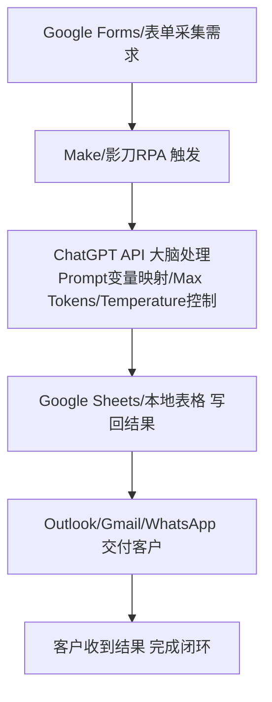
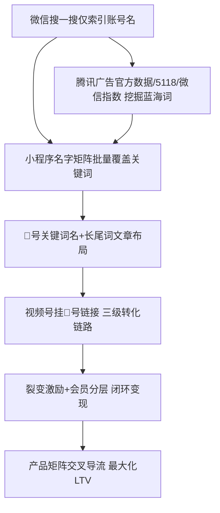

# 第 23 章 运营工具与效率思维 —— 避免体力劳动的技术化杠杆
作者：龙哥

## 学习目标

- 理解‘工具替代人力’的底层逻辑与复利价值
- 掌握 RPA+AI 自动化生产线的‘手脚-大脑-接口’三层架构搭建方法
- 熟悉微信生态‘账号名 SEO’与‘名字矩阵’的流量获取核心打法
- 能识别工具类产品‘技术非壁垒、推广定生死’的商业规律并制定冷启动策略
- 学会利用‘场景化素材’替代‘产品实拍’提升内容转化相关性
- 建立‘先人工跑通、再自动化替代’的标准化落地原则
- 掌握 RPA 环境一致性调试、延时随机化防封、多重容错等工程化细节
- 理解工具类产品‘推广获客是主要瓶颈’与‘开发容易推广难’的普遍现状
- 掌握主体资质复用策略（生活号复用≤50个小程序免认证费）与 union_id 打通用户体系
- 了解平台规则收紧风险（百度小程序2000元押金、字节/快手虚拟支付收紧）与合规底线
- 掌握裂变激励（邀请返现/赠送会员）与会员分层订阅变现模型设计
- 理解产品矩阵交叉导流、跨平台需求迁移、支付宝评级飞轮、uni-app多端开发顺序等规模化策略
- 建立‘首单付费验证正向循环’的商业模型验证思维

## 23.1 生活类比

想象‘工具替代人力’就像**建造一条自动化流水线**取代手工作坊：RPA（影刀/按键精灵） = **机械手臂**：不知疲倦地重复‘拿取-放置-拧紧’等标准动作（发帖、点击、填表）；ChatGPT API = **中央大脑**：根据配方（Prompt）实时判断‘下一步放什么料’、‘这批次合不合格’（生成文案、判断逻辑、处理异常）；平台 API/模拟操作 = **传送带接口**：把半成品从‘车间A’自动送到‘车间B’（跨系统数据流转）；场景化素材库 = **通用零件仓库**：按‘客户画像’（教师/司机/护士）预制好标准件，比临时加工‘定制件’（产品实拍）快十倍且更通用；延时随机化 = **变频调速器**：故意降速、抖动节奏，让质检员（平台风控）误判这是‘熟练工’而非‘机器’；名字矩阵 = **在商场每个入口都挂同款招牌**：用户无论从‘搜一搜’哪个词进来，都能看到你的‘专柜’（小程序）；主体资质复用 = **一张营业执照开 N 家分店**：用生活号复用资质注册 ≤50 个小程序，省 300 元/个认证费，union_id 打通用户体系；裂变激励 = **老带新分红制**：邀请返现/赠送会员时长，利用用户获取高级功能刚需驱动指数级增长；会员分层 = **免费版 vs 付费版体验差异**：限量/广告/基础音色 vs 不限量/极速/高级音色/商用授权，体验差距驱动转化；产品矩阵交叉导流 = **核心技术横向复用**：AI 配音技术复用为 AI 写作/伪原创/去水印等多款工具，存量用户交叉导流最大化 LTV；跨平台需求迁移 = **验证过的模式复刻到新商场**：微信生态跑通的高热度功能，低成本迁移至支付宝/百度/🐧 等竞品少、红利期平台；支付宝评级飞轮 = **等级决定特权**：C/B/A/S 级决定关键词数量与流量分发，完善功能+接入审核+创建服务+品牌认证+繁星计划，评级越高流量越多正向循环；uni-app 多端开发顺序 = **主攻旗舰店再开分店**：主攻微信开发者工具（体验最佳）再适配支付宝/百度/🐧，避免多端同步调试效率极低；首单付费验证正向循环 = **第一笔订单是开业庆典**：只有付费需求是真需求，首单收入带来正向激励支撑开发者长期迭代扩大矩阵，形成验证-激励-投入-收益飞轮。

## 23.2 概念地图

运营工具与效率体系 (第23章)
├── 核心定律：工具替代人力
│   ├── 杠杆性：一次投入无限复用 边际成本趋零
│   ├── 复利性：三年沉淀 4TB 工具箱 持续迭代
│   └── 生态性：社群共创补全 评论区飞轮
├── 自动化生产线：RPA+AI 三位一体架构
│   ├── RPA 做‘手脚’：影刀/按键精灵/指纹浏览器 模拟人工操作
│   ├── AI 做‘大脑’：ChatGPT API/提示词工程 内容生成/逻辑判断
│   └── API/模拟做‘接口’：跨系统数据流转 对接平台能力
├── 落地方法论
│   ├── 先人工跑通 再自动化（验证盈利模型）
│   ├── 场景化素材 > 产品实拍（受众共鸣为先）
│   ├── 延时随机化防封（固定延时模拟人工频率）
│   └── 环境一致性（缩放/分辨率/路径 对齐）
├── 微信生态分发核心：账号名 SEO 与名字矩阵
│   ├── 小程序名字矩阵（30-1000+ 覆盖关键词）
│   ├── 👸号关键词布局 + 长尾词文章
│   ├── 视频号挂载👸号链接 三级转化链路
│   └── 裂变激励 + 会员分层 + 产品矩阵交叉导流
├── 工具类商业规律
│   ├── 技术非核心壁垒 推广定生死
│   ├── 搜一搜蓝海词挖掘（腾讯广告官方数据/5118/微信指数）
│   ├── 内容稀薄解法：文档/技巧 + ChatGPT 生成 + 外链建设
│   └── 主体资质复用：生活号复用注册 ≤50 个免认证费
├── 典型验证案例
│   ├── 亚马逊 POST 批量发布：万帖仅几百点击 免费长尾补位
│   ├── AI 配音工具：名字矩阵+公私域联动+裂变 完整闭环
│   ├── 知乎好物自动化：草稿箱+Automa+ChatGPT 三位一体
│   └── 招聘挖掘项目：RPA 批量发布/投递 + ChatGPT 文案/面试
├── 工具类产品变现瓶颈与策略
│   ├── 推广获客是主要瓶颈（开发容易推广难）
│   ├── 零基础学习曲线陡峭（需前置开发经验）
│   ├── 小程序躺赚模式：年入个位数十万/年成本≤5000元
│   └── 首单付费验证正向循环（赚到第一块钱是唯一试金石）
├── 平台生态差异化运营
│   ├── 微信生活号资质复用策略（≤50个小程序省认证费+union_id打通）
│   ├── 支付宝小程序评级飞轮（C/B/A/S级决定关键词数与流量分发）
│   ├── 百度小程序退款押金陷阱（2000元锁定现金流）
│   ├── QQ小程序红利期机制（上架前两周强推荐占后续半年流量半数）
│   ├── 字节/快手虚拟支付收紧下架风险高
│   └── UGC类必须接入内容审核接口否则必下架
└── 跨平台开发与分发策略
    ├── uni-app 多端开发顺序（主攻微信开发者工具再适配其他端）
    ├── 跨平台需求迁移（微信验证高热度功能复刻至支付宝/百度/🐧）
    ├── 高搜索量低竞品供给定位法（平台搜索核心词头部用量大竞品少即蓝海）
    └── 平台付费意愿差异（支付宝8-15% > 微信4-6% > 百度/快手/字节限制虚拟支付）

## 23.3 工具替代人力定律 —— 让重复劳动自动化

### 为什么需要这个概念？

你在运营工作中一定深有体会：每天要在多个平台发布内容、采集数据、搬运素材、填表回复……这些动作重复性极强、批量大，如果全靠人力，效率低、成本高、极易出错，稍微规模化一点就成了核心瓶颈。传统靠堆人头解决问题的模式，在内卷环境下早已不可持续。

> "在日常运营工作中，切勿投入过多体力劳动。任何重复的工作、批量的工作，大多都是能找到对应工具和技术来解决。建议大家多研究下工具、多使用工具，这是我们提升效率，提升核心竞争力非常有效的手段！"
> 
> ——《docs/202303/20230328_108.md》

### 核心定义

**工具替代人力定律**：

任何重复性、批量性工作，大多能找到对应工具和技术来解决。核心公式：

$$
\text{运营效率} = \text{业务流程标准化程度} \times \text{工具自动化覆盖率}
$$

工具箱建设是落地该定律的基础设施：4TB 资源库 + 飞书文档 + 域名分发。

### 关键性质

- **杠杆性**：一次工具投入，无限次复用，边际成本趋近于零。
- **复利性**：工具库持续迭代沉淀（三年积累），解决能力随时间指数增长。
- **生态性**：鼓励社群共创补全（评论区补充），形成开放生态飞轮。

> "赠人玫瑰手有余香，利他便是利己！欢迎圈友补充更多工具（直接补充在本帖评论中），来帮助更多人！"
> 
> ——《docs/202303/20230328_108.md》

### 典型例子

**亚马逊 POST 批量发布**：人工单条 2-3 分钟 → RPA 稳定跑通多店铺，边际成本趋零 [P001, p.2]。

**4TB 运营工具箱**：覆盖视频号、自媒体、电商等日常高频需求，免费开放，域名跳转永久可得 [P001, p.1]。

**AI 配音工具**：小程序名字矩阵（30-1000个）+ 👸号/视频号联动 + 裂变激励，实现低成本获客规模化 [P004, p.3]。

### 边界条件

- 环境差异（浏览器缩放、分辨率、文件路径）是 RPA 落地最大变数，必须人工跑通一次并调试 [P007, p.5]。
- 平台规则变更（如紫鸟浏览器不兼容第三方 RPA、微信限制👸号注册数量）会导致工具失效 [P007, p.4]。
- 核心业务决策、非标准化服务、高创意内容生产仍依赖人类，工具仅作脚手架。

### 素材溯源

- docs/202303/20230328_108.md：工具替代人力定律的原始提出与 4TB 工具箱构建实践
- docs/202303/20230328_109.md：RPA 自动化亚马逊 POST 发布的工程化落地验证
- docs/202303/20230328_129.md：AI 配音工具项目中“技术非壁垒，推广定生死”与微信生态矩阵打法的商业化验证
- docs/202303/L8sxdC6wYorZO1xVgNbc39L4nvf.md：独立开发者利用 uni-app 多端复用开发十几款工具类小程序，一年积累 10 万+ 用户、实现 5 万+ 变现的全过程复盘
- docs/202303/20230328_165.md：微信小程序独立开发者变现复盘，年入个位数十万、年成本≤5000元的‘躺赚’模式验证

## 23.4 RPA+AI 自动化生产线 —— 非程序员的数字员工

### 为什么需要这个概念？

单一成功经验难以规模化，缺乏标准化 SOP 与自动化执行能力；传统外包/雇佣模式成本高、管理难、质量不稳定；非技术人员无法编写代码，但急需“数字员工”替代重复劳动。

### 核心定义

**RPA+AI 自动化生产线**：

- **RPA 做“手脚”**（影刀/按键精灵/指纹浏览器模拟人工操作）
- **ChatGPT API/提示词工程做“大脑”**（内容生成、逻辑判断、数据处理）
- **对接平台 API/模拟操作做“接口”**（跨系统数据流转）

三位一体构成“非程序员也能搭建的自动化生产线”。

### 关键性质

- **低门槛**：可视化拖拉拽（UIBot Creator）零代码搭建流程。
- **高容错**：多重容错机制（启动即重置、断点续爬、指数退避）。
- **可迁移**：跨平台通用（亚马逊发帖、知乎推广、BOSS直聘挖项目、社媒矩阵分发、爬虫采集）。

### 典型例子

**亚马逊 POST 批量发布**：UIBot Creator 导入源码 → 配置图片路径 → 串联流程块 → 闭环循环，含 15 步详细操作指南 [P007, p.2]。

**知乎好物自动化**：草稿箱存题 → Automa 插件遍历调用 ChatGPT 填充 → 人工把关发布，三位一体闭环 [P003, p.1]。

**招聘挖掘项目**：RPA 批量发布岗位/投递简历 + ChatGPT 生成文案/应对面试，单人公司规模化运作 [P005, p.2]。

### 关键方法：UIBot Creator 可视化流程搭建

> **UIBot Creator 可视化流程搭建**（来源：《docs/202303/doxcnXIOtkZmPJLb1izKrreOuMg.md》）

```
1. 打开 UIBot Creator，点击“新建流程”
2. 点击“可视化”按钮切换到可视化模式
3. 复制预置源代码到空白处，选用 4.0 版本（含多重容错机制）
4. 尝试手动上传一次 AMZON POST，目的是设置好图片上传文件夹路径
5. 配置图片上传文件夹路径变量
6. 串联流程块：登录 → 进入 Posts 页面 → 上传图片 → 填写文案 → 点击发布 → 切换店铺
7. 鼠标左键长按流程块连接线，形成闭环循环
8. 观察调试：如元素定位失败、点击偏移，逐步微调选择器/坐标
9. 设置固定延时（如 200,000 毫秒即约 2 分钟/条）模拟人工频率
10. 启动运行，程序自动批量发布 POST
```

这个伪代码展示了从零搭建一个亚马逊 POST 批量发布 RPA 流程的标准化 10 步法，核心在于“可视化拖拉拽 + 手动跑通一次设路径 + 容错机制 + 固定延时防封”。

### 关键方法：ImageAssistant 批量采图工作流

> **ImageAssistant 批量采图工作流**（来源：《docs/202303/doxcnXIOtkZmPJLb1izKrreOuMg.md》）

```
1. 安装 Chrome 插件 Image Assistant
2. 打开无版权图片网站（如 Pexels、Unsplash），按关键词搜索
3. 点击插件“提取本页图片”
4. 筛选图片类型（JPG/PNG）与大小（如 >500KB）
5. 点击“全选”
6. 点击“自动下载”并确认“继续下载”
7. 本地形成结构化素材库，按场景/人群标签分文件夹存储
```

这个工作流展示了如何用零成本插件在 5 分钟内建立百张级场景化素材库，替代昂贵的产品实拍。

### 关键方法：延时随机化防封策略

> **延时随机化防封策略**（来源：《docs/202303/doxcnXIOtkZmPJLb1izKrreOuMg.md》）

在 RPA 循环中设置固定延时（如 200,000 毫秒即约 2 分钟/条），模拟人工发布频率，规避平台风控，替代复杂的定时发布策略。

这个策略展示了用最简单的“固定延时”替代复杂的“定时任务调度”，以极低维护成本实现防封效果。

### 数据流图



这个数据流图展示了 RPA+AI 自动化生产线的“采集-加工-存储-交付”四阶段标准化数据流向。

### 素材溯源

- docs/202303/20230328_109.md：RPA 亚马逊 POST 发布的完整教程与实测数据
- docs/202303/20230328_129.md：AI 配音工具中 ChatGPT 生成 SEO 内容、外链建设的 AI 赋能实践
- docs/202303/20230328_108.md：UIBot Creator 可视化搭建、ImageAssistant 批量采图、延时随机化防封、RPA 降维打击人工成本定律
- docs/202303/doxcnXIOtkZmPJLb1izKrreOuMg.md：UIBot Creator 可视化流程搭建、ImageAssistant 批量采图、延时随机化防封、环境差异是 RPA 落地最大变数
- docs/202303/KVYSdKgmIoQxCLxdIkrcKW0Snze.md：非程序员利用 Make/Zapier 等无代码平台串联 Google Forms、ChatGPT API、Google Sheets、邮件/短信，构建‘采集需求-AI加工-结果交付’全自动商业闭环

## 23.5 微信生态工具类分发核心 —— 账号名 SEO 与名字矩阵

### 为什么需要这个概念？

微信“搜一搜”对小程序页面内容收录极难，流量入口高度依赖账号名称关键词匹配；传统内容 SEO 失效，必须通过“批量注册账号覆盖关键词”获取搜索流量；小程序/👸号/视频号三端联动可构建完整公私域转化闭环。

### 核心定义

**微信生态工具类分发核心**：

- **小程序名字矩阵**：批量注册 30-1000+ 个小程序，名称植入核心词/长尾词，利用账号排名获取精准搜索流量。
- **👸号关键词布局**：注册垂直关键词账号名 + 文章布局长尾词，获取“搜一搜”精准流量，内嵌小程序卡片转化。
- **视频号挂载👸号链接**，构建“视频号 → 👸号 → 小程序”三级转化链路。

### 关键性质

- **确定性高**：微信搜索规则稳定，账号名权重最高，可规模化复制。
- **成本低**：小程序注册成本极低，主体资质复用（生活号复用资质注册 ≤50 个免认证费）。
- **闭环强**：小程序间可相互导流，公私域打通，裂变激励（邀请返现/赠送会员）驱动指数级增长。

### 典型例子

**头部玩家“几百上千个”小程序矩阵实现“日活近 100 万”**，验证上限极高 [P004, p.2]。

**学员👸号后台截图实证**：关键词账号名 + 长尾词文章布局 → 精准获取微信搜一搜流量 [P004, p.3]。

**AI 配音工具**：小程序名字矩阵 + 👸号/视频号联动 + 裂变 + 会员分层 + 产品矩阵交叉导流，完整增长闭环 [P004, p.3]。

### 边界条件

- 主体资质获取难：个人手机号仅能认证/管理 2 个👸号，规模化需注册公司/生活号复用资质 [P004, p.3]。
- 平台规则收紧风险：百度小程序 2000 元押金锁死现金流、字节/快手虚拟支付收紧下架风险高 [P006, p.3]。
- 内容合规底线：涉及 UGC 图片/文本处理类必须接入平台指定内容审核接口，否则必下架 [P006, p.3]。
- 腾讯广告“搜一搜”官方数据工具需开户权限，早期个人账号可免费用，数据源获取有门槛 [P004, p.3]。

### 关键方法：微信小程序名字矩阵推广法

> **微信小程序名字矩阵推广法**（来源：《docs/202303/20230328_129.md》）

批量注册微信小程序（数量级 30-1000+），在小程序名称中植入核心关键词及长尾词，利用微信“搜一搜”仅对账号名建索引的规则，通过账号排名获取精准搜索流量，小程序间可相互导流。

这个方法展示了利用微信搜索“只索引账号名”规则漏洞，以极低成本实现确定性流量获取的核心打法。

### 关键方法：👸号/视频号联动导流法

> **👸号/视频号联动导流法**（来源：《docs/202303/20230328_129.md》）

注册垂直关键词👸号 → 布局长尾关键词文章获取“搜一搜”精准流量 → 文章内嵌小程序卡片/链接转化；视频号挂载👸号链接，构建“视频号-👸号-小程序”转化链路。

这个方法展示了如何用三端联动打通公域搜索流量到私域转化的完整链路。

### 关键方法：工具类裂变机制设计

> **工具类裂变机制设计**（来源：《docs/202303/20230328_129.md》）

在小程序内置“邀请返现/赠送会员时长”激励体系，利用用户获取高级功能的刚需，驱动老带新实现指数级增长，属于工具类产品标配增长手段。

这个方法展示了利用用户“想要更好体验”的刚需，设计低成本裂变激励的标准化模版。

### 关键方法：工具类网站 SEO 内容填充策略

> **工具类网站 SEO 内容填充策略**（来源：《docs/202303/20230328_129.md》）

针对工具站无内容难收录难排名，规划“使用文档/技巧教程”等长尾内容池，引入 ChatGPT 批量生成辅助内容，配合友链互换与外推建设外链，提升域名权重获取百度自然流量。

这个策略展示了如何用“文档+AI生成+外链”三板斧解决工具站内容稀薄的 SEO 冷启动难题。

### 关键方法：会员分层订阅变现模型

> **会员分层订阅变现模型**（来源：《docs/202303/20230328_129.md》）

将功能拆分为免费基础版（限量/广告/基础音色）与付费高级版（不限量/极速/高级音色/多语种/商用授权），通过体验差异驱动转化，构建稳定现金流。

这个模型展示了如何用“体验差距”而非“功能阉割”设计付费墙，让用户“不得不付费”又不感到被强迫。

### 关键方法：技术能力产品化矩阵扩展法

> **技术能力产品化矩阵扩展法**（来源：《docs/202303/20230328_129.md》）

利用核心技术团队优势，将 AI 能力横向复用为 AI 写作、AI 伪原创、去水印等多款小程序/工具，形成产品矩阵，通过存量用户交叉导流最大化 LTV（生命周期价值）。

这个方法展示了如何用“单一核心技术 → 多场景产品化”实现技术资产的杠杆化复用。

### 方法演进图



### 素材溯源

- docs/202303/20230328_129.md：微信生态工具类分发核心理论、名字矩阵实战、👸号/视频号联动、裂变机制、会员变现、SEO 内容填充
- docs/202303/L8sxdC6wYorZO1xVgNbc39L4nvf.md：微信指数/5118 需求挖掘、跨平台需求迁移、支付宝评级机制、uni-app 多端开发、平台付费意愿差异
- docs/202303/20230328_165.md：微信小程序独立开发者变现复盘，推广获客是主要瓶颈、零基础学习曲线陡峭
- docs/202303/20230328_005.md：营业执照年报实操与合规避坑，自主年报零成本替代第三方代理

## 23.6 多源对照

### 共识

所有素材一致认为：**工具化、自动化是运营规模化的必经之路**，核心杠杆在于“一次投入、无限复用”的边际成本优势；微信生态内“账号名 SEO”是工具类产品获取搜索流量的确定性主渠道；RPA+AI 三位一体架构（手脚-大脑-接口）是非程序员搭建自动化生产线的标准范式。

### 分歧

- **RPA 工具选型**：P007 推荐 UIBot Creator（可视化、多重容错、4.0 版本稳定）；P002 推荐影刀 RPA/按键精灵/指纹浏览器（生态成熟、跨平台）；P005 推荐 Make/Zapier/IFTTT（无代码平台、零代码门槛、适合 API 串联场景）。
- **微信👸号矩阵规模化路径**：P004 强调“生活号复用资质注册 ≤50 个小程序免认证费”+ union_id 打通；P006 指出“个人手机号仅能认证/管理 2 个👸号”是硬性掣肘，需注册公司突破。
- **平台主力选择**：P006 主张“集中资源深耕支付宝+微信，浅度布局 🐧 红利期，规避百度/字节/快手深坑”；P004 侧重微信生态全链路打法，未充分展开多平台对比。

## 23.7 设计中的取舍

**为什么不用全人工运营而要搭建自动化生产线？**

人工运营的边际成本随规模线性上升，且受限于人力上班时间、精力波动、差错率；自动化生产线前期投入较高（学习工具、调试流程、环境配置），但跑通后边际成本趋近于零，可 7×24 小时无人值守运行，抗风险能力强（如平台风控升级只需微调延时/选择器，无需重新培训团队）。

**这种设计的 trade-off 是什么？**

- **获得**：极低的边际成本、确定性的产出节奏、规模化复制能力、核心竞争力护城河。
- **失去**：前期时间沉没成本（学习 RPA、调试环境、对齐选择器）、对平台规则/界面变更的敏感依赖（UI 升级即失效）、非标准化场景的处理能力（仍需人工兜底）。
- **适用边界**：高重复、低决策、流程固化的运营动作（发帖、采集、填表、回复）；不适用于高创意、强决策、非标交互的核心业务环节。

## 23.8 动手练习

### 练习 1：设计一个 RPA+AI 自动化发文流程

**场景**：每天需要在 5 个亚马逊店铺各发布 3 条 Posts（图文），素材来自无版权图库，文案由 ChatGPT 根据产品卖点生成。

**请设计完整流程图，包含**：

1. 素材获取模块（ImageAssistant 批量采图 + 场景化筛选标准）
2. 文案生成模块（ChatGPT Prompt 结构：角色/任务/输入变量/输出格式/合规约束）
3. RPA 执行模块（UIBot Creator 流程块串联：登录→进入 Posts→上传图→填文案→发布→切换店铺→循环）
4. 异常处理与容错（验证码拦截/网络超时/发布失败重试/启动即重置环境）
5. 防封策略（固定延时/随机化间隔/浏览器指纹隔离）

**思考题**：

- 如果亚马逊后台 UI 升级导致选择器失效，如何在 1 小时内修复上线？
- 如何用‘人工跑通一次’的数据作为 RPA 调试的‘黄金标准’？

### 练习 2：微信生态‘名字矩阵’冷启动实战推演

**假设**你开发了一款‘AI 生成考研复习计划’小程序，准备用‘名字矩阵’获取搜一搜流量。

**任务**：

1. 使用 微信指数/5118/腾讯广告搜一搜 挖掘 20 个核心长尾关键词（如‘考研复习计划表生成器’‘考研每日任务规划’等）
2. 规划注册 30 个小程序的命名矩阵（品牌词+核心词/长尾词/地域词/人群词组合），避免重名审核不通过
3. 设计‘生活号复用主体资质’注册路径：注册公司→开通企业网银→创建生活号→复用资质批量注册，计算认证费节省额
4. 配合👸号矩阵：注册 3 个垂直👸号（名称含关键词），文章布局长尾词，嵌入小程序卡片；视频号挂👸号链接
5. 设定裂变激励规则（邀请 1 位好友送 3 天 VIP/邀请 5 位送永久会员）与会员分层权益表

**思考题**：

- 微信‘一个手机号仅能认证/管理 2 个👸号’限制下，如何合规突破👸号矩阵数量上限？
- 百度小程序 2000 元押金锁定现金流，是否值得同步布局？决策依据是什么？

### 练习 3：工具类产品‘技术非壁垒’破局策略工作坊

**背景**：你要上线一款‘AI 一键生成短视频脚本’工具，市场上已有 50+ 同类产品，核心模型均调用通用大模型 API，技术门槛极低。

**任务**：

1. 列出该工具的‘三大刚需逻辑’（参考 AI 配音：2C 大盘/声音焦虑/复合功能），定义你的差异化切入点
2. 设计‘0-1 种子用户获取’三步法（不投广告、不靠自然流量、预算 0 元）
3. 规划‘搜一搜蓝海词’挖掘与验证 SOP（含腾讯广告官方数据获取渠道替代方案）
4. 制定‘内容填充 SEO’计划：用 ChatGPT 批量生成 100 篇‘使用技巧/避坑指南/对比测评’长尾文章，发布至👸号/工具站/知乎
5. 设计‘产品矩阵横向扩展’路线图：从脚本生成延伸至分镜生成/标题优化/标签推荐/封面制作，形成矩阵交叉导流

**思考题**：

- 如何用‘免费基础版+付费高级版’的体验差距设计，让用户‘不得不付费’又不感到被强迫？
- 当平台收紧‘虚拟支付/外链/内容审核’时，你的 Plan B 分发渠道是什么？

### 练习 4：RPA 环境一致性故障排查演练

**现象**：开发环境（Win10/1920x1080/100%缩放/UIBot 4.0）跑通的亚马逊 POST 发布流程，部署到生产服务器（Win Server 2019/1366x768/125%缩放/同版本 UIBot）后，第 3 步‘点击发布按钮’持续失败（找不到元素/点击偏移）。

**任务**：

1. 列出可能导致失败的 5 个环境差异变量，按影响概率排序
2. 设计‘最小变更验证法’：每次仅修正一个变量（如仅调分辨率/仅调缩放/仅调浏览器版本）并重跑，记录结果
3. 编写‘环境标准化清单’模版，包含：OS/分辨率/缩放/浏览器内核版本/驱动版本/插件白名单/文件绝对路径/权限策略/网络代理/时区语言
4. 制定‘人工跑通一次’标准化交付物：录屏全流程+每步坐标/选择器/耗时/截图+异常分支处理演示

**思考题**：

- 为什么‘紫鸟浏览器不兼容第三方 RPA’？这揭示了什么底层架构差异？
- 如果无法统一生产环境分辨率，如何在代码层面实现‘分辨率自适应定位’？

## 23.9 本章小结

这一章中我们学习了如何用工程化思维重构运营体系，用技术杠杆替代体力劳动。首先我们确立了“工具替代人力”定律：任何重复性、批量性工作都能找到工具技术解决，4TB 运营工具箱三年沉淀验证了复利价值；其次我们掌握了 RPA+AI 自动化生产线的“手脚-大脑-接口”三层架构：RPA 做手脚（影刀/UIBot 模拟操作）、ChatGPT 做大脑（Prompt 变量化/Token 控制）、API/模拟做接口（跨系统流转），非程序员也能可视化搭建；接着我们深入微信生态“账号名 SEO 与名字矩阵”核心打法：小程序批量覆盖关键词、👸号长尾词布局、视频号三级转化链路、裂变激励与会员分层标配；然后我们识别了工具类产品“技术非壁垒、推广定生死”商业规律：搜一搜蓝海词挖掘、内容稀薄 SEO 补强、主体资质复用降本、跨平台需求迁移低成本复制；之后我们落地了“先人工跑通再自动化”原则：场景化素材优于产品实拍、固定延时防封、环境一致性对齐、多重容错机制；最后我们量化了变现瓶颈与策略：推广获客是主瓶颈、零基础学习曲线陡峭、躺赚模式年入十万级/成本≤5000 元、首单付费是唯一试金石。

本章我们一起学习了以下概念：

| 概念 | 解释 |
|------|------|
| 工具替代人力定律 | 重复性/批量性运营工作必有工具技术解，工具研习是提升效率与核心竞争力最有效路径 |
| 4TB 运营工具箱 | 三年跨平台积累+社群共创，飞书文档+域名跳转永久开放，覆盖视频号/自媒体/电商日常高频需求 |
| RPA+AI 自动化生产线 | RPA做手脚+ChatGPT做大脑+API做接口，非程序员可视化搭建，单条 Posts 从 2-3 分钟压缩至边际成本趋零 |
| 先人工跑通再自动化 | 业务流程必须先人工验证盈利模型，再引入 RPA 替代标准化环节，避免自动化放大亏损 |
| 场景化素材 > 产品实拍 | Posts/内容素材核心是‘受众场景共鸣’，利用无版权图库按人群标签检索比自拍产品图更高效、转化相关性更强 |
| 延时随机化防封 | RPA 循环设固定延时（如 200秒/条）模拟人工发布频率，替代复杂定时策略规避平台风控 |
| 环境一致性要求 | 浏览器缩放、分辨率、文件路径等环境差异是 RPA 落地最大变数，开发调试环境须与生产环境严格对齐 |
| 微信搜一搜账号名 SEO | 小程序内容难收录，流量入口高度依赖账号名称关键词匹配，批量注册账号覆盖关键词是唯一确定性规模化手段 |
| 小程序名字矩阵 | 头部玩家几百上千个小程序实现日活近百万，个人至少准备 30-50 个，积少成多，小程序间可相互导流 |
| 👸号/视频号联动 | 关键词注册👸号+长尾词文章布局获取搜一搜精准流量，文章嵌小程序卡片/视频号挂👸号链接构建三级转化链路 |
| 技术非壁垒 推广定生死 | AI 配音等工具类产品技术门槛低同质化严重，核心竞争力在于‘懂推广、能冷启动、挖蓝海词’ |
| 搜一搜蓝海词挖掘 | 结合腾讯广告官方数据（需开户/早期个人号免费）、5118长尾词、微信指数趋势，挖掘搜索量大竞争弱的切入词 |
| 工具站 SEO 冷启动困境 | 工具类网站内容稀薄难收录难排名，需通过‘使用文档/技巧’内容池+ChatGPT 生成+友链/外推建设外链补强 |
| 主体资质复用策略 | 微信生活号复用资质注册 ≤50 个小程序省认证费，union_id 打通用户体系；个人手机号限管 2 个👸号是规模化掣肘 |
| 平台规则收紧风险 | 百度小程序 2000 元押金锁死现金流、字节/快手虚拟支付收紧下架风险高、UGC 类必须接入内容审核接口否则必下架 |
| 裂变激励标配 | 邀请返现/赠送会员时长是工具类产品标配增长手段，利用用户获取高级功能刚需驱动老带新指数级增长 |
| 会员分层订阅变现 | 免费版（限量/广告/基础音色）vs 付费版（不限量/极速/高级音色/商用授权），体验差异驱动转化构建稳定现金流 |
| 产品矩阵交叉导流 | 核心技术横向复用为 AI 写作/伪原创/去水印等多款工具，存量用户交叉导流最大化 LTV |
| 跨平台需求迁移 | 微信生态验证高热度功能，复刻迁移至支付宝/百度/🐧 等竞品少、红利期平台，低成本复制成功模式 |
| 支付宝评级飞轮 | C/B/A/S 级决定关键词数量与流量分发，完善功能+接入审核+创建服务+品牌认证+繁星计划，评级越高流量越多正向循环 |
| uni-app 多端开发顺序 | 主攻微信开发者工具（体验最佳）再适配支付宝/百度/🐧，避免多端同步调试效率极低 |
| 首单付费验证正向循环 | 只有付费需求是真需求，首单收入带来正向激励支撑开发者长期迭代扩大矩阵，形成验证-激励-投入-收益飞轮 |

下一章中，我们将学习投资与理财认知 —— 从“月光焦虑”到“高产低债量化跃迁”，掌握个人三表模型、储蓄率基准线、资产配置双模型、低阻力记账体系等全流程操作体系。
