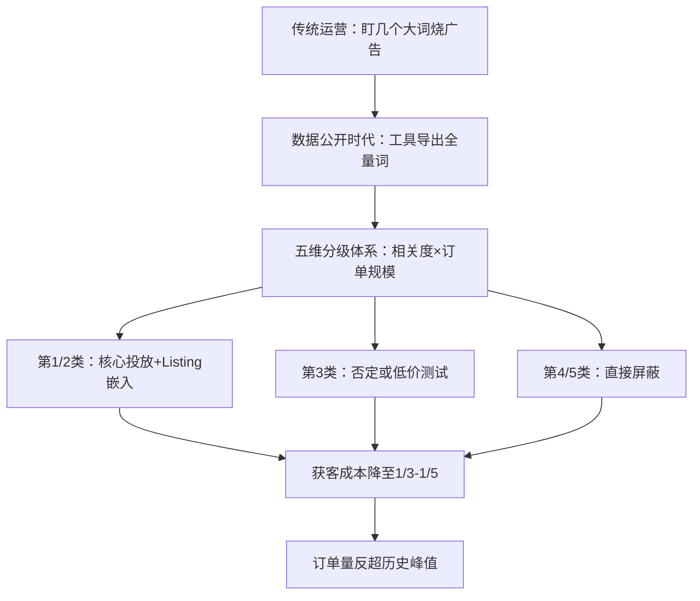
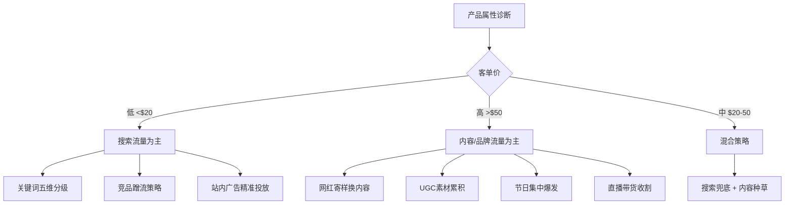

# 第 51 章 跨境电商精细化运营体系

## 学习目标

- 理解亚马逊运营核心矛盾从'流量获取难'转移到'流量识别与匹配难'的本质
- 掌握关键词五维分级体系及其在Listing优化和广告投放中的实操应用
- 掌握竞品蹭流策略：通过优化Listing共享竞品详情页关联推荐免费流量
- 理解产品-流量渠道匹配度铁律：产品属性决定流量战略，违背必亏
- 掌握电商六步成交公式在图片/视频/文案/直播等全触点的标准化应用
- 理解站外推广三大核心价值（辅助运营、清库存、打品牌）及生命周期匹配策略
- 掌握自助式站外推广平台模式：资源标准化/透明化/SaaS化解决卖家痛点
- 了解亚马逊联盟生态与FB群组运营模型，识别综合群与垂直群的商业逻辑差异
- 掌握新品'站外控量'、清库存'大折扣变现'、众筹'首周导流'三大标准化打法
- 建立'服务商资源透明化与卖家自主权统一'的双赢合作认知

## 51.1 生活类比

想象亚马逊运营像**开一家实体精品店**：
- **关键词五维分级** = 把进店顾客按'精准意向/模糊逛逛/误进/路过/躲雨'分五类，只对前两类重点推销
- **竞品蹭流策略** = 不在自家门口吆喝，而是把店开在隔壁爆款店旁边，借人家'买了这个又买那个'的货架位置免费获客
- **产品-流量渠道匹配度** = 卖标准螺丝钉去五金批发市场吆喝(搜索流量)，卖定制婚戒去婚博会/小红书种草(内容流量)，搞反了必亏
- **电商六步成交公式** = 导购话术六步法：亮资质(信任)→讲独有(差异)→算账划算(收益)→包退换(消异议)→指着排队买单(背书)→最后一单送礼(逼单)
- **站外推广三大价值** = 新品期发传单拉人气(辅助运营)、积压库存打折清仓(清库存)、办会员制建私域粉丝群(打品牌)
就像实体店老板要懂'选址匹配客群、话术成体系、推广分阶段、自建会员池'，亚马逊卖家也要懂'流量识别匹配、成交公式标准化、站外推广分层、品牌自带流量'。

## 51.2 概念地图

跨境电商精细化运营体系
├── 核心认知转移
│   ├── 流量识别优先原则  —— P008
│   ├── 消费者行为分散性  —— P008
│   └── 亚马逊运营核心矛盾转移定律  —— P008
├── 关键词体系与广告结构
│   ├── 关键词五维分级体系  —— P001
│   ├── 关键词全量梳理与分级法  —— P001
│   └── 流量成本与精准度反比定律  —— P008
├── 流量获取策略矩阵
│   ├── 竞品蹭流策略  —— P002
│   ├── 竞品关联流量捕获法  —— P002
│   ├── 产品-流量渠道匹配度  —— P003
│   ├── 产品属性决定流量战略铁律  —— P008
│   └── 网红内容营销布局法  —— P003
├── 转化率系统化工程
│   ├── 电商六步成交公式  —— P004
│   ├── 电商六步成交公式应用法  —— P004
│   └── 转化率系统化工程公理  —— P008
└── 站外推广生态体系
    ├── 站外推广三大核心价值  —— P005
    ├── 站外渠道二维分类体系  —— P009
    ├── FB群组运营模型  —— P007
    ├── 自助式站外推广平台模式  —— P006
    ├── 亚马逊联盟营销生态  —— P007
    ├── 服务商资源透明化与卖家自主权统一论  —— P007
    ├── 亚马逊流量红利消退与站外必然性定律  —— P007
    ├── 新品'站外控量'打法  —— P007
    ├── 清库存'大折扣快速变现'打法  —— P007
    └── 众筹项目'前置导流'爆发法  —— P007

## 51.3 关键词五维分级体系 —— 把流量词分类才能精准投放

### 51.3.1 为什么需要这个概念？

你可能会问：我已经选好品了，直接上大词投广告不就行了？为什么还要把流量词分那么细？

过去几年，亚马逊开放了大量消费者行为数据，搜索词报告、品牌分析、机会探测器，数据几乎完全公开。但拓跋勇在《亚马逊精细化运营核心：从“盲目烧广告”到“流量识别匹配”》中指出：

> "亚马逊正在变得越来越容易...过去几年亚马逊开放了大量的消费者行为数据...当搜索数据几乎被完全公开时，对于细心的人来说绝对是个巨大的机会，当然了，机会面前往往有很多障碍，因为每个人对于数据的理解是完全不同的"
> 
> ——《P008, p.1-2》

这段话揭示了核心矛盾：**数据公开了，但理解数据的能力差异巨大**。作者观察到：

> "80%甚至是超越 90%的亚马逊卖家目前仍然停留在解决站内搜索流量的阶段...很多朋友宁可花费巨额的广告费...都不愿意先做好流量的识别工作"
> 
> ——《P008, p.2》

这就是为什么你需要五维分级体系——**不分级，就等于把钱扔给弱相关甚至无关的流量**。一个真实案例：三款滞销产品，原运营仅盯着几十个低相关大词，执行全量词梳理+五维分级后，收录流量词从几十增至数百上千，获客成本降至原来 1/3-1/5，订单量大幅超越历史峰值。

### 51.3.2 核心定义：关键词五维分级体系

**定义（来源：《P008》）**：

按**相关度**与**订单规模**二维矩阵，将产品所有潜在搜索词划分为五类：

| 分级 | 相关度 | 订单规模 | 典型特征 | 运营动作 |
|------|--------|----------|----------|----------|
| **第1类** | 高度相关 | 订单量大 | 核心大词，如 "portable coffee maker" | 核心投放 + Listing标题/五点/ST嵌入 |
| **第2类** | 高度相关 | 订单规模一般 | 精准中长尾，如 "best portable coffee maker for travel" | 广告精准投放 + Listing细节页布局 |
| **第3类** | 弱相关 | 订单规模大 | 泛流量大词，如 "coffee machine" | 否定关键词 或 极低价测试 |
| **第4类** | 看似相关 | 实则无关 | 伪需求词，如 "coffee beans" (卖咖啡机的) | 必须否定屏蔽 |
| **第5类** | 完全无关 | 噪音 | 无关词，如 "tea maker" | 必须否定屏蔽 |

> "对流量词进行划分：高度相关，订单量较大的词、高度相关，订单规模一般的词、弱相关，订单规模比较大的词、看似相关实则无关的词、完全无关的词"
> 
> ——《P008, p.3》

这个公式展示了流量识别的核心逻辑：**相关度是第一位的筛选标准，订单规模只是辅助参考**。只有前两类词值得核心预算投入；第3类词是“烧钱大户”，必须通过否定关键词隔离；第4、5类词是纯噪音，直接屏蔽。

### 51.3.3 关键方法：关键词全量梳理与分级法

**方法（来源：《P008》）**：

```
1. 工具导出：用卖家精灵/Helium 10/Jungle Scout导出品类Top 50竞品 + 自身品类词的全量关键词（建议500-2000词）
2. 相关度人工标注：逐词判断“搜这个词的人，是否在找我的产品？”（高度相关/弱相关/无关）
3. 订单规模参考：结合搜索量、竞品销量、品牌分析数据标注“大/中/小”
4. 二维矩阵划分：按上表归类到五类
5. 动作执行：
   - 第1/2类 → 核心预算倾斜，嵌入标题/五点/ST/广告精准投放
   - 第3类 → 广告组设为否定关键词，或单独建低价自动广告测试
   - 第4/5类 → 直接加入否定关键词列表（广泛/词组/精准三匹配全覆盖）
6. 周度复盘：搜索词报告新增词汇重新分级，否定词库动态维护
```

这个流程展示了**“识别-分级-匹配-屏蔽”**的完整闭环。作者强调：

> "先完整的熟路这类产品的所有流量词，然后对流量词进行划分...重新修改产品的文案，观察收录的状态，重新投放广告"
> 
> ——《P008, p.3》

### 51.3.4 方法演进图



---

## 51.4 竞品蹭流策略 —— 借力竞品详情页的免费关联流量

### 51.4.1 为什么需要这个概念？

你有没有遇过这种情况：核心大词被头部大卖垄断，CPC 高得离谱，转化率却低得可怜？拓跋勇分享了一个扎心的案例：

> "产品的售价非常低，竞品又处于垄断地位，当时我们出高价花了大量的广告费，转化率非常惨淡...烧了几十万广告费后，我几乎绝望准备放弃"
> 
> ——《P008, p.4》

但他发现了一个关键的消费者行为模式：

> "消费者并不会仅仅只购买一个，而是习惯性的购买至少两个到三个同类的产品，一方面是为了凑金额免运费，另外一个就是用户的消费习惯就是拿这类产品作为装饰品"
> 
> ——《P008, p.4》

这个洞察直接催生了**竞品蹭流策略**——**不跟头部硬刚核心大词，而是让算法把你判定为“高相关竞品”，共享对方详情页的“Frequently bought together / Compare with similar items”免费推荐位**。

### 51.4.2 核心定义：竞品蹭流策略

**定义（来源：《P008》）**：

针对**低客单价 + 消费者有组合购买习惯**（装饰品、配件、凑单品）的品类：
- 放弃直接竞争核心大词
- 优化 Listing（标题、图片、类目节点、关键词、价格、评分、Prime 资格），使 A9 算法识别为该头部竞品的“高相关竞品”
- 共享竞品详情页的关联推荐免费流量

### 51.4.3 关键方法：竞品关联流量捕获法

**方法（来源：《P008》）**：

```
1. 竞品分析：确定品类 Top 3 头部竞品 ASIN，记录其类目节点、标题关键词结构、主图风格、价格区间、评分
2. Listing 对齐：
   - 类目节点：必须与竞品完全一致（叶子节点级）
   - 标题：核心关键词前置，属性词（颜色/尺寸/材质）对齐
   - 主图：风格、角度、背景与竞品高度相似（算法视觉识别）
   - 关键词：ST/五点/描述覆盖竞品核心流量词
3. 基础竞争力达标：
   - 价格：≤ 竞品价格 × 1.2（或具有明显性价比优势）
   - 评分：≥ 4.0 星
   - 物流：Prime 标配
4. 关闭无效广告：停掉核心大词广告组，预算转向长尾精准词
5. 监控验证：每日检查竞品详情页 "Frequently bought together" / "Compare with similar items" 是否出现本 ASIN
```

这个伪代码展示了**“对齐算法认知”而非“对抗竞品”**的核心逻辑。作者验证结果：

> "当我们的产品跟竞争对手的产品被平台同时推荐后，我几乎没有再打一分钱的广告，每天却可以从别人那儿蹭来小一百单，产品也算是顺利的实现了盈利"
> 
> ——《P008, p.4》

### 51.4.4 适用性边界与应对

| 适用品类 | 不适用品类 | 失效应对 |
|----------|------------|----------|
| 低客单价（<$20） | 高客单价（>$100） | 竞品流量下滑 → 多竞品并行蹭流 |
| 组合购买习惯强（装饰/配件/耗材） | 单品决策、无搭配属性 | 算法调整 → 持续监控 Listing 对齐度 |
| 高频复购 | 耐用消费品 | 自身 Listing 权重不足 → 先做站内广告积累权重 |

---

## 51.5 产品-流量渠道匹配度 —— 产品属性决定流量战略

### 51.5.1 核心定律：产品属性决定流量战略铁律

拓跋勇提出了一个**铁律**：

> "他的产品在搜索端完全没有什么优势，但是因为产品的颜值比较高，很适合情侣之间送礼的场景，于是我建议他放弃付费搜索流量，转而采用跟海外网红合作的方式来推广自己的产品"
> 
> ——《P008, p.5》

**定理（来源：《P008》）**：
- **标品 / 低价 / 高频 / 功能性强** → 搜索流量 + 关联流量为主
- **非标 / 高价 / 强视觉 / 强场景 / 强社交属性 / 明确受众** → 网红内容流量 / 品牌流量为主
- **违背此铁律强行跑搜索广告必然亏损**

### 51.5.2 关键方法：网红内容营销布局法

**方法（来源：《P008》）**：

```
1. 属性诊断：确认产品具备“高颜值/强场景/明确受众/差异化卖点”
2. 放弃搜索广告：大幅削减或停止站内 SP/SB/SBV 广告预算
3. 网红筛选：
   - 平台：YouTube / Instagram / TikTok / 小红书 / 抖音（按目标市场选）
   - 层级：中腰部优先（1万-50万粉），性价比高、配合度高、真实测评
   - 垂直度：必须与产品使用场景高度重合（如情侣送礼→情侣博主/生活方式博主）
4. 合作模式：免费寄样换内容（无需付费），要求：
   - 真实开箱/使用场景展示
   - 视频/图文/Reels/Shorts 多形态
   - 发布时标注品牌 @ + 话题标签
5. UGC 积累与二次利用：
   - 授权转发至品牌官方账号
   - 素材剪辑用于站内 Posts / A+ 页面 / 广告视频
   - 关键节日（情人节/黑五/网一）集中爆发
6. 后续放大：接入直播带货（TikTok Shop / Amazon Live）收割流量
```

这个流程展示了**“属性诊断 → 渠道匹配 → 低成本试错 → 素材复用 → 节日爆发 → 直播收割”**的完整链路。案例验证：

> "很多网红非常喜欢他们家的产品，在 Youtube、Ins、Tiktok 发布了大量优质的视频内容，一度把他的产品送到了同品类的第二名，刚好赶上年后的情人节，他们的产品一度在海外卖脱销"
> 
> ——《P008, p.5-6》

### 51.5.3 数据流图：产品属性如何决定流量去向



---

## 51.6 电商六步成交公式 —— 让每个触点都具备成交能力

### 51.6.1 为什么需要这个公式？

很多卖家主图很美、视频很酷、文案很长，但就是不出单。拓跋勇直指痛点：

> "我们想要获得成交就一定要遵循这个公式，很多朋友去做营销，搞销售，没有很好的结果，恰恰就是没有一套相对完整和成体系的销售公式"
> 
> ——《P008, p.7》

转化率不是单一要素决定的，而是**六维要素完备性的系统工程**。缺失任一环节，转化漏斗就断层。

### 51.6.2 核心定义：电商六步成交公式

**定义（来源：《P008》）**：

$$
\text{Conversion} = \text{Credibility} + \text{USP} + \text{User Benefit} + \text{Question Killer} + \text{Social Proof} + \text{Lure(CTA)}
$$

| 要素 | 中文名 | 核心内容 | 典型素材形式 |
|------|--------|----------|--------------|
| **Credibility** | 信任背书 | 品牌授权/工厂实景/认证徽章/销量徽章/专利证书 | 主图角标、视频开头、A+页面工厂实拍 |
| **USP** | 独特销售主张 | 专利/独家工艺/独特设计/差异化参数/唯一功能 | 五点描述第1点、视频核心演示、对比图 |
| **User Benefit** | 用户收益 | 场景化收益/解决痛点/情绪价值/省钱省时/爽感 | 五点描述第2-3点、生活场景图、视频B-roll |
| **Question Killer** | 异议消除 | FAQ/对比图/风险反转/售后承诺/尺寸对照表 | QA模块、详情页对比表、保修卡图片 |
| **Social Proof** | 社会化证明 | 真实买家秀/媒体报道/KOL背书/销量数据/榜单排名 | 买家视频/评论截图/红人背书图/Best Seller徽章 |
| **Lure/CTA** | 行动召唤 | 限时折扣/买赠/库存倒计时/组合立减/首单礼 | 促销标签、倒计时条、组合购买模块、Coupons |

> "Credibility+USP+User benefit+Question Killer+Social proof+Lure（CTA） 产品可靠性+独特销售主张+用户收益+解决问题+社会化证明+销售诱饵"
> 
> ——《P008, p.7》

### 51.6.3 关键方法：电商六步成交公式应用法

**方法（来源：《P008》）**：

```
对于每一个销售触点（主图/视频/A+页面/五点描述/直播话术/站外落地页）：
1. 审计清单：六要素是否全覆盖？顺序是否符合用户决策心理（信任→差异→收益→异议→背书→逼单）？
2. 权重调整：
   - 高客单价（>$100）：重 Credibility(30%) + Question Killer(25%) + Social Proof(20%)
   - 冲动型低客单（<$30）：重 Lure(30%) + User Benefit(25%) + USP(20%)
   - 标品/功能性：重 USP(30%) + User Benefit(25%) + Credibility(20%)
3. 素材生产标准化：
   - 主图：1主图(USP) + 2场景图(User Benefit) + 3对比图(USP) + 4细节图(Credibility) + 5买家秀(Social Proof) + 6促销图(Lure)
   - 视频：前3秒(Credibility+USP) → 中间场景演示(User Benefit) → FAQ对比(Question Killer) → 买家见证(Social Proof) → 限时优惠(Lure)
   - 直播话术：开场建信(Credibility) → 核心卖点(USP) → 场景代入(User Benefit) → 现场答疑(Question Killer) → 展示好评/销量(Social Proof) → 逼单成交(Lure)
4. 周度复盘：按六要素拆解转化漏斗，定位断层环节，定向优化
```

这个公式展示了**全渠道复用同一套销售逻辑**的威力。作者团队验证：

> "它在文案中，视频中，图片中的效果是完全一样的，我们想要获得成交就一定要遵循这个公式"
> 
> ——《P008, p.7》

### 51.6.4 缺失诊断表（对应动手练习 3）

| 缺失要素 | 典型症状 | 补救优先级 |
|----------|----------|------------|
| Credibility | 新品无评价、无品牌、主图只有参数表 | ★★★★★ |
| USP | 同质化严重、无差异化卖点 | ★★★★☆ |
| User Benefit | 罗列参数、无场景化描述、用户“看不懂有什么用” | ★★★★★ |
| Question Killer | 退货率高、QA空白、负面评论集中在同一问题 | ★★★★☆ |
| Social Proof | 评价<10条、无买家秀、无KOL背书 | ★★★★☆ |
| Lure/CTA | 加购率高但转化率低、无促销、无紧迫感 | ★★★★★ |

---

## 51.7 站外推广三大核心价值 —— 运营辅助、清库存、打品牌

### 51.7.1 为什么必须做站外推广？

Rick（海豚出海合伙人）在《站外推广体系复盘》中揭示了亚马逊流量红利的生命周期：

> "以前亚马逊好做是因为信息差：卖家少，平台需要丰富品类，亚马逊也不是天生自带流量，也是靠联盟从站外把流量引过来然后亏本给到卖家...现在亚马逊不好做是因为信息差已经过去了，平台已经不缺同质化产品...当平台需要靠广告费收割，这时候我们只能自己从站外去引流"
> 
> ——《P008, p.2-3》

这就是**亚马逊流量红利消退与站外必然性定律**：平台早期亏本补贴流量（红利期），成熟期靠广告收割，卖家必从站外自建流量池或低成本购买流量才能生存。

### 51.7.2 核心定义：站外推广三大核心价值

**定义（来源：《P008》）**：

| 价值层级 | 核心作用 | 适用生命周期 | 关键指标 |
|----------|----------|--------------|----------|
| **价值一：辅助站内运营** | 激活链接、配合秒杀、出单索评、维护排名、稀释退货率/差评率、绑定FBT、直接盈利 | 新品期、稳定期 | 单量、评论数、BSR排名、转化率 |
| **价值二：清库存** | 大折扣快速变现，优于平台 Outlet 不可控、线下收货低价 | 滞销期、季末、停产前 | 回款速度、库存周转天数、亏损控制 |
| **价值三：打造品牌** | 应对广告成本高企，建立自带流量的品牌护城河，积累 UGC 素材接入直播 | 成熟期、品牌化期 | 品牌搜索量、复购率、站外流量占比、UGC数量 |

> "我们为什么要做站外推广？ 1. 辅助亚马逊运营 ... 2. 清库存 ... 3. 打造品牌 ... 从平台角度来看，能从站外引流给平台带来客户并成交，平台能挣钱，自然就会给链接加权...而品牌是最好的流量池，品牌是自带流量的，是赢得人心的结果...站外推广的终局应该是往品牌去走"
> 
> ——《P008, p.4-5》

### 51.7.3 生命周期匹配策略表

| 生命周期 | 核心目标 | 站外策略 | 预算分配 | 典型打法 |
|----------|----------|----------|----------|----------|
| **新品期** | 冲排名、积评论、测转化 | 流量推广为主 + 品牌推广辅助 | 70%流量 / 30%品牌 | 每日投放 30-50 个 FB 群组，控单量稳 BSR |
| **成长期** | 扩大词量、提权重、跑出自然单 | 流量推广为主 | 80%流量 / 20%品牌 | 站外控单量配合站内广告降 CPC |
| **成熟期** | 利润最大化、品牌资产沉淀 | 品牌推广为主 + 流量推广辅助 | 40%流量 / 60%品牌 | 垂直 KOL 种草 + PR 软文 + 众筹/直播 |
| **滞销/清仓期** | 现金流回笼、止损 | 流量推广（大折扣） | 90%流量 / 10%品牌 | Deal 站 + FB 群组大折扣清货 |

---

## 51.8 站外渠道二维分类体系 —— 流量推广 vs 品牌推广

### 51.8.1 核心定义

**定义（来源：《P008》）**：

> "我们可以把这些内容创造者或博主分为两种，一种是泛流量的...另一个是垂直类目的...我们可以把上面两种成为流量推广和品牌推广"
> 
> ——《P008, p.6》

| 维度 | **流量推广** | **品牌推广** |
|------|--------------|--------------|
| **流量性质** | 泛流量、大众消费者 | 垂直流量、精准粉丝 |
| **核心渠道** | FB 群组、FB 主页、Deal 站 | PR 软文、KOL 网红、众筹平台 |
| **折扣要求** | 高（通常 40% OFF 起） | 低/无折扣（早鸟价/全价） |
| **追求目标** | 出单量、排名、评论数 | 品牌资产、精准用户、长期复购 |
| **素材要求** | 标准化促销图/视频 | 定制化深度测评/故事化内容 |
| **KPI** | 单量、CPA、BSR 提升 | 品牌搜索量、UGC 数量、复购率 |
| **适用阶段** | 新品拉升、清库存 | 品牌建设、高客单新品、众筹 |

### 51.8.2 两大体系并行操作要点

- **预算分离**：两套预算独立核算，不互相挪用
- **素材分离**：流量推广用标准化促销素材；品牌推广需定制化深度内容
- **团队分离**：流量推广适合外包/自助平台/SOP 执行；品牌推广需核心团队把控调性
- **数据归因**：UTM 参数 + 专属折扣码 + 品牌分析仪表盘，穿透全链路

---

## 51.9 自助式站外推广平台模式 —— 资源透明化、标准化、SaaS 化

### 51.9.1 为什么需要自助平台？

Rick 亲历了三种模式的演进：

1. **找服务商**：资源不透明（反馈打码）、排期不可控（集中爆发）、渠道重叠（买到同一个群）、数据造假
2. **自建团队**：成本高、招人难、管理复杂、时差沟通累、资源维护成本高
3. **自助平台（海豚出海模式）**：**资源标准化、透明化、SaaS 化**

> "服务商由于以下缺点限制了我们推广目的：1.反馈打码，数据不透明... 2.单量集中在某一天... 3.没办法根据产品分析适合什么渠道...我们慢慢开始和更多关系不错的老客户进行新的合作尝试，把客户想发的群组和我们认为不错的群组列在表格中，供客户根据每天预算挑选上贴...这是一次双赢的合作。真正做到省心又省钱。可以做很多以前只有自己站外团队才能实现的事情。"
> 
> ——《P008, p.8-9》

### 51.9.2 核心模型：自助式站外推广平台

**定义（来源：《P008》）**：

- **供给侧**：聚合数百个 FB 群组 / Deal 站 / 红人资源，标准化标注（受众画像、粉丝量、适合品类、历史转化数据、价格）
- **需求侧**：卖家自主选品类 / 粉丝量 / 价格 / 发帖时间下单，几分钟完成，第二天查反馈
- **价格机制**：平台批量采购压低单价（如 30 万粉群低至 9.9 元），解决“找资源难、单次采购贵、资源重叠、数据不透明”痛点

**方法（来源：《P008》）**：

```
平台建设端：
1. 资源采集：爬虫/人工采集 FB 群组/Deal 站/红人联系方式
2. 资源画像：标注受众国家/性别/年龄/兴趣标签/粉丝量/活跃度/适合品类/历史出单率
3. 价格体系：按粉丝量分级定价（10万<5万<100万<300万），批量套餐折扣
4. SaaS 系统：卖家后台选品类→筛选群组→设预算/时间→下单支付→排期自动执行→数据回传（点击/转化/订单）
5. 质控机制：上帖率监控（<70%预警）、重复群组去重、虚假流量识别

卖家使用端：
1. 注册认证：绑定亚马逊店铺授权，验证真实卖家身份
2. 创建任务：选品类/目标国家/预算/时间范围/折扣力度
3. 智能推荐/自选：系统推荐高匹配群组，或卖家自主勾选
4. 下单支付：预充值/单笔支付，冻结资金至上帖确认
5. 执行监控：实时看上帖状态/截图/链接，异常即时介入
6. 数据复盘：次日自动拉取点击/加购/订单/转化率/ACOS，更新资源评分
```

### 51.9.3 实战数据验证

> "全部群组都下单一遍，加起来大概 3000+人民币，$400 左右...基本能达到 70%的上帖率，如果产品做了站外还有利润，这个玩法基本上每天都能带来 100 多单销量...通过站外推广一天就从 5w 多名上升至 9k 多，每天通过站外辅助稳定链接在 Health 1W 名左右"
> 
> ——《P008, p.9-10》

---

## 51.10 亚马逊联盟生态与 FB 群组运营模型

### 51.10.1 联盟生态三方结构

**定义（来源：《P008》）**：

> "亚马逊联盟中：亚马逊提供平台，联盟内容创造者-如 Facebook 群组管理员，社媒红人，亚马逊影响者等提供流量，卖家提供产品，这三者构建成了联盟营销生态。"
> 
> ——《P008, p.5》

### 51.10.2 FB 综合群组运营模型（核心商业逻辑）

**模型（来源：《P008》）**：

```
1. 拉人头扩充成员：广告/病毒裂变/交叉推广 → 成员数 = 流量资产估值基础
2. 多分工管理员：内容审核/排期/客服/广告销售 → 低成本运营
3. 综合品类分发：不限品类，满足“凑单/装饰/好奇”泛需求 → 高活跃度
4. 双重变现：
   - 亚马逊联盟佣金（1%-4%，长尾稳定）
   - 卖家发帖费（$5-$50/帖，主利润来源）
5. 结果：垂直类目群组难生存（流量不够分）、折扣门槛抬升至 40% OFF 起
```

> "群组的特点是方便，快速，通过发布大量的帖子，博取出单概率，但是单价低且分佣的管理员多，所以他们必须通过不同产品，满足群员来激活群组的活跃度...所以大部分群组都是综合群...这也是为什么垂直类目群组很少的原因。发展到现在，折扣基本上都是 40%OFF 起步了。"
> 
> ——《P008, p.6-7》

### 51.10.3 综合群 vs 垂直群：商业逻辑对比

| 维度 | 综合大群 | 垂直小群 |
|------|----------|----------|
| 成员画像 | 泛消费者、捡漏党 | 精准意向用户、发烧友 |
| 转化率 | 低（0.5%-1.5%） | 高（3%-8%） |
| 客单价适配 | 低客单（<$30） | 中高客单（>$50） |
| 折扣门槛 | 40% OFF 起 | 20%-30% OFF 可谈 |
| 发帖费 | 低（$5-$15） | 高（$20-$100） |
| 管理成本 | 低（标准化分发） | 高（需专业选品/内容） |
| 卖家适用 | 清库存、新品拉升、冲量 | 品牌种草、高客单转化、精准获客 |

---

## 51.11 三大标准化站外打法

### 51.11.1 新品「站外控量」打法

**场景**：新品广告衰退期、需要稳单量守排名、索评

**执行标准（来源：《P008》）**：
```
- 预算：$300-500/天（约 3000 元）
- 群组数：每日 30-50 个高匹配群组
- 控单量：日均 80-120 单，平滑曲线避免突变
- 索评率：目标 5%-10%（站外订单通常评论率高于站内）
- BSR 目标：大类目前 1 万名以内
- 周期：新品前 2-4 周，直至自然单占比 > 60%
```

> "通过站外推广一天就从 5w 多名上升至 9k 多，每天通过站外辅助稳定链接在 Health 1W 名左右...全部群组都下单一遍，加起来大概 3000+人民币，$400 左右，帖子大约 3 天左右上完...基本能达到 70%的上帖率，如果产品做了站外还有利润，这个玩法基本上每天都能带来 100 多单销量"
> 
> ——《P008, p.9-10》

### 51.11.2 清库存「大折扣快速变现」打法

**场景**：积压库存 > 3 个月、长期仓储费临近、停产清仓

**执行标准（来源：《P008》）**：
```
- 折扣力度：50%-70% OFF（必须防叠加：取消 Coupons/Prime 专享/虚拟捆绑）
- 渠道：FB 综合群 + Deal 站（Slickdeals/DealNews/Woot 等）
- 频次：每日高频投放，直至库存清零
- 止损线：单品亏损不超过采购成本 20%（含广告/物流/退货）
- 对比优势：优于平台 Outlet（不可控、周期长、低价）、优于线下收货商（价格极低、回款慢）
```

> "站外清库存的时候我们一般折扣力度都做的很大，这时候只要注意折扣叠加问题，避免不必要的损失...后面我们清完货后...我们就开始自己联系开发了一些群组...持续放了 2 个月，把剩下都清完了，回款十几个W，挽回了一些损失。"
> 
> ——《P008, p.10》

### 51.11.3 众筹项目「前置导流」爆发法

**场景**：Kickstarter / Indiegogo 众筹首发

**核心铁律**：**成败系于首周导流，首周不理想基本凉凉，不可强行续命**

**执行标准（来源：《P008》）**：
```
- 上线前 2 个月：提交资料、制作视频/素材、搭建落地页、配置追踪
- 上线前 2 周：垂直红人早鸟价铺货（免费寄样/定金锁单）、行业媒体软文预热、官方社区/论坛预热
- 首日爆发：全渠道同步推送（邮件列表/红人/媒体/社群/付费广告）
- 首周目标：达成筹款目标 30%-50%（触发平台算法推荐/热门榜单）
- 后续：若首周达标 → 持续红人追投 + 直播带货收割；若首周不达标 → 止损关项，保护品牌声誉
```

> "众筹的成败就在前一周导流，如果不理想基本上第二周开始就凉凉了，也不要垂死挣扎了...1. 我们可以找一下垂直网红，给他们早鸟价格，通过挂链接把粉丝引流到众筹网页。 2. 在一些行业杂志或者网站上，写软文引流。 3. 参加 kickstarter 官方或者其他社区引流。"
> 
> ——《P008, p.11》

---

## 51.12 服务商资源透明化与卖家自主权统一论

### 51.12.1 核心矛盾

传统服务商模式的四大顽疾（来源：《P008》）：
1. **数据不透明**：反馈打码，卖家无法核实真实点击/转化
2. **排期不可控**：单量集中在某一天，无法平滑控单量
3. **渠道不匹配**：服务商只管发帖，不分析产品适合什么渠道
4. **资源重叠**：不同服务商手里可能有同一个群组，卖家重复买单

### 51.12.2 解决之道：SaaS 平台化

> "我们想把这个很好的站外合作模式大量推广...于是我们做成了网站的方式...网站根据每个群组受众，粉丝数，适合渠道等都标记的很清楚...几分钟就可以完成，然后第二天查看下反馈就行...同时我们跟管理员购买了大量帖子套餐，把上帖价格做到更低，有的 30w 粉丝的群组低至￥9.9"
> 
> ——《P008, p.8-9》

**定理（来源：《P008》）**：
**唯有将资源标准化、价格透明化、排期自主化（SaaS 平台化），才能实现卖家推广目的与服务商规模化盈利的双赢。**

这不仅是商业模式创新，更是**认知升级**：从“买服务”转向“买标准化资源接入权”，卖家重获决策主动权。

---

## 51.13 亚马逊运营核心矛盾转移定律 —— 从抢流量到识别流量

### 51.13.1 定理陈述

**定理（来源：《P008》）**：

> "亚马逊正在变得越来越容易...过去几年亚马逊开放了大量的消费者行为数据...当搜索数据几乎被完全公开时，对于细心的人来说绝对是个巨大的机会，当然了，机会面前往往有很多障碍，因为每个人对于数据的理解是完全不同的...80%甚至是超越 90%的亚马逊卖家目前仍然停留在解决站内搜索流量的阶段...很多朋友宁可花费巨额的广告费...都不愿意先做好流量的识别工作"
> 
> ——《P008, p.1-2》

**过去**：核心矛盾 = **流量获取难**（信息不透明、工具少、红利期靠运气）
**现在**：核心矛盾 = **流量识别与匹配难**（数据公开、理解差异大、精细化运营决胜负）

### 51.13.2 配套定律

| 定律名 | 核心内容 | 来源 |
|--------|----------|------|
| **消费者行为分散性** | 决策不依赖单一搜索词/渠道，呈现多渠道、多触点、多动机 | P008 |
| **流量成本与精准度反比定律** | 越不精准的流量，获客成本指数级上升；精细化识别高相关流量可降本 60%-80% | P008 |
| **转化率系统化工程公理** | 转化率 = 六维要素完备性的系统工程，缺一不可，全渠道复用 | P008 |
| **产品属性决定流量战略铁律** | 产品属性强制决定最优流量路径，违背必亏 | P008 |

---

## 51.14 多源对照

### 共识

- **P008 与 P008 双素材共识**：亚马逊运营已进入“精细化流量识别”时代，盲目烧广告是死路一条；必须建立关键词分级体系、匹配产品属性与流量渠道、标准化成交公式、分层做站外推广。
- **站外推广是生存刚需**：站内流量红利消退，站外推广三大价值（辅助运营/清库存/打品牌）覆盖全生命周期。
- **服务商模式向平台模式演进**：资源透明化、标准化、SaaS 化是双赢的唯一出路。

### 分歧

| 维度 | P008（拓跋勇视角） | P008（Rick 视角） |
|------|-------------------|-------------------|
| **核心切入点** | 卖家运营视角：Listing/广告/内容/选品 | 服务商/平台视角：资源聚合/渠道分类/商业模式 |
| **流量识别工具** | 强调人工理解消费者行为数据 | 强调平台工具标准化资源画像 |
| **竞品蹭流** | 核心策略之一，零广告日出百单 | 未详细展开，隐含在流量推广渠道中 |
| **品牌建设** | 网红营销 → UGC → 直播收割 | 站外推广终局是品牌，但更强调自建流量池 |

**综合洞察**：两者互补。**拓跋勇教你“怎么打仗”（运营战术），Rick 教你“从哪弹药/怎么建军火库”（资源体系）。** 真正的高手，左手拿拓跋勇的运营方法论，右手拿 Rick 的站外资源平台，中间夹着六步成交公式做转化，这才是完整的跨境电商作战体系。

---

## 51.15 设计中的取舍

### 为什么不用“全自动 AI 选品/选词/投放”方案？

**答案**：数据公开不等于洞察自动化。消费者行为分散性、产品属性差异、竞品动态博弈、平台规则变化，这些都需要**人类的判断力**去做“相关度标注”、“属性诊断”、“渠道匹配”。AI 只能做“导出词表”、“生成文案初稿”、“监控异常”，决策环节必须人工把关。

### 这种设计的 trade-off 是什么？

| 获得 | 失去 |
|------|------|
| 精准流量控制、获客成本可控、转化率体系化、品牌资产可积累 | 前期人力投入大（词表分级、Listing 对齐、素材生产）、需要懂数据分析的运营人才、不适合完全不懂类目的纯小白 |

**核心判断**：**“君子性非异也，善假于物也”**——工具（RPA/AI/自助平台）是杠杆，但**支点必须是你对消费者和产品的深度理解**。没有理解，杠杆再长也撬不动地球。

---

## 51.16 动手练习

### 练习 1：关键词五维分级实战演练

某卖家销售'便携式咖啡机'，使用工具导出品类前500关键词，请按五维体系分级：
1. 高度相关、订单量大的核心大词（如：portable coffee maker）
2. 高度相关、订单规模一般的精准中长尾词（如：best portable coffee maker for travel）
3. 弱相关但订单规模大的泛流量词（如：coffee machine、espresso maker）
4. 看似相关实则无关的伪需求词（如：coffee beans、coffee mugs）
5. 完全无关的噪音词（如：tea maker、juicer）

**回答问题**：
- 该卖家原仅盯着第3类词投放广告，获客成本$15，分级后剔除第3/4/5类词，核心预算倾斜第1/2类，预估获客成本会如何变化？为什么？
- 第3类词'coffee machine'搜索量巨大，为何必须否定或极低价测试？

### 练习 2：竞品蹭流策略适用性判断

判断以下产品是否适用'竞品蹭流策略'，并说明核心理由：
1. 售价$9.9的手机壳（消费者常买2-3个不同颜色搭配）
2. 售价$299的高端吸尘器（单次购买、决策周期长、无组合购买习惯）
3. 售价$12.9的圣诞树挂饰套装（节日强季节性、消费者习惯一次买整套、凑单免运费）
4. 售价$49的专业相机镜头（高客单、专业买家、单品购买、无装饰属性）

**回答问题**：
- 适用品类的Listing优化重点是什么？（提示：类目节点、关键词、图片、标题对齐）
- 若竞品流量下滑或算法调整，蹭流策略如何应对？

### 练习 3：电商六步成交公式缺失诊断

某Listing主图仅展示产品参数表，无品牌授权/工厂实景/认证徽章；五点描述罗列功能无场景化收益；无FAQ/对比图/售后承诺；仅有3条买家秀且无KOL背书；无限时折扣/库存倒计时/组合立减。

**请识别该Listing缺失的六步成交公式要素**：
1. 缺失 Credibility（信任背书）的具体表现？
2. 缺失 User Benefit（用户收益）的具体表现？
3. 缺失 Question Killer（异议消除）的具体表现？
4. 缺失 Social Proof（社会化证明）的具体表现？
5. 缺失 Lure/CTA（行动召唤）的具体表现？

**回答问题**：
- 若仅补充'限时折扣'(Lure)而其他五要素均缺失，转化率会显著提升吗？为什么？
- 高客单价产品（>$200）应重点强化哪两个要素？低客单冲动型产品（<$20）应重点强化哪两个要素？

---

## 51.17 本章小结

这一章中我们学习了跨境电商精细化运营的完整体系。首先，我们确立了**亚马逊运营核心矛盾已从“流量获取难”转移为“流量识别与匹配难”**的认知基石，理解了消费者行为分散性决定了必须做流量识别工作。其次，我们掌握了**关键词五维分级体系**，学会按相关度与订单规模把流量词分五类，只对前两类核心投放，其余屏蔽或低价测试。接着，我们拆解了**竞品蹭流策略**，通过 Listing 对齐共享头部竞品详情页关联推荐免费流量，实现零广告日出百单。然后，我们内化了**产品-流量渠道匹配度铁律**：标品走搜索，非标走内容，违背必亏。之后，我们系统掌握了**电商六步成交公式**，在图片/视频/文案/直播全触点嵌入信任-差异-收益-异议-背书-诱饵六要素。最后，我们构建了**站外推广生态体系**：三大价值分层匹配生命周期、二维渠道分类指导预算分配、自助平台模式解决资源透明化、三大标准化打法覆盖新品/清仓/众筹全场景。

本章我们一起学习了以下概念：

| 概念 | 解释 |
|------|------|
| 关键词五维分级体系 | 按相关度与订单规模将流量词分五类，是精细化广告与Listing优化的基础框架 |
| 竞品蹭流策略 | 低客单+组合购买习惯品类，优化Listing共享竞品详情页关联推荐免费流量 |
| 产品-流量渠道匹配度 | 标品/低价走搜索流量，非标/高价/强视觉走网红内容流量，违背铁律必亏 |
| 电商六步成交公式 | Credibility+USP+User Benefit+Question Killer+Social Proof+Lure(CTA)全触点通用转化框架 |
| 亚马逊运营核心矛盾转移定律 | 从抢流量转向识别流量，赚钱取决于对消费者行为数据理解深度与执行精细度 |
| 站外推广三大核心价值 | 辅助站内运营(激活/秒杀/索评/维权/稀释)、清库存(优于Outlet/线下)、打品牌(应对广告高企建护城河) |
| 自助式站外推广平台模式 | 将FB群组/Deal站资源标准化透明化SaaS化，卖家自主下单、批量压价、数据透明 |
| FB群组运营模型 | 拉人头扩充→多分工管综合帖→联盟佣金+发帖费双重变现，导致垂直群难生存、折扣门槛40%起 |
| 服务商资源透明化与卖家自主权统一论 | 传统服务商资源不透明/排期不可控，唯有SaaS平台化实现资源标准化/价格透明/排期自主，达成双赢 |
| 亚马逊流量红利消退与站外必然性定律 | 平台早期亏本补贴流量(红利)，成熟期靠广告收割，卖家必从站外自建流量池或低成本购买流量才能生存 |

下一章中，我们将学习 **无代码 AI 应用开发与商业闭环**，探索普通人如何用 Make/Zapier 等工具串联表单、ChatGPT API、表格、邮件，构建“采集需求-AI加工-结果交付”全自动商业闭环，实现“超级个体”构建术。
