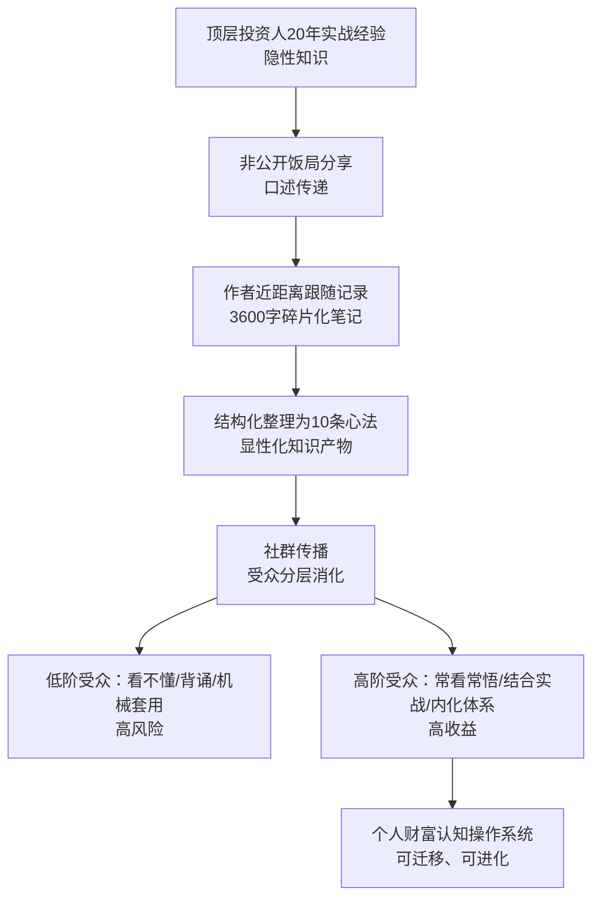

# 第 10 章 顶层投资认知与财富心法 —— 站在巨人肩膀上跨越认知鸿沟

## 学习目标

- 理解顶层投资人财富心法的稀缺性与可迁移性边界
- 掌握通过标杆案例复盘跨越认知鸿沟的核心路径
- 识别隐性知识显性化传播中的受众分层与认知门槛
- 建立从"学心法"到"建体系"的个人财富认知升级闭环
- 警惕幸存者偏差与语境依赖性对心法直接套用的风险

## 10.1 生活类比

想象顶层投资心法是一份**米其林大厨的"不传秘籍"**：大厨是百亿级投资人（20年、30亿美元、理想/小i等招牌菜），秘籍是10条心法（火候、选材、调味的底层逻辑），食材是标杆案例（理想汽车、小i机器人等具体菜品），食客是普通投资者（有的只吃得到"好吃"，有的能悟出"道"），厨房语境是宏观周期/政策环境（同一道菜换个灶台/季节味道全变）。就像学做菜不能光背秘籍、不懂火候语境、没练过刀工，投资心法也需在实战语境中"常看常悟"才能内化为自己的"手艺"。

## 10.2 概念地图

顶层投资认知与财富心法
├── 核心概念
│   ├── 百亿级投资人财富心法 —— P001
│   │   ├── 定义：顶层投资人长期实战总结的认知体系与行动指南
│   │   ├── 稀缺性：源于非公开饭局分享的隐性知识显性化产物
│   │   ├── 可迁移性：主张普通人通过复盘标杆案例决策逻辑实现认知跃迁
│   │   └── 系统性：覆盖认知、决策、周期、格局的底层操作系统
│   ├── 标杆投资案例 —— P001
│   │   ├── 理想汽车：早期识别团队与趋势共振，穿越周期坚定持仓
│   │   ├── 小i机器人：AI赛道早期布局垂直应用龙头，捕捉商业化红利
│   │   └── 30亿美元实盘：20年跨周期验证，非单次运气
│   └── 核心主张：顶层投资认知可迁移性 —— P001
│       └── 通过复盘案例背后决策逻辑跨越认知鸿沟
├── 理论边界与局限
│   ├── 认知门槛高：初学者"看不懂、比较年轻"，需基础商业常识 —— P001
│   ├── 幸存者偏差：仅见成功案例，缺踩坑细节、止损逻辑、仓位参数 —— P001
│   ├── 语境依赖性：脱离宏观周期/政策/赛道语境直接套用易失效 —— P001
│   └── 缺乏量化细则：给"是什么"无"怎么做"的标准化SOP —— P001
└── 传播与受众特征
├── 隐性知识显性化必要性：高阶认知需结构化传递 —— P001
└── 受众分层特征：低阶"看不懂"vs高阶"常看常悟/投资自己" —— P001

## 10.3 百亿级投资人财富心法 —— 站在巨人肩膀上跨越认知鸿沟

### 为什么需要这个概念？

你是否有过这样的困惑：看了无数投资书籍、学了各种技术指标，可一旦面对真实的市场波动，依然不知所措？普通投资者面临的核心困境是**认知天花板**——我们往往只能看到技术层面的战术（怎么买卖、看什么指标），却难以触及大趋势、大周期、大格局下的财富底层规律。

顶层投资人之所以稀缺，是因为他们经历过多轮完整的牛熊周期，管理过超大规模资金（百亿级别），并用真金白银验证了自己的认知体系。素材中的这位投资人，**20年间累计投资30亿美元**，早期捕捉了**理想汽车**、**小i机器人**等独角兽项目，这些不是纸上谈兵，而是跨周期的实盘验证。

> "机缘巧合下跟随标题中的牛人学习：20 年间投资 30 亿美元，国内知晓度高的企业如理想汽车、小 i 机器人等，还有一些海外企业。"
> 
> ——《P001，作者：赫男》

这段原文揭示了素材的核心来源：**一位经过20年、30亿美元实盘验证的顶级投资人，其投资版图覆盖了理想汽车、小i机器人等标杆案例**。作者通过近距离跟随（LP/G视角），将老师饭局分享的碎片化经验系统化整理为结构化的10条心法清单。

单纯学技术、学战术不如学底层心法。**心法决定了在不确定性中如何做高质量决策**。当市场环境剧变、教科书失效时，拥有底层操作系统的人能穿越周期，而只有战术的人会被市场淘汰。

### 核心定义：什么是"百亿级投资人财富心法"？

**百亿级投资人财富心法**（来源：《P001》）

> 定义：指处于财富金字塔顶层、管理规模超百亿的投资人在长期实战中总结出的关于财富积累、认知升级、决策判断的核心认知体系与行动指南。
> 
> - 由作者近距离跟随该投资人饭局分享、隐性知识显性化提炼而成的10条结构化心法清单
> - 覆盖认知、决策、周期、格局四大维度，构成底层操作系统

这个定义有三个关键性质，你需要牢记：

1. **稀缺性**：源于非公开的饭局内部分享，属于高阶隐性知识显性化产物。这不是书店里买得到的公开知识，而是圈层内部流转的"秘籍"。
2. **可迁移性**：主张普通投资者通过复盘标志性案例背后的决策逻辑，实现财富认知阶跃式提升。这不是让你照抄买卖，而是让你学会"怎么思考"。
3. **系统性**：非零散技巧，而是覆盖认知、决策、周期、格局的底层操作系统。心法之间是相互关联、相互支撑的整体。

> "前段时间听了老师关于财富的分享，整理出 10 条心法，全文 3600 字。"
> 
> ——《P001，作者：赫男》

这句话看似平淡，实则透露了关键信息：**原始素材是3600字的碎片化口述记录**，而非系统化的教科书。这意味着我们拿到的素材本身就存在"压缩失真"——老师讲了3小时，记下来只有3600字，中间的语境、案例细节、反问互动全丢失了。

### 典型例子：心法如何在标杆案例中体现？

素材提到的两个标杆案例，是心法有效性的"背书载体"：

| 标杆案例 | 核心逻辑（素材推测） | 心法映射 |
|----------|---------------------|----------|
| **理想汽车** | 造车新势力早期，识别"团队+趋势"双重共振，穿越周期坚定持仓 | 趋势判断力、定力、非共识时的重仓勇气 |
| **小i机器人** | AI赛道早期，布局垂直应用层龙头，捕捉技术商业化红利 | 赛道嗅觉、应用层先于基础设施层获利、早期布局耐心 |
| **30亿美元实盘** | 20年跨周期验证，经历过互联网泡沫、金融危机、移动互联网、AI多个周期 | 周期认知、资产配置、风险控制、复利耐心 |

**关键提示**：素材**仅给出了结果**（投了理想、投了小i、赚了钱），**未披露过程**（何时买、买多少、何时加减仓、怎么止损、心理怎么想）。这就是典型的"只给菜谱不给火候"。

### 边界条件：为什么心法不能直接套用？

这是本章最重要的风险提示。素材评论区的一条留言精准戳中痛点：

> "罗松萍 : 现在还看不懂，比较年轻 罗松萍 : 很多东西我还要好好学"
> 
> ——《P001，评论区》

这揭示了**认知门槛**的客观存在。心法不是通用的"万能药"，它有四大边界条件，你必须在使用前清楚：

#### 1. 认知门槛高：初学者"看不懂、比较年轻"

心法假设你已具备**基础商业常识与投资常识**（如：什么是PE/VC、什么是赛道生命周期、什么是估值体系、什么是仓位管理）。如果你连"一级市场/二级市场"都分不清、"估值泡沫"概念模糊，心法对你就是天书。

**类比**：给不懂"火候"概念的人讲"大火收汁、小火慢炖"，对方只会困惑：什么叫大火？什么叫收汁？

#### 2. 幸存者偏差：仅见成功案例，缺踩坑细节

素材展示的是**30亿美元、理想汽车、小i机器人**——这些都是**成功案例的幸存者**。我们看不到：
- 踩过多少坑、亏过多少钱
- 止损逻辑是什么、仓位参数怎么设
- 面对连续亏损时怎么调整心态
- 错过的十倍股、踩雷的项目有哪些

**后果**：你只复制"买理想"，不复制"决策体系"，下一次遇到类似项目时，你无法判断"这是不是下一个理想"。

#### 3. 语境依赖性：脱离时空语境直接套用易失效

心法诞生于特定的**宏观周期、政策环境、赛道生命周期**中：
- 过去20年：中国互联网崛起、制造业升级、消费升级、AI爆发
- 政策：鼓励创新、支持新能源、数据安全监管
- 赛道：从PC互联网到移动互联网到AI，每个阶段玩法完全不同

**公式化表达**：

$$
\text{心法有效性} = f(\text{核心逻辑}, \text{宏观周期}, \text{政策环境}, \text{赛道阶段}, \text{资金规模}, \text{人格特质})
$$

当变量$宏观周期, 政策环境, 赛道阶段$发生相变（如：从宽松货币转紧缩、从鼓励扩张转严监管、从早期红利转红海厮杀），原心法的$\text{核心逻辑}$可能失效甚至反向。

#### 4. 缺乏量化执行细则：给"是什么"无"怎么做"

素材给出的是**心法清单**（是什么），缺乏**标准化SOP**（怎么做）：
- 无仓位模型：重仓定义是30%还是80%？分批建仓间隔多久？
- 无止损线：跌幅20%？还是基本面变化？
- 无复盘频次：日复盘？周复盘？月复盘？
- 无决策清单：投资前必须确认的N个条件是什么？

> "期待向圈友们多多学习，多多交流"
> 
> ——《P001，作者：赫男》

作者结语透露了真实心态：**这是一个邀请共创的开始，而非终极答案**。真正的心法内化，需要你在实战中"常看常悟"、自己补全细节、建立自己的执行体系。

### 方法演进图：从隐性知识到显性心法的传播链条

这张图揭示了知识传播的**损耗链条**：每一步传递都伴随信息损失和语境剥离。你作为最终接收者，拿到的是第4步的产物，离第1步的"实战现场"已隔了四层。**你的任务不是背诵第4步，而是逆向工程还原第1步的决策现场。**

### 多源对照：同一概念的不同解读视角

虽然本章核心素材仅来自P001单一来源，但我们可以结合大纲中其他章节的相关论述，进行**交叉验证**：

#### 共识：顶层认知的稀缺性与迁移难度

| 来源章节 | 核心观点 | 与本章共识点 |
|----------|----------|--------------|
| 第1章-商业认知重构 | "赚钱即利他"、主观价值理论证明交易正和博弈 | 顶层认知源于对价值创造本质的洞察，而非技巧 |
| 第3章-长期主义复利 | "坚持即稀缺"、时间门槛定律、抗压持久力是核心壁垒 | 顶层心法核心是穿越周期的定力，非短期技巧 |
| 第4章-创业心法 | "Always Day 1"、过程即奖赏、使命穿越周期 | 顶层投资人同样是"过程即奖赏"的长期主义者 |
| 第5章-个人商业变现 | "天赋优势区"匹配业务、"见识溢价"打破认知天花板 | 学习顶层心法本质是购买"见识"升级认知上限 |
| 第6章-欲望即货币 | 微观经济模型设计驱动行为、货币锚定欲望 | 顶层投资本质是识别并捕捉大规模欲望变迁的商业化 |

#### 分歧/张力：如何获取与验证顶层认知

| 视角 | 主张 | 潜在张力 |
|------|------|----------|
| **本章素材(P001)** | 通过跟随顶级投资人饭局、整理心法清单获取 | 信息压缩严重、语境丢失、无量化细则、幸存者偏差 |
| **第11章-个人与组织匹配** | 通过"双向匹配决策框架"主动选择高质量社群/导师 | 强调主动筛选与验证，而非被动接收"秘籍" |
| **第9章-实战复盘** | "极限压力测试式复盘"在自我怀疑中提炼底层逻辑 | 强调亲身实战中的认知重构，而非学习他人现成结论 |
| **第17章-自我迭代** | "改变>思考>学习"、"组合创新"而非原创、微循环迭代 | 强调行动优先、小步快跑验证，而非先学懂心法再行动 |

**核心洞见**：**顶层心法不是"拿来即用"的工具，而是"需要在实战中反复打磨"的坯子。** 不同章节从不同角度印证了同一个真理：**认知升级的唯一路径是"实战-复盘-迭代"的闭环，而非被动接收结论。**

### 设计中的取舍

**为什么素材只给心法清单，不给决策细节？**

1. **保密协议/商业敏感性**：顶级投资人的具体仓位、止损、入场时点属于核心商业机密，饭局分享默认不外传细节。
2. **隐性知识难显性化**：波利尼悖论——"我们知道的比我们能说出来的多"。老师可能也说不清"为什么那一刻决定加仓"，那是多年经验沉淀的直觉。
3. **受众分层保护**：直接给细节反而害了初学者——没认知基础的人拿到"买理想的具体价位和仓位"，会机械复制导致爆仓。
4. **商业模式设计**："心法清单"是免费/低价引流品，"详细决策体系/实战陪跑"才是高客单价后端产品。

**这种设计的 trade-off 是什么？**

| 获得 | 失去 |
|------|------|
| 传播广度：心法清单易传播、易引发讨论、易建立个人IP | 传播深度：无法直接指导实战操作 |
| 安全性：规避了"教人炒股亏钱被怨"的风险 | 完整性：切断了"知-行-果"完整链条 |
| 稀缺性：制造"秘籍"感知，提升社群粘性与付费意愿 | 可用性：初学者拿到手无法直接落地，产生挫败感 |

**给你的建议**：把这10条心法当作**检索索引**，而非操作手册。每条心法背后，你需要自己去：
- 找公开资料还原案例决策现场
- 用小资金实盘测试心法边界
- 建立属于你的量化执行细则
- 在复盘中不断修正、丰富、内化

## 10.4 多源对照：顶层投资认知的获取路径之争

### 共识

1. **顶层认知源于长周期实战验证**，非书本推导、非短期运气（P001、第3章、第4章、第9章一致）
2. **隐性知识显性化传播存在天然损耗**，接收者必须主动补全语境（P001评论区、第11章、第17章一致）
3. **认知升级的核心是"决策逻辑"而非"交易结果"**，复制买卖动作不复制决策体系必死（P001幸存者偏差、第9章极限复盘、第17章微循环迭代一致）
4. **受众分层是客观规律**：同一内容，低阶"看不懂"、高阶"常看常悟"（P001评论区、第1章认知重构、第5章见识溢价一致）

### 分歧

| 维度 | **被动学习派（心法清单路径）** | **主动实战派（复盘迭代路径）** |
|------|--------------------------------|--------------------------------|
| **代表** | P001素材、第1章认知重构 | 第9章极限复盘、第17章自我迭代、第11章匹配决策 |
| **核心主张** | 先学懂顶层心法，建立认知框架，再指导实战 | 先低成本实战跑通MVP，在实战中提炼/验证心法 |
| **风险** | 知行分离、假装努力、语境失效、幸存者偏差 | 认知碎片化、缺乏顶层设计、容易在错误方向上"快速试错" |
| **适用阶段** | 已有一定实战经验、具备基础认知框架、需要系统化整理时 | 零基础起步、新赛道探索、不确定性极高时 |
| **本章建议** | **二者结合：以心法为"地图"，以实战为"领土"，在地图指引下探索领土，在领土反馈中修正地图** | |

## 10.5 动手练习

### 练习 1：心法拆解与语境还原练习

假设你获得了某顶级投资人"重仓赛道龙头、穿越周期持有"的一条心法。

1. 列举该心法生效所需的 3 个宏观语境条件（如：利率周期、政策风向、赛道生命周期阶段）。
2. 当语境发生反转（如加息周期启动、监管收紧、赛道进入成熟期），该心法应如何修正或废弃？
3. 设计一个最小验证实验：用 1 万元资金在模拟盘中测试该心法 3 个月，记录关键决策节点与心理变化。

### 练习 2：标杆案例逆向工程复盘

以"理想汽车早期投资"为例，尝试还原投资决策链条：

1. 信息源头：投资人通过什么渠道、在什么时间点首次接触该项目？
2. 核心判断：团队、趋势、赛道三要素中，哪个是"非共识且正确"的关键变量？
3. 仓位管理：建仓、加仓、减仓的触发信号分别是什么？（注：素材未披露，需基于公开信息推演）
4. 退出逻辑：若项目基本面恶化，止损线在哪里？若超预期，获利了结标准是什么？

回答问题：
- 为什么素材中"30亿美元、理想、小i"等结果信息容易传播，而决策过程信息极难获得？
- 普通投资者只复制"买了理想"而不复制"决策体系"会导致什么后果？

### 练习 3：个人财富认知升级路径设计

结合自身情况，制定一份"跨越认知鸿沟"的 12 个月行动计划：

1. 信息源筛选：列出你将重点跟踪的 3-5 个顶层信息源（投资人、基金、媒体、社群），并设定监控频次。
2. 案例复盘库：每月深度复盘 1 个标杆投资案例（成功或失败），输出《决策逻辑-语境-结果》结构化笔记。
3. 实盘验证：拿出总资产 5%-10% 作为"认知学费"，按复盘得出的逻辑小额实盘，建立"决策-反馈-修正"闭环。
4. 认知门槛突破：针对当前"看不懂"的高阶内容（如宏观周期、资产配置模型），制定专项补课计划。

回答问题：
- 如何判断一个信息源是"真顶层"还是"伪大师"？
- 当你的实盘结果与复盘逻辑背离时，优先怀疑执行偏差还是逻辑失效？

## 10.6 本章小结

这一章中我们学习了顶层投资认知与财富心法的核心内涵与边界条件。首先，我们理解了百亿级投资人财富心法的定义——它是20年30亿美元实盘验证的底层认知操作系统，具有稀缺性、可迁移性、系统性三大特质。其次，我们通过理想汽车、小i机器人两大标杆案例，看到了心法在实战中的体现，但也清醒地认识到素材仅给结果不给过程的局限。接着，我们深度剖析了四大边界条件：认知门槛、幸存者偏差、语境依赖性、缺乏量化细则，这是防止心法误用的关键防线。然后，我们通过方法演进图梳理了隐性知识显性化传播的损耗链条，明确了接收者必须主动逆向工程的任务。最后，我们通过多源对照，确立了"以心法为地图、以实战为领土"的双轨并行认知升级路径。

本章我们一起学习了以下概念：

| 概念 | 解释 |
|------|------|
| 百亿级投资人财富心法 | 顶层投资人20年30亿美元实战沉淀的底层认知操作系统，覆盖认知/决策/周期/格局 |
| 标杆案例（理想汽车/小i机器人） | 心法有效性的背书载体，但素材未披露具体决策过程与仓位细节 |
| 顶层投资认知可迁移性主张 | 主张普通人通过复盘案例决策逻辑实现财富认知阶跃式提升 |
| 认知门槛与受众分层 | 初学者"看不懂"vs高阶"常看常悟"，印证隐性知识传播的分层特征 |
| 幸存者偏差风险 | 仅展示成功结果，缺失踩坑止损细节，直接套用易失效 |
| 语境依赖性 | 心法脱离宏观周期/政策/赛道语境直接应用极大概率失效 |
| 缺乏量化执行细则 | 给出"是什么"（心法），缺"怎么做"（SOP/仓位/止损/复盘频次） |

下一章中，我们将学习**个人与组织匹配决策**——如何通过"双向匹配决策框架"，精准评估个人与社群、公司、伴侣的契合度，拒绝盲目跟随与沉没成本陷阱，实现职业规划与资源投入的精准对齐。这将是从"认知升级"走向"决策落地"的关键一步。
