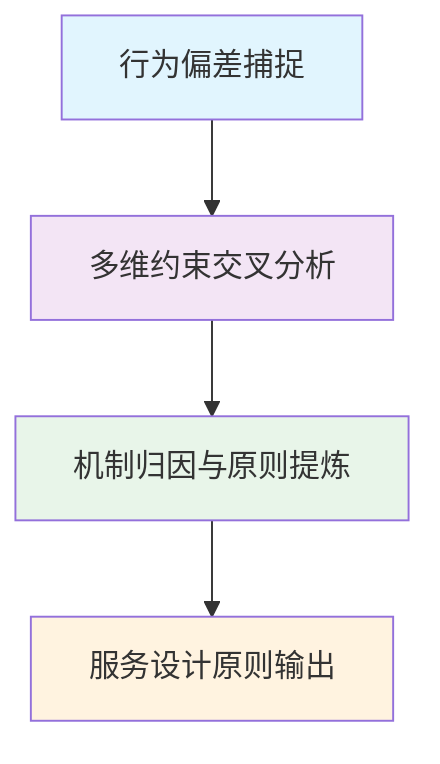

# 第 74 章 服务设计微观洞察 —— 好的服务让客户“下意识选择它”
作者：龙哥

## 学习目标

- 理解‘下意识选择’作为服务设计最高境界的内涵与判据
- 掌握‘情境化行为观察法’捕捉行为偏差、交叉分析多维约束、归因推导设计原则的完整流程
- 识别‘微观服务触点’（扶手、台阶、动线）在特定人群与动态情境下的决定性杠杆作用
- 辨析‘环境约束下的借力路径’三要素（可用肢体、支撑点位置、动力传递链路）与‘扶手-惯用手匹配度’的工程化量化指标
- 内化‘就近原则优于偏好原则’的行为切换机制与‘台阶-扶手缺失叠加门槛’的非线性失效模型
- 能将‘好的服务让客户下意识选择它’定理迁移至数字产品、空间设计、流程再造等领域的微观触点优化实战

## 74.1 生活类比

想象服务设计是一位**隐形的舞伴**：用户 = 蒙着眼、提着重物、站在晃动地板上的舞者；环境物理线索（扶手/台阶/动线）= 舞伴在关键节拍伸出的、恰到好处的手；下意识选择 = 舞者无需思考、凭本能抓住那只手、完成下一个动作；显性引导（标识/语音/教程）= 边上有人喊口令、举牌子‘把手伸这儿’；微观触点缺失 = 关键时刻舞伴的手缩回了、或伸到了够不着的位置。就像顶级舞伴从不教你跳舞、只在你即将失衡时把支撑点放在你本能伸手的轨迹上，最好的服务设计也不是教用户怎么用，而是把‘怎么用’设计进物理环境的肌理里。

## 74.2 概念地图

服务设计微观洞察
├── 核心定理
│   ├── 好的服务让客户下意识选择它定理  —— P005
│   └── 服务细节容错性决定下意识选择发生率  —— P005
├── 基础概念
│   ├── 下意识选择  —— P001
│   ├── 环境约束下的借力路径  —— P002
│   ├── 微观服务触点  —— P003
│   ├── 扶手-惯用手匹配度决定上座成败  —— P006
│   ├── 动态环境下‘就近原则’优于‘偏好原则’  —— P007
│   └── 台阶与扶手缺失叠加的隐性门槛  —— P008
└── 方法论体系
    ├── 情境化行为观察法  —— P004
    │   ├── 行为偏差捕捉
    │   ├── 多维约束交叉分析（物理×身体×环境）
    │   └── 机制归因与原则提炼
    └── 适用边界：高频/标准化/物理约束明确的微观交互场景

## 74.3 下意识选择 —— 让用户无需思考自动做对

### 为什么需要这个概念？

真实场景中用户常处于高认知负荷或身体受限状态（如老人提袋、车辆晃动）。显性引导（标识、语音）往往被忽视或来不及处理。只有适配本能反应的环境设计，才能在关键时刻托底用户体验。

### 核心定义

> "好的服务是会让客户下意识的选择它"
> 
> ——《docs/202303/20230328_096.md》

**下意识选择**指用户在特定情境约束（车辆震动、双手被占、时间压力）下，无需刻意思考、权衡利弊，仅凭环境物理线索（扶手可得性、距离远近）即可自动完成的最优行为决策。

核心公式：环境线索匹配度 × 用户约束下的可用性 = 下意识选择发生率

### 关键性质

- **非理性非随机**：基于生理本能与物理环境的耦合，而非逻辑推演
- **容错性强**：即使首选方案失效，也能自动切换到次优可行方案
- **隐性高效**：零学习成本、零决策延迟、零操作指导

### 典型例子

- 公交车上老人因首选座位无扶手、惯用手被占，启动瞬间自动转向就近有扶手座位
- 电梯门两侧贴脚部引导贴：用户下意识站位自动留出中间通道
- 手机解锁“滑动上唤醒”：符合重力与拇指活动范围的自然动作

### 边界条件

- 仅适用于高频、标准化、物理约束明确的微观交互场景
- 无法替代复杂决策场景中的显性信息架构与引导
- 过度依赖可能掩盖系统性流程设计缺陷（如本该无台阶却靠扶手补救）

## 74.4 环境约束下的借力路径 —— 设计要懂用户‘怎么发力’

### 为什么需要这个概念？

服务设计常忽略用户在动态环境中的身体力学现状。同一设施（如扶手），位置偏差几厘米就可能从‘好用’变‘废’。只有还原用户‘受限身体’在‘动态环境’中的真实发力路径，才能做对细节。

### 核心定义

**环境约束下的借力路径**指用户在物理受限环境（如启动中的公交）中，为完成动作（如上座）而寻找的身体支撑点与发力路径的匹配度。包含三要素：

1. **可用肢体**（哪只手/脚能发力）
2. **支撑点位置**（扶手在哪）
3. **动力传递链路**（能否形成有效杠杆）

> "在启动的车辆里不好发力，需要借用工具帮助自己迈上那个小阶梯"
> 
> "首选的“1”号并没有明显的扶手，由于自己手拎袋子，“1”号座位的座位扶手与自己可借力手同方向，导致借力不好借"
> 
> ——《docs/202303/20230328_096.md》

### 关键性质

- **极强情境依赖性**：静态测量‘有扶手’≠动态可用‘能借力’
- **惯用手/侧优势**：人体发力存在显著侧向不对称，设计必须适配优势侧
- **动态稳定性要求**：移动载具中，借力点必须能对抗惯性力

### 典型例子

- 老人提袋导致右手被占，左侧扶手可跨身体借力（好），右侧扶手同侧无法发力（坏）
- 地铁扶手环高度分层：适配不同身高人群的抓握发力点
- 无障碍坡道扶手双侧设置：适配单侧瘫痪/拐杖使用者的单侧发力需求

### 边界条件

- 依赖人因工程学标准数据（身高百分位、握力、关节活动度）
- 需结合具体场景的动态参数（车辆加速度、地面摩擦系数）
- 无法通过问卷/访谈获得，必须现场观察真实行为偏差

## 74.5 微观服务触点 —— 成败在毫厘之间的物理细节

### 为什么需要这个概念？

宏观流程走通了，微观触点卡住，体验依然为零。这些细节常被规划图纸、验收标准、甚至设计师自己忽略。只有放大镜级观察，才能发现决定‘下意识选择’的关键物理载体。

### 核心定义

**微观服务触点**指服务系统中微小的、常被忽视的物理设施细节（如座位旁的扶手、台阶高度、门把手形状、按钮阻力）。它们在特定使用情境下直接决定用户体验的成败，是‘下意识选择’发生的物理载体。

> "“2”号旁有扶手而“3”号旁没扶手（图 4 是对比图）"
> 
> "观察到座位都有一个小阶梯，需要迈步上抬才能上到座位上（图 6）"
> 
> ——《docs/202303/20230328_096.md》

### 关键性质

- **不可见性**：日常使用中不被觉察，只在失效时显现
- **杠杆放大效应**：微小投入（加一根扶手）撬动巨大体验差异（能坐上 vs 摔倒）
- **组合爆炸性**：单个触点合格，组合可能失效（有台阶+无扶手=不可用）

### 典型例子

- 公交座位扶手：有无、左右、高低、粗细、距座位距离
- 门槛石高度：15mm 以下无感，15-30mm 绊脚，30mm 以上需扶手
- 自动门感应区宽度：窄于肩宽会夹人，宽于两步会误触

### 边界条件

- 必须通过‘情境化行为观察’发现，靠桌面推演极易漏判
- 修复成本随工程阶段指数级上升：设计期 1 元，施工期 10 元，运营期 100 元
- 标准化难度大：同一触点在不同场景（医院/商场/家用）标准完全不同

## 74.6 情境化行为观察法 —— 在真实现场抓‘偏差’找‘真相’

### 为什么需要这个概念？

用户说的（访谈）与做的（行为）常不一致，更不敢说‘我力气小扶手够不着’。实验室模拟无法复刻真实环境的动态约束（晃动、拥挤、时间压力）。只有捕捉‘计划行为’与‘实际行为’的偏差，才能定位隐性设计缺陷。

### 核心定义

**情境化行为观察法**是在真实服务场景中捕捉异常行为（如换座、绕行、放弃、报错），通过多维度现场取证（座位物理属性、用户身体状态、环境动态约束），反向推导行为发生的物理与认知机制，进而提炼服务设计原则。核心三步：

1. **行为偏差捕捉**
2. **多维约束交叉分析**
3. **机制归因与原则提炼**

> "回到现场，我看了几个点，然后从中推导或许能推测这现象发生背后的理由。"
> 
> "本来是选择我对面的前排“1”号位，都已经走过去准备坐上去了，但在公交启动的情况下选择回来我这边的“2”号座位"
> 
> "为什么在已选择且要准备坐上去的时候，突然改变选择的座位？"
> 
> "1.老人首次选择的座位【回到“3”号去对比“2”号】有以下不同... 2.老人背着单边包，手拎白色塑料袋... 3.观察到座位都有一个小阶梯... 结合 1.2.3 点推导..."
> 
> ——《docs/202303/20230328_096.md》

### 关键性质

- **现场性**：必须在真实时空发生点完成观察与取证
- **多维交叉**：单一维度（如只看扶手）无法解释行为，需物理×身体×环境三维交叉
- **归因外显化**：将隐性的物理认知机制显性化为可迁移的设计原则

### 典型例子

- 本素材：老人走向1号→启动晃动→上座失败→转向2号→成功，三维交叉定位‘扶手-惯用手-台阶’耦合失效
- 便利店收银台排队弯腰取货：观察到弯腰动作→量台高/货架深/人身高→改浅台面/前置货架
- APP注册流程流失：埋点发现卡在‘设置密码’→回看密码规则复杂度→简化规则/展示强度条

### 边界条件

- 观察者需具备‘不打扰’隐蔽观察能力与‘多维同步记录’技能
- 样本量小（N=1 也可出洞察），但需警惕个案过度泛化
- 伦理边界：公共场景可观察，私密场景需知情同意

### 方法演进图

## 74.7 好的服务让客户下意识选择它定理 —— 服务设计的最高境界

### 为什么需要这个概念？

传统服务设计聚焦‘功能完备’与‘显性引导’，忽视‘无感体验’。真正的高手不教用户怎么用，而是把‘怎么用’设计进物理环境里。这一定理将服务设计评价标准从‘好不好用’提升到‘用不用想’。

### 核心定义

**好的服务让客户下意识选择它定理**：服务设计的最高境界不是提供显性的指引或选项，而是通过物理环境的微细节（如扶手位置、动线设计）适配用户在特定约束下的本能反应，使用户无需思考即可完成最优交互。

判据：用户完成目标任务时，认知负荷 ≈ 0，身体负荷 ≈ 最小值。

> "好的服务是会让客户下意识的选择它"
> 
> "一场公交上老人临时的换座，让我看到了非常有趣知识，更让我想起一句话“好的服务是会让客户下意识的选择”"
> 
> ——《docs/202303/20230328_096.md》

### 关键性质

- **以‘不设计’为设计**：最好的设计是用户感觉不到被设计
- **约束适配性**：越是在极端约束（单手、震动、时间压力）下，越能体现设计水平
- **容错兜底**：首选路径失效时，环境自动提供次优可行路径（就近原则）

### 典型例子

- 本素材：无标识、无语音、无引导，仅靠扶手位置与台阶组合，让老人自动完成最优换座
- 宜家单向动线：地面箭头+货架布局+捷径门，让顾客‘不由自主’逛完全场
- 微信‘长按识别二维码’：符合拇指自然停留动作，零学习成本

### 边界条件

- 不等于‘傻瓜化’：复杂专业任务仍需显性引导与认知支撑
- 不等于‘隐性操作’：关键不可逆操作（删除、支付）必须显性确认
- 依赖环境物理属性的稳定性：数字界面易变，物理环境相对固定，更适合长期沉淀

## 74.8 扶手-惯用手匹配度决定上座成败 —— 微观人因的决定性杠杆

### 为什么需要这个概念？

同一个扶手，对左撇子是救命稻草，对右撇子可能是摆设。标准化设计常按‘对称/居中’布局，忽视人体发力的本质不对称。量化这一匹配度，能将‘体验好坏’转化为‘可测可改的工程指标’。

### 核心定义

**扶手-惯用手匹配度**指座位扶手的空间位置（左/右/前/后/高/低）与用户在特定情境下可用发力肢体（惯用手/可用手/受限侧）的力学匹配程度。直接决定：能否产生有效支撑力矩、能否对抗车辆惯性、能否完成重心转移。

> "老人背着单边包，手拎白色塑料袋（图 5）"
> 
> "首选的“1”号并没有明显的扶手，由于自己手拎袋子，“1”号座位的座位扶手与自己可借力手同方向，导致借力不好借，一时间没能上座。"
> 
> "因为我隔壁的“2”号位具备扶手又是最近的距离，因此成为老人下意识的选择。"
> 
> ——《docs/202303/20230328_096.md》

### 关键性质

- **二元性**：匹配=可用，不匹配=不可用，几乎无中间态
- **情境激活**：静态坐着测‘够得着’，动态启动时‘借不上力’，必须动态测试
- **可量化指标**：扶手-手横向距离、垂直高度差、握持角度、最大发力力矩

### 典型例子

- 本素材：老人右手提袋→左手可用→1号扶手在右侧（同侧）→跨身体借力失效→上座失败；2号扶手在左侧（对侧）→自然借力→上座成功
- 驾驶位安全带扣位置：必须适配右手（主驾驶惯用手）单手盲操作
- 手机屏幕底部导航栏：适配单手拇指弧形覆盖区（大拇指区）

### 边界条件

- 仅适用于‘单手/受限肢体’高频发力场景
- 左撇子比例约10%，通用设计需提供左右对称或可调节方案
- 老年/康复人群肌力下降，匹配容差更低，需更大扶手、更近距离

## 74.9 动态环境下‘就近原则’优于‘偏好原则’ —— 行为切换的生存逻辑

### 为什么需要这个概念？

用户有偏好是常态，但环境不配合时，死磕偏好=失败/受伤。设计必须预留‘Plan B’路径，且要比‘Plan A’更易触达。理解这一切换机制，能避免‘用户不按套路走’的设计抱怨。

### 核心定义

当用户首选方案在物理/认知上不可行时，用户不再寻找最优偏好，而是自动触发‘当前可行且最近’的备选方案选择机制。

切换触发条件：首选路径阻塞 + 存在可感知的可行替代路径 + 时间/体力压力。

> "本来是选择我对面的前排“1”号位，都已经走过去准备坐上去了，但在公交启动的情况下选择回来我这边的“2”号座位"
> 
> "在这期间，行驶的公交让老人被动的选择就近座位，因为我隔壁的“2”号位具备扶手又是最近的距离，因此成为老人下意识的选择。"
> 
> ——《docs/202303/20230328_096.md》

### 关键性质

- **非理性但适应性**：看似‘妥协’，实则是生存本能驱动的最优满意决策
- **距离敏感**：备选方案距离每增加 1 步，采纳率指数级下降
- **信号显性度**：备选方案的可行线索（如扶手可见性）必须强于首选路径的障碍线索

### 典型例子

- 本素材：偏好1号（对面前排）→启动晃动+无扶手→物理不可行→就近2号（有扶手+最近）→自动切换
- 网页表单：首选‘注册’按钮灰色不可点→就近‘微信登录’高亮可点→用户自动切换
- 紧急出口：平时偏好常用楼梯，火灾时就近应急门（绿灯+推杆）自动成为首选

### 边界条件

- 仅适用于‘目标明确、替代方案可感知、时间压力大’的场景
- 若备选方案同样不可行，用户将陷入‘习得性无助’放弃任务
- 不能作为‘故意制造障碍引导行为’的借口（黑暗模式）

## 74.10 台阶与扶手缺失叠加的隐性门槛 —— 微小缺陷在特定人群下的放大效应

### 为什么需要这个概念？

单一缺陷（有台阶/无扶手）可能被用户补偿，组合出现则直接阻断。标准规范常单项考核（台阶高度≤X、扶手高度Y），忽视组合失效模式。识别‘叠加门槛’是无障碍设计与老龄化适配的核心突破口。

### 核心定义

指物理环境中两个或以上微小缺陷（如小台阶+无扶手、重门+高把手、窄道+急转弯）在特定人群（老年/残疗/孕妇/带娃）与特定情境（启动/拥挤/夜间）下叠加，形成单一缺陷不具备的‘质变性’服务阻断。

门槛强度 = Σ(单项缺陷严重度 × 人群脆弱度 × 情境放大系数)

> "观察到座位都有一个小阶梯，需要迈步上抬才能上到座位上（图 6）"
> 
> "在启动的车辆里不好发力，需要借用工具帮助自己迈上那个小阶梯"
> 
> "首选的“1”号并没有明显的扶手... 一时间没能上座。在这期间，行驶的公交让老人被动的选择就近座位"
> 
> ——《docs/202303/20230328_096.md》

### 关键性质

- **非线性跃迁**：单项缺陷可跨越，叠加后不可跨越（0→1 的质变）
- **人群选择性**：对健壮青年不存在，对脆弱人群是绝对壁垒
- **隐蔽性**：常规验收‘单项合格’，实测‘组合不合格’

### 典型例子

- 本素材：小台阶（需迈步上抬）+ 启动晃动（需借力稳定）+ 无扶手（借力点缺失）= 老人上座失败
- 医院挂号窗口：高台面（坐轮椅看不见）+ 无感应窗（需大声喊）+ 嘈杂环境（听不清）= 轮椅用户无法自主挂号
- 老旧小区加装电梯：楼梯半层平台窄（轮椅转弯半径不足）+ 电梯门宽不足（进不去）= 形式上有电梯、实则用不了

### 边界条件

- 必须基于‘真实人群+真实情境’的组合测试发现，靠清单核查极难覆盖
- 修复往往需系统性改造（如本案需同时加扶手、降台阶、缓坡道），单点修补无效
- 成本受益比极高：微小投入解决核心痛点，但极易被成本控制环节砍掉

## 74.11 多源对照

本章核心洞察主要源自单一素材《docs/202303/20230328_096.md》的深度观察与归因，暂无其他素材直接支撑同一概念的并列对照。若引入诺曼《设计心理学》、克里斯托弗·亚历山大《建筑的永恒之道》等经典文献，可形成以下对照：

### 共识

- 环境物理属性直接塑造行为，优于显性指令（诺曼：能动性 Affordance）
- 微观细节的组合效应非线性放大（亚历山大：模式语言的组合生成整体质量）
- 真实观察优于用户自述（诺曼：用户不知道自己需要什么）

### 分歧

- 诺曼强调‘心智模型’的显性构建，本章主张‘零心智负荷’的环境耦合
- 亚历山大关注宏观模式的生成语法，本章聚焦微观触点的工程化量化指标
- 传统人因工程以百分位人群静态数据为准，本章要求动态情境下的‘受限身体’实测

## 74.12 设计中的取舍

**为什么不用显性引导（标识/语音/教程）而依赖下意识线索？**

显性引导需要用户：看到→读懂→决策→执行，每个环节在晃动、拥挤、提重物的动态环境中都可能断链。下意识线索直连本能动作，绕过认知通道，容错率指数级更高。代价是设计难度大：必须极其精准地预判用户在特定约束下的身体几何与力学轨迹，误差毫米级即失效。

**这种设计的 trade-off 是什么？**

收益：零学习成本、极高容错率、极强适用性（覆盖文盲/认知障碍/语言不通人群）。成本：前期观测与测试投入大、标准化复用性弱（每个场景重测）、易被‘看不见的投入’在预算审批中砍掉。决策原则：在‘高频/刚需/脆弱人群/动态环境’的核心触点，必须投入下意识设计；在‘低频/可选/健全人群/静态环境’的边缘触点，显性引导即可。

## 74.13 动手练习

### 练习 1：现场行为偏差捕捉与三维归因实战

选择一个你熟悉的公共服务场景（如医院挂号大厅、地铁换乘通道、超市收银台、APP注册流程），进行 30 分钟隐蔽观察，记录：

1. 发现至少 3 个‘计划行为→实际行为’的偏差案例（如：用户走向 A 通道→返身走 B 通道；用户点击‘注册’→放弃转向‘微信登录’）
2. 对每个偏差案例，同步记录三维约束证据：
   - 环境物理属性（空间布局、设施参数、标识系统）
   - 用户身体状态（携带物品、肢体受限、年龄/体能特征）
   - 情境动态约束（人流密度、时间压力、设备运行状态、光线/噪音）
3. 交叉分析定位关键决策变量，提炼 1 条可迁移的微观触点优化原则

回答问题：
- 为什么单纯询问用户‘为什么选这里’往往得不到真实原因？
- 如何判断一个微观触点是‘锦上添花’还是‘生死攸关’的决定性杠杆？

### 练习 2：扶手-惯用手匹配度工程化测试设计

针对某具体座椅/扶手系统（如公交车、地铁、办公椅、病床护栏），设计一套‘动态借力匹配度’测试方案：

1. 定义测试人群画像：覆盖左右手惯用、不同身高百分位、单手/双手受限、老年/康复等关键分层
2. 设定动态情境参数：车辆启动加速度、侧向晃动幅度、上座时间窗口、地面摩擦系数
3. 确定量化指标与合格阈值：
   - 扶手-手横向距离 ≤ ? cm
   - 扶手垂直高度差（相对坐高） ∈ [? , ?] cm
   - 最大有效发力力矩 ≥ ? N·m（对抗惯性力需求）
   - 单手盲操作成功率 ≥ ?%
4. 设计‘组合失效’测试用例：台阶高度 × 扶手缺失 × 单手受限 × 动态晃动

回答问题：
- 静态‘够得着’与动态‘借得上力’的本质区别是什么？如何在实验室低成本模拟动态约束？
- 左撇子约 10%，通用设计应提供对称方案还是可调节方案？决策依据是什么？

### 练习 3：‘好的服务让客户下意识选择它’定理的跨域迁移练习

选取以下任一数字产品/服务场景，应用该定理重新审视并重构 3 个关键微观触点：

- 场景 A：移动端 APP 的‘首次授权弹窗’与‘隐私设置入口’
- 场景 B：智能家居‘回家模式’的传感器触发逻辑与手动兜底开关
- 场景 C：线上课程‘学习进度提醒’的推送时机、文案、落地页跳转

重构要求（每个触点）：

1. 识别用户在该触点面临的‘三重约束’：认知带宽、身体/操作便利性、情境时间压力
2. 诊断现有设计是否存在‘显性引导过度’或‘隐性线索缺失/错位’
3. 给出‘零认知负荷、最小身体负荷’的重构方案（调整位置/时机/文案/默认值/交互路径）
4. 定义可观测的‘下意识选择发生率’指标（如：授权通过率、模式自动触发率、课程续学率）

回答问题：
- 数字界面的‘物理环境’等价物是什么？其稳定性与物理环境有何本质不同？
- 关键不可逆操作（删除、支付、隐私授权）为何不能适用‘下意识选择’？边界在哪里？

## 74.14 本章小结

这一章中我们学习了如何通过微观视角洞察服务设计的核心本质。首先，我们确立了**下意识选择**作为服务设计最高境界的判据：好的服务不是教用户怎么用，而是把“怎么用”设计进物理环境的肌理里。其次，我们拆解了**环境约束下的借力路径**三要素（可用肢体、支撑点位置、动力传递链路），揭示了静态“有扶手”不等于动态“能借力”的人因工程真相。接着，我们识别了**微观服务触点**的不可见性、杠杆放大效应与组合爆炸性，指出修复成本随工程阶段指数级上升的残酷现实。然后，我们掌握了**情境化行为观察法**的三步走：捕捉行为偏差、交叉多维约束、归因推导原则，这是在真实现场抓“真相”的唯一可靠路径。随后，我们内化了**好的服务让客户下意识选择它定理**，将评价标准从“好不好用”提升到“用不用想”。紧接着，我们量化了**扶手-惯用手匹配度**这一决定性杠杆，给出了动态测试的工程化指标体系。接着，我们解码了动态环境下**就近原则优于偏好原则**的行为切换生存逻辑，理解了用户在物理不可行时的自动兜底机制。最后，我们曝光了**台阶与扶手缺失叠加的隐性门槛**，揭示了微小缺陷组合在特定人群下非线性跃迁为绝对壁垒的质变规律。

本章我们一起学习了以下概念：

| 概念 | 解释 |
|------|------|
| 下意识选择 | 用户在约束下零认知负荷、凭环境线索自动完成的最优决策 |
| 环境约束下的借力路径 | 用户受限身体在动态环境中寻找的支撑点与发力路径匹配度，三要素：可用肢体、支撑点位置、动力传递链路 |
| 微观服务触点 | 决定体验成败的微小物理细节（扶手、台阶、门把手等），具有不可见性、杠杆放大效应、组合爆炸性 |
| 情境化行为观察法 | 现场捕捉行为偏差→多维约束交叉分析→归因推导设计原则，核心三步法 |
| 好的服务让客户下意识选择它定理 | 服务设计最高境界：通过环境微细节适配用户本能反应，使用户无需思考即完成最优交互 |
| 扶手-惯用手匹配度 | 扶手空间位置与用户可用发力肢体的力学匹配程度，二元性强（匹配=可用/不匹配=不可用），可量化为距离/高度/角度/力矩 |
| 动态环境下‘就近原则’优于‘偏好原则’ | 首选方案物理不可行时，用户自动触发‘当前可行且最近’的备选方案，非妥协而是生存本能的满意决策 |
| 台阶与扶手缺失叠加的隐性门槛 | 微小缺陷组合在特定人群/情境下非线性跃迁为绝对壁垒（0→1质变），单项合格≠组合合格 |

下一章中，我们将学习如何将这些微观洞察体系化为可规模化复制的服务设计标准与组织级能力建设，敬请期待。
