# 第 52 章 垂类深耕与非标服务实战

## 学习目标

- 理解成人用品即时配送模式如何利用外卖平台解决临时、隐私、即时三大痛点
- 掌握热力图+本地知识双重验证选址法与竞品SKU复刻错位定价策略
- 了解轻资产夫妻店模型的核心要素与边界条件
- 掌握三圈交叉定位法与场景化优势验证，精准锁定创业赛道
- 理解家长分层模型与高客单价非标服务产品设计逻辑
- 掌握免费咨询转化六步法、产品差异化设计三板斧、公开课漏斗设计法等高客单价转化体系
- 理解知识IP本质论、高客单价非标服务门槛护城河理论、教育付费决策痛点滞后性原理、信任资产复利原则
- 掌握陪诊从业者成长三阶段、护城河产品（试管陪诊）、医疗资源整合变现、派单分成模型、合规性生存底线
- 了解抖音自然流量获客法在医疗垂类中的实操要点

## 52.1 生活类比

想象成人用品外卖是**深夜急诊室的药房**：外卖平台 = 24小时开放的急诊大厅，病人（用户）主动找上门，无需你拉客；骑手配送 = 院内急送药械的传送管道，30分钟送达生命线（即时需求）；选址策略 = 把药房开在‘高发病区’（夜场/酒吧/大学城）门口，而非商场中心；竞品复刻 = 抄隔壁药房的‘急救药清单’（高销SKU），微降价、错位开，病人认准疗效不认品牌；夫妻店模型 = 两个轮班药师守住窗口，低成本、高信任、抗风险，单店封顶即开分号。想象家庭教育知识IP是**私人健身教练的‘陪练年卡’**：知识课程 = 训练计划表（标品化、可复制、边际成本低）；陪伴指导 = 教练旁边纠姿势、喊口号、调心态（非标服务、高溢价、核心壁垒）；三圈定位 = 选教练必看：真爱健身（热爱）、拿过证/练过伤（优势）、会员缺教练（需求）；家长分层 = 会员分级：自练党（低价课）、跟课党（中价课）、要教练贴身陪练的大佬（高价卡）；信任资产 = 教练朋友圈天天发训练日常/学员变化/专业观点，练久了信服，续费不犹豫。想象陪诊师进化是**从‘跑腿小弟’到‘医疗资源经纪人’**：第一阶段 = 自己排队挂号跑单，卖体力，天花板低（日均1单）；第二阶段 = 懂试管流程、能派单带徒，卖专业/流量，建立杠杆（3:7分成）；第三阶段 = 手握绿通/院内制剂/海外就医渠道，卖稀缺资源，构建护城河（单价5000-20000）；合规底线 = 绝不碰黄牛号/黑中介，只做合法资源整合，活得久才能赚得多。

## 52.2 概念地图

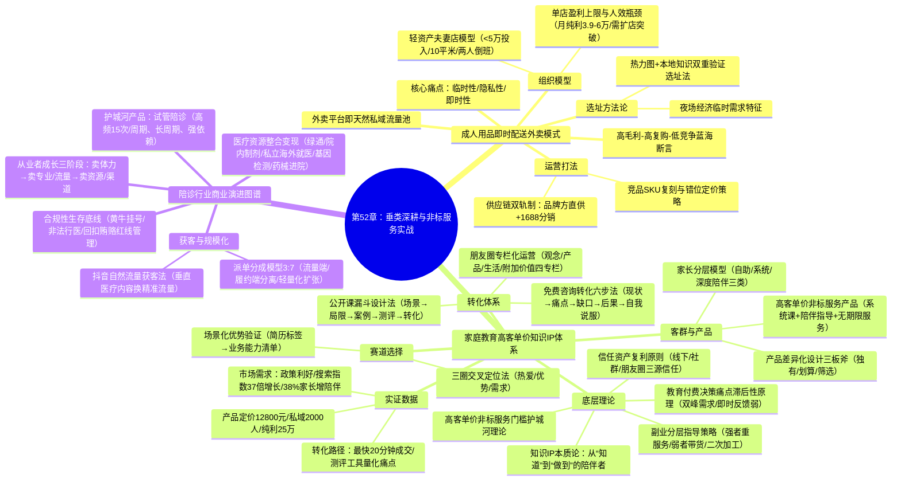

## 52.3 成人用品即时配送模式 —— 解决临时隐私痛点的外卖闭环

### 52.3.1 核心概念拆解

**为什么需要这个概念？**  
传统电商3-5天物流无法满足“临时性、即时性”需求；线下实体店购买存在社交尴尬与隐私顾虑；外卖平台自带高意图搜索流量与骑手配送网络，天然解决获客与履约难题。

成人用品即时配送模式的核心定义是：利用美团/饿了么等外卖平台作为流量入口与交易闭环，通过骑手30-60分钟即时配送，解决用户临时、隐私、即时三大痛点，替代传统电商长周期物流及线下尴尬感的商业模式。其关键性质表现为：高毛利（单品毛利65%-75%，客单价60-80元）、高复购（刚需消耗品，用户粘性强）、低竞争（行业特殊性天然屏蔽大厂与传统商家跨界）、平台即私域（外卖平台算法分发+骑手众包配送，无需自建私域引流）。

典型例子包括：哈尔滨作者操盘月单量千单级、纯利3.9-6万元；大学城店铺周五周六爆单，夜场周边工作日平稳周末激增。边界条件在于：需营业执照、食品经营许可证等资质合规；单店受限于人力（凌晨订单需两人倒班），规模化需开分店或交托他人；依赖外卖平台规则与流量分配，存在平台政策变更风险。

> "这个项目还在于能够及时送达，去电商平台拍下发货要 3-5 天，多数人而言应该没有提前准备的这个习惯，也算是这个项目的一个优势"
> 
> "外卖隐蔽送达保护隐私确实解决一些后顾之忧，目前线上女性用户占比大，有可能都是觉得很不好意思，外卖平台完全解决了客户的顾虑！完全解决了用户的痛点！"
> 
> ——《docs/202303/20230328_081.md》

### 52.3.2 选址方法论：热力图+本地知识双重验证选址法

**为什么需要这个概念？**  
选址直接决定外卖店铺的曝光量与订单量，是成败关键；单纯依赖平台热力图缺乏业务场景语义，单纯依赖主观经验缺乏数据支撑；成人用品临时需求高度依赖夜场、酒吧、酒店、大学城等特定时空聚集场景。

热力图+本地知识双重验证选址法的核心定义是：结合百度地图商业热力图（客观人群热度数据）与创业者对本地夜场经济分布的主观认知（主观经验），锁定“高临时需求密度 + 外卖配送可达”的最优开店坐标。其关键性质表现为：双重验证（数据看热度，经验看业态，缺一不可）、动态匹配（周末/节假日需求潮汐显著，选址需覆盖高峰时段核心辐射区）。

典型例子包括：作者结合热力图与熟悉的夜场一条街、大学城周边选址，实现开店即出单；评论区印证：大学城店周五周六爆单，夜场周边周末激增。边界条件在于：仅适用于即时配送半径覆盖范围内（通常3-5公里）；需规避竞品密集区，采取“物理隔离+微降价”错位竞争；依赖创业者对本地商业版图的深度熟悉度，异地复制需重新调研。

> "百度地图有热力图，可以看到人群热度，但是你所在的城市，其实你更熟悉，哪些区域街道有：临时性的成人用品需求（比如夜场周边、酒吧一条街周边等）"
> 
> ——《docs/202303/20230328_081.md》

**热力图+本地知识双重验证选址法流程图**

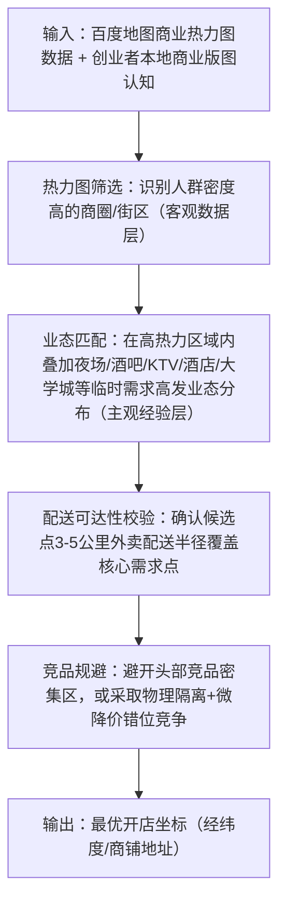

### 52.3.3 运营打法：竞品SKU复刻与错位定价策略

**为什么需要这个概念？**  
新店缺乏历史销量权重，需借力头部竞品已验证的爆款品类结构；盲目选品试错成本高，复刻高销SKU可直接获取平台算法推荐流量；正面价格战伤利润，需通过物理空间隔离实现差异化共存。

竞品SKU复刻与错位定价策略的核心定义是：通过外卖平台公开数据，抓取头部竞品高销量SKU清单，复制核心品类结构，采取“同品微降价 + 选址物理隔离”策略，快速获取算法流量，规避正面价格战。其关键性质表现为：低成本试错（利用竞品已验证的市场反馈，缩短选品验证周期）、算法友好（平台倾向于推荐同区域高转化、高性价比的同质化商品）、非恶意竞争（微降价仅为破冰获流，核心利润靠高毛利品类结构保障）。

典型例子包括：作者复制附近头部店销量高的品类，选址错开并微降价，快速跑通冷启动。边界条件在于：仅适用于标品化程度高、品牌忠诚度低的SKU（如套套、润滑液等大众品类）；需确保供应链成本可支撑降价空间，不可陷入亏损价格战；长期仍需建立自有品牌/选品护城河，摆脱纯跟随模式。

> "找附近卖的最好的成人外卖店，然后，把销量高的列下来，把好的品记下来，去别的位置开店的话可以比他便宜，（这里并不是建议大家在价格上恶意竞争，也算获得流量的一些小技巧，可以离他家店铺远点哈）"
> 
> ——《docs/202303/20230328_081.md》

**竞品SKU复刻与错位定价策略流程图**

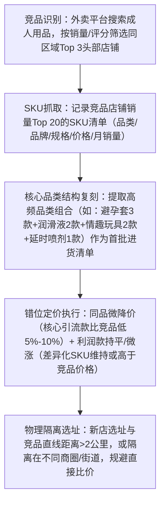

### 52.3.4 组织模型：轻资产夫妻店模型

**为什么需要这个概念？**  
普通人创业缺乏资金、团队、供应链等重资产能力；成人用品外卖非标品属性强，标准化难，大团队管理成本高；夫妻/宝妈/家庭档具备天然信任、低沟通成本、灵活倒班优势。

轻资产夫妻店模型的核心定义是：投入<5万元（房租+首批货+执照），场地10平米非核心商圈（家/车库），核心劳动力为家庭成员/夫妻/宝妈，两人白夜倒班承接全天候订单，实现低风险、高现金流、可复制的微型创业单元。其关键性质表现为：极低固定成本（无装修、无全职人力、库存可少量多批次补货）、高边际利润（毛利65%-75%，扣除房租平台佣金后纯利仍可达3.9-6万/月）、抗风险强（失败沉没成本仅几万元，可快速止损或转型）。

典型例子包括：作者本人：95后通信行业从业者，主业之外夫妻/家人合伙操盘；评论区大量宝妈、夫妻档确认“很适合我们”，验证人群适配度。边界条件在于：单店上限受限于人力（凌晨订单熬夜），月纯利封顶约6万；规模化复制需复制“夫妻档+选址+运营SOP”三位一体，非单纯开店；依赖家庭成员高配合度与抗压能力，非标准化雇佣关系可复制。

> "场地在家或者找个车库 10 平米左右就可以，人员 2 人 白天晚上倒一倒 负责接单装货等外卖小哥来取货就可以了"
> 
> "比较适合夫妻俩，或者宝妈，一些刚创业的小伙伴们，对于这些群体很友好，投入小，利润高"
> 
> "1000 单毛利润在 6w-8w 左右，纯利润应该在 3.9w-6w 之间"
> 
> ——《docs/202303/20230328_081.md》

**轻资产夫妻店模型要素图**

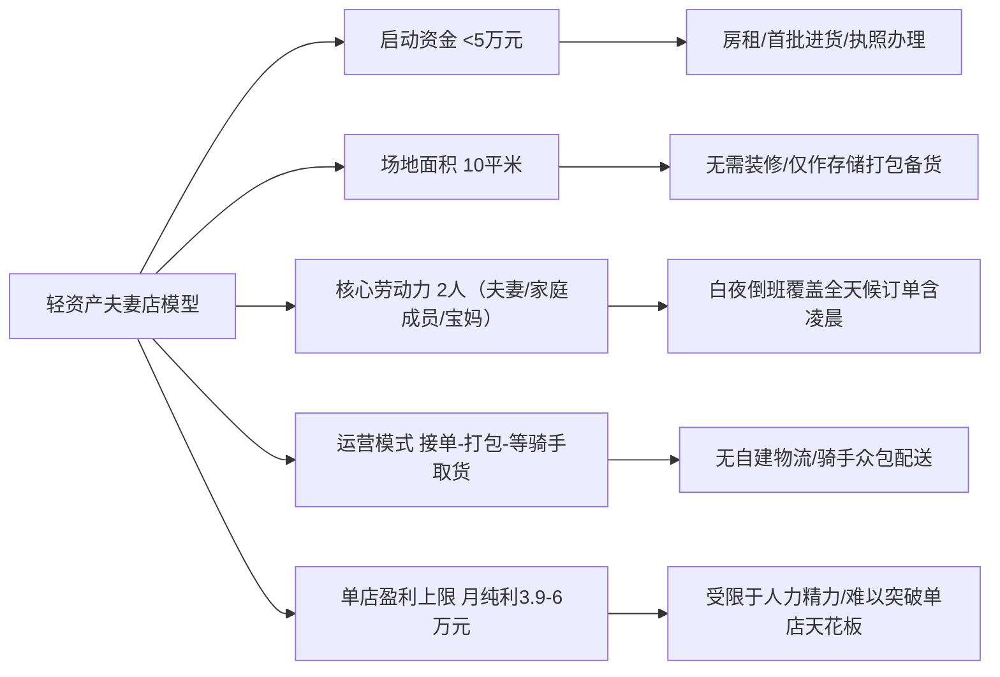

### 52.3.5 平台即私域：外卖平台即天然私域流量池

**为什么需要这个概念？**  
传统模式需自建私域（如58同城引流微信+自送货），获客成本高、链路长；外卖平台用户自带“即时需求”搜索意图，转化率极高；平台算法+骑手众包配送，完成“获客-转单-履约-复购”全链路闭环。

外卖平台即天然私域流量池定理的核心定义是：外卖平台自带搜索/推荐算法，用户主动搜索意图极强（即时需求），无需商家自建私域引流，平台即完成全链路获客转化履约，大幅降低运营门槛，实现“平台即私域”。其关键性质表现为：流量精准度高（用户搜“附近成人用品”即为强购买意图）、履约外包化（骑手众包配送，商家无需自建物流团队）、复购自循环（平台会员体系+算法推荐自动唤醒老客复购）。

典型例子包括：14-15年作者靠58同城年费3000元买流量+微信成交+自送货；今依托外卖平台算法分发+骑手配送，边际成本趋近零。边界条件在于：完全依赖平台规则与流量分配算法，存在单边规则变更风险；平台佣金（约20%+）侵蚀利润，高客单价品类更划算；无法直接获取用户联系方式，私域沉淀需设计钩子（如卡片引导加微信）。

> "我 14 年 15 年的时候在哈商大对面开成人用品店，那时候还靠 58 同城拉流量到微信成交，然后我去送货，以前 58 有单独的成人用品版块，会员 3000 来块钱一年"
> 
> "外卖平台完全解决了客户的顾虑！完全解决了用户的痛点！"
> 
> ——《docs/202303/20230328_081.md》

**外卖平台即天然私域流量池：新旧模式对比图**

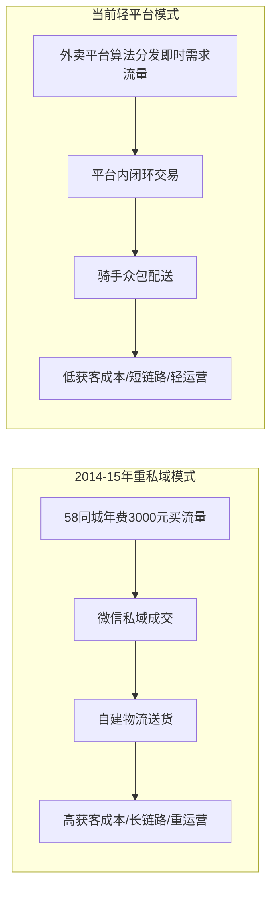

---

## 52.4 家庭教育高客单价知识IP体系

### 52.4.1 赛道选择：三圈交叉定位法与场景化优势验证

**为什么需要这个概念？**  
创业选赛道盲目跟风易踩坑，纯靠热情易忽视变现，纯靠优势易脱离市场；需要一个结构化决策框架，将主观意愿与客观条件对齐。

三圈交叉定位法的核心定义是：通过热爱（贴钱也要做、坚持最久的事）、优势（教育背景、技能、经验）、市场需求（政策风口、搜索指数、人群痛点）三个维度的交集，确定创业赛道。素材中作者以此拆解选择家庭教育赛道的决策过程。

$$ \text{赛道} = \text{热爱} \cap \text{优势} \cap \text{市场需求} $$

该公式通过集合论的交集运算，直观揭示了创业赛道选择的本质：**只有当热爱、优势、市场需求三个维度同时满足时，才能形成可持续的竞争优势**。推导逻辑如下：若仅有热爱无优势，则无法交付专业服务；若仅有优势无热爱，则难以支撑长周期的非标服务投入；若仅有市场需求无热爱与优势，则极易被更有激情和能力的竞争者替代。三者缺一不可，交集区域即为“最高概率成功路径”，偏离任一维度风险指数级上升。公式的作用在于为创业者提供了一把结构化的决策手术刀，将模糊的直觉拆解为可验证的三个具体维度，避免盲目跟风或自我感动。

关键性质表现为：动态验证（热爱需经“贴钱测试”与“时间测试”，优势需“场景化验证”，需求需“数据佐证”）、交集即初心（三圈重合处为最高概率成功路径，偏离任一维度风险指数级上升）。

典型例子包括：作者：热爱家庭教育（贴钱做社群）、优势名校背景+擅长学习+妈妈群经验、需求政策利好+搜索指数37倍增长。边界条件在于：优势必须“场景化”才能转化为业务能力，简历标签不可直接用；市场需求需区分“伪需求”（如低价课自助型）与“真需求”（高客单深度陪伴型）；热爱不可替代专业能力，仅是长期主义的燃料。

> "看到了三圈交集定位法，既然热爱这么明显，那接下来就是衡量自己的优势和市场需求了。"
> 
> "判断是否真心喜欢的两个角度：1）从你的爱好里筛选，找到你最感兴趣、坚持最久的事情。 2）想想有没有你贴钱也要去做的事情。"
> 
> ——《docs/202303/20230328_161.md》

**三圈交叉定位法验证路径图**

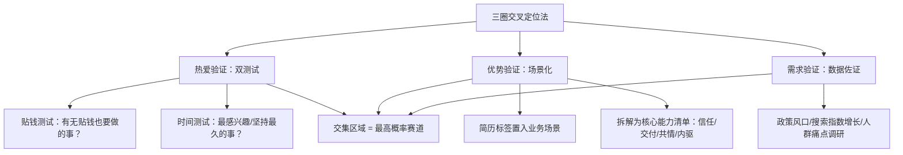

**为什么需要这个概念？**  
通用型简历标签（如名校、擅长学习）无法直接支撑业务交付；客户买单的是“解决具体问题的能力”，而非抽象标签；必须将优势置于具体业务场景中拆解、验证、转化。

场景化优势的核心定义是：将抽象个人优势置于具体业务场景中验证和转化，形成可支撑业务交付的核心能力清单，而非通用型简历标签。其关键性质表现为：信任背书（教育背景好→易收获信任，场景：咨询销售时展示）、交付支撑（擅长学习/细心→深入研究帮助他人学以致用，场景：课程研发、陪伴指导）、经验转化（混迹妈妈群经验→解决家庭教育问题能力，场景：1v1咨询、课程案例库）、情感锚点（助人获得满足感>其他事，场景：长期高强度陪伴服务的内驱力）。

典型例子包括：作者将“名校背景”场景化为“咨询时的信任背书”，将“妈妈群经验”场景化为“案例库与共情能力”。边界条件在于：场景化拆解需诚实面对短板，不可过度包装；优势随业务阶段变化，需定期复盘更新能力清单；单一优势不足以支撑全链路，需组合拳（信任+交付+共情+内驱力）。

> "从我的经验里，我发现所谓的优势需要放在具体场景里去具体化，这样的优势可以拿来判断自己是不是具有从事这一行的优势。"
> 
> "所以，后来我是这么梳理自己的优势的：① 教育背景好，这个标签要用，容易收获信任 ② 擅长学习，细心，喜欢的事情能深入研究，可以帮助他人学以致用收到实效 ③ 经过多年混迹妈妈群、自建妈妈群的经历，我发现我有解决家庭教育问题的能力 ④ 帮别人解决家庭教育问题我所获得的满足感大于其他事情上获得的满足感"
> 
> ——《docs/202303/20230328_161.md》

**场景化优势验证：简历标签到业务能力的映射图**

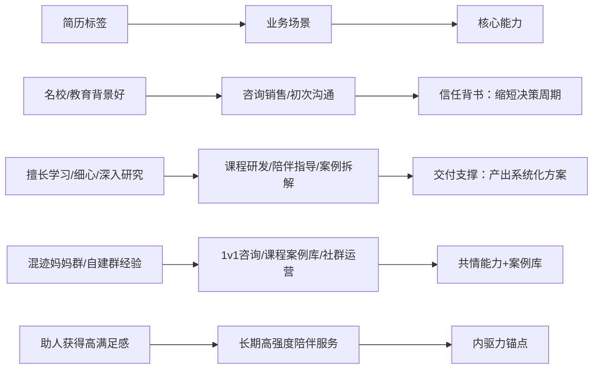

### 52.4.2 客群与产品：家长分层模型与高客单价非标服务产品

**为什么需要这个概念？**  
家长群体付费意愿、学习方式、问题紧迫度差异巨大，统一产品无法兼顾；低价课吸引自助型家长但无法支撑高强度服务成本；必须分层设计产品矩阵，锁定高LTV目标客群。

家长分层模型的核心定义是：根据学习方式、付费意识、问题紧迫度将家长分三类：1. 自助解决型：喜欢碎片学习、付费意识弱、低客单；2. 系统学习型：有学习意识、接受三位数/小四位数课程、中客单；3. 深度陪伴型：高认知/问题严重、需系统深度学习+陪伴指导、高客单。锁定第三类为核心目标，兼容第二类，放弃第一类。其关键性质表现为：精准定价（高客单价12800元天然筛选高净值、高意愿、高配合度客群）、服务匹配（深度陪伴型客群需“系统课程+高频陪伴+无期限服务”组合拳）、成交效率（精准客群成交周期短、成交率高、售后纠纷低）。

典型例子包括：作者主打产品12800元（6门系统课+陪伴指导+授证），私域2000人实现25万纯利；学员反馈：跟学两个月顶过去一年零散学习，幼龄孩子家长买“避坑”即收益。边界条件在于：放弃第一类家长意味着放弃大流量入口，需接受“小而美”规模；高客单价倒逼极高交付标准，服务不及时即导致信任崩塌；需持续产出高质量内容维持专家人设，内容断更即信任贬值。

> "① 第一类家长，喜欢自助解决问题...不愿意付费咨询...付费意识不强。"
> 
> "③ 第三类家长，高认知，愿意通过自我提升去为孩子的未来做好铺垫，对当下的养育问题比较敏感，或者已经存在较严重的养育问题...他们想系统深度学习，也需要陪伴指导..."
> 
> "我们的主打产品就应运而生了，即：提供一套系统、全面、精简的课程，同时，做长期的陪伴指导帮助他们解决问题的服务...价格是 12800"
> 
> ——《docs/202303/20230328_161.md》

**家长分层模型与产品矩阵对应图**

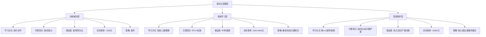

**为什么需要这个概念？**  
知识本身（书/PPT）边际成本趋零，无法支撑高定价；家庭教育强个性化、长周期、结果不确定，单纯卖课无法交付结果；核心痛点在于“知道到做到”的落地差，需陪伴指导填补。

高客单价非标服务产品的核心定义是：针对家庭教育非标特点，设计“系统课程 + 高频陪伴指导（一对一回复、直播答疑、通话指导）+ 无期限服务”的高客单价产品，核心壁垒在于解决非标个性化实际问题的“陪伴指导体系”。其关键性质表现为：非标服务（每个家庭问题不同，标准化课程仅为底座，陪伴指导才是核心）、长周期（课程不限期，一年听不完两三年也行，匹配教育结果滞后性）、高粘性（陪伴过程建立深度情感连接，形成极高转介绍率与复购率）。

典型例子包括：作者产品：12800元含系统课+周反馈+直播答疑+通话指导+不限期服务；服务细节：问题及时解决不积压，需时解决的提供陪伴指导。边界条件在于：极度依赖主理人专业能力与精力，难以标准化复制规模化；陪伴指导边际成本高，客单价必须覆盖时间机会成本；仅适用于高认知、高粘性、长周期的非标服务赛道。

> "我们的主打产品就应运而生了，即：提供一套系统、全面、精简的课程，同时，做长期的陪伴指导帮助他们解决问题的服务..."
> 
> "通过这三个板块的配合，真正做到了让学员从“知道”到“做到”，需要及时解决的问题及时解决不积压，需要花一段时间解决的提供陪伴指导..."
> 
> "我们的课程不限期，一年听不完，两年三年也行，不存在三个月没学完过期了的问题"
> 
> ——《docs/202303/20230328_161.md》

**高客单价非标服务产品结构图**

```mermaid
graph TD
    A[高客单价非标服务产品 12800元] --> B[系统课程(底座): 6门系统课/系统全面精简/一站式学完]
    A --> C[高频陪伴指导(核心壁垒)]
    C --> C1[周反馈]
    C --> C2[直播答疑]
    C --> C3[通话指导]
    C --> C4[一对一回复]
    A --> D[无期限服务(长周期匹配): 一年听不完两三年也行/匹配教育结果滞后性]
```

### 52.4.3 转化体系：免费咨询六步法、公开课漏斗、朋友圈专栏化

**为什么需要这个概念？**  
高客单价非标服务无法直接靠文案成交，需深度沟通建立信任；非专业销售易聊偏、聊散、不敢要钱，需标准化话术流程；咨询过程实为“诊断-暴露缺口-推动自我说服”的心理引导。

免费咨询转化六步法的核心定义是：高客单价教育产品的标准化销售话术六步流程：1. 现状了解：遇到什么问题；2. 时间跨度确认：持续多久了；3. 关键事件唤起痛点：引导回忆触发事件；4. 自我努力复盘暴露缺口：分析努力无效原因，让对方看到能力缺陷；5. 植入案例/后果推演放大痛点：聊不改变的危害，制造紧迫感；6. 二选一推动自我说服：保持现状还是想办法改变，推动成交。其关键性质表现为：咨询即诊断（非闲聊，每一步都有明确心理引导目的）、暴露缺口（让客户自我意识到“自己解决不了”，而非你告诉他）、利他前提（真心帮客户分析问题，非强行推销，成交率反而最高）。


> "① 了解对方遇到什么问题 ② 问题持续了多长时间了 ③ 引导对方回忆一件事，唤起客户痛点的关键事件 ④ 询问对方自己做过哪些努力，分析问题依然存在的原因，让对方看到自己的能力缺陷，暴露需求... ⑤ 如果不改变，会是什么结果，必须聊到不改变带来的危害... ⑥ 是要保持现状还是要想办法改变，推动对方自我说服。"
> 
> ——《docs/202303/20230328_161.md》

**免费咨询转化六步法心理引导路径图**

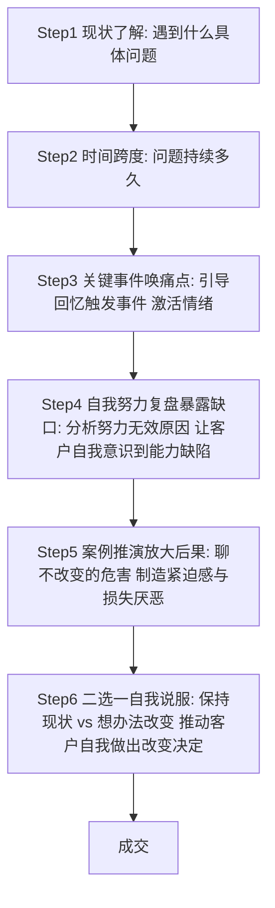

**为什么需要这个概念？**  
免费公开课是低成本获取精准种子用户的核心渠道；普通公开课干货堆砌无转化，需设计符合心理决策路径的漏斗结构；必须完成：激发期待→暴露痛点→建立信任→深化需求→引导转化。

公开课漏斗设计法的核心定义是：免费公开课三段式内容结构：1. 场景代入：展示典型养育场景，激发对理想状态的期待；2. 思维局限拆解：讲成为高情商父母的思维局限，引导对标自省，发现自身卡点；3. 品牌故事与学员案例：秀肌肉，讲品牌故事及成功案例，建立信任。后接：赠送测评工具深化需求 → 引导转化高客单产品。其关键性质表现为：心理路径同构（期待→痛点→信任→行动，符合人类决策底层逻辑）、测评工具作钩子（量化痛点，让隐性需求显性化，强化购买动机）、案例即证据（学员成功案例比任何承诺更有说服力）。

典型例子包括：作者公开课：展场景→拆局限→秀案例→送测评→促转化；学员做完测评反馈“你说的全对”，结合作业内容痛点清晰，激发购买欲。边界条件在于：仅适用于高客单价、强专业背书、长决策周期的知识服务产品；课程内容必须真实有料，注水课程反而破坏信任；测评工具需专业有效，玩具化测评会降低品牌格调。

> "课程内容重点告诉他三点：第一部分，展示典型养育场景...激发对理想状态的期待；第二部分，讲成为高情商父母的几个思维局限...引导大家对标自身，发现自己正式存在这些局限；第三部分，秀肌肉，讲我们品牌故事以及学员成功案例..."
> 
> "她听完课我们会送一个亲子关系测评，用测评结果，结合他的作业内容，让痛点、需求、自己的卡点都更加清晰起来。从而激发购买欲"
> 
> ——《docs/202303/20230328_161.md》

**公开课漏斗设计法转化路径图**

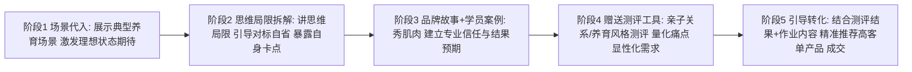

**为什么需要这个概念？**  
碎片化朋友圈难以建立系统性专家人设与深度信任；单纯发广告引起反感，单纯发生活无法转化专业价值；需要结构化、持续性、立体化的内容框架。

朋友圈专栏化运营的核心定义是：将朋友圈内容结构化为四大固定专栏：观念输出、专业产品、生活圈、附加价值；心中有专栏意识，尽量每天都有内容，持续立体化输出；建立信任感与情感链接，而非单纯广告推送。其关键性质表现为：观念输出（蹭热点/金句聊看法经验，建立专业认知高度）、专业产品（展示课程、案例、学员反馈，秀肌肉建信任）、生活圈（真实生活碎片，拉近心理距离，去专家化做朋友）、附加价值（赠送工具、测评、资源，利他先行触发互惠）。

典型例子包括：作者针对潜在客户痛点发案例，精准击中促单；学员见证作者多年朋友圈持续输出，建立“看着你成长起来的”信任。边界条件在于：需长期坚持（年级），短期无明显效果；内容质量参差不齐会稀释专业人设，需保持专栏水位；仅作信任建设前端，成交仍需私聊/电话/咨询等深度沟通环节。

> "自己的朋友圈内容，都有哪些，自己心里要清晰...主要由以下几个专栏构成：1. 根据一些金句，或者热点事件，聊一聊自己的看法和经验... 2. 专业和产品... 3. 生活圈... 4. 附加价值... 尽量每天都有这些内容，是最好的...自己心中要有这样的专栏意识。"
> 
> ——《docs/202303/20230328_161.md》

**朋友圈专栏化运营四专栏协同图**

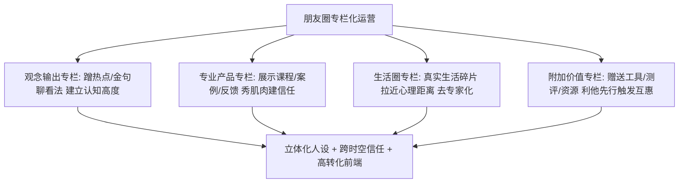

### 52.4.4 底层理论：四大核心定理

#### 知识IP本质论：从"知道"到"做到"的陪伴者

**为什么需要这个概念？**  
多数知识付费从业者误以为“卖知识/卖课”即商业模式；知识本身边际成本趋零，书/PPT可替代，无法支撑高客单价；客户真实需求是“消化知识、落地实操、获得改变”，而非获得信息。

知识IP本质论的核心定义是：知识IP核心价值不在于知识本身，而在于帮助客户消化知识、落地实操、获得真实改变；必须提供超出知识本身的附加价值：陪伴、指导、情感链接、人设信任；这是支撑高客单价的根本逻辑。其关键性质表现为：服务本质（知识IP=知识+服务，服务占比随客单价升高而上升）、陪伴溢价（大咖不做陪伴/价格高，低价课无服务，中间真空地带即机会）、信任资产（长期累积的信任（线下/社群/朋友圈）是高成交核心基础）。

典型例子包括：作者：直接卖书/PPT不行，必须帮客户从“知道”到“做到”；学员成交理由：“看到你这些年一直在持续精进，我就看好你这个人”。边界条件在于：仅适用于强非标、强服务、长周期的知识服务赛道；标准化程度高、结果可量化的技能培训（如Excel、英语）不适用；陪伴服务边际成本极高，规模化需极其谨慎设计产品边界。

> "知识 IP，绝不仅仅是知识和技巧本身。如果只是知识和技巧本身，那我们直接卖书、卖 pp t 就行了。"
> 
> "我们知识 IP 的本质，是帮助客户去消化知识、消化之后还能把技巧用在自己身上，从而去使自己真的得到改变，得到进步。我们是要帮助客户从“知道”到“做到”，这是知识 IP 的本质。"
> 
> "那个本质，就要求我们提供超出知识本身、技巧本身的价值，去让客户有一个好的体验感。"
> 
> ——《docs/202303/20230328_161.md》

**知识IP本质论：知识与服务的价值分层图**

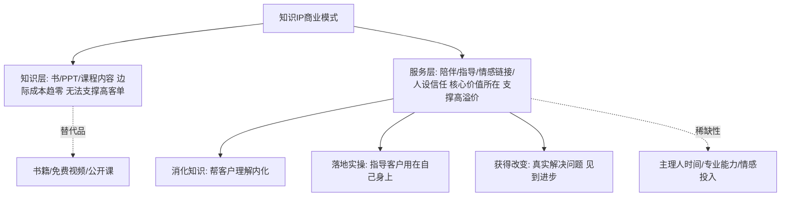

#### 高客单价非标服务门槛护城河理论

**为什么需要这个概念？**  
赛道进入门槛低≠做高客单价门槛低，两者本质不同；无护城河高客单价必被大咖降维打击或低价课围剿；必须明确核心壁垒所在，集中资源建设壁垒。

高客单价非标服务门槛护城河理论的核心定义是：家庭教育赛道进入门槛低但做高客单价门槛高；核心壁垒在于“持续迭代产品能力”与“解决非标个性化实际问题能力”的结合；大咖不做陪伴/价格高，低价课无服务/不解决问题，中间存在巨大市场真空。其关键性质表现为：双重能力壁垒（产品迭代能力（课程更新、工具开发）+ 非标解决能力（1v1指导、情绪托底））、时间复利（信任资产需长期累积，一旦形成支撑高客单快速成交且抗周期）、真空地带（介于大咖与低价课之间的“高性价比重服务”定位极难被替代）。

典型例子包括：作者观察：大咖不做陪伴、低价课不解决问题，作者占据中间真空地带；验证：私域2000人实现25万纯利，高客单价模式在小规模精准私域中跑通。边界条件在于：壁垒建设需极长周期（作者多年积累），非短期可速成；核心能力高度依赖主理人，人岗分离极难，规模化瓶颈明显；若平台规则变更（如私域触达限制），信任触达路径可能失效。

> "我做到目前的观察是：进入门槛不高，但是做高客单价产品门槛比较高。"
> 
> "因为，这需要家庭教育 IP 有持续迭代产品的能力，以及不断解决各种实际问题的能力，即维持稳定的产品供应链的能力。"
> 
> "大咖也具有解决问题的能力呀，但是大咖不会做这种陪伴服务的，就算做，一般人也支付不起。所以，我们这份能收到实效的陪伴指导就有市场了。"
> 
> ——《docs/202303/20230328_161.md》

**高客单价非标服务门槛护城河理论：市场真空地带图**

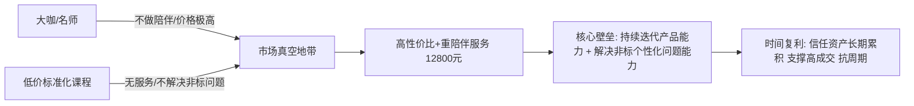

#### 教育付费决策痛点滞后性原理

**为什么需要这个概念？**  
教育结果在未来，导致痛点感知天然滞后于问题发生；问题不严重时痛点不足、付费意愿低（多买低价课自助安慰）；问题严重时即时反馈弱、解决周期长，客户焦虑但难快速成交高客单。

教育付费决策痛点滞后性原理的核心定义是：教育付费决策存在痛点滞后性：结果在未来导致痛点感知滞后；高客单价客群仅来自两类：高认知前置投资者、痛苦极致求救者；产品必须经得起长周期验证，经得起“问题严重后”的复购考验。其关键性质表现为：双峰需求（要么极早（前置投资）、要么极晚（救急），中间巨大空白区）、即时反馈弱（教育改变非一日之功，服务需提供“陪伴确定性”对冲焦虑）、长周期验证（产品质量需经得起时间考验，短期营销手段失效）。

典型例子包括：幼龄孩子家长买课“避坑”，认为避坑即收益（前置投资型）；青春期严重问题家长高价求救（痛苦极致型）；学员反馈：跟学两个月顶过去一年零散学习，串联起碎片知识。边界条件在于：仅适用于结果滞后、过程非标、高度个性化的教育/心理/成长类赛道；即时反馈强的技能类（编程、设计、语言）不适用此原理；营销切入点必须对齐“前置投资”或“救急”两种心智模式，中间地带无效。

> "为什么会这样呢？因为教育这件事，结果在未来。"
> 
> "孩子心理成长和底层能力成长方面的很多问题不会一天形成，所以，不到问题很严重的时候，痛点不够痛，那家长就没有动力去付高价。"
> 
> "同样，问题解决起来，也不是一天两天就可以，尤其是问题已经很严重的，它的即时反馈不是那么明显。"
> 
> "不管是哪一类家长，都需要你的产品真的有质量，同时，需要能真的解决问题。"
> 
> ——《docs/202303/20230328_161.md》

**教育付费决策痛点滞后性原理：双峰需求结构图**

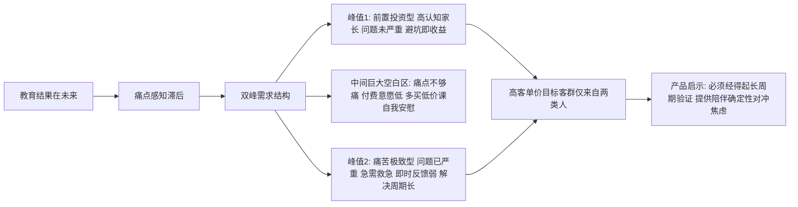

#### 信任资产复利原则

**为什么需要这个概念？**  
私域高成交看似靠话术/产品，实靠长期累积的信任资产；信任建设需时间周期，但一旦形成可支撑极高成交效率；线上信任建设比线下更难，朋友圈持续输出是最佳方式。

信任资产复利原则的核心定义是：私域高成交核心基础是长期累积的信任资产：线下服务信任、社群分享信任、朋友圈持续输出信任；信任建设需时间周期，但一旦形成可支撑高客单价快速成交（最快20分钟电话成交），且抗周期性强。其关键性质表现为：多源复利（线下服务信任（实地体验）+ 社群分享信任（圈层背书）+ 朋友圈输出信任（长期见证））、非线性爆发（信任积累到临界点，成交效率指数级跃升（从需多次沟通到20分钟成交））、抗周期（信任资产不随平台算法波动，是跨周期的核心资产）。

典型例子包括：作者：以前线下课信任基础好 + 断断续续社群分享 + 一直朋友圈分享看着成长；学员成交理由：持续精进的人设建立了跨越时空的信任锚点。边界条件在于：信任建设不可速成，任何捷径（刷单、买粉、虚假人设）终将暴雷；信任资产具有“易失难建”特性，一次严重翻车可归零；需持续投入内容生产与服务交付维护信任账户余额。

> "我们实现目前营收的私域基础大概 2000+ 人，虽然人数不多，但是人群基础较好。第一，以前做过几期线下课...信任基础比较好；第二...断断续续的分享...第三...一直在朋友圈分享...看着我成长起来的。"
> 
> "相对于线下的交往来说，线上的交往相对不容易建立信任度，那朋友圈的持续输出，就是建立信任最好的方式。"
> 
> "最快的可能就 20 分钟通了个电话就成交了。他们当时就说，我看到你这些年一直在家庭教育领域持续精进，我就看好你这个人。"
> 
> ——《docs/202303/20230328_161.md》

**信任资产复利原则：三源信任协同与非线性爆发图**

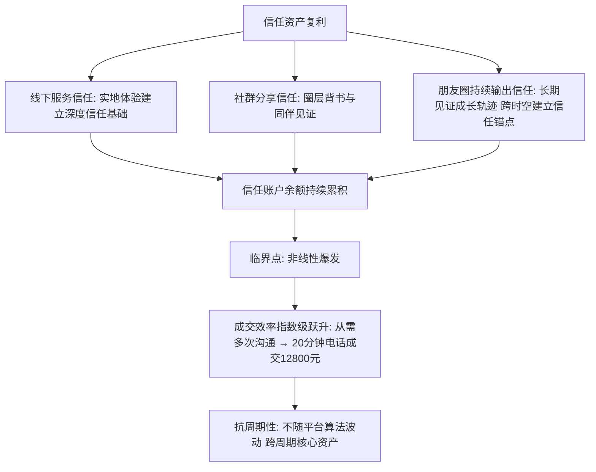

### 52.4.5 产品差异化设计三板斧与副业分层指导

**为什么需要这个概念？**  
知识付费红海竞争激烈，同质化课程陷入价格战；大咖不做陪伴/价格高，低价课无服务/不解决问题，中间存在巨大市场真空；必须构建竞品“无法复制、不愿复制、复制不划算”的差异化护城河。

产品差异化设计三板斧的核心定义是：三大策略构建高客单价产品护城河：1. 别人没有的我们有：个性化陪伴指导体系（周反馈+直播答疑+通话指导），解决非标问题；2. 别人有的我们划算：系统化课程打包+长期服务，降低单位学习成本，一站式学完；3. 高客单价筛选优质客群：价格即门槛，筛掉无效客户，提升成交率与服务质量。其关键性质表现为：稀缺性（陪伴指导体系依赖主理人稀缺时间与专业能力，竞品难复制）、性价比重构（非绝对低价，而是“含服务的系统化方案”单位成本更低）、客群筛选（高价格倒逼客户更珍惜、更配合、更易出结果，良性循环）。

典型例子包括：作者：大咖不陪伴/价格高，低价课无服务，作者占据“高性价比+重服务”真空地带；成交数据：私域2000人基础，25万纯利，验证模式跑通。边界条件在于：策略1依赖主理人不可复制的个人能力，规模化受限；策略2需持续迭代课程内容，维持“系统全面精简”优势；策略3若服务跟不上价格，将引发严重信任危机与退款风波。

> "1）别人没有的我们有...通过三个板块的服务，去把问题剖析准确，然后陪伴大家在实践中纠偏、调整..."
> 
> "2）别人有的我们划算...我们的课程内容系统、全面、又精简，一站式学完...而且加上陪伴指导，其实非常划算。"
> 
> "3）高客单价应运而生...这个价格就已经筛掉了很大一批无效客户了，能来问的基本上是花得起这个钱的...成交率是很高的"
> 
> ——《docs/202303/20230328_161.md》

**产品差异化设计三板斧护城河构建图**

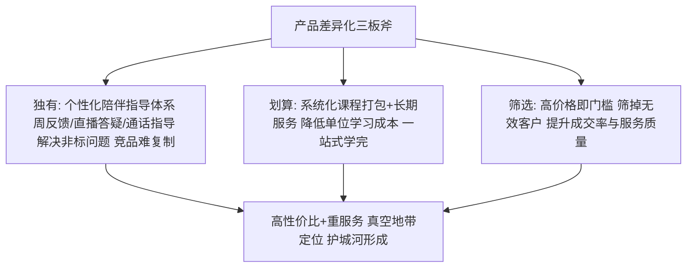

**为什么需要这个概念？**  
学员专业积累差异巨大，统一教“高客单课程+陪伴”模式必导致大部分人交付崩盘；专业弱者硬上高客单赛道，服务跟不上→投诉退款→毁口碑；必须提供分层变现路径，让不同层级学员都能在能力圈内赚钱。

副业分层指导策略的核心定义是：针对学员专业积累差异，提供分层变现路径：1. 专业强者：走“课程+重服务”高客单模式（复制作者模式）；2. 专业弱者：走“成长者带货赚佣金”或“二次加工低价课（如100个案例卖199）”规模化模式。其关键性质表现为：能力圈匹配（不强求所有人做高难度事，在能力边界内最大化变现概率）、成长路径设计（弱者通过带货/二次加工积累案例与现金流，逐步向高客单进阶）、生态互补（强者做高客单服务，弱者做分销/裂变，形成完整商业生态）。

典型例子包括：专业强者：复制作者12800高客单模式，重服务、高溢价；专业弱者：《青春期孩子常见问题100个》卖199元，卖1万份=200万营收。边界条件在于：分层标准需客观量化（如：是否具备持续一对一解决能力），主观判断易偏差；低价课模式需极强流量获取能力，无流量则零销量；佣金模式依赖上游产品质量，上游翻车连累分销者信誉。

> "如果专业积累足够，具有持续一对一解决能力的伙伴，可以用课程+服务并且重在服务的形式，做高客单价产品，"
> 
> "如果专业积累不够...我们的建议是两个：①以成长者的角色带货（课），挣佣金 ②做二次加工类的课程，比如《青春期孩子常见问题 100 个》...卖个 199 ，如果能卖 10000 份，也是很香的"
> 
> ——《docs/202303/20230328_161.md》

**副业分层指导策略：能力圈匹配与生态互补图**

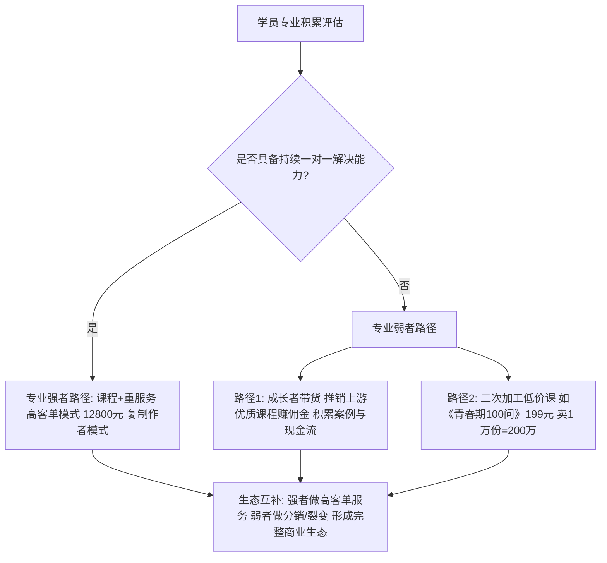

---

## 52.5 陪诊行业商业演进图谱

### 52.5.1 从业者成长三阶段：从卖体力到卖资源渠道

**为什么需要这个概念？**  
陪诊行业从业者普遍陷入“自己跑单”低天花板，不知如何进阶；缺乏清晰的商业演进路径，导致大量从业者停留在劳动密集型阶段；需要一个阶段性演进框架，指导从业者向高杠杆、高壁垒方向跃迁。

陪诊从业者成长三阶段的核心定义是：陪诊从业者商业演进必经三阶段：1. 第一阶段“卖体力”：自己跑单、挂号，收入上限低（月~9000元）；2. 第二阶段“卖专业/卖流量”：试管陪诊、派单分成、教学、加盟，建立杠杆；3. 第三阶段“卖资源/卖渠道”：绿通、院内制剂、药械进院、海外就医、基因检测，构建护城河。其关键性质表现为：阶段跃迁核心（从“个人劳动密集型”向“平台化/资源整合型”转型）、护城河构建（第三阶段产品具备高稀缺性、高复购、高专业门槛，难被复制）、杠杆递增（单人上限9000元 → 派单分成突破上限 → 资源产品单价5000-20000元）。

典型例子包括：作者静水：从自己跑单（日均1单）→ 试管陪诊跟进11个周期 → 派单分成3:7 → 绿通/院内制剂/海外就医/基因检测多元变现；行业头部：优德医加盟5万、陪诊无忧10万+分成，确立品牌化标杆。边界条件在于：阶段跨越需主动建立资源网络（医生关系、医院渠道、院外机构），非自然演进；第三阶段涉及医疗灰色地带，合规风险极高，需专业筛选机制甄别机构真实性合法性；非医学背景从业者进入第三阶段难度极大，建议止步第二阶段深耕专业服务。

> "一：自己跑单...平均下来一天一单左右。一线城市半天收费标准是300元。"
> 
> "二：试管陪诊...试管婴儿一个周期需要去医院15次左右"
> 
> "三：派单分成...自己得3成，接单者分7成"
> 
> "七：快速入院手术...绿通费用在5000-20000不等"
> 
> "十一：介绍客户海外就医...返实收金额的8-20%"
> 
> "十二：基因检测推广...一单佣金在1000-3000之间"
> 
> ——《docs/202303/ScDWdhjkHolKzAxyHpjclEDsnMg.md》

**陪诊从业者成长三阶段演进图**

```mermaid
flowchart TD
    A[陪诊从业者商业演进] --> B[第一阶段: 卖体力]
    B --> B1[核心模式: 个人劳动密集型 自己跑单/挂号/取报告]
    B --> B2[典型产品: 基础陪诊半天300元]
    B --> B3[收入特征: 日均1单 月~9000元天花板]
    B --> B4[杠杆逻辑: 无杠杆 时间换钱 受限于精力上限]
    A --> C[第二阶段: 卖专业/流量]
    C --> C1[核心模式: 专业服务+流量分发]
    C --> C2[典型产品: 试管陪诊(15次/周期) 派单分成(3:7) 教学/加盟]
    C --> C3[收入特征: 单周期高客单 分成突破单人上限 教学规模化]
    C --> C4[杠杆逻辑: 专业壁垒+流量杠杆 突破个人精力限制]
    A --> D[第三阶段: 卖资源/渠道]
    D --> D1[核心模式: 稀缺医疗资源整合]
    D --> D2[典型产品: 绿通(5000-20000) 院内制剂 私立/海外就医(佣金8-20%) 基因检测(1000-3000/单) 药械进院分润]
    D --> D3[收入特征: 单价极高 高复购 高不可替代性]
    D --> D4[杠杆逻辑: 资源准入权垄断 构建核心护城河]
```

### 52.5.2 护城河产品：试管陪诊

**为什么需要这个概念？**  
陪诊行业同质化严重，基础陪诊极易被替代；需要一个具备高客单价、高复购、高专业门槛、长周期的核心产品建立壁垒；试管婴儿流程复杂、周期长、专业依赖强，天然形成护城河。

护城河产品：试管陪诊的核心定义是：试管陪诊为行业“护城河产品”：单周期需陪诊15次左右，高频次、长周期、强依赖特性，支撑高客单价、高留存，是从业者核心竞争壁垒。其关键性质表现为：高频次（一个周期15次陪诊，天然高复购）、长周期（周期跨度长（数月），客户粘性极强，难流失）、强依赖（流程复杂、专业性强、信息不对称大，客户极度依赖专业指导）、高溢价（节省客户时间/交通/住宿成本，支撑高客单价）。

典型例子包括：作者实操跟进11个试管周期，验证该服务高频、长周期、强依赖特性；客户痛点：不懂流程、怕走弯路、省时间省钱，付费意愿极强。边界条件在于：要求从业者具备专业医学知识与丰富医院实操经验，非零门槛可入；需建立标准化服务流程（SOP），否则服务质量不稳定导致口碑崩塌；单人服务上限受限于精力，规模化需派单分成或组建团队。

> "试管陪诊是行业的“护城河产品”。　做试管婴儿很多人不懂得流程，有人指导会节省很多时间，交通费，住宿费。"
> 
> "试管婴儿一个周期需要去医院15次左右，我目前跟了11个周期"
> 
> ——《docs/202303/ScDWdhjkHolKzAxyHpjclEDsnMg.md》

**试管陪诊护城河产品特性图**

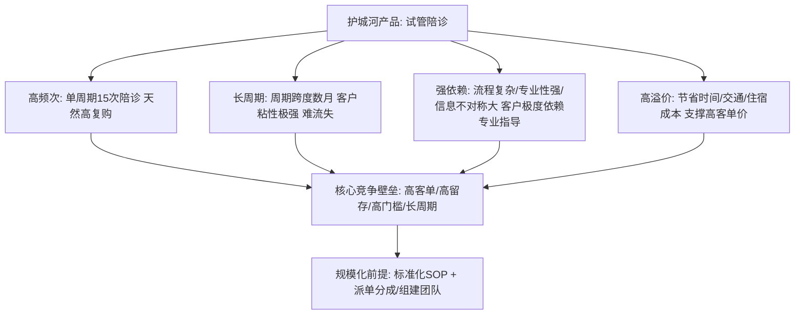

### 52.5.3 医疗资源整合变现：将"获取难"转化为"可介绍可分成"

**为什么需要这个概念？**  
医疗资源（专家号、绿通、院内制剂、海外就医、基因检测）极度稀缺且分散；患者/家属获取成本极高（时间、精力、信息差），愿意支付高额溢价；陪诊师凭借长期积累的医院/医生/机构资源，可将“获取难”转化为商业产品。

医疗资源整合变现的核心定义是：基于医院科室资源、医生关系、院外机构合作（基因检测、私立医院、海外医院），将“获取难”的医疗资源转化为“可介绍、可分成”的商业产品，核心模式：信息差变现 + 资源准入权变现 + 佣金分成。其关键性质表现为：绿通（花钱买时间，三甲手术等待1-2月压缩至2-7天，费用5000-20000元）、院内制剂（医院独家配方、无替代、长期验证有效，高复购实物商品）、私立/海外就医（时间差套利（公立排队久vs私立/海外即时），佣金实收8-20%）、基因检测（单单佣金1000-3000元，标准化推广易规模化）、药械进院（介绍药品器械进驻医院，分润模式）。

典型例子包括：作者：开胃醒脾饮视频爆款带来2万+收益且持续复购；PET-CT案例：公立预约1周+ vs 私立当天约，价格持平7000元，佣金2000+；海外就医：中美日英癌症5年生存率差异（中国40.5% vs 美国67.1%）作锚点，高净值客户命价格不敏感。边界条件在于：必须建立严格项目筛选机制，甄别机构真实性合法性，规避黄牛挂号/非法行医/回扣贿赂红线；资源获取依赖长期人脉积累，非短期可速成，新人切勿盲目切入；涉及医疗灰色地带，政策风险高，需法律顾问把关合规边界。

> "有熟悉的医院科室资源，可以介绍药品及医疗器械进院分润。"
> 
> "介绍客户到大型私立医院，做检查治疗...佣金2000+。"
> 
> "介绍客户海外就医...返实收金额的8-20%"
> 
> "基因检测推广...一单佣金在1000-3000之间"
> 
> "中外癌症5年生存率，中国40.5%，英国54.3%，日本65.8%，美国67.1%。返实收金额的8-20%"
> 
> ——《docs/202303/ScDWdhjkHolKzAxyHpjclEDsnMg.md》

**医疗资源整合变现：资源类型与变现模式对应图**

```mermaid
graph TD
    A[医疗资源整合变现] --> B[就医绿通: 买时间 三甲手术排队1-2月压缩至2-7天 服务费5000-20000元]
    A --> C[院内制剂: 稀缺/无替代/长期验证 有效 高复购实物商品]
    A --> D[私立/海外就医: 时间差套利 公立排队久vs私立/海外即时 佣金实收8-20%]
    A --> E[基因检测: 标准化推广易规模化 单单佣金1000-3000元]
    A --> F[药械进院: 介绍药品器械进驻医院 分润模式]
    B & C & D & E & F --> G[核心逻辑: 信息差变现 + 资源准入权变现 + 佣金分成]
```

### 52.5.4 获客与规模化：抖音自然流量获客法与派单分成模型

**为什么需要这个概念？**  
医疗/陪诊行业禁止投放DOU+等付费广告，仅能依赖自然流量；通用娱乐内容引流精度低、转化差、粉丝价值低；垂直专业医疗内容虽涨粉慢，但精准度高、信任强、转化率高。

抖音自然流量获客法的核心定义是：利用抖音平台发布垂直医疗内容（院内制剂科普、就医攻略、避坑指南），获取精准自然流量，通过私域转化实现多元变现（课程、陪诊、资源整合），依赖内容专业度与垂直度实现低成本获客。其关键性质表现为：合规前提（医疗内容需严守平台规范，避免违规导致限流封号）、长尾效应（专业医疗内容生命周期长，持续产生搜索流量与复购线索）、信任前置（专业内容建立专家人设，私域咨询转化率远高于泛流量）。

典型例子包括：作者：中医院制剂视频（开胃醒脾饮）爆款，收益2万+且持续复购；抖音直播挂链接卖课程，内容即信任，信任即转化。边界条件在于：要求从业者具备真实医疗专业背景或深度实操经验，伪专业内容极易被专业用户识破；自然流量增长慢，前期需耐得住寂寞，坚持产出高质量垂直内容；平台算法变更可能导致流量断崖式下跌，需多平台分发分散风险。

> "最大的免费流量平台是抖音，陪诊行业不能投抖＋都是自然流量。"
> 
> "我爆过一个中医院制剂的视频(开胃醒脾饮)，收益2Ｗ＋，现在还不断有复购的。"
> 
> "抖音直播挂链接卖课程。"
> 
> ——《docs/202303/ScDWdhjkHolKzAxyHpjclEDsnMg.md》

**抖音垂直医疗内容自然流量获客法转化路径图**

```mermaid
flowchart LR
    A[发布垂直医疗内容: 院内制剂科普/就医攻略/避坑指南/专家科普] --> B[获取精准自然流量: 禁投DOU+ 依靠内容专业度]
    B --> C[建立专家人设信任: 专业内容建立权威 私域咨询转化率高]
    C --> D[私域多元变现: 陪诊服务/试管陪诊/课程/资源整合产品]
    D --> E[长尾复购: 内容生命周期长 持续产生搜索流量与复购线索]
```

**为什么需要这个概念？**  
头部从业者流量多但个人履约上限低（单人日均1单）；尾部从业者有履约能力但缺流量；需要一种机制将流量与履约分离，实现规模化扩张。

派单分成模型（3:7分成制）的核心定义是：头部从业者负责流量获取与客户筛选，将订单派发给同行履约，按30%/70%比例分成：流量端得3成，履约端分7成，实现单人突破服务上限的规模化轻量化运营模式。其关键性质表现为：轻资产（无需雇佣全职员工，无固定人力成本，按单结算）、激励对齐（履约端得7成主动维护服务质量，流量端专注获客转化）、标准化前提（需建立标准化服务SOP（零红点标准、话术库），保证履约质量可控）。

典型例子包括：作者：获取流量后转派给同行分成，自己得3成，接单者分7成；突破单人服务上限，实现收入规模化跃迁。边界条件在于：仅适用于标准化程度高、可SOP化的标准化陪诊服务（如基础挂号、跑单、试管标准流程）；非标高客单服务（如绿通、海外就医）不可派单，需头部亲自把控；需建立严格准入与淘汰机制，履约端服务差即切换，保护流量端品牌声誉。

> "获取流量后转派给同行分成，自己得3成，接单者分7成。"
> 
> ——《docs/202303/ScDWdhjkHolKzAxyHpjclEDsnMg.md》

**派单分成模型（3:7分成制）流量端与履约端分离图**

```mermaid
graph LR
    A[头部从业者: 流量端] -->|获客+筛选+派单| B[同行/团队: 履约端]
    A --> C[分成比例: 流量端3成 / 履约端7成]
    B --> D[执行标准化陪诊服务: 基础挂号/跑单/试管标准流程]
    C --> E[轻资产: 无全职员工/无固定人力成本/按单结算]
    C --> F[激励对齐: 履约端高分成主动维护质量 流量端专注获客]
    C --> G[标准化前提: 零红点标准/话术库/SOP 保证履约质量可控]
```

### 52.5.5 合规性生存底线：医疗灰色地带的红线管理

**为什么需要这个概念？**  
陪诊/医疗资源整合处于政策灰色地带，法律风险极高；黄牛挂号、非法行医、回扣贿赂等红线一触即溃；无合规底线，业务规模越大死得越快。

合规性生存底线的核心定义是：在医疗服务灰色地带运营时，必须建立项目筛选机制，甄别合作机构真实性与合法性，规避法律红线；合规是业务长期存续的前提，而非可选项。其关键性质表现为：红线清单化（明确列出黄牛挂号、非法行医、虚假宣传、回扣贿赂等禁止事项）、机构准入制（合作前必查资质、实地考察、背景调查、小额试单验证）、动态监控（运营中持续监测投诉率、纠纷率、监管动态，风险即切）。

典型例子包括：作者强调：合作项目机构真实性及合法性需自己筛选判断；行业乱象：黄牛挂号、虚假绿通、黑中介骗钱，合规者反而存活更久。边界条件在于：合规成本高（需法律顾问、实地考察、试错成本），压缩利润空间；政策突变风险不可控（如突发严打），需预留安全垫与退出预案；合规非绝对护城河，但不合规必死，是生存必要非充分条件。

> "在做的过程中会有各种各样的人来找你谈合作，要自己筛选判断合作项目机构的真实性及合法性。"
> 
> ——《docs/202303/ScDWdhjkHolKzAxyHpjclEDsnMg.md》

**合规性生存底线：红线管理与机构准入流程图**

```mermaid
flowchart TD
    A[合规性生存底线] --> B[红线清单化: 明确禁止事项]
    B --> B1[黄牛挂号]
    B --> B2[非法行医]
    B --> B3[虚假宣传]
    B --> B4[回扣贿赂]
    B --> B5[黑中介骗钱]
    A --> C[机构准入制: 合作前四步验证]
    C --> C1[资质查验]
    C --> C2[实地考察]
    C --> C3[背景调查]
    C --> C4[小额试单验证]
    A --> D[动态监控: 运营中持续监测]
    D --> D1[投诉率监测]
    D --> D2[纠纷率监测]
    D --> D3[监管动态追踪]
    D --> D4[风险即切机制]
```

---

## 52.6 多源对照：非标服务护城河的不同路径

本章涉及三大非标服务赛道的护城河构建路径，存在共识与分歧：

### 共识

1. **核心壁垒非知识/技术本身，而在"陪伴/指导/资源整合"等非标服务能力**——三大赛道均验证：知识IP本质是陪伴者、陪诊护城河是试管陪诊的高频长周期服务、成人用品外卖虽标品化但依赖选址/运营SOP的非标执行力。
2. **信任资产是跨周期核心资产**——家庭教育靠朋友圈/线下/社群三源信任复利；陪诊靠专业内容建立专家人设信任；成人用品靠平台算法信任+隐私保护承诺。
3. **高客单价必须匹配高服务门槛**——家庭教育12800元对应无期限陪伴指导；陪诊绿通5000-20000元对应资源准入权；成人用品虽客单价低但毛利高依赖即时履约服务。

### 分歧

| 维度 | 成人用品外卖 | 家庭教育知识IP | 陪诊行业 |
|------|------------|--------------|---------|
| **标准化程度** | 高（SKU标品、流程可SOP） | 低（课程标品化+服务高度非标） | 中（基础服务可SOP、高阶资源极度非标） |
| **规模化路径** | 复制"夫妻档+选址SOP"开分店 | 极难规模化，依赖主理人不可复制能力 | 派单分成(3:7)分离流量与履约，轻量化扩张 |
| **合规风险** | 低（营业执照+食品经营许可证） | 低（知识付费合规） | **极高**（医疗灰色地带，黄牛/非法行医/回扣红线） |
| **时间周期** | 即时交易（分钟级履约） | 长周期（年级陪伴，结果滞后） | 中长周期（试管数月、绿通即时、海外就医长周期） |

---

## 52.7 设计中的取舍

**为什么成人用品外卖不自建私域引流，而家庭教育/陪诊重私域？**  
成人用品外卖属于即时性强、决策链路短、复购频次高的标品化赛道，平台算法精准分发即时需求流量，骑手众包解决履约，边际成本趋近零，自建私域引流的ROI不如依托平台闭环。家庭教育与陪诊属于高客单价、决策周期长、强信任依赖、非标服务赛道，平台公域流量精度低、信任建立难，必须沉淀私域通过长期信任累积实现高成交。这是交易属性决定流量策略的铁律。

**为什么陪诊行业采用3:7派单分成，而家庭教育不采用类似模式？**  
陪诊基础服务（挂号、跑单、试管标准流程）标准化程度高、可SOP化、服务结果可量化验证，适合流量端与履约端分离。家庭教育核心价值在于个性化陪伴指导，高度非标、强依赖主理人专业判断与情感连接、难以SOP化，派单即失去核心壁垒。这是服务标准化程度决定组织形式的铁律。

**为什么成人用品外卖采用"竞品SKU复刻+微降价"，而家庭教育强调"差异化三板斧"？**  
成人用品外卖处于冷启动期，需借力竞品已验证的市场反馈快速跑通流量闭环，微降价仅为破冰获流手段，长期仍需自有品牌。家庭教育处于成熟竞争期，同质化课程陷入价格战，必须构建竞品无法复制、不愿复制、复制不划算的差异化护城河。这是竞争阶段决定产品策略的铁律。

---

## 52.8 动手练习

### 练习 1：成人用品外卖店选址与冷启动推演

假设你在某二线城市打算开一家成人用品外卖店，已有百度地图热力图权限，并熟悉本地商业版图：

1. 如何结合热力图与本地知识，列出3个候选选址坐标？请说明各自的“临时需求密度”逻辑（如夜场聚集区、大学城、商务酒店带）。
2. 找到该区域现有头部竞品店铺，如何提取其Top 10高销SKU并构建你的首批选品清单？
3. 制定“同品微降价+物理隔离”的错位定价策略：降价幅度如何设定？选址距离竞品多远为宜？
4. 启动资金<5万，场地10平米，夫妻两人倒班。请估算：首批进货成本、平台佣金率、单店盈亏平衡日单量、预计月纯利区间。

回答问题：
- 为什么说“外卖平台即天然私域流量池”？对比2014年靠58同城引流微信自送货模式，边际成本差异在哪里？
- 单店遇到“凌晨订单人力熬不住”瓶颈时，规模化复制的关键要素是什么？（提示：非单纯开店）

### 练习 2：家庭教育高客单价知识IP产品设计与转化闭环演练

你是一名擅长学习、有妈妈群运营经验的宝妈，想切入家庭教育赛道做高客单价知识付费：

1. 运用三圈交叉定位法，写出你的“热爱”证据（贴钱测试/时间测试）、“优势”场景化清单（至少4条，如信任背书/课程研发/案例库/内驱力）、“需求”数据锚点（政策/搜索指数/人群痛点）。
2. 设计家长分层模型：定义三类家长的学习方式/付费意识/问题紧迫度特征，并制定对应产品矩阵（低/中/高客单）。
3. 核心高客单产品（如12800元）包含：系统课程几门？陪伴指导具体形式（1v1频次/直播/通话/不限期）？如何用“差异化三板斧”构建护城河？
4. 画出转化漏斗：免费咨询六步法话术流程 + 公开课三段式结构 + 朋友圈四专栏运营节奏，标注关键转化节点与心理引导逻辑。

回答问题：
- 为什么说“教育付费决策存在痛点滞后性”？高客单客群仅来自哪两类人？产品如何经得起长周期验证？
- “信任资产复利原则”中，线下/社群/朋友圈三源信任如何协同？为何最快能20分钟电话成交12800元？
- 面对专业积累不足的学员，你会建议其走“成长者带货”还是“二次加工低价课”？决策依据是什么？

### 练习 3：陪诊从业者商业演进路径规划与合规风控

你是一名在一线城市做基础陪诊（跑单/挂号）半年的从业者，月收入卡在9000元天花板，想突破：

1. 对照“成长三阶段”，你目前处于哪阶段？向第二阶段跃迁需要具备哪些“专业/流量”能力？（如试管陪诊SOP/派单分成机制/教学大纲/加盟体系）
2. 识别你所在城市的“护城河产品”机会：是否有试管中心？院内制剂品种？三甲医院绿通渠道？私立医院/海外就医合作可能？列出可落地的3个资源整合方向。
3. 设计派单分成模型：你作为流量端，如何建立履约端准入/淘汰机制？3:7分成比例如何测算？标准化SOP包含哪些核心模块？
4. 制定合规红线清单：列出5条绝对禁止事项（如黄牛挂号/虚假宣传/回扣等），并设计机构准入尽调流程（资质查验/实地考察/小额试单/动态监控）。

回答问题：
- 为什么说“陪诊服务非标准化溢价定律”中，溢价空间与“时间成本/焦虑程度/资源不可替代性”正相关？请举3个实例验证。
- 抖音垂直医疗内容获客为何不能投DOU+？自然流量虽慢但转化率高的底层逻辑是什么？如何规避算法变更导致流量断崖风险？
- 从“卖体力”到“卖资源”，核心跨越在于什么？非医学背景从业者建议止步哪阶段？为什么？

---

## 52.9 本章小结

这一章中我们深入剖析了三大垂直赛道的非标服务实战模型。首先，成人用品即时配送模式利用外卖平台算法与骑手网络，30-60分钟送达解决临时/隐私/即时痛点，通过热力图+本地知识双重验证选址、竞品SKU复刻错位定价、轻资产夫妻店模型，实现月纯利3.9-6万的微型创业闭环。其次，家庭教育高客单价知识IP体系通过三圈交叉定位法锁定赛道，场景化优势验证转化能力，家长分层模型精准锁定深度陪伴型客群，设计“系统课程+高频陪伴指导+无期限服务”的12800元高客单产品，配合免费咨询六步法、公开课漏斗、朋友圈专栏化运营构建转化闭环，私域2000人实现25万纯利。接着，陪诊行业商业演进图谱揭示从卖体力到卖专业/流量再到卖资源/渠道的三阶段跃迁，试管陪诊作为护城河产品支撑高频长周期强依赖壁垒，医疗资源整合将稀缺资源转化为可分成商业产品，派单分成3:7模型实现轻量化规模化，合规性生存底线贯穿始终。最后，我们对比了三大赛道在标准化程度、规模化路径、获客依赖、合规风险、时间周期上的共识与分歧，揭示了“交易属性决定流量策略”、“服务标准化程度决定组织形式”、“竞争阶段决定产品策略”的底层取舍逻辑。

本章我们一起学习了以下概念：

| 概念 | 解释 |
|------|------|
| 成人用品即时配送模式 | 利用外卖平台算法与骑手网络，30-60分钟送达解决临时/隐私/即时痛点，毛利65%-75%，月纯利3.9-6万 |
| 热力图+本地知识双重验证选址法 | 百度热力图看人群客观热度，本地经验识别夜场/酒店/大学城等临时需求高密度场景，双重锁定最优坐标 |
| 竞品SKU复刻与错位定价策略 | 抓取头部店高销SKU复刻品类结构，同品微降价+物理隔离选址，借力算法流量规避价格战 |
| 轻资产夫妻店模型 | <5万投入、10平米场地、家庭成员两人倒班，低风险高现金流微型创业单元，单店上限约6万纯利 |
| 外卖平台即天然私域流量池 | 平台自带强意图搜索流量+骑手众包配送，完成获客-转单-履约-复购全链路，无需自建私域引流 |
| 三圈交叉定位法 | 热爱（贴钱也做/坚持最久）∩ 优势（教育/技能/经验场景化）∩ 需求（政策/指数/痛点）= 最高概率赛道 |
| 场景化优势 | 将简历标签（名校/擅长学习/妈妈群经验）置于具体业务场景（信任背书/课程研发/案例库/内驱力）验证转化 |
| 家长分层模型 | 自助解决型(低付费) / 系统学习型(中客单) / 深度陪伴型(高客单/高认知/问题严重)，锁定第三类为核心目标 |
| 高客单价非标服务产品 | 系统课程(底座) + 高频陪伴指导(核心壁垒：1v1/直播/通话/不限期) 解决“知行差”，定价12800元 |
| 知识IP本质论 | 核心价值非知识本身(边际成本零)，而在陪伴指导/情感链接/人设信任助客户从“知道”到“做到” |
| 免费咨询转化六步法 | 现状了解→时间跨度→关键事件唤痛点→自我努力复盘暴露缺口→案例推演放大后果→二选一推动自我说服成交 |
| 产品差异化设计三板斧 | 1.独有：个性化陪伴指导体系 2.划算：系统课程打包+长期服务降单位成本 3.筛选：高价格门槛提升成交率与服务质量 |
| 公开课漏斗设计法 | 场景代入激发期待→思维局限拆解暴露卡点→品牌故事案例建信任→赠测评量化痛点→引导转化高客单 |
| 信任资产复利原则 | 线下服务信任+社群分享信任+朋友圈持续输出信任=长期累积信任资产，临界点后支撑高客单快速成交(最快20分钟) |
| 陪诊从业者成长三阶段 | 卖体力(跑单/月~9千) → 卖专业/流量(试管/派单/教学/加盟) → 卖资源/渠道(绿通/院内制剂/海外就医/基因检测/药械进院) |
| 护城河产品：试管陪诊 | 单周期15次陪诊，高频/长周期/强依赖/高溢价，支撑高客单高留存，是核心竞争壁垒 |
| 医疗资源整合变现 | 将稀缺医疗资源(绿通/院内制剂/私立海外就医/基因检测/药械进院)转化为可介绍可分成商业产品，信息差+资源准入权变现 |
| 派单分成模型(3:7) | 头部获流量筛客户派单给同行履约，流量端3成/履约端7成，轻量化突破单人服务上限实现规模化 |
| 合规性生存底线 | 医疗灰色地带必建项目筛选机制，甄别机构真实性合法性，规避黄牛挂号/非法行医/回扣贿赂红线，合规是长期存续前提 |
| 抖音垂直医疗内容自然流量 | 医疗行业禁投DOU+，依靠专业垂直内容(院内制剂科普/就医攻略)获精准自然流量，私域转化多元变现 |

下一章中，我们将学习如何构建个人IP与内容变现体系，包括表达者红利、视觉钩子设计、朋友圈专栏化运营、小程序多端矩阵零边际成本躺赚等核心方法论，助你建立跨周期的个人品牌护城河。


