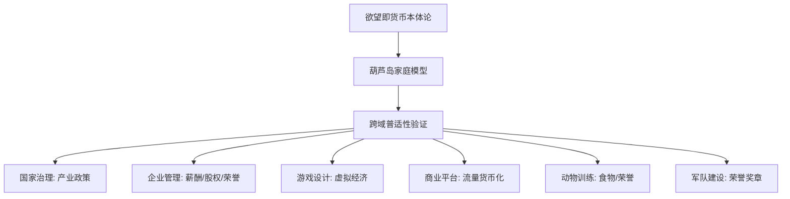
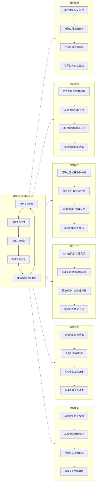
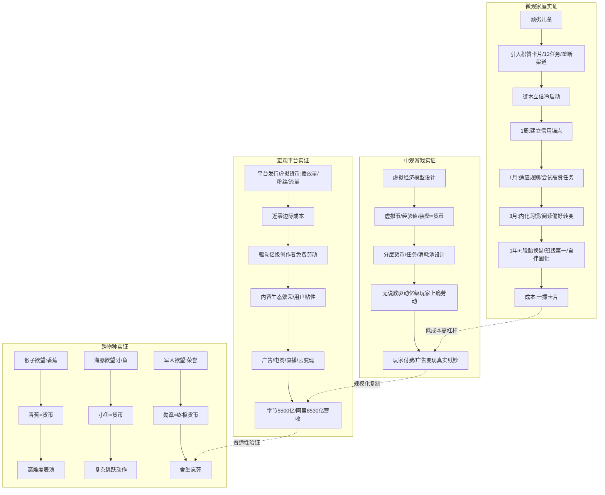
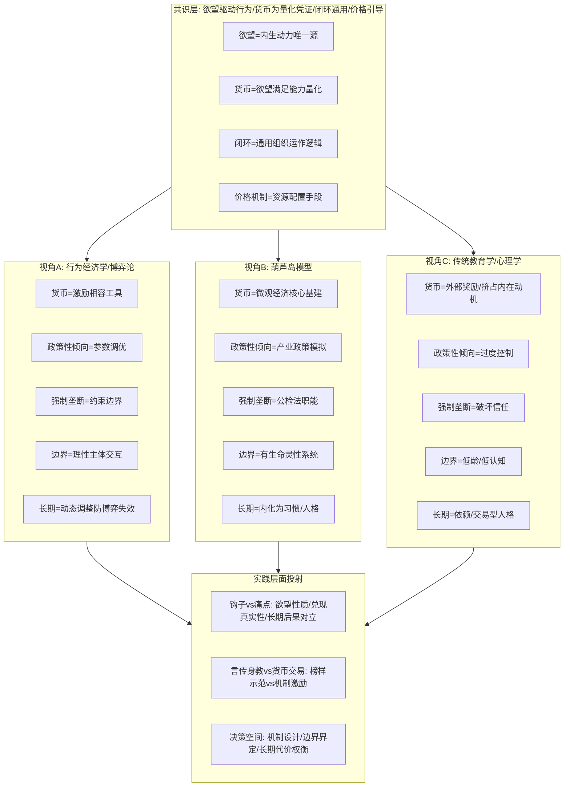

# 第 6 章 欲望即货币 —— 设计驱动行为的微观经济模型

## 学习目标

- 理解欲望作为人类行为唯一底层能量源与货币内在面值的本体论地位
- 掌握葫芦岛家庭经济模型三步法：发行货币、设定工资规则、垄断欲望渠道
- 了解政策性倾向如何通过差异化定价引导行为结构与资源配置
- 能识别货币信用崩塌风险与强制垄断执行的必要条件
- 能将欲望即货币模型迁移至企业管理、游戏设计、商业平台、国家治理等跨域场景
- 能基于四维验证模型评估项目落地性：产品服务、变现模式、赚钱思路、收益评估

## 6.1 生活类比

想象欲望即货币是一个**大型游乐园的游戏币系统**。在这个系统中，**欲望**是游客想玩的项目——过山车、旋转木马、鬼屋，每一个项目都对应着游客内心真实的渴求；**货币**（游戏币/赞）是兑换游玩资格的唯一通用凭证，没有它，任何项目都无法体验；**劳动**（任务/打工）是游客在园内完成任务——打扫卫生、参与表演、答题闯关——赚取游戏币的过程，劳动的难易与报酬挂钩；**政策性倾向**是园方的运营策略：鼓励深度体验的大型项目给双倍币，限量儿童项目防止刷分，通过差异化定价引导游客流向；**强力管理**是封死翻墙、偷溜、找熟人免票等非正规入园渠道，物理隔绝“0元购”漏洞，确立“合法劳动换币”作为唯一通道；**信用兑现**是园方的核心承诺：持币必能玩，一旦赖账、缩水、改规则，游乐园信用崩塌，游客离场，生意倒闭。就像游乐园必须设计好玩的项目（欲望）、公平的赚币规则（工资）、堵住漏洞（垄断）、守住承诺（信用），家庭、企业、平台才能让“玩家”心甘情愿持续“打工”并快乐其中。

## 6.2 概念地图

欲望即货币（第6章核心体系）
├── 核心本体论：欲望是行为唯一能量源与货币内在面值  —— [P001]
│   ├── 内生性：欲望驱动的力是内生、恒久、快乐的  —— [P001]
│   ├── 可替代性：各种货币形式平行存在，均可满足欲望  —— [P001]
│   └── 普适性：适用于一切有生命灵性的系统  —— [P001]
├── 葫芦岛家庭经济模型三步法  —— [P001]
│   ├── 发行货币：积赞卡片、仪式感/防伪/记账功能  —— [P001]
│   ├── 分级工资规则：12项任务、难度定价、政策性倾向  —— [P001]
│   │   ├── 政策性倾向：限制连环画册≤5赞、家务≥3赞  —— [P001]
│   │   └── 冷启动机制：徙木立信降低门槛建立信用锚点  —— [P001]
│   └── 强力管理：物理切断非法满足渠道、打击0元购  —— [P001]
├── 货币机制普适性跨域验证  —— [P001]
│   ├── 国家治理：产业政策引导资源配置  —— [P001]
│   ├── 企业管理：薪酬/股权/荣誉货币化员工欲望  —— [P001]
│   ├── 游戏设计：虚拟币/经验值/装备驱动玩家劳动  —— [P001]
│   ├── 商业平台：流量/粉丝/播放量货币化创作者欲望  —— [P001]
│   │   ├── 微信：阅读量/粉丝量  —— [P001]
│   │   ├── 抖音：播放量/粉丝量  —— [P001]
│   │   ├── B站：硬币/充电  —— [P001]
│   │   └── 知乎：赞同/盐粒  —— [P001]
│   ├── 动物训练：香蕉/小鱼/荣誉奖章  —— [P001]
│   └── 军队建设：荣誉奖章驱动舍生忘死  —— [P001]
├── 财富转化套利实证  —— [P001]
│   ├── 家庭实证：顽童一年蜕变优等生，成本仅一摞卡片  —— [P001]
│   ├── 游戏实证：无需说教让人上瘾的虚拟经济模型  —— [P001]
│   ├── 平台实证：字节5500亿/阿里8530亿营收验证模型  —— [P001]
│   └── 跨物种实证：猴子/海豚/军人行为验证普适性  —— [P001]
└── 边界条件与执行风险
    ├── 执行力是关键：家长懒惰/坚持不住导致模型崩塌  —— [P001]
    ├── 环境一致性：需夫妻统一战线、祖辈配合  —— [P001]
    ├── 适用年龄窗口：更适合低龄/学前儿童  —— [P001]
    └── 哲学冲突：言传身教vs货币交易的教育本质争议  —— [P001]

## 6.3 欲望即货币 —— 捕获内生动力的本体论重构

### 为什么需要这个概念？

传统教育与管理长期依赖外部强加的作用力——说教、棍棒、恐惧、道德绑架，这些手段不可持续，且极易导致心理扭曲或极端反弹。素材中指出：“被父母强行高压培养进了北大的柳智宇、吴谢宇、张空谷、超级神童宁铂等，都强烈反弹，几年后做出了令人震惊的事情，或沉迷游戏屡被退学或出家当和尚或弑母，成为新闻事件。” 这揭示了高压教育必然反弹的定律：违背“为欲望工作”的本性逻辑，切断了行为的内生动力源。人类持久、高效、自发的行为动力，唯有源于内生的“欲望”，而非外部压力。货币本质是欲望的载体，唯有绑定欲望的货币，才能驱动长久习惯与自律。

> "鸟为食亡，人为财死。欲望即是货币。"
> 
> "货币只有绑定了欲望，才有力量。只要具备了兑现欲望的能力，万物皆可为货币。"
> 
> "由于各种“货币形式”在世界中平行存在，而它们都可以无差别地“满足欲望”，甚至一些货币形式，明显比“纸钞”更捷径，直接在行为过程中满足了欲望，干脆连“货币交易”的步骤都省略了，纸钞是有明显局限的。"
> 
> —— [P001]

### 核心定义

**欲望即货币本体论**（来源：[P001]）

- **欲望是货币的「内在面值」**，是驱动人类行为的唯一底层能量源
- **凡能让人付出成本去获取、以满足欲望的中介形式，皆为广义货币**（万物皆可为货币）
- **货币只有绑定了欲望，才有力量**；纸钞有局限，更高阶的货币形式可直接在行为中满足欲望

这个定义展示了货币不再是单纯的交换媒介，而是**欲望满足能力的量化凭证**。当我们说“钱能通神”时，本质是钱绑定了他人的欲望（安全感、地位、快乐等），所以能驱动行为。

### 关键性质

下表总结了欲望即货币本体论的三大关键性质：

| 性质 | 解释 | 来源 |
|------|------|------|
| **内生性** | 欲望驱动的力是内生的、恒久的、快乐的，唯有为欲望而工作才持久 | [P001] |
| **可替代性** | 各种货币形式平行存在，均可无差别满足欲望，甚至可省略货币交易步骤 | [P001] |
| **普适性** | 该模型适用于一切有生命灵性的系统（国家、企业、军队、游戏、商业平台、动物训练） | [P001] |

素材中强调：“人类行为的能量之源，唯有‘欲望’。只有‘欲望’才能战胜人的惰性，而且这种‘力’是内生的，恒久的。现代经济社会里，没有哪一个‘打工人’或个体户、企业是被棍棒、说教驱赶着工作的...人的本性，只有为欲望而工作，才是快乐和持久的。”

### 内生性与外部强迫的对比

我们可以用一个概念性表达来概括这一核心洞见：

$$
\text{BehaviorForce} = f(\text{InternalDesire}) \gg f(\text{ExternalCoercion})
$$

**解释**：行为驱动力 = 内生欲望函数 $\gg$ 外部强迫函数。这个表达式揭示了：只有内生欲望产生的力量才是可持续的；外部强迫（说教、棍棒、恐惧）产生的力量不仅微弱，而且随时间衰减，甚至产生反作用力（心理压抑、极端反弹）。这是“欲望即货币”模型区别于传统管教模式的根本分水岭。**注：这是基于素材核心洞见的概念性形式化表达，非原文公式推导。**

### 典型例子

游戏机制中，虚拟币、经验值、装备作为货币，无需说教让玩家上瘾劳动；互联网平台上，微信的“阅读量/粉丝量”、抖音的“播放量/粉丝量”货币化创作者欲望，驱动亿级免费劳动变现千亿营收；军队荣誉体系中，荣誉奖章为终极货币，驱动战士舍生忘死，非纸钞可换取；动物训练中，猴子为香蕉、海豚为小鱼表演高难度动作。

### 方法演进图



### 边界条件

- **外部强加作用力不可持续**：说教/棍棒/恐惧长期使用会导致心理压抑扭曲或极端反弹（如高压培养的北大学生案例，来源：[P001]）
- **货币体系依赖「国家信用/兑现承诺」**：一旦出尔反尔，信用崩溃，模型失效
- **执行力是关键**：易因执行者懒惰/坚持不住导致模型崩塌，需环境一致性（夫妻统一战线、祖辈配合）
- **适用年龄有限**：更适合低龄/学前儿童，大龄有社交比较后执行难度激增
- **教育哲学冲突**：存在「言传身教」与「货币交易」的教育本质争议

---

## 6.4 葫芦岛家庭经济模型 —— 三步法构建微观经济闭环

### 为什么需要这个概念？

家庭教育的核心矛盾，是家长要求的「延时满足」（未来成就）与儿童倾向的「即时满足”（玩乐）之间的冲突。素材指出：“本质上，天下家长和小孩之间的矛盾，就是‘即时满足’与‘延时满足’两者之间的矛盾...小孩没有‘延时满足’的体验，只会选择当下可以体验到的‘即时满足。’” 传统管教手段（说教/暴力/高压）违背「为欲望工作」本性，必然失败或导致反弹。需要一套将「延时满足」拆解为「即时可得」货币奖励的机制，实现时间维度套利与对齐。

> "一个家庭，便是一个「葫芦岛」经济模型的缩小版...爸爸妈妈便是政府，两个有淘气的儿童是「人民」。"
> 
> "在这个经济模型中，儿童的欲望是打游戏、玩手机...造币部落希望引导的方向是博览群书、勤劳自立、有责任有担当。"
> 
> "综上所述，家庭「葫芦岛」的经济模型可以设置如下：一：有 10 个赞，周末可以玩手机、打游戏一次... 二：有各种劳动岗位可以赚到「赞」... 三：在家庭经济模型中，儿童满足「欲望」的唯一途径，只能是在造币部落设计的若干项目之内。拔掉电视机网络接口...切断任何可以「满足欲望」的途径。"
> 
> —— [P001]

### 核心定义

**葫芦岛家庭经济模型三步法**（来源：[P001]）

1. **发行货币**：锚定欲望，设计货币载体与面额
2. **设定工资规则**：量化劳动，政策性倾向引导结构
3. **强力管理**：垄断欲望兑现渠道，打击非法获取

将畸形的「无劳动即满足欲望」模型转化为「劳动换货币、货币换欲望」良性循环系统。

### 步骤一：发行货币

**货币载体设计**（来源：[P001]）

> "现在选取「卡片」作为货币载体，以「积赞」的方式记账，代表货币面额——对应着满足欲望的能力大小。附注：卡片，作为神圣的「货币」，需要付出大量「劳动」获得，所以要具备一定的「仪式感」，最好是比较正式的硬卡片...不能是太随便的纸张。"
> 
> —— [P001]

这个设计展示了三个关键属性：
- **记账功能**：积赞数量 = 货币面额 = 欲望满足能力
- **防伪/仪式感**：硬质卡片提升神圣感，增加伪造成本
- **兑换锚点**：10赞 = 周末玩手机1次，建立货币与欲望的固定汇率

### 步骤二：分级工资规则与政策性倾向

**任务清单12项**（来源：[P001]）

下表列出了葫芦岛家庭经济模型中的12项标准任务及其对应的赞值设定：

| 任务类别 | 具体内容 | 赞值 | 说明 |
|---------|---------|------|------|
| 临时任务 | 完成1个临时任务 | 1赞 | 基础劳动单元 |
| 家务劳动 | 做1件家务 | 1赞 | 习惯养成 |
| 阅读学习 | 阅读一般书籍50页 | 1赞 | 标准阅读 |
| 阅读学习 | 连环画册100页 | 1赞 | **政策性倾向：折价** |
| 阅读学习 | 高年级代数/几何/物理15页 | 1赞 | **政策性倾向：溢价** |
| 校内表现 | 考试/竞赛优等 | 5赞 | 高价值产出 |
| 行为习惯 | 一周令行禁止 | 2赞 | 自律奖励 |
| 惩罚机制 | 犯错屡教不改 | -1赞/差 | 记差抵消赞 |

**政策性倾向实例**（来源：[P001]）

> "比如规定：由阅读连环画册积赞数量要小于或等于 5，做家务积赞数量要大于或等于 3。"

这个规则展示了**国家产业政策的微观模拟**：
- 限制连环画册 ≤ 5赞 = 抑制低附加值阅读（类比限制高污染产业）
- 要求家务 ≥ 3赞 = 强制均衡发展（类比基础设施建设指标）

素材中对阅读任务的差异化定价进一步说明了难度系数的设定逻辑：“阅读一般的文字纸质书，每 50 页 1 个赞，如果是连环画册，100 页 1 个赞，如果是高年级代数、几何、物理，15 页 1 个赞。” 这体现了：同样的“1赞”，对应的劳动投入因任务难度而异，从而引导儿童向高难度、高价值任务分配精力。

### 步骤三：强力管理与垄断渠道

**欲望渠道垄断**（来源：[P001]）

> "拔掉电视机网络接口，或者切断电源，收起儿童可以触摸到的任何电子产品，手机设置指纹锁。总之，除了用家长发行的「货币」来兑换，切断任何可以「满足欲望」（玩手机、打游戏）的途径。如果超市允许「0 元购物」，如果抢劫偷盗不用受到任何惩罚和制止，经济模型中的一切规则都是一纸空文。"
> 
> —— [P001]

这个操作建立了**合法劳动换货币 = 满足欲望的唯一通道**。类比国家通过公检法维护经济秩序，打击走私/偷盗/假币。

### 冷启动机制：徙木立信

**针对顽劣儿童的入场引导**（来源：[P001]）

> "如果有的儿童平时太过于散漫，一下子难以适用规则，可以循循善诱，降低难度，给他一个逐步适应过程。比如来一个「徙木立信」，先让他完成 1 个简单项目，就奖励 1 个赞，凭这 1 个赞，就可以玩游戏 N 分钟..."
> 
> —— [P001]

这个机制借用商鞅变法「徙木立信」典故：**降低门槛 → 完成微小任务 → 即时兑现欲望 → 建立货币信用锚点**。这是建立信任体系的最小可行性步骤。

### 关键性质总结

下表梳理了葫芦岛模型的五大核心要素及其失效后果：

| 核心要素 | 作用 | 失效后果 |
|---------|------|---------|
| **仪式感/防伪货币** | 确立货币神圣性与面额锚点 | 货币贬值、作弊泛滥 |
| **政策性倾向定价** | 引导行为结构向期望方向配置 | 资源错配、单一技能刷分 |
| **国家信用/兑现承诺** | 货币体系基石，家长必须无条件兑现 | 信用崩溃、模型彻底失效 |
| **强制垄断渠道** | 确立合法劳动唯一通道 | 0元购/绕过规则、规则失效 |
| **徙木立信冷启动** | 顽劣对象入场引导，建立信用锚点 | 拒绝参与、对立情绪固化 |

---

## 6.5 货币机制普适性 —— 从家庭到国家/游戏/商业的跨域验证

### 为什么需要这个概念？

验证「欲望即货币」模型不止于家庭教育，而是普适于一切有生命系统的组织运作底层逻辑。揭示捕获欲望、设计货币、构建闭环这一财富创造与组织运作的通用套利原理，为商业变现、平台设计、企业管理提供可迁移的底层方法论。

> "它几乎可以改造一切有生命和灵性的事物。帮助人掌控一个国家，管理一个社群，维持良好的人际关系，激励企业的员工，训练出纪律严明的军队，设计出令玩家上瘾的电子游戏，创造出具有蓬勃生命力的商业形态。"
> 
> "甚至可以令马戏团和海底世界的动物们随指挥棒起舞...网络游戏为什么不需要任何说教，就令儿童以及成年人上瘾...因为游戏里面，经济模型的设置！"
> 
> —— [P001]

### 核心定义

**跨域普适性定理**（来源：[P001]）

- **核心在于捕获目标主体的欲望，设计对应货币与兑现规则，构建「欲望→货币→劳动→欲望」闭环**
- **「钩子」（黑灰产）与「痛点」（合法商业）本质均为「欲望即货币」在商业变现层面的应用**
- **财富转化套利**：捕获并货币化他人欲望（转化为积分/流量/粉丝等虚拟货币）→ 驱动免费劳动 → 变现真实纸钞

素材进一步阐述：“在下三滥的团伙，‘欲望’有一个专有名词——钩子。并把‘钩子’设计为团伙经济模型运转的核心...在中小型公司，‘欲望’也有一个专有名词——痛点。用户痛点在哪里，货币就在哪里。” 以及：“与之同时，‘欲望’是呼唤货币的‘魔法’，通过‘欲望’，可以转换出真实的纸钞货币，这是一组有巨大套利空间的‘价格差’。欲望无止境，商机无止境——‘欲望’是打开财富大门的钥匙。把‘欲望’从这一头塞进去，从另一头输送出来的，是真实的纸钞。”

### 多源对照：不同领域的货币化实现

下表对比了六大领域中欲望货币化机制的同构与差异：

| 领域 | 目标主体 | 核心欲望 | 货币形式 | 兑现机制 | 驱动行为 |
|------|---------|---------|---------|---------|---------|
| **国家治理** | 国民 | 安全/繁衍/地位 | 政策红利/户籍/荣誉 | 产业补贴/资源倾斜 | 生育/创业/纳税/迁徙 |
| **企业管理** | 员工 | 钱/晋升/成就/归属 | 薪酬/股权/荣誉/期权 | 年终奖/晋升/授予股权 | 加班/创新/忠诚/招聘 |
| **军队建设** | 战士 | 荣誉/使命/生存 | 勋章/军衔/英雄称号 | 授勋仪式/史册记载 | 舍生忘死/冲锋陷阵 |
| **游戏设计** | 玩家 | 成就/社交/支配/收集 | 虚拟币/经验/装备/皮肤 | 掉落/商城/排行榜 | 刷本/氪金/组队/直播 |
| **商业平台** | 创作者 | 认同/影响力/变现 | 阅读量/粉丝/播放量/流量 | 算法分发/广告分成/带货 | 日更/优化/引流/矩阵 |
| **动物训练** | 动物 | 食物/安全/繁衍 | 香蕉/小鱼/表扬声 | 即时喂食/正向强化 | 表演/配合/复杂动作 |

**共识**：所有系统的核心都是**捕获欲望 → 设计货币 → 构建闭环 → 驱动劳动 → 变现价值**。

**分歧**：
- **家庭/教育场景**强调「延时满足」的时间套利，货币为过渡媒介
- **商业平台/游戏**强调「即时反馈」的多巴胺闭环，货币即欲望满足的直接量化
- **国家/军队**强调「荣誉/使命」的超越性欲望，货币具有不可替代的精神属性

素材中关于“钩子”与“痛点”的界定，揭示了商业伦理的核心张力：黑灰产利用人性弱点（贪婪、恐惧、色欲）设计“钩子”实施诈骗；合法商业捕获用户真实痛点（效率、社交、成长）设计“痛点”创造价值。二者在“捕获欲望→设计货币→构建闭环”的技术路径上同构，但在欲望的性质（毁灭性 vs 建设性）、兑现的真实性（虚假承诺 vs 真实交付）、长期后果（掏空受害者 vs 双赢）上本质对立。这是“欲望即货币”模型在商业应用层面必须严守的红线。

### 方法演进图：欲望货币化跨域闭环流程



### 典型例子深度拆解

#### 商业平台：字节跳动/阿里巴巴的欲望货币化

> "微信公众号的博主，欲望是「阅读量」、「粉丝量」，腾讯通过巧妙设置，把这两个数据「货币化」...让无数优秀的内容创作者，为了「阅读量」和「粉丝量」，辛勤地创作..."
> 
> "抖音平台...以「粉丝量」「播放量」为货币...数以亿计的创作者每天辛勤地为抖音「劳动」，平台坐收渔翁之利。2022 年，字节跳动营收 5500 亿人民币...2022 年，阿里巴巴营业收入 8530 亿元人民币..."
> 
> —— [P001]

平台通过**近零边际成本发行虚拟货币（播放量、粉丝量、流量排名）** → **驱动亿级创作者免费劳动（日更、优化、引流）** → **高效率变现真实纸钞（广告/电商/直播/云服务）**。这构成了一个完整的“财富转化套利”闭环：欲望从一头塞入（创作者渴望认同与变现），真实纸钞从另一头输出（平台营收）。

#### 游戏设计：虚拟经济模型

> "网络游戏为什么不需要任何说教，就令儿童以及成年人上瘾，沉迷其中？因为游戏里面，经济模型的设置！所有成功的游戏，团队重点设置是其中的经济模型，各种虚拟币、经验值、通关、点数、装备、皮肤、宝箱、道具、超能力等等，就是游戏世界的「货币」..."
> 
> —— [P001]

游戏经济模型的**三大核心设计**：
1. **货币体系分层**：基础币(金币) → 进阶币(钻石/元宝) → 终极币(稀有装备/称号)
2. **获取路径设计**：日常任务(基础劳动) → 副本挑战(技能劳动) → 社交协作(组织劳动) → 付费捷径(资本置换)
3. **消耗池设计**：数值成长(强化欲望) → 外观收集(审美/社交欲望) → 权力竞争(支配欲望)

#### 军队荣誉：终极货币

> "荣誉奖章是军人的「货币」，战士们为了荣誉而前赴后继，舍生忘死，这种勇于牺牲的奉献精神，完全不是纸钞可以换取的，只有终极货币才可以。"
> 
> —— [P001]

这揭示了**货币的最高阶形式**：当欲望超越生存本能（如荣誉、使命、信仰），对应的货币就具有了**非货币可替代性**——这是纸钞永无法达成的兑换。

---

## 6.6 财富转化套利实证 —— 从顽童蜕变到千亿营收的验证链

### 为什么需要这个概念？

理论需落地验证：从微观家庭实验到宏观商业帝国，构建完整证据链证明模型有效性。揭示「欲望货币化→劳动驱动→财富变现」在不同尺度下的可复制性与确定性，为实践者提供可参考的执行标准与避坑指南。

### 核心证据链

下表梳理了四个尺度的实证案例，构成完整的验证链条：

| 尺度 | 案例 | 投入成本 | 产出结果 | 核心验证点 |
|------|------|---------|---------|-----------|
| **家庭微观** | 顽童蜕变优等生 | 一摞卡片/规则设计 | 主动做家务/阅读理科/班级第一 | 低成本重塑行为，内生动力有效 |
| **游戏中观** | 网络游戏上瘾机制 | 虚拟经济模型设计 | 亿级玩家自发劳动/付费 | 无说教驱动复杂持久行为 |
| **平台宏观** | 字节/阿里营收 | 虚拟数据发行(近零成本) | 5500亿/8530亿年营收 | 亿级创作者免费劳动变现 |
| **跨物种** | 猴子/海豚/军人 | 香蕉/小鱼/荣誉奖章 | 高难度表演/舍生忘死 | 跨物种/群体验证普适性 |

### 家庭实证深度复盘

> "我朋友家的儿童，小学低年级，由于以前的宠爱和教育疏忽，行为非常顽劣...对家长的任何口头教育毫无反应...甚至敢操起家伙直接跟家长干架。以上「经济模型」的细则，就是我针对这个儿童设计的，运行一年多以后，现在脱胎换骨...主动做家务，动作麻利，阅读的课外书籍以及数理化读物一本接一本...一周前，这位儿童学习成绩班级第一名，全面发展，妥妥的优等生。家长付出的代价就是「一摞卡片」，云淡风轻。"
> 
> —— [P001]

**行为重塑轨迹**：

```
第1-2周：徙木立信 → 完成微任务 → 即时兑现 → 建立信用锚点
第3-4周：适应规则 → 尝试高赞任务 → 体验延时满足 → 行为频率上升
第2-3月：内化习惯 → 主动求任务 → 阅读偏好转变(连环画→理科) → 成绩提升
第6月+：自律固化 → 无需监管 → 班级第一 → 模型可逐步淡出
```

### 平台实证量化验证

**字节跳动/阿里巴巴双巨头验证**：

下表量化对比了两大平台的欲望货币化变现能力：

| 指标 | 字节跳动(2022) | 阿里巴巴(2022) | 验证含义 |
|------|---------------|---------------|---------|
| 年营收 | 5500亿 | 8530亿 | 虚拟货币变现真实纸钞能力 |
| 创作者规模 | 亿级日活创作者 | 亿级商家/创作者 | 免费劳动规模 |
| 货币形式 | 播放量/粉丝/流量排名 | 流量/转化/GMV排名 | 多元欲望货币化 |
| 边际成本 | 接近零(数据写入) | 接近零(数据写入) | 货币发行零成本 |
| 变现路径 | 广告/电商/直播/游戏 | 佣金/广告/云/金融 | 多元变现闭环 |

### 方法演进图：多尺度实证验证链条



### 边界条件与执行风险（来自评论区真实反馈）

> "东山老师 : 不知道你自己是否在家里测试过...一两个月后，她也累，我也累，而且完全没效！孩子行为习惯最大的影响者不是货币交易，而是言传身教！"
> 
> "随便说一个 ...在年龄小没有认知的情况下可以这样 但有朋友了有社交了 这套实践起来可能会难很多 孩子之间也会互相比较；还有就是也需要其他家庭成员的配合..."
> 
> "南侠 1987 : 夫妻先达成一致，是最起码的"
> 
> —— [P001] 评论区反馈

**执行风险矩阵**：

下表梳理了家庭模型落地时的主要风险维度、表现形式、缓解策略及素材支撑：

| 风险维度 | 表现形式 | 缓解策略 | 素材支撑 |
|---------|---------|---------|---------|
| **执行力崩塌** | 家长懒惰/累/坚持不住 → 规则执行断档 | 简化流程/工具辅助/外包监督 | 东山老师反馈 |
| **环境不一致** | 夫妻分歧/祖辈溺爱 → 货币体系被冲击 | 家庭会议达成共识/签署家庭契约 | 南侠1987/随便说一个 |
| **年龄窗口** | 大龄儿童社交比较 → 货币贬值/拒绝 | 引入社交货币/同伴竞争机制 | 随便说一个反馈 |
| **哲学冲突** | 言传身教派 vs 货币交易派 → 理念对立 | 混合模式：榜样示范+货币激励并行 | 东山老师反馈 |
| **信用破裂** | 家长出尔反尔/平台改规则 → 信任崩塌 | 承诺机制化/智能合约/法律保障 | 本体论定义 |

---

## 6.7 多源对照：欲望货币化的不同理论视角

### 共识

1. **欲望是行为的唯一内生动力源**——无异议
2. **货币本质是欲望满足能力的量化凭证**——无异议  
3. **构建「欲望→货币→劳动→欲望」闭环是通用组织运作逻辑**——无异议
4. **政策性倾向/价格机制可引导资源配置**——无异议

### 分歧

下表对比了行为经济学/博弈论、本素材「葫芦岛模型」、传统教育学/心理学三个视角在核心维度上的分歧：

| 维度 | 视角A：行为经济学/博弈论 | 视角B：本素材「葫芦岛模型」 | 视角C：传统教育学/心理学 |
|------|--------------------------|---------------------------|------------------------|
| **货币角色** | 激励相容机制设计的工具 | 家庭/组织微观经济系统的核心基建 | 外部奖励，可能挤占内在动机 |
| **政策性倾向** | 机制设计中的参数调优 | 模拟国家产业政策的微观治理手段 | 过度控制，扼杀自主探索 |
| **强制垄断** | 约束条件/边界设定 | 必须物理切断的「公检法」职能 | 破坏信任关系，制造对抗 |
| **适用边界** | 所有理性主体交互场景 | 有生命灵性系统(含动物/儿童) | 仅适用低龄/低认知阶段 |
| **长期效果** | 需动态调整防止博弈失效 | 可内化为习惯/人格特质 | 易产生依赖/交易型人格 |

素材中的“钩子vs痛点”、“言传身教vs货币交易”争议，正是上述分歧在实践层面的投射。行为经济学关注机制的激励相容性与动态稳定性；葫芦岛模型关注微观经济系统的完整构建与信用锚定；传统教育学则警惕外部奖励对内在动机的挤占效应（Deci & Ryan自我决定理论）。三者在“欲望驱动行为”这一本体论上达成共识，在“如何设计货币机制”、“边界在哪里”、“长期代价是什么”上各执一词，构成了该模型应用时必须权衡的决策空间。

### 方法演进图：三视角理论张力结构



---

## 6.8 设计中的取舍

### 为什么不用「说教/榜样/高压」而是「货币机制」？

说教与榜样依赖**认知内化**，路径长、不确定性高、易被情绪干扰；高压依赖**恐惧驱动**，不可持续且必反弹（素材中的北大学生反弹案例铁证如山，来源：[P001]）。货币机制直接对接**欲望底层**，路径最短、反馈最快、可量化调控。素材中的「高压教育必然反弹定律」与「游戏无说教上瘾」（虚拟经济模型，来源：[P001]）形成鲜明对比：前者切断内生动力，后者精准捕获并放大内生动力。选择货币机制，本质是选择**顺应人性**而非**对抗人性**。

### 这种设计的 trade-off 是什么？

下表梳理了采用货币机制设计的核心收益与代价：

| 收益 | 代价 |
|------|------|
| 行为立竿见影改变 | 家长需持续高执行力维护系统 ([P001]) |
| 可量化/可调控/可复制 | 依赖环境一致性(夫妻/祖辈) ([P001]) |
| 培养延时满足/契约精神 | 存在「交易型人格」塑造风险 ([P001]) |
| 低成本高杠杆(卡片vs补习班) | 适用年龄窗口有限(低龄最佳) ([P001]) |
| 跨域可迁移(平台/企业/国家) | 道德哲学争议(言传身教vs货币) ([P001]) |

**核心权衡**：**执行成本**换**行为确定性**。家长用持续的规则执行成本，换取儿童行为的高确定性改变与长期习惯养成。这种权衡在商业平台中同样存在：平台用算法调优与运营成本，换取创作者行为的高可预测性与规模化内容生产。

---

## 6.9 动手练习

### 练习 1：设计一个微型家庭经济模型

假设你是一位8岁孩子的家长，孩子沉迷手机游戏（欲望），你希望引导其每天阅读30分钟、完成家务（目标行为）。请设计：

1. **货币载体**：选择什么实物作为‘赞’的载体？如何体现仪式感与防伪？
2. **兑换锚点**：多少‘赞’兑换多长时间手机游戏？如何设置阶梯价格？
3. **任务清单**：设计3-5项分级任务（含阅读、家务、临时任务），标注每项赞值，并设置一条政策性倾向规则（如限制单一任务上限）。
4. **强力管理**：列出3种物理切断‘非法满足欲望’渠道的具体操作。
5. **冷启动**：如果孩子第一周完全不配合，你的‘徙木立信’第一步任务是什么？奖励多少赞？兑现什么？

**回答问题**：
- 如果家长某次因心情不好拒绝兑现承诺的游戏时间，模型会发生什么？
- 为什么阅读连环画册的赞值要低于阅读理科书籍？这体现了什么经济学原理？

### 练习 2：跨域迁移：识别商业平台中的欲望货币化机制

选取一个你熟悉的商业平台（如抖音、小红书、某游戏、某APP），分析其欲望货币化闭环：

1. 平台捕获了用户的什么核心欲望？（如：展示欲、社交认同、成就感、获知焦虑缓解）
2. 平台设计了什么虚拟货币作为欲望的‘内在面值’？（如：粉丝量、播放量、等级、勋章、积分、虚拟币）
3. 用户通过什么‘劳动’获取该货币？（如：发视频、写笔记、打怪升级、每日签到、邀请好友）
4. 平台如何垄断欲望兑现渠道？（如：算法分发流量、限制外链、封禁刷量、实名认证）
5. 平台如何将虚拟货币‘变现’为真实纸钞？（如：广告分成、电商佣金、直播打赏抽成、卖流量包）

**回答问题**：
- 该平台的‘政策性倾向’体现在哪里？（如：鼓励原创给流量扶持、打击搬运限流）
- 如果平台突然修改规则（如大幅降低播放量单价、封禁某类账号），相当于家庭模型中的什么操作？会引发什么后果？

### 练习 3：项目验证实战：四维模型评估‘AI绘画变现’项目

运用素材中的‘四维项目验证模型’（产品服务、变现模式、赚钱思路、收益评估），评估一个‘教普通人用Midjourney做AI壁纸卖会员’的项目：

1. **产品服务**：核心交付物是什么？（如：壁纸图包/会员订阅/提示词教程/定制服务），边际成本多少？
2. **变现模式**：怎么卖？（如：小红书引流私域卖会员/闲鱼1元引流/公众号挂载/自建小程序），流程几步？
3. **赚钱思路**：底层逻辑是什么？（如：信息差/技能门槛/审美筛选/流量套利），可复制性强吗？
4. **收益评估**：单价/转化率/客单价/复购率预估，月入多少算及格？多少算优秀？

**回答问题**：
- 该项目的‘欲望’在哪里？用户付费满足的是什么欲望？
- 若Midjourney官方推出一键生成壁纸免费功能，相当于‘货币信用崩塌’还是‘欲望渠道被垄断’？项目如何应对？

---

## 6.10 本章小结

这一章中我们学习了欲望即货币这一底层本体论，以及基于此构建的葫芦岛家庭经济模型三步法。首先我们确立了欲望是人类行为唯一底层能量源、货币力量源于绑定欲望的核心认知；其次我们掌握了发行货币（积赞卡片）、设定分级工资规则（含政策性倾向）、强力垄断欲望渠道的家庭微观经济闭环构建方法；接着我们验证了该模型在国家治理、企业管理、游戏设计、商业平台、军队建设、动物训练等跨域场景的普适性；然后我们通过顽童蜕变、游戏上瘾、字节阿里千亿营收、跨物种行为等多尺度实证构建了完整证据链；最后我们识别了执行力崩塌、环境不一致、年龄窗口、哲学冲突、信用破裂等边界风险与应对策略。

本章我们一起学习了以下概念：

下表汇总了本章核心概念及其解释：

| 概念 | 解释 |
|------|------|
| 欲望即货币 | 货币力量源于绑定的欲望，万物皆可为货币，欲望是行为唯一底层能量源 |
| 葫芦岛家庭经济模型 | 发行货币-设定工资-垄断渠道三步法，将即时满足转化为延时满足的良性闭环 |
| 积赞卡片 | 具备仪式感/防伪/记账功能的货币载体，面额锚定欲望满足能力 |
| 分级工资规则 | 12项任务覆盖劳动/阅读/考试/习惯，难度定价+政策性倾向引导结构 |
| 政策性倾向 | 通过差异化定价（如限制连环画册≤5赞、家务≥3赞）引导行为资源配置 |
| 强力管理/垄断渠道 | 物理切断绕过货币体系直接满足欲望的路径（断网/锁机），确立合法劳动唯一通道 |
| 国家信用/兑现承诺 | 货币体系基石：家长必须无条件不打折兑现，出尔反尔即导致信用崩溃模型失效 |
| 徙木立信/冷启动 | 针对顽劣对象降低门槛，完成极简任务即给奖励兑现，建立货币-欲望信用锚点 |
| 钩子/痛点 | 商业语境下的欲望代称：黑灰产叫钩子，合法商业叫痛点，本质均为欲望即货币的变现应用 |
| 财富转化套利 | 捕获并货币化他人欲望（虚拟币/积分/流量）→ 驱动免费劳动 → 变现真实纸钞 |
| 货币机制普适性 | 适用于国家/企业/军队/游戏/平台/动物等一切有生命系统的组织运作底层逻辑 |
| 执行力边界 | 家庭模型成败核心变数：家长懒惰/累/坚持不住易崩塌，需环境一致性支撑 |

感谢你读到了这里，恭喜你完成了第6章的学习！你已经掌握了「欲望即货币」这一穿透本质的微观经济模型，能够将其应用于家庭教育、商业变现、组织管理、平台设计等多元场景。愿你成为捕获欲望、设计货币、构建闭环的高手，在不确定的世界中建立确定性的财富创造能力。

