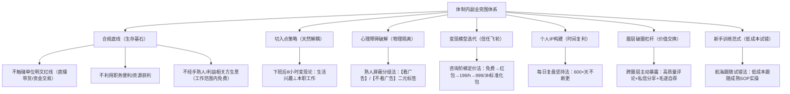

# 第 7 章 体制内副业突围 —— 以生活为切入点，以IP为杠杆，以合规为底线

## 学习目标

- 理解体制内副业的核心合规边界与红线定义
- 掌握以生活兴趣为切入点解耦主业风险的选题策略
- 学会使用微信分组功能消除熟人社交心理包袱
- 理解咨询服务阶梯定价法：从免费验证到标准化高价包的进化逻辑
- 掌握每日复盘坚持法构建个人IP的时间复利机制
- 学会跨圈层主动暴露法通过价值交换获取顶流背书
- 掌握航海跟随试错法低成本跑通0-1积累可迁移核心技能

## 7.1 生活类比

## 7.2 概念地图

## 7.3 体制内副业合规底线 —— 红线内的生存空间与自由度

### 为什么需要这个概念？

体制内人员副业面临明文规定约束与隐形道德风险，踩红线会导致主业丢失、副业归零的双重毁灭性打击。大多数人因恐惧风险而不敢动，或因无知触碰红线（如利用职务资源、经手熟人生意）导致身败名裂。只有明确边界、划定底线，才能在合规安全区内大胆尝试、安心积累，实现"主业兜底、副业突围"。

### 原文摘录

> "首先一点，不要尝试在底线摩擦，比如在事业单位有明文规定，不要做直播带货、跟学校相关的产业相关的资金交易，那么这些避开就好了。"
> 
> "我给自己定的标准就是不做工作范围内同事、家长的生意，尤其是家长，哪怕是孩子都已经毕业了，家长资源不利用。"
> 
> "包括我自己工作范围内的学区咨询，购房建议等相关的内容，全部不收费，免费解答。这是我给自己定的底线。"
> 
> ——《docs/202303/20230328_114.md》

### 核心定义

**合规底线** = 不触碰单位明文禁止红线（如直播带货、校内资金交易） ∩ 不利用职务便利/资源获利 ∩ 不经手熟人/利益相关方生意（含家长、同事、学区咨询）。

**物理隔离**：副业资源、客群、收益与主业职权、人脉、场景完全剥离，工作范围内的咨询服务坚持"免费"原则。

### 关键性质

- **非协商性**：是副业存续的生死线，不可因"利益诱惑"或"熟人情面"动摇。
- **正向筛选力**：倒逼从业者寻找与主业正交的赛道（生活兴趣、跨领域知识），反而激发差异化竞争优势。
- **心理安全阀**：有了底线兜底，执行层面才敢"大大方方搞钱"，消除潜意识愧疚感导致的执行拖延。

### 典型例子

- **幼教工作者"土豆妈"**：明确拒绝学区房咨询收费、拒绝家长资源变现、拒绝校内关联产业，转而做装修分享、民宿运营、房产咨询（非学区）。
- **警察分享健身、医生分享食谱、老师分享育儿**：主业身份仅作人设背书，变现动作与职权零关联。

### 边界条件

- **灰色地带判定**：若副业内容涉及主业专业知识输出（如老师卖教案），需咨询单位纪检/法务，默认归入"高风险区"规避。
- **平台政策变动**：抖音/视频号对体制内身份认证收紧时，需评估实名认证对主业的暴露风险，必要时用家人名义开号。
- **规模化临界点**：当副业收入超主业、团队扩张需办证照时，合规边界从"个人行为"升级为"经营主体资质"，需重新审视底线。

## 7.4 下班后8小时变现论 —— 生活兴趣作为天然解耦切入点

### 为什么需要这个概念？

体制内人员普遍面临"不敢做、不会做、没资源做"的三重困境，传统副业（微商、保险、兼职）多涉及人脉透支、身份冲突。生活领域（衣食住行、育儿健身、审美提升）是每个人每天必经、必懂、必投入的高频刚需，自带真实感、信任感、共鸣感。生活兴趣与本职工作在"时间、空间、资源、利益"四维度天然正交，领导无法干涉，同事无法举报，自我无包袱。

### 原文摘录

> "生活类的领域，是每个普通人都离不开的，体制内想要破圈，完全可以从生活入手，比如警察可以分享每日健身，老师可以分享每日育娃妙招，医生可以分享营养减脂餐，把下班后的生活分享出来，没那么多包袱了，每个人都有下班后的 8 小时。"
> 
> "我自己靠什么来赚钱，就是下班后倒腾自己家房子，我赚点房租跟我做什么工作有关系吗？领导会来干涉吗？那就大大方方折腾就对了！"
> 
> ——《docs/202303/20230328_114.md》

### 核心定义

将下班后的生活体验（装修避坑、育儿妙招、健身增肌、美食探店、民宿房东）直接转化为内容素材与变现产品。

核心逻辑：人人有生活 → 生活有痛点 → 痛点有方案 → 方案可复制 → 复制可变现 → 变现不违规。

### 关键性质

- **零准入门槛**：无需额外学习专业技能，只需将已发生的生活经历"文档化、结构化、产品化"。
- **天然信任背书**：真实生活场景（自家房子、自家娃、自家饭）比任何专家证书更有说服力，转化率极高。
- **抗周期性**：无论经济周期如何，人们对美好生活的向往不变，生活类副业现金流最稳健。

### 典型例子

- **民宿房东**：闲置房源+装修审美+服务细节 = 极低成本的文旅现金流，疫情三年熬过即爆发。

### 边界条件

- **隐私保护红线**：涉及家人（尤其是未成年孩子）、邻里、隐私地理位置的内容，必须脱敏或征得同意。
- **专业资质界限**：涉及医疗建议、法律文书、结构改造等强资质领域，只能分享"避坑经验"，严禁冒充专业人士出具方案。
- **内容枯竭期**：单一生活场景（如装修）有周期性结束，需提前布局下一生活赛道（如装修后的收纳、软装、二胎育儿）实现接力。

## 7.5 熟人屏蔽分组法 —— 心理包袱的物理隔离术

### 为什么需要这个概念？

"不敢发朋友圈"是体制内、职场人、内向者启动副业的第一大心理拦路虎：怕同事嘲笑、怕领导看见、怕亲戚议论、怕客户觉得不专业。传统做法"注册小号、建群分发"成本高、触达低、维护累，且割裂了熟人信任资源的潜在价值。需要一个零成本、零技术、零维护、即时生效的"物理屏蔽+心理放下"双重解法。

### 原文摘录

> "朋友圈不敢发？把所有人一个个拉出来做备注标签，只分两类，【看广告】和【不看广告】，就跟物品断舍离的时候一样，但凡犹豫的都暂时归纳到【不看广告】，这样分类清楚之后，你还有什么不敢发朋友圈的呢？"
> 
> ——《docs/202303/20230328_114.md》

### 核心定义

微信好友仅分两组标签：【看广告】（目标客群、同频同行、支持者）与【不看广告】（同事、领导、长辈、犹豫不决者、无关弱联系）。

发布副业内容（朋友圈/视频号同步）时，勾选"谁可以看" → 仅选择【看广告】标签组，一键实现精准触达与熟人隔离。

### 关键性质

- **决策成本极低**：不必纠结分类细节，犹豫者默认归入"不看广告"，宁可少触达、不冒风险。
- **心理卸载即时**：发圈前不再预演后果、发圈后不再焦虑撤回，心理包袱随设置完成而归零。
- **隐形分发效应**：【看广告】组包含大量潜在客户（同城业主、同龄宝妈、同行），精准触达率反超公开发圈。

### 典型例子

- **土豆妈**：几百好友分两组，装修/房产/咨询内容仅对【看广告】组可见，单条朋友圈成交咨询单999元。
- **知识付费从业者**：将同行、大佬、意向学员放入【看广告】，形成"半公开"的高质量内容分发圈层。

### 边界条件

- **微信规则上限**：单个标签上限约200人，需定期清理僵尸粉或建立多级标签（看广告1、看广告2）。
- **熟人穿透风险**：极少数熟人可能通过共同群、评论区、转发间接看到内容，核心对策是"内容本身无违规、无丑闻、大方承认"。
- **社交成本**：长期不可见可能导致弱联系自然淡出，但对于副业而言，这是"筛选高质量社交圈"的正向副作用。

### 为什么需要这个概念？

### 原文摘录

> 
> "一开始定价 99/年的时候我是怀疑的，不确定的，一步步地优化、完善后，甚至觉得这么有内容、有价值的社群值得有更高的定价。"
> 
> ——《docs/202303/20230328_114.md》

### 核心定义

- **阶段1（0-6个月）**：免费社群，核心动作=高频输出干货（装修日记、避坑指南、选品清单）+ 高情商运营（欢迎语、围观互动、资料分享），目标=积累200-500精准用户、沉淀50+核心内容资产。
- **阶段2（转型期）**：设置付费门槛（99-199元/年），核心话术="内容太多需整理维护、服务升级需成本、筛选同频人"而非"收割韭菜"，老用户免费/优惠续费。
- **阶段3（成熟期）**：内容产品化（电子书、工具包、标准SOP）、服务分层（社群+咨询+实地考察）、价格迭代（199→399→999），建立"内容年费+服务单费"双轨制。

### 关键性质

- **信任沉淀期不可压缩**：免费期<3个月通常内容不够厚、信任不够深，付费转化率<5%；>1年用户粘性高、转化率可达15-20%。
- **价格锚定心理学**：低价起步（99元）降低决策门槛，高价迭代（999元）锚定高价值感知，中间需有"内容增量"作为涨价理由。
- **退出机制保护**：承诺"不满意随时退全款"，将用户风险转移给运营者，倒逼内容质量持续在线。

### 典型例子

- **考公/考研/考证赛道**：免费资料群→付费打卡营→付费VIP全程班，已成行业标准商业模版。

### 边界条件

- **平台封群风险**：微信群超100人需实名、超500人不可扩、敏感词触发封禁，需建立"群裂变+私域沉淀+邮件/👸号触达"多通道备份。
- **服务兑现陷阱**：付费后若无法持续产出高质量内容/服务，口碑反噬速度是建立速度的10倍，宁可慢收费、不可烂服务。
- **法务合规**：虚拟服务类商品需明确"服务期限、范围、标准、退费规则"，规避"预付式消费"监管风险。

## 7.7 咨询服务阶梯定价法 —— 把时间越卖越贵的定价进化论

### 为什么需要这个概念？

服务型副业最难定价：定高了无人问津、定低了累死赚不到钱、不定价（免费/随意）则被白嫖、不被尊重、无法规模化。咨询本质是"确定性售卖"，客户买的是"避坑概率提升、决策时间压缩、结果确定性兜底"，而非单纯的"时间"。需要一套从"市场验证"到"价值锚定"再到"标准化交付"的动态定价进化路径。

### 原文摘录

> "2022 年年底开始尝试私人咨询服务，主要是房产购买、学区规划、装修建议等方面，从一开始不收费，到红包随意，再到 199/h，最近涨价到单次 999/3h。把自己的时间和精力越卖越贵。"
> 
> ——《docs/202303/20230328_114.md》

### 核心定义

- **Lv.0 免费体验期（0-10单）**：目标=跑通流程、收集案例、获取好评截图、建立标准话术/SOP，拒绝"长期免费"。
- **Lv.1 红包随意期（10-30单）**：目标=验证支付意愿、测试价格下限、筛选有支付能力用户，心理门槛="不想白嫖、想表达感谢"。
- **Lv.2 低价试水期（199元/小时）**：目标=建立"付费=专业"心智锚定、过滤低质量咨询、验证小时单价接受度。
- **Lv.3 标准化高价包（999元/3小时）**：核心创新=从"卖时间"转向"卖结果/卖套餐"，包含：前置问卷诊断+3小时深度咨询+事后执行清单+30天微信追问，单价溢价5倍但成交率不降。

### 关键性质

- **价格即筛选器**：每次涨价都是一次客群升级，低价客群流失=高质量客群腾笼，转化率看似下降实则GMV上升。
- **标准化倒逼专业**：为了支撑999元定价，必须产出《咨询前置问卷》《执行清单模板》《常见问题知识库》，人效指数级提升。
- **心理账户重构**：客户将999元归类为"投资避坑成本"而非"咨询费"，支付阻力骤降，复购/转介绍率显著提升。

### 典型例子

- **土豆妈房产装修咨询**：免费→红包→199/h→999/3h，紫菜大神等头部大佬主动付费复购，验证高净值人群对"确定性服务"的高溢价接受度。
- **律师/会计/医疗咨询行业**：标准化"首诊套餐/合规体检包/二诊方案包"替代小时计费，已成行业共识。

### 边界条件

- **服务标准化前提**：仅适用于"问题相对标准、流程可SOP化、结果可预期"的咨询领域（房产、装修、留学、求职、理财）；高度非标、强依赖专家直觉的领域（心理治疗、复杂诉讼、战略咨询）慎用。
- **个人精力上限**：单人高价咨询上限约20-30单/月，突破需引入"初级顾问执行+资深顾问把关"分级模型，或转型为"训练营/课程/社群"杠杆模式。
- **平台规则限制**：微信个人收款单笔上限、年度上限；高客单需引导企业转账/个体户收款码/小程序订单，规避风控。

## 7.8 每日复盘坚持法 —— 时间复利下的个人IP核弹

### 为什么需要这个概念？

个人IP建设最大的难点不是"不会写"，而是"不敢写、不持续、无反馈、易放弃"，完美主义导致的"零输出"比低质量输出危害大100倍。体制内/普通人缺乏爆款制造能力、无团队运营、无广告预算，唯一可控变量是"时间投入"与"动作频次"。需要一个门槛极低、正反馈强、复利效应明显、可终身执行的"最小可行性动作"。

### 原文摘录

> "其实我就做了一件小事，写每日复盘，少则 20 字，多则 2000 字，坚持了 600 多天，二胎生娃当天也没断更。"
> 
> "靠谱就是一路围观我这 600 多天，如何买卖房子、装修房子、顺便生了个二胎。"
> 
> "土豆妈是如何破圈让@梁靠谱 关注到我？让靠谱大神多次在群里、直播中，甚至还写了一条朋友圈单独来介绍我？其实我就做了一件小事，写每日复盘...坚持了 600 多天...靠谱就是一路围观我这 600 多天"
> 
> ——《docs/202303/20230328_114.md》

### 核心定义

- **承诺**：每天输出一条复盘，内容不限（工作感悟、副业进展、育儿心得、投资记录、情绪觉察），字数不限（20字-2000字），形式不限（文字/图片/语音/视频），唯一硬指标=不断更。
- **机制**：利用"公开承诺倒逼执行"+"时间累积产生稀缺性"+"真实记录穿透信任层"三重效应，将日常琐碎转化为个人品牌资产。

### 关键性质

- **反脆弱性**：生病、生娃、加班、旅行、心情差都不例外，打破"状态好才能写"的完美主义陷阱，越是低谷期的复盘越真实、越打动人。
- **被动引力场**：坚持300天以上，必然吸引同频高能量人群（大佬、同行、客户）主动关注、点赞、私信、背书，无需主动推销。
- **认知外化加速器**：每天强迫思考"今天核心进展/教训/下一步"是啥，元认知能力与决策质量在不知不觉中跃迁。

### 典型例子

- **土豆妈**：600+天不断更（含二胎生产当天），吸引生财有术创始人梁靠谱多次公开背书（群内、直播、朋友圈），引流数百精准付费用户。
- **亦仁/梁宁/李笑来等头部IP**：均有"日更/周更/月更"数年以上的长期主义公开记录，是其个人品牌护城河的核心基石。

### 边界条件

- **内容合规底线**：严禁泄露主业机密、涉政言论、隐私信息、未经验证的传闻，复盘内容需脱敏处理。
- **效率临界点**：单条复盘耗时>30分钟容易导致坚持困难，建议建立"语音输入→AI整理→定时发布"半自动化流程，压缩至5-10分钟。
- **平台分发策略**：首发微信朋友圈（熟人信任场）+ 同步视频号/👸号/小红书/知识星球（公域资产沉淀），形成全网矩阵。

## 7.9 跨圈层主动暴露法 —— 价值交换撬动顶流背书

### 为什么需要这个概念？

普通人在封闭圈层里"闷声干活"极难被外界发现，平台算法对零基础账号的冷启动分发极其吝啬。顶流大佬/头部KOL拥有巨大流量分发权、背书信用、高阶认知，但他们极其稀缺"高质量、垂直、可落地"的实操案例与反馈。需要一套"主动暴露价值 → 筛选高价值反馈 → 建立弱连接 → 转化强连接"的标准化社交破圈动作包。

### 原文摘录

> "前几天，我发现亦仁老大家里也在装修，毛遂自荐了自己，分享了一下我的社群思路，也是获得了亦仁的肯定。"
> 
> "写的一篇五年买卖 6 次学区房赚百万的经验，帮我引流了好几个付费的私人咨询。紫菜大神也来加好友做房产买卖、装修相关的个人咨询。"
> 
> ——《docs/202303/20230328_114.md》

### 核心定义

- **动作1（高质量评论）**：在大佬动态下，结合自身实战数据/独特视角/反直觉结论留言，字数>100字，拒绝"学习了/赞同/打卡"废话。
- **动作2（私信分享）**：针对大佬近期关注话题（如亦仁装修），主动私信分享自己的系统化经验/文档/避坑清单，附赠"可直接转发给家人/团队"的实用性。
- **动作3（毛遂自荐）**：明确告知"我能为你/你的项目提供什么价值"（如社群运营思路、选品模型、SOP模板），而非模糊求指导。

### 关键性质

- **价值先行**：不求关注、不求回关、不求免费咨询，先给价值、给素材、给视角，利用互惠心理触发对方回应。
- **精准画像**：仅针对"认知维度高我1-2级、业务领域相关/互补、有公开互动习惯"的大佬，盲目广撒网=垃圾信息制造者。
- **可复制性**：每个动作耗时<10分钟，可标准化为"每周锁定3-5位目标大佬 → 产出1条深度评论/私信 → 记录反馈 → 复盘优化"SOP。

### 典型例子

- **土豆妈发现亦仁装修 → 私信分享社群运营思路 → 获亦仁肯定 → 亦仁群内/直播/朋友圈多次背书 → 引流数百付费用户**。
- **五年买卖6次学区房赚百万经验帖 → 吸引紫菜大神等头部大佬主动加好友付费咨询（999/3h）**。

### 边界条件

- **价值门槛**：自身必须有"跑通闭环的实战案例、系统化的方法论沉淀、独特的数据/视角"，空手套白狼会被拉黑。
- **频次控制**：同一大佬月互动≤3次，避免打扰；重点维护3-5个核心弱连接，而非广撒网博概率。
- **心态建设**：被拒绝/不回复/冷嘲热讽是常态，内核稳定者视为"筛选机制"，内核脆弱者易放弃，需先练"厚脸皮"再练"高质量暴露"。

## 7.10 航海跟随试错法 —— 新手低成本跑通0-1的训练场

### 为什么需要这个概念？

新手面临"啥也不会、没项目、不敢投、怕被割"的四重死局，自学成才周期长、试错成本高、中途放弃率超90%。成熟社群（生财有术、玩赚星球等）已沉淀大量"跑通闭环、有SOP、有教练、有陪跑"的成熟项目（TikTok、知乎好物、小红书、视频号等）。需要一种"低成本、低风险、高确定性、可迁移技能"的新手训练范式，替代"独自摸索、盲目跟风、花钱买课不落地"。

### 原文摘录

> "从 2020 年入生财有术，再到 22 年加入玩赚星球，尝试过 TIKTOK，知乎好物、小红书等等，虽然变现不多，但都算跑通了，积累的网感、图文编辑能力、视频剪辑能力、写作能力都是提升自己的核心竞争力的。"
> 
> "进了生财你还怕没项目吗？每月都都各类大大小小的航海活动，先挑自己感兴趣的，跟着学起来。慢慢就有赚钱的感觉了。"
> 
> ——《docs/202303/20230328_114.md》

### 核心定义

利用社群提供的"航海/陪跑营"机制：缴纳低额学费（几百-几千元） → 进入结构化训练营 → 跟随教练按SOP实操（选品、建号、发内容、引流、变现） → 复盘迭代 → 跑通单月正现金流。

核心心法：不求单次大赚，只求"跑通流程、积累网感、练就剪辑/写作/选品/运营等可迁移核心竞争力"，将项目视为"练兵场"而非"印钞机"。

### 关键性质

- **容错率极高**：主业兜底生活，项目失败仅损失业余时间（原本刷手机/看剧的时间）+ 低额学费，损失可控、心理安全。
- **技能迁移率100%**：剪辑、写作、选品、数据分析、客户沟通、SOP执行等核心技能，在任何内容电商、私域运营、知识付费项目中通用。
- **社交资产副产品**：航海过程中结识的教练、组长、优秀船友，往往成为未来合伙人、客户、投资人、核心圈层入场券。

### 典型例子

- **土豆妈**：2020年入生财有术 → 22年入玩赚星球 → 尝试TikTok、知乎好物、小红书等航海 → 虽单项目变现不多，但积累的网感、编辑、剪辑、写作能力支撑其后续装修社群/咨询年入20W+。

### 边界条件

- **甄别航海质量**：警惕"无SOP、无教练、无复盘、只发鸡血、教练自己没跑通项目"的坑爹航海，入营前必看教练实战数据、往期船友反馈、SOP样章。
- **执行力前置**：航海提供"地图+指南针+补给"，但必须自己"走路"，执行力为0者任何航海均无效，建议先通过"21天打卡/每日复盘"自测执行力。
- **及时止损**：单项目航海执行2周仍无正反馈（0粉、0咨询、0单），果断切换下一航海，避免沉没成本绑架，保持"快速试错、小步快跑"节奏。

## 7.11 多源对照

### 共识

多个素材来源（包括生财有术社群其他成员复盘、玩赚星球航海实录）均确认：体制内副业突围的核心路径是"合规为本、生活切入、坚持输出、低成本试错"，不存在依靠职务资源、人脉变现的可持续路径。

### 分歧

- **关于"主业身份是否露脸"**：土豆妈选择不露脸、用生活内容做人设；部分同类创作者（如医生IP、律师IP）认为露出主业资质证书能显著提升信任度、缩短转化路径，但需承担更高合规审查风险。
- **关于"免费社群运营时长"**：土豆妈主张免费运营1年以上再转付费；部分快节奏赛道（如AI工具、短视频带货）实操者主张"1个月免费验证→即刻付费"，认为过长免费期会养成用户白嫖习惯，增加后期转付费阻力。
- **关于"咨询定价上限"**：素材展示999/3h为当前验证上限；但高客单价咨询从业者（如留学规划、高端财税）认为"单次咨询定价上限取决于客户单次避坑价值的1/10"，可达数千元，建议建立"诊断费+方案费+落地费"三段式定价而非打包套餐。

## 7.12 设计中的取舍

### 为什么不用"注册小号/匿名号"做副业分发？

注册小号看似规避熟人风险，实则切断了体制内人员最大的信任资产——熟人圈层的"背书效应"。微信生态的信任传递依赖实名强关系，小号无人设、无历史、无互动，冷启动成本是实名号的10倍以上。熟人屏蔽分组法在"保留实名信任资产"与"隔离熟人视线负面影响"之间实现了帕累托最优。

零信任状态下直接收费，用户决策成本极高，转化率趋近于零。免费社群是"低成本获客+高信任沉淀"的最优前置环节，1.5年免费运营沉淀的50+核心内容资产、200+精准用户、专家人设，是后续199→399→999定价迭代的价值锚点。跳过免费期，等于放弃了"内容资产复利"与"信任资产复利"的双重杠杆。

### 为什么咨询定价要从"按小时"转"按套餐"？

按小时计费将咨询本质定性为"出卖时间"，客户天然倾向压价、计较时长，且专家无法规模化。按套餐定价（999/3h含诊断+方案+清单+追问）将咨询重新定义为"标准化确定性产品"，客户购买的是"结果确定性"而非"专家时间"，单价溢价5倍但成交率不降，且倒逼专家产出SOP、模板、知识库，实现人效指数级跃升。

### 为什么每日复盘不设字数/质量门槛？

设定门槛（如"每天500字优质干货"）会触发完美主义防御机制，导致"今天状态不好不写了→明天补→彻底断更"的死亡螺旋。唯一硬指标"不断更"利用行为心理学中的"承诺一致性原理"，将认知负荷降至最低，保证长期执行的存活率。600天中"20字水贴"可能占30%，但这30%的"存活"保住了70%的"精华"。

### 为什么跨圈层暴露要"先给价值"而非"求指导"？

顶流大佬的时间稀缺、信息过载，求指导者如过江之鲫。先给价值（实战数据、避坑清单、独特视角）利用互惠心理触发回应，同时完成"能力展示+需求匹配"双重筛选。求指导是"索取者姿态"，先给价值是"合作者姿态"，后者获得深度连接概率高阶数量级。

## 7.13 动手练习

- **练习 1：体制内副业合规自查清单设计**
  假设你是一名公立医院医生/公立学校教师/事业单位行政人员（三选一），请列出：
  1. 你所在单位/行业明文禁止的副业行为红线至少3条
  2. 你可能无意中利用的职务资源/便利/信息至少2类
  3. 你的'熟人/利益相关方'圈层画像（同事/家长/患者/供应商等），如何物理隔离副业触达？
  4. 基于以上，你能开展的3个'天然正交'生活兴趣副业方向及理由

- **练习 2：免费社群冷启动30天执行计划**
  选择一个你熟悉的生活领域（如：二手房装修避坑/科学育儿/家庭健身/美食探店），设计：
  1. 社群定位一句话Slogan（含目标人群+核心价值+差异化标签）
  2. 前30天内容产出日历：每天1条什么形式的干货（图文/语音/视频/文档）？解决什么具体痛点？
  3. 入群欢迎语话术（含：群规/福利领取/自我介绍/引导互动）
  4. 第30天向付费转型的决策判断指标：群人数/活跃度/内容沉淀量/用户付费意愿测试结果

- **练习 3：咨询服务阶梯定价模拟推演**
  以你擅长的一个垂直领域（如：留学规划/职场面试/理财配置/装修设计）为例：
  1. 设计Lv.0免费体验版：提供什么？限制几名？如何收集案例与好评？
  2. 设计Lv.1红包随意版：如何引导'不想白嫖'的用户付费？话术模板？
  3. 设计Lv.2低价试水版(199/h)与Lv.3标准化高价包(999/3h)的核心差异：交付物/服务流程/客户感知价值
  4. 计算：若Lv.3成交率为20%，月服务上限10单，月收入多少？扣除时间成本后时薪是否高于主业？

- **练习 4：每日复盘坚持与跨圈层暴露实战周计划**
  制定一个为期7天的'每日复盘+主动暴露'执行表：
  1. 每日复盘模板：固定3个问题（今日核心进展/最大教训/明日最关键动作），承诺字数不限但必须发布
  2. 筛选3-5位目标圈层大佬（认知高1-2级/业务相关/有互动习惯），记录其近期关注话题
  3. 每日针对1位大佬执行：高质量评论(>100字含数据/反直觉观点) 或 私信分享(附实用文档/避坑清单)
  4. 记录反馈：大佬回复/点赞/转发/加好友/无反应，周末复盘调整下周目标大佬名单

- **练习 5：航海项目甄选与止损决策模拟**
  在生财有术/玩赚星球等社群浏览近期3个招募中的'航海/陪跑营'项目（如：视频号带货/TikTok变现/小红书IP/知乎好物/AI工具变现），请对每个项目填表甄别：
  1. 教练实战数据：近3个月单账号/团队GMV/利润/ROI截图是否公开？
  2. SOP完备度：是否有《选品表/发布日历/话术库/去重参数/投流模板》等可直接执行的文档样章？
  3. 陪跑形式：教练亲自带/助教带/仅发文档？每周复盘频次？群内优秀船友案例？
  4. 止损线设定：若执行2周'0粉/0咨询/0单'，或发现教练自己没在跑，你的退出决策触发条件是什么？
  5. 技能迁移清单：该航海能让你练就哪3项通用核心技能（如：选品逻辑/剪辑节奏/私域转化话术）？

## 7.14 本章小结

本章我们一起学习了以下概念：

| 概念 | 解释 |
|------|------|
| 体制内副业合规底线 | 不触红线、不借职务、不经手熟人生意，工作范围内咨询免费，为副业生存筑基 |
| 下班后8小时变现论 | 以装修、育儿、民宿等生活兴趣为切入点，与主业天然正交，零包袱、强信任、易变现 |
| 熟人屏蔽分组法 | 微信好友仅分【看广告】/【不看广告】两组，发副业内容仅勾选可见组，物理隔离熟人视线，心理卸下包袱 |
| 咨询阶梯定价法 | 免费→红包随意→199/h→999/3h标准化包(含诊断/方案/清单/追问)，验证支付意愿锚定价值倒逼专业化 |
| 每日复盘坚持法 | 承诺日更(少20字多2000字)不断更600+天，利用时间复利积累真实轨迹吸引大佬背书与精准付费用户 |
| 跨圈层主动暴露法 | 高质量评论+私信分享经验+毛遂自荐提供价值，利用价值交换撬动顶流背书、流量与认知对齐 |
| 航海跟随试错法 | 低成本跟随社群成熟项目实操(TikTok/知乎好物/小红书)，不求单次大赚，只求跑通流程积累可迁移核心技能(网感/剪辑/写作/选品) |
| 体制内破圈自洽公式 | 副业成功 = 合规底线(硬约束) × 生活兴趣(软切入) × 持久行动(核心变量) × 开放分享(放大器) × 心理建设(内核) |
| 坚持即稀缺定律 | 在体制内环境中，坚持做一件超出常态的事(日更600天)本身即稀缺品牌资产，自动穿透圈层吸引顶流关注 |
| 分享即变现法则 | 将过程/经验/教训公开化、内容化，隐性经验转显性资产(流量/信任/咨询单/社群费)，财富流向跟随影响力流向 |
| 零成本试错容错率公理 | 主业兜底下试错成本仅为业余时间，损失趋近零，应大胆先动手再完善，小步快跑验证商业闭环 |

下一章中，我们将学习如何通过自我关怀与关系重构，在无职业间歇期的条件下实现深度成长，掌握"Self-Caring Year"五步法与关系去滤镜化分层边界管理。

