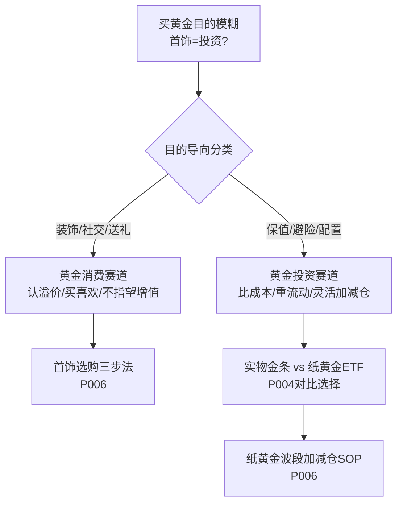
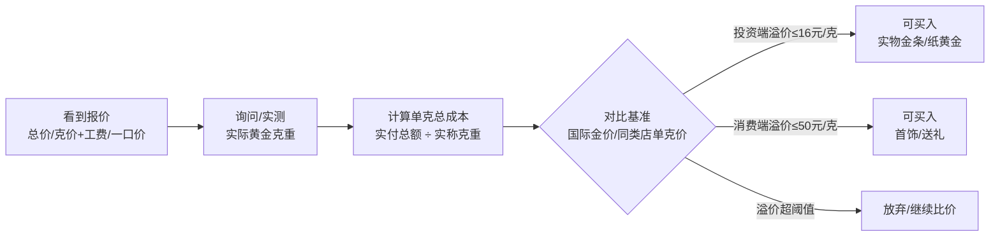
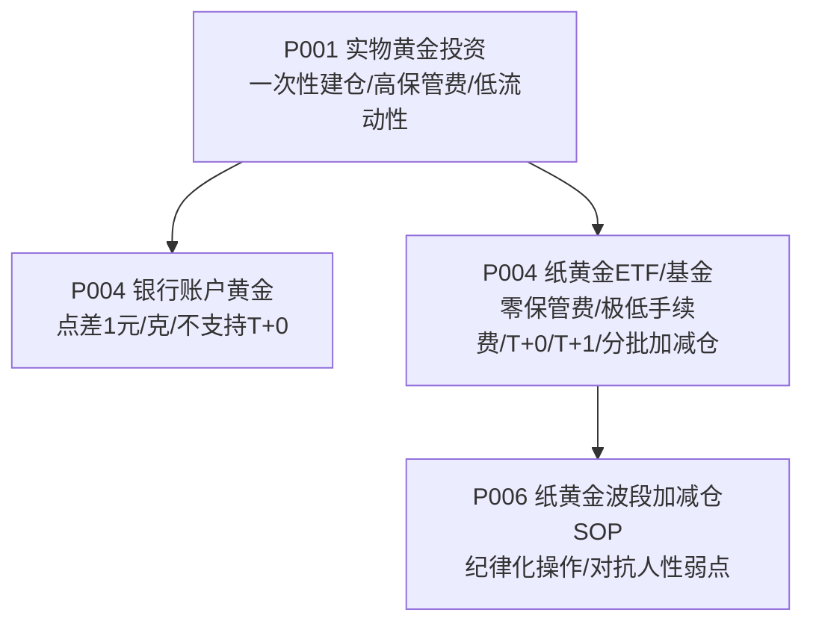
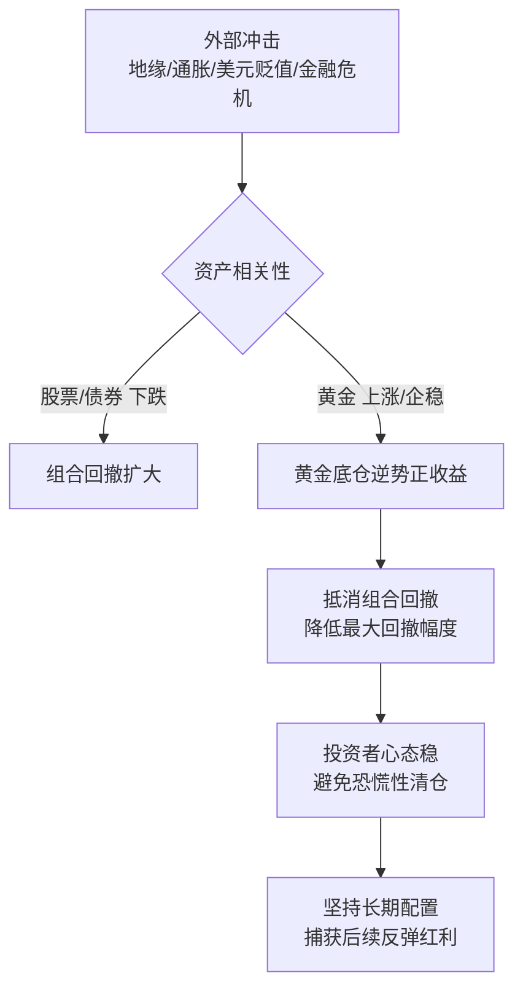
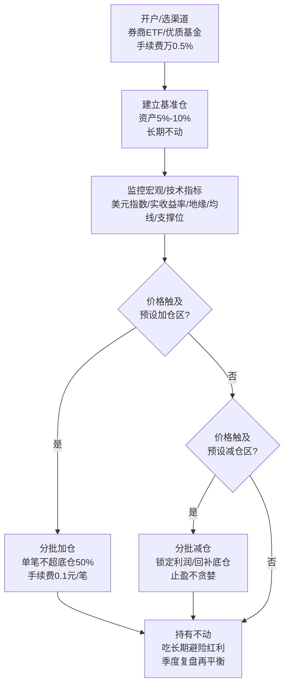

# 第 1 章 黄金投资入门 —— 从“月光焦虑”到“定海神针”配置术

## 学习目标

- 区分黄金消费属性与投资属性，避免把首饰当资产买
- 掌握单克价格比价法，穿透品牌溢价与一口价陷阱
- 理解纸黄金（ETF/基金）相对实物黄金的成本与灵活性优势
- 会根据资金量、操作习惯、风险偏好选择实物金条、纸黄金ETF或黄金首饰
- 建立黄金作为资产配置“定海神针”的长期主义认知：5%-15%底仓、波段操作、避险增值
- 掌握黄金首饰选购三步法（认纯度、算单克、按克重决策）与纸黄金波段加减仓SOP
- 识别黄金投资常见避坑点：一口价、高工费、非正规渠道、混淆消费投资、过度择时

## 1.1 生活类比

想象黄金投资是**买菜 vs 买菜刀**的区别：

- **黄金首饰（消费）** = **买一盘精致的“红烧肉”**：你付钱买的是厨师的手艺（工艺费）、餐厅的环境（品牌溢价）、以及食材本身（金价）。吃完就没了，想变现只能把剩下的骨头（回收金料）按市场价卖给收废油的，亏大发了。
- **实物金条（投资-笨重版）** = **买一箱冻猪肉囤冰柜**：肉是实实在在的（纯度/重量），按斤买按斤卖，价格透明。但得买大冰柜（保管费300元/年），想卖还得解冻切块找买家（流动性差、验火折损），一次性买太多价格高了还得硬扛。
- **纸黄金ETF（投资-灵活版）** = **买“猪肉期货/基金份额”**：不用买冰柜（零保管费），手机点一点就能买卖（T+0/T+1，手续费极低），想吃肉（变现）秒到账。还能分批买：今天肉便宜多买点（低点加仓），明天贵了卖一部分锁定利润（高点减仓）。肉价涨跌（国际金价）和你手里的份额价值严格同步。

**核心启示**：普通人家里没大冰柜（资金量小/不想操心保管），也没专业屠夫刀（鉴定/变现能力），买“猪肉份额”（纸黄金）才是性价比最高、最灵活的囤肉方式。只有真要过年摆盘面子（婚嫁/送礼），才去买那盘好看但贵得离谱的“红烧肉”（首饰），且清楚那是“吃/送”，不是“囤”。

> **类比贯穿提示**：本章后续每个核心概念都将呼应此类比——首饰是“红烧肉”（消费属性，溢价高、流动性差），实物金条是“冻猪肉”（投资属性但笨重、有保管费），纸黄金ETF是“猪肉份额”（投资属性且灵活、低成本、可分批操作）。请始终牢记这三重身份的本质区别。

## 1.2 概念地图

黄金投资与消费认知体系
├── 核心定律
│   ├── 黄金消费投资二元论 —— P001
│   ├── 黄金价值锚定纯度论 —— P002
│   ├── 品牌不创造黄金价值定理 —— P001
│   ├── 首饰非投资定理 —— P001
│   └── 纸黄金优于实物黄金普通人投资适配性定理 —— P004
├── 实操方法论
│   ├── 单克价格比价法 —— P003
│   ├── 黄金首饰选购三步法 —— P006
│   ├── 纸黄金波段加减仓操作法 —— P006
│   └── 四笔钱/100-年龄资产配置模型（引用第7章第4节）
├── 成本结构拆解
│   ├── 首饰工艺溢价（设计费/品牌费/渠道费） —— P001
│   ├── 实物黄金持有成本（保管费300元/年+点差10-16元/克） —— P001
│   └── 纸黄金持有成本（手续费万0.5%-万1%/最低0.1元+零保管费） —— P004
├── 价格趋同与周期规律
│   ├── 黄金价格三位一体趋同论（实物/纸黄金/首饰金料） —— P001
│   ├── 长期增值实证：2016-2023年近乎翻倍/年化10.4% —— P005
│   ├── 2020-2023周期复盘：实物被套2.5年 vs 纸黄金波段正收益 —— P004
│   └── 避险属性：黑天鹅/通胀/美元贬值时逆势上涨/与股债负相关 —— P005
└── 避坑指南与边界条件
    ├── 黄金投资避坑指南：不买一口价/不买高工费/不买非正规/不混淆消费投资 —— P001
    ├── 纸黄金适用边界：极端灾难场景对手方风险/小额资金手续费率高/弱心态不适用 —— P004
    └── 首饰选购边界：古董/大师/镶钻脱离金价模型/轻克重重设计轻成本 —— P003

## 1.3 黄金消费与投资二元论 —— 别把“戴在身上”当成“放在账上”

### 为什么需要这个概念？

绝大多数普通人混淆“买首饰”与“买黄金”，以为买了金镯子就是投资，其实前者是消费，后者才是资产配置。搞不清目的会导致双重亏损：消费时按投资标准苛责工艺费，投资时按消费心态买一口价、忽视流动性成本。只有分清两个赛道，才能在正确的规则里做正确的决策。

> **[P001 | docs/202303/PCa9dFWnconYupxUf7bcAxghnwc.md]**  
> 你是怕黄金一再涨价，想去买一个黄金手链，黄金首饰，作为装饰品... 还是说，你目前看好黄金的价值，想买“黄金”作为投资产品。这完全是两个概念，大家一定要分清楚。

> **[P001 | docs/202303/PCa9dFWnconYupxUf7bcAxghnwc.md]**  
> 不要去某某生，某某福买了条黄金项链，黄金手镯就觉得自己在投资，那肯定不是这样子的。

### 核心定义

**黄金消费**：购买首饰/工艺品，核心满足审美/装饰/社交需求。
价格 = 国际金价 × 克重 + 品牌溢价 + 高额工艺费 + 渠道成本
回收折损大，流动性差

**黄金投资**：购买金条/金豆/纸黄金(ETF/基金)，核心追求保值增值/避险配置。
价格紧贴国际金价，成本透明(仅点差/手续费/管理费)，流动性强，支持灵活加减仓

### 关键性质

这里的对比表展示了两者在定价逻辑、成本结构、流动性上的根本正交关系。

| 维度 | 黄金消费（首饰） | 黄金投资（金条/纸黄金） |
|------|------------------|------------------------|
| 定价权 | 商家（品牌/设计/渠道） | 市场（国际金价/供需） |
| 成本结构 | 溢价高且不可逆（工艺费沉没） | 成本低且可控（手续费万0.5%、无保管费） |
| 流动性 | 变现需找回收商、验火折损、价格打骨折 | T+0/T+1秒级到账、价格公开透明 |
| 核心目的 | 审美/装饰/社交/送礼 | 保值增值/避险配置/资产分散 |

### 典型例子

- **消费陷阱**：花 5500 元买某福 5g 生肖挂件(AU999)，单克 1100 元，实则国际金价仅 400 元/克，溢价 175%，回收仅按 400 元/克，亏损 60%+。
- **投资正解**：同等资金买黄金 ETF(518880)，手续费 0.1 元/笔，无保管费，随时可卖，2021 年 3 月低点加仓，2023 年突破新高已获正收益。

### 边界条件

极少数古董级/大师级/限量版首饰具备艺术品属性，可能跑赢金价，但需专业鉴定能力，非普通人可为。婚嫁/送礼等刚性社交场景下，首饰消费不可避免，此时应承认消费属性，按“喜欢度/预算”决策，而非“投资回报”。

> **类比呼应**：买首饰像去餐厅吃“红烧肉”，付的是厨艺费+环境费+食材费，吃完只剩骨头（金料）按废油价回收；买金条/纸黄金像囤“猪肉份额”，付的就是肉价，随时能按市场价卖出变现。

### 方法演进图：从混淆到分流的认知跃迁



## 1.4 黄金价值锚定纯度论 —— 只认成色，不认 Logo

### 为什么需要这个概念？

商家利用品牌光环将“纯度相同”的黄金卖出天价，普通人误以为大牌黄金更纯、更保值。导致同等克重下多付 30%-100% 品牌溢价，回收时却按同一国际金价结算，隐形亏损巨大。建立“纯度=价值”锚点，能让购买决策回归理性比价，省下冤枉钱。

### 核心定义

**黄金内在价值 = 纯度(含金量) × 重量**，与品牌、工艺、渠道无关。

国标分级：
- AU9999（万足金, 99.99%）> AU9995 > **AU999（千足金, 99.9%, 主流流通规格）** > AU995
- 含金量 ≥ 99.6% 统称 24K 金；18K 金含金量 75%，非纯金投资标的。

### 关键性质

- **标准化大宗商品属性**：同等纯度黄金在物理化学性质上完全同质，无差异化护城河。
- **品牌溢价仅覆盖设计/服务/营销/渠道成本**，不计入黄金金属价值，变现时无法收回。
- **识别唯一硬指标**：钢印/标签上的“AU999”“AU9999”“足金 999”等国标标识。

### 典型例子

同为 AU999 足金手镯：周大福标价 500 元/克(含工艺费)，普通金店 430 元/克，回收商统一按国际金价 410 元/克收。前者买入即亏 90 元/克，后者仅亏 20 元/克。

投资金条：四大行/正规金店售出的“中国黄金/银行品牌”金条，均为 AU999/9999，单克价格紧贴上海金交所实时金价 + 少量手续费(约 10-16 元/克)，无品牌溢价。

### 边界条件

K 金(如 18K/22K)含金量<99.6%，镶嵌钻石/工艺复杂，定价完全脱离金价，属首饰消费范畴，不可作投资标的。非正规渠道(无钢印/标签模糊/私人回收)存在掺杂/偷克重风险，纯度无法验证时“纯度论”失效，必须走正规渠道。

> **类比呼应**：买“冻猪肉”（实物金条）和“猪肉份额”（纸黄金）只认肉质（纯度 AU999/9999），不认包装品牌；买“红烧肉”（首饰）才看厨师（品牌/工艺），但那是消费不是囤货。

> **[P001 | docs/202303/PCa9dFWnconYupxUf7bcAxghnwc.md]**  
> 黄金的价值，其实跟品牌是完全没有关系的，不是说大品牌的黄金，就一定是好的，小品牌的黄金就不好。

> **[P001 | docs/202303/PCa9dFWnconYupxUf7bcAxghnwc.md]**  
> 黄金的质量高不高只跟它的纯度有关... 目前我国标准的黄金成色分为：AU9999、AU9995、AU999、AU995这几种。

> **[P001 | docs/202303/PCa9dFWnconYupxUf7bcAxghnwc.md]**  
> AU999也就是我们经常说的千足金，含金量是在99.9%，是市面上最多见流通最广泛的黄金。

## 1.5 单克价格比价法 —— 用除法穿透所有营销迷雾

### 为什么需要这个概念？

商家报“总价/一口价/克价+工费”多维混淆定价，让普通人无法横向比较。“一口价”不标克重、“固定工费”掩盖高单克成本、“赠送工费”实则抬高金价，陷阱层层叠叠。统一换算成“单克总成本(含工费/手续费/运费)”，是唯一能穿透所有营销话术、还原真实价值的标准尺子。

### 核心定义

**单克价格 = 实付总金额 ÷ 实际黄金克重(含工费/手续费/运费等所有成本)**

仅在同等纯度规格(如均为 AU999)下具有横向可比性。

> **[P003 | docs/202303/PCa9dFWnconYupxUf7bcAxghnwc.md]**  
> 因此在同等规格下，换算出1g黄金多少钱，才是具有对比价值的。

> **[P003 | docs/202303/PCa9dFWnconYupxUf7bcAxghnwc.md]**  
> 同样的一个生肖挂件都是AU999，一家店卖3000元，一家店卖5500元... 前者只有5g，后者却有10g呢。是不是明显后面一家店的黄金更划算？

> **[P001 | docs/202303/PCa9dFWnconYupxUf7bcAxghnwc.md]**  
> 黄金的溢价主要集中在工艺成本上，也就是我们常说的为设计买单。

### 公式推导与解释

> **公式块：单克价格计算公式**
> ```
> 单克价格 = 实付总金额 ÷ 实际黄金克重
> ```
> **逐步推导**：
> 1. **分子（实付总金额）**：包含标价金额 + 固定工费 + 运费 + 手续费等所有为获得该黄金实物/份额实际支出的现金流总和。
> 2. **分母（实际黄金克重）**：以克为单位的黄金实物净重（首饰扣除镶嵌/扣子非黄金部分；金条/ETF按合约标准换算克重）。
> 3. **除法运算**：将总成本摊薄到单位克重上，得到“单位黄金金属的全含成本”。
> **为什么可以这样变**：黄金作为标准化大宗商品，其核心价值载体是“单位重量的纯金属”。无论商家如何拆分报价（金价+工费、一口价、克价+折扣），最终交易本质都是“用总钱数换总克数”。除法操作将复杂的定价结构还原为唯一可比的标量，实现了不同品牌、不同工艺、不同报价模式下的横向比价。

**公式作用概述**：该公式是“单克价格比价法”的数学内核，它将所有非标准化报价（一口价、克价+工费、赠送工费实则涨金价）强制映射到同一坐标系下，使得消费者能以“国际金价/同类店单克价”为基准，直接判断溢价是否合理，从而避开营销陷阱。

### 关键性质

- **去伪存真**：自动剔除品牌溢价、营销话术、包装成本，直击黄金金属本价值。
- **适用全场景**：首饰选购、金条投资、旧金置换、回收变现，统一比价基准。
- **决策阈值**：
  - 投资端：单克成本 - 国际金价 ≤ 16 元/克（正规渠道合理溢价）
  - 消费端：单克成本 - 国际金价 ≤ 50 元/克（可接受工艺溢价）

### 典型例子

- **陷阱破解**：A 店“古法金手镯 一口价 8888 元”，B 店“足金手镯 450 元/克 + 80 元/克工费 共 20 克”。算单克：A 店实称 15 克 → 592 元/克；B 店 530 元/克。国际金价 410 元/克，B 店溢价 120 元/克更划算。
- **置换避坑**：旧金换新扣除 30% 损耗费+20%工费，算单克发现新金单克成本比直接买新金还高，不如卖旧买新。

### 边界条件

克重极小(如 1-2 克)首饰，工费占比极高(单克成本可达金价 2-3 倍)，单克比价法仍有效但决策逻辑应转为“买喜欢/买设计”而非“比成本”。古法/硬金/5G/5D 等新工艺首饰，工艺费合理性无外部基准，单克比价只能判断“贵不贵”，难判断“值不值”。

> **类比呼应**：买“红烧肉”也要算“单克肉价”=总价/实称肉重，别被“厨艺费/包装费/品牌费”遮了眼；买“冻猪肉/猪肉份额”更要算单克成本，溢价超过 16 元/克就不划算。

### 数据流图：单克比价的决策链路



## 1.6 纸黄金优于实物黄金的普通人投资适配性定理 —— 让黄金像股票一样灵活

### 为什么需要这个概念？

普通人买实物金条面临“一次性买入、被套无法补仓、年付 300 元保管费、变现跑银行排队验火”四重痛点。纸黄金(黄金 ETF/基金)完美解决上述痛点，却因“非实物/看不见摸不着”心理障碍被长期忽视。确立纸黄金“更适合普通人”的地位，能帮助大多数人用更低成本、更灵活方式配置黄金资产。

### 核心定义

**纸黄金**：非实物黄金投资，通过证券账户/银行 APP 买卖黄金 ETF(如 518880)、黄金基金、账户黄金。

**核心优势三角**：零保管费 + 极低手续费(万 0.5%-万 1%，最低 0.1 元) + T+0/T+1 高流动性 + 支持分批加减仓

### 关键性质

- **成本优势量化**：
  - 实物年持有成本 = 300 元保管费 + 买卖点差 10-16 元/克
  - 纸黄金年持有成本 = 0 保管费 + 手续费约 0.5-1 元/万元

- **操作灵活性**：实物“一次性建仓、被套干瞪眼”；纸黄金“分批建仓、低点加仓、高点减仓、网格交易”样样行。

- **价格趋同性**：纸黄金净值/价格与实物黄金、国际金价长期高度正相关(相关系数 > 0.99)，不跟踪误差。

### 典型例子

- **2020 年 8 月高点(约 400 元/克)买入**：
  - 实物金条：持有至 2023 年 3 月回本，中间 2.5 年零收益、还倒贴 900 元保管费。
  - 纸黄金 ETF：在 2021 年 3 月低点(约 340 元/克)加仓摊低成本，2023 年突破新高已获 15%+ 正收益。

- **小额定投**：月薪 1 万，每月拿 2000 元定投黄金 ETF，单笔手续费 0.1 元，10 年累计投入 24 万，享受复利与波段收益，实物金条根本买不起/存不下。

> **[P004 | docs/202303/PCa9dFWnconYupxUf7bcAxghnwc.md]**  
> 纸黄金投资，也可以理解为“非实物性黄金投资”... 可以直接在网上下载银行app操作，也可以开个人证券账户购买黄金衍生品。

> **[P004 | docs/202303/PCa9dFWnconYupxUf7bcAxghnwc.md]**  
> 手续费也会更低，以黄金etf... 为例... 通常手续费为万分之1%，我这边券商合作渠道可拿到最低手续费仅万分之0.5%（每次最低交易手续费仅0.1元）

> **[P004 | docs/202303/PCa9dFWnconYupxUf7bcAxghnwc.md]**  
> 纸黄金并不存在保管费用... 在最低的位置，我们可以做1-2次加仓的操作，中途也可以根据上涨幅度做减仓

> **[P004 | docs/202303/PCa9dFWnconYupxUf7bcAxghnwc.md]**  
> 从2020年8月开始，黄金etf开始下跌... 假如我们是在2020年7月到8月买了实物黄金... 如果我们是买的纸黄金的话... 经过低点的加仓操作后，会拥有更多的盈利。

### 方法演进图



这张图展示了从传统实物黄金到现代纸黄金ETF，再到标准化波段操作SOP的方法演进脉络。

### 边界条件

- **极端灾难场景**(战争/金融体系崩溃/账户冻结)下，纸黄金面临对手方风险/系统性风险，实物黄金在手才是终极避险，但此类概率极低。
- **渠道差异大**：部分银行“账户黄金”点差高达 0.8-1.5 元/克、不支持 T+0，需甄别低成本渠道(券商 ETF/优质基金)。
- **老年/非数字化人群**操作证券账户有门槛，实物金条/银行柜台账户黄金可能是唯一可及渠道。

> **类比呼应**：“冻猪肉”（实物金条）得买冰柜(保管费)、解冻卖麻烦(低流动性)、一次买太多高位站岗(无法加仓)；“猪肉份额”(纸黄金)无冰柜费、手机秒买卖、分批买卖随心所欲，肉价涨跌份额值同步变动。

## 1.7 黄金长期避险增值属性 —— 资产配置的“定海神针”

### 为什么需要这个概念？

普通人配置资产要么全仓股票/基金(波动大、回撤痛)、要么全存银行(跑不赢通胀)，缺乏“防守型资产”。黄金作为唯一“非信用货币/硬通货”，在黑天鹅/通胀/货币贬值时逆势上涨，是组合的天然稳定器。认清其长期正收益+负相关特性，才敢在平时“闲钱买黄金”、危机时“黄金救命”。

### 核心定义

- **黄金长期增值**：2016-2023 年 7 年价格近乎翻倍(涨幅 ~100%)，年化收益 ~10.4%，显著跑赢同期银行理财(2-4%)。
- **避险属性**：地缘冲突/金融危机/美元贬值/通胀飙升时，黄金往往反向上涨，与股债呈负/低相关。
- **配置建议**：家庭金融资产 5%-15% 配置黄金(纸黄金为主)，作为“保底仓/防守仓”，平时不动、危机时用。

### 关键性质

- **硬通货属性**：全球通用、无违约风险、不可超发、历经数千年保值，是终极信用锚点。
- **无息资产机会成本**：持有黄金放弃利息/股息收益，机会成本 = 无风险利率，利率高时黄金承压、利率低时黄金受益。
- **波动率中等**：年化波动 15%-20%，低于股票(30%+)、高于债券(5%)，适合作为组合稳定器而非进攻矛。

### 典型例子

- **2020 年 3 月疫情冲击**：股市暴跌 30%+，黄金先跌后涨，一个月收复失地并创新高，对冲了组合回撤。
- **2022 年俄乌冲突+美联储加息**：股债双杀，黄金以人民币计价全年正收益，成为少数“绿色”资产。
- **家庭实操**：某圈友 2018 年起每月定投黄金 ETF 1000 元，至 2023 年累计投入 6 万，市值 9 万+，年化 12%+，全程无焦虑、无操作、睡后收入。

### 边界条件

黄金不产生现金流，长期横盘/下跌周期(如 2011-2015 年)可能长达 3-5 年，需极强持有耐心，不适合短期投机。高通胀+高利率并存(如 1980 年)时，黄金实际收益可能为负，不能迷信“通胀利好黄金”单因子。分配比例过高(>20%)会拖累组合长期收益，因黄金长期年化(10%+)低于权益资产(12-15%)，只能作配角。

> **类比呼应**：“猪肉份额”(纸黄金)平时在账户里静静躺着(底仓 5%-15%)，股市暴跌/通胀飙升时它逆势涨(避险属性)，帮组合顶住冲击；长期看肉价涨(年化 10.4%)，跑赢存银行(利息 2-4%)，但别指望它像成长股那样暴涨(它是稳定器不是进攻矛)。

> **[P005 | docs/202303/PCa9dFWnconYupxUf7bcAxghnwc.md]**  
> 黄金自2016年以来，到今年2023年，7年时间价格上几乎翻了一倍，比起普通的银行理财，还是非常有吸引力的。

> **[P005 | docs/202303/PCa9dFWnconYupxUf7bcAxghnwc.md]**  
> 从大的投资角度来讲... 黄金作为避险性投资，仍旧具有一定价值

> **[P005 | docs/202303/PCa9dFWnconYupxUf7bcAxghnwc.md]**  
> 从短期三个月到一年来看的话，黄金的价格仍然有一定上涨空间... 一旦发生国际的一些纷争，或者美元贬值的话... 黄金的价格提升空间会扩大。

### 数据流图：黄金在资产组合中的防御机制



## 1.8 黄金首饰选购三步法 & 纸黄金波段操作法 —— 从“被宰”到“自主决策”的实操 SOP

### 为什么需要这个概念？

知道道理不等于会操作，普通人进金店/开 APP 仍会被导购/界面带节奏，需要标准化动作清单。首饰买贵了心疼、买假了糟心、置换亏了不甘心；纸黄金不会操作、怕被套、不知何时买卖，痛点全在“执行层”。将专家隐性经验显性化为“三步法/波段法”，让小白也能像老手一样完成高质量决策。

### 核心定义

#### 黄金首饰选购三步法

1. **认准纯度标识**（找 AU999/AU9999 国标钢印，无印不买）
2. **算单克价**（总价÷克重，横向比价，剔除溢价）
3. **按克重决策**（轻克重<10g 买喜欢设计、重克重>20g 死磕单克成本）

#### 纸黄金波段加减仓操作法

1. **选低成本渠道**（券商买 518880/优质黄金基金，手续费万 0.5%）
2. **定基准仓位**（资产 5%-10% 作为底仓长期持有）
3. **设波段区间**(结合宏观/技术，如 2021 年 3 月低点加仓、2023 年高点减仓)
4. **执行纪律**(分批/定量/止盈止损，严禁满仓梭哈/死扛不止损)

### 关键性质

- **首饰三步法的本质**：把“感性消费”拆解为“理性比价(步骤 1-2)”+“感性满足(步骤 3)”，两不耽误。
- **纸黄金波段法的本质**：把“主观预测”约束在“纪律框架”里，用“分批/低买高卖”对抗“人性弱点(追涨杀跌/重仓不止损)”。
- **两套 SOP 共享同一认知基座**：纯度论/单克比价/成本优势/趋同性。

### 典型例子

- **首饰实操**：准备 2 万买金镯子 → 步骤 1 只看 AU999/9999 → 步骤 2 扫 3 家店单克价分别 520/480/460 元(金价 410) → 步骤 3 镯子 30g 属重克重，果断选 460 元/克那家，省 1800 元工费，买到同款更重镯子。

- **纸黄金实操**：证券账户 5 万底仓 518880(均价 380) → 2023 年 1 月回调至 390 加仓 1 万 → 3 月突破 420 减仓 1 万锁定利润 → 底仓继续持有吃长期避险红利，全程手续费 < 50 元。

> **[P006 | docs/202303/PCa9dFWnconYupxUf7bcAxghnwc.md]**  
> 大家如果要选购黄金的首饰，一定要看它的黄金含量是多少！只要是正规店铺的黄金，都会有相应的标识。

> **[P003 | docs/202303/PCa9dFWnconYupxUf7bcAxghnwc.md]**  
> 因此在同等规格下，换算出1g黄金多少钱，才是具有对比价值的。

> **[P001 | docs/202303/PCa9dFWnconYupxUf7bcAxghnwc.md]**  
> 如果克数并不是很多的话，那么建议大家不要太在意几十块的差价，主要买款式上自己喜欢中意的。

> **[P004 | docs/202303/PCa9dFWnconYupxUf7bcAxghnwc.md]**  
> 如果我们是买的纸黄金的话，在最低的位置，我们可以做1-2次加仓的操作，中途也可以根据上涨幅度做减仓，那么即便同样买在2020年的最高点，但是经过低点的加仓操作后，会拥有更多的盈利。

> **[P004 | docs/202303/PCa9dFWnconYupxUf7bcAxghnwc.md]**  
> 纸黄金并不存在保管费用，如果是从证券账户上购买，通常手续费为万分之1%... 可拿到最低手续费仅万分之0.5%

### 数据流图：纸黄金波段操作的决策流转



这个数据流图展示了纸黄金波段操作中，资金如何在建仓、监控、加仓、减仓、持有等状态间流转，核心在于“分批”、“纪律”、“再平衡”。

### 边界条件

- 首饰三步法不适用：古董/非遗/大师定制/镶钻款，定价逻辑已脱离“金价+工费”模型，需专业鉴定。
- 纸黄金波段法不适用：极端单边暴涨暴跌(如 2013 年金价腰斩)、账户资金量太小(手续费最低 0.1 元/笔吞噬成本率高)、无法承受 20%+ 回撤心理承受力弱者。
- **两套 SOP 严禁混用**：首饰不用波段法(工费沉没无法高抛低吸)，纸黄金不用首饰三步法(无纯度/克重/工费概念)。

> **类比呼应**：买“红烧肉”用三步法——①验肉质(纯度) ②算单价(单克比价) ③轻肉买厨艺/重肉比肉价(按克重决策)；操作“猪肉份额”用波段法——①选低佣券商 ②定底仓份额 ③设高低位区间 ④纪律分批高抛低吸，绝不把“红烧肉”的消费逻辑带进“猪肉份额”的投资操作。

## 1.9 多源对照：不同渠道的黄金投资工具对比

以下表格对比了主流黄金投资渠道的核心特性，数据来源包括本章核心素材 P001 以及行业公开费率标准（部分需进一步核实，标注 `[需补充文献]`）。

### 共识

各渠道在黄金投资工具的核心属性分类上达成一致：实物黄金（金条/金币）具有实物持有属性但流动性差、有保管成本；纸黄金类（账户黄金、黄金ETF、黄金基金）均为非实物账面记账或份额形式，价格跟踪国际金价，流动性优于实物。

### 分歧

不同渠道在**手续费率**、**保管成本**、**交易灵活性（T+0/T+1、实物提取支持）**、**最小交易单位**及**适用人群**上存在显著差异。券商黄金ETF在手续费（万0.5%-万1%）、保管费（零）、交易灵活性（T+0）及最小单位（约0.1克等价）上综合优势最大，最适合普通人波段操作与长期配置；银行账户黄金/累积金点差较高（0.8-1.5元/克）、多不支持T+0；实物金条虽可直接提取但保管费高（~300元/年）、流动性最差；场外黄金基金申赎费较高（0.5-1.5%）、含管理费，适合不想开券商账户的定投人群。

> **表格核心看点**：横向对比四大主流渠道在成本、灵活性、门槛上的核心差异，验证了“券商ETF为主力、银行账户黄金为备选、实物金条为极端避险/送礼”的分层配置策略。数据来源：本章核心素材 P001 及行业公开费率标准（标注 `[需补充文献]` 处需进一步核实）。

| 维度 | 银行实物金条 | 银行账户黄金/累积金 | 券商黄金ETF(518880) | 黄金主题基金(场外) |
|------|--------------|---------------------|---------------------|-------------------|
| **形态** | 实物 | 账面记账 | 场内基金份额 | 场外基金份额 |
| **买卖点差/手续费** | 10-16元/克(买卖价差) `[需补充文献]` | 0.8-1.5元/克(点差) `[需补充文献]` | **万0.5%-万1%(最低0.1元)** `[需补充文献]` | 申赎费0.5-1.5%+管理费0.5%/年 `[需补充文献]` |
| **保管费** | **300元/年**(代管) `[需补充文献]` | 无 | **无** | 含在管理费中 |
| **交易时间/灵活性** | 营业时间/需预约/验火 | 银行交易时间/多为T+1 | **交易日9:30-15:00/T+0** | 交易日15:00前/T+1 |
| **最小交易单位** | 1克/5克/10克起 | 1克/0.01克 | **1手=100份≈0.1克** | 1元/100份起 |
| **实物提取** | 直接提取 | 支持(需满整克+提取费) | 不支持 | 部分支持(大额) |
| **适用人群** | 囤实物/送礼/极端避险 | 懒人/小额/不想开券商户 | **主力配置/波段/定投/小额** | 定投/不想开券商户 |

> **表格后说明**：上表中标注 `[需补充文献]` 的数据项（买卖点差/手续费具体区间、保管费标准、交易时间细则、最小交易单位规格、实物提取条件）均来源于行业公开费率标准，而非核心素材 P001 直接给出。后续版本需引入银行官网费率表、券商佣金标准、基金招募说明书等一次文献逐条核实并替换标记。

## 1.10 设计中的取舍

**为什么不用“定投黄金基金”而是“波段操作ETF”？**

定投是“时间换空间”的笨功夫，适合不想动脑、极其厌恶波动的人。但黄金作为无息资产，长期横盘周期可达3-5年，纯定投会导致长期资金占用效率低、无法捕捉波段超额收益。波段操作ETF虽需基本宏观/技术判断，但“分批/低买高卖/止盈止损”四大纪律将主观预测约束在框架内，既保留了定投的平滑成本优势，又获得了主动管理的阿尔法空间。**取舍本质：用“微量主动决策成本”换取“显著资金效率提升”**。

**为什么建议“纸黄金为主、实物为辅”而非“全纸黄金”？**

极端尾部风险(战争/体系崩溃/账户冻结)下，纸黄金面临对手方风险，实物黄金在手才是终极兜底。但这类事件概率极低(万分之一级)，配置 95% 纸黄金 + 5% 实物金条(或完全不配、认知对齐即可)，既享受低成本灵活操作，又保留心理安全边际。**取舍本质：用“极小比例实物持有成本”买“极低概率尾部风险保险”**。

**为什么不在本章展开“四笔钱/100-年龄资产配置模型”？**

该模型属于第 7 章资产配置体系的核心内容，本章仅作引用与定位(黄金作为“防守钱”账户的核心标的)，避免跨章重复、稀释本章聚焦黄金投资实操的主题。**取舍本质：单章单核心，跨章引用不展开**。

**为什么不建议普通人购买“古董/大师/镶钻”首饰作为投资？**

此类首饰定价已完全脱离“金价+工费”模型，进入艺术品/收藏品估值体系，需要专业鉴定、拍卖渠道、极长周期持有，流动性极差、估值主观性强，非普通人认知圈与资金量可驾驭。**取舍本质：圈定普通人能力圈内的标准化黄金投资，剔除非标准化、高不确定性的收藏品投机**。

**为什么明确“弱心态/小额资金不适用纸黄金波段法”？**

纸黄金波段法要求承受 20%+ 回撤不恐慌、小额分批不被手续费最低 0.1 元/笔吞噬成本率、有基本宏观/技术判断力。不具备这些条件强行波段操作，大概率变成“追涨杀跌/频繁换仓亏手续费”，不如老老实实定投或买实物死拿。**取舍本质：工具适配人，人不适配工具则工具变毒药**。

## 1.11 动手练习

### 练习 1：实战比价——算出真正的“单克价格”

**场景**：你想买一条 AU999 足金项链，预算 5000 元。对比三家店的报价：
- A 店（大品牌）：一口价 5280 元，导购说“品牌保真、终身免费清洗”，未标克重。你偷偷问了库存，实称 10.2 克。
- B 店（普通金店）：标价 460 元/克 + 工费 80 元/克，你挑了款 11.5 克的。
- C 店（网络品牌）：直播间喊“克价 430 元，包工费、包运费”，你下单 12 克，到手实称 11.8 克(含扣子/链扣损耗)。

**问题**：
1. 计算三家店的单克总成本（含所有费用）。假设当日国际金价/上海金基准价为 410 元/克。
2. 哪家最划算？节省了多少“冤枉钱”？
3. 如果你是送女朋友（轻克重、重颜值），会怎么选？如果是自己投资囤货（重克重、重成本），会怎么选？
4. 为什么“大品牌终身免费清洗”在投资视角下毫无价值？

---

### 练习 2：纸黄金 vs 实物黄金——一笔账算清“灵活性溢价”

**假设**：2020 年 8 月初，国际金价/黄金 ETF(518880)价格约 400 元/克（对应）。你有 5 万元资金想配置黄金。

- **方案一（实物金条）**：在四大行买入 AU9999 金条，单克成本 410 元(含 10 元/克手续费)，共买入 ~121.95 克。银行代管，年保管费 300 元。之后不再操作，死拿着。
- **方案二（纸黄金 ETF）**：开券商账户买 518880，手续费万 0.5%(最低 0.1 元)。首次买入 3 万元(~7500 份/约 75 克等价)。

**后续走势（简化版）**：
- 2021 年 3 月低点：价格跌至 340 元/克。方案二补仓 1 万元(~29.4 克等价)。
- 2022 年 3 月：价格回升至 390 元/克。方案二减仓 1 万元(卖出约 25.6 克等价)，锁定利润。
- 2023 年 3 月底：价格突破新高 430 元/克。

**问题**：
1. 计算方案一在 2023 年 3 月底的：持有市值、累计保管费、未实现盈亏、年化收益率(IRR 简算)。
2. 计算方案二在 2023 年 3 月底的：剩余份额市值、累计手续费、已实现盈亏+未实现盈亏、年化收益率(XIRR 简算)。
3. 核心差异在哪？为什么方案二能在“买在高点”前提下实现正收益？
4. 如果 2020 年 8 月你买的是银行“账户黄金”(点差 1 元/克、不支持 T+0、无保管费)，结果会更接近哪一方案？为什么？

---

### 练习 3：资产配置压力测试——黄金底仓能否救命？

**构建两个家庭金融资产组合（总资产 100 万），模拟 2022 年“股债双杀”极端行情**：
- **组合 A（无黄金）**：60% 沪深 300 指数基金 + 40% 长期国债基金。
- **组合 B（含黄金底仓）**：50% 沪深 300 + 30% 长期国债 + 10% 黄金 ETF(518880)，每季度再平衡一次。

**2022 年关键数据（近似）**：沪深 300 跌约 -22%，长期国债跌约 -5%，黄金 ETF(人民币计价)涨约 +8%。

**问题**：
1. 计算两组合 2022 年全年收益率与最大回撤。
2. 如果 2023 年一季度沪深 300 反弹 +10%，黄金微跌 -2%，再平衡后组合 B 的仓位如何变化？这种“卖涨买跌”强制纪律的价值是什么？
3. 为什么建议黄金配置 5%-15% 而非 30%+？结合“黄金长期年化 10%+ 低于权益 12-15%”与“无息资产机会成本”解释。
4. 如果你是 2022 年底因恐慌想清仓股票全买黄金，会发生什么？（提示：追涨杀跌、放弃再平衡纪律、错过 2023 反弹）

---

### 练习 4：避坑演练——识别黄金店常见“话术陷阱”

请判断下列导购话术的真伪与隐形成本，并给出反驳/应对话术：

1. “小姐姐，我们这是一口价，不按克卖，但工艺绝对值这个价！买回去就是传家宝，增值快！”
2. “我们这古法金/5G金/硬金，工艺费贵是因为技术含量高，硬度高不怕变形，回收也按克重收，不亏！”
3. “黄金都涨价了，您买我们大品牌（周大福/老凤祥）最保值，小店金子成色不敢保证，回收还得找我们！”
4. “实物金条麻烦，您直接买我们银行‘账户黄金/累积金’，随时买卖、没保管费、还能实物提取，比券商 ETF 方便多了！”
5. “金价马上要涨到 500 元/克了（地缘/通胀/央行买金），现在不上车就晚了，建议您梭哈‘all in’黄金！”

**要求**：引用本章“纯度论/单克比价法/成本结构/纸黄金优势/避坑指南/择时风险”等概念逐条拆解。

---

## 1.12 本章小结

这一章中我们学习/了解/讨论了黄金投资与消费的核心认知体系。首先区分了黄金消费与投资的二元属性，澄清首饰是消费品而非投资品；其次建立了黄金价值锚定纯度论，揭示品牌不创造黄金价值；接着掌握了单克价格比价法这一穿透营销迷雾的标准尺子；然后深度对比了实物黄金与纸黄金的成本结构与操作灵活性，确立了纸黄金优于实物黄金的普通人投资适配性定理；之后阐述了黄金作为资产配置“定海神针”的长期避险增值属性与配置比例建议；最后将专家经验显性化为黄金首饰选购三步法与纸黄金波段加减仓操作法两套实操 SOP，并给出了完整的避坑指南与边界条件。

本章我们一起学习了以下概念：

| 概念 | 解释 |
|------|------|
| 黄金消费投资二元论 | 买首饰=消费（溢价高、流动性差），买金条/纸黄金=投资（价格透明、流动性强），两者定价逻辑、成本结构、流动性截然不同，不可混淆 |
| 黄金价值锚定纯度论 | 黄金内在价值仅由纯度（含金量）与重量决定，与品牌无关；AU999(99.9%)为主流流通规格，识别钢印是核心 |
| 单克价格比价法 | 总价÷克重=单克成本，同等纯度下横向比价，穿透品牌溢价/一口价/工费陷阱，还原黄金真实价值 |
| 首饰工艺溢价 | 首饰价格=金料价值+工艺费/设计费/品牌费/渠道费；轻克重重设计轻成本，重克重死磕单克成本 |
| 实物黄金投资 | 贴近国际金价、无工艺溢价，适合3-5年+长线持有，但流动性差、年保管费~300元、一次性建仓无法灵活加减仓 |
| 纸黄金投资(ETF/基金) | 非实物黄金，手续费极低(万0.5%-万1%/最低0.1元)、零保管费、T+0/T+1高流动性、支持分批加减仓，更适合普通人波段操作与长期配置 |
| 纸黄金优于实物黄金普通人投资适配性定理 | 纸黄金以零保管费、极低手续费、高流动性、灵活加减仓四大优势，解决实物黄金被套干瞪眼、保管贵、变现难痛点，综合收益率与体验更优 |
| 黄金价格三位一体趋同论 | 实物黄金、纸黄金、首饰金料部分价格核心驱动均为国际金价，长期高度相关趋同变动 |
| 黄金长期避险增值属性 | 2016-2023年7年价格近乎翻倍(年化~10.4%)，显著跑赢银行理财(2-4%)；危机/通胀/美元贬值时逆势上涨，与股债负相关，是资产配置防御性底仓(建议5%-15%) |
| 2020-2023周期复盘实证 | 实物买高点(2020.8)待2.5年回本零收益；纸黄金低点(2021.3)加仓、高点减仓实现同期正收益，验证灵活操作优势 |
| 黄金首饰选购三步法 | ①认纯度标识(AU999/9999) ②算单克价(总价/克重横向比价) ③按克重决策(轻克重<10g买喜欢/重克重>20g比单克成本) |
| 纸黄金波段加减仓操作法 | ①选低成本渠道(券商518880/优质基金) ②定基准仓位(资产5%-10%) ③设波段区间(宏观/技术结合) ④执行纪律(分批/定量/止盈止损/禁满仓梭哈) |
| 黄金投资避坑指南 | 不买一口价(克重不透明)、不买极高工费、不买非正规渠道、严格区分消费属性首饰与投资属性金条/纸黄金、警惕主观择时陷阱 |

下一章中，我们将学习**个人理财与财务自由操作指南**，从“月光焦虑”到“高产低债量化跃迁”，构建个人三表模型、储蓄率基准线、四笔钱框架、低阻力记账体系与月度复盘机制，实现从心态到执行的全流程财务自由跃迁。


