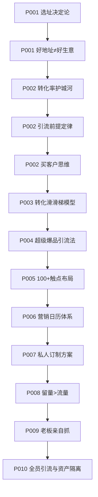
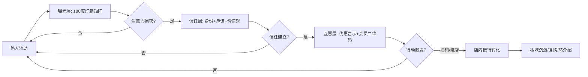
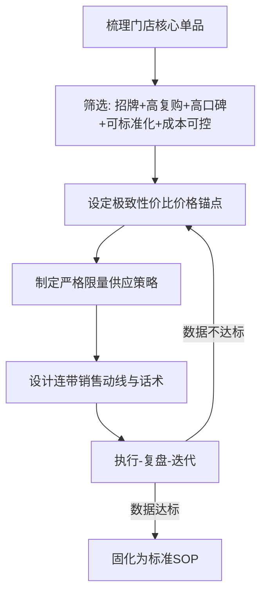
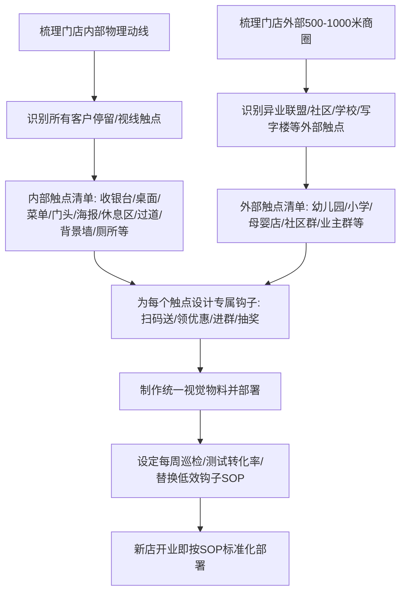
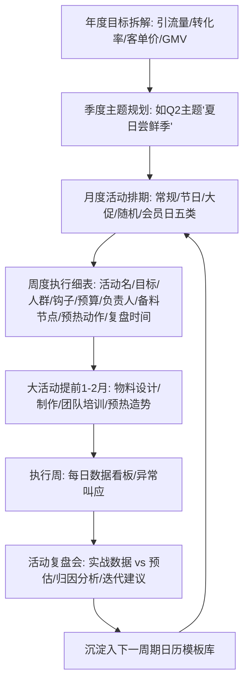
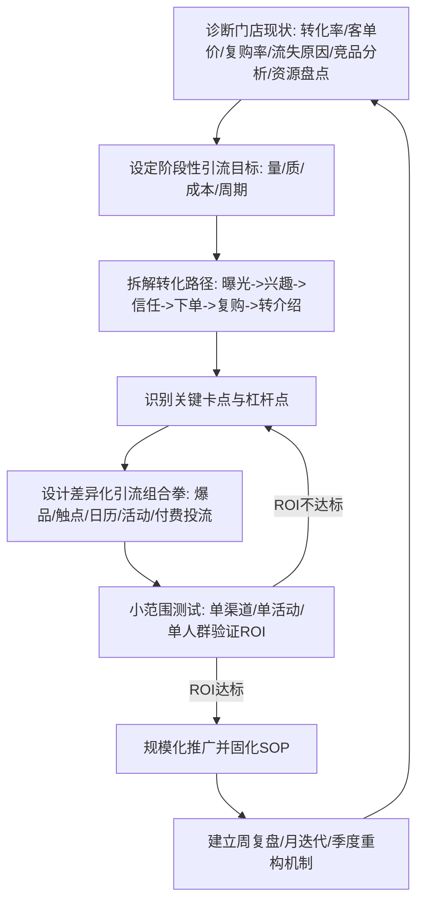
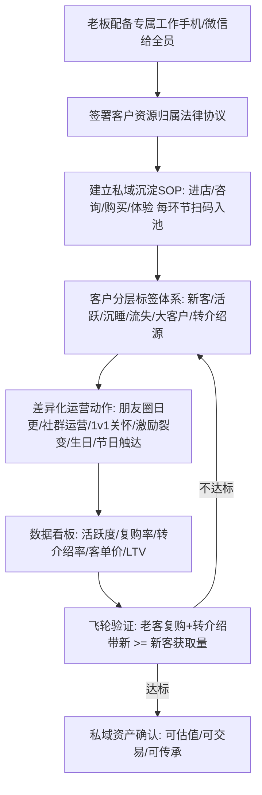
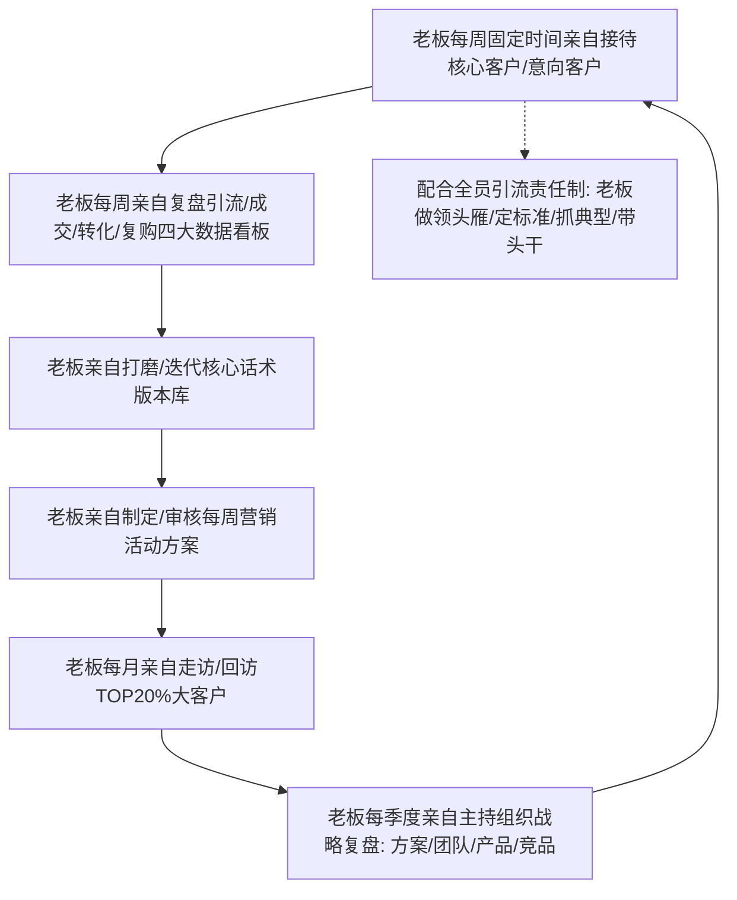

# 第 50 章 实体门店与同城服务 —— 选址、转化、信任、爆品、私域留量

## 学习目标

- 理解实体门店选址与转化的本质区别，掌握'选址只是入场券，转化才是赢利点'的核心认知
- 掌握'买客户思维'与付费引流ROI核算方法，建立可量化、可规模化的获客投资体系
- 掌握'转化滑滑梯模型'三步法（曝光-信任-下单）的门头系统化设计与物理空间布局技巧
- 掌握超级爆品引流法、引流触点布局（100+钩子）、营销日历体系化运营等标准化引流动作库
- 理解'留量大于流量'的私域资产沉淀逻辑，掌握全员引流责任制与私域资产物理/法律双重隔离机制
- 确立老板亲自抓引流成交的核心原则，建立私人订制引流方案而非盲目跟风的决策能力

## 50.1 生活类比

想象实体门店经营是一场**精心设计的「相亲大会」**：**选址** = 选了个黄金地段的高档餐厅（入场券）；**门头/灯箱** = 你精心打扮的形象、自信的眼神、得体的开场白（抢夺注意力/曝光）；**信任显性化（身份/承诺/价值观）** = 你亮出的真实学历、工作证明、过往信用记录、价值观宣言（建立信任/降低决策成本）；**超级爆品** = 你拿得出手的绝技/特长/独家资源（精准筛选同频对象）；**互惠促单（优惠/会员/钩子）** = 你主动请客、送小礼物、提出下次约会的具体建议（触发行动/成交）；**私域留量** = 你们建立的专属微信联系、共同朋友圈、相互了解的深度（长期关系资产/复购转介绍）；**老板亲自抓** = 你自己去相亲，而不是雇个中介替你谈恋爱（核心环节不可外包）；**全员引流** = 你的父母、朋友、同事都在帮你物色对象（组织全员获客）。就像相亲不能光靠「选好餐厅」（选址），更不能雇人替你谈（甩手掌柜），必须自己精心打扮（门头）、真诚展示（信任）、主动表达（互惠）、经营关系（私域），才能修成正果。

## 50.2 概念地图

实体门店与同城服务增长体系
├── 核心认知重构
│   ├── 选址只是入场券，转化才是赢利点  —— P001
│   ├── 引流前提定律：无转化，不引流  —— P001,P002
│   ├── 付费引流最优定律：买客户思维  —— P002
│   ├── 爆品即最佳引流品定律  —— P004
│   ├── 方案私人订制定律  —— P007
│   ├── 私域留量资产定律  —— P008
│   └── 老板亲自抓引流成交原则  —— P009
├── 转化体系构建
│   ├── 转化滑滑梯模型：曝光-信任-下单  —— P003
│   ├── 转化首因律：注意力抢夺成本核算  —— P003
│   ├── 信任显性化定律：信任要写在门头上  —— P003
│   ├── 互惠触发原则：双轨促单设计  —— P003
│   ├── 存量位置增值论：好门头运营>好位置  —— P003
│   └── 转化率护城河：高转化倒逼全链路升级  —— P002
├── 引流动作标准库
│   ├── 超级爆品引流法：限量极致性价比  —— P004
│   ├── 引流触点布局：里里外外100+条鱼竿  —— P005
│   ├── 营销日历体系：年/季/月/周四级节奏  —— P006
│   ├── 单一目标活动设计法  —— P006
│   └── 同城相亲四类账号矩阵流量模型  —— P002(apply)
├── 私域资产经营
│   ├── 留量>流量：老客复购/转介绍飞轮  —— P008
│   ├── 全员引流责任制：绩效挂钩引流指标  —— P010
│   ├── 私域资产归属隔离：专属手机+法律协议  —— P010
│   ├── 微信生态私域交付体系：小助手分流+红娘深度  —— P002(apply)
│   └── 资料授权机制：征得同意再给微信  —— P002(apply)
├── 组织与执行保障
│   ├── 老板亲自掌舵：时刻干离钱最近的事  —— P009
│   ├── 疫情期组织韧性重构：高情商/流程化/远程协作  —— P002(apply)
│   ├── 产品极简主义：砍产品线即砍隐性成本  —— P002(apply)
│   └── 高情商红娘服务壁垒：不可标准化的深度交付  —— P002(apply)
└── 差异化增值拓展
├── 高净值男性形象改造蓝海  —— P002(apply)
├── 朋友圈四季素材库打造  —— P002(apply)
└── 付费流量降维打击：毛利率决定投流上限  —— P002(apply)

## 50.3 选址只是入场券，转化才是赢利点 —— 别让好位置变成摆设

### 为什么需要这个概念？

许多老板误以为选好位置（好地址）就等于生意好，实则位置只解决“被看见”的概率，不解决“被购买”的必然性。

作者亲历双重惨痛教训：一亏选址选错无流量，二亏选址选对却无人进店，证明选址与经营是两套独立能力体系。

只有搞定“进店率”和“转化率”，好位置才能变现，否则重金买下的好铺位就是高昂的摆设。

### 核心定义

**选址只是入场券，转化才是赢利点**（来源：《P001》）

> "我自己就曾经吃了两大亏：一亏选址选错了，哭；二亏选址选好了，但客户愣是不进店，再哭。"
> 
> ——《docs/202303/20230328_153.md》

这个定律揭示了门店经营的两套独立体系：**选址体系**解决流量入口概率问题，**运营体系**解决流量转化确定性问题。门店转化闭环为：路人曝光 → 激发兴趣 → 转化信任 → 立刻下单，缺一不可。

### 关键性质

**转化率是核心杠杆**（来源：《P002》）

高转化率能倒逼产品、服务、团队全链路升级，形成降维打击竞争壁垒。

> "我认为，门店与门店之间真正拼的是：转化和成交的能力！"
> 
> ——《docs/202303/20230328_154.md》

**引流前提定律：无转化，不引流**（来源：《P001,P002》）

转化率未达标盲目引流等同于放大亏损。

> "如果你的转化率做的很差劲，那么你多拼命去引流都无济于事，甚至你会进入一个怪区，引流越狠，亏损越狠。"
> 
> ——《docs/202303/20230328_154.md》

**付费引流最优定律**（来源：《P002》）

在转化合格前提下，付费引流因可量化ROI、可规模化，优于免费引流。

> "能用付费的，就用付费的去引流，效果更快更好，只要ROI正向。"
> 
> ——《docs/202303/20230328_154.md》

### 典型例子

**少儿美术机构A/B对比实证**（来源：《P002》）

同一条街相隔50米的两家机构，同招100人、单价5000元：
- A机构转化率60%，收入30万，利润率高，敢打"198元12次课+送教材"组合拳
- B机构转化率35%，收入16.5万，跟进同款活动则亏损
- **利润差13.5万**，核心差异仅在于转化率

这个案例展示了转化率如何成为竞争生死的分水岭。

**摄影机构雇拓客团队反面教材**（来源：《P002》）

> "我见过一个做摄影的机构，给引流拓客团队引流了 10 万人左右，都是前端送一个 XX 相册...结果所有的业务团队和摄影师都非常不喜欢接待这帮客人，转化率太低，筛选成本太高。"
> 
> ——《docs/202303/20230328_154.md》

外包引流带来低质流量，反而拖垮后端转化体系。

**厦门沙茶面店"骰子免单"案例**（来源：《P002》）

> "每次吃完面后，有一次摇骰子的机会，摇出 666 就免单！...对于老板来说：摇出 666 的概率很低的，比打个 95 折还划算！"
> 
> ——《docs/202303/20230328_154.md》

单一目标+娱乐性+低成本活动设计，以极低成本引爆流量。

### 边界条件

- 仅适用于已具备基础转化接待体系的门店，转化率极低时切勿投入引流资源
- 付费引流需精细核算ROI，包含隐性时间成本、机会成本、空置成本，不可只算广告费
- 爆品引流法要求爆品必须是核心招牌、高复购、高口碑产品，而非廉价赠品

### 方法演进图



## 50.4 买客户思维 —— 把引流当投资，ROI正向就无限加码

### 为什么需要这个概念？

传统老板痴迷“免费引流”，实则隐性成本（时间、人力、空置、机会）极高且不可控。

引流本质是买卖：花钱买精准客户进店，只要算清投入产出比（ROI）为正，就应无限加大投放。

打破“舍不得花钱”心魔，建立“所有好的客户本质上都是买回来的”商业本能。

### 核心定义

**买客户思维**（来源：《P002》）

> "把“付费引流”当成一笔投资去看待，例如你花了 1000 元去做投放，引流来的人最终有 1500 元的利润，那么你就可以加大这笔投入了，这就是最简单的换算思维，也称之为：买客户思维。"
> 
> "所有好的客户本质上都是买回来的"
> 
> ——《docs/202303/20230328_154.md》

这个思维将引流从“成本中心”重构为“投资组合”，核心公式：
$$ROI = \frac{\text{引流带来利润} - \text{引流成本}}{\text{引流成本}} > 0 \Rightarrow \text{无限加码}$$

**该公式的作用：** 它将模糊的“花钱买流量”转化为可量化、可决策的投资模型。老板只需盯住分子（引流带来利润）与分母（引流成本）的实时数据，一旦分子大于分母，便可果断加大预算，将引流从“经验主义”变为“科学投资”，实现获客规模的可控放大。

### 关键性质

**可量化、可规模化、可复制**

付费渠道数据透明，跑通模型后可快速横向复制放大。

**竞争门槛高**

不敢/不愿付费的竞争对手自动出局，形成天然护城河。

**速度快**

免费引流靠运气和时间，付费引流靠确定性和杠杆。

> "就算你是做免费的引流，但是你花在引流的时间成本，机会成本，员工工资成本，店铺的空置成本等只会更大！"
> 
> ——《docs/202303/20230328_154.md》

### 典型例子

**仁材药店"药"字灯箱投资回报核算**（来源：《P003》）

> "算一笔账，一个‘药’字灯箱预计500-800元，24小时亮灯，每天电费5元。每一天争取一位客户，利润10元，160天后成本回收...如果没有这个灯箱，每天利润损失10元，一年下来，损失的费用达3650元。"
> 
> ——《docs/202303/QdPkd1IM2orhqFxaAXCcM6fynsc.md》

这个公式展示了微小固定投入如何通过注意力获取撬动持续现金流。

**同城相亲行业付费投流降维打击**（来源：《P002(apply)》）

> "相亲行业毛利百分之百，怎么投都投的起。这个行业同城团队类型的很少有人投付费，降维打击。"
> 
> ——《docs/202303/20230328_155.md》

高毛利率（~100%）支撑高获客成本承受力，百元级获客成本远低于客户LTV。

### 边界条件

- 前提是后端转化体系成熟（转化率达标），否则付费引流等于烧钱
- 需建立精细的数据追踪体系（UTM/邀请码/专属链接），精准核算单渠道ROI
- 免费引流并非完全弃用，但在商业化成熟期，付费引流是主力、免费是辅助

## 50.5 转化滑滑梯模型 —— 让客户像坐滑梯一样自然滑入店内下单

### 为什么需要这个概念？

门店转化非单一环节，而是连贯系统工程：注意力缺失则后续全断裂，信任缺失则促单无效，互惠缺失则动力不足。

传统门头设计重美观轻功能，实则每个物理组件都应承载明确转化功能（曝光/信任/促单）。

需要一个可视化、可执行、可复制的门店转化物理空间设计标准。

### 核心定义

**转化滑滑梯模型**（来源：《P003》）

> "整个店面的门头做了大量的灯箱，但每个灯箱都有明确的功能，从曝光到转化形成了一个滑滑梯，让客户就像坐滑梯，自然的滑到店内，然后下单。"
> 
> ——《docs/202303/QdPkd1IM2orhqFxaAXCcM6fynsc.md》

这个模型将陈勇《超级转化率》公式**激发兴趣 → 建立信任 → 立即下单**物理化为门头三层结构，下表展示了各阶段的核心动作、物理载体及对应公式阶段：

| 滑梯阶段 | 核心动作 | 物理载体 | 对应公式阶段 |
|---------|---------|---------|-------------|
| **曝光层** | 180度灯光灯箱矩阵最大化注意力 | "药"字灯箱、服务口号灯箱、企业灯箱、拐角/侧面/远距离布局 | 激发兴趣 |
| **信任层** | 身份+承诺+价值观三位一体显性化 | 老字号灯箱、三大承诺灯箱(退货/比价/服务)、价值观展示区 | 建立信任 |
| **互惠层** | 显性优惠+会员二维码双重互惠 | 黄色优惠告示、会员福利灯箱(含二维码) | 立即下单 |

### 关键性质

**转化首因律：注意力是转化必要前提**（来源：《P003》）

> "转化的第一步：让他们先注意到我们，看向我们。是的，就是这么简单，但是我们做到最大限度的让客户注意到我们吗？"
> 
> ——《docs/202303/QdPkd1IM2orhqFxaAXCcM6fynsc.md》

必须通过物理手段最大化“被看见”概率，注意力缺失导致后续转化链条彻底断裂。

**信任显性化定律：信任要写在门头上**（来源：《P003》）

> "信任的元素可以写出来，让客户一眼就能知道，别一味要等待客户尝试你的产品听你口述才能知道，既降低客户决策成本，还赢得客户信任。"
> 
> ——《docs/202303/QdPkd1IM2orhqFxaAXCcM6fynsc.md》

信任三要素显性化布局法：
1. **身份锚定**：老字号/本地连锁/资质认证 → 建立地缘联系与专业背书
2. **承诺具象化**：三大承诺（退货/比价/服务） → 具象化风险对冲，降低决策成本
3. **价值观展示**：服务/价格/身份理念 → 情感共鸣与品牌人格化

**互惠触发原则：双轨促单设计**（来源：《P003》）

> "双重的优惠信息，让客户一眼就能了解，举手就能申请，极大的促进客户进店下单。"
> 
> ——《docs/202303/QdPkd1IM2orhqFxaAXCcM6fynsc.md》

物理空间双轨并行：
- **地面/视线低处**：黄色优惠告示 → 刺激即时下单（非会员通道）
- **视线平行处**：会员福利灯箱(含图文权益+扫码入口) → 兼顾私域沉淀与会员转化

**双重属性组件**（来源：《P003》）

单一物理组件（如会员灯箱）可同时承载“激发兴趣”与“互惠促单”双重功能，实现转化路径压缩与效率最大化。

**存量位置增值论：好门头运营>好位置**（来源：《P003》）

> "这个细节点，就让它在最大范围内曝光，争夺客户...现在线下门店生意越发难，我们都在寻求新流量，在这里我看到的基于线下本身的位置，通过一些常用的方式，也能很好的提高整个门店转化率。"
> 
> ——《docs/202303/QdPkd1IM2orhqFxaAXCcM6fynsc.md》

即使偏僻内巷、竞争对手占优位置，精细化门头运营仍可反超转化率。

### 典型例子

**仁材药店门头系统化设计全景**（来源：《P003》）

- **曝光层**：拐角"药"字灯箱 + 竞对旁50米外超大灯箱 + 企业灯箱 = 立体曝光面
- **信任层**：老字号身份灯箱 + 三大承诺灯箱(100%退货/比价现金券/服务返现) + 价值观展示
- **互惠层**：黄色优惠告示(地面) + 会员福利灯箱(视线平行，含二维码) = 双轨促单

**竞品对照组转化缺失验证**（来源：《P003》）

> "最后再来对比它的竞争对手（图九），你可以看到，没有什么优惠信息，也没有什么服务承诺，更没有建立信任感...两家药店，你更愿意在哪家下单呢？"
> 
> ——《docs/202303/QdPkd1IM2orhqFxaAXCcM6fynsc.md》

同地段同人流下，无转化设计门头呈“裸奔”状态，全军覆没。

### 数据流图



**数据流图说明：** 该流程图展示了客户从路人流动进入曝光层，经注意力捕获、信任建立、互惠触发，最终完成进店转化并沉淀至私域的完整路径。每个菱形判断节点对应滑滑梯的关键闸口，任一环节失效即流失回路人池，这正是门头设计必须系统化、不可缺环的原因。

### 边界条件

- 适用于实体门店、同城服务等强依赖物理空间转化的业务
- 需配合店内接待流程（进店后的转化承接），门头只负责“引进来”，店内负责“留下来”
- 存量位置增值论：即使偏僻内巷、竞争对手占优位置，精细化门头运营仍可反超转化率

## 50.6 超级爆品引流法 —— 用招牌菜当鱼饵，精准收割同频客群

### 为什么需要这个概念？

传统引流靠送柴米油盐、玩具等廉价赠品，吸引的是羊毛党，转化极低、成本高、品牌受损。

门店最核心、口碑最好、复购最高的招牌产品（爆品），天然具备最高吸引力与精准筛选力。

以爆品为引流品，同步实现“引流获客+品牌建立+连带销售”三合一，性价比极高。

### 核心定义

**爆品即最佳引流品定律**（来源：《P004》）

> "我发现他们最牛逼的引流品就是他们门店的爆品！"
> 
> "与其不断的去策划各种不相关的引流品，倒不如直接用心打磨一个超级爆品，这个爆品就可以把你所有客户全部都吸引过来！"
> 
> ——《docs/202303/20230328_154.md》

**超级爆品引流法**核心机制：
1. **选品标准**：核心招牌 + 高复购 + 高口碑 + 可标准化 + 成本可控
2. **定价策略**：极致性价比（成本价/微利价），远低于心理预期
3. **供应控制**：严格限量（如每日150份），制造稀缺感与话题性
3. **连带转化**：引流品亏本/微利，靠连带销售实现整单盈利

### 关键性质

**精准筛选**

爱吃剁椒鱼头的才会为9.9元排队，天然过滤非目标客群。

**连带转化**

> "9.9 元/5 个，超划算又好吃！10 个中有超过一半的都会顺便带走几个其他面包"
> 
> ——《docs/202303/20230328_154.md》

引流品作为入口，连带带走高毛利饮料、沙拉、其他面包。

**品牌资产沉淀**

爆品引流同时强化品牌核心认知，而非稀释品牌价值。

### 典型例子

**湖南菜馆"剁椒鱼头9.9元/份，每日限量150份"**（来源：《P004》）

引爆进店流量，超半数客人顺带带走其他菜品/饮料。

**社区面包店"9.9元/5个"限量爆品**（来源：《P004》）

客流排队，连带带走高毛利饮料、沙拉。

### 边界条件

- 爆品必须具备极高性价比感知（价格锚定远低于心理预期）且品质过硬，否则砸招牌
- 限量供应是核心机制，不限量则无稀缺感、无话题性、成本失控
- 仅适用于有明星单品、可标准化复制的餐饮/零售/服务门店，非标定制类需谨慎

### 方法演进图



## 50.7 引流触点布局 —— 里里外外布下100+条带钩子的鱼竿

### 为什么需要这个概念？

单一引流入口极其脆弱，流量来源单一、转化路径易断裂、抗风险能力为零。

客户在门店内外物理空间的每一个停留点（收银台、厕所、海报、周边社区、异业联盟），都是潜在触点。

必须构建全方位、多层级、高密度的引流触点网络，将“被动等客”转为“主动撒网”。

### 核心定义

**引流触点布局**（来源：《P005》）

> "围绕你门店的里里外外最少布置 100 条鱼竿"
> 
> "门店内部：收银台、桌子、菜单、门头、海报、休息区、过道走廊、背景墙、厕所、洗手间等等都可以。"
> 
> "你所有做的引流海报，必须要有钩子，也就是添加你的理由！千万不要做那种“姜太公钓鱼”的海报"
> 
> ——《docs/202303/20230328_154.md》

**钩子 = 添加理由**：如“扫码送资料/领优惠/进群/抽奖”，严禁无理由的“姜太公钓鱼”式海报。

### 关键性质

**全覆盖**

物理空间无死角，客户视线/动线所至皆有引流入口。

**高相关**

钩子设计紧扣目标客群痛点/爽点/利益点，非泛泛而谈。

**标准化可复制**

形成SOP，新店开业即可快速部署触点网络。

### 典型例子

**门店内触点矩阵**（来源：《P005》）

- 收银台放“扫码领试听课”
- 厕所贴“扫码进妈妈群领绘本”  
- 菜单印“加微信送教案”
- 门头/海报/休息区/过道/背景墙全覆盖

**门店外触点延伸**（来源：《P005》）

- 周边500-1000米：幼儿园/小学/母婴店异业联盟互换引流
- 社区业主群发“周末免费体验课”海报
- 作者要求：“围绕你门店的里里外外最少布置 100 条鱼竿”

### 边界条件

- 触点数量非越多越好，而是“够用就好”，需匹配后端接待/转化/服务能力，避免咨询量爆发导致服务崩塌
- 每个钩子需测试转化率，低转化钩子需及时替换，避免形成视觉盲区
- 外部触点需维护异业关系（利益绑定/定期走访/送烟酒/请客），非一次性铺设即永久有效

### 方法演进图



## 50.8 营销日历体系 —— 用体系化节奏对抗临时起意的混乱

### 为什么需要这个概念？

多数门店活动靠拍脑门、蹭热点、临时起意，执行仓促、物料不备、团队不齐、复盘缺失，ROI极低。

营销非单次事件，而是有节奏的系统工程：年/季/月/周四级节奏，常规/节日/大促/随机/会员日五类活动。

提前规划才能从容筹备，确保每周有活动、有备无患、持续制造进店理由。

### 核心定义

**营销日历体系**（来源：《P006》）

> "你需要提前把今年/每个季度/每月/每周的活动都提前安排好！做到每周都要有活动"
> 
> "只要你做好营销日历，那么你 4 月份要做的活动，你从 3 月份就开始筹备了"
> 
> ——《docs/202303/20230328_154.md》

核心原则：**4月活动3月筹备，大活动提前1-2个月备料/练兵/预热**。

### 关键性质

**确定性**

将营销从“不确定的灵感”转为“确定的排程”，团队心智稳定、执行有序。

**累积性**

长期坚持形成“周周有活动、月月有大促、年年有节奏”的品牌心智，客户形成预期性进店习惯。

**可迭代**

每次活动复盘数据（引流量/转化率/客单价/ROI），沉淀为下一周期优化依据。

### 典型例子

**单一目标活动设计法**（来源：《P006》）

> "比较有效的活动规则是 1 次只实现 1 个目标，一次只针对一类人"
> 
> "例如：XX 护士子女免费学，6 月生的孩子打半价，XX 社群 XX 岁的妈妈，消费就送 XX"
> 
> "每次吃完面后，有一次摇骰子的机会，摇出 666 就免单！"
> 
> ——《docs/202303/20230328_154.md》

一次只实现1目标、针对1类人，降低决策成本，提升参与率与精准度。

### 边界条件

- 需配合“私人订制引流方案”，日历是骨架，方案是血肉，不可生搬硬套他人日历
- 活动频次不可过密导致团队疲劳、客户麻木，需平衡“高频触达”与“稀缺感”
- 随机活动预留缓冲，应对突发热点/竞品动作/库存压力等非预期机会

### 方法演进图



## 50.9 私人订制引流方案 —— 拒绝盲目跟风，只做适合自己的精准动作

### 为什么需要这个概念？

市场充斥“万能引流方案”、“最新玩法”，老板盲目抄袭导致方案同质化、客源同质化、陷入恶性价格战。

每家门店的目标、基础、竞争环境、转化路径、资源禀赋完全不同，通用方案必然失效。

唯有基于自身现状量身定制，在过往成功经验基础上迭代优化，才能追求精准而非数量。

### 核心定义

**私人订制引流方案**（来源：《P007》）

> "你的引流方案一定要私人订制，要根据当下的引流目标，门店的基础，周围的竞争等，结合你的转化路径进行私人订制引流方案"
> 
> "引流的数量绝对不是多多益善，而是够用就好！"
> 
> "客源同质化最大的根源就在于方案的同质化！恶性的价格战竞争就是由此而来了"
> 
> ——《docs/202303/20230328_154.md》

核心口诀：**引流方案要私人订制，借鉴思路不抄袭方案，追求精准不追求数量**。

### 关键性质

**差异化**

方案差异化决定客源差异化，避免同质化恶性竞争。

**进化论**

方案非一成不变，需随门店阶段、竞争格局、资源变化持续迭代。

**老板亲定**

核心方案老板必须亲自把关/亲自执行/亲自复盘，不可外包。

### 典型例子

**少儿培训机构反面教材**（来源：《P007》）

抄袭“大场面送礼品抽奖”引流羊毛党，亏得一塌糊涂；而定制“骰子免单/特定人群专属”低成本精准引流。

**同城相亲分平台分性别精准获客**（来源：《P002(apply)》）

> "小红书🧣：高质量女性客户——女性占比百分之 90 抖音快手：男性客户——男生占比百分之 80"
> 
> ——《docs/202303/20230328_155.md》

针对不同平台用户画像部署四大标准化内容模板，实现分平台分性别精准获客。

### 边界条件

- 前提是老板深度了解自身业务数据（转化率/客单价/复购率/流失原因），无数据不订制
- 订制不等于封闭，需持续对标标杆、吸收新知，但吸收后必须“消化吸收再排泄”成自身方案
- 初创期可适度模仿验证，但必须快速转向订制化，否则永远做跟随者

### 方法演进图



## 50.10 留量大于流量 —— 私域沉淀才是门店的永久护城河

### 为什么需要这个概念？

外部流量（平台/广告/路人）是暂时的、不可控的、租来的；私域留量（沉淀客户关系）是永久的、可控的、自己的。

老客户复购率高、转介绍成本低、信任基础牢，是利润主力；新客户获取成本高、转化周期长、流失率高。

许多老板本末倒置：老客户没维护好，拼命引流新客户，导致“前门进、后门出”。

### 核心定义

**私域留量资产定律**（来源：《P008》）

> "我一直坚持认为：任何的门店缺的不是“流量”，而是“留量”"
> 
> "从赚钱的角度来说，老客户的复购和转介绍是最有价值的"
> 
> "老客户都没有维护好，一个劲的去引流新客户，这是本末倒置了！"
> 
> ——《docs/202303/20230328_154.md`

**留量大于流量**：核心稀缺资源非外部流量，而是将进店/路过客户沉淀至自有私域（老板/企业名下手机微信），通过标签化运营、朋友圈营销、激励裂变挖掘老客复购与转介绍价值。

**私域资产归属隔离**（来源：《P008》）

> "老板一定要自己给员工配套专属的手机和专属的微信，给他们任务，让她们把客户都沉淀到手机来。"
> 
> "记得给员工手机和微信号时，一定要签订基本的协议"
> 
> ——《docs/202303/20230328_154.md`

物理隔离（专属手机/微信）+ 法律协议（归属条款）+ 管理机制（交接SOP/数据备份）三位一体。

### 关键性质

**资产化**

沉淀在自有载体中的标签化客户关系网，是可估值、可交易、可传承的核心资产。

**飞轮效应**

老客复购 → 转介绍 → 新客进来 → 变老客 → 复购转介绍，形成可持续增长飞轮。

**抗风险**

平台算法变/广告涨价/竞品抢流，私域留量基本盘不受影响，现金流安全垫。

### 典型例子

**同城相亲私域资产化管理**（来源：《P002(apply)》）

> "当时微信小助手账号已经开到十几个号了。合计微信好友至少 2 万人以上了。...一个微信聊天记录可以几百个 G...交接工作半个月。"
> 
> ——《docs/202303/20230328_155.md`

小助手账号累计2万+好友，聊天记录百GB级，通过“资料授权机制”（征得同意再给微信）+“小助手账号资产化管理”构建高信任私域池。

**实体门店全员引流责任制**（来源：《P008》）

老板给每个员工配专属手机微信，引流任务挂绩效，离职交接账号密码，客户留存门店。

### 边界条件

- 私域运营需长期投入（朋友圈日更/社群运营/客户关怀），非建群发广告即可
- 需建立分层运营体系（新客/活跃/沉睡/流失/大客户），差异化触达策略
- 物理隔离（专属手机/微信）+ 法律协议（归属条款）+ 管理机制（交接SOP/数据备份）三位一体，缺一不可

### 方法演进图



## 50.11 老板亲自抓引流成交 —— 只有离钱最近的事，才配得上老板的时间

### 为什么需要这个概念？

许多老板甩手掌柜：引流外包拓客团队、成交交给销售、转化靠课程顾问、复购靠教务，自己躲幕后看报表。

外包团队不懂业务本质、不负结果责任、靠堆量赚服务费，员工无主人翁意识、推诿扯皮、离职带走客户。

只有老板亲自下场，才能听到真实客户声音、发现转化卡点、打磨核心话术、掌握客户资产控制权。

### 核心定义

**老板亲自抓引流成交原则**（来源：《P009》）

> "你既然是老板，那么你最主要的工作就是：时刻干离钱最近的事情。所以引流，成交，转化，复购等事情只有你自己来！"
> 
> "只有那些老板亲自抓引流，亲自抓成交转化，亲自抓客户服务和复购的门店，生意才会日渐兴隆发达！"
> 
> ——《docs/202303/20230328_154.md`

### 关键性质

**方案精准度**

老板最懂产品/客户/转化路径，亲自抓才能确保方案落地不走样。

**客户资产掌控权**

老板直接连接核心客户，建立个人信任锚点，非员工可替代。

**组织信号**

老板亲自冲锋，团队才会跟进执行、重视细节、形成战斗力。

### 典型例子

**少儿阅读机构"傻瓜校长"反面教材**（来源：《P009》）

> "一个做少儿阅读的小破机构，2 个全职老师，100 来个学生，但是却要养 2 个课程顾问，1 个主管，1 个前提教务和 1 个执行校长！每个月挣的钱，还不够发他们几个人的工资。我见过好几个这样的傻瓜校长，一年亏掉老家一套房的大有人在！"
> 
> ——《docs/202303/20230328_154.md`

过度雇佣管理层、老板不亲自抓核心链路，是亏损核心原因。

**同城相亲组织精简案例**（来源：《P002(apply)》）

> "团队人数 5 人 服务产品 3＋...工作也开始流程化-产品也减下来"
> 
> ——《docs/202303/20230328_155.md`

从20+人团队精简至5人，核心动作：老板亲自带头高情商服务、亲自管核心客户、亲自定产品方向。

### 边界条件

- 适用于中小微门店/服务业（规模<50人），大型连锁需建立“区域合伙人/店长制”下沉老板角色
- 老板亲自抓不等于老板包揽一切执行细节，核心是“把关关键节点、定标准、抓典型、带头干”
- 需配合“全员引流责任制”，老板做领头雁，员工做执行兵，形成上下同欲者胜

### 方法演进图



## 50.12 全员引流与私域资产归属 —— 让每个员工成为引流兵，让每个客户归属老板

### 为什么需要这个概念？

单靠老板引流瓶颈极大，全员（导购/教师/技师/前台/保洁）皆是触点，人人引流才能释放组织最大获客能量。

员工离职高发期，无资产隔离机制则客户随人走，门店血本无归；必须物理隔离（专属手机/微信）+ 法律锁定（归属协议）。

引流无责任制 = 无人引流；绩效不挂钩引流指标 = 引流是口号。

### 核心定义

**全员引流责任制与私域资产归属隔离**（来源：《P010》）

> "引流人人有责，你要把绩效和每个人的引流目标挂钩"
> 
> "老板一定要自己给员工配套专属的手机和专属的微信，给他们任务，让她们把客户都沉淀到手机来。"
> 
> "记得给员工手机和微信号时，一定要签订基本的协议"
> 
> ——《docs/202303/20230328_154.md`

### 关键性质

**激励对齐**

员工引流有奖（现金/提成/晋升），不引流有罚（扣绩效/影响晋升），利益驱动行为。

**资产安全**

物理隔离（手机/号归公司）+ 法律固化（协议/保密/竞业）+ 管理兜底（交接SOP/定期备份/违规追责）。

**可复制**

新员工入职即领专属手机/号，按SOP执行引流动作，快速上手，规模化复制无压力。

### 典型例子

**同城相亲小助手岗位高流失痛点与对策**（来源：《P002(apply)》）

> "相亲这个行业，就是聊天...每天接受的负能量比较多。很多小年轻内心不够强大，就各种问题。做的最长的员工就一个现在还在，其它平均的半年左右。"
> 
> "这就造成了员工账号交接问题，一个账号几千人，客户的情况等等一堆问题，交接工作半个月。一个微信聊天记录可以几百个 G，手机电脑内存加了再加。"
> 
> ——《docs/202303/20230328_155.md`

作者通过专属手机+账号资产化管理+高薪招高情商长留存者缓解痛点。

### 边界条件

- 专属手机/微信成本需计入运营预算（作者小助手工资7-10k+手机成本），ROI需覆盖
- 需建立聊天记录定期云备份/导出机制，防手机损坏/丢失导致数据灭失
- 法律协议需专业起草（保密条款/竞业限制/违约赔偿/管辖法院），口头约定无效

### 方法演进图

```mermaid
graph TD
    A[入职即配: 专属工作手机+微信号(实名公司主体)] --> B[签署: 客户资源归属协议/保密协议/竞业限制协议]
    B --> C[培训: 引流SOP/话术库/钩子设计/标签体系/合规红线]
    C --> D[执行: 岗位差异化KPI(加微信数/进群数/成交转化数/活跃度)]
    D --> E[激励: 周/月现金奖+季度晋升积分+年度分红权]
    E --> F[管控: 周数据看板/月复盘会/季度账号审计/聊天记录云备份]
    F --> G[离职交接: 账号密码/客户标签/跟进记录/聊天记录导出/签字确认]
    G --> H[账号归池/重置/分配给新员工]
    H --> A
```

## 50.13 多源对照：同城相亲模型的跨域验证

同城相亲（P002(apply)）作为实体门店方法论的跨域验证，提供了强有力的实证支撑。

### 共识

| 核心定律 | 实体门店通用性 | 同城相亲验证 |
|---------|--------------|-------------|
| 转化率护城河 | 高转化倒逼全链路升级 | 一对一红娘月转化10万，支撑高客单 |
| 买客户思维 | 付费引流ROI正向加码 | 毛利100%支撑付费投流降维打击 |
| 爆品即引流品 | 核心招牌产品引流 | 线下活动作信任锚点/引流品 |
| 100+触点布局 | 物理空间全覆盖 | 四类账号矩阵覆盖全平台全性别 |
| 营销日历体系 | 周周有活动 | 线下活动高频标准化执行 |
| 私人订制方案 | 差异化避免同质化 | 分平台分性别精准内容模板 |
| 留量>流量 | 私域沉淀飞轮 | 小助手分流+红娘深度+朋友圈运营 |
| 老板亲自抓 | 核心链路不可外包 | 老板亲自带头高情商服务 |
| 全员引流资产隔离 | 专属手机+法律协议 | 小助手账号资产化管理 |

### 分歧

| 维度 | 实体门店标准打法 | 同城相亲差异化打法 | 差异根因 |
|-----|----------------|------------------|---------|
| **引流品形态** | 实物爆品（剁椒鱼头/面包） | 线下活动（信任锚点） | 非标服务无实物，信任是核心稀缺 |
| **产品结构** | 单品/多品连带销售 | 三层阶梯（活动→群→一对一） | 高客单非标服务需分层信任建立 |
| **转化场景** | 门头→店内→私域 | 线上分流→线下活动→私域深度→一对一 | 情感托付需物理见面+深度陪伴 |
| **核心壁垒** | 转化率/爆品/位置 | 高情商红娘/时间复利信任网络 | 情感服务不可标准化 |
| **付费投流** | 通用付费渠道 | 同城定向投流+模板化内容 | 极高毛利率(~100%)决定投流上限 |

## 50.14 设计中的取舍

### 为什么不用"免费引流+羊毛党筛选"方案？

免费引流的隐性成本（时间/机会/空置/人力）往往高于付费引流的显性成本。羊毛党筛选成本极高（如摄影机构案例），且稀释品牌价值。付费引流天然筛选高意向客群，ROI可量化、可规模化。

### 为什么不用"通用引流方案/最新玩法"？

方案同质化导致客源同质化，引发恶性价格战。每家门店的转化路径、竞争环境、资源禀赋不同，唯有私人订制方案能追求精准而非数量。

### 为什么不雇职业经理人团队全权负责？

职业经理人无所有权激励、不负结果责任、靠堆人头赚管理费。少儿阅读机构100学员养5管理层、月入不够发工资、老板年亏一套房，印证"老板不亲自抓=亏损"铁律。

### 这种设计的 trade-off 是什么？

| 获得 | 付出 |
|-----|------|
| 高转化率护城河 | 老板需亲自下场、高强度执行、长期坚持 |
| 私域资产永久掌控 | 专属手机/法律/管理三重成本投入 |
| 精准获客可规模化 | 付费引流现金流压力、需精细数据追踪体系 |
| 差异化避免价格战 | 老板需深度了解业务数据、持续迭代方案 |
| 组织抗风险能力 | 精简团队/流程化/高薪招高情商人才的管理难度 |

## 50.15 动手练习

### 练习 1：门店转化滑滑梯诊断与改造实战

选择一家你熟悉的线下门店（餐饮/零售/服务均可），实地观察其门头与店内首屏区域：

1. **曝光层**：是否有180度灯光/灯箱矩阵覆盖不同视角/距离？竞品对比下注意力获取力如何？
2. **信任层**：门头是否显性展示身份（老字号/连锁/资质）、承诺（退货/比价/服务）、价值观？是否“裸奔”？
3. **互惠层**：是否有显性优惠告示、会员福利二维码等“举手可及”的行动召唤？双重属性组件是否缺失？
4. 结合陈勇公式（激发兴趣-建立信任-立即下单），给该门店门头打分（满分10分），并列出3条零成本/低成本改造建议。

**回答问题**：
- 为什么说『注意力是转化的必要前提』？若门店处于偏僻内巷，如何通过门头运营反超竞品？
- 『信任显性化』与『让客户进店体验再建立信任』相比，决策成本差异在哪里？

### 练习 2：买客户思维ROI核算与付费引流方案设计

假设你经营一家客单价500元、毛利率60%、复购率30%的少儿美术机构，当前自然进店咨询月20组，转化率40%。

1. 计算当前单客获客成本（含房租/人力/营销分摊）与LTV（生命周期价值）。
2. 设计一个付费引流方案（如抖音同城投流/异业联盟付费/小红书薯条/社群裂变激励），预估投放成本、预期进店量、预期转化率、预期ROI。
3. 设定『止损线』与『加码线』：连续多少天/多少预算ROI为负则停止？ROI达标后如何规模化放大？

**回答问题**：
- 为什么说『就算免费引流，时间成本/机会成本/空置成本只会更大』？如何量化这些隐性成本？
- 转化率未达标时强行付费引流会发生什么？结合『少儿美术机构A/B对比案例』说明转化率对引流策略的杠杆放大作用。

### 练习 3：私域留量资产构建与全员引流责任制落地

为你的门店/项目设计一套『私域留量建设与资产隔离』执行方案：

1. **物理隔离**：员工专属工作手机/微信号配置标准、采购预算、设备管理SOP。
2. **法律隔离**：客户资源归属协议核心条款（保密/竞业/违约赔偿/管辖）、签署节点、存证方式。
3. **管理隔离**：聊天记录云备份/导出频次、离职交接清单、数据安全红线。
4. **全员引流责任制**：各岗位（导购/教师/技师/前台/保洁）差异化引流KPI（加微信数/进群数/成交转化数）、激励机制（现金/提成/晋升）、考核周期。
5. **老板亲自抓的关键节点**：每周复盘会议议程、亲自接待的核心客户标准、亲自打磨的核心话术版本管理。

**回答问题**：
- 『员工又不是你儿子，终有一天会离职』，除物理/法律隔离外，如何通过文化/机制降低员工带走客户的动机？
- 同城相亲案例中『小助手岗位平均半年流失、百GB聊天记录交接半个月』，若你是老板，如何重构该岗位的标准化交付流程以对抗高流失风险？

### 练习 4：超级爆品引流法与营销日历体系化设计

为一家定位『中高端社区面包店』的门店，设计『超级爆品引流+年度营销日历』组合拳：

1. 选定1-2款超级爆品（需满足：核心招牌/高复购/高口碑/可标准化/成本可控），设定限量价格/供应量/话术/陈列动线。
2. 设计『单一目标活动』模板库（至少5个）：如『周一护士半价』『周三摇骰子666免单』『会员日双倍积分』『新品尝鲜官招募』『邻里节团购』，每个活动明确目标/人群/钩子/预算/预估ROI。
3. 编制Q2（4-6月）营销日历：按周填入活动、备料节点、预热动作、复盘时间，确保『每周有活动、大活动提前1-2月筹备』。

**回答问题**：
- 为什么『与其策划不相关引流品，不如打磨一个超级爆品』？若爆品品质不稳定会发生什么？
- 营销日历若沦为『形式主义排程』失效，核心预警指标有哪些？如何建立『活动复盘-迭代日历』的闭环机制？

### 练习 5：同城服务业差异化获客与信任锚点设计

参照同城相亲『四类账号矩阵+三层产品阶梯+线下活动信任锚点』模型，为一个你熟悉的同城服务业（如家政/维修/陪诊/装修/家教）设计差异化获客方案：

1. **平台-性别/人群画像匹配表**：该服务核心决策人在哪个平台（小红书/抖音/视频号/微信生态）？对应部署哪类账号模板？
2. **三层产品阶梯设计**：入门引流品（低客单/解决信任）→ 互动复购品（中客单/高频）→ 核心利润品（高客单/深度服务），定价与交付标准。
3. **线下信任锚点活动设计**：频次/规模/形式/转化路径/成本核算，如何做到『不以盈利为目的解决90%信任问题』？
4. **付费投流可行性测算**：估算毛利率、获客成本承受上限、同城定向投流ROI预期，验证『降维打击』可行性。

**回答问题**：
- 为什么同城相亲『线下活动不以盈利为目的』反而能构建最高壁垒？这种『亏本建信任』逻辑在哪些服务业不适用？
- 『高情商红娘服务壁垒』的核心是『承接深层情感托付』，在你的目标服务业中，对应的『不可标准化的深度交付』是什么？如何招聘/培养/留存这类人才？

## 50.16 本章小结

这一章中我们学习了实体门店与同城服务的系统化增长体系。首先重构核心认知：选址只是入场券，转化才是赢利点，建立"无转化不引流"的引流前提定律；其次确立买客户思维，将付费引流视为投资，ROI正向即无限加码；接着掌握转化滑滑梯模型，通过曝光-信任-下单三层门头设计让客户自然转化；然后建立标准化引流动作库：超级爆品引流法精准筛选客群，100+触点布局全方位撒网，营销日历体系化对抗临时起意，私人订制方案拒绝盲目跟风；随后确立留量大于流量的私域资产观，构建物理/法律/管理三重隔离机制；最后落实老板亲自抓引流成交与全员引流责任制，确立组织执行保障。同城相亲案例跨域验证了全套方法论在非标服务业的普适性与差异化应用。

本章我们一起学习了以下概念：

| 概念 | 解释 |
|------|------|
| 选址只是入场券，转化才是赢利点 | 位置只解决被看见概率，不解决被购买必然性；盈利关键在于进店率与转化率精细化运营 |
| 引流前提定律：无转化，不引流 | 后端转化体系未成熟时盲目引流等同放大亏损；高转化率是支撑高客单引流的前提 |
| 买客户思维 | 把付费引流当投资，计算ROI，正向盈利即持续加大付费投放，打破免费引流执念 |
| 转化滑滑梯模型 | 门头设计为系统工程：180度灯光曝光→身份+承诺+价值观建信任→显性优惠+会员二维码促单 |
| 注意力抢夺成本核算 | 单灯箱投入500-800元+日电费5元，日增1客利润10元测算160天回本，量化微小投入撬动流量 |
| 信任显性化定律 | 信任不靠口述靠写在门头上：身份锚定、风险承诺、价值观三要素可视化，实现一眼知信 |
| 超级爆品引流法 | 用核心招牌产品作引流品（如9.9元限量150份剁椒鱼头），极致性价比精准筛选，连带销售盈利 |
| 引流触点布局 | 门店内外物理空间密集设置100+带钩子（行动理由）的引流入口，构建全方位获客网络 |
| 营销日历体系 | 年/季/月/周四级提前规划，常规/节日/大促/随机/会员日五类活动，确保每周有活动、有备无患 |
| 私人订制引流方案 | 基于门店目标/基础/竞争/转化路径量身定制，借鉴思路不抄袭方案，追求精准而非数量 |
| 留量大于流量 | 核心稀缺资源非外部流量，而是私域沉淀老客复购转介绍，建立可持续增长飞轮 |
| 老板亲自抓引流成交 | 老板作为核心销售亲自掌握执行引流/成交/转化/复购全链路，拒绝外包或全权委托 |
| 全员引流与私域资产归属 | 绩效挂钩引流指标；配专属手机/微信给员工，法律协议锁定客户资源归属，防离职带走资产 |
| 同城相亲核心壁垒：信任>流量 | 线下高频活动建物理信任锚点+高情商红娘深度情感交付+时间复利转介绍网络 |
| 三层产品阶梯 | 入门活动解决信任→互动群筛选维护→一对一红娘核心利润，形成完整商业闭环 |
| 付费流量降维打击 | 毛利率~100%决定投流上限；同行不敢投，精准获客成本百元级远低于客户LTV |

下一章中，我们将学习选品与供应链体系，掌握跨品类选品通用标准及供应链实操方法论，包括源头现采模式、动态成本定价、分级售后包装体系、OEM合作放大器等核心能力，完成从"获客转化"到"产品交付"的商业闭环。


