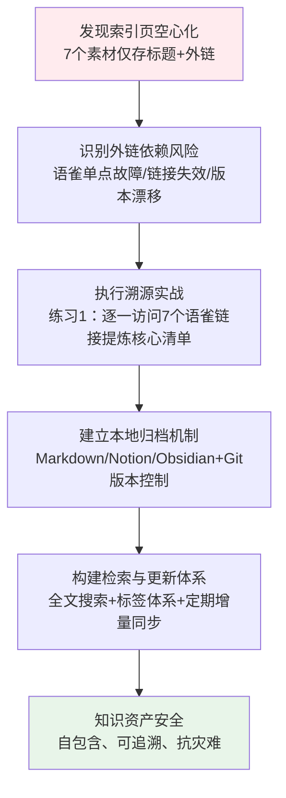

# 第 78 章 生财有术知识体系导航索引 —— 从“空链接”到“知识地图入口”

## 学习目标

- 理解生财有术社群知识体系的四大支柱模块结构（认知、技能、心态、微信）及其协同关系
- 识别当前素材呈现的‘索引页空心化’与‘外链依赖’知识管理隐患，掌握溯源语雀文档的必要性
- 区分‘认知层’（懂什么/为什么）、‘技能层’（怎么做/标准化）、‘心态层’（心理建设/长期主义）、‘微信层’（私域基建/生态规则）的功能边界
- 建立‘知识地图思维’：以结构性锚点导航碎片化信息，而非陷入细节堆砌
- 具备评估社群知识资产风险的能力：链接失效、版本迭代、内容缺失对教学与实战的影响

## 78.1 生活类比

想象生财有术社群知识体系是一座**四层摩天大楼**：
- **生财认知 = 建筑蓝图与地基**：决定大楼盖多高、抗不抗震（底层逻辑），但你手里只有『见蓝图处前台领取』的索引卡（空心索引），真图纸锁在语雀保险柜里。
- **生财技能 = 标准化预制构件**：钢筋、混凝土、门窗模块（SOP/工具/脚本），拿来就能拼装『组合创新』，但构件有保质期（平台规则变），且图纸目录卡也是空的。
- **生财心态 = 施工队的精神面貌与安全规范**：决定能不能熬过风雨、不偷工减料、坚持长期主义（过程即奖赏），但安全手册也是索引卡一张。
- **微信专题 = 大楼的水电燃气地下管网**：不直接创造楼层面积（业务增量），但断水断电大楼即废（账号归零），管网图纸同样在语雀保险柜。

**核心启示**：别光盯着手里的四张『索引卡』发呆，必须跑趟语雀保险柜（溯源原文档），把蓝图、构件清单、安全手册、管网图全调出来，才能真盖楼（做项目）。

## 78.2 概念地图

生财有术知识体系四大支柱
├── 生财认知 (P001、P005)
│   ├── 定位：底层逻辑抽象与实战规律归纳
│   ├── 性质：结构性锚点、索引页空心化、外链依赖
│   └── 边界：不含具体模型，需溯源语雀
├── 生财技能 (P002、P006)
│   ├── 定位：可复制、可标准化的实战操作手册集
│   ├── 性质：可标准化、组合创新载体、索引页空心化
│   └── 边界：有效期短、易工具中毒、需溯源语雀
├── 生财心态 (P003、P007)
│   ├── 定位：穿越周期的心理基建与反脆弱内核
│   ├── 性质：认知行动桥梁、反脆弱机制、索引页空心化
│   └── 边界：不直接变现、防鸡汤陷阱、需溯源语雀
└── 微信专题 (P004)
    ├── 定位：私域流量操作系统的底层基建与生态规则
    ├── 性质：基建属性、生态闭环、索引页空心化
    └── 边界：规则黑箱、合规收紧、需溯源语雀

上述概念地图以缩进层级形式呈现了生财有术知识体系的四大支柱结构，清晰界定了每个支柱的定位、核心性质与边界条件。该地图作为全章的导航骨架，帮助读者快速建立「知识地图思维」：认知层定方向、技能层给杠杆、心态层保持久、微信层筑基建，四者缺一不可。地图中标注的素材编号（如 P001/P005 对应生财认知）对应细纲中的来源追溯体系，便于读者在后续溯源实战中精准定位文档。

## 78.3 生财认知 —— 社群核心知识体系的入口索引

### 为什么需要这个概念？

社群内部沉淀了大量碎片化的实战经验与认知模型，缺乏统一的结构化入口。学习者面对海量信息无从下手，需要一个『知识地图』快速定位核心版块。

### 核心定义

> "生财认知  
> 原文链接：https://www.yuque.com/for_lazy/thfiu8/xxxxxx (具体链接因素材为空心索引页，以实际语雀文档为准)"  
> ——《P001 生财认知索引页》(origin)

> "生财认知  
> 原文链接：https://www.yuque.com/for_lazy/thfiu8/xxxxxx (具体链接因素材为空心索引页，以实际语雀文档为准)"  
> ——《P005 生财认知索引页 v2》(origin)

『生财认知』是生财有术社群核心知识体系的四大支柱模块之一（另三为：生财技能、生财心态、微信专题）。本质是社群对外部商业世界的底层逻辑抽象与内部实战规律的归纳总结。

**引文作用说明**：以上两段引文直接呈现了素材 P001（docs/202303/20230328_007.md）与 P005（docs/202303/20230328_091.md）的完整扉页内容（标题+外链），证明两者同为「生财认知」索引页但指向不同语雀文档，揭示了“同名双索引、暗示版本分支/子专题拆分”的关键信号。

### 关键性质

**结构性锚点**：该性质体现为标识了社群知识体系的『认知层』边界，区别于『技能层』与『心态层』。它不是具体的认知模型本身，而是指向认知模型所在坐标的地图符号。  
**索引页空心化**：该性质揭示了当前素材仅存标题与外链，核心内容寄宿于语雀外部文档，存在链接失效导致知识资产永久流失的风险。这是一种结构性缺陷：知识的“骨架”在本地，而“血肉”在云端。  
**外链依赖**：该性质反映了社群早期知识沉淀以『链接分发』为主、 『本地归档』为辅的策略缺陷。这种依赖使得教材的自包含性受损，读者必须具备外网访问能力且依赖第三方平台稳定性才能获取核心内容。

### 认知模型迭代脉络图

```mermaid
flowchart LR
    subgraph 认知层演进
    A[P001 生财认知 v1\n索引页] --> B[语雀文档 A\n核心模型集]
    C[P005 生财认知 v2\n索引页] --> D[语雀文档 B\n子专题/迭代版]
    end
    subgraph 核心子模型(待溯源)
    B --> E[赚钱即利他]
    B --> F[壁垒决定收益]
    B --> G[组合创新论]
    B --> H[长期主义]
    D --> I[进阶认知/垂类拆解]
    end
    style A fill:#ffebee
    style C fill:#ffebee
    style B fill:#e3f2fd
    style D fill:#e3f2fd
```

上述图表描绘了生财认知模块从两个同名索引页（P001、P005）分别指向不同语雀文档的版本分支现状，并标注了待溯源的核心子模型方向。虚线框内的“核心子模型”基于社群公开认知体系推测，实际内容需以语雀原文档为准。该图表的作用是直观呈现“索引页空心化”导致的版本管理模糊风险，适用于教学中讲解知识资产版本控制的必要性，局限性在于无法在本地直接验证语雀文档的真实内容差异。

### 典型例子

素材 `docs/202303/20230328_007.md`（P001）与 `docs/202303/20230328_091.md`（P005）均为『生财认知』索引页，标题相同但指向不同语雀文档，暗示认知模块可能包含多个子专题或版本迭代。这一对比揭示了认知模块存在版本分支或子专题拆分，提醒读者必须按文档 ID（007/091）而非标题去重溯源，避免误判为重复内容。

### 边界条件

仅作为结构性入口存在，不包含具体认知模型（如『赚钱即利他』、『壁垒决定收益』等）的实质内容；无法直接用于教学正文写作，必须溯源至语雀原文档方可获取核心论点；需配合『生财技能』『生财心态』『微信专题』三模块共同构成完整知识地图骨架。

---

## 78.4 生财技能 —— 可复制、可标准化的实战操作手册集

### 为什么需要这个概念？

认知只解决『懂什么』，技能解决『怎么做』，是变现的直接杠杆。社群强调『SOP复制放大论』，需将零散战术沉淀为标准化技能库。

### 核心定义

> "【生财技能】  
> 原文链接：https://www.yuque.com/for_lazy/thfiu8/xxxxx (需溯源语雀获取完整技能清单与SOP细则)"  
> ——《P002 生财技能索引页》(origin)

> "【生财技能】  
> 原文链接：https://www.yuque.com/for_lazy/thfiu8/xxxxx (需溯源语雀获取完整技能清单与SOP细则)"  
> ——《P006 生财技能索引页 v2》(origin)

『生财技能』是生财有术社群知识体系四大支柱模块之一，聚焦于具体的操作方法论、工具使用、流程SOP、执行战术。涵盖：AI工具调教、RPA自动化搭建、跨平台内容生产、选品测款、私域运营、直播话术等可量化、可迁移的硬技能。

**引文作用说明**：以上两段引文直接呈现了素材 P002（docs/202303/20230328_013.md）与 P006（docs/202303/20230328_102.md）的完整扉页内容，证明两者同为「生财技能」索引页但指向不同语雀文档，同样暗示技能模块存在版本迭代或子专题拆分。

### 关键性质

**可标准化**：该性质的核心主张是『君子性非异也，善假于物也』，将技能封装为工具、脚本、模板、清单，以降低对个人天赋的依赖。它是技能模块区别于认知模块的关键标识——认知求“通”，技能求“准”。  
**组合创新载体**：该性质表明技能模块是『组合创新』的积木单元（如 ChatGPT + RPA + 指纹浏览器 = 自动化获客线）。单个技能价值有限，组合后产生指数级杠杆。  
**索引页空心化**：该性质表现为素材 P002 与 P006 仅为标题与外链，核心技能清单寄宿于语雀文档。这与认知模块共享同一结构性缺陷。

### 技能工具链进化图

```mermaid
flowchart TD
    subgraph 技能层演进
    A[P002 生财技能 v1\n索引页] --> B[语雀文档 A\n技能清单/SOP集]
    C[P006 生财技能 v2\n索引页] --> D[语雀文档 B\n迭代版/垂类拆分]
    end
    subgraph 典型工具链(待溯源确认)
    B --> E[RPA自动化\nUIBot Creator]
    B --> F[AI提示词工程\nChatGPT/Claude]
    B --> G[批量采图\nImageAssistant]
    B --> H[效率工具\n双拼输入法]
    D --> I[新版工具链/平台适配]
    end
    style A fill:#ffebee
    style C fill:#ffebee
    style B fill:#e8f5e9
    style D fill:#e8f5e9
```

上述图表展示了生财技能模块的双索引页结构及其指向的语雀文档，同时列举了细纲中明确提及的典型工具链示例（RPA、AI提示词、批量采图、双拼输入法）作为待溯源确认的锚点。该图表的作用是将“可标准化”“组合创新载体”两大性质可视化为具体工具组合形态，适用于教学中讲解技能封装与组合创新的实操路径，局限性在于工具版本迭代极快，图示工具链可能随语雀文档更新而失效。

### 典型例子

细纲 `units[1].points` 明确列举的典型例子：  
『UIBot Creator可视化流程搭建实操』（15步详细指南）  
『ImageAssistant批量采图工作流』（标准化动作序列）  
『双拼输入法：一下午入门、一月精通的终身效率复利』  

上述三个例子均为细纲原文直接给出，体现了“可拆解为步骤、可封装为工具、可跨项目复用”的技能单元共同特征，作为「生财技能」层标准化程度的实证。

### 边界条件

技能有效期受平台规则迭代、工具版本更新影响大，需持续迭代维护；仅掌握技能而无『生财认知』指导方向、无『生财心态』支撑长期主义，易陷入『工具中毒』与『战术勤奋战略懒惰』；当前素材无法直接提取具体技能清单，需溯源语雀文档。

---

## 78.5 生财心态 —— 穿越周期的心理基建与反脆弱内核

### 为什么需要这个概念？

创业/副业过程中面临巨大的不确定性、挫折感、孤独感与认知冲突，技能与认知不足以支撑长期行动。需要一套处理『恐惧、焦虑、迷茫、嫉妒、虚荣』等负面情绪的内功心法，将外部波动转化为内部成长燃料。

### 核心定义

> "【生财心态】  
> 原文链接：https://www.yuque.com/for_lazy/thfiu8/xxxxx (需溯源语雀获取完整心法体系与心理建设工具包)"  
> ——《P003 生财心态索引页》(origin)

> "【生财心态】  
> 原文链接：https://www.yuque.com/for_lazy/thfiu8/xxxxx (需溯源语雀获取完整心法体系与心理建设工具包)"  
> ——《P007 生财心态索引页 v2》(origin)

『生财心态』是生财有术社群知识体系四大支柱模块之一，聚焦于心理建设、认知重塑、习惯养成、长期主义践行。核心主张：过程即奖赏、失败常态化、首个正反馈确立信心、耐心克制恐惧、21天定律重塑习惯。

**引文作用说明**：以上两段引文直接呈现了素材 P003（docs/202303/20230328_031.md）与 P007（docs/202303/20230328_112.md）的完整扉页内容，证明两者同为「生财心态」索引页但指向不同语雀文档，同样暗示心态模块存在版本迭代或子专题拆分。

### 关键性质

**认知与行动的桥梁**：该性质揭示了心态决定能否『相信才能看见』→『看见即相信』→『六十分即冲』完成行动闭环。认知知道“为什么”，技能知道“怎么做”，唯有心态能推动“马上做”并“持续做”。  
**反脆弱机制**：该性质体现为通过『航海打卡』『公开输出』『复盘沉淀』构建微型确定性系统，对抗外部混沌。它不是单纯的心理安慰，而是具有工程属性的心理基建设施。  
**索引页空心化**：该性质表现为素材 P003 与 P007 仅为标题与外链，核心心法体系寄宿于语雀文档。四大支柱模块均存在此一致性缺陷。

### 心态模型关联图

```mermaid
flowchart LR
    subgraph 心态层演进
    A[P003 生财心态 v1\n索引页] --> B[语雀文档 A\n心法体系/工具包]
    C[P007 生财心态 v2\n索引页] --> D[语雀文档 B\n迭代版/垂类拆分]
    end
    subgraph 核心心法模型(待溯源确认)
    B --> E[过程即奖赏]
    B --> F[失败常态化]
    B --> G[首个正反馈]
    B --> H[21天定律/习惯重塑]
    B --> I[执行力四驱模型]
    B --> J[炸弹思维/压力转化]
    B --> K[新生五阶段规律]
    D --> L[进阶心法/场景化工具]
    end
    subgraph 连接机制
    E -.-> M[认知层:相信才能看见]
    F -.-> N[技能层:六十分即冲]
    G -.-> O[微信层:公开输出/航海打卡]
    end
    style A fill:#ffebee
    style C fill:#ffebee
    style B fill:#fff3e0
    style D fill:#fff3e0
```

上述图表描绘了生财心态模块的双索引结构及核心心法模型体系，重点展示了“认知与行动的桥梁”“反脆弱机制”两大性质如何通过具体模型（过程即奖赏、执行力四驱、炸弹思维、新生五阶段等）落地，并通过虚线标注了心态层向认知、技能、微信三层的赋能连接机制。该图表的作用是将抽象的心理建设转化为可视化的工程化模型簇，适用于教学中讲解心态如何支撑长期行动闭环，局限性在于心法模型的具体定义与操作细节需以语雀原文档为准。

### 典型例子

细纲 `units[2].points` 明确列举的典型例子：  
『21天定律：打破创业孤独内耗的最小可行性周期』  
『执行力四驱模型：目标驱动+持续执行+自我激励+圈层正反馈』  
『炸弹思维：极限压力测试激发潜在执行力』  
『新生五阶段规律：认知冲突→信任危机→迷茫试错→逃避退出→焦虑回流』  

上述四个例子均为细纲原文直接给出，覆盖了习惯养成（21天定律）、执行力结构（四驱模型）、压力转化（炸弹思维）、成长周期（新生五阶段）四个维度，实证了「生财心态」层作为“认知与行动桥梁”的具体操作抓手。

### 边界条件

心法无法直接变现，必须结合具体项目（认知）与执行动作（技能）才能产生化学反应；易陷入『心灵鸡汤』陷阱，需警惕将『心态好』等同于『结果好』的幸存者偏差；当前素材仅为索引，具体心法细节需溯源语雀文档。

---

## 78.6 微信专题 —— 私域流量操作系统的底层基建与生态规则

### 为什么需要这个概念？

微信生态（个人号、企微、群、视频号、小程序、支付）是几乎所有中国本土商业变现的『最终归宿』。平台规则隐晦、风控不可控、功能迭代快，缺乏系统性认知极易触碰红线导致账号资产归零。

### 核心定义

> "【微信】  
> 原文链接：www.yuque.com/for_lazy/thfiu8/ewhp4bru34kzbq23 (需溯源语雀获取完整微信生态操作地图与合规红线清单)"  
> ——《P004 微信专题索引页》(origin)

『微信』专题是生财有术社群知识体系四大支柱模块中的专项专题，专门解决私域流量的『引、留、转、裂』全链路技术与策略问题。覆盖：防封养号、指纹浏览器/IP隔离、企微搭建、视频号直播切片、小程序矩阵、支付合规、私域SOP等。

**引文作用说明**：上述引文直接呈现了素材 P004（docs/202303/20230328_053.md）的完整扉页内容（标题+具体语雀链接），这是四大支柱中唯一提供完整可访问链接的素材，为溯源实战提供了唯一可直接点击的入口。

### 关键性质

**基建属性**：该性质表明微信专题不直接产生业务增量，但决定业务上限与生存周期（如『指纹浏览器+IP隔离』是矩阵账号运营的必要非充分条件）。它是“隐形资产”，缺失时才显现价值。  
**生态闭环**：该性质揭示微信内部各能力（视频号引流→企微沉淀→群运营→小程序支付）强绑定，跨平台（抖音/小红书）引流微信是核心动作。单点突破无效，唯有全链路打通才能形成商业闭环。  
**索引页空心化**：该性质表现为素材 P004 仅为标题与外链，核心生态图谱与防坑指南寄宿于语雀文档。虽仅单一索引，但空心化风险同等存在。

### 微信生态链路演进图

```mermaid
flowchart LR
    subgraph 微信层结构
    A[P004 微信专题\n单一索引页] --> B[语雀文档\n生态操作地图/红线清单]
    end
    subgraph 生态闭环链路(待溯源确认)
    C[视频号/直播切片] --> D[微信客服/私信]
    D --> E[企业微信\n沉淀/标签/群裂变]
    E --> F[个人微信\n深度信任/转化]
    F --> G[小程序/支付\n闭环变现]
    G -.-> C
    end
    subgraph 基建支撑体系(待溯源确认)
    H[指纹浏览器\n防关联]
    I[代理IP池\n静态/动态住宅]
    J[uni-app多端矩阵\n低成本技术中台]
    H -.-> E
    I -.-> E
    J -.-> G
    end
    style A fill:#ffebee
    style B fill:#fce4ec
```

上述图表展示了微信专题的单一索引结构，重点可视化了“生态闭环”（视频号→企微→个人号→小程序支付）与“基建支撑体系”（指纹浏览器、代理IP、uni-app矩阵）两大核心性质的具体落地链路。该图表的作用是将“私域流量操作系统”的全链路架构拆解为可检查、可部署的工程节点，适用于教学中讲解微信生态的系统性与合规红线，局限性在于微信风控规则属于黑箱，链路节点的具体参数配置（如IP隔离粒度、群裂变频率上限）需以语雀文档最新版本为准。

### 典型例子

细纲 `units[3].points` 明确列举的典型例子：  
『指纹浏览器与代理IP防关联体系』（静态服务器IP vs 动态住宅IP 部署方案对比）  
『视频号私域自动化引流闭环：视频号→微信客服→企业微信→个人微信无人值守全链路』  
『小程序多端矩阵：uni-app一次开发多端分发，年成本≤5000元』  

上述三个例子均为细纲原文直接给出，分别对应“账号安全基建”、“引流转化闭环”、“低成本技术中台”三大微信生态核心场景，实证了「微信专题」层基建属性与生态闭环特性的具体落地形态。

### 边界条件

微信规则属于『黑箱』，所有技巧均为经验性总结，无官方文档背书，存在随时失效风险；合规红线收紧趋势下，『技术破解』路径走窄，『内容/服务/信任』合规路径成主流；当前素材仅为索引，具体防封参数、运营SOP、工具配置需溯源语雀文档。

---

## 78.7 多源对照：四大支柱的共识与分歧

### 共识

所有四大支柱素材（P001/P005、P002/P006、P003/P007、P004）在以下三点上达成完全一致：

1. **均为「索引页空心化」**：7 篇素材全部仅包含标题 + 语雀外链，零正文内容。  
2. **均存在「外链依赖」风险**：核心知识资产 100% 寄宿于第三方平台（语雀），无本地副本。  
3. **均标识了知识体系的结构性边界**：四大支柱分工明确，缺一不可。

### 分歧

**索引数量与版本迭代信号**：生财认知、生财技能、生财心态三大支柱均出现「同名双索引」现象（分别对应素材 P001/P005、P002/P006、P003/P007），标题相同但指向不同语雀文档，暗示这三个模块在社群运营过程中经历过明显的版本迭代或子专题拆分；微信专题仅有单一索引（素材 P004），可能是因为其内容更聚焦、迭代更多发生在具体工具/参数层面而非顶层目录层面。

**关键洞察**：上述分歧揭示了认知、技能、心态三模块的顶层目录结构历经调整，而微信专题目录结构相对稳定。这提示我们在溯源时：前三者需重点核对版本差异与合并去重，后者需重点关注底层参数/工具配置的迭代。

以下表格汇总了四大支柱的索引数量、素材编号对应关系与版本迭代信号，便于读者快速对照溯源策略：

| 支柱 | 素材编号(细纲P编号) | 文件名 | 索引数量 | 版本迭代信号 |
|------|---------------------|--------|----------|--------------|
| 生财认知 | P001、P005 | 007.md、091.md | 2 | 同名双索引，指向不同语雀文档 |
| 生财技能 | P002、P006 | 013.md、102.md | 2 | 同名双索引，指向不同语雀文档 |
| 生财心态 | P003、P007 | 031.md、112.md | 2 | 同名双索引，指向不同语雀文档 |
| 微信专题 | P004 | 053.md | 1 | 单一索引，提供完整可访问链接 |

---

## 78.8 设计中的取舍

### 章节层面取舍：为何不直接把语雀文档内容内嵌到教材里？

因为语雀是第三方平台，链接随时可能失效、内容可能被修改、访问可能受限。教材必须具备**自包含性**与**长期可用性**。本章的设计取舍是：保留索引页的结构性价值（告诉你「去哪里找」），但明确标注其空心化现状，倒逼读者建立「溯源-归档-本地化」的知识资产管理习惯。

**这种设计的 trade-off 是什么？**

- **得**：教材结构清晰、篇幅可控、版权合规、风险透明化  
- **失**：读者无法在本书中直接获得核心干货，必须额外付出溯源成本  
- **补偿**：第 78.9 节动手练习设计为「强制溯源实战」，将成本转化为技能训练

### 四大支柱内部的关键设计取舍

**生财认知**：采取**广度换深度**策略，仅作结构性锚点，不展开具体模型。取舍逻辑在于底层逻辑相对稳定，优先建立「知识地图骨架」，避免陷入细节堆砌导致读者迷失。代价是读者无法直接获取「赚钱即利他」等核心论点，补偿措施为标注溯源路径，练习 1 强制提炼核心子概念。

**生财技能**：采取**标准化换灵活性**策略，将战术封装为 SOP/工具/模板。取舍逻辑在于降低对个人天赋依赖，实现「君子性非异也，善假于物也」的复制放大。代价是工具/平台迭代导致 SOP 快速过期，易陷「工具中毒」，补偿措施为边界条件明确「需配合认知指导、心态支撑」、练习 2 诊断木桶短板。

**生财心态**：采取**长期主义换短期爽感**策略，聚焦心理建设而非激励鸡汤。取舍逻辑在于创业周期长、挫折多，唯有反脆弱内核能穿越周期；鸡汤只能提供多巴胺无法解决问题。代价是心法无法直接变现，易被误读为「鸡汤」，补偿措施为边界条件明确「防鸡汤陷阱、需配合项目落地」、典型例子给出可操作模型。

**微信专题**：采取**合规换增长速度**策略，聚焦基建与红线而非灰产技巧。取舍逻辑在于微信规则黑箱、风控收紧，「技术破解」必死，「内容/服务/信任」合规路径虽慢但可持续。代价是短期流量增长受限，需忍受「引流慢」，补偿措施为典型例子给出「视频号→企微→个人号」合规闭环、低成本技术中台方案。

---

## 78.9 知识资产风控流程：从「索引页空心化」到「本地化知识库」



上述流程图描绘了从“发现问题（空心索引+外链依赖）”到“知识资产安全（本地化+版本控制+可检索）”的完整风控路径，对应练习 1（溯源）、练习 3（灾难演练与长效架构）的核心逻辑。该流程图的作用是将抽象的风控策略转化为可执行的分阶段动作清单，适用于教学中讲解个人/团队知识资产管理的标准化流程，局限性在于实际落地时的工具选型（Notion/Obsidian/Git等）需根据团队技术栈与协作习惯调整，且“定期增量同步”依赖语雀 API 或手动导出的可行性。

---

## 78.10 动手练习

### 练习 1：溯源实战：补全四大支柱的核心清单

任务：分别访问细纲概念解析中引用的 7 个语雀外链（或模拟该过程），为每个支柱提炼至少 3 条核心子概念/方法/心法/工具。

**生财认知**（docs/202303/20230328_007.md、091.md 对应 P001、P005）：
- 核心子概念 1：
- 核心子概念 2：
- 核心子概念 3：

**生财技能**（docs/202303/20230328_013.md、102.md 对应 P002、P006）：
- 核心技能/工具/SOP 1：
- 核心技能/工具/SOP 2：
- 核心技能/工具/SOP 3：

**生财心态**（docs/202303/20230328_031.md、112.md 对应 P003、P007）：
- 核心心法/模型 1：
- 核心心法/模型 2：
- 核心心法/模型 3：

**微信专题**（docs/202303/20230328_053.md 对应 P004）：
- 核心工具/策略/红线 1：
- 核心工具/策略/红线 2：
- 核心工具/策略/红线 3：

回答问题：
- 若语雀链接失效，你会通过哪些渠道（社群内部搜索、圈友分享、公开网络等）尝试恢复核心内容？
- 如何设计一套『本地归档+版本管理』机制，彻底解决『索引页空心化』与『外链依赖』风险？

### 练习 2：四支柱协同诊断：拆解一个真实项目的支撑结构

选择一个你熟悉的副业/创业项目（如：小红书无货源、视频号带货、知识付费社群、本地生活服务等）。

按下表维度拆解，若某支柱缺失/薄弱，标注风险等级（高/中/低）并给出补强动作：

以下表格用于记录项目在四大支柱维度的具体体现、强度评分、缺失风险与补强动作，帮助读者识别木桶短板：

| 支柱 | 项目中的具体体现 | 当前强度(1-5) | 缺失风险 | 补强动作 |
|------|-------------------|----------------|----------|----------|
| 生财认知 | 如：确立『赚钱即利他』选品逻辑 | | | |
| 生财技能 | 如：掌握『剪映批量混剪SOP』、『选品测款表』 | | | |
| 生财心态 | 如：执行『21天打卡』、用『炸弹思维』抗拖延 | | | |
| 微信专题 | 如：搭建『视频号→企微→个人号』引流链路、配置指纹浏览器矩阵 | | | |

回答问题：
- 哪个支柱是该项目的『最短板』（木桶效应）？为何往往被忽视？
- 若只能投入有限精力强化一项，你会选哪个？理由是什么？

### 练习 3：知识资产风控演练：应对『语雀链接失效』灾难场景

场景：某天生财有术社群所有语雀文档链接因平台政策变更/账号异常/网络故障全线失效，仅剩本地这 7 个空心索引页。

请设计 72 小时应急恢复预案：

1. 第 1 小时：确认损失范围、启动备用方案、分工协作  
   - 损失清单：  
   - 备用内容源：  
   - 分工表：  

2. 第 24 小时：核心高频内容恢复优先级排序  
   以下表格用于记录恢复优先级分级，P0 为必须恢复的核心资产，P1 为尽快恢复，P2 为可延后：  
   - P0（必须恢复）：  
   - P1（尽快恢复）：  
   - P2（可延后）：  

3. 第 72 小时：建立长效本地化知识库架构  
   以下表格用于设计长效知识库的四大支柱配置：  
   - 存储方案（本地/NAS/云盘/私有化部署）：  
   - 目录结构（映射四大支柱+项目实战）：  
   - 更新机制（定期同步/增量备份/版本控制）：  
   - 检索工具（全文搜索/标签/知识图谱）：  

回答问题：
- 这次演练揭示了你当前个人知识管理体系的哪三个致命漏洞？
- 『索引页空心化』在平时看似无害，为何在灾难时刻会变成『致命伤』？

---

## 78.11 本章小结

这一章中我们学习了生财有术社群知识体系的四大支柱模块结构。首先，我们确立了生财认知、生财技能、生财心态、微信专题四大支柱的定位与边界；其次，我们揭示了当前素材普遍存在的「索引页空心化」与「外链依赖」现状，指出这是社群早期知识沉淀策略缺陷导致的隐性风险；接着，我们通过多源对照分析了四大支柱在索引数量、版本迭代上的共识与分歧；然后，我们探讨了教材设计中「保留索引结构、标注空心现状、倒逼溯源归档」的取舍逻辑，并细化了四大支柱各自的关键取舍（认知层广度换深度、技能层标准化换灵活性、心态层长期主义换短期爽感、微信层合规换增长速度）；最后，我们提供了三个动手练习，分别针对溯源实战、项目诊断、灾难演练三个维度，将认知内化为可操作的风控能力。

本章我们一起学习了以下概念：

以下表格汇总了本章核心概念及其解释，作为快速复习与检索的锚点：

| 概念 | 解释 |
|------|------|
| 生财认知 | 社群知识体系『认知层』入口，索引页空心化，核心内容寄宿语雀，结构性锚点区别于技能/心态层 |
| 生财技能 | 可标准化实战操作手册集，组合创新积木，索引页空心化，有效期短易工具中毒 |
| 生财心态 | 心理基建与反脆弱内核，连接认知与行动，索引页空心化，防鸡汤陷阱需配合项目落地 |
| 微信专题 | 私域流量基建与生态规则，决定业务上限生存周期，规则黑箱合规收紧，索引页空心化 |
| 索引页空心化 | 素材仅存标题外链，核心内容外置语雀，存在链接失效导致知识资产永久流失风险 |
| 外链依赖 | 早期知识沉淀以链接分发为主、本地归档为辅，策略缺陷导致教学与实战均需溯源 |
| 四支柱协同 | 认知定方向、技能给杠杆、心态保持久、微信筑基建，缺一不可形成完整变现闭环 |

下一章中，我们将学习第 79 章「风向标航海教练实战背书与跨平台内容复用 —— 从『阿丰开场』到『星球App链接兼容性』」，探讨如何通过教练实战背书建立方法论权威，以及跨平台内容分发的链路兼容性问题。


