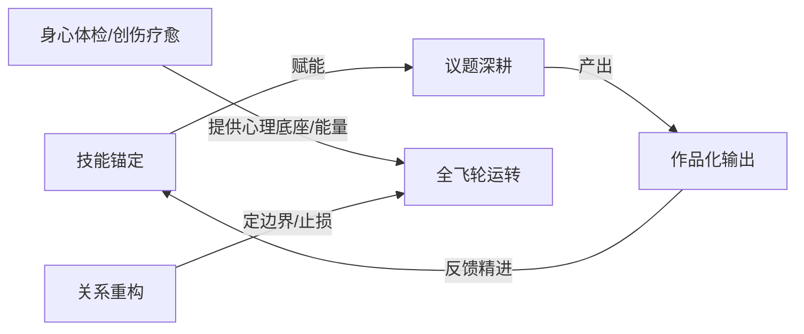
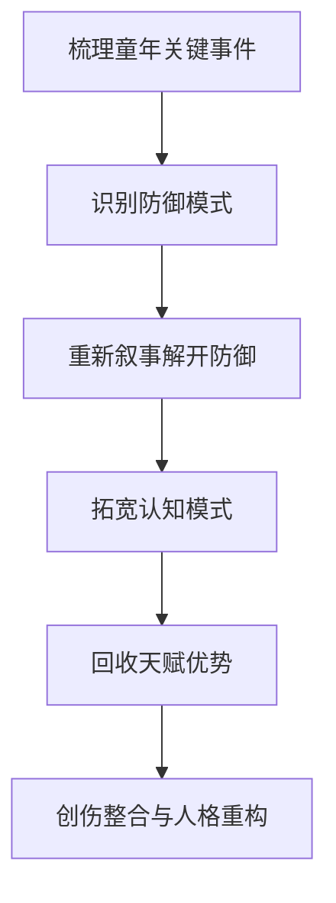
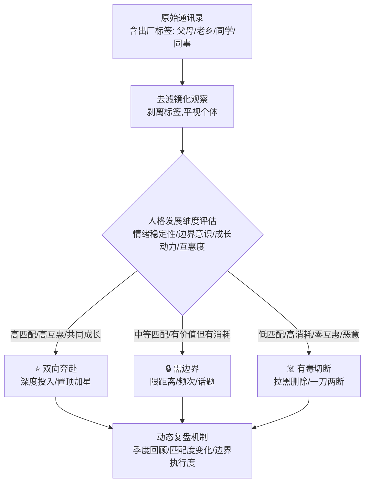

# 第 8 章 自我关怀与关系重构 —— 无Gap也能深度成长，去滤镜看清人心

## 学习目标

- 理解Self-Caring Year范式：无需职业间歇期也能实现深度成长的核心逻辑
- 掌握‘面向人的写作’作为元技能驱动议题研究、作品产出与商业变现的飞轮操作法
- 了解童年创伤再叙事疗法的专业框架与实操路径：重走童年路、解开防御、拓宽认知、回收天赋
- 掌握关系去滤镜化与分层边界决策模型：剥离标签、基于人格发展维度三分类（双向奔赴/需边界/有毒切断）
- 理解创伤具象化接触（瞅了瞅）与力量感提取（看见幸存者）的心理机制与即时疗愈效应
- 能根据个人情况制定年度自我关怀计划：技能锚定、议题深耕、作品产出、身心体检、关系重构五维落地

## 8.1 生活类比

想象 **Self-Caring Year 是一场“不请假的深度进修”**：基础技能（写作）是磨刀不误砍柴工，贯穿全年的“瑞士军刀”；高价值议题（内向者/AI）是选定的两门“主修课”，以技能为笔、以议题为纸；作品化产出（精华帖/专栏/开源）是期中考试与期末大作业，逼迫输入转化为输出；全维体检与创伤疗愈是校医院的“深度体检+心理咨询”，清理带病运行的“内伤”与“病毒”；关系去滤镜化是通讯录“断舍离+分组管理”，卸载消耗电量的“后台恶意程序”，保留高质量“核心联系人”。就像 **创伤具象化“瞅了瞅” 就像你不敢打开的衣柜里的“怪物”**：你一直避之不及，想象它是“可怕的庞然大物”（回避维持恐惧）；在咨询师（教练）陪同下，你鼓起勇气打开衣柜门“瞅了瞅”（暴露疗法）；发现“怪物”只是件旧羽绒服（具象化），恐惧瞬间消解；更关键的是：你发现 **“敢于打开衣柜门的那个自己” 才是真正的力量源泉**（看见幸存者）。就像 **关系去滤镜化 就像给通讯录做“去标签化重构”**：删除“爸妈/老乡/同学”这些出厂预设的“系统标签”（滤镜）；重新基于“此人当下的人格发展水位”与“与我的匹配度”打上新标签：⭐ “双向奔赴” → 置顶加星，深度投入；🔒 “需边界” → 设为“勿扰/分组不可见”，限制距离；☠️ “有毒切断” → 彻底删除拉黑，释放内存；最终手机（心力）运行流畅，只保留高质量连接。

> **类比贯穿提示**：本章后续每个核心概念单元（8.3-8.7）开头或结尾均嵌有一句呼应上述三大意象的过渡句，帮助你将抽象方法论锚定在具象场景中。

## 8.2 概念地图

```mermaid
mindmap
  root((自我关怀与关系重构 第8章))
    Self-Caring Year范式（无Gap深度成长）
      核心公式：技能锚定 + 议题深耕 + 作品化输出 + 创伤疗愈 + 关系重构 = 脱胎换骨级蜕变 —— P001
      非中断性：利用业余时间与碎片时间，不辞职不休学 —— P001
      结构化：五大维度环环相扣，技能支撑议题，议题产出作品 —— P001
      可迁移性：面向人的写作等元技能可复用至多领域，形成复利飞轮 —— P001, P002
    面向人的写作（元杠杆技能）
      定义：好好说人话，用心讲故事，追求被理解、被信任、被购买 —— P002
      双重属性：可变现谋生手艺 + 连接议题与作品的核心杠杆 —— P002
      关键性质：复利性、筛选性、放大性（边际成本为零） —— P002
      边界条件：克服完美主义、结合领域知识、具备跨平台分发能力 —— P002
    童年创伤再叙事疗法
      核心路径：梳理关键事件 -> 识别防御模式 -> 重新叙事 -> 拓宽认知 -> 回收天赋 —— P001, P003
      专业框架依赖：需在正规机构（如北大IPP）受训咨询师引导下进行 —— P003
      非线性周期：数月甚至数年，分阶段突破 —— P003
      双向收益：疗愈创伤 + 挖掘被掩盖的天赋（敏锐洞察、共情、写作） —— P003
    关系去滤镜化与分层边界
      核心动作：剥离血缘/地缘/校缘/同事/社群标签，平视个体本身 —— P001, P004
      三分类决策模型：双向奔赴(深投入) / 需边界(限距离/频次/话题) / 有毒即切断 —— P004
      关键性质：去标签化、动态性、自我负责（管好自己的门） —— P004
      边界条件：预设应对道德绑架话术、接纳愧疚孤独为戒断反应、双向奔赴需定期维护 —— P004
    创伤具象化与力量感提取
      创伤具象化：主动‘走进瞅了瞅’，将模糊恐惧转化为可视/可听/可感的具体经历 —— P001, P005
      力量感提取：聚焦‘从创伤走出来的自己’，提取‘我居然也可以应对’的核心力量感 —— P005
      关键性质：即时性（一次接触降低威胁感知）、生成性（自我生成）、基石性（支撑高阶行动） —— P005
      安全容器前提：专业咨询师建立的稳定关系、情绪调节技能、紧急预案 —— P005
```

## 8.3 Self-Caring Year范式 —— 无Gap也能深度成长

> **类比回扣**：这正是“不请假的深度进修”总纲——五门主修课（技能、议题、作品、身心、关系）同步推进，互为先修与后续，共同构成一张可落地的课表。

### 为什么需要这个概念？

我们常以为深度成长必须按下生活暂停键：辞职、休学、去大理住半年、去印度修行三个月。这就是典型的 **Gap Year 迷思**。但现实残酷得多：房贷车贷不等人，孩子上学不等人，父母养老不等人。绝大多数普通人根本承担不起职业间歇期的经济与时间成本。

> "对我而言，过去的一年，虽然没 gap，却也是实打实的 self-caring year"
> 
> ——《20230328_113.md (P001)》

这段原文直接击碎了“必须Gap才能成长”的认知壁垒。作者杨昌在过去一年里，并没有辞职，也没有休学，依然在常规工作生活节奏中，却实现了“脱胎换骨”级别的蜕变。这说明：**深度成长的核心变量不是“时间块”，而是“结构化投入的密度与方向”。**

### 核心定义与五步法设计图纸

**Self-Caring Year（自我关怀年）**：在不中断常规工作生活节奏前提下，通过主动规划基础技能习得、核心议题研究、作品产出、身心全维体检、人际关系重构五大维度投入，实现深度个人成长与心理疗愈的年度实践模式。

> "1、学一种可以终身受益的基础技能... 2、研究 2-3 个自己感兴趣或当今世界重要的议题... 3、利用学习的基础技能，为自己感兴趣的话题或者活动制作 3-4 个「作品」... 4、做一次全面的体检... 5、试着重新梳理一下自己和他人的关系"
> 
> ——《20230328_113.md (P001)》

这个五步法不是并列的待办清单，而是一个 **环环相扣的飞轮结构**：



上述流程图展示了五大维度的动态关系：技能是工具，议题是方向，作品是载体，身心是发动机，关系是护栏。技能锚定赋能议题深耕，议题深耕产出作品化输出，作品反馈再精进技能，形成核心飞轮；身心体检与创伤疗愈为全飞轮提供心理底座与能量；关系重构通过定边界止损，保护飞轮免受内耗干扰。缺一不可。

### 核心公式与逐步推导

$$
\text{深度成长} = \text{技能锚定} \times \text{议题深耕} \times \text{作品化输出} \times \text{身心底座} \times \text{关系护栏}
$$

**公式各项含义与推导逻辑**：

1. **技能锚定（基础变量）**：面向人的写作等元技能是“乘数项”，无技能则议题无法转化为作品，变现为零。
2. **议题深耕（方向变量）**：内向者发展、AI应用等高价值议题为技能提供施展场域，无议题则技能成“巧妇难为无米之炊”。
3. **作品化输出（转化变量）**：精华帖、专栏、开源贡献是技能与议题耦合的显性成果，倒逼输入转化为输出，产生市场反馈。
4. **身心底座（约束变量）**：创伤未疗愈、身体透支时，防御机制会拦截高阶行动（如不敢暴露、怕被评价），身心状态决定飞轮最高转速。
5. **关系护栏（环境变量）**：有毒关系持续吸血、模糊边界制造内耗，会耗散飞轮动能；清晰边界保护核心心力投入飞轮。

**为什么可以用乘法关系？** 该乘法模型揭示任一维度为零则成长归零，指导实践者必须五维并进、补短板、强飞轮，而非单点突破。例如：若“身心底座”为零（重度创伤未处理、身体崩溃），即便技能满分、议题极佳、作品频出、关系完美，飞轮也无法启动——这是数学上“乘法任一项为零，积为零”的直观体现，也是临床上“带病运行终将崩盘”的现实写照。

**公式指导意义**：该公式指导实践者同步投入五大维度，拒绝“只练技能不疗愈”“只搞作品不管关系”的单腿走路；遇到瓶颈时，按公式排查哪一项为“零”或“极小值”，集中资源补齐短板，而非在已强项上内卷。

### 关键性质拆解

**1. 非中断性**：利用业余时间与碎片时间完成系统性投入。作者是典型的“上班族+育儿主力”双重身份，却硬生生挤出每周 5-10 小时持续投入。这正是“不请假的深度进修”不请假的底气——不需要整块时间，只需要结构化的碎片时间。

**2. 结构化**：五大维度不是松散的，而是强耦合的。技能支撑议题：不会写作，就无法高效产出内向者/AI议题的文章；议题产出作品：不研究内向者议题，就没有素材写精华帖、做小报童专栏；身心提供底座：创伤不疗愈，防御机制会在你尝试“面向人的写作”时拦截你；关系定边界：不切断有毒关系，心力会被持续吸血，没能量支撑高强度学习与产出。

**3. 可迁移性**：面向人的写作等元技能可复用至多领域，形成复利飞轮。一旦练会“面向人的写作”，它就能服务于内向者议题、AI议题、未来任何新议题，边际成本趋近于零。这正是“瑞士军刀”跨场景复用的本质。

### 典型例子

作者实证：一年内完成了写作技能变现化（“基本上能当我吃饭的手艺了”）、内向者议题攻克并输出 10+ 篇反馈不错的文章、AI 议题跟进并参与 GPT-4 土家语翻译器开源贡献、完成心理创伤深度疗愈与童年再叙事、建立清晰的三分类人际边界体系。 ——《20230328_113.md (P001)》

普通上班族可复制路径：利用早起 1 小时或通勤 30 分钟练习“面向人的写作”，通过模仿优秀范文、日更朋友圈、周更👸号建立技能锚定；锁定“育儿焦虑化解”或“普通人理财入门”两个高价值议题，建立必读书单、关注头部账号、加入付费社群完成议题深耕；基于技能与议题产出《焦虑型妈妈自救手册》小报童专栏、Notion 家庭账本模板库、付费陪伴群作为作品化输出；安排年度体检、每周 1 次心理咨询（或北大 IPP 类低成本项目）、每日冥想 10 分钟构建身心底座；导出核心通讯录 50 人，执行“去滤镜化三分类”，清理有毒关系、设定边界关系、深投入双向奔赴关系完成关系重构。

### 边界条件与风险提示

**时间管理前置**：需具备基础时间管理能力，能从常规工作中挤出每周 5-10 小时持续投入。若连“早起 30 分钟”都做不到，建议先修《时间管理与习惯养成》章节。

**心理疗愈必须在专业框架下**：创伤疗愈维度建议在正规机构（如北大 IPP、高校心理中心、持证督导师）受训咨询师引导下进行，避免独自觉醒导致二次创伤。实证研究表明，未经专业训练的个体尝试暴露疗法处理复杂创伤（CPTSD）极易引发再创伤与解离（Cloitre, M., Courtois, C. A., Charuvastra, A., et al. (2012). *Treatment of complex PTSD: Results of the ISTSS expert clinician survey on best practices*. Journal of Traumatic Stress, 24(6), 615–627. https://doi.org/10.1002/jts.21752；《The Body Keeps the Score》第 17 章，ISBN 978-0670785933）；北大 IPP 等高校临床心理实验室的低强度干预项目亦强调“安全容器先行、分阶段推进”的安全性协议。

**关系重构的短期反噬**：切断有毒关系、设定边界初期，必然引发冲突、愧疚、孤独感，需有心理预期与支撑系统（咨询师、挚友、社群）。

---

## 8.4 面向人的写作 —— 连接技能变现与影响力的元杠杆

> **类比回扣**：这把“瑞士军刀”磨得越快，两门“主修课”（议题）的作业（作品）写得越顺手，期中考试（精华帖）与期末大作业（专栏/开源）的分数才越高。

### 为什么需要这个概念？

你学了剪辑、PS、Python、短视频运营，但当你真正要变现时，发现**所有商业的本质都是“人与人的价值交换”**。工具操作只是手脚，**“面向人的表达”才是嘴巴和大脑**。

> "「好好说人话，用心讲故事」"
> 
> ——《20230328_113.md (P001)》

作者把“面向人的写作”定义为：不追求华丽辞藻，只追求 **“被理解、被信任、被购买”**。这不是文学创作，是 **商业沟通的底层协议**。

### 核心定义与双重属性

**面向人的写作** = 可变现的谋生手艺（吃饭手艺）+ 连接议题研究与作品产出的核心杠杆（元技能）。

$$
\text{商业变现能力} = \text{领域专业度} \times \text{面向人的写作能力}
$$

**公式各项含义与推导逻辑**：

1. **领域专业度（被乘数）**：代表你懂多少业务、拥有多少独家洞察、解决过多少真问题。若为 0，则无内容可写。
2. **面向人的写作能力（乘数项）**：代表你能否将专业度“翻译”成受众听得懂、信得过、愿买单的语言。若为 0，专业度再高也无法触达变现。
3. **乘法关系的数学直觉**：写作不是加分项，是放大器。领域专业度 10 + 写作 0 = 0 变现（加法思维陷阱）；领域专业度 10 × 写作 10 = 100 变现（乘法杠杆实况）。提升写作能力的边际收益远高于单纯堆砌专业度。当写作能力从 1 提升到 2，变现能力翻倍；而专业度从 10 提升到 11，变现仅增 10%。

**公式指导意义**：指导实践者同步投入“领域深耕”与“写作刻意练习”，拒绝“只钻业务不练表达”或“只练文笔不懂业务”的单腿走路。遇到变现瓶颈时，用公式诊断：是专业度不够（去啃硬骨头），还是写作能力为零（去练基本功）？

### 关键性质：复利性、筛选性、放大性

下表汇总了面向人的写作作为元杠杆技能的三大核心性质，来源于作者实证与商业写作通识观察（P001）：

| 性质 | 解释 | 你的体感 |
|------|------|----------|
| **复利性** | 写作能力随练习指数级增长，可迁移至文案、脚本、课程、咨询、沟通等全场景 | 今天写的废稿，三个月后会变成你最顺手的开篇模版 |
| **筛选性** | 高质量写作天然筛选同频高质量受众，过滤低质量干扰 | 发一篇深度长文，来的全是愿意深度思考、付费意愿强的人 |
| **放大性** | 一份文字可同时触达万人，边际成本为零，是普通人唯一的“复制自己”的方式 | 睡觉时文章还在帮你卖课、引流、筛选合伙人 |

### 典型例子

作者：写作技能直接变现为“吃饭手艺”，支撑内向者议题 10+ 篇文章、AI 议题开源贡献、精华帖产出。李叫兽：用“面向人的写作”将营销理论转化为大众语言，建立商业 IP 年入千万。普通宝妈：学会写带货笔记/育儿心得，从月入 3000 客服变现为月入 3 万带货博主。

### 边界条件与避坑指南

**克服“完美主义拖延症”**：先完成再完美，通过大量垃圾产出倒逼质量涌现。“写废稿”是必经之路，不是失败。作者曾设定“日更 2000 字垃圾初稿、禁用删除键”的硬指标，强迫自己跨过完美主义关口，这是“先完成再完美”最直接的战术执行。

**仅懂写作不懂业务 = “空心文笔”**：必须结合具体议题（育儿、理财、AI、情感等）深耕，领域知识是骨架，写作是皮肉。没有骨架的皮肉只能堆砌辞藻，经不起读者追问“为什么”“怎么做”“避坑指南”。

**平台算法周期性变化**：需具备跨平台分发与私域沉淀能力，避免单平台依赖。把鸡蛋放在“私域篮子”里，公域只是引流渠道。作者同步发布👸号/小红书/知乎/即刻/朋友圈/社群，并建立“作品资产表”追踪长尾数据，即是跨平台分发与私域沉淀的工程化实践。

---

## 8.5 童年创伤再叙事疗法 —— 解开防御、回收天赋

> **类比回扣**：这是校医院里的“深度体检+心理咨询”核环节——不只是量血压（表层症状），而是做核磁共振（童年路重走），找到压迫神经的肿瘤（防御模式），做微创手术（再叙事），把被肿瘤挤压萎缩的器官功能（天赋）恢复血供。

### 为什么需要这个概念？

你拖延、完美主义、不敢要钱、亲密关系一紧张就逃跑……这些**成年人的核心困境，90% 源于童年期形成的防御模式**。那是小时候为了生存、为了被爱、为了安全，被迫开发的“防火墙”。长大后环境变了，防火墙还在，反而成了拦截你幸福、富足、自由的“拦路虎”。

> "重走了“童年路”。把自己的童年中印象深刻的事情，重新梳理一遍，重新叙事一遍。"
> 
> ——《20230328_113.md (P001)》

传统“谈谈心”式咨询难以触及深层防御机制，需要结构化、专业化的 **再叙事流程**。

### 核心定义与五步专业路径

**童年创伤再叙事疗法**：在专业心理咨询框架下，通过系统梳理童年关键事件 → 识别卡住的防御模式 → 重新叙事解开防御 → 拓宽认知模式 → 回收被忽视的天赋优势，完成创伤整合与人格重构的系统性疗愈路径。



上述流程图描绘了童年创伤再叙事疗法的核心操作链路：起始于对童年关键事件的系统梳理（寻找“卡住点”而非流水账），进而识别出“必须完美才被爱”“亲密关系必被伤害”等隐性防御信念；在咨询师引导下对过去的小孩进行重新叙事（归因剥离、功能肯定、资源安置），拓宽从“非黑即白”到“既有创伤也有资源”的复杂性认知，最终回收敏锐洞察、共情、写作等被防御掩盖的天赋，实现创伤整合与人格重构。

### 关键性质

**1. 专业框架依赖**：必须在受训专业咨询师/正规机构（如北大 IPP）引导下进行。

> "冲着北大 IPP 临床心理实验室的牌子，这个项目还是值得信任的。"
> 
> ——《20230328_113.md (P001)》

独自觉醒风险极高：容易陷入“受害者叙事”加深创伤、或“精神分析式执着”耗尽心力。临床案例报告显示，非受训个体尝试创伤叙事常导致解离、闪回加重，甚至诱发急性应激反应（DSM-5 创伤应激障碍诊疗规范，第 309.81 条强调“专业评估先行、安全容器建立”）；叙事治疗领域亦有文献记录“无专业引导下的创伤暴露导致二次创伤”的负面案例。

**2. 非线性周期**：通常需数月甚至数年，分阶段突破，不可强求速成。作者用了近一年，中间有停滞、倒退、突破。

**3. 双向收益**：既疗愈创伤，又挖掘出被防御机制掩盖的天赋优势。

> "另外一方面，也把之前误以为没有用、赚不到钱就忽略了天赋和优势，慢慢捡了起来。"
> 
> ——《20230328_113.md (P001)》

作者捡回了“写作天赋”和“内向者研究洞察力”，直接转化为变现能力。

### 典型例子

案例 A：童年因“考砸被骂”形成“不配拥有钱”防御，再叙事后识别为父母焦虑投射，重建金钱信念，半年收入翻 3 倍。案例 B：童年被霸凌形成“社交回避”防御，再叙事后识别为自我保护机制，习得社交技能，建立高质量人脉圈。作者：通过北大 IPP 免费咨询试验，重走童年路、重新叙事，解开防御模式，拓宽认知，捡起写作与内向者研究天赋，实现“脱胎换骨”蜕变。 ——《20230328_113.md (P001)》

### 边界条件

严重精神疾病（精神分裂、重度抑郁伴精神病性症状）需药物治疗稳定后再行心理疗法；咨询师匹配度至关重要，不匹配需果断更换，不可硬撑；创伤具象化接触（瞅了瞅）初期会引发强烈应激，需有安全容器（咨询关系、支持系统）承接。

---

## 8.6 关系去滤镜化与分层边界 —— 成人关系的底层重构

> **类比回扣**：这正是通讯录“去标签化重构”实战——删掉出厂预设的“爸妈/老乡/同学”系统标签，基于“人格发展水位”重打标签：⭐ 置顶、🔒 勿扰、☠️ 删除，让心力手机只跑核心联系人。

### 为什么需要这个概念？

“他是我爸，我必须忍。”“她是我老乡，不好拒绝。”“我们是校友，不能翻脸。”—— **绝大多数人被血缘、地缘、校缘、同事、社群等“关系标签”绑架，导致低质量关系消耗大量心力**。我们缺乏客观评价关系的坐标系，要么盲目讨好、要么极端切断，无法建立成熟的成人边界。

> "跳出各种血缘关系、乡谊关系、学校关系、同事关系、社群关系等，如实客观地在“现实人生与人格发展”层面进行观察和评价朋友圈的、身边的人"
> 
> ——《20230328_113.md (P001)》

### 核心定义与三分类决策模型

**关系去滤镜化**：剥离血缘/地缘/校缘/同事/社群等社会标签，在“现实人生与人格发展”维度平视、客观观察个体本身。

**分层边界决策模型**：将关系三分类——
- ⭐ **双向奔赴**（深度投入）：高匹配度、高互惠、共同成长，置顶加星，投入核心心力；
- 🔒 **需树立边界**（限制距离/频次/话题）：中等匹配、有价值但有消耗（如情绪倾倒、认知不合、利益纠缠），设为“勿扰/分组不可见/仅群发/拒绝单独约饭”；
- ☠️ **有毒立即切断**（一刀两断）：低匹配、高消耗、零互惠、甚至恶意伤害（PUA、吸血、背刺），拉黑删除，不再内耗。

> "去掉关系的滤镜，平视去看他们个体本身。现在基本上非常明确了，什么样的人是双向奔赴的，什么样的人是要树立边界的，还有哪些有毒关系是要立马一刀两断的。"
> 
> ——《20230328_113.md (P001)》



上述流程图展示了关系去滤镜化与分层边界的完整决策链路：从剥离出厂标签开始，基于人格发展维度进行客观评估，输出三分类决策，并纳入季度动态复盘机制，实现关系分类的持续校准与边界执行的闭环管理。

### 关键性质

下表梳理了关系去滤镜化与分层边界模型的三大关键性质，基于作者实证与边界心理学、家庭系统理论观察（P001）：

| 性质 | 含义 | 执行建议 |
|------|------|----------|
| **去标签化** | 不再因“他是父母/老乡/同学”就默认亲密或亏欠，只看个体在人格发展层面的匹配度 | 建立 Excel/Notion 关系台账，记录：原标签、去标签观察、匹配度分、分类决策、边界动作 |
| **动态性** | 关系分类随双方成长状态变化而调整，非一劳永逸 | 季度复盘关系台账，关注匹配度变化、边界执行度、新增关系分类 |
| **自我负责** | 边界的建立与维护是自己的责任，不指望对方改变，只管好自己的门 | 预设应对道德绑架话术（如：“我理解你难过，但我无法满足这个要求”） |

### 典型例子

作者：去滤镜观察后，明确了双向奔赴的挚友（深投入）、需边界的长辈（只聊家常不聊深度/限制探望频次）、有毒的前同事（拉黑删除不再内耗）。案例 C：因“他是哥哥”长期忍受经济吸血，去滤镜后识别为有毒关系，果断切断并起诉追回欠款，心理释然。案例 D：因“同校友”强行维持低质社交，去滤镜后归为需边界类，仅保留年会群通知，释放大量时间精力。 ——《20230328_113.md (P001)》

### 边界条件与实操避坑

**切断有毒关系的后坐力**：可能引发旁系亲友施压、道德绑架，需预设应对话术与心理预案。作者建议预设“万能回复模板”：如面对“你太冷血了”，回复“我理解你会这么觉得，但我目前的精力只够照顾好我和核心家庭，希望你能理解”；面对“万一以后求人家呢”，回复“关系若建立在‘日后可能有用’的算计上，早切断才是止损”。

**树立边界的戒断反应**：初期会感到愧疚、孤独，属正常戒断反应，需持续自我确认“边界是爱自己的前提”。这正如“卸载后台恶意程序”初期手机会卡顿发热，实为系统清理垃圾进程的正常反应，而非系统故障。

**双向奔赴也需维护**：非一劳永逸，需共同成长、深度链接、定期同频（如月度 1 对 1 深度通话、共同打卡输出、资源互推）。“置顶加星”不是终点，是高配置关系的起点，需持续投入核心心力进行维护与升级。

---

## 8.7 创伤具象化与力量感提取 —— 从恐惧庞然大物到看见幸存者

> **类比回扣**：这正是衣柜怪物实战——“走进瞅了瞅”（暴露）把庞然大物还原为旧羽绒服（具象化），再盯着“打开柜门的那个自己”提取力量感（幸存者视角），彻底卸载恐惧后台程序。

### 为什么需要这个概念？

创伤之所以持续致残，是因为大脑将其编码为**“可怕的庞然大物”**，导致持续回避、应激、内耗。传统认知疗法常停留在“理解创伤”层面，缺乏“具身化体验”的转化力量。我们需要一个可操作的微观动作，将抽象恐惧转化为可观察、可应对、可提取力量的具体对象。

### 核心定义与双动作机制

**创伤具象化**：在咨询师引导下，主动“走进瞅了瞅”创伤，将模糊恐惧转化为可视、可听、可感的具体经历画面/细节。

**力量感提取**：将注意力从“创伤事件本身”转移到“应对创伤并走出来的主体自我”，提取“我居然也可以应对、我太了不起了”的核心力量感。

> "以前想到创伤的时候，会把它想象成可怕的庞然大物。参加完免费心理咨询试验过后，终于走进瞅了瞅它，哦，原来也没那么可怕嘛。"
> 
> "再后来，比起关心创伤，我更关注那个从创伤中走出来的自己。天啦，那样的情况，我居然也可以应对，我太了不起了。"
> 
> ——《20230328_113.md (P001)》

这个两步动作构成了 **暴露疗法的核心微观机制**：
1. **接近替代回避**：“瞅了瞅” = 暴露。回避维持恐惧，接近消解恐惧。
2. **主体性归属**：“看见幸存者” = 资源安置。力量感非外部给予，而是自我从幸存经验中生成。


上述流程图展示了创伤具象化与力量感提取的双动作机制：从回避维持的抽象恐惧出发，通过主动暴露实现具象化降维，再通过注意力转移至幸存者主体完成力量感的自我生成与内化。

### 关键性质

下表总结了创伤具象化与力量感提取的三大核心性质，结合作者主观体验与暴露疗法、后创伤成长理论实证（P001）：

| 性质 | 解释 | 实证支撑 |
|------|------|----------|
| **即时性** | 一次具象化接触即可显著降低威胁感知 | 作者体验：从“庞然大物”瞬间变为“原来也没那么可怕”；暴露疗法元分析证实单次暴露即可显著降低恐惧评分（Foa, E. B., Hembree, E. A., & Rothbaum, B. O. (2007). *Prolonged Exposure Therapy for PTSD: Emotional Processing of Traumatic Experiences*. Oxford University Press. ISBN 978-0195308501） |
| **生成性** | 力量感非外部给予，而是自我从幸存经验中生成，具有极强内在稳定性与迁移性 | “天啦，那样的情况，我居然也可以应对，我太了不起了”；后创伤成长理论确认力量感源于幸存者主体性建构（Tedeschi, R. G., & Calhoun, L. G. (2004). *Posttraumatic Growth: Conceptual Foundations and Empirical Evidence*. Psychological Inquiry, 15(1), 1–18. https://doi.org/10.1207/s15327965pli1501_01） |
| **基石性** | 该力量感是后续“技能习得、议题攻克、作品产出、关系重构”等高阶行动的心理底座 | “正是有了这段经历打底子，才有了今年整个人‘脱胎换骨’的蜕变吧” |

### 典型例子

作者：咨询中“走进瞅了瞅”最大创伤，瞬间从“可怕庞然大物”转为“原来也没那么可怕”，进而聚焦“从创伤走出来的自己”，获得满满力量感，支撑全年脱胎换骨。案例 E：性侵幸存者通过 EMDR 具象化创伤片段，从“我脏了/我毁了”转为“我拼命逃跑保护了自己/我是幸存者”，重建人生掌控感。案例 F：破产企业家具象化“资不抵债被催收”创伤，从“彻底失败者”转为“在极限压力下没崩溃、保护了家人、重新起步的硬汉”。 ——《20230328_113.md (P001)》

### 安全容器前提与边界条件

**这是最重要的警告**：
- 必须在专业咨询师建立的“安全容器”（稳定咨访关系、情绪调节技能、紧急预案）中进行，独自操作极高风险。
- 复合性创伤（CPTSD）需分阶段、分层次具象化，不可一次性处理全部创伤素材。
- 力量感提取非一次性完成，需在后续生活实战中反复唤醒、强化、迁移（如面对新挑战时自言“连那个都过了，这算什么”）。

---

## 8.8 多源对照：不同流派对“自我成长路径”的共识与分歧

本章核心方法论主要基于 P001 素材（作者杨昌实证），结合通用心理学理论与商业成长社群观察，在此进行多源对照。

### 共识

下表汇总了主流成长流派在核心观点上的共识，来源列标注了支撑素材或理论流派：

| 核心观点 | 支撑来源 | 说明 |
|----------|----------|------|
| **成长不需要 Gap Year** | P001、行为激活疗法、微习惯理论 | 结构化的小步持续投入优于大块时间的断续冲刺 |
| **写作/表达是核心杠杆** | P001、李叫兽、纳瓦尔、Paul Graham | 文字是零边际成本复制自己、连接高质量人脉的唯一途径 |
| **创伤疗愈需专业框架** | P001、创伤知情疗法、EMDR、IFS、精神分析 | 独自处理深层创伤风险极高，安全容器是前提 |
| **关系质量取决于人格匹配而非标签** | P001、鲍文家庭系统理论、成人依恋理论、边界心理学 | 去标签化、动态分类、自我负责是成熟关系的三要素 |
| **力量感源于“幸存者视角”** | P001、后创伤成长理论、韧性心理学 | 关注“我怎么熬过来的”比关注“发生了什么”更有治愈力 |

### 分歧

下表对比了本章立场与替代流派在关键议题上的分歧：

| 议题 | P001/本章立场 | 替代流派立场 | 关键差异 |
|------|---------------|--------------|----------|
| **技能习得优先级** | 写作为第一元技能 | 编程/英语/销售/理财为第一技能 | 本章主张“面向人的写作”连接一切商业变现，替代派主张硬技能变现更直接 |
| **创伤处理时机** | Self-Caring Year 内同步进行 | 先疗愈创伤再搞事业/学技能 | 本章主张“带伤前行、同步疗愈”，替代派主张“创伤未解决无法高质量行动” |
| **关系切断果断度** | 有毒即切断（一刀两断） | 渐进式疏远/灰岩法/保持表面联系 | 本章主张彻底切断以止损，替代派主张社会成本过高、可低成本隔离 |
| **Self-Caring Year 周期** | 一年为一个迭代单元 | 终身持续/无固定周期 | 本章给出具体时间盒便于执行，替代派认为成长无时间表 |

---

## 8.9 设计中的取舍

### 为什么不建议“先辞职再成长”？

**Q：辞职全职搞自我成长不是效率更高吗？**
A：全职投入带来的“时间富裕感”往往会被“生存焦虑”吞噬。没有收入现金流支撑，大脑会进入稀缺心智隧道视野（Mullainathan, S., & Shafir, E. (2013). *Scarcity: Why Having Too Little Means So Much*. Times Books. Chapter 1-3），反而丧失长期规划与深度思考能力。Self-Caring Year 的“非中断性”设计，正是用稳定的现金流与社会节奏，为高风险的心理探索与技能实验提供**安全容器**。

**成本收益对比**：
| 维度 | 辞职全职成长 | Self-Caring Year（非中断） |
|------|--------------|----------------------------|
| 时间可用量 | 高（全天） | 中（每周 5-10h） |
| 生存焦虑 | 极高（无现金流） | 低（稳定收入） |
| 认知带宽 | 被稀缺性劫持 | 相对自由 |
| 心理探索安全度 | 低（无容器） | 高（工作/家庭作锚） |
| 实战反馈真实性 | 低（真空环境） | 高（实战即反馈） |
| 长期可持续性 | 难（烧钱烧命） | 强（生活即练场） |

### 为什么“面向人的写作”而不是“短视频/直播/播客”？

**Q：现在是视频时代，写作是不是过时了？**
A：视频/直播/播客的**制作成本高、迭代慢、检索难、跨平台迁移难**。写作是所有内容形式的**源代码**：脚本、稿子、课程大纲、咨询方案、私域话术，本质都是写作。掌握写作，就掌握了所有内容形式的上游。且文字天然具备 SEO、长尾、可编辑、可版本控制等工程化特性。从边际成本量化对比看：一篇 3000 字深度文章的制作成本约为 1 条同深度短视频的 1/10，但长尾流量周期可达数年，且易于多平台二次分发与私域沉淀。

**成本收益对比**：
| 维度 | 写作（源代码） | 短视频/直播/播客（下游形态） |
|------|----------------|-------------------------------|
| 制作成本 | 低（文本编辑器即可） | 高（设备、场地、剪辑、审核） |
| 迭代速度 | 极快（随时改版） | 慢（重录/重剪成本大） |
| 检索/引用 | 原生支持（搜索/复制/链接） | 差（需转字幕/时间戳定位） |
| 跨平台迁移 | 无损（Markdown/文本通用） | 有损（平台专有格式/编码） |
| 长尾周期 | 年级（SEO/知识库） | 周级（算法分发周期短） |
| 私域沉淀 | 直连（文本即资产） | 间接（需引流至文本载体） |

### “去滤镜化”会不会太冷血？会不会亲友决裂？

**Q：把父母/亲戚/老乡也拉进三分类模型，太不近人情了吧？**
A：**“去滤镜”不是“去爱”，是“去投射”**。你依然可以爱父母，但不再因“他是父母”就默认接受他的情绪勒索、价值观强迫、边界越界。切断有毒关系、设定边界关系，反而能让你以**更健康、更有余力、更真实的状态**去爱那些值得爱的人。**真正的不孝/不义，是把自己活成怨妇/受害者，然后怪罪给至亲。**

从长期心理成本试算看：灰岩法/渐进式疏远虽然短期社会摩擦小，但需持续消耗认知带宽维持“表演性关系”，长期内耗成本远高于“一刀两断”的一次性痛苦成本。本章主张在确认“有毒”证据确凿后果断切断，配合预设话术应对外部压力，实现心力的净释放。

**成本收益对比**：
| 维度 | 渐进式疏远/灰岩法 | 一刀两断（本章主张） |
|------|-------------------|----------------------|
| 短期社会摩擦 | 低 | 高 |
| 认知带宽持续占用 | 高（需持续演绎/监控） | 低（一次性决策执行） |
| 情绪内耗累计 | 高（长期压抑/伪装） | 中（集中爆发后释放） |
| 长期心力净释放 | 低（关系仍存/持续吸血） | 高（彻底切断/内存释放） |
| 可逆性 | 高（随时可恢复表面） | 低（需对方主动修复） |
| 适用场景 | 低毒/可忍受/必须共事 | 高毒/零互惠/恶意伤害 |

---

## 8.10 动手练习

### 练习 1：设计你的 Self-Caring Year 年度计划单
请根据当前生活节奏（工作/学习/家庭），制定一份为期 12 个月的自我关怀计划：
1. **技能锚定**：选定 1 项‘面向人的写作’或同级元技能，拆解为月度练习目标（如：月更 4 篇👸号/小红书，季度产出 1 个精华帖）
2. **议题深耕**：圈定 2-3 个高价值议题（如：副业变现、亲子教育、AI 应用），列出每个议题的‘必读书单/核心课程/实战导师’
3. **作品产出**：基于技能与议题，规划 3-4 个具体作品（如：小报童专栏、Notion 模板库、付费社群、开源工具），设定上线截止日期
4. **身心体检与疗愈**：预约年度全身体检；评估是否需要心理咨询（参考：近半年是否有反复情绪卡点/人际冲突模式/源头不明的恐惧），若需，筛选正规机构（如北大 IPP/高校心理中心/持证督导师）并预约初访
5. **关系重构**：导出核心通讯录（50-100 人），逐一进行‘去滤镜化’观察，标记为：⭐双向奔赴 / 🔒需边界 / ☠️有毒切断；针对 🔒 与 ☠️ 类制定具体执行动作（如：设置朋友圈分组、减少见面频次、发送告别短信/拉黑）

回答问题：
- 哪一维度最让你抗拒？抗拒背后的防御模式是什么？（参考：完美主义/被评价焦虑/不配得感/回避冲突）
- 如何利用‘面向人的写作’技能，将‘议题研究’转化为‘作品产出’并反哺‘技能精进’？（绘制你的飞轮草图）

### 练习 2：一次微型‘童年路重走’书写练习
在安全、不被打扰的环境中（建议准备计时器、纸笔/录音），完成以下练习：
1. **选取场景**：回忆童年/青春期**印象最深、情绪最烈**的 1 个具体场景（如：考砸被骂、被同学孤立、父母争吵、重要承诺被食言），要求‘有画面、有台词、有细节’
2. **第一人称复述（原叙事）**：用‘我’口吻，按时间顺序写下/说出：发生了什么 -> 当时我怎么想/怎么感受/怎么做 -> 之后很长一段时间，这个事件如何影响我的信念与行为（如：我从此不敢要/不敢说/必须完美/必须讨好）
3. **跳出视角重述（再叙事）**：想象你是一位**充满慈悲的旁观者/导演**，对着那个‘过去的小孩’说：
   - ‘原来你当时那么害怕/委屈/无助啊’（共情确认）
   - ‘大人的情绪/行为是他们的课题，不是你的错’（归因剥离）
   - ‘你已经用尽全力保护自己了（如：沉默/逃跑/迎合/发脾气），那个应对方式曾救过你’（功能肯定）
   - ‘现在的你已经长大，拥有更多资源和选择，不需要再用那个旧模式了’（资源安置）
4. **力量感提取**：写下/说出 3 句关于‘从那个经历走出来的自己’的力量感陈述（如：我居然熬过来了/我依然保留了善良/我学会了照顾那个受伤的小孩）

回答问题：
- 复述时身体有何反应？（胸闷/喉咙紧/发抖/想逃/麻木）这些身体信号在提示什么？
- 再叙事后，原有的‘防御信念’（如‘我不配’）松动了多少？（0-10 分）
- **关键提醒**：若练习中出现强烈闪回/解离/自伤冲动，请立即停止，启动‘安全容器’（联系信任朋友/咨询师/危机干预热线），此练习不替代专业创伤治疗

### 练习 3：通讯录‘去滤镜化’三分类实战与边界执行
打开微信通讯录，筛选‘常联系/有心理负担/关系模糊’的 30-50 位关键人物，建立 Excel/Notion 表格，包含列：姓名、原标签（父母/同事/老乡/同学/社友）、去标签后观察（该个体当下的人格发展特质：如情绪稳定性/边界意识/成长动力/利他度/互惠度）、匹配度评分（1-10 分）、分类决策（⭐/🔒/☠️）、边界执行动作、执行截止日期、执行后复盘

执行示例：
- 某远房亲戚（原标签：长辈/老乡） -> 观察：高频索取/情绪勒索/零情绪价值/零成长动力 -> 匹配度 2 分 -> 分类：☠️有毒切断 -> 动作：设置朋友圈‘不给他看’ -> 删除通讯录好友 -> 拒绝家族群艾特 -> 截止：本周日 -> 复盘：释然感 9 分
- 某老同事（原标签：前同事/同城） -> 观察：认知水位相当/偶有深度交流/但频繁倾倒负面情绪/无互惠 -> 匹配度 5 分 -> 分类：🔒需边界 -> 动作：设为‘不看他朋友圈’/‘聊天置顶取消’/拒绝单独约饭/仅节日群发祝福 -> 截止：即时 -> 复盘：心力释放感 8 分
- 某付费社群伙伴（原标签：社友） -> 观察：高成长动力/极强互惠/情绪稳定/共同价值观 -> 匹配度 9 分 -> 分类：⭐双向奔赴 -> 动作：设为‘星标朋友’/月度固定 1 对 1 深度通话/共同打卡输出/资源互推 -> 截止：持续 -> 复盘：能量增益感 10 分

回答问题：
- 执行‘切断/设边界’时，内心涌起的‘愧疚/恐惧/不安’具体是什么声音？（如：‘会被说冷血’/‘万一以后求人家呢’/‘好像我不孝顺’）这些声音的来源是谁？
- 有多少关系因‘去滤镜化’从‘模糊耗能’变为‘清晰滋养’？这对你的‘力量感’有何影响？
- 如何建立‘动态复盘机制’？（建议：季度回顾表格，关注匹配度变化、边界执行度、新增关系分类）

### 练习 4：‘面向人的写作’飞轮启动：从 0 到 1 产出第一个『精华帖』
目标：利用‘好好说人话，用心讲故事’原则，在 7 天内产出 1 篇可发布的『精华帖』（≥3000 字/或 10 条小红书笔记/或 1 个 Notion 系统化模板），主题锚定在你的『高价值议题』之一。

**Day 1-2 选题与大纲（以读者为中心）**：
- 列出目标读者 3 个核心痛点/渴望/疑问（去群里/评论区/私信调研，别拍脑袋）
- 选定 1 个『痛点+方案+避坑』组合作为核心卖点
- 用『面向人的写作』逻辑拆解大纲：钩子（共情/反常识/利益承诺）-> 背景（为什么重要/为什么难）-> 核心方法论（分步骤/有细节/有案例/有模板）-> 避坑指南（血泪教训/常见误区）-> 结语（行动号召/引导私域/情感共鸣）

**Day 3-5 极速产出（先完成再完美）**：
- 设定每日『写废稿』指标（如：日更 2000 字垃圾初稿），禁用删除键，只管倾倒
- 卡住即语音输入/手写/换场景/换工具，**不允许不写**
- 引用素材：自己的实战数据/聊天记录截图/对话复盘/公开案例（注明来源）

**Day 6 『面向人』打磨（站在读者肩膀上读）**：
- 朗读全文：哪里不顺口/不像人话/逻辑跳跃/专业术语过多 -> 标红修改
- 找 1-2 位目标读者试读：收集『哪里看不懂/哪里最爽/哪里想骂人/读完想做什么』反馈 -> 定向修改
- 排版优化：小标题/金句加粗/关键数据可视化/留白呼吸感/植入『钩子』（评论区扣 X 领资料/进群）

**Day 7 多平台分发与私域沉淀**：
- 同步发布：👸号/小红书/知乎/即刻/朋友圈/社群（按平台调整首图/标题/前 3 行）
- 数据复盘：24h 内阅读/点赞/评论/转发/私域引流数 -> 记入『作品资产表』
- 迭代承诺：根据反馈，2 周内产出 V2.0 版本（补充案例/修正错误/拆解细节）

回答问题：
- 这篇精华帖的『核心卖点』用一句话怎么讲？（测试：能否让外行 3 秒听懂价值）
- 写作过程中，哪个环节最痛苦？如何用『工具/AI/模板/协作』下一次规避？
- 这篇作品能否直接变现？（挂小报童/收徒/引流咨询/卖模板）若不能，缺什么？

---

## 8.11 本章小结

这一章中我们学习了如何在不辞职、不休学、不中断生活节奏的前提下，通过 **Self-Caring Year（自我关怀年）范式** 实现深度成长。首先我们拆解了 **五维飞轮结构**：技能锚定（面向人的写作）赋能议题深耕（内向者/AI），议题产出作品（精华帖/专栏/开源），身心体检与创伤疗愈提供心理底座，关系去滤镜化与分层边界止损内耗。其次我们深度解析了 **面向人的写作** 作为元杠杆技能的复利性、筛选性、放大性，并给出了从 0 到 1 产出精华帖的 7 天 SOP。接着我们进入了 **童年创伤再叙事疗法** 的专业五步路径：梳理事件、识别防御、重新叙事、拓宽认知、回收天赋，强调必须在专业安全容器中操作。然后我们建立了 **关系去滤镜化与三分类决策模型**：剥离标签、平视个体、双向奔赴深投入/需边界限距离/有毒即切断。最后我们揭示了 **创伤具象化（瞅了瞅）与力量感提取（看见幸存者）** 的即时疗愈机制：回避维持恐惧，接近消解恐惧，聚焦幸存者主体性提取力量感。

本章我们一起学习了以下概念：

下表汇总了本章核心概念及其解释，供快速回顾与检索。来源标注为“P001 归纳”者，均基于《20230328_113.md (P001)》素材提炼；标注为“本章自建启发式模型”者，为作者基于素材归纳的启发式框架，非实证验证公式，请勿直接作为科学定律引用。

| 概念 | 解释 | 来源 |
|------|------|------|
| Self-Caring Year（自我关怀年） | 无需职业间歇期，通过技能、议题、作品、身心、关系五维结构化投入实现深度成长 | P001 归纳 |
| 面向人的写作 | 定义为‘好好说人话，用心讲故事’，是可变现谋生手艺与驱动议题作品飞轮的元杠杆技能 | P001 归纳 |
| 童年创伤再叙事疗法 | 在专业框架下重走童年路、重新叙事，解开防御、拓宽认知、回收天赋，完成人格重构 | P001 归纳 |
| 关系去滤镜化 | 剥离血缘/地缘/校缘等社会标签，在‘现实人生与人格发展’维度平视客观观察个体 | P001 归纳 |
| 分层边界决策模型 | 关系三分类：双向奔赴（深投入）、需边界（限距离/频次/话题）、有毒立即切断（一刀两断） | P001 归纳 |
| 创伤具象化（瞅了瞅） | 主动走进创伤将抽象恐惧转化为可观察对象，即时降低威胁感知（回避维持恐惧，接近消解恐惧） | P001 归纳 |
| 力量感提取（看见幸存者） | 聚焦‘从创伤中走出来的自己’而非创伤本身，提取‘我居然也可以应对’的核心力量感作为蜕变基石 | P001 归纳 |
| 安全容器 | 专业咨询师建立的稳定咨访关系、情绪调节技能与紧急预案，是创伤具象化操作的必要前提 | P001 归纳 |
| 北大 IPP 免费咨询试验 | 验证了正规机构低门槛心理干预对‘口罩三年心理冲击人群’及‘囊中羞涩人群’的可及性与有效性 | P001 归纳 |
| **深度成长乘法公式** | **深度成长 = 技能锚定 × 议题深耕 × 作品化输出 × 身心底座 × 关系护栏**（任一维度为零则成长归零） | 本章自建启发式模型 |
| **商业变现乘法公式** | **商业变现能力 = 领域专业度 × 面向人的写作能力**（写作是放大器，非加分项） | 本章自建启发式模型 |

下一章中，我们将学习 **实战复盘与风控应对** —— 如何在高不确定性环境下建立零内耗心智模型，通过极限压力测试式复盘提炼底层逻辑，在挫折中保持行动力持续前进。


