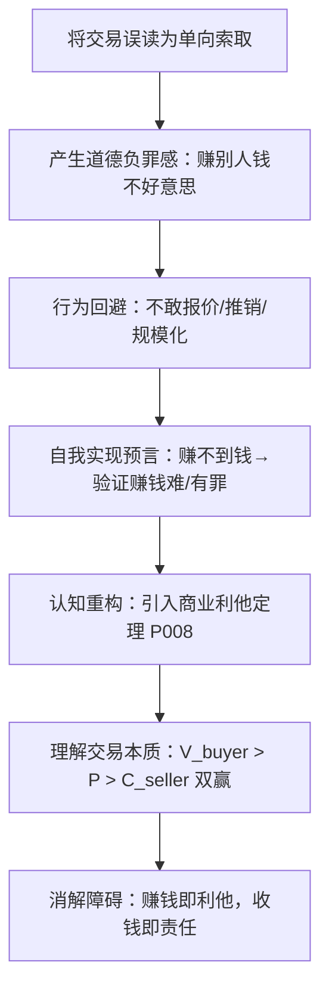
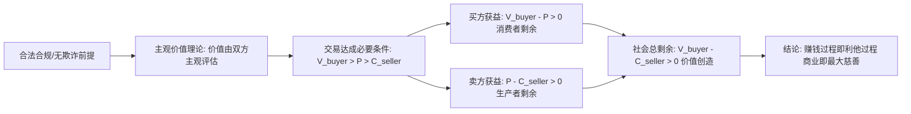
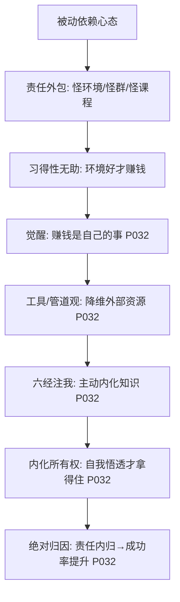
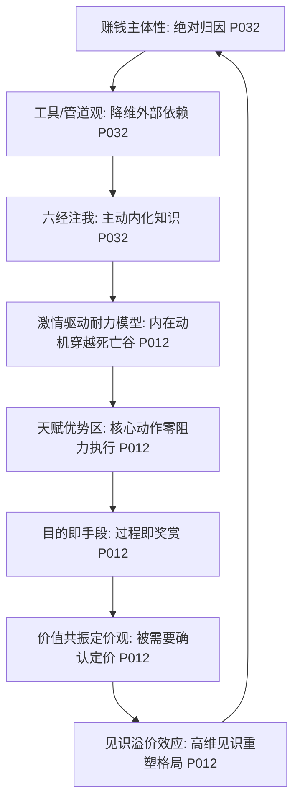
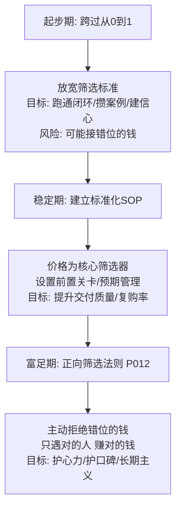
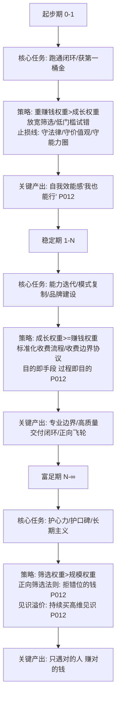

# 第 1 章 商业认知重构 —— 从“赚钱有罪”到“利他即赚钱”
作者：龙哥

## 学习目标

- 理解‘赚钱有罪’心理障碍的成因、表现及其对商业变现的阻碍作用
- 掌握‘商业利他定理’的底层逻辑：基于主观价值理论证明合法交易是双向价值创造的正和博弈
- 确立‘赚钱主体性’认知：将社群、课程、平台降维为‘工具/管道’，践行‘六经注我’实现认知内化与责任归属
- 学会‘用户筛选与价值匹配’实操策略：不追求普度众生，通过筛选‘值得帮’、‘适合’的用户实现高效利他与商业正向循环
- 能区分不同创业阶段的赚钱权重与成长权重，建立动态调整的阶段性策略
- 识别‘免费是最大的不负责任’的悖论，建立标准化收费流程与话术管理预期

## 1.1 生活类比

想象商业交易是一场**“双向奔赴的礼物交换”**：你（卖方）精心准备了一份礼物（产品/服务），成本是你的心力与资源；客户（买方）手里有钱，但缺的是你礼物里装的“解决方案/安全感/成长/爽感”；价格只是客户为了得到这份礼物，愿意付出的“入场券”。交易达成的那一刻：客户觉得“这礼物值了，我赚到了”；你觉得“这钱值了，我帮到了人”。心理障碍就像你觉得“收钱卖礼物不好意思，像在讹人”，于是不敢伸手要入场券，礼物烂在手里，客户也得不到帮助。用户筛选就像你只把礼物送给“真心需要、懂得珍惜、能用得上”的朋友，而不是大街上随便拉个人硬塞。就像送礼物要看对方需不需要、收不收得起、珍不珍惜，做生意也要筛选“值得帮”、“适合”的用户，才能双向奔赴、长久循环。

## 1.2 概念地图

- 商业认知重构
  - 赚钱心理障碍
    - 道德负罪感：赚别人钱不好意思 —— P008《亦仁：赚钱就是在帮别人，就是在利他》
    - 行为回避：不敢报价/推销/规模化 —— P008《亦仁：赚钱就是在帮别人，就是在利他》
    - 根源：将价值交换误读为单向索取 —— P008《亦仁：赚钱就是在帮别人，就是在利他》
  - 商业利他定理（核心支柱）
    - 主观价值理论：价值由交易双方主观评估决定 —— P008《亦仁：赚钱就是在帮别人，就是在利他》
    - 交易达成公式：买方感知价值 > 价格 > 卖方成本 —— P008《亦仁：赚钱就是在帮别人，就是在利他》
    - 正和博弈本质：双方均获益，无人买单自己觉得不值的东西 —— P008《亦仁：赚钱就是在帮别人，就是在利他》
    - 核心主张：赚钱过程即帮人过程，商业是最大的慈善 —— P008《亦仁：赚钱就是在帮别人，就是在利他》
  - 赚钱主体性
    - 绝对归因：赚钱是自己的事，与外部环境无关 —— P032《亦仁：赚钱是你自己的事情》
    - 工具/管道观：社群/课程/平台是工具非彼岸 —— P032《亦仁：赚钱是你自己的事情》
    - 六经注我：为我所用、我注解，非盲目跪拜 —— P032《亦仁：赚钱是你自己的事情》
    - 内化所有权：自己悟透才是自己的，别人给拿不住 —— P032《亦仁：赚钱是你自己的事情》
  - 用户筛选与价值匹配
    - 双向选择：卖方选买方，买方也选卖方 —— P008《亦仁：赚钱就是在帮别人，就是在利他》, P012《小冯妮儿：赚钱与成长的13条认知》
    - 价格即筛选器：合理定价天然过滤低匹配用户 —— P012《小冯妮儿：赚钱与成长的13条认知》
    - 正向循环：筛选优质用户 → 高质量交付 → 正向反馈 → 信心增强 —— P008《亦仁：赚钱就是在帮别人，就是在利他》, P012《小冯妮儿：赚钱与成长的13条认知》
    - 拒绝错位的钱：赚违背舒适区/价值观的钱长期必反噬 —— P012《小冯妮儿：赚钱与成长的13条认知》
  - 阶段性策略与收费心法
    - 起步期：重赚钱建立信心（第一桶金即强心剂） —— P012《小冯妮儿：赚钱与成长的13条认知》
    - 稳定期：重成长追求自我实现（目的即手段，过程即目的） —— P012《小冯妮儿：赚钱与成长的13条认知》
    - 富足期：重筛选只赚对的钱（正向筛选法则） —— P012《小冯妮儿：赚钱与成长的13条认知》
    - 收费即责任与保护：建立契约倒逼专业、防白嫖内耗 —— P012《小冯妮儿：赚钱与成长的13条认知》
    - 见识溢价：高价格信心源于高维见识的直接目击 —— P012《小冯妮儿：赚钱与成长的13条认知》
    - 激情驱动耐力模型：唯有激情能穿越死亡谷 —— P012《小冯妮儿：赚钱与成长的13条认知》
    - 天赋优势区：无需意志力即可高频执行的行为模式 —— P012《小冯妮儿：赚钱与成长的13条认知》
    - 目的即手段，过程即目的：赚钱是手段，成长才是目的 —— P012《小冯妮儿：赚钱与成长的13条认知》
    - 价值共振定价观：价格源于外部需求的“发现”而非自我定义 —— P012《小冯妮儿：赚钱与成长的13条认知》
    - 免费的代价：免费缺乏契约约束导致双输 —— P012《小冯妮儿：赚钱与成长的13条认知》

## 1.3 赚钱心理障碍 —— 打破“赚钱有罪”的道德枷锁

### 为什么需要这个概念？

普遍存在“赚别人钱不好意思”的道德负罪感，导致不敢报价、不敢推销、不敢规模化。这是商业变现的核心拦路虎，阻碍个体从打工思维向商业思维跃迁。只有消解“赚钱有罪”的错误认知，才能建立积极主动的商业心态。

### 核心定义

> **赚钱心理障碍**（来源：《亦仁：赚钱就是在帮别人，就是在利他》）

> 因认为盈利具有剥削性质，产生的道德负罪感与行为回避。表现为：不敢开口要钱、定价过低、推销时底气不足、抗拒规模化赚钱。

> ——《P008, p.1-2》

### 关键性质

赚钱心理障碍的根源在于对交易本质的误解：将“价值交换”误读为“单向索取”。这种误解具有自我实现预言特性：越觉得赚钱有罪，越不敢赚钱，越验证“赚钱难”。但它可通过认知重构——即理解交易的利他本质——实现彻底消解。

### 典型例子

圈友不敢发朋友圈卖课，怕熟人觉得“割韭菜”；咨询师服务到位却只收微信红包随意，不敢报标准价；电商卖家明明产品优秀，却因“赚差价不好意思”压低利润。

### 边界条件

该概念仅适用于合法合规、无欺诈虚假宣传的正常商业交易场景。若交易涉及虚假宣传、强买强卖、庞氏骗局，则属违法犯罪而非心理障碍。认知重构后仍需配合“用户筛选”策略，避免陷入“普度众生”的无效利他。

### 方法演进图：赚钱心理障碍的形成与消解路径

---

> "很多圈友，还是对赚钱存在偏见，觉得自己赚别人钱不好意思。"
> 
> ——《亦仁：赚钱就是在帮别人，就是在利他》 P008, p.1

> "要真正的意识到赚钱是你自己的事情，和生财有术没关系。"
> 
> ——《亦仁：赚钱是你自己的事情》 P032, p.1

> "世上 99% 的事都是自己的事，想明白了就不会有怪他人的想法了"
> 
> ——《亦仁：赚钱是你自己的事情》 P032, p.2

这组原文直接指出了问题的普遍性：心理障碍不是少数人的特例，而是大多数普通人进入商业领域时的共同起点。接下来我们要做的，就是从底层逻辑上拆解这个误区。

## 1.4 商业利他定理 —— 交易是双向价值创造的正和博弈

### 为什么需要这个概念？

我们需要从底层逻辑上证明“赚钱即利他”，为认知重构提供坚实理论基石。打破零和博弈思维（我赚=你亏），确立商业交易的价值创造本质。这不仅是心理建设，更是后续所有定价、销售、筛选策略的底层逻辑支撑。

### 核心定义

> **商业利他定理**（来源：《亦仁：赚钱就是在帮别人，就是在利他》）

> 在合法合规、无欺诈前提下，商业盈利的必要条件是为他人创造净价值增量。交易达成公式：买方感知价值 > 价格 > 卖方成本，双方均获益。赚钱过程 = 帮助他人解决问题（省钱/省时/赚钱/爽感/安全感）的过程。

> ——《P008, p.2-3》

### 关键性质

商业利他定理建立在主观价值理论基石之上：价值由交易双方主观评估决定，非第三方客观定价。交易具有排他性：没有人会买自己觉得“不值”的东西，交易天然筛选有效价值。该定理普适于所有合法商业模式（电商、知识付费、服务、实体等）。

### 典型例子

简历修改服务：提供者视角“小菜一碟”，求职者视角“改变职业生涯”，价值鸿沟即定价空间；保险销售：客户支付保费获得“安全感”与“风险兜底”，销售获得佣金，双赢；知识付费：学员付费购买“避坑指南/认知跃迁”，创作者获得收益与成就感。

### 边界条件

前提为无虚假宣传、无违法违规、无信息不对称强迫交易。若产品无实际效用、或通过洗脑PUA成交，则不属于该定理保护范畴。利他不等于无偿：利他越深、覆盖越广、频次越高，合理盈利越高。

---

> "在没有虚假宣传违法违规的前提下，任何交易都是在创造价值，都是在给社会做贡献，没有一个傻子会买自己觉得不值的东西。"
> 
> ——《亦仁：赚钱就是在帮别人，就是在利他》 P008, p.2

> "只有对方认为他获得的价值高于他付出的金钱，交易才可能达成。"
> 
> ——《亦仁：赚钱就是在帮别人，就是在利他》 P008, p.2

> "赚钱，就是在帮别人，就是在利他。"
> 
> ——《亦仁：赚钱就是在帮别人，就是在利他》 P008, p.3

> "商业是最大的慈善，赚钱是最好的利他"
> 
> ——《亦仁：赚钱就是在帮别人，就是在利他》 P008, p.3

这组原文构成了**商业利他定理**的完整论证链条：
1. **前提**：合法合规、无欺诈（排除零和/负和博弈的恶性交易）
2. **机制**：主观价值评估（买方感知价值 > 价格）
3. **结论**：交易达成即双赢，卖方盈利 = 买方获得净价值增量
4. **升华**：追求利润最大化 = 追求社会总价值贡献最大化

### 方法演进图：商业利他定理的逻辑推演链条

**素材来源：P008《亦仁：赚钱就是在帮别人，就是在利他》**

### 交易达成公式的逐步推导与逻辑阐释

商业利他定理的核心公式表述为：

$$
\text{交易达成} \iff V_{\text{buyer}} > P > C_{\text{seller}}
$$

**推导步骤与逻辑依据：**

**第一步：主观价值理论确立价值判断的主体性**
根据奥地利学派主观价值理论，价值不内在于商品本身，而取决于评估主体的主观需求强度与稀缺性感知。因此，$V_{\text{buyer}}$ 代表买方对该产品/服务在特定时空下的主观估值，$C_{\text{seller}}$ 代表卖方放弃该产品/服务的机会成本（边际成本）。不存在第三方客观标准能裁决“值多少钱”。

**第二步：交易自愿性推导出不等式链的必要性**
交易是自愿的双向选择。买方只有在感知获得的价值严格大于支付价格（$V_{\text{buyer}} > P$）时才会掏钱，这部分差额即为**消费者剩余**，是购买动力来源。卖方只有在收到价格严格大于成本（$P > C_{\text{seller}}$）时才愿意成交，这部分差额即为**生产者剩余（利润）**，是经营动力来源。若任一不等式不成立，交易即不会自愿达成。

**第三步：不等式链传递性证明社会总剩余为正**
由传递性可得 $V_{\text{buyer}} > C_{\text{seller}}$。这意味着交易创造的总价值（买方估值）超过了资源的总机会成本（卖方成本），差额 $(V_{\text{buyer}} - C_{\text{seller}})$ 即为**社会总剩余/净价值增量**。这是“价值创造”而非“价值转移”的数学证明。

**第四步：利润与利他的等价性**
卖方的每一笔利润 $P - C_{\text{seller}}$，都对应着买方获得的消费者剩余 $V_{\text{buyer}} - P$。利润越高，在 $V_{\text{buyer}}$ 不变前提下意味着 $P$ 越高，买方剩余虽减但仍为正；在竞争市场中高利润往往源于更高的 $V_{\text{buyer}}$（即提供了更大价值）。因此，**你的每一笔利润，都对应着客户获得的超额价值。赚钱越多，说明你帮客户解决的问题越大、覆盖人群越广。**

这个公式揭示了：**商业交易不是零和博弈（我赚=你亏），而是正和博弈（双赢）。“赚钱有罪”源于将“价格>成本”孤立看待，忽略了“价值>价格”的前提。**

**公式推导总结：** 通过主观价值理论与自愿交易原则的四步推导，我们严格证明了：每一笔合法交易背后，都隐含着 $V_{buyer} > P > C_{seller}$ 的不等式链。这不仅在数学上确证了“社会总剩余为正”的价值创造事实，更在逻辑上完成了“赚钱=利他”的等价置换——你的利润，正是客户获得超额价值的镜像。这一推导为后续“收费即责任”“价格即筛选器”“拒绝错位的钱”等实操策略提供了不可动摇的底层逻辑基石。

### 多源对照：关于“利他”的不同维度阐释

下表对比了不同素材对“赚钱即利他”的侧重点与互补阐释：

| 来源 | 侧重点 | 关键论断 |
|------|--------|----------|
| P008《亦仁：赚钱就是在帮别人，就是在利他》 | 交易微观机制 | 单笔交易的主观价值评估机制：$V_{buyer} > P > C_{seller}$ |
| P012《小冯妮儿：赚钱与成长的13条认知》 | 价值发现过程 | 价值非自我定义，而通过高频、多元客户碰撞被“需要”而确立；“小菜一碟”与“改变命运”的视角差即定价空间 |
| P032《亦仁：赚钱是你自己的事情》 | 责任归属 | 赚钱是自己的事，利他程度取决于个体主体性，而非外部环境 |

**P012 补充了关键的“价值发现”视角**：

> "如何才能越卖越贵，越卖越有底气？和这个世界更加激烈的碰撞。在我的眼里，价格=价值，价值不是被任何人定义出来的，而是当你接触到越来越多的人的时候发现自己「被需要」。"
> 
> ——《小冯妮儿：赚钱与成长的13条认知》 P012, p.4-5

这段话告诉我们：**利他不是自我感动的单向输出，而是在市场碰撞中被外部需求“验证”、“确认”、“需要”的双向共振过程。** 你觉得自己“利他了”不算数，客户掏钱投票才算数。

## 1.5 赚钱主体性 —— 从“被动等待赋能”到“六经注我”

### 为什么需要这个概念？

普遍存在“责任外包”心理：将赚钱结果归因于社群、课程、大佬、工具等外部因素。依赖外部赋能导致习得性无助：环境好就赚钱，环境差就怪平台/群/老师。唯有确立“赚钱是自己的事”，才能激活内生动力，实现认知内化与所有权归属。

### 核心定义

> **赚钱主体性**（来源：《亦仁：赚钱是你自己的事情》）

> 个体深刻认知并接受“赚钱结果由自己唯一负责”这一事实。

> ——《P032, p.1》

> **工具/管道观**（来源：《亦仁：赚钱是你自己的事情》）

> 将社群、课程、平台、大佬定性为“工具/管道”而非“彼岸/救世主”。

> ——《P032, p.1》

> **六经注我**（来源：《亦仁：赚钱是你自己的事情》）

> 学习外部知识为我所用、我注解，而非盲目跪拜、教条遵循（我注六经）。

> ——《P032, p.1》

### 关键性质

赚钱主体性包含绝对归因：赚钱概率与承担责任程度正相关，责任内归是成功率提升的前提。内化所有权：自己悟透才是自己的，别人给的（外部灌输）若无自悟则“拿不住”。该观点非对抗性：非否定外部资源价值，而是明确“资源上限取决于个体接纳度与执行力”。

### 典型例子

社恐成员：从“万事开头难、等大佬带” → “主动输出、复盘迭代、年入百万”；知识付费用户：从“买课不学、怪课程烂” → “六经注我、提炼SOP、实战变现”；创业者：从“缺资源/缺人脉/缺风口” → “盘点手中牌、匹配能力圈、小步快跑”。

### 边界条件

不排斥付费学习/加入社群，但要求“付费=买工具/买环境/买时间”而非“买结果/买保证”。社群/工具的边界：提供信息差、同伴样本、实战训练、高密度周报，不承担执行责任。认知内化需经过“实践验证”闭环：输入→实操→复盘→沉淀→迁移，单纯听懂不算内化。

---

> "要真正的意识到赚钱是你自己的事情，和生财有术没关系。"
> 
> ——《亦仁：赚钱是你自己的事情》 P032, p.1

> "生财，是工具，是管道，不是彼岸"
> 
> ——《亦仁：赚钱是你自己的事情》 P032, p.1

> "六经注我，而非我注六经"
> 
> ——《亦仁：赚钱是你自己的事情》 P032, p.1

> "自己悟到才是自己的，别人给也拿不住。"
> 
> ——《亦仁：赚钱是你自己的事情》 P032, p.1

这组原文构成了**赚钱主体性**的完整认知闭环：
1. **归因重构**：赚钱结果 = f(自我认知、决策、行动)，而非 f(环境、社群、他人)
2. **资源定位**：外部资源 = 工具/管道（上限取决于你的用工水平），非彼岸/救世主
3. **学习范式**：六经注我（主动内化、为我所用）vs 我注六经（被动跪拜、教条遵循）
4. **所有权确认**：只有经过“实践验证”闭环（输入→实操→复盘→沉淀→迁移）的认知，才是真正属于你的资产

### 方法演进图：从被动依赖到主体性觉醒

**素材来源：P032《亦仁：赚钱是你自己的事情》**

### 多源对照：关于“主体性”的互补阐释

| 来源 | 核心概念 | 关键差异/互补 |
|------|----------|---------------|
| P032《亦仁：赚钱是你自己的事情》 | 绝对归因、工具/管道观、六经注我 | 强调认知层面的“去权威化”与责任内归 |
| P008《亦仁：赚钱就是在帮别人，就是在利他》 | 用户筛选、价值匹配 | 将主体性落地为具体的经营动作：筛选适合的用户 |
| P012《小冯妮儿：赚钱与成长的13条认知》 | 天赋匹配、激情驱动、阶段性策略 | 将主体性具体化为“发挥天赋”、“跟随激情”、“动态调整权重”的执行策略 |

**共识**：个体是赚钱结果的唯一责任主体，外部资源仅为辅助。

**分歧/互补**：P032 给出“元认知”层面的定性（心态）；P008 给出“经营动作”层面的落地（筛选）；P012 给出“执行策略”层面的指导（天赋/激情/阶段）。

---

## 1.6 核心执行力模型：激情、天赋与定价的内在逻辑

**注**：本节整合了原 1.5 节中嵌入的五大概念，使“赚钱主体性”落地为可执行的内驱力与定价体系。

### 1.6.1 激情驱动耐力模型 —— 长期主义的心力燃料

**概念定义**：激情驱动耐力模型指商业长周期中，意志力有限且易耗竭，唯有“不挣钱也甘愿做”的激情能提供穿越漫长不盈利期（死亡谷）所需的持久耐力。

**核心主张**：

> "很多生意做到最后，都是在日复一日的打磨中拼耐力...如果没有持续的激情注入，那种不挣钱也甘愿去做的耐力，做到后面你就会自我迷失...更可怕的，也许成功离你很近，你因为心力不足更容易放弃。"
> 
> ——《小冯妮儿：赚钱与成长的13条认知》 P012, p.5-6

**逻辑阐释**：意志力是消耗性资源，靠强迫自己“坚持”只能撑过短期。激情则是再生性能量：当你从事的事业触及核心价值观、发挥天赋优势、产出即时正反馈时，行动本身即产生多巴胺奖赏，形成“越做越有劲”的正向循环。这解释了为何“赚钱主体性”必须结合“天赋匹配”与“激情驱动”才能落地——没有主体性，你找不到属于自己的激情赛道；没有激情，主体性在长周期挫折面前会崩塌。

**理论锚定**：该模型呼应心理学**自我决定理论**——内在动机（自主性、胜任感、归属感）产生的持久性显著优于外在动机（金钱、奖励）；亦呼应安吉拉·达克沃斯**毅力**理论——激情是坚持长期目标的核心燃料，而非单纯的意志力。

### 1.6.2 天赋优势区 —— 低阻力高绩效的执行锚点

**概念定义**：天赋优势区指无需意志力即可日常高频执行的行为模式，映射为业务核心动作可实现高绩效低阻力执行。

**核心主张**：

> "赚钱要发挥自己的天赋优势，去做不需要用意志力就能坚持的事，这样更容易成功。比如我是个话唠，每天都会找几个朋友聊天，做保险一个核心点就是你要每天聊够足够多的人，然而这件事是我的日常，我不需要用意志力逼迫自己就能实现。"
> 
> ——《小冯妮儿：赚钱与成长的13条认知》 P012, p.3-4

**逻辑阐释**：天赋不是“擅长什么”，而是“什么事让你不觉得累、甚至上瘾”。商业成功的概率 = 天赋匹配度 × 激情强度 × 执行时长。当核心业务动作（如销售、写作、编程、分析）落入天赋优势区时，执行阻力趋近于零，复利效应最大化。这是“赚钱主体性”在执行层面的具象化：主体性负责“选对赛道”，天赋负责“跑得长久”。

**理论锚定**：该概念对应战略管理**资源基础观**中的“核心竞争力”理念——将独特、难以模仿、可复用的个人特质（天赋）转化为商业优势；亦呼应**心流理论**——技能与挑战高度匹配时产生的沉浸体验消解了意志力消耗。

### 1.6.3 目的即手段，过程即目的 —— 赚钱与成长的辩证统一

**概念定义**：赚钱（目的）仅是驱动个体进化的手段，真正的收益在于对抗不确定性过程中发生的能力迭代与心力增长（过程）。

**核心主张**：

> "引用涛哥所说，赚钱是最好的修行，我深信，因为赚到钱是一个结果，你为了这个结果需要不断升级打怪，对抗这个世界的不确定性，而这个过程你必然成长。所以目的只是手段，过程才是目的。"
> 
> ——《小冯妮儿：赚钱与成长的13条认知》 P012, p.2

**逻辑阐释**：若视赚钱为终极目的，一旦达成即陷入虚无或恐惧失去；若视成长为终极目的，赚钱只是验证成长的“计分卡”，过程中的每一次迭代（认知升级、技能习得、心力增强）都是不可被剥夺的真实收益。这解决了“赚钱焦虑”：当下没有结果也没关系，因为我在成长；有了结果也不会骄傲，因为那是过程的副产品。

### 1.6.4 价值共振定价观 —— 价格源于被需要，而非自我定义

**概念定义**：价格源于外部需求的“发现”而非自我定义；提供者视角的“小菜一碟”与需方“改变命运”的鸿沟即定价空间。

**核心主张**：

> "如何才能越卖越贵，越卖越有底气？和这个世界更加激烈的碰撞。在我的眼里，价格=价值，价值不是被任何人定义出来的，而是当你接触到越来越多的人的时候发现自己「被需要」。这件事对你来说小菜一碟不值钱，但对于一个刚毕业的人来说这有可能会改变别人职业生涯。"
> 
> ——《小冯妮儿：赚钱与成长的13条认知》 P012, p.4-5

**逻辑阐释**：定价不是“拍脑袋决定”，而是“被市场教育出来的”。每一次高频、多元的客户碰撞，都是在校准你的价值坐标。当你发现原本觉得“微不足道”的专业，能精准解决特定人群的“生死大事”时，定价底气自然生成。这打破了“自我怀疑→低价→吸引低质客户→更怀疑”的恶性循环，建立“高频碰撞→被需要确认→敢卖高价→筛选高质客户→更强确认”的正向飞轮。

**理论锚定**：该观点对应行为经济学**锚定效应**的逆向应用——不以成本为锚，以客户感知价值为锚；亦呼应**主观价值理论**的实战推演——价值在交易双向互动中被共同发现而非单向定义。

### 1.6.5 见识溢价效应 —— 高价格信心源于高维见识的直接目击

**概念定义**：高价格信心源于亲眼目睹高阶商业模式/定价锚点；主动买见识是打破认知天花板的最短路径。

**核心主张**：

> "想赚更多钱，先花钱去买见识。一个敢出高价卖的人往往不是自己来的迷之自信，而是他亲眼看到了别人能卖这么多，并且能卖出去。我的信仰被充值了，我的格局打开了，原来还有这样的远方。"
> 
> ——《小冯妮儿：赚钱与成长的13条认知》 P012, p.6-7

**逻辑阐释**：个体的定价上限受限于“见过的最高价格/最牛模式”。认知无法通过“自我想象”突破，只能通过“眼见为实”重构。花钱购买高阶社群、咨询、考察，本质是购买“确定性样本”：原来这也能卖、这么卖、这么贵。见识一旦获得，不可逆地重塑了格局上限，进而重塑定价锚点。

**理论锚定**：该效应呼应认知心理学**可得性启发式**与**社会学习理论**——通过观察他人成功案例（替代性经验）重塑自我效能感与认知边界；亦对应战略管理中**标杆学习**的核心逻辑。

### 方法演进图：核心执行力模型的内在联动

**素材来源：P032《亦仁：赚钱是你自己的事情》、P012《小冯妮儿：赚钱与成长的13条认知》**

---

## 1.7 用户筛选与价值匹配 —— 不追求普度众生，只做精准利他

### 为什么需要这个概念？

“商业利他定理”不等于无条件利他。盲目普度众生会导致资源耗散、价值错配。只有筛选“值得帮”“适合”的用户，才能确保双方价值感知匹配，实现高效利他。筛选机制本质是保护提供者心力、提升交付质量、建立商业正向循环。

### 核心定义

> **价值匹配**（来源：《亦仁/小冯妮儿》）

> 买方感知价值与卖方提供价值在特定场景下高度重合。

> ——《P008, p.3; P012, p.6》

> **用户筛选**（来源：《亦仁/小冯妮儿》）

> 主动选择“能听懂、买得起、配合度高、反馈好”的目标客群。

> ——《P008, p.3; P012, p.6》

> **正向循环**（来源：《亦仁/小冯妮儿》）

> 筛选优质用户 → 高质量交付 → 正向反馈 → 信心增强 → 更好产品

> ——《P008, p.3; P012, p.6》

### 关键性质

用户筛选体现双向选择：不仅卖方选买方，买方也在选卖方，匹配度决定转化率与复购率。价格即筛选器：合理定价天然过滤低匹配度用户，降低沟通成本与售后风险。必须拒绝“错位的钱”：赚违背舒适区/价值观/预期管理的钱，长期必反噬。

---

> "赚钱就是在帮助值得帮的人 。筛选适合的用户 。"
> 
> ——《亦仁：赚钱就是在帮别人，就是在利他》 P008, p.3

> "当你不为生计发愁，有的钱让赚的你不舒服，我劝你宁可不赚。因为赚了不对的钱，后面极有可能反噬你。"
> 
> ——《小冯妮儿：赚钱与成长的13条认知》 P012, p.7

> "只遇对的人，赚对的钱。"
> 
> ——《小冯妮儿：赚钱与成长的13条认知》 P012, p.7

这组原文揭示了筛选的三个层次：
1. **起步期**：为了跑通闭环，可适当放宽标准（P012 阶段性策略）
2. **稳定期**：建立标准化筛选 SOP，价格作为核心筛选器（P012 收费边界协议）
3. **富足期**：主动拒绝“错位的钱”，保护心力与长期口碑（P012 正向筛选法则）

### 典型例子

保险销售：只服务“认可长期价值、配合健康告知、按时缴费”的客户，拒绝“只想买返佣/短期退保”者；知识付费：设置“作业打卡/面试/预习”门槛，筛选高意愿学员，提升结课率与口碑；咨询服务：付费前先“问题澄清/快速评估”，非匹配型需求直接分流免费资源/拒单。

### 边界条件

起步期（缺案例/缺信心/缺现金流）可适当放宽筛选标准，以“跑通闭环”为第一要务。筛选不等于傲慢/冷漠：需建立“开门做生意基础解释成本”机制，接受必要的非精准咨询。核心标准：该用户的问题是否在我的能力圈内？解决后双方是否都爽？是否利于长期口碑？

### 方法演进图：用户筛选的三阶段动态演进

**素材来源：P008《亦仁：赚钱就是在帮别人，就是在利他》、P012《小冯妮儿：赚钱与成长的13条认知》**

---

## 1.8 阶段性策略与收费心法 —— 动态调整权重，建立契约边界

### 为什么需要这个概念？

创业不是线性过程，不同阶段面临的核心约束不同。起步期缺信心缺现金流，稳定期缺成长缺突破，富足期缺筛选缺专注。僵化应用单一策略会导致“起步期不敢收钱”、“稳定期只赚钱不成长”、“富足期贪多嚼不烂”。同时，收费不仅是商业动作，更是心理契约的建立与心力边界的守护。

### 核心定义

> **阶段性权重分配**（来源：《小冯妮儿：赚钱与成长的13条认知》）

> 根据创业阶段与经济压力动态调整“赚钱权重”与“成长权重”：起步期重赚钱（建立信心），稳定期重成长（追求自我实现），富足期重筛选（只赚对的钱）。

> ——《P012, p.2-3, 7》

> **收费即责任与保护**（来源：《小冯妮儿：赚钱与成长的13条认知》）

> 收费是建立责任契约、倒逼专业交付的机制，同时是防止“白嫖”导致心理内耗、维护心理边界的自我保护机制。

> ——《P012, p.6-7》

> **见识溢价效应**（来源：《小冯妮儿：赚钱与成长的13条认知》）

> 高价格信心源于高维见识的直接目击。通过付费购买见识（认知更高阶的商业模式/定价锚点），可打破认知天花板，实现格局跃迁。

> ——《P012, p.6-7》

> **第一桶金认知价值**（来源：《小冯妮儿：赚钱与成长的13条认知》）

> 创业初期赚到第一笔钱的核心价值不在于金额，而在于建立“我也能行”的自我效能感，该认知作为强心剂支撑后续面对不确定性的心理韧性。

> ——《P012, p.1-2》

> **免费的代价**（来源：《小冯妮儿：赚钱与成长的13条认知》）

> 免费服务缺乏契约约束，导致提供者敷衍交付（不负责）与接收者低估价值（白嫖），双输局面；收费才能建立专业边界与高质量交付闭环。

> ——《P012, p.6-7》

### 关键性质

**阶段性权重分配**遵循动态调整原则：
- **起步期（0-1）**：赚钱权重 > 成长权重。核心任务是跑通商业闭环、获得第一桶金。第一桶金的核心价值不在于金额，而在于建立“我也能行”的自我效能感，作为对抗不确定性的强心剂。此阶段可适当放宽筛选标准、降低定价门槛，但需设定“止损线”：不赚违法违规、严重违背价值观、超出能力圈导致交付崩盘的钱。
- **稳定期（1-N）**：成长权重 ≥ 赚钱权重。经济压力缓解后，核心任务转向能力迭代、模式复制、品牌建设。践行“目的即手段，过程即目的”：赚钱是驱动进化的手段，成长（对抗不确定性的能力迭代）才是目的，过程本身即奖赏。此阶段应建立标准化收费流程与话术，通过“收费边界协议”管理预期、筛选高意向客户。
- **富足期（N-∞）**：筛选权重 > 规模权重。不为生计发愁时，主动拒绝“错位的钱”，只遇对的人、赚对的钱。践行“正向筛选法则”：赚违背舒适区/价值观/预期管理的钱，长期必反噬。

**收费即责任与保护**的双重机制：
- **责任契约**：收了钱就有了责任，有了责任就不能随便一干、随口一说，必须逼着自己好好帮别人解决问题。免费反而给提供者留了后路（敷衍），给接收者留了借口（不珍视）。
- **心力保护**：不主动收钱，就要承担被白嫖后的心理不适（怨气、自我否定、边界模糊）。建立“客客气气大大方方收钱”的标准化话术，是对自己最大的保护。

**见识溢价效应**的操作路径：主动付费接触/观察行业标杆的高阶商业模式、定价体系、客群画像，利用“眼见为实”打破认知边界，重塑定价锚点与格局上限。正如前辈盯着福布斯富豪榜卖亿元保单，让作者“信仰被充值、格局打开”。

**免费的代价**揭示的双输悖论：免费缺乏契约约束 → 提供者敷衍（不负责）+ 接收者低估（白嫖） → 双方均无收获。收费才能建立专业边界与高质量交付闭环。

### 典型例子

起步期：自由职业者接单不挑客户、低价跑量，只为攒下第一个10万存款，建立“我能养活自己”的底气。稳定期：顾问建立“付费诊断→方案交付→复盘迭代”标准化流程，拒绝免费咨询，将精力聚焦于头部20%高价值客户。富足期：投资人拒绝不认同理念的LP资金，创始人拒绝高估值但强控制权的条款，只做价值观对齐的长期主义生意。

### 边界条件

阶段划分非绝对时间节点，而是由“经济安全边际（现金流覆盖生活成本倍数）”与“业务确定性（复购率/转化率稳定性）”共同判定。起步期放宽筛选 ≠ 无底线接单，必须守住法律红线与核心价值观底线。收费话术需根据业务形态定制（如：咨询按次/按项目、课程按期/按模块、社群按年/按阶），核心原则是“预期管理前置、交付标准显性、退费机制清晰”。

### 多源对照：阶段性策略与收费心法的素材溯源

| 概念 | 核心素材 | 关键原文支撑 |
|------|----------|--------------|
| 阶段性权重分配 | P012《小冯妮儿：赚钱与成长的13条认知》 | "在起步阶段，创业副业赚钱的比例可以占的比重更高...如果你已经没有经济压力了，选择创业和副业方向成长的比例要占的更大...当你不为生计发愁，有的钱让赚的你不舒服，我劝你宁可不赚。" |
| 第一桶金认知价值 | P012《小冯妮儿：赚钱与成长的13条认知》 | "赚到第一块钱的手感和信心非常重要...'我也能行'这个认知是我的强心剂，不管我后面碰上各种困难，我觉得都可以迎难而上。" |
| 目的即手段，过程即目的 | P012《小冯妮儿：赚钱与成长的13条认知》 | "赚到钱是一个结果，你为了这个结果需要不断升级打怪，对抗这个世界的不确定性，而这个过程你必然成长。所以目的只是手段，过程才是目的。" |
| 激情驱动耐力模型 | P012《小冯妮儿：赚钱与成长的13条认知》 | "很多生意做到最后，都是在日复一日的打磨中拼耐力...如果没有持续的激情注入，那种不挣钱也甘愿去做的耐力，做到后面你就会自我迷失。" |
| 天赋优势区 | P012《小冯妮儿：赚钱与成长的13条认知》 | "赚钱要发挥自己的天赋优势，去做不需要用意志力就能坚持的事...比如我是个话唠...这件事是我的日常，我不需要用意志力逼迫自己就能实现。" |
| 价值共振定价观 | P012《小冯妮儿：赚钱与成长的13条认知》 | "价值不是被任何人定义出来的，而是当你接触到越来越多的人的时候发现自己「被需要」...这件事对你来说小菜一碟不值钱，但对于一个刚毕业的人来说这有可能会改变别人职业生涯。" |
| 收费即责任与保护 | P012《小冯妮儿：赚钱与成长的13条认知》 | "收钱才是最大的负责...收了钱就有了责任...收钱才是对自己最大的保护...不主动收钱，就要想好承担被别人白嫖后的心理不适。" |
| 见识溢价效应 | P012《小冯妮儿：赚钱与成长的13条认知》 | "想赚更多钱，先花钱去买见识...他亲眼看到了别人能卖这么多，并且能卖出去。我的信仰被充值了，我的格局打开了。" |
| 免费的代价 | P012《小冯妮儿：赚钱与成长的13条认知》 | "你不好意思收钱，不要认为这是善良，你同时也给自己留了后路...收钱才是对自己最大的保护。" |
| 正向筛选法则 | P012《小冯妮儿：赚钱与成长的13条认知》 | "只遇对的人，赚对的钱。" |

### 方法演进图：阶段性策略的动态调整与收费契约建立

**素材来源：P012《小冯妮儿：赚钱与成长的13条认知》**

---

## 1.9 设计中的取舍

### 核心 Trade-off 深度分析

| 维度 | 选择 | 放弃 | Trade-off 逻辑 |
|------|------|------|----------------|
| **资源定位** | **工具/管道观**：外部资源为辅助手段，上限取决于个体用工水平 | **彼岸/救世主观**：误将社群/课程视为终极归宿，产生习得性无助 | 工具观激活主体性，虽需更高自驱力，但赋予个体控制权；彼岸观降低认知负荷，但将命运交付他人，长期必失控。 |
| **学习范式** | **六经注我**：主动内化、为我所用，经实践验证闭环才算所有权 | **我注六经**：被动跪拜、教条遵循，听懂即以为得 | 六经注我虽认知负荷高、周期长，但形成不可剥夺的隐性知识资产；我注六经看似高效，实则构建“借来的认知”，遇变局即崩塌。 |
| **驱动机制** | **激情驱动**：“不挣钱也甘愿做”的内在动机，再生性能量，穿越死亡谷 | **意志力驱动**：消耗性资源，靠强迫坚持，短期有效长期崩溃 | 激情驱动需前期探索成本（找到天赋匹配区），但边际成本递减；意志力驱动零启动成本，但边际成本递增至耗竭。 |
| **交易边界** | **收费即契约**：建立责任边界、倒逼专业、筛选高意向、护心力 | **免费/低价善意**：缺乏契约约束，提供者敷衍+接收者低估，双输 | 收费虽设门槛降低触达，但换取交付质量与心理边界；免费看似利他，实则害人害己，无法规模化与长期化。 |
| **筛选机制** | **价格为核心筛选器**：规模化、标准化、低边际成本、自动24h工作 | **面试/人工筛选**：精准但依赖创始人时间，难以规模化 | 价格同时传递价值锚点、建立心理契约、倒逼交付标准，是“收费即责任”的核心载体。面试仅作高客单价辅助关卡。 |
| **阶段策略** | **动态权重分配**：起步重赚钱建信心、稳定重成长求实现、富足重筛选拒反噬 | **全阶段统一标准**：僵化应用单一策略（如始终不敢收钱/始终只赚钱/始终普度众生） | 战术妥协（起步期放宽标准）≠ 战略背叛。起步期明知“不匹配”仍主动承担短期心力成本，以“活下来/建信心”为锚，设定止损线，跨过生存线立即收紧。 |

### 为什么选择“价格作为核心筛选器”而非“面试筛选”？

价格筛选具有**规模化、标准化、低边际成本**的优势：一旦定价体系建立，自动24小时工作，无需创始人逐个面试。面试筛选虽精准但依赖创始人时间，难以规模化。价格同时传递价值锚点、建立心理契约、倒逼交付标准，是“收费即责任与保护”的核心载体。面试仅作为高客单价（如万元以上咨询）的辅助关卡，而非主力筛选器。

### 为什么“起步期放宽标准”不违背“拒绝错位的钱”原则？

这是**战术妥协**而非**战略背叛**。起步期放宽标准的前提是：明确知晓对方“不匹配”，但主动选择“为了跑通闭环、获得正反馈”而承担短期心力成本。这要求创始人具备**清醒的元认知**——我知道这单钱“赚得不舒服”，但我为了“活下来/建立信心”主动买单，且设定明确止损线（如：最多接3单、不续费、不求证言）。一旦跨过生存线，必须立即收紧标准，回归“只赚对的钱”轨道。混淆“战术妥协”与“战略原则”，是导致很多创业者长期陷入低价、低质、高内耗泥沼的根源。

---

## 1.10 动手练习

### 练习1：拆解你的‘赚钱心理障碍’清单

1. 列出你在过往尝试变现（卖课、卖货、咨询、推销等）过程中，因‘不好意思’、‘怕被骂割韭菜’、‘觉得自己不配’而放弃或降价的 3-5 个具体场景。
2. 对每个场景，写下当时的核心念头（如：‘这也就值50块，卖500块良心过不去’）。
3. 用‘商业利他定理’逐条反驳：若客户买单，说明他感知价值>价格；你不卖，反而剥夺了他获得价值的机会。
4. 思考问题：如果不收钱，你能否长期坚持高质量交付？客户不付费，是否会珍视并用好你的产品？

### 练习2：绘制‘工具/管道’依赖图谱与‘六经注我’行动清单

1. 画一张思维导图，中心写‘我的赚钱目标’，分支列出你当前依赖的所有外部资源：社群、付费课程、大佬指导、软件工具、平台流量等。
2. 给每个资源打标签：是‘工具’（我主动用，如剪映）、‘管道’（我主动跑，如小红书）、还是‘彼岸’（我被动等，如‘进了这个群就能躺赚’、‘买了这课就能财富自由’）。
3. 针对所有‘彼岸’型依赖，制定‘六经注我’行动：本周我将如何‘为我所用’？（例：不再等大佬发作业，而是先按自己理解跑通MVP；不再全盘背诵课程，而是提炼1个SOP立即实操）。
4. 思考问题：若明天这些外部资源全部消失，我手里还剩下什么可复用的核心能力？

### 练习3：设计你的‘用户筛选标准化 SOP’

1. 定义你的核心产品/服务解决的具体问题（如：帮宝妈解决‘孩子不爱阅读’）。
2. 列出‘理想用户’的 5 个硬性指标（如：孩子3-6岁、妈妈认可绘本价值、愿投入每天15分钟陪读、预算500-2000元/年、愿意配合打卡反馈）。
3. 列出‘拒绝用户’的 3 个红线特征（如：只要免费资料/想速成不陪伴/孩子已有严重阅读障碍需医疗干预）。
4. 设计‘付费前筛选动作’：免费公开课/测评问卷/1对1 15分钟诊断沟通/预习作业，至少设置 1 道筛选关卡。
5. 设定‘退款/劝退话术’：服务中发现价值观严重不合或预期无法管理时，如何体面地结束合作并保护双方心力？
6. 思考问题：起步期现金流紧张时，你会放宽哪条标准？放宽后如何防止‘错位的钱’反噬？

### 练习4：绘制你的‘阶段性权重分配’与‘见识投资’路线图

1. 判断你当前所处阶段：起步期（月现金流<生活成本2倍）、稳定期（现金流覆盖生活成本3-6个月、有稳定复购）、富足期（被动收入覆盖生活成本、有显著时间自由度）。
2. 根据阶段填写权重表：赚钱权重___%，成长权重___%，筛选权重___%。核心行动3件事：____、____、____。
3. 列出你未来3个月计划“买见识”的3个具体动作：付费加入高阶社群/拜访标杆同行/购买高客单价竞品课程/参加行业闭门会等，预算___元。
4. 设定“定价锚点挑战”：本月尝试将核心产品价格上调___%，观察转化率与客户反馈变化，记录心理活动与认知迭代。

---

## 1.11 本章小结

这一章中我们学习了商业认知重构的四大支柱。首先，我们拆解了**赚钱心理障碍**的成因——将“价值交换”误读为“单向索取”导致的道德负罪感，它让人不敢报价、不敢推销、不敢规模化。其次，我们从**主观价值理论**出发证明了**商业利他定理**：合法交易中买方感知价值>价格>卖方成本，双方均获益，赚钱过程即帮人利他过程。接着，我们确立了**赚钱主体性**：个体为赚钱结果唯一责任主体，将社群/课程/平台降维为“工具/管道”，践行“六经注我”实现认知内化与所有权归属。随后，我们掌握了**核心执行力模型**：激情驱动耐力模型支撑长期主义、天赋优势区降低执行阻力、目的即手段重构赚钱与成长关系、价值共振定价观确立价格源于被需要、见识溢价效应打破认知天花板。再次，我们学会了**用户筛选与价值匹配**实操：不追求普度众生，通过价格与标准筛选“值得帮、适合”的用户，建立筛选→交付→反馈→信心的商业正向循环。最后，我们建立了**阶段性策略与收费心法**：起步期重赚钱建信心（第一桶金即强心剂）、稳定期重成长求实现（目的即手段，过程即目的）、富足期重筛选拒反噬（正向筛选法则），并确立收费即责任与保护、免费的代价等核心心法。

本章我们一起学习了以下概念：

下表汇总了本章所有核心概念及其释义，供快速回顾与检索：

| 概念 | 解释 |
|------|------|
| 赚钱心理障碍 | 因‘赚钱有罪’的道德负罪感导致不敢报价、推销、规模化，核心是将价值交换误读为单向索取 |
| 商业利他定理 | 合法交易基于主观价值评估，买方感知价值>价格>卖方成本，双方均获益，赚钱过程即帮人利他过程 |
| 主观价值理论 | 价值由交易双方主观决定，无第三方客观标准；没有人会买自己觉得不值的东西，交易天然筛选有效价值 |
| 赚钱主体性 | 个体为赚钱结果唯一责任主体；社群/课程/平台是工具管道非彼岸；践行六经注我，自我悟透才拥有所有权 |
| 工具/管道观 | 将外部资源定性为辅助手段，价值上限取决于个体接纳度与执行力，误视为救世主导致习得性无助 |
| 六经注我 | 学习外部知识为我所用、我注解，而非我注六经（盲目跪拜），体现认知内化与主体性思考的统一 |
| 激情驱动耐力模型 | 意志力有限易耗竭，唯有‘不挣钱也甘愿做’的激情能穿越死亡谷，支撑长期主义 |
| 天赋优势区 | 无需意志力即可日常高频执行的行为模式，映射为业务核心动作可实现高绩效低阻力执行 |
| 目的即手段，过程即目的 | 赚钱是驱动进化的手段，成长（对抗不确定性的能力迭代）才是目的，过程本身即奖赏 |
| 价值共振定价观 | 价格源于外部需求的‘发现’而非自我定义；提供者视角的‘小菜一碟’与需方‘改变命运’的鸿沟即定价空间 |
| 见识溢价效应 | 高价格信心源于亲眼目睹高阶商业模式/定价锚点；主动买见识是打破认知天花板的最短路径 |
| 用户筛选 | 主动选择‘能听懂、买得起、配合度高、反馈好’的目标客群，价格天然过滤低匹配用户 |
| 价值匹配 | 买方感知价值与卖方提供价值高度重合；拒绝错位的钱，只遇对的人、赚对的钱 |
| 正向循环 | 筛选优质用户 → 高质量交付 → 正向反馈 → 信心增强 → 更好产品，商业飞轮由此启动 |
| 阶段性权重分配 | 起步期重赚钱建信心，稳定期重成长求实现，富足期重筛选拒反噬，动态调整赚钱与成长权重 |
| 收费即责任与保护 | 收费建立责任契约倒逼专业交付，同时防止白嫖导致心理内耗，是对提供者最大的保护 |
| 第一桶金认知价值 | 核心价值不在于金额，而在于建立‘我也能行’的自我效能感，作为对抗不确定性的强心剂 |
| 免费的代价 | 免费缺乏契约约束导致提供者敷衍、接收者低估，双输；收费才能建立专业边界与高质量交付闭环 |
| 正向筛选法则 | 经济基础允许时主动拒绝错位的钱，只遇对的人、赚对的钱，规避后续反噬风险 |

下一章中，我们将学习**提问与沟通技术**——如何让他人愿意为你思考，构建高效的认知协作与社交杠杆。

