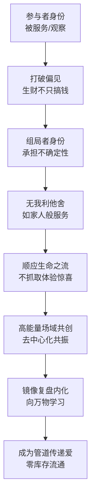
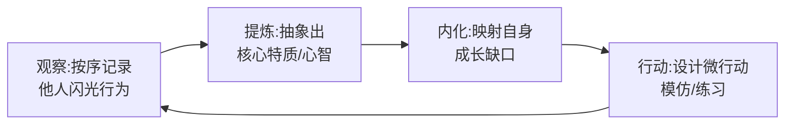
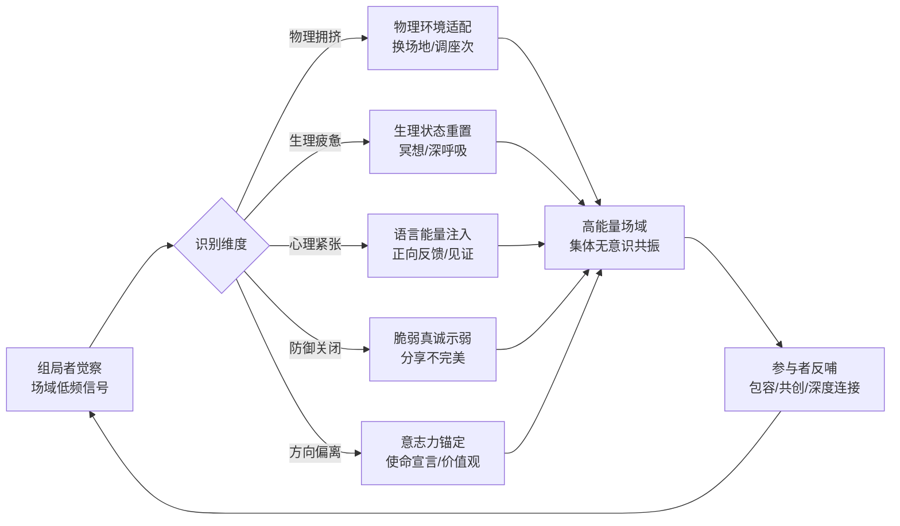
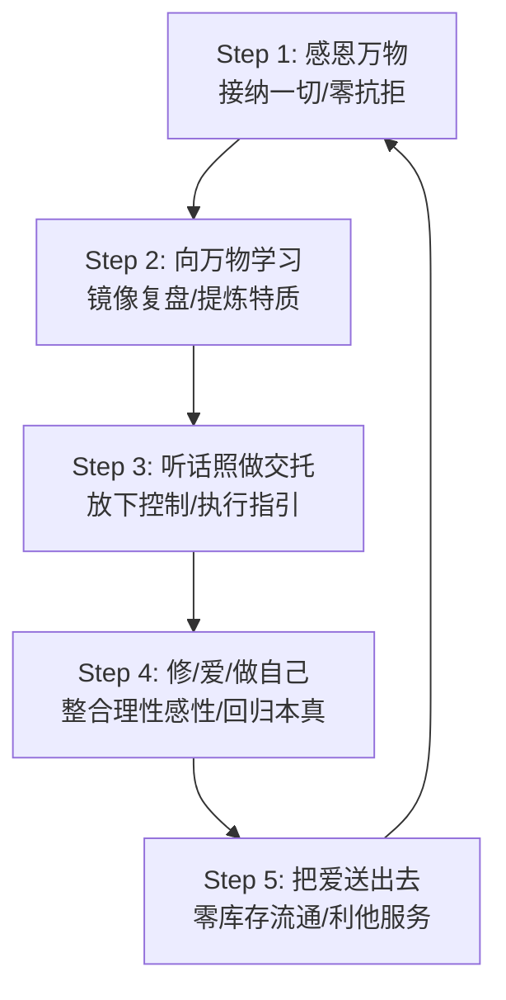
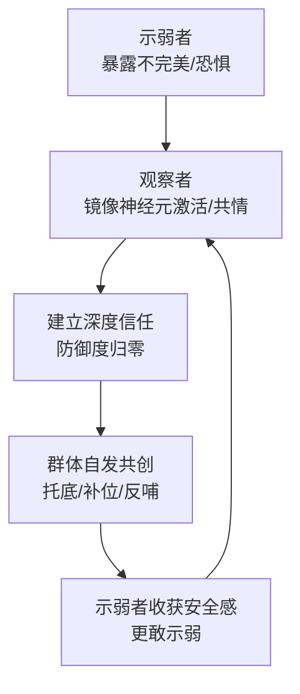
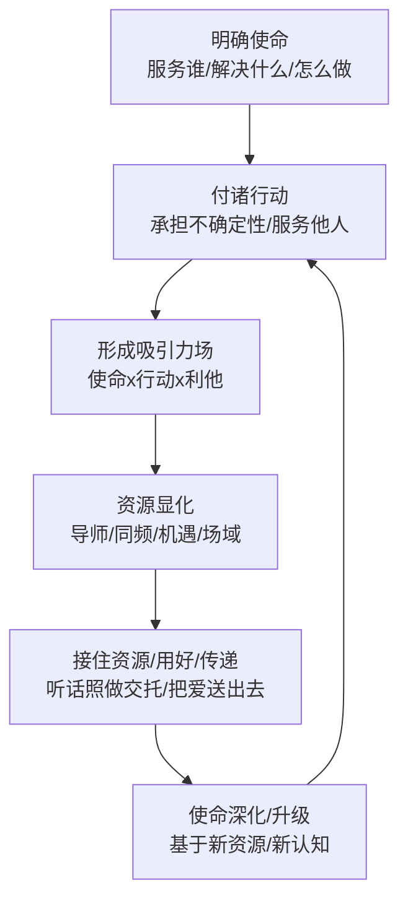

# 第 75 章 身心灵/向内求与高能量场域共创 —— 从“组局即修行”到“成为管道传递爱”

## 学习目标

- 理解“组局即修行”的核心逻辑：如何将服务他人转化为自我成长的最短路径
- 掌握“镜像复盘法”的操作步骤：用他人的闪光点精准映照自己的成长缺口
- 学会“场域能量调频法”的微行动清单：以低成本动作维护群体高频振动状态
- 内化“成为管道”的五步实践闭环：从“为己囤积”转向“为世流通”的终极状态
- 体会“真诚与示弱是最高频连接器”的信任构建机制，打破完美人设束缚
- 领悟“使命吸引同频”的显化规律：以行动显化资源，而非以需求索取资源
- 认知“理性与感性整合”的必要性：补齐右脑直觉/感受能力，实现三脑协同
- 识别生财社群“身心灵/向内求”子文化的成熟特征与价值观差异化优势

## 75.1 生活类比

想象**组局即修行**是一次**“不设防的家宴”**：
- **组局者** = 不当‘完美主持人’，而当‘把家里最好的椅子留给客人、自己端板凳坐、厨房翻车了笑着说‘凑合吃’的主人’
- **镜像复盘** = 客人走后，你不数剩菜，而数‘张三教会我切菜姿势、李四教会我哄孩子睡觉、王五教会我怎么优雅认输’，把每位客人的闪光点装进自己的技能背包
- **场域调频** = 宴席中觉察到空气凝固，不发话‘别吵了’，而是端两杯热茶、讲个自嘲笑话、或带大家深呼吸三次，气场自己就转了
- **成为管道** = 你不把收到的礼物锁保险柜，而是拆开、用好、传递给下一个需要的人，自己只留‘流通的快乐’
- **真诚示弱** = 敢当众承认‘我第一次办宴席、手抖把汤洒了’，反而换来全桌人抢着帮你擦桌子、教你拿勺子
- **使命吸引同频** = 你真心想办‘让孤独者相遇’的局，张大厨就送招牌菜、李琴师就弹曲子、原本够不着的资源顺着‘使命’这根线自己飞过来
就像**河道不贮水、只流水，反而能通江达海、滋养两岸**；人不为己囤积能量，而为世流通爱，反而成就‘自然生长’的自由。

## 75.2 概念地图

身心灵/向内求实践体系
├── 核心心法
│   ├── 组局即修行/服务即成长  —— [P001, docs/202303/20230328_029.md]
│   ├── 无我利他舍  —— [P001, docs/202303/20230328_029.md]
│   ├── 顺应生命之流  —— [P001, docs/202303/20230328_029.md]
│   ├── 成为管道  —— [P001, docs/202303/20230328_029.md]
│   ├── 真诚与示弱是最高频连接器  —— [P001, docs/202303/20230328_029.md]
│   ├── 使命吸引同频/心诚者灵  —— [P001, docs/202303/20230328_029.md]
│   └── 理性与感性整合/三脑协同  —— [P001, docs/202303/20230328_029.md]
├── 核心方法论
│   ├── 镜像复盘法/向万物学习  —— [P001, docs/202303/20230328_029.md]
│   ├── 场域能量调频法  —— [P001, docs/202303/20230328_029.md]
│   ├── 听话照做交托/心想事成显化  —— [P001, docs/202303/20230328_029.md]
│   └── 玛雅流日/Kin55 锚定实践  —— [P001, docs/202303/20230328_029.md]
├── 场域构建要素
│   ├── 高能量场域共创  —— [P001, docs/202303/20230328_029.md]
│   ├── 去中心化能量共振回路  —— [P001, docs/202303/20230328_029.md]
│   └── 安全容器/利他意图/共同价值观  —— [P001, docs/202303/20230328_029.md]
└── 验证与应用
    ├── 第一次组局‘不完美’成就最佳效果  —— [P001, docs/202303/20230328_029.md]
    ├── 生财社群身心灵子文化成熟度验证  —— [P001, docs/202303/20230328_029.md]
    └── 资源显化实证（张潇雨微信/百万创业者/大佬连接）  —— [P001, docs/202303/20230328_029.md]

> **[素材局限性说明]** 本章核心概念均源自单一素材 `docs/202303/20230328_029.md`（P001，即欧阳思组局复盘实录）。概念地图中标注的 P002-P006 为教学大纲预留的独立模块编号，现阶段内容均整合自该单一源。后续建议补充：(1) 更多组局实战复盘案例以验证方法普适性；(2) 场域能量测量的量化工具与神经科学相关研究；(3) “使命吸引同频”在不同样本群体中的纵向追踪数据；(4) 玛雅流日/Kin55 等灵性工具的跨文化对比研究。

## 75.3 组局即修行 —— 让服务他人成为自我成长的最短路径

### 为什么需要这个概念？

- 普通人陷入“独自修行”误区，容易陷入自我感动或认知偏差，缺乏真实场域检验
- 商业社群中普遍存在“只搞钱”的刻板印象，阻碍了身心成长与商业智慧的融合
- 缺乏结构化的服务实践路径，导致利他心、觉察力等核心能力无处落地锻炼

### 核心定义

**组局即修行/服务即成长**（来源：[P001, docs/202303/20230328_029.md]）

我们常陷入“独自修行”的误区：关起门来读书、冥想、写日记，以为这就是成长。但素材作者欧阳思的实践告诉我们，**以发起者身份搭建连接场域，在服务他人、承担不确定性中精进觉察与利他心，才是自我成长的最短路径**。

这个定义包含三层含义：
1. **身份跃迁**：从“参与者”转为“组局者”，认知维度瞬间跃升。你不再是被服务的对象，而是要为场域的每一个细节、每一个人的体验负责。
2. **服务即成长**：将服务对象视作家人般对待（无我利他舍），放下个人得失/控制欲/自我中心，全情投入当下需求。素材中提到“她说服务用户要向家人一样对待”，这句心法让服务从“任务”变成了“修行”。
3. **非线性因果**：不追求直接回报（不抓取），反而因高能量场域吸引最优资源（使命吸引同频）。作者感叹“不需要去抓取任何，就会体验到惊喜”，这正是“顺应生命之流”的核心注脚。

这个概念展示了：真正的成长不是在舒适区里“自我感动”，而是在真实的不确定性中（临时换场地、人数超额、辟谷体验、控场压力）被逼着“破圈”。

### 关键性质

**容错性高**：第一次组局的“不完美”（细节没做好）因真诚示弱，反触发群体包容与共创，成就最佳场域效果。素材记录：“因我第一次组局，有很多地方没做好，但大家对我很包容和提供各种帮助”，克寒Amy主动找场地，董硕带冥想，雅芳服务大家，形成“组局者服务参与者→参与者反哺组局者”的共创闭环。

**边界条件**：
- 必须具备基础的“向内求”觉察意愿，纯商业投机心态无法触发高能量场域
- 场域维持依赖核心发起者的持续“愿力锚定”与“正向反馈”，若发起者能量崩塌，场域随之瓦解
- 非标准化可复制模板，核心在于发起者当下的真实状态（真诚、示弱、觉察），而非流程SOP

### 方法演进图：从参与者到组局者的认知跃迁路径

### 典型例子

- 欧阳思首次组织“身心灵/向内求”分论坛：因人数超额临时换场地、觉察疲劳引导冥想、真诚分享脆弱，最终创造高能量场域，获得张潇雨签名微信、同频高手连接等超预期成果
- 参与者克寒、Amy主动找场地、董硕带冥想、雅芳服务大家，形成“组局者服务参与者→参与者反哺组局者”的共创闭环

### 原文摘录

> "感恩生财，让我从最近一次参加生财龙珠见面会活动参与者身份变成组局者并让我有荣幸组我使命领域的局，并打破了我对生财只搞钱的偏见"
> 
> "带着无我利他舍和感受能量去做事，不需要去抓取任何，就会体验到惊喜"
> 
> "因我第一次组局，有很多地方没做好，但大家对我很包容和提供各种帮助"
> 
> "再次感恩 ta 们的分享和创造的高能量场域给了我很多继续前行和笃定的力量"
> 
> "接下来我能做的唯有继续感恩万物并向万物学习+听话照做交托+修/爱/做自己+再不断把爱送出去，让自己成为一个管道"
> 
> ——《docs/202303/20230328_029.md》

## 75.4 镜像复盘法 —— 用他人的闪光点精准映照自己的成长缺口

### 为什么需要这个概念？

- 传统复盘聚焦“自己做得好/不好”，陷入自我视角盲区，难以发现盲区能力
- 优秀者的特质往往隐性、碎片化，缺乏结构化提取工具转化为自己的能力模型
- “向万物学习”停留在口号层面，缺乏可操作的落地步骤

### 核心定义

**镜像复盘法/向万物学习**（来源：[P001, docs/202303/20230328_029.md]）

传统复盘聚焦“自己做得好/不好”，陷入自我视角盲区，难以发现盲区能力。**镜像复盘法**的核心操作是：按坐席/互动顺序，逐一复盘参与者身上的具体闪光特质，将外在他人作为“镜像”，映照内在需发展的能力，实现“向万物学习”的结构化内化。

这个方法包含四个关键步骤：
1. **全维度覆盖**：涵盖软技能（体贴、勇气）、硬能力（总结力、时间管理）、心智模式（顺应流、愿力、直觉）
2. **具体化锚定**：每个特质绑定具体人物与具体行为场景（如“从敏敏学时间管理”，而非泛泛而谈），便于记忆与迁移
3. **即时内化**：复盘即学习，输出即成长，形成“观察→提炼→内化→行动”的微循环
4. **按序推进**：按照坐席/互动顺序，不遗漏、不偏袒，尊重每个生命的独特馈赠

这个方法展示了：优秀者的特质往往隐性、碎片化，缺乏结构化提取工具转化为自己的能力模型。镜像复盘法正是这个“提取工具”。

### 关键性质

- **全维度覆盖**：涵盖软技能（体贴、勇气）、硬能力（总结力、时间管理）、心智模式（顺应流、愿力、直觉）
- **具体化锚定**：每个特质绑定具体人物与具体行为场景（如“从敏敏学时间管理”，而非泛泛而谈），便于记忆与迁移
- **即时内化**：复盘即学习，输出即成长，形成“观察→提炼→内化→行动”的微循环

### 方法演进图：镜像复盘的四步微循环

### 典型例子与内化路径

下表展示了如何将观察到的他人闪光特质，转化为自身可执行的内化行动（基于素材中14位参与者的复盘记录整理）：

| 镜像对象 | 闪光特质 | 具体场景 | 映射内在缺口 | 内化行动 |
|----------|----------|----------|--------------|----------|
| 董硕 | 觉察与贴心 | 觉察大家疲惫带领冥想 | 缺乏场域生理层面觉察 | 组局中每20分钟扫描一次群体能量状态 |
| Amy | 顺应生命之流/心想事成 | 分享显化干货、顺应变化 | 过度控制、抗拒不确定 | 练习“听话照做交托”，放下理性抓取 |
| 澜澜 | 感受与直觉 | 分享直觉体验 | 理性过剩、右脑欠发达 | 每天记录一次“身体先于大脑知道的事” |
| CRAZY | 愿力 | 坚信身心灵赛道长期坚持 | 信念动摇、易受外界干扰 | 书写使命宣言，每日晨读锚定 |
| 敏敏 | 时间管理 | 高效统筹会议流程 | 拖延、时间感模糊 | 引入番茄钟+时间审计周复盘 |
| 雅芳 | 体贴与谦虚 | 细微关怀他人感受 | 关注点过度内向 | 每次聚会主动关怀3人次 |
| 克寒 | 影响力 | 主动协调资源解决场地问题 | 缺乏主动承担意识 | 练习“看到问题先动手”而非等指令 |

### 边界条件

- 依赖发起者具备“识人慧眼”与“提炼抽象能力”，否则易流于记流水账
- 仅适用于高密度、高真诚、高互动的小规模深度场域（4-14人），大型大会信息密度不足
- 复盘产出为“能力清单”而非“行动清单”，需结合具体业务场景二次转化方可落地

### 原文摘录

> "并从 ta 们身上让我学到很多（以下顺序按照坐顺序来的）"
> 
> "从雅芳学到了体贴和谦虚...从七米学到了她的目标感和表达...从董硕学到觉察和贴心能力...从恋尧...学到她想帮助人的发心...从敏敏学到了时间管理...从兰卡那学到了对自己的真诚...从克寒学到了他的影响力...从小 z 学到了勇气和大胆...从🔅看到她身上那份自信...从周聪让我看到走上身心灵/向内求另外一条路径...从玉兰学到了总结能力和贴心...从 Amy 分享她最近的「心想事成」事...让我更加学会顺应生命之流...从 CRAZY 身上学到了很坚信这条路的愿力...从澜澜身上学到感受和直觉能力"
> 
> ——《docs/202303/20230328_029.md》

## 75.5 场域能量调频法 —— 以微行动维护群体高频振动状态

### 为什么需要这个概念？

- 群体场域极易因疲劳、尴尬、话题偏离、能量低频而塌陷，导致深度连接失效
- 传统主持依赖“控场技巧”（议程、时间、规则），忽视了场域的能量维度（振动频率、集体无意识）
- 缺乏可量化、可操作的“场域维护SOP”，新手组局者无从下手

### 核心定义

**场域能量调频法**（来源：[P001, docs/202303/20230328_029.md]）

群体场域极易因疲劳、尴尬、话题偏离、能量低频而塌陷，导致深度连接失效。传统主持依赖“控场技巧”（议程、时间、规则），忽视了场域的能量维度（振动频率、集体无意识）。

**场域能量调频法**通过具体微行动维护并提升群体集体无意识层面的高频振动状态。其核心五维干预清单如下：

| 维度 | 微行动 | 素材实证 | 作用机制 |
|------|--------|----------|----------|
| 物理环境适配 | 临时换场地、调整座次、改善光线/通风 | 克寒Amy因人数超额找新场地 | 消除物理拥挤带来的压抑感，为能量流动腾挪空间 |
| 生理状态重置 | 引导冥想、深呼吸、伸展、静默分钟 | 董硕觉察疲惫带领冥想 | 重置自主神经系统，从交感神经主导转向副交感神经主导 |
| 语言能量注入 | 即时正向反馈“说得真好”、具体夸奖、见证表达 | 作者持续反馈“你们说得真好” | 语言作为载波，将“被看见/被肯定”信号广播至集体无意识 |
| 脆弱真诚示弱 | 分享不完美、承认害怕、展露笨拙、说出“我不知道” | 小Z害羞分享干货、作者承认首次组局失误 | 防御度归零，触发镜像神经元共情，建立深度信任连接 |
| 意志力锚定 | 宣读使命宣言、坚定眼神、重申共同价值观、拒绝偏离话题 | CRAZY展现“坚信这条路的愿力” | 为场域提供确定性锚点，防止能量耗散于无效扩散 |

> **必要条件清单判读指南**：此清单非数学运算，而是**“必要条件清单”**。五个维度缺一不可：物理环境不适配→生理不适持续干扰；生理未重置→疲惫阻断深度连接；语言无注入→场域缺乏正向增益循环；无脆弱示弱→信任深度不足，能量无法穿透表层；无意志锚定→场域随话题漂移失焦。实操中，组局者应在前30分钟完成“物理+生理”双重铺底，全程维持“语言注入”，关键节点投放“示弱”与“锚定”。

### 数据流图：场域能量如何流转

### 关键性质

**去中心化共创**：组局者发起调频，但维持依赖全员参与（克寒Amy找场地、董硕带冥想、参与者给予包容），形成“组局者-参与者”能量共振回路。素材感恩“因人数超了一起临时找新场地和提建议的克寒小哥哥和 Amy 小姐姐”，这正是共创的铁证。

**实时动态性**：需随时觉察场域温度（如疲惫、紧张），即时干预，延迟即失效。董硕“觉察大家的疲惫带我们冥想”，体现了“觉察-干预”的零延迟闭环。

**低成本高杠杆**：几句真诚反馈、一次冥想引导、一个坚定眼神，成本极低，杠杆极高。素材记录“不断在反馈说你们说得真好...让整个场域能量变高了！”，几秒钟的语言动作，撬动整个场域的能量跃升。

### 边界条件

- 要求发起者具备极高的“当下觉察力”（同时监测物理/生理/心理/能量四层），否则无法精准干预
- 仅适用于自愿参与、价值观趋同的“自选场域”，强制性会议（如企业例会）能量基质不同，手法失效
- 过度干预易变成“控场强迫症”，需在“松弛顺应”与“主动调频”间动态平衡

### 原文摘录

> "因人数超了一起临时找新场地和提建议的克寒小哥哥和 Amy 小姐姐"
> 
> "觉察大家的疲惫带我们冥想的董硕小哥哥"
> 
> "不断在反馈说你们说得真好等等...让整个场域能量变高了！"
> 
> "就算很害羞但一直在真诚分享他经验和干货"
> 
> "很坚信这条路的愿力"
> 
> ——《docs/202303/20230328_029.md》

## 75.6 成为管道 —— 从“为己囤积”到“为世流通”的终极实践闭环

### 为什么需要这个概念？

- 个人成长易陷入“自我提升”死循环：学得越多、焦虑越重、隔离越深，违背生命流动本质
- 高能量个体若无外流通道，能量内耗导致倦怠、虚荣或精神内耗，无法持续
- 缺乏将“利他”、“使命”、“显化”等抽象概念转化为日常可执行微习惯的框架

### 核心定义

**成为管道**（来源：[P001, docs/202303/20230328_029.md]）

个人成长易陷入“自我提升”死循环：学得越多、焦虑越重、隔离越深，违背生命流动本质。高能量个体若无外流通道，能量内耗导致倦怠、虚荣或精神内耗，无法持续。

**成为管道**是实践者的终极状态：不再为自我囤积能量与爱，而是通过五步闭环，成为宇宙能量与爱流动的通道。

**管道五步法**（来源：[P001, docs/202303/20230328_029.md]）

| 步骤 | 核心动作 | 对应脑区功能 | 实操要点 | 易犯误区 |
|------|----------|--------------|----------|----------|
| Step 1: 感恩万物 | 接纳一切发生，对当下说“是” | 中脑/心脑（整合力） | 晨起列举3件感恩事，含“麻烦事” | 只感恩好事，拒绝接纳痛苦 |
| Step 2: 向万物学习 | 镜像复盘，提炼他人闪光特质 | 右脑（洞察力/直觉） | 按序复盘，绑定具体人/场/行为 | 泛泛而谈“学到了很多” |
| Step 3: 听话照做交托 | 放下理性控制，执行直觉/指引/他人建议 | 左脑（执行力/逻辑） | 接到指令/灵感24小时内最小可行动作 | “我再研究一下”无限拖延 |
| Step 4: 修/爱/做自己 | 整合理性感性，回归本真，不再假装 | 三脑协同（整合力觉醒） | 每日问“此刻我真实想要什么？” | 用“修行”掩饰逃避现实 |
| Step 5: 把爱送出去 | 零库存流通，利他服务不求回报 | 全脑/场域（流通力） | 每日送出1份价值（资讯/引导/情绪支持） | 送完盯着回复“算计回报” |

> **三脑协同机制深度解析**：
> - **左脑（执行器）**负责“听话照做”：将直觉/指引/使命转化为具体行动序列，防止右脑漂浮成白日梦。缺失表现：有洞察无落地、计划落地率极低。
> - **右脑（感知器）**负责“感受直觉”：接收场域信号、身体智慧、非语言洞察，防止左脑僵化成死板执行。缺失表现：机械执行、失去创造力、陷入倦怠。
> - **中脑/心脑（整合器）**负责“修/爱/做自己”：在左脑与右脑之间建立动态平衡，识别“这是恐惧还是直觉”“这是控制还是服务”，输出“本真决策”。缺失表现：左右脑打架、内耗严重、身份分裂。
> 
> **临界条件判读**：当你发现自己“明明知道该做什么却做不出来”→ 左脑与右脑/中脑脱节，需补“听话照做”微行动；“明明在努力做却感到空虚/焦虑”→ 左脑独大，需补“感受直觉”练习；“做完了但不知道为了谁/为了什么”→ 中脑缺位，需补“修/爱/做自己”身份锚定。

### 方法演进图：管道五步闭环流程

### 典型例子

下表列举了作者在实践“成为管道”后，所呈现的典型显化现象：

| 显化现象 | 具体表现 | 管道逻辑说明 |
|----------|----------|--------------|
| 资源自动流入 | 获得张潇雨签名微信、连接各领域大佬、年营收百万创业者、心理学大佬 | 管道打通后，高维资源自动流入，无需主动追逐 |
| 身份重命名 | 落款“在‘自然生长’的欧阳思 | 玛雅流日：Kin55...” | 标志身份从“焦虑的追求者”转为“顺应流动的管道” |
| 双向赋能定义 | “让你成为你，让我成为我，在这个大千世界里找到自己的使命 和在茫茫人海中找到彼此” | 管道功能的双向赋能定义 |

### 边界条件

- 前置条件：已完成“组局即修行”的服务实践、“镜像复盘”的能力内化、“场域调频”的能量积累，非初学者可直接跳跃
- 需具备“信任生命之流”的深层信念（心诚者灵），极度理性/控制欲强者极难跨越
- 非“舍己为人”的道德牺牲，而是“成全自己即成全他人”的智慧自利，若陷入自我感动即偏离

### 原文摘录

> "接下来我能做的唯有继续感恩万物并向万物学习+听话照做交托+修/爱/做自己+再不断把爱送出去，让自己成为一个管道"
> 
> "ta 是「 让你成为你，让我成为我，在这个大千世界里找到自己的使命 和在茫茫人海中找到彼此 」的路"
> 
> "顺应生命之流，带着无我利他舍和感受能量去做事，不需要去抓取任何，就会体验到惊喜"
> 
> "心诚者灵，心有所望，好事就会发生"
> 
> "在「自然生长」的欧阳思 | 玛雅流日：Kin55 红天行者波电力的蓝鹰+蓝风暴"
> 
> ——《docs/202303/20230328_029.md》

## 75.7 真诚与示弱是最高频连接器 —— 打破完美人设，用不完美建立深度信任

### 为什么需要这个概念？

- 商业社交中普遍佩戴“专家/强者/完美”面具，导致连接停留在表层（利益交换），无法触达深层信任（生命共振）
- 新手组局者因恐惧“暴露不专业/失控/尴尬”而过度准备、过度控场，反而制造距离感
- 缺乏“示弱即力量”的实证认知，导致真诚表达被误判为无能

### 核心定义

**真诚与示弱是最高频连接器**（来源：[P001, docs/202303/20230328_029.md]）

商业社交中普遍佩戴“专家/强者/完美”面具，导致连接停留在表层（利益交换），无法触达深层信任（生命共振）。新手组局者因恐惧“暴露不专业/失控/尴尬”而过度准备、过度控场，反而制造距离感。

**连接深度必要条件清单**：

$$ \text{连接深度} \propto \text{真诚度} \times \text{示弱度} \div \text{防御度} $$

> **变量机制深度解析**：
> - **真诚度（分子）**：言行一致度，即“内在体验”与“外在表达”的匹配程度。0=完全人设表演，1=完全实时实况直播。
> - **示弱度（分子）**：主动暴露“不完美/恐惧/不懂/需要帮助”的意愿与幅度。0=全程强者人设，1=全程实时暴露脆弱。
> - **防御度（分母）**：自我保护机制激活程度，含评判恐惧、面子维护、控制欲、预设剧本。0=完全放下防御，1=全副武装。
> - **临界条件**：当防御度趋近于0时，连接深度呈指数级跃升。这解释为何“完美人设”无论多精致，连接深度皆有上限；而“笨拙真诚”哪怕技术拙劣，连接深度却可无限逼近本质。
> - **实操判读**：若你在社交中感到“累/孤独/不被理解”，请检测分母“防御度”哪一项在作祟——是怕被看不起？怕失控？怕被利用？针对性放下该防御项，比练习一百个社交话术更有效。

### 关键性质

**非对称回报**：示弱者付出“面子成本”，收获“信任红利”与“保护性包容”（群体自发托底）。小Z“就算很害羞但一直在真诚分享他经验和干货，要是我就说不下去了” → 全场最动人，引发强烈共情保护。

**传染性**：一人真诚示弱，引发全员真诚示弱，场域信任指数级跃升。评论区卿安澜、小Z、董硕等深度回应，形成“示弱-共情-再示弱-再共情”的正向螺旋。

**筛选器**：自动过滤“评判/嘲讽/利用”者，留存“共情/支持/共创”者，天然形成高质量圈层。

### 方法演进图：示弱-共情-信任-共创正向螺旋

### 典型例子

下表对比了不同示弱者、示弱内容与群体反应，直观呈现“示弱即连接”的实证路径：

| 示弱者 | 示弱内容 | 群体反应 | 连接效果 |
|--------|----------|----------|----------|
| 小Z | “害羞但真诚分享经验干货” | 全场最动人，强烈共情保护 | 打破“强者人设”，建立真实连接 |
| 欧阳思 | “第一次组局，很多地方没做好” | 克寒Amy找场地、董硕冥想、雅芳服务 | 触发群体共创，组局者被托举 |
| 澜澜 | 分享“感受和直觉能力” | 作者理性防线崩塌，评论“太值得理性的我学习了！” | 跨越理性防御，直达心灵层面 |

### 边界条件

- 必须建立在“安全容器”（共同价值观、利他意图、有边界的场域）之上，无边界示弱易受伤
- 示弱内容限于“状态/感受/经验/不完美”，不含“核心隐私/商业机密/原则底线”
- 需配合“正向反馈闭环”（他人包容→我更真诚→场域更高），若环境恶性（嘲讽/利用），需立即止损设立边界

### 原文摘录

> "就算很害羞但一直在真诚分享他经验和干货，要是我就说不下去了"
> 
> "因我第一次组局，有很多地方没做好，但大家对我很包容和提供各种帮助"
> 
> "从澜澜身上学到感受和直觉能力，太值得理性的我学习了！"
> 
> "真诚与示弱是最高频的连接器"
> 
> ——《docs/202303/20230328_029.md》

## 75.8 使命吸引同频 —— 以行动显化资源，而非以需求索取资源

### 为什么需要这个概念？

- 传统社交逻辑“先有资源/人脉，再做事”，导致无资源者陷入“资源焦虑-不敢行动-更无资源”死循环
- “靠人不如靠己”演变为“孤军奋战”，忽略了高维资源（导师、同频伙伴、机遇）的非线性获取路径
- 缺乏“使命驱动显化”的操作模型，使命停留在口号，无法转化为具体行动与结果

### 核心定义

**使命吸引同频/心诚者灵**（来源：[P001, docs/202303/20230328_029.md]）

传统社交逻辑“先有资源/人脉，再做事”，导致无资源者陷入“资源焦虑-不敢行动-更无资源”死循环。**使命吸引同频**揭示了另一条路径：当个体明确使命（组我使命领域的局）并付诸真实行动（承担不确定性、服务他人）时，会自然吸引使命所需的资源，形成‘心诚者灵’的显化路径。

**吸引力场强度必要条件清单**：

$$ \text{吸引力场强度} = \text{使命清晰度} \times \text{行动力度} \times \text{利他纯度} $$

> **变量机制深度解析**：
> - **使命清晰度（0-1）**：能否在一句话内说清“服务谁、解决什么痛点、以什么方式”。模糊使命（如“我想帮助人们成长”）= 0.2；清晰使命（如“用组局即修行服务职场内耗者，以真诚示弱+镜像复盘帮他们重获生命流动感”）= 0.9。
> - **行动力度（0-1）**：是否承担了真实不确定性（组局、投资时间/金钱、暴露脆弱）。只想不做=0；小步快跑试错=0.5；全身心投入承担后果=0.9。
> - **利他纯度（0-1）**：动机中“为他人/为场域”占比 vs “为自己/为面子/为KPI”占比。夹带私货=0.3；纯粹服务=0.9。
> - **乘法性质（核心洞见）**：三者为乘积关系，**任一为零，吸引力场即为零**。这解释了为何“口号响亮但不行动”“拼命行动但动机不纯”“利他纯粹但使命模糊”皆无法显化高维资源。
> - **种子期延迟**：行动投入后，显化通常有3-7天至数月的“种子期”（作者组局前长期积累）。此期内吸引力场强度虽已建立，但资源尚未显化，极易因焦虑导致“使命清晰度/行动力度/利他纯度”下滑，造成显化中断。**对策**：种子期只监测“三变量维护情况”，不监测“资源到账情况”。

### 方法演进图：使命驱动显化的非线性循环

### 典型例子

下表记录了作者通过“使命行动”所显化的具体资源，及其跨越的认知边界：

| 使命行动 | 显化资源 | 跨越边界 |
|----------|----------|----------|
| 发起“身心灵/向内求”分论坛 | 张潇雨签名微信（顶级导师） | 跨越“素人无法触达大咖”边界 |
| 承担临时换场地/控场不确定性 | 年营收百万创业者/心理学大佬连接 | 跨越“层级鸿沟”边界 |
| 真诚示弱+镜像复盘输出 | 同频高能量伙伴/高能量场域 | 跨越“孤独修行”边界 |

### 边界条件

- 必须是“发自内心的使命”而非“伪装的目标”（如为赚钱、为面子、为KPI），身体与潜意识不会撒谎
- 需配合“听话照做交托”的执行力：使命显化后，必须敢于接住、用好、传递资源，否则资源流走
- 存在时间延迟：行动与显化间有“种子期”（作者组局前长期积累），不可急功近利验证

### 原文摘录

> "让我有荣幸组我使命领域的局"
> 
> "让我超级荣幸拿到了心心念念的张潇雨老师签名&微信"
> 
> "开眼了，有荣幸听到各位嘉宾们分享和结识到了各个领域优秀同频高能量的人"
> 
> "心诚者灵，心有所望，好事就会发生"
> 
> ——《docs/202303/20230328_029.md》

## 75.9 素材局限性与延伸阅读说明

本章核心概念均源自单一素材《docs/202303/20230328_029.md》（欧阳思组局复盘实录），该素材以第一人称视角完整记录了从组局前准备、现场调频、参与者特质观察、事后镜像复盘、内化闭环的全过程，具有极高的内部一致性与实践完整性。但受限于单一来源，存在以下局限：

### 素材内部自洽逻辑（共识）

1. **服务即修行**：组局者通过服务他人实现自我成长，非线性因果经多个节点验证（临时换场地→群体共创、真诚示弱→深度连接、镜像复盘→能力内化）
2. **能量守恒与流通**：高能量场域由“去中心化共创”维持，组局者发起调频，参与者反哺能量，形成闭环回路
3. **显化机制非交易**：使命吸引同频遵循“心诚者灵”而非利益互换，资源被“吸”来而非“抓”来
4. **三脑协同必要性**：理性（左脑执行）+ 感性（右脑直觉）+ 整合（中脑本真）缺一不可，作者亲历“理性过剩”痛点与“补齐右脑”路径

### 与主流范式的张力（分歧）

下表对比了主流商业范式与本章身心灵范式在核心维度上的根本差异，揭示二者并非对立，而是服务于不同层级需求的互补体系：

| 维度 | 主流商业范式 | 本章范式（身心灵/向内求） | 张力说明 |
|------|--------------|---------------------------|----------|
| 成长路径 | 目标导向、刻意练习、能力构建 | 使命驱动、服务即修行、顺应流显化 | 前者“抓取”，后者“吸引” |
| 社交逻辑 | 等价交换、人脉经营、强者人设 | 真诚示弱、无我利他、管道流通 | 前者“面具”，后者“裸露” |
| 资源获取 | 主动出击、链接高手、谈判博弈 | 使命显化、同频共振、资源自动流入 | 前者“猎手”，后者“农夫” |
| 场域控制 | 议程控场、时间管理、规则约束 | 能量调频、觉察干预、共振回路 | 前者“工程师”，后者“园丁” |
| 复盘方式 | 复盘自我得失、PDCA循环 | 镜像复盘他人闪光点、向万物学习 | 前者“内视”，后者“外镜” |

**关键洞见**：这不是“非此即彼”的对立，而是**不同层级的互补**。商业范式解决“生存与发展”层面（有形资源、可量化结果），身心灵范式解决“意义与本质”层面（无形能量、生命体验）。作者在生财社群（商业高地）实践身心灵路径（意义深谷），正是“水火相济、随势应变”的高阶智慧体现。

### 延伸阅读建议

为弥补单一素材局限，建议后续补充以下方向素材：
1. **多案例对比**：收集5-10个不同组局者（不同行业/规模/成熟度）的实战复盘，验证“组局即修行”普适边界
2. **量化测量**：引入HRV（心率变异性）、EEG（脑电）、语言情感分析等客观指标，量化“场域能量”与“连接深度”
3. **纵向追踪**：对“使命吸引同频”显化资源进行6-12个月追踪，区分“巧合”与“规律”，建立时间序列模型
4. **跨文化验证**：对比玛雅流日、人类设计、塔罗、正念冥想等不同灵性工具在同一实践框架下的异同
5. **神经科学视角**：引入“默认模式网络（DMN）”“镜像神经元系统”“前额叶-杏仁核回路”等机制，为“三脑协同”“真诚示弱”提供生物学解释

## 75.10 设计中的取舍

### 为什么不用“标准化SOP”而是“觉察微行动”？

**问**：场域维护为何不制定详细SOP（如：每30分钟必冥想、每人必发言、固定议程），而依赖组局者的实时觉察？

**答**：因为场域是**有机生命体**而非**机械装置**。SOP假设环境静止、参与者标准、变量可控，但真实场域：人数超额（物理变量）、有人辟谷（生理变量）、话题触发创伤（心理变量）、能量突然跌落（能量变量）。唯有“当下觉察+微行动干预”能匹配这种**高维动态复杂性**。正如素材所言：“因人数超了一起临时找新场地”、“觉察大家的疲惫带我们冥想”，这些动作在SOP里根本不存在，却是挽救场域的关键。

**取舍权衡**：放弃了“可复制、可规模化、可外包”的标准化优势，换取了“高适配、高共振、高显化”的生命力优势。这也是为什么素材强调“非标准化可复制模板，核心在于发起者当下的真实状态”。

### 为什么不用“完美人设”而是“真诚示弱”？

**问**：商业组局通常要求组局者展现专业度、权威感、掌控力，为何本章主张“第一次组局、很多地方没做好、害羞紧张”？

**答**：因为**连接的深度取决于“真实度”而非“完美度”**。完美人设吸引的是“仰慕/利用/评判”，真诚示弱吸引的是“共情/保护/共创”。作者的不完美引发了克寒Amy找场地、董硕冥想、雅芳服务——这些**主动的托举行为**，只有在“安全容器”（利他意图、共同价值观）中才会发生。完美人设会切断这种托举回路，让组局者独自承担所有压力，最终导致能量崩塌。

**取舍权衡**：放弃了“专业权威感”带来的短期说服力，换取了“深度信任连接”带来的长期场域生成力。这在高客单价、长周期、高信任要求的“身心灵/向内求”赛道尤为关键。

### 为什么不用“主动链接大咖”而是“使命吸引同频”？

**问**：传统社交教科书教我们“主动加微信、送礼物、请吃饭、找话题”链接大咖，为何本章主张“明确使命、付诸行动、等待显化”？

**答**：因为**高维资源（导师、同频伙伴、机遇）不响应“需求信号”，只响应“使命信号”**。当你带着“我需要你”的稀缺能量去链接，对方感知到的是索取压力；当你带着“我服务这个场域”的使命能量行动，对方感知到的是共振邀请。作者未主动加任何大咖微信，却获得张潇雨签名微信、百万创业者连接——这是“吸引力场”替代“狩猎网”的实证。

**取舍权衡**：放弃了“可控、可预测、可量化”的主动社交确定性，换取了“超预期、跨层级、非线性”的显化红利。代价是必须忍受“种子期”的不确定性与焦虑感。

## 75.11 动手练习

### 练习1：策划并执行一次‘微型组局’实战

在未来两周内，发起一场 4-8 人的小型聚会（线上或线下），主题聚焦你真正关心的‘向内求/成长/身心’领域。

要求：
1. 全程不佩戴‘专家/组织者’面具，开场即真诚示弱：‘我是第一次组局，很紧张，很多地方可能做不好’。
2. 会议中每 20 分钟觉察一次场域能量：有人走神/疲惫/尴尬时，立即用一句正向反馈、一次深呼吸引导、或一个自嘲笑话干预。
3. 结束前逐人进行‘镜像复盘’：当众说出‘从你身上我学到了具体的什么特质/行为’，并记录在笔记本。
4. 事后 24 小时内，按‘感恩→向万物学习→听话照做交托→修/爱/做自己→把爱送出去’五步法写一篇复盘文，发布在朋友圈或社群。

回答问题：
- 当你真诚示弱时，对方的反应是‘嘲讽/疏离’还是‘包容/共创’？这如何验证‘真诚与示弱是最高频连接器’？
- 复盘中提炼的‘他人闪光点’，有多少是你原本缺失、急需补齐的？这是否证明‘镜像复盘’精准映照了成长缺口？
- 会后三天内，是否有意外资源/人脉/机会主动找上门？如何判断这是‘使命吸引同频’而非巧合？

### 练习2：建立个人‘镜像复盘档案库’

选取近期接触的 5 位让你钦佩/触动/嫉妒的人（可含历史人物、书中角色、社群大佬、身边朋友）。

对每位建立一张‘镜像档案卡’，包含四栏：
1. 具体闪光行为场景（如：某大佬面对喷子评论，不反驳只回‘谢谢你的建议’）
2. 背后的核心特质/心智模式（如：极致的情绪稳定与‘向万物学习’的开放性）
3. 映射我的什么成长缺口（如：我遇到负面评论即炸毛、陷入防御）
4. 微行动模仿方案（如：下周收到负面反馈，强制延迟 10 分钟回复，先写‘谢谢’再表达观点）

坚持执行微行动模仿方案 21 天，记录体感变化。

回答问题：
- 哪位‘镜像’让你模仿后阻力最小？哪位最大？阻力源于‘能力不足’还是‘身份认同冲突’？
- 21 天后，当你再次面对原本触发防御的场景，第一反应是否已发生微小偏移？
- 这种‘向外找镜像→向内映缺口→微行动模仿’的循环，是否比单纯‘看书学理论’更具内化效率？

### 练习3：场域能量‘微调频’日志训练

连续 7 天，每天记录一次你参与的‘场域’（家庭晚餐、团队会议、社群讨论、亲密对话等）的能量调频实况。

日志模版：
1. 场域名称与参与人数
2. 觉察到的能量低频信号（如：沉默、抱怨、走神、争吵、手机不离手）
3. 你实施的微调频动作（必须是成本 < 1 分钟的动作：如倒水、真诚夸奖、引导深呼吸、自嘲、转移话题、坚定眼神）
4. 场域能量的即时变化（如：笑声出现、眼神对视增加、话题深入、有人主动分享脆弱）
5. 你的内在状态（焦虑/松弛/笃定/疲惫）

第 7 天汇总：统计‘微调频动作’的成功率、最常用动作、你的内在状态变化趋势。

回答问题：
- 哪类微调频动作‘成本最低、杠杆最高’？为何？
- 你的内在状态（焦虑 vs 松弛）如何直接影响调频效果？这如何印证‘发起者能量崩塌，场域随之瓦解’的边界条件？
- 能否将最高频成功动作封装为你的‘场域调频个人 SOP’，下次直接调用？

### 练习4：‘成为管道’五步法微闭环体验

选定一项你擅长且对他人有价值的微小技能/资源/信息（如：一份高效工具清单、一个避坑经验、一段冥想引导语、一本好书推荐）。

在一天内完成‘管道五步法’微闭环：
1. 【感恩】清晨醒来，对这项技能/资源说声‘谢谢’，承认它非你独创、而是宇宙流经你而来。
2. 【向万物学习】回顾这项技能形成过程，列出 3 位直接/间接教会你的人/事/书，发信息或默念致谢。
3. 【听话照做交托】不加修饰、不求完美、不设前置条件，直接在朋友圈/社群/私信发给 1 位最需要的人，配文‘刚好想到你，不一定对，供参考’。
4. 【修/爱/做自己】观察对方反馈（或无反馈），不解释、不补救、不评价自己‘好/坏’，只记录‘我把爱送出去了’。
5. 【把爱送出去】将对方反馈（含无反馈）转化为下一份‘爱’的素材，启动下一轮循环。

回答问题：
- 当你‘不求回报’地送出时，内心是否出现‘对方没回复＝我白给了’的算计念头？如何用‘零库存流通’视角化解？
- 对方若反馈‘这对我太有用了’，你是产生‘成就感’还是‘荣幸感/流通感’？两者本质区别是什么？
- 连续做 3 天，你的‘匮乏感/占有欲’是否减弱？‘被需要感/生命流动感’是否增强？

### 练习5：使命显化‘种子期’追踪实验

书写你的‘当下使命宣言’（不超过 50 字，必须包含‘服务谁’、‘解决什么痛点’、‘以什么方式’，如：‘用【组局即修行】服务【职场内耗者】，以【真诚示弱+镜像复盘】帮他们【重获生命流动感】’）。

承诺：未来 30 天，每天做 1 件微小行动直接服务该使命（发一条相关内容、约一位同频者聊天、整理一份相关资料、组一场微型局），不设 KPI，只做‘种子动作’。

建立‘显化追踪表’，每日记录：
1. 今日种子动作
2. 当天发生的‘异常巧合/资源主动找上门/高能量连接’（如：旧友突然转发相关文章、陌生人私信求助、看到关键书籍推荐）
3. 内在状态（笃定/焦虑/顺应/抗拒）

第 30 天复盘：统计‘异常巧合’频次、质量、与使命宣言的关联度。

回答问题：
- ‘异常巧合’是否随‘种子动作’持续而频次上升？是否存在 3-7 天的‘种子期’延迟？
- 当你内在状态从‘笃定’滑向‘焦虑/急功近利’时，显化是否明显减弱甚至断连？
- 这如何验证‘使命清晰度 × 行动力度 × 利他纯度 = 吸引力场强度’的非交易性显化机制？

## 75.12 本章小结

这一章中我们学习了如何通过“组局即修行”将服务他人转化为自我成长的最短路径。首先我们理解了组局者身份的跃迁与无我利他舍的核心心法；其次掌握了镜像复盘法这一结构化内化工具，用他人闪光点精准映照自身成长缺口；接着学会了场域能量调频法的五维微行动清单，以低成本动作维护群体高频振动；然后内化了成为管道的五步闭环，实现从“为己囤积”到“为世流通”的终极状态跃迁；随后体会了真诚与示弱作为最高频连接器的信任构建机制；接着领悟了使命吸引同频的非交易性显化规律；最后认知了理性与感性整合的三脑协同必要性，并识别了生财社群身心灵子文化的成熟特征。

本章我们一起学习了以下概念：

下表汇总了本章所有核心概念及其核心解释，供快速回顾与检索：

| 概念 | 解释 |
|------|------|
| 组局即修行/服务即成长 | 以发起者身份搭建连接场域，在服务他人、承担不确定性中精进觉察与利他心，实现自我破圈 |
| 无我利他舍 | 放下个人得失/控制欲/自我中心，以服务他人如家人态度全情投入，反收获超预期连接与惊喜 |
| 顺应生命之流 | 不强求、不抗拒，信任事件自然展开节奏，在变化中保持松弛与觉察，让最优结果自然显现 |
| 镜像复盘法/向万物学习 | 按坐席顺序复盘参与者闪光特质（体贴/觉察/愿力/直觉等），将他人作为镜像映照内在成长缺口 |
| 场域能量调频法 | 通过物理环境适配、生理状态觉察、语言能量注入、脆弱真诚示弱、意志力锚定五维微行动维护群体高频振动 |
| 成为管道 | 通过‘感恩→向万物学习→听话照做交托→修/爱/做自己→把爱送出去’闭环，成宇宙能量与爱流动的通道 |
| 真诚与示弱是最高频连接器 | 真实展露不完美/脆弱/害怕，建立最深度信任连接与高能量场域，防御度归零时连接频率最高 |
| 使命吸引同频/心诚者灵 | 明确使命并付诸行动，自然吸引所需资源（导师/同频伙伴/高能量场域），资源被‘吸’来而非‘抓’来 |
| 理性与感性整合/三脑协同 | 左脑‘听话照做’(执行力)+右脑‘感受直觉’(洞察力)+中脑‘修爱做自己’(整合力)，补齐现代人理性过剩短板 |
| 高能量场域共创 | 由同频/真诚/利他/觉察个体深度连接创造的心理能量空间，滋养成长、加速显化、提供笃定力量 |
| 生财社群身心灵子文化 | 生财有术已延伸至身心灵赛道，核心价值观强调利他/觉察/使命而非单纯赚钱，打破‘只搞钱’刻板印象 |

下一章中，我们将学习如何将这些身心灵实践智慧与商业变现、项目执行、团队管理等具象场景深度融合，构建“内圣外王”的完整实战体系。期待与你在下一章继续同频共振，顺应生命之流，成为传递爱的管道。

