# 第 16 章 无代码 AI 应用开发与商业闭环 —— 普通人的“超级个体”构建术

## 学习目标

- 掌握 AI 焦虑应对与切入策略：结合实际工作痛点“先用起来”，将 AI 降维为生产力工具
- 理解单技能三维变现裂变：SaaS 工具开发、Prompt 服务外包、保姆级教程变现三条并行路径
- 精通双轨流量获客体系：付费广告 + 免费内容营销 → 私域成交闭环
- 熟练运用风向标拆解串联法：从信息噪音中通过四阶漏斗挖掘高确定性产品创意
- 驾驭 GPT 全能副驾模式：在单一 Chat 会话中完成全栈 MVP 半天级交付
- 内化对话式编程范式：实现非程序员“自然语言即接口”的工程级开发
- 建立 Prompt 迭代闭环与异常驱动修正机制：让 AI 协作开发拥有自动纠偏能力
- 践行验证优于实现原则：以最低成本验证“目标群体 × 核心需求”匹配
- 组装工具组合杠杆：以 GPT 为大脑、SaaS 为手脚构建超级个体生产力体系

## 16.1 生活类比

想象 AI 协作开发是一场**“指挥家带领乐团排练新曲”**：**最小模型调试** = 先让每个声部单独练对旋律（单元素），再分组合奏（单页），最后全团联排（全量）；**结构化需求总结** = 总谱：记录每个声部的调性、速度、力度标记，换指挥也能按原貌演出；**Class 双维定位** = 既看乐谱上的音符（Class 值），又确认演奏位置（标签/层级），防止走调；**分页级事务保存** = 每排练完一个乐章就录制存档（落盘），中途断电也不怕白练；**对话式编程** = 指挥家用自然语言“大提琴第二小节稍慢”，乐手（AI）自动翻译成指法动作；**反爬纵深防御** = 排练厅三重安检：证件核验（应用层 UA）、安检门（传输层代理）、行为分析（会话层节奏）；**二级页面穿透** = 总谱模糊不清时，直接去找独奏家（详情页）要最标准的演奏版本；**半定制 RPA** = 积木搭建舞台：触发器（开场信号）→ AI 大脑（编曲）→ 存储（录音）→ 交付（发行），无需盖新剧院；**风向标拆解串联** = 听百场音乐会（泛刷）→ 自己试唱几句（实操）→ 盯着金曲奖名单（中标）→ 把爵士乐、电子乐、说唱拼成新风格（串联）；**GPT 全能副驾** = 一位全能制作人：既能写词（PM）、编曲（Dev）、设计封面（Designer）、联系媒体（运营），你只需拍板决策；**Prompt 迭代闭环** = 彩排录音 → 发现跑调（报错）→ 标注修正（反馈）→ 重录验收，直到完美；**验证优于实现** = 先在街头卖唱（MVP 验证需求），观众掏钱再回去录专辑（重开发）；**工具组合杠杆** = 指挥家（GPT 大脑）+ 乐器/录音棚/发行商（SaaS 手脚）= 一个人就能出专辑的超级个体。

## 16.2 概念地图

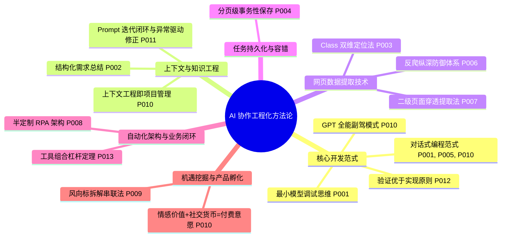

## 16.3 最小模型调试思维 —— 让复杂工程拆解为可验证的微步骤

### 为什么需要这个概念？

非程序员面对完整爬虫/自动化需求时，代码量大、逻辑深、反爬多，一次性让 AI 生成全量代码极易失败。传统编程教学强调“先设计再编码”，但 AI 协作模式下，人类不具备架构设计能力，需通过“跑通最小单元 -> 逐层叠加”的方式降低认知负荷。素材中作者从“提取单个元素”开始，迭代至“全量 9000+ 数据”，验证了该思维对小白的必要性。

### 核心定义

> "实践了最小模型调试思维，先提取某一个元素的几个数据，再 2 个/3 个 元素，然后迭代到整页/多页/全部数据"
> 
> ——《P001, docs/202303/W9bkdxL8Iouy7PxPFBMcSP9qnLh.md, p.2》

将复杂工程任务拆解为：单元素提取 → 多元素提取 → 单页提取 → 多页提取 → 全量提取 的五级渐进验证链路。每一级只解决一个核心问题（如选择器定位、翻页逻辑、反爬对抗），跑通后再进入下一级。

### 方法演进流程

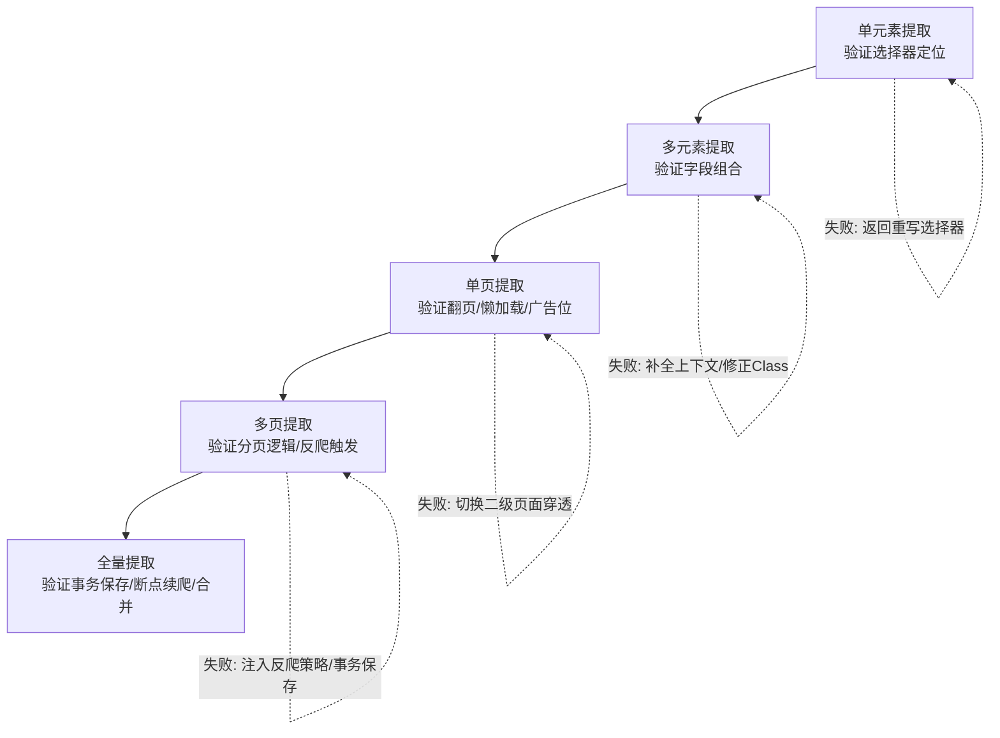

该流程图展示了最小模型调试的五级渐进验证链路：从单元素提取开始验证选择器定位，逐步扩展到多元素、单页、多页、全量提取。每一级失败时都有明确的回退策略，例如单页提取失败时可切换二级页面穿透法，多页提取失败时注入反爬策略与事务保存机制。读者应理解这是一种“分而治之”的工程化思维，将不可控的复杂任务拆解为可控、可验证、可回滚的微步骤序列。

### 关键性质

- 容错性强：单级失败不影响已验证的上一级成果
- 反馈快：单元素/单页级别运行耗时极短，能在分钟级获得正反馈
- 可迁移：该拆解逻辑适用于爬虫、自动化测试、数据清洗等所有“批量处理”型工程任务

### 典型例子

素材实战：CoinMarketCap 爬虫开发，先搞定“提取第 1 个币的名称和简称”，再解决“前 10 个缺失”，再解决“翻页只抓 90 条”，最后解决“反爬中断与数据丢失”。

> "只获取了后面 90 个代币名称，前面 10 个没有获取到，2、代币简称没有任何数据"
> 
> "提取的数据是我想要的效果，但是只有前 10 个，这个页面应该有 100 个代币"
> 
> ——《P001, docs/202303/W9bkdxL8Iouy7PxPFBMcSP9qnLh.md, p.3-4》

> "调整提取思路，从每个代币的详细页面进行提取... 代币名称和代币简称的class代码如下： Bitcoin BTC... 很好，我已经得到一整页我需要的所有数据了"
> 
> ——《P001, docs/202303/W9bkdxL8Iouy7PxPFBMcSP9qnLh.md, p.4》

> "在成功提取 6 页数据后...又报错提示请求频繁了，已经提取的 6 页数据页没有保存，于是又让GPT每提取一页数据，就在Excel 中新建一个 sheet 进行保存"
> 
> "遇到错误...自动重新运行程序，并从上一次成功提取的下一页开始提取，重试次数设置为 100，可以实现了一次性完成所需数据的提取"
> 
> ——《P001, docs/202303/W9bkdxL8Iouy7PxPFBMcSP9qnLh.md, p.5》

### 边界条件

仅适用于“目标明确、可分步验证”的工程任务，不适用于需整体架构设计的系统级开发（如微服务拆分、高并发架构）。要求人类具备“运行代码、看懂报错、定位 HTML 结构”的最低执行能力。

## 16.4 结构化需求总结 —— 将 AI 协作成果固化为可复用的工程规格书

### 为什么需要这个概念？

AI 协作开发中，上下文窗口有限，长对话易丢失关键决策细节（选择器、参数、异常规则）。非程序员无法阅读完整代码进行维护，需一份“自然语言版需求文档”作为验收标准与二次开发蓝本。素材中作者在最后要求 GPT “根据最新完整代码，总结我的需求，要求准确详细，尤其是 Class 的所有信息”，即为生成该总结。

### 核心定义

> "根据最新的完整代码，总结一下我的需求，要求准确详细，尤其是 Class 的所有信息"
> 
> ——《P001, docs/202303/W9bkdxL8Iouy7PxPFBMcSP9qnLh.md, p.5》

在多轮调试结束后，要求 AI 输出包含：目标 URL、目标字段、样本真实值、HTML 选择器特征（标签+Class+属性）、存储规则、反爬策略、异常处理规则、库版本约束、运行环境要求的结构化文档。本质是软件工程中“需求规格说明书 (SRS)”的轻量化、自然语言化版本。

### 方法演进流程

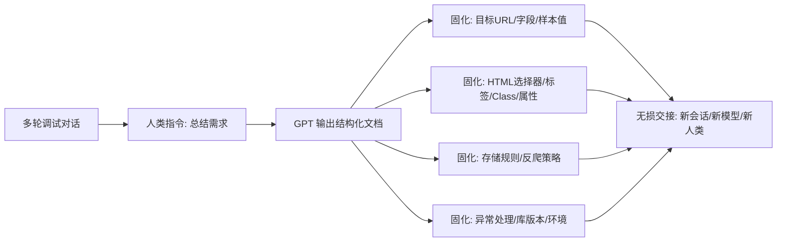

该流程图描述了结构化需求总结的生成与作用机制：从多轮调试对话中提炼关键工程决策，经由 GPT 输出结构化文档，将目标 URL、字段定义、HTML 选择器特征、存储与反爬规则、异常处理及环境依赖等核心要素显性化固化。最终形成可跨会话、跨模型、跨人员无损交接的工程规格书。读者应理解此图展示了“隐性知识显性化”的过程，是 AI 协作开发中实现知识资产沉淀与复用的关键环节。

### 关键性质

- 固化成果：将隐性在对话历史中的工程决策显性化，防止上下文截断导致的知识丢失
- 迁移复用：同一需求总结可直接喂给新会话/新模型/新人类开发者，实现“无损交接”
- 反向约束：倒逼人类在调试阶段就必须提供精准上下文（HTML 片段、报错堆栈），否则无法生成高质量总结

### 典型例子

素材实战输出的结构化需求总结（节选）：

> "您需要爬取 CoinMarketCap 网站前 90 页的加密货币数据... 这些数据对应的 HTML class 特征如下... 爬取过程中需遵循以下要求..."
> 
> ——《P001, docs/202303/W9bkdxL8Iouy7PxPFBMcSP9qnLh.md, p.5-6》

目标：爬取 CoinMarketCap 前 90 页加密货币数据
字段：名称、简称、详情链接
HTML Class 特征：全名 class="sc-1d5226ca-1"，简称 class="nameSymbol"
反爬策略：动态 UA、1-3 秒随机延迟、代理 IP 切换、分页事务保存、指数退避重试
输出：每页一个 Sheet，最终合并为单文件

> "网址：https://coinmarketcap.com/ ，需要提取的字段：代币名称、代币简称和代币名称的链接，在该网页的第1个代币名称是Bitcoin，其代币简称是BTC..."
> 
> "我分析了网页结构，代币名称和代币简称的class代码如下： Bitcoin ， BTC ，帮我分析并更新全部代码"
> 
> ——《P001, docs/202303/W9bkdxL8Iouy7PxPFBMcSP9qnLh.md, p.2-3》

### 边界条件

依赖于调试过程的“充分暴露细节”，若调试中大量使用模糊指令（如“帮我优化一下”），生成的总结将失真。无法替代代码本身，仅作为“人类可读、AI 可执行”的中间表示。

## 16.5 Class 双维定位法 —— 破解动态网页选择器失效的精准锚定术

### 为什么需要这个概念？

现代前端框架（React/Vue/CSS-in-JS）生成的 Class 名多为哈希值（如 `sc-1d5226ca-1`），极不稳定，传统“复制 Class 名”法极易失效。列表页因虚拟滚动、懒加载、广告插入导致 DOM 结构频繁变动，单纯靠 Class 值定位极其脆弱。素材中作者发现“Class 有两项信息：标签和值，都要求完全准确”，并通过“元素面板层层穿透”解决了详情页定位难题。

### 核心定义

> "发现 Class 有两项信息：标签和值，都要求完全准确"
> 
> ——《P001, docs/202303/W9bkdxL8Iouy7PxPFBMcSP9qnLh.md, p.3》

定位任意网页元素时，必须同时获取并验证两个维度：HTML 标签名（如 `div`、`span`、`h1`）与 Class 属性值（如 `nameSymbol`）。并通过浏览器开发者工具“元素面板”层层展开父节点，确认该元素在 DOM 树中的相对稳定位置（如：第 2 个 `tr` 下的第 1 个 `td` 下的 `span`）。

### 方法决策树

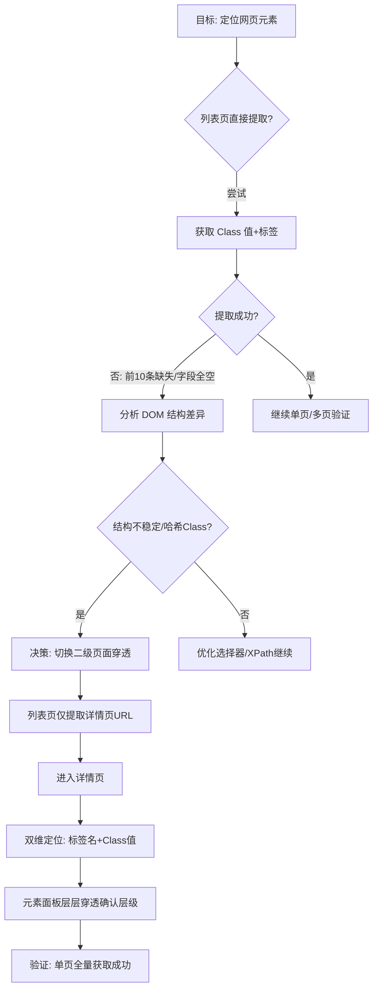

该决策树展示了 Class 双维定位法在实战中的决策路径：优先尝试列表页直接提取，获取标签名与 Class 值双维信息；若提取失败（如前 10 条缺失、字段全空），分析 DOM 结构差异，确认是否因结构不稳定或哈希 Class 导致；若是，果断切换二级页面穿透策略，在详情页重新进行双维定位并通过元素面板层层穿透确认层级关系，最终验证单页全量获取成功。读者应掌握“标签名+Class值”双维锚定与“层层穿透确认层级”两大核心动作，这是应对动态网页选择器失效的通用方法论。

### 关键性质

- 标签名相对稳定：语义化标签（`h1`、`table`、`a`）极少变动，可作为一级锚点
- Class 值需运行时确认：哈希化 Class 需在每次调试/运行时通过开发者工具获取当前有效值，不可硬编码
- 结构路径 > 单一选择器：基于“父子兄层级关系”的 XPath/CSS Path 比单一 Class 选择器鲁棒性高得多

### 典型例子

素材实战：列表页 `div` 标签+哈希 Class 导致前 10 条缺失、简称全空；切换至详情页，定位 `h1.sc-1d5226ca-1`（全名）和 `span.nameSymbol`（简称），结构稳定、全量获取。

> "一级页面无法全量获取...于是决定先调整思路，尝试每一个二级页面去获取，重新获取有效 Class 信息更新代码后，成功获取到想要的信息"
> 
> "代币名称和代币简称的 class 代码如下： Bitcoin ， BTC ，帮我分析并更新全部代码"
> 
> "很好，我已经得到一整页我需要的所有数据了"
> 
> ——《P001, docs/202303/W9bkdxL8Iouy7PxPFBMcSP9qnLh.md, p.4》

> "在「标签」方面，普通网页里的Class 前面的标签是 div，代码里也默认用这个标签，但提取失败的数据标签是其它的；在「值」方面，也需要多次尝试和确认"
> 
> ——《P001, docs/202303/W9bkdxL8Iouy7PxPFBMcSP9qnLh.md, p.3》

### 边界条件

若目标网站采用 Shadow DOM、Canvas 渲染或严重加密混淆，该方法失效，需转向无头浏览器/图像识别/协议逆向。需人类具备“打开 F12、找到 Elements 面板、会点击元素审查”的基础操作技能。

## 16.6 分页级事务性保存 —— 让长任务拥有“存档点”与“断点续爬”能力

### 为什么需要这个概念？

爬虫/批量任务耗时长（素材中 90 页需数小时），中途遭遇反爬、断网、服务器重启、内存溢出等异常概率极高。默认“内存累积 -> 最后一次性写入”模式，一次中断导致前功尽弃，素材中作者前 6 页数据因未保存而全丢，痛定思痛引入此机制。非程序员不懂数据库事务、Checkpoint 机制，需将“页”这一业务天然边界映射为“事务边界”。

### 核心定义

> "每爬取一页数据，将其保存到一个 Excel 文件的单独 sheet 中"
> 
> "每提取一页数据，就在 Excel 中新建一个 sheet 进行保存，防止抓取到中间时报错一个数据都没保存"
> 
> ——《P001, docs/202303/W9bkdxL8Iouy7PxPFBMcSP9qnLh.md, p.4-5》

以“页”为最小事务单元：每爬取完一页数据，立即写入 Excel 独立 Sheet 并持久化落盘。记录“已成功完成的最大页码”作为断点续爬的恢复起点。配合“指数退避重试”（如最多重试 100 次），在异常恢复后自动从失败页继续执行。

### 方法事务循环

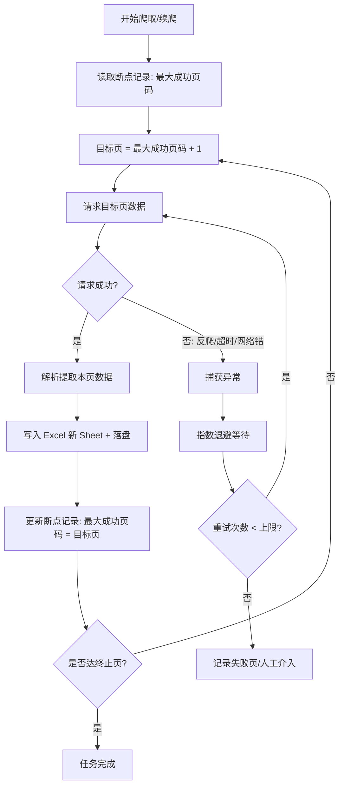

该事务循环图展示了分页级事务性保存的完整执行逻辑：从读取断点记录开始，逐页请求、解析、写入、更新断点，形成原子性事务单元；遇到异常时捕获错误、指数退避等待、重试直至上限。核心设计在于“页”作为天然事务边界，每页数据独立落盘、断点记录持久化，保证任意中断点下的零数据丢失与自动恢复能力。读者应理解这是将数据库事务思想（原子性、持久化、检查点恢复）映射到 Excel 多 Sheet 结构上的轻量化实现，适合非程序员在无数据库基础设施下构建鲁棒的长任务执行器。

### 关键性质

- 零数据丢失：已落盘的页级数据物理隔离，后续异常不影响历史成果
- 可观测性强：Excel 多 Sheet 结构天然可视化进度，人类可随时打开查看“已跑到第几页”
- 成本极低：利用 `openpyxl`/`pandas` 追加写入 Sheet，无需引入数据库、Redis 等中间件

### 典型例子

素材实战：引入“每页建 Sheet + 断点续爬”后，单次运行成功完成 90 页（9000+ 条）全量采集，生成 90 个 Sheet 文件，后经合并脚本整理为单文件。

> "在成功提取 6 页数据后...又报错提示请求频繁了，已经提取的 6 页数据页没有保存，于是又让 GPT 每提取一页数据，就在 Excel 中新建一个 sheet 进行保存"
> 
> "遇到错误（需确认只有请求频繁的问题）自动重新运行程序，并从上一次成功提取的下一页开始提取，重试次数设置为 100，可以实现了一次性完成所需数据的提取"
> 
> ——《P001, docs/202303/W9bkdxL8Iouy7PxPFBMcSP9qnLh.md, p.5》

### 边界条件

仅适用于“按页/按批次”天然分段的任务；流式、增量、实时任务需引入 WAL/消息队列等专业组件。Excel 单文件 Sheet 数上限（约 65535）与文件体积限制，超大规模任务需分文件存储。

## 16.7 对话式编程范式 —— 非程序员的“自然语言即接口”开发新范式

### 为什么需要这个概念？

传统编程要求人类掌握语法、数据结构、算法、框架、部署，门槛极高，绝大多数领域专家被挡在门外。LLM 将“编程接口”从 Python/Java 等形式语言降维为自然语言，但非程序员仍不会“提问”，导致生成代码不可用。素材总结出一套标准化对话循环：角色预设 -> 结构化首令 -> 报错反馈 -> 结构分析 -> 代码迭代 -> 需求总结，使小白也能驾驭 GPT-4 完成工程级开发。

### 核心定义

人类作为“产品经理+架构师+测试工程师”，通过自然语言驱动 AI 完成“程序员+调试员+文档员”工作。标准对话循环 6 步：

1. 角色设定：`你是一名专业 Python 程序员...`
2. 结构化首令：目标 URL、目标字段、样本真实值、输出格式
3. 报错全文反馈：复制完整 Traceback + 当前代码版本
4. 结构分析追问：`帮我分析可能的原因和解决方案，并更新代码`
5. 上下文注入：喂入 HTML 片段、选择器、业务规则
6. 需求总结固化：生成结构化需求文档

> "你是一名专业 Python 的程序员，可以帮我抓取一个网站的数据吗"
> 
> "出现了以下错误代码，先帮我分析再更新代码"
> 
> "帮我分析可能的原因和解决方案，并更新代码"
> 
> "根据最新的完整代码，总结一下我的需求，要求准确详细，尤其是 Class 的所有信息"
> 
> ——《P001, docs/202303/W9bkdxL8Iouy7PxPFBMcSP9qnLh.md, p.1-2》

### 标准对话循环

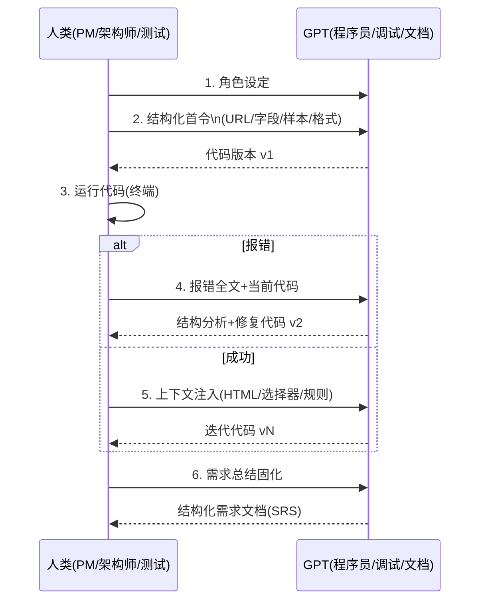

该序列图展示了对话式编程的标准化协作循环：人类扮演 PM/架构师/测试三重角色，通过角色设定、结构化首令启动会话；在本地运行代码捕获报错，将完整 Traceback 与当前代码反馈给 AI 进行结构分析与定点修复；成功后注入 HTML 选择器等上下文迭代优化；最终固化结构化需求文档实现知识资产沉淀。读者应理解这是一套“自然语言即接口”的工程化协作协议，将编程门槛从“会写语法”降为“会描述问题、会跑代码、会看报错、会找 Class”。

### 关键性质

- 分工铁律：人做决策（拆解目标、判断方向、验收结果），AI 做实现（语法、库调用、修补逻辑）
- 上下文工程即项目管理：单一 Chat 会话维护长上下文，等价于建立了项目级“共享知识库”与“状态记忆”
- 门槛重构：编程门槛从“会写语法”降为“会描述问题、会跑代码、会看报错、会找 Class”

### 典型例子

素材全流程：从环境配置、Class 定位、反爬对抗、分页存储到文件合并，全程零手写代码，仅通过上述对话循环完成。

> "一个项目一个 chat：之前我都是遇见了一个问题，就开一个 chat。在实操中也发现，它的上下文理解的连续性很好... 就不需要再额外地垫很多信息，它也能结合上下文去回答你的问题了。"
> 
> ——《P005, docs/202303/20230328_119.md, p.3》

### 多源对照

#### 共识

多篇素材均确认：自然语言驱动开发的核心是“结构化上下文注入”，即向 AI 提供确切的目标 URL、样本真实值、HTML 选择器、异常堆栈、输出格式约束。人类的核心职能是“任务拆解、上下文准备、验收决策”，而非“写语法”。

#### 分歧

- 《P001》侧重爬虫工程实战，强调 Class 双维定位、分页事务保存、二级页面穿透等**工程细节**；
- 《P005》侧重通用协作范式，提出“报错全文反馈 -> 结构分析 -> 定点修复 -> 需求总结”的**标准化迭代闭环**；
- 《P010》侧重产品化交付，展示 GPT 在单一会话中连续扮演 PM/文案/设计/开发/运营的**全能副驾模式**，并组合 Gumroad/Typeform/Zapier 等 SaaS 工具链实现零代码 MVP。

> "如何调教 ChatGPT 并实现抓取？"
> "3.1 聊天问题梳理 3.2 Prompt 完善 3.3 需求总结"
> 
> ——《P005, docs/202303/20230328_119.md, p.1-2》

> "在整个过程中，我扮演了一个角色：一个小白创业者，事事需要 GPT 来协助。"
> "GPT 扮演了文案写作、翻译员、创意设计、问卷撰写、逻辑梳理、操作指导、商业决策等各个角色。"
> 
> ——《P010, docs/202303/Zl9zdlsffoXMOIxIk9Ac0sIenje.md, p.1-2》

## 16.8 反爬纵深防御体系 —— 应用层+传输层+会话层三位一体的生存法则

### 为什么需要这个概念？

单一反爬手段（仅延迟、仅换 UA、仅换 IP）极易被识别穿透，导致任务中断、账号封禁、IP 拉黑。素材实战中：仅加延迟 -> 触发频控；加延迟+换 UA -> 仍触发频控；加延迟+换 UA+切代理节点 -> 仍不稳定；最终引入“分页事务保存+断点续爬+指数退避”才在会话层实现鲁棒性。非程序员不懂网络协议、TLS 指纹、浏览器指纹，需一套“可理解、可配置、可组装”的防御清单。

### 核心定义

构建三层纵深防御体系：

1. **应用层**：动态 User-Agent（`fake_useragent`）、Referer 伪造、Cookie 维持、请求头随机化
2. **传输层**：代理 IP 池（住宅/数据中心）、TLS 指纹伪装、连接复用控制
3. **会话层**：随机延迟（1-3s/指数退避）、人类行为模拟（鼠标轨迹/点击间隔）、分页事务性保存、断点续爬熔断机制

> "在此基础上，我希望考虑两点优化：1、避免请求频繁；2、尽量模拟真实用户"
> 
> "每次抓取数据前随机生成一个请求头... 在爬取每个加密货币详细信息前，加入 1-3 秒的延迟... 后面还切换了节点... 遇到错误自动重新运行程序，并从上一次成功提取的下一页开始提取"
> 
> ——《P001, docs/202303/W9bkdxL8Iouy7PxPFBMcSP9qnLh.md, p.4-5》

### 分层架构与失效兜底

```mermaid
flowchart TB
    subgraph 会话层
        SL1[随机延迟 1-3s]
        SL2[指数退避重试]
        SL3[断点续爬/事务保存]
        SL4[人类行为模拟]
    end
    subgraph 传输层
        TL1[代理IP池(住宅/DC)]
        TL2[TLS指纹伪装]
        TL3[连接复用控制]
    end
    subgraph 应用层
        AL1[动态User-Agent]
        AL2[Referer/Cookie伪造]
        AL3[请求头随机化]
    end
    
    AL1 --> TL1
    AL2 --> TL1
    AL3 --> TL1
    TL1 --> SL1
    TL2 --> SL1
    TL3 --> SL1
    SL1 --> SL2
    SL2 --> SL3
    SL3 --> SL4
    
    style SL3 fill:#f9f,stroke:#333,stroke-width:2px
    style SL2 fill:#f9f,stroke:#333,stroke-width:2px
```

该分层架构图展示了反爬纵深防御的三层解耦设计：应用层解决请求特征伪装（UA、Referer、Cookie），传输层解决网络身份匿名与指纹伪装（代理 IP、TLS 指纹），会话层解决行为模式拟人化与容错兜底（随机延迟、指数退避、断点续爬、事务保存）。箭头方向表示防御层级的依赖与叠加关系：应用层特征经传输层传输，最终在会话层形成完整的行为会话。其中会话层的“断点续爬/事务保存”（SL3）与“指数退避重试”（SL2）被高亮标记，因其为长任务鲁棒性的最关键兜底机制——若会话层无此二者，前两层再强也无法防止“中断即全丢”。读者应理解这是一种“分层解耦、各司其职、最弱环节决定鲁棒性”的系统性防御思维。

### 关键性质

- 分层解耦：每层解决不同维度的识别特征，单层失效不导致整体崩溃
- 成本递增：应用层成本最低（库调用），传输层中等（买代理），会话层最高（时间成本、逻辑复杂度）
- 鲁棒性 = 最弱环节：若会话层无断点续爬，前两层再强也无法防止“中断即全丢”

### 典型例子

素材实战组合拳：`fake_useragent` 动态 UA + `1-3秒随机延迟` + `代理节点切换` + `每页建 Sheet 落盘` + `异常捕获重试 100 次`，最终实现 90 页全量无损采集。

> "如何调教 ChatGPT 并实现抓取？"
> "3.1 聊天问题梳理"
> 
> ——《P005, docs/202303/20230328_119.md, p.1》

### 边界条件

面对 WAF（Web应用防火墙）、行为分析型反爬（如 Cloudflare、DataDome）、图像/滑块验证码，该体系仍显无力，需引入无头浏览器、验证码打码平台、浏览器指纹伪装等重武器。代理 IP 质量、成本、稳定性是传输层核心变量，免费代理不可用于生产环境。

## 16.9 二级页面穿透提取法 —— 绕过列表页反爬直击详情页数据源

### 为什么需要这个概念？

列表页常采用虚拟滚动、懒加载、前端渲染、数据加密、DOM 结构混淆等手段，导致直接提取极其困难（素材中前 10 条缺失、简称全空、仅 90 条）。详情页通常为服务端渲染（SSR）、结构固定、数据完整、反爬强度相对较低，是更优的数据源入口。非程序员不会写复杂的列表页解析逻辑，但会“点详情页链接”，该方法将“人会的操作”转化为“爬虫逻辑”。

### 核心定义

策略转换：放弃在列表页直接提取目标字段，改为：
1. 列表页仅提取“详情页 URL 列表”
2. 遍历详情页 URL，逐个访问并提取结构化目标数据
3. 聚合所有详情页数据为最终结果集

核心前提：列表页能稳定获取详情页入口链接（通常为 `<a href>` 且结构固定）。

> "一级页面无法全量获取...于是决定先调整思路，尝试每一个二级页面去获取，重新获取有效 Class 信息更新代码后，成功获取到想要的信息"
> 
> "我准备调整提取思路，从每个代币的详细页面进行提取"
> 
> "代币名称和代币简称的 class 代码如下： Bitcoin ， BTC ，帮我分析并更新全部代码"
> 
> "很好，我已经得到一整页我需要的所有数据了"
> 
> ——《P001, docs/202303/W9bkdxL8Iouy7PxPFBMcSP9qnLh.md, p.4》

### 数据流向

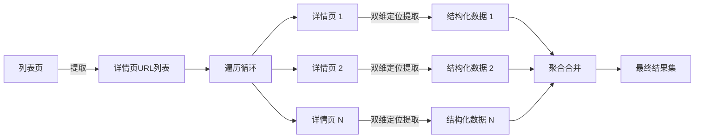

该数据流向图展示了二级页面穿透提取法的核心数据通路：列表页仅承担“提取详情页 URL 列表”的轻量任务，避开复杂的列表页渲染与反爬；遍历循环依次访问各详情页，配合 Class 双维定位法提取结构化数据；最后聚合合并为最终结果集。这种“降维打击”策略将 N 个目标的提取请求放大为 N+1 次（1次列表+N次详情），虽增加请求量但显著提升数据完整性与提取稳定性。读者应理解此法的核心权衡：用请求量增长换取提取成功率与数据完整度，需配合会话层防御（延迟、代理、断点续爬）控制成本与风险。

### 关键性质

- 降维打击：将“解析复杂列表页”降级为“提取简单链接”，利用详情页结构稳定性规避列表页反爬
- 请求量放大：N 个目标需 N+1 次请求（1次列表 + N次详情），需配合会话层防御（延迟、代理、断点续爬）控制成本与风险
- 数据完整性高：详情页通常包含列表页无法展示的完整字段（如完整描述、多图、参数表）

### 典型例子

素材实战：列表页提取失败后，切换至“遍历详情页”策略，定位 `h1.sc-1d5226ca-1` 和 `span.nameSymbol`，单页 100 条全量获取，最终 90 页全胜。

> "只获取了后面90个代币名称，前面10个没有获取到，2、代币简称没有任何数据"
> 
> "提取的数据是我想要的效果，但是只有前10个，这个页面应该有100个代币"
> 
> ——《P001, docs/202303/W9bkdxL8Iouy7PxPFBMcSP9qnLh.md, p.3-4》

### 边界条件

若详情页同样采用强反爬（加密、动态渲染、需登录），该方法失效。请求量放大 N 倍，目标站点若有严格 IP 限流，需配备大规模代理池，成本显著上升。不适用于“仅需列表页汇总字段、不需详情” 的轻量任务，属于过度设计。

## 16.10 半定制 RPA 架构 —— 非程序员的“搭积木式” AI 业务闭环构建术

### 为什么需要这个概念？

传统 RPA（UiPath/Automation Anywhere）学习曲线陡峭、授权昂贵、部署繁重，非技术人员望而却步。纯代码开发门槛更高，维护成本大。素材提出“半定制 RPA”：利用 Make/Zapier/IFTTT 等无代码平台，以“表单触发 -> AI 处理 -> 存储/交付”四阶段标准化节点，像搭积木一样拖拉拽组装端到端自动化业务流。

### 核心定义

> "相当于一个半定制的 RPA。"
> 
> "为什么不说 RPA，也不说编程? 因为 RPA 对于大部分圈友来说，还是有门槛的，更不要说编程了。"
> 
> "一句话说明白，就是自动采集需求，通过 ChatGPT API 传送给 ChatGPT，ChatGPT 加工后，输出结果，利用自动化工具进行回复/存储/发布... 我们就像搭积木一样，直接拖拉点击操作就可以了。"
> 
> ——《P008, docs/202303/KVYSdKgmIoQxCLxdIkrcKW0Snze.md, p.1-2》

核心四阶段工作流：
1. **触发层**：Google Forms / Typeform / Webhook / 定时器
2. **处理层**：ChatGPT API / 其他 LLM API（Prompt 变量映射、Max Tokens/Temperature 控制）
3. **存储层**：Google Sheets / Notion / Airtable / Excel
4. **交付层**：Email / WhatsApp / Slack / HTTP 回调 / 智能硬件

“半定制”意指：流程骨架标准化（四阶段固定），业务逻辑定制化（Prompt、字段映射、分支判断由用户配置）。

### 标准化节点与数据流向

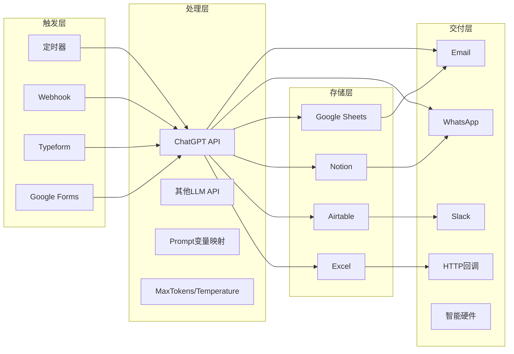

该标准化节点图展示了半定制 RPA 架构的四层解耦设计：触发层负责数据采集入口（表单、Webhook、定时器），处理层封装 AI 推理能力（Prompt 变量映射、Token 预算控制），存储层提供结构化持久化（Sheets、Notion、Airtable），交付层实现多渠道触达（邮件、即时通讯、Webhook、硬件）。数据流向呈现“扇入-扇出”模式：多触发源汇聚至处理层，处理结果分发至多存储与多交付渠道。读者应理解这是将传统 RPA“设计-开发-部署-运维”全生命周期压缩为“配置-测试-上线”三步的轻量化架构，核心竞争力在于业务流拆解能力与工具生态选型能力，而非编程能力。

### 关键性质

- 零代码门槛：全程可视化配置，核心技能为“业务流拆解”与“工具配置”而非“写代码”
- 工具栈免费/低成本：Google 套件免费，Make 免费版 2 个工作流/月，OpenAI API 按量付费（极低）
- 场景化迁移强：同一架构可横向迁移至起名、SEO、Listing、社媒矩阵、RSS 加工、社群助理等 10+ 高频场景

### 典型例子

素材“AI 自动起名”服务：用户填 Google 表单 -> Make 监控新提交 -> 调用 ChatGPT (text-davinci-003) 生成建议 -> 写回 Google Sheets -> 发邮件/短信给用户，全程零人工。

> "示例的工作流：1、使用表单采集用户提供的文字内容，并使用表格存储 2、ChatGPT 处理文字信息，按需求进行加工 3、加工的信息存储到表格 4、通过邮件或短信交付给客户"
> 
> ——《P008, docs/202303/KVYSdKgmIoQxCLxdIkrcKW0Snze.md, p.2》

> "自动化是 ChatGPT 商业应用的另一条腿"
> 
> "工具基本免费。"
> 
> ——《P008, docs/202303/KVYSdKgmIoQxCLxdIkrcKW0Snze.md, p.2-3》

### 边界条件

无代码平台表达能力有限：复杂分支、循环、状态机、并发控制难以实现，遇到复杂逻辑仍需转代码。依赖第三方 SaaS 稳定性：Make/Zapier 故障、API 限流、账号封禁均会导致业务中断，无自主可控能力。数据隐私风险：用户数据流经表单平台、自动化平台、AI API、存储平台、通讯平台，合规敏感场景需自建方案。

## 16.11 风向标拆解串联法 —— 从信息噪音中挖掘高确定性产品创意的四阶漏斗

### 为什么需要这个概念？

信息过载时代，每天海量资讯、风向标、大 V 观点涌入，普通人无法判断哪些是真机会、哪些是噪音。素材作者建立个人信息处理漏斗：泛刷建立敏感度 -> 实操验证偏好 -> 聚焦领域中标 -> 拆解共性/串联特点/规划可执行产品，将碎片化资讯转化为结构化产品机会。该方法论支撑作者从“看到风向标”到“半天 MVP 落地”的完整闭环。

### 核心定义

> "以下是我看风向标的几个阶段：1. 什么都看... 2. 尝试实操... 3. 建立偏好... 4. 着重看标... 5. 只看中标的兴趣领域。"
> 
> "对信息二次加工的时候... 我会将有相近特点的风向标放在一起，拆解有什么共同的之处。"
> 
> "将标点共性进行串联，就会得到新的产品灵感。"
> 
> ——《P009, docs/202303/Zl9zdlsffoXMOIxIk9Ac0sIenje.md, p.2-3》

四阶段漏斗模型：
1. **泛刷建立敏感度**：全量浏览风向标/资讯，不求深求广度，建立对“新奇/赚钱/可落地”信号的直觉反应
2. **实操验证偏好**：对感兴趣的信息点尝试微操作（注册体验、跑通 Demo、写个 Prompt），验证自己真实偏好与能力边界
3. **聚焦领域中标**：仅关注“圈友/大V发布且被标记为中标/高赞”的高信噪比信息，大幅降噪
4. **拆解共性/串联特点/规划产品**：将相似特点的风向标聚类，提取共性要素（如：名人 IP + 1v1 定制 + 零门槛交互 + 情感价值），串联组合为新产品创意（如“名人来信”）

### 四阶漏斗与产出路径

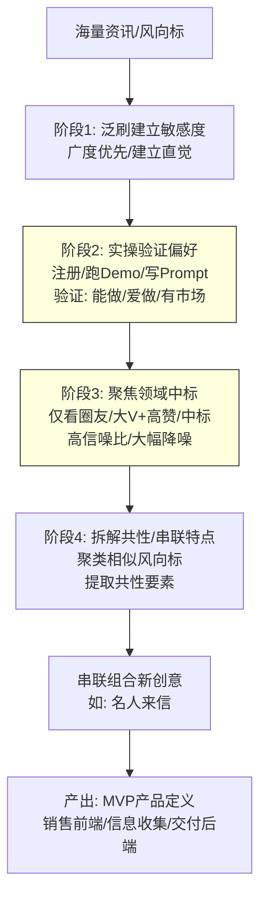

该四阶漏斗图展示了风向标拆解串联法的完整信息加工流水线：从海量资讯入口开始，经历泛刷建立敏感度（广度优先）、实操验证偏好（三维验证：能做/爱做/有市场）、聚焦领域中标（高信噪比降噪）、拆解共性串联特点（聚类提取要素），最终产出可执行的 MVP 产品定义（销售前端/信息收集/交付后端三模块）。其中阶段 2 与阶段 3 被高亮标记，因其为漏斗的关键转折点：阶段 2 的实操验证防止“看起来美好却干不了”的幸存者偏差，阶段 3 的聚焦中标实现大幅降噪与效率跃升。读者应理解这是一个“主动加工、验证前置、串联创新”的系统化机遇挖掘方法论，而非被动的信息消费。

### 关键性质

- 从“被动接收”到“主动加工”：不等信息喂到嘴边，而建立主动筛选、实操验证、结构化拆解的加工流水线
- 串联创新非原创：不发明新技术、新模式，而是将成熟要素（名人 IP、AI 生成、表单交互、邮件交付、送礼场景）重新组装
- 验证前置：实操验证偏好（阶段 2）在聚焦中标（阶段 3）之前，确保不因“看起来美好”而误入“干不了”的赛道

### 典型例子

素材实战：风向标中“AI 写情书/书信”类信息频现 -> 实操验证 AI 生成信件效果极佳 -> 聚焦“送礼/情感价值”赛道中标信息 -> 拆解共性：名人 IP + 定制化 + 零提问交互 + 社交炫耀 -> 串联产出“名人来信”产品创意 -> 半天 MVP 上线。

> "产品特色：获得来自名人\榜样\历史人物的信息；1V1 定制化；简单交互，用户不需要提问，也能得到答案。"
> 
> ——《P009, docs/202303/Zl9zdlsffoXMOIxIk9Ac0sIenje.md, p.2》

> "上周五在风向标看到一位圈友发布的消息...在GPT4的辅助下，花了不到半天的时间内，完成了产品的MVP。"
> 
> ——《P011, docs/202303/20230328_122.md, p.1》

### 边界条件

依赖高质量风向标源：若信息源本身水分大、滞后、同质化严重，漏斗输出必然劣质。需具备“微操作验证”能力：不敢/不会做微实验（注册、跑 Demo、写 Prompt）者卡在阶段 2。串联创新易陷入“伪需求”：组合出的创意看似合理，实则无人买单，仍需 MVP 验证。

## 16.12 GPT 全能副驾模式 —— 单一 Chat 会话驱动全栈 MVP 半天级交付

### 为什么需要这个概念？

传统开发需协调 PM、设计、前端、后端、运营、法务等多角色，沟通成本高、周期长、非技术创始人无法驾驭。素材发现：GPT-4 在单一上下文中具备极强的角色扮演连贯性，可连续扮演 PM/文案/设计师/开发/运营，配合 Gumroad/Typeform/Zapier/OpenAI 等 SaaS 工具链，实现零代码半天级全闭环交付。解决了“非技术创始人有创意无法落地、找外包贵且不可控、找合伙人难”的核心痛点。

### 核心定义

在单一 Chat 会话中，人类作为“创始人/决策者”，GPT 作为“全能副驾”，按需切换角色完成全栈任务：

- **PM**：需求拆解、MVP 范围界定、工具选型建议
- **文案**：命名头脑风暴、定价策略、Landing Page 文案框架/模块撰写/润色整合（4步法）
- **设计师**：封面设计方案（文案/配色/布局/AI绘画 Prompt）、Figma 操作实时指导
- **开发**：Zapier/Make 配置教程、OpenAI API 参数、Prompt 工程代码自主生成
- **运营**：分销裂变设计、邮件模板、上线清单

核心前提：维持单一长上下文（一个项目一个 Chat），避免跨会话同步信息损耗。

> "在整个过程中，我扮演了一个角色：一个小白创业者，事事需要 GPT 来协助。"
> 
> "GPT 扮演了文案写作、翻译员、创意设计、问卷撰写、逻辑梳理、操作指导、商业决策等各个角色。"
> 
> "一个项目一个 chat... 它的上下文理解的连续性很好... 就不需要再额外地垫很多信息，它也能结合上下文去回答你的问题了。"
> 
> ——《P010, docs/202303/Zl9zdlsffoXMOIxIk9Ac0sIenje.md, p.1-2》

### 角色切换流程与工具链集成

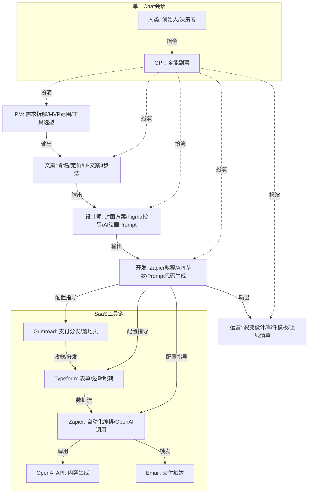

该流程图展示了 GPT 全能副驾模式的核心运作机制：在单一 Chat 会话中，人类作为决策者发出指令，GPT 按需无缝切换 PM、文案、设计师、开发、运营五大角色，角色间输出呈流水线顺序传递（PM 产出需求规格 -> 文案产出落地页文案 -> 设计师产出视觉方案 -> 开发产出自动化配置 -> 运营产出增长策略），并指导配置 SaaS 工具链（Gumroad/Typeform/Zapier/OpenAI/Email）实现端到端业务闭环。读者应理解“单一会话维持长上下文”是该模式生效的前置条件，它使 GPT 能基于完整业务语境给出连贯决策，避免了跨会话同步信息的成本与损耗；同时 GPT 的“自我编程 Prompt”能力（为 OpenAI API 自动生成结构化 System/User Prompt 模板）进一步降低了非技术者调用 API 的门槛。

### 关键性质

- 角色流动性：无需开启新会话，直接自然语言指令“请扮演产品设计师...”“现在切换到开发模式...”即可无缝切换
- 自我编程能力：GPT 能根据业务需求自主编写结构化的 System Prompt 与 User Prompt 模板（含变量占位），并指导填入 API 参数，实现“AI 给 AI 写 Prompt”
- 工具组合杠杆：GPT(智力中枢) + SaaS 工具(执行手脚) 组合，工具间集成能力（Zapier 连接 Typeform/OpenAI/Email）放大杠杆效应

### 典型例子

素材“名人来信”实战：从灵感触发 -> Gumroad 落地页 -> Typeform 表单 -> Zapier+OpenAI 自动化交付，全链路半天闭环，Prompt 调试 1-2 天，落地执行半天。

> "MVP 包含哪些模块，主要分为 3 部分：销售前端、信息收集、交付后端。"
> 
> "前期用户少的时候，可以完全人工来把交付流程搞定——因为开发的成本可能相对于人工交付的成本还要高。"
> 
> "选择 Gumroad 的另一个核心原因，就是它有支付功能，只有用户完成了消费才会收取服务费。"
> 
> "根据它的比较，考虑到更多集成的可能性，我选择了 Typeform。"
> 
> "国外的工具我只知道 zapier，所以直接问 GPT，如何操作。"
> 
> "最后，在 GPT 的帮助下，0 代码就把将自动化的部分也搞定了。"
> 
> ——《P010, docs/202303/Zl9zdlsffoXMOIxIk9Ac0sIenje.md, p.2-3》

### 多源对照

#### 共识

GPT 在长上下文中具备跨角色连贯性，能作为“全栈副驾”辅助非技术创始人完成 MVP 交付。核心前提是“一个项目一个 Chat”，维护长上下文作为项目级共享知识库。

#### 分歧

- 《P010》强调**角色扮演的连贯性与 SaaS 工具链集成**，展示了从 Landing Page 到自动化交付的全链路；
- 《P001/P005》侧重**工程级代码生成与调试**，对话循环聚焦于选择器、反爬、存储等技术细节；
- 《P008》展示**无代码平台编排**，核心是 Make/Zapier 的可视化配置而非 GPT 直接生成自动化代码。

> "一句话说明白，就是自动采集需求，通过 ChatGPT API 传送给 ChatGPT，ChatGPT 加工后，输出结果，利用自动化工具进行回复/存储/发布... 我们就像搭积木一样，直接拖拉点击操作就可以了。"
> 
> ——《P008, docs/202303/KVYSdKgmIoQxCLxdIkrcKW0Snze.md, p.1-2》

## 16.13 Prompt 迭代闭环与异常驱动修正 —— 让 AI 协作开发拥有“自动纠偏”能力

### 为什么需要这个概念？

AI 生成代码首轮通过率低，且错误类型多样（选择器错、逻辑漏洞、库版本不兼容、环境变量缺失），人工逐行阅读代码修 Bug 对小白不现实。素材建立“报错全文反馈 -> 结构分析 -> 定点修复 -> 回归验证”的标准化迭代闭环，将调试从“读代码”降维为“贴报错、提要求、跑验证”。同时引入“需求总结固化”机制，将每轮迭代的成果沉淀为结构化上下文，防止长对话上下文丢失导致的反复摇摆。

### 核心定义

标准迭代循环 4 步：
1. 执行运行：在 PyCharm 终端运行当前版本代码
2. 异常捕获：复制完整 Traceback 报错堆栈
3. 结构化反馈：`出现了以下错误代码，先帮我分析再更新代码` + 粘贴报错 + 粘贴当前代码
4. 定点修复与验收：GPT 输出修复代码 -> 人类再次运行 -> 循环直至通过

里程碑固化：每跑通一大阶段（单页、翻页、反爬、全量），执行 `根据最新的完整代码，总结一下我的需求` 生成结构化需求文档，作为后续迭代的锚定基准。

> "出现了以下错误代码，先帮我分析再更新代码"
> 
> "帮我分析可能的原因和解决方案，并更新代码"
> 
> "根据最新的完整代码，总结一下我的需求，要求准确详细，尤其是 Class 的所有信息"
> 
> ——《P001, docs/202303/W9bkdxL8Iouy7PxPFBMcSP9qnLh.md, p.2-5》

### 标准化迭代闭环

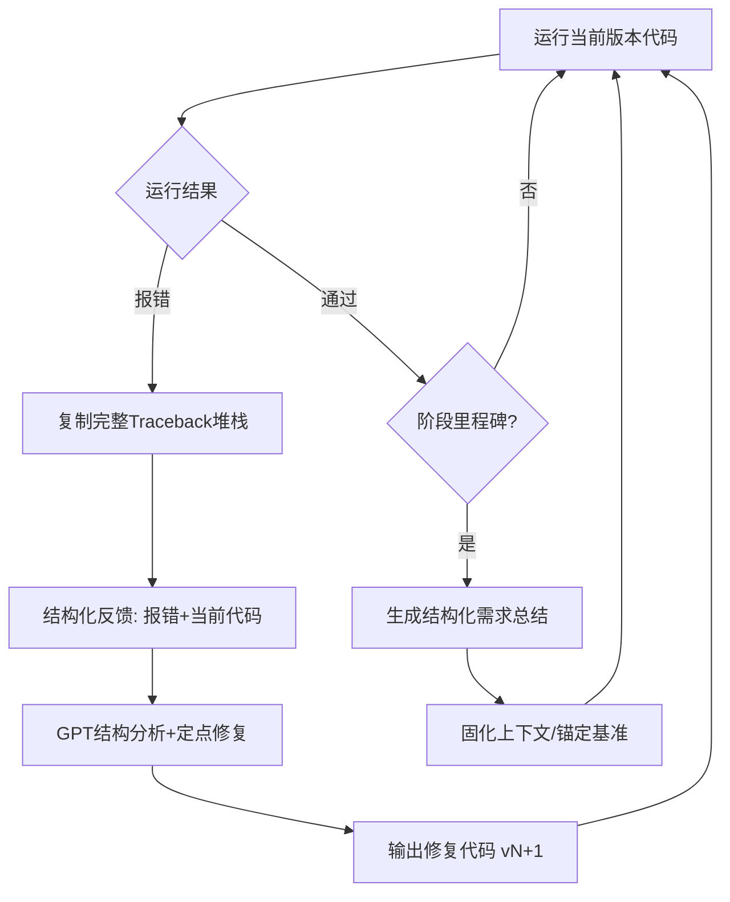

该迭代闭环图展示了 Prompt 迭代与异常驱动修正的标准化运作机制：运行代码 -> 捕获异常 -> 结构化反馈（报错堆栈+当前代码）-> GPT 结构分析定点修复 -> 输出新版本 -> 循环验证；每跑通一阶段里程碑则生成结构化需求总结固化上下文，作为后续迭代的锚定基准。这种“报错驱动、定点修复、里程碑固化”的闭环设计，将非程序员无法胜任的“读码调试”转化为可执行的“贴报错、提要求、跑验证”标准动作，同时通过需求总结机制解决长对话上下文衰减导致的知识丢失与指令漂移问题。读者应掌握“完整 Traceback 反馈”、“结构分析追问”、“需求总结固化”三大核心动作，这是 AI 协作开发中实现自动纠偏的关键操作规范。

### 关键性质

- 非程序员可执行：无需看懂代码逻辑，只需会“跑脚本、复制报错、粘贴对话”
- 上下文累积优势：同一会话中，GPT 能看到完整的“报错-修复”历史，避免重复犯同类错误（如反复用错同一个 Class）
- 需求文档作为“契约”：后续新需求/新模型/新人类接手时，以结构化需求文档为准，避免口头描述的模糊与偏差

### 典型例子

素材全程：从“只获取后 90 条” -> “前 10 条缺失/简称全空” -> “翻页仅 90 条” -> “反爬中断 6 页丢数据” -> “详情页穿透” -> “分页事务保存+断点续爬” -> “合并 90 个 Sheet”，每一步均通过报错反馈闭环推进。

> "如何调教 ChatGPT 并实现抓取？"
> "3.1 聊天问题梳理 3.2 Prompt 完善 3.3 需求总结"
> 
> ——《P005, docs/202303/20230328_119.md, p.1-2》

> "一个项目一个chat：之前我都是遇见了一个问题，就开一个chat。在实操中也发现，它的上下文理解的连续性很好...就不需要再额外地垫很多信息，它也能结合上下文去回答你的问题了。"
> 
> ——《P009, docs/202303/Zl9zdlsffoXMOIxIk9Ac0sIenje.md, p.2》

### 边界条件

若报错信息被截断/加密/无堆栈（如某些编译错误、加密混淆代码运行报错），反馈闭环失效。GPT 修复能力有上限：涉及底层协议、复杂并发、内存泄漏、C 扩展模块 Bug 等深层问题，GPT 往往给出错误或无效修复方案。迭代轮数过多（>20 轮）会导致上下文污染、指令漂移，需定期“需求总结”重置上下文。

## 16.14 验证优于实现原则 —— 早期舍弃技术完美，仅为跑通“目标群体 × 核心需求”匹配

### 为什么需要这个概念？

创业早期最大风险是“做没人要的产品”，而非“技术不够完美”。非技术创始人极易陷入“过早优化”陷阱：纠结域名、服务器、架构、代码规范、CI/CD，耗尽时间窗口却未验证需求。素材明确主张：呈现形式（Landing Page、人工服务、No-code 工具）应服务于最低成本验证，避免过早投入重开发成本。

### 核心定义

> "产品前期最重要的是“验证”，而不应拘泥于它的呈现形式上：当你想要创作一个全新的产品的时候，先把目标群体和需求跑通了，再花时间再更重的开发上面。"
> 
> "毕竟都是九死一生，需要快速验证快速迭代。"
> 
> "前期用户少的时候，可以完全人工来把交付流程搞定——因为开发的成本可能相对于人工交付的成本还要高。"
> 
> ——《P010, docs/202303/Zl9zdlsffoXMOIxIk9Ac0sIenje.md, p.2-3》

产品早期核心目标唯一：验证“目标群体”与“核心需求”的匹配度。验证手段分级：人工服务（Concierge MVP）> 组合式 SaaS/No-code（Wizard of Oz MVP）> 简易代码原型 > 完整工程实现。决策准则：若人工/工具组合能跑通闭环，绝不写代码；仅当规模化/边际成本/体验上限触及天花板时，再投入开发重构。

### 验证手段分级决策阶梯

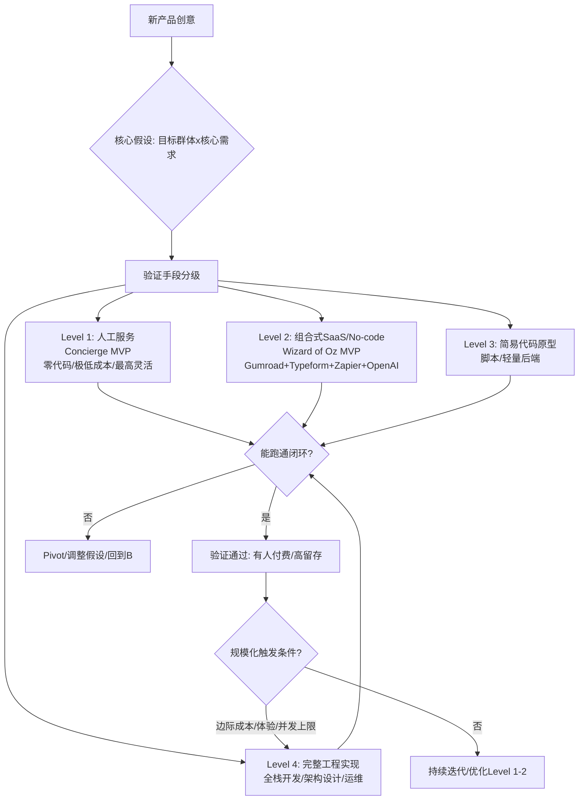

该决策阶梯图展示了验证优于实现原则的分级执行逻辑：从核心假设出发，按成本与复杂度递增顺序尝试四级验证手段（人工服务 -> 组合式 SaaS/No-code -> 简易代码原型 -> 完整工程实现），每一级均以“能否跑通闭环”为验收标准；验证通过后，仅当触发规模化条件（边际成本/体验/并发上限）时才投入完整工程实现，否则持续在低成本层级迭代优化。读者应理解这是一种“反脆弱”的产品开发策略：用最低成本、最高灵活度的手段优先证伪核心假设，避免在未验证需求前沉没大量技术投入，同时为后续规模化预留重构预算与周期。

### 关键性质

- 成本倒置：人工/工具组合看似“笨重”，实则边际成本极低（无开发投入），且能最快触达用户获取真实支付信号
- 学习速度最大化：每个验证周期（想法 -> 落地 -> 测试 -> 反馈）压缩至小时/天级，而非周/月级
- 避免沉没成本绑定：无代码/低代码方案易弃易改，代码一旦写下即产生“维护/重构”心理包袱，阻碍果断 pivot

### 典型例子

素材“名人来信”：Gumroad(支付分发) + Typeform(信息收集) + Zapier+OpenAI(自动化交付) 三件套，0 固定成本、0 代码、半天上线，验证“用户愿为 AI 生成名人信付费”核心假设。

> "选择 Gumroad 的另一个核心原因，就是它有支付功能，只有用户完成了消费才会收取服务费。"
> 
> "根据它的比较，考虑到更多集成的可能性，我选择了 Typeform。"
> 
> "国外的工具我只知道 zapier，所以直接问 GPT，如何操作。"
> 
> ——《P010, docs/202303/Zl9zdlsffoXMOIxIk9Ac0sIenje.md, p.3》

### 边界条件

仅适用于“需求不确定性高、交付可标准化、SaaS 工具链覆盖完备”的早期验证阶段。若核心价值依赖“极致性能/极致体验/私有算法/硬核技术壁垒”（如实时语音翻译、自动驾驶、高频交易），验证即需核心技术实现，无法走捷径。验证通过后，规模化阶段往往仍需重写代码（技术债偿还），需预留重构预算与周期。

## 16.15 工具组合杠杆定理 —— GPT(大脑) + SaaS(手脚) = 超级个体

### 为什么需要这个概念？

单一 AI 模型只能解决“生成”问题（写代码、写文案、出方案），无法解决“触达用户、收款交付、持久化存储、定时调度”等“手脚”问题。传统开发需自己写“手脚”代码，门槛高、周期长。素材发现：成熟 SaaS 工具（支付、表单、自动化、邮件、数据库、部署）已覆盖 MVP 90%+ 的“手脚”需求，GPT 仅需作为“大脑”输出配置指令、Prompt、文案即可组装完整业务闭环。

### 核心定义

> "善用低代码 \ 0 代码 \ 自动化工具和平台：前期不要纠结于具体的技术实现上面... 工具直接的组合，也能创造出更大的生产力，比如自动化 + GPT。"
> 
> "自动化是 ChatGPT 商业应用的另一条腿"
> 
> "工具基本免费。"
> 
> ——《P008, docs/202303/KVYSdKgmIoQxCLxdIkrcKW0Snze.md, p.2-3》

个体生产力公式：GPT(智力中枢：需求拆解、方案生成、代码/配置/文案输出、决策辅助) + SaaS 工具组合(执行手脚：支付/表单/自动化/存储/通讯/部署) = 超级个体。核心能力不再是“会写代码”，而是“懂工具生态、会选型组合、会用自然语言驱动工具协作”。

### 工具生态编排图

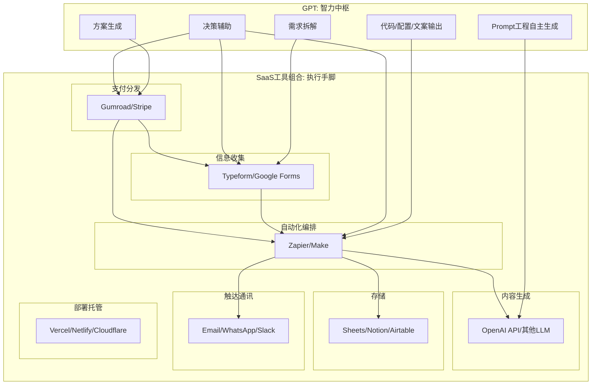

该工具生态编排图展示了工具组合杠杆定理的架构实现：GPT 作为智力中枢承担需求拆解、方案生成、代码配置文案输出、决策辅助、Prompt 工程自主生成五大认知功能；SaaS 工具组合作为执行手脚覆盖支付分发、信息收集、自动化编排、内容生成、存储、触达通讯、部署托管七大执行域。箭头表示 GPT 与工具、工具与工具间的协作数据流：GPT 指导工具配置（B3->T3，B4->T1/T2/T3，B5->T4），工具间按业务流串联（T2->T3->T4/T5/T6，T1->T2/T3）。这种“大脑+手脚”分离架构使个体能以零代码成本组装全栈交付能力，核心竞争力转移至“懂工具生态、会选型编排、会自然语言驱动工具协作”的元能力上。读者应理解这是 AIGC 时代个体生产力跃迁的结构性红利：工具基本免费/按量付费，杠杆率极高，组合创新非原创，学习曲线平缓。

### 关键性质

- 杠杆率极高：SaaS 工具多为免费/按量付费，边际成本趋近零，个体可零成本拥有“全栈团队级”交付能力
- 组合创新非原创：不发明新工具，而是将成熟工具（Gumroad/Typeform/Zapier/OpenAI）按业务流重新编排
- 学习曲线平缓：学会一个新工具只需“问 GPT 怎么配置 + 跟着点几下”，而非学习 SDK/API 文档

### 典型例子

素材“名人来信”工具链：Gumroad(销售前端/收款分发) + Typeform(信息收集/逻辑跳转) + Zapier(自动化编排/OpenAI 调用) + OpenAI API(内容生成) + 邮件(交付触达)，全链路零代码。

### 多源对照

#### 共识

AI 商业化的核心不是模型本身，而是“采集-加工-交付”基础设施的快速搭建能力。工具基本免费，核心竞争力在于业务流设计与工具编排。

#### 分歧

- 《P008》强调 **Make/Zapier 等无代码平台的可视化编排**，核心是“拖拉拽配置”；
- 《P010》强调 **GPT 自主生成自动化配置代码/教程**，核心是“自然语言驱动工具链”；
- 《P001/P005》展示 **GPT 直接生成 Python 脚本** 作为“手脚”，适用于无现成 SaaS 覆盖的定制化工程场景。

> "重点（要圈起来）：这里通过示例展示的是思路... 重要的是，工具基本免费。"
> "更重要的是应用到我们的工作学习中，帮助我们降本增效，帮助我们提高生产力，帮助我们商业变现。"
> 
> ——《P008, docs/202303/KVYSdKgmIoQxCLxdIkrcKW0Snze.md, p.2-3》

> "善用低代码 \ 0 代码 \ 自动化工具和平台：前期不要纠结于具体的技术实现上面... 工具直接的组合，也能创造出更大的生产力，比如自动化 + GPT。"
> "通过 GPT 加持，快速学习技能和工具... 甚至直接上手用，在执行层面有任何不懂的问题，再向 GPT 寻求答案和帮助。"
> 
> ——《P010, docs/202303/Zl9zdlsffoXMOIxIk9Ac0sIenje.md, p.2-3》

### 边界条件

SaaS 工具集成深度有限：Zapier/Make 免费版任务数限制、不支持复杂条件分支、无法处理大文件/流式数据。数据主权与合规：核心用户数据分散在多个第三方 SaaS 中，数据导出、删除、合规审计困难，不适合强监管行业（金融/医疗/政务）。单点故障风险：任一 SaaS 故障/涨价/停服/封号均导致全链路中断，无自主可控兜底方案。

## 16.16 设计中的取舍

为什么不用全代码开发而是半定制 RPA？全代码开发要求人类掌握语法、框架、部署、运维，门槛极高；且早期需求变更频繁，代码重构成本大。半定制 RPA 利用成熟 SaaS 组件，将“写代码”降维为“配置流程”，非技术人员也能在小时级搭建、修改、迁移业务闭环。代价是失去对底层逻辑的完全控制，遇到复杂分支、高并发、强合规场景时受限于平台表达能力。

为什么要“一个项目一个 Chat”而不是多会话并行？多会话并行会导致上下文碎片化，人类需反复喂料同步信息（选择器、业务规则、工具配置），极易遗漏关键决策。单一长上下文维护了项目级“共享知识库”，GPT 能基于完整历史给出连贯决策。代价是上下文窗口有限，超长项目需定期“需求总结”压缩上下文。

为什么要“验证优于实现”而不是“先建完美架构”？完美架构建立在“已知需求”前提上，早期需求不确定性极高，过早架构即制造沉没成本。验证优先用最低成本（人工/No-code）跑通“有人付费”闭环，再按需重构。代价是验证通过后往往背负技术债，规模化阶段需预留重构周期。

这种设计的 trade-off 是什么？在技术门槛维度，选择自然语言/无代码获得普通人可落地，失去底层控制力与极致性能；在开发速度维度，选择半天级 MVP 获得极快验证节奏，失去代码质量与可维护性；在成本结构维度，选择 SaaS 按量付费获得零固定成本，失去长期边际成本优势与数据主权；在迭代灵活性维度，选择配置即修改获得极低改动成本，失去复杂逻辑表达能力。

## 16.17 动手练习

### 练习 1：最小模型调试实战：从单元素到全量爬取

**目标**：爬取某电商网站商品列表页（含分页）的商品名、价格、销量

1. 打开浏览器开发者工具，定位第 1 个商品的名称元素，记录其标签名与 Class 值
2. 编写 Prompt 让 GPT 仅提取该单一元素，运行验证输出是否正确
3. 扩展至提取前 3 个商品的名称、价格、销量三个字段，对比 HTML 结构差异
4. 实现单页全量提取，处理广告位、空值等异常结构
5. 加入翻页逻辑，爬取前 5 页数据

**回答问题**：
- 若第 3 步发现价格字段 Class 为哈希值且每页不同，如何修改定位策略？
- 为何不建议初版代码直接实现“爬取全站所有商品”？

### 练习 2：结构化需求总结与 Prompt 迭代闭环演练

**基于练习 1 最终跑通的代码**：

1. 向 GPT 发送：'根据最新完整代码，总结我的需求，要求准确详细，尤其是 HTML 选择器、反爬策略、异常处理、存储格式、运行环境'
2. 对比生成的结构化需求文档与你实际调试过程，是否遗漏关键决策（如某次改用详情页穿透、某次加入代理 IP）？
3. 故意制造一个错误（如修改 Class 值为错误字符串），运行获取报错 Traceback
4. 将报错全文+当前代码发给 GPT，提示：‘出现以下错误，先分析原因再更新代码’，观察修复是否精准
5. 连续迭代 3 轮不同类型错误（选择器错、翻页逻辑错、编码错误），记录 GPT 是否重复犯同类错误

**回答问题**：
- 结构化需求总结中哪些字段对“二次开发/换模型/换人”最关键？
- 当 GPT 给出的修复方案无效时，人类应如何介入打破循环？

### 练习 3：半定制 RPA 业务闭环搭建：从表单到自动交付

**场景**：用户填写 Google Form 提交“小红书爆款标题生成”需求（输入：核心关键词、目标人群、风格偏好），系统自动调用 ChatGPT 生成 5 个标题，写回 Google Sheets 并邮件通知用户

1. 在 Make/Zapier 中创建工作流：Google Forms 监控新提交 → OpenAI 模块（配置 System Prompt 含变量占位、User Prompt 映射表单字段、Max Tokens=200、Temperature=0.8） → Google Sheets 追加行（含时间戳、输入参数、生成结果） → Gmail 发送邮件（HTML 格式化结果）
2. 测试全流程：提交 3 组不同参数，验证 Sheets 记录完整、邮件无乱码、Token 消耗在预算内
3. 迁移场景：将“生成标题”替换为“生成 SEO 文章大纲”/“翻译跨境电商 Listing”/“生成周报初稿”，仅修改 Prompt 模板与表单字段

**回答问题**：
- 免费版 Make/Zapier 的任务数/工作流数限制如何影响商业化规模？如何低成本突破？
- 用户数据流经 Forms、Make、OpenAI、Sheets、Gmail 五个平台，若涉及隐私合规（如医疗/金融），该架构有哪些硬伤？如何改造？

### 练习 4：风向标拆解串联与极速 MVP 验证

1. 打开“生财有术”风向标/即刻/小红书/推特，泛刷 30 分钟，收集含“AI+垂直场景”的 5 条高赞信息
2. 对每条信息微操作验证：注册体验/跑通 Demo/写 Prompt 测效果，标记“我能做/爱做/有市场”三维度
3. 筛选近期被标记“中标”/高互动的同类信息 3 条，提取共性要素（如：IP 授权+零门槛交互+情感价值+社交传播）
4. 串联组合出 1 个新产品创意，定义 MVP 范围（销售前端/信息收集/交付后端）
5. 选用 Gumroad+Typeform+Zapier+OpenAI 组合，在半天内搭建可跑通收款交付的 MVP

**回答问题**：
- 为何要求“实操验证偏好”必须在“聚焦中标”之前？若顺序颠倒会发生什么？
- MVP 上线后，如何用最低成本验证“用户真实支付意愿”而非“点赞/收藏”？

### 练习 5：反爬纵深防御与二级页面穿透综合实战

**目标**：爬取某动态加载网站（如知乎回答/小红书笔记/抖音评论）前 50 页核心数据

1. 分析列表页：是否存在虚拟滚动/懒加载/数据加密？尝试直接提取，记录失败模式（缺失字段、截断、报错）
2. 实施二级页面穿透：解析列表页获取详情页 URL 列表，编写详情页提取逻辑（Class 双维定位），对比数据完整性
3. 配置三层防御：`fake_useragent` 动态 UA + 住宅代理 IP 池(10 条/分钟) + 请求前 1-3 秒随机延迟 + 页级事务保存(Excel 多 Sheet) + 断点续爬(记录最大成功页码) + 指数退避重试(最大 10 次)
4. 运行至完成或中断，若中断检查已落盘 Sheet 数量与数据质量
5. 编写合并脚本将多 Sheet 整理为单文件

**回答问题**：
- 若详情页同样需登录/有图形验证码/采用 GraphQL 加密接口，穿透法失效，此时应转向何种技术路线？
- 请求量放大 N 倍（列表页 1 次+详情页 N 次）导致代理 IP 成本激增，如何在不降低数据量前提下优化成本？

## 16.18 本章小结

这一章中我们学习了如何从零构建“超级个体”生产力体系：首先掌握了最小模型调试思维，将复杂工程拆解为可验证的微步骤；其次建立结构化需求总结，将 AI 协作成果固化为可复用的工程规格书；接着攻克 Class 双维定位法与二级页面穿透提取法，解决动态网页数据提取难题；然后引入分页级事务性保存与反爬纵深防御体系，赋予长任务零数据丢失的鲁棒性；之后内化对话式编程范式与 Prompt 迭代闭环，实现非程序员“自然语言即接口”的工程级开发；随后践行验证优于实现原则，以最低成本跑通商业闭环；紧接着组装半定制 RPA 架构与风向标拆解串联法，构建自动化业务流与机遇挖掘漏斗；最后驾驭 GPT 全能副驾模式与工具组合杠杆定理，在单一会话中完成全栈 MVP 交付，组装超级个体生产力体系。

本章我们一起学习了以下概念：

| 概念 | 解释 |
|------|------|
| 最小模型调试思维 | 将复杂工程拆解为单元素→多元素→单页→多页→全量的五级渐进验证链路 |
| 结构化需求总结 | 将 AI 协作隐性决策显性化为包含 HTML 特征、存储规则、反爬策略的结构化文档，实现无损交接 |
| Class 双维定位法 | 同时锚定 HTML 标签名与 Class 值，并通过 DOM 树层级关系定位，破解动态哈希 Class 失效 |
| 分页级事务性保存 | 以页为事务单元即时落盘，配合断点续爬与指数退避，实现长任务零数据丢失 |
| 对话式编程范式 | 人类任产品经理/架构师/测试，AI 任程序员/调试/文档，自然语言驱动工程级开发 |
| 反爬纵深防御体系 | 应用层(动态 UA)+传输层(代理 IP)+会话层(随机延迟/断点续爬)三层解耦纵深防护 |
| 二级页面穿透提取法 | 放弃列表页直接提取，改为解析详情页 URL 逐个访问，利用详情页结构稳定性规避反爬 |
| 半定制 RPA 架构 | 触发(表单)→处理(API)→存储(表格)→交付(通讯)四阶段标准化节点，零代码搭建 AI 业务闭环 |
| 风向标拆解串联法 | 泛刷建敏感度→实操验偏好→聚焦领域中标→拆解共性/串联特点规划产品的四阶漏斗 |
| GPT 全能副驾模式 | 单一 Chat 会话中 GPT 连续扮演 PM/文案/设计/开发/运营，配合 SaaS 工具链半天交付全栈 MVP |
| Prompt 迭代闭环与异常驱动修正 | 报错全文反馈→结构分析→定点修复→回归验证的标准化循环，配合需求总结固化上下文 |
| 验证优于实现原则 | 早期仅验证目标群体与核心需求匹配，人工/No-code 跑通再重构，避免过早技术投入 |
| 工具组合杠杆定理 | GPT(智力中枢)+ SaaS 工具组合(执行手脚) = 超级个体，核心竞争力在于工具生态选型编排能力 |

下一章中，我们将学习数字人直播与本地生活落地实战，探讨技术成熟度与商业 ROI 的博弈，给出分层入局建议。

