# 第 60 章 风险识别与合规底线 —— 组织信息过滤、平台规则敬畏、法律红线、心理安全感

## 学习目标

- 理解组织信息过滤的成因、特征与决策破坏力
- 掌握管理者主动破局获取真相的三大核心手段（跳级汇报、潜台词识别、心理安全感建设）
- 洞察闲鱼二手书等非标品交易中“笨功夫”优于技术流的底层逻辑（真实感建立信任、从众心理驱动转化）
- 确立小白创业“销售优先于供应链”的资源配置公理，识别并规避“找货源”这类伪勤奋陷阱
- 建立“确定性陷阱”免疫机制，内化责任内归律：接受不确定性、拒绝包赚承诺、通过试错学会赚钱
- 掌握轻资产社区工作室模型的组织形态优势与规模化复制条件
- 敬畏成熟平台规则，理解合规是存量博弈期的生存底线而非道德说教
- 构建陪诊行业变现四阶跃迁认知模型：从卖体力→卖专业/流量→卖资源/渠道，锁定护城河产品与合规红线
- 认知陪诊师职业倦怠本质为“共情过载”而非体力透支，建立心理屏蔽机制与边界感
- 识别二手书经营核心风险不在有无证而在有无违禁书，掌握合规边界
- 掌握银行套利风控核心要素：四大行资金自有卡闭环、利息承保
- 理解医疗服务灰色地带运营必须建立项目筛选机制，规避黄牛挂号/非法行医/回扣贿赂红线

## 60.1 生活类比

想象组织管理如同**指挥潜艇深潜**：  
**组织信息过滤** = 船员只报‘深度正常’，不报‘侧壁渗水’，因为报坏消息要被骂（利益规避）、丢面子（面子维护）、甚至被调离（权力不对等）；  
**管理盲区** = 舰长坐在指挥塔只看仪表盘（正式汇报），直到潜艇即将崩塌才发现早已‘下面闹开锅了’；  
**跳级汇报** = 舰长不听大副汇报，直接去机舱问水兵‘机器响不响’；  
**潜台词识别** = 水兵说‘再观察观察/有点难/下周再说’，舰长秒懂：这是‘不行’；  
**心理安全感** = 规定‘报告渗水有奖、隐瞒渗水重罚’，让船员敢说真话。

再看闲鱼卖书像**摆地摊卖旧货**：  
**笨功夫** = 老板亲自擦亮每本书、实拍真实磨损、前期便宜卖攒‘人气/想要’，买家看见‘真实+大家都抢’敢下单；  
**技术流** = 扫码上架、图片模糊、价格死板、零销量零想要，买家一眼识破‘不靠谱’划走；  
**销售优先供应链** = 老板把精力花在‘吆喝/摆摊位/聊天成交’上，货源‘卖得动自然有厂家送上门’，而不是天天跑批发市场比价囤货。

陪诊行业像**医院里的‘专业领路人+资源黄牛’混合体**：  
**第一阶段** = 单纯跑腿挂号（卖体力，累死累活月入9000封顶）；  
**第二阶段** = 专攻试管婴儿（高频长周期强依赖）、带团队分单（3:7分成）、收徒教学（卖专业/流量）；  
**第三阶段** = 搞绿通买时间（5000-2万/单）、倒卖院内制剂/海外就医/基因检测（卖稀缺资源/渠道，单利几万起）；  
**职业倦怠** = 每天陪绝望病人，像海绵吸满脏水（共情过载），不挤干（心理屏蔽/符咒/物理隔离）早晚烂掉。

二手书经营像**走钢丝不带安全网**：  
**年销5万免证** = 低空飞行相对安全；  
**核心死穴** = 卖了违禁书（政治/色情/盗版），证照再全也保不住；  
**分散流水** = 多平台各卖几万，单平台不超线，监管够不着。

银行套利像**在自家保险箱里倒腾钱**：  
**资金全程自有卡内流转** = 无第三方触碰，本金安全有承保；  
**只操作四大行** = 国有大行信用背书，小银行风险自担；  
**利息有承保** = 收益锁定，不吃利率波动亏。

医疗灰色地带像**在雷区跳舞**：  
**每个合作项目/机构** = 可能埋着黄牛挂号/非法行医/回扣的雷；  
**项目筛选机制** = 唯一的探雷针，没它迟早炸；  
**合规** = 生存底线，而非道德加分项。

## 60.2 概念地图

- 风险识别与合规底线
- ├── 组织信息过滤
- │   ├── 权力不对等导致真话缺失定律 —— P003
- │   ├── 管理盲区与认知滞后必然性 —— P003
- │   ├── 获取真相三板斧：跳级汇报/潜台词识别/心理安全感 —— P003
- │   ├── 离职面谈信息失真案例：员工给社会通用借口隐瞒真实不满 —— P003
- │   └── 员工视角说真话风险实证：说真话易得罪直系领导遭穿小鞋 —— P003
- ├── 平台规则敬畏机制
- │   ├── 成熟期存量博弈生存底线 —— P086
- │   ├── 笨功夫优于技术流：真实感与从众心理转化律 —— P086
- │   ├── 小白创业“销售优先于供应链”公理与货源陷阱识别 —— P086
- │   ├── 确定性陷阱与责任内归律 —— P086, P162
- │   ├── 知识付费本质是避坑工具而非致富门票 —— P162
- │   ├── 项目分层匹配能力圈决策法 —— P162
- │   ├── 训练营高投入低产出实证：月费大几千出单率<50%月入过万<10% —— P086
- │   ├── 技术流批量铺货全军覆没观察 —— P086
- │   ├── 实体仓库vs社区工作室利润对比：1000平米仓库不如30号工作室赚得多 —— P086
- │   ├── 圈友单篇文章变现正向案例：仅凭风向标信息执行落地副业月入大几千 —— P086
- │   └── 寻找货源行为心理逃避本质：不敢面对销售压力用伪勤奋掩盖恐惧销售 —— P086
- ├── 二手书合规红线
- │   ├── 年售5万以下免证，核心风险在卖违禁书 —— P169
- │   └── 多平台分散流水可规避监管阈值 —— P169
- ├── 医疗服务合规性生存底线
- │   ├── 甄别机构真实性合法性 —— PSc
- │   └── 规避黄牛挂号/非法行医/回扣贿赂红线 —— PSc
- ├── 陪诊行业变现四阶跃迁模型
- │   ├── 第一阶段：卖体力（基础陪诊，天花板低） —— P173, PSc
- │   ├── 第二阶段：卖专业/流量（试管陪诊/派单分成/教学/加盟） —— P173, PSc
- │   ├── 第三阶段：卖资源/渠道（绿通/院内制剂/药械进院/私立海外就医/基因检测） —— P173, PSc
- │   ├── 核心护城河产品：试管陪诊（高频/长周期/强依赖） —— PSc
- │   ├── 派单分成模型(3:7)与抖音自然流量获客 —— PSc
- │   └── 合规性生存底线：甄别机构真实性/规避黄牛挂号/非法行医/回扣 —— PSc
- ├── 陪诊师职业倦怠本质与心理屏蔽机制
- │   ├── 共情过载/能量场污染非体力透支 —— P173, PSc
- │   └── 物理隔离/符咒/心理建设构建边界感 —— P173, PSc
- └── 银行套利风控
    ├── 四大行资金自有卡闭环+利息承保 —— P166
    └── 小银行存在入坑风险 —— P166

## 60.3 组织信息过滤 —— 权力不对等下的真话缺失定律

### 为什么需要这个概念？

管理者往往误以为自己掌握全局，实则是最后一个知道公司出问题的人。员工基于利益规避、面子维护、权力不对等，不敢向上传递真实负面信息。正式汇报渠道系统性失真，导致决策建立在虚假繁荣之上。

### 核心定义

**组织信息过滤** 指组织层级结构导致信息在上传下达中被筛选、修饰、隐瞒的现象。下级面临“说真话风险高、说假话成本低”的博弈结构，必然导致上级接收信息系统性失真。

> "员工不会完全说真话，你要努力了解公司的真相"  
> ——《P003, p.1》

> "你的下属，你下属的下属，可能反馈的信息都不同，因为每个人都是站在自己的立场说问题的"  
> ——《P003, p.1》

### 关键性质

- **单向透明**：老板对下透明，下对老板不透明
- **普遍性**：不限于老板-下属，同僚之间也不可能全说真话
- **隐蔽性**：员工给出社会通用借口（如读书、换行业）掩盖真实不满

### 典型例子

**袁世凯案**：称帝前身边人造假报纸歌功颂德，83天后被迫撤销帝制。

**离职面谈**：员工说“想读书/换赛道”，实则因对公司不满碍于面子不敢直说。

**评论区实证**：说真话先得罪直系领导等着穿小鞋，老板衡量得失后装作看不到形成默契。

> "据说来袁世凯要复辟前...每份报纸对他都是赞美之词...登基83天后被迫撤销帝制"  
> ——《P003, p.2》

> "无数次经历告诉我，如果我跟老板说真话，先把我的直系领导（安全总监）给得罪了...有时候不是不说，而是不能说，说了就等着被穿小鞋吧（评论区 双平）"  
> ——《P003, p.3》

> "老板都是很聪明的有时候不是看不到，而是衡量各方面的得失后，装作看不到（评论区 双平）"  
> ——《P003, p.3》

### 方法演进图

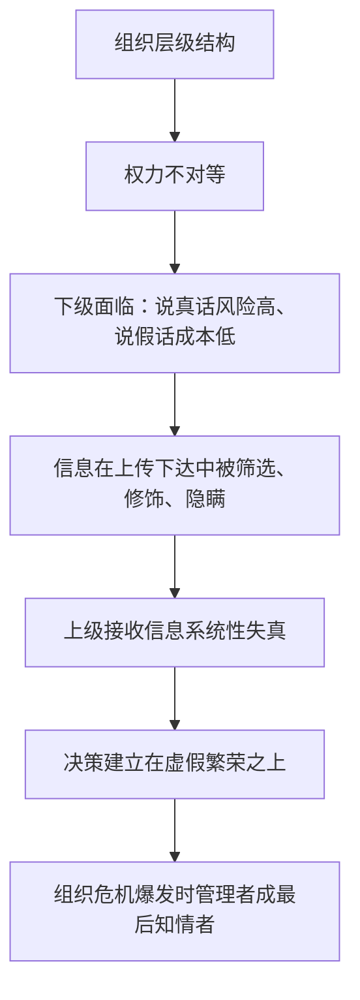

这个图表展示了组织信息过滤从结构成因到决策后果的完整演进链条。

### 边界条件

仅靠正式汇报渠道必成最后知情者，必须主动构建获取真相机制。心理安全感缺失时，任何激励机制都无法打通真话通道。适用于一切权力不对等的组织关系（企业、政府、军队等）。

[P003]

## 60.4 管理盲区与认知滞后 —— 不主动破局必成瞎子

### 为什么需要这个概念？

管理者身处信息金字塔顶端，仅接收过滤后的“好消息”。基层矛盾、员工真实诉求被层层拦截，管理者对真实运行状态一无所知。认知滞后具有必然性：不主动构建真相机制，仅靠正式汇报必成最后知情者。

### 核心定义

**管理盲区** 指管理者因信息过滤导致的认知偏差状态：自以为无事实则危机四伏。核心悖论：权力越大、层级越高，越容易成为信息孤岛。

### 关键性质

- **滞后性**：很可能下面闹开锅了，老板还不知道
- **系统性**：源于组织结构而非个别员工素质
- **破坏性**：决策建立在虚假数据上，导致战略性失误

### 典型例子

**袁世凯假报纸案**：每天看赞美之词，误判民心民意，83天帝制崩溃。

**离职面谈失真**：员工给社会通用借口，隐瞒对管理层/文化/薪酬的真实不满。

**员工视角**：说真话易得罪直系领导遭穿小鞋，老板装作看不到形成默契。

> "有些老板会天真地以为，自己没啥问题，其实他有可能是最后一个知道公司出问题的人"  
> ——《P003, p.1》

> "袁世凯...身边的人每天给他看的都是假新闻，假报纸...登基83天后被迫撤销帝制"  
> ——《P003, p.2》

> "很可能下面闹开锅了，老板还不知道"  
> ——《P003, p.2》

### 方法演进图

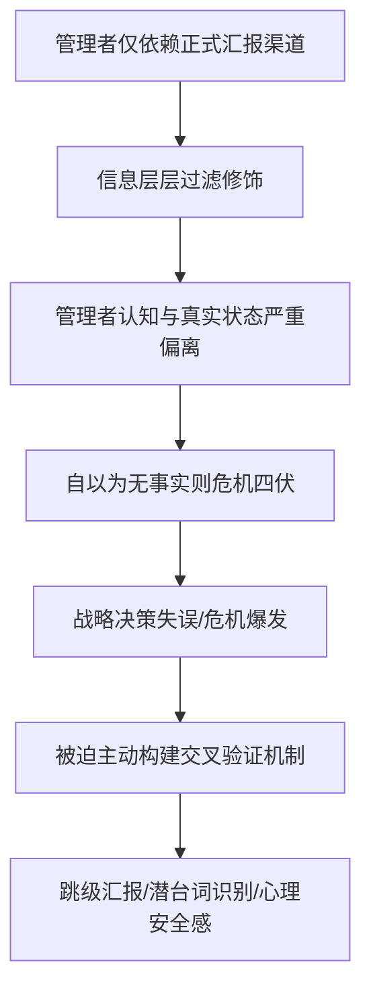

这个图表揭示了管理盲区形成的必然路径及破局的关键节点。

### 边界条件

必须跳出单一汇报渠道，建立多层级交叉验证机制。需训练识别语言潜台词能力（如：没有痛快答应即拒绝）。创业前就应知道“做老板是个很难的活”，需有心理准备。

[P003]

## 60.5 获取真相三板斧 —— 跳级汇报、潜台词识别、心理安全感

### 为什么需要这个概念？

单一汇报渠道必然失真，必须打破信息茧房主动获取真相。管理者无法直接消除权力不对等，只能通过方法论对冲其副作用。真相获取是管理者的核心生存技能，关乎决策质量与组织存亡。

### 核心定义

一套主动打破组织信息过滤、拼凑真实运行状态的方法论组合，包含：**跳级汇报/多层级交叉验证**、**非显性拒绝信号识别**、**建立心理安全感**。

### 关键性质

- **主动性**：不能等真相上报，要亲自下沉去挖
- **交叉验证**：对比不同立场（下属、下属的下属、同僚）信息差异拼凑真相
- **解码能力**：识别“拖延/模糊/找借口”即为非显性拒绝

### 典型方法与实操

**方法一：跳级汇报/多层级交叉验证**

```
1. 直接了解“下属的下属”反馈，绕过中层过滤
2. 对比一级汇报与跳级汇报的差异，定位信息断层
3. 建立常态化跨层级沟通机制（如季度跳级面谈）
```

**方法二：非显性拒绝信号识别法**

```
1. 观察回应的及时性：拖延回复 = 不想做/不能做
2. 观察回应的确定性：模糊表态（"再看看"/"有点难"）= 拒绝
3. 观察回应的热情度：找借口/推细节 = 无意愿
4. 核心口诀：没有"痛快答应"即为拒绝
```

**方法三：心理安全感建设**

```
1. 制度层面：只罚结果不罚报告问题，鼓励暴露坏消息
2. 文化层面：管理者带头承认错误，树立“报告坏消息是功劳”的榜样
3. 反馈层面：对报告问题者给予即时正向反馈，而非追责
```

> "这就需要你努力了解公司的真相，你的下属，你下属的下属，可能反馈的信息都不同"  
> ——《P003, p.1》

> "我常常说：一个人没有痛快的答应，通常就是拒绝的意思"  
> ——《P003, p.2》

### 方法演进图

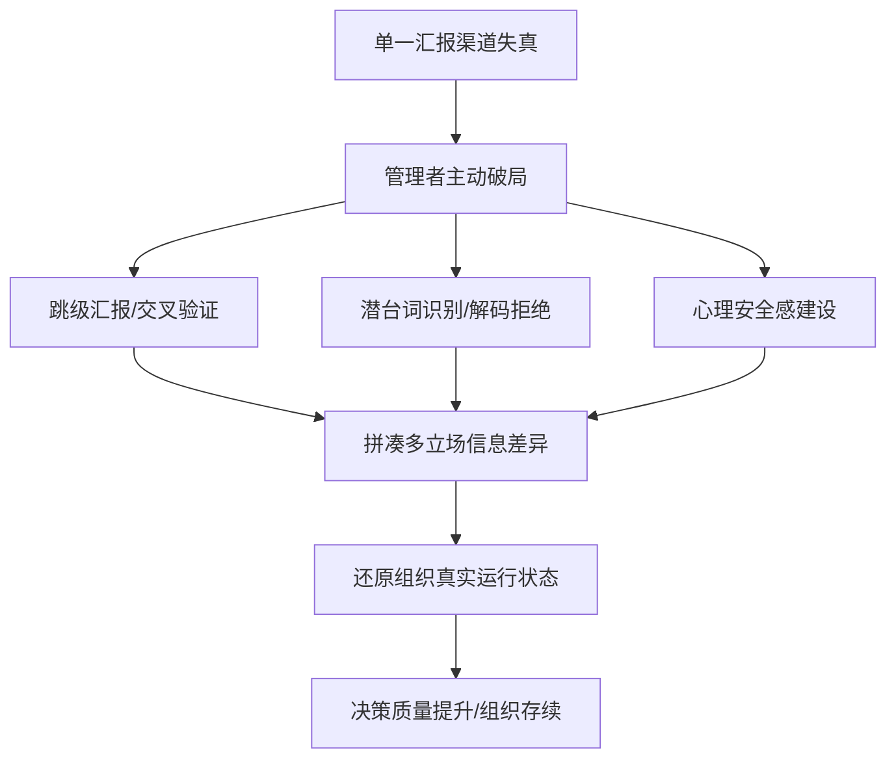

这个图表展示了三大核心手段如何协同作用，从打破信息茧房到还原真相的完整路径。

### 边界条件

方法论只能缓解无法根治，权力结构决定信息过滤本质属性。过度跳级可能破坏中层权威，需把握频次与方式。心理安全感建设需长期一致性，一次报复性惩罚即可摧毁。

[P003]

## 60.6 闲鱼二手书“笨功夫”优于技术流 —— 真实感与从众心理转化律

### 为什么需要这个概念？

新手迷信采集软件/ERP批量铺货，实则系统性丧失转化核心要素。非标品交易中，买家决策依赖“实拍图真实度”建立信任、“想要数/热门榜”触发从众。技术流导致图片质量差、基础数据为零、定价刚性，转化率极低。

### 核心定义

**笨功夫优于技术流** 定律：在闲鱼二手书等非标C2C场景，人工精选图片、手动上架、人工养号（点想要、控价格、聊天回复）显著优于自动化工具。“笨功夫”本质是对商品真实感的还原与社交证据的主动构建。

> "他也都是一本本手动上书的，我们工作室也是全部找大学生，精选图片上书的，而同时期开始，那些一开始就各种技术手段的人，都没有拿到太大的结果。"  
> ——《P086, p.3》

### 关键性质

- **真实感**：实拍图展示真实品相、瑕疵，建立买家信任
- **从众心理**：前期低价引流积累“想要/销量/热门榜”，触发后续买家跟随
- **定价弹性**：人工可前期压低价格引流，有数据后再慢慢涨价；软件铺货刚性定价无法调整

以下表格展示了非标品交易中不同展示要素对买家点击决策的影响对比：

| 选项 | 图片质量 | 基础数据(想要/销量) | 价格 | 点击概率 |
|------|----------|---------------------|------|----------|
| 1. 采集图+高价+零数据 | 差 | 无 | 高 | 极低 |
| 2. 实拍图+真实+热门榜 | 优 | 高 | 中 | **高** |
| 3. 采集图+高价+零数据 | 差 | 无 | 高 | 极低 |
| 4. 实拍图+低价+有想要 | 优 | 中 | 低 | **高** |

这个表格展示了非标品交易中，真实感与从众心理数据是买家决策的两大核心锚点，技术流系统性缺失这两要素。

### 典型买家决策模拟

> "选择 2 的理由，就是实拍图真实，而且还是热门榜，一般人都会有从众心理；选择 4 的理由，就是价格便宜，至少还有几个想要"  
> ——《P086, p.4》

### 典型例子

**老瞿团队/小嵩团队**：找大学生精选图片手动上书，存活并规模化。

**同期技术流群体**：采集软件批量铺货，普遍未拿到结果甚至因违规封号退出。

> "系统采集上架的图书：1、质量基本上跟手动的存在较大的差距；2、批量铺货的人...根本没有心情给一些商品稍微做点数据...3、更不可能在前期把价格压低..."  
> ——《P086, p.4》

### 方法演进图

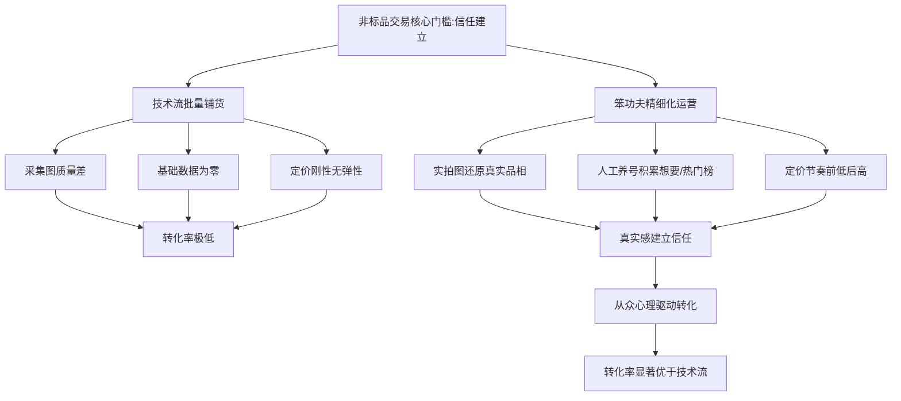

这个图表对比了技术流与笨功夫在非标品交易中的核心差异与转化路径。

### 边界条件

仅适用于非标品（二手书、旧物）等需要信任背书的交易场景。标准品（3C数码、标准化消费品）可能更适合自动化铺货。需配合标准化SOP（选品标准、拍照规范、话术库）规模化复制，不能纯靠人海战术。

[P086]

## 60.7 小白创业“销售优先于供应链”公理 —— 货源陷阱与伪行动识别

### 为什么需要这个概念？

新手将90%精力投入“找货源/选品/仓储”，实为逃避“搞流量/卖产品”核心难点。产品过剩时代，货源非稀缺资源；销售端跑通后，供应链会反向寻找销售端。“找货源”提供虚假成就感，掩盖“不敢面对销售额”的恐惧，是典型伪勤奋。

### 核心定义

**销售优先于供应链公理**：创业初期核心稀缺能力是“销售/获客”，而非“供应链/货源”。货源陷阱：以寻找货源为借口麻痹自己，逃避业绩压力的心理防御机制。

> "今天是一个产品过剩的时代，对于小白来说，货源没有任何意义，把仅有的精力花在搞流量上，花在卖产品上，只要你能卖出去，什么产品都会求着你。"  
> ——《P086, p.5》

### 关键性质

- **优先级倒置**：重供应链轻销售 = 逃避困难 + 伪勤奋
- **流量端聚焦**：有限精力100%投入获取流量与转化销售（优化标题/图片/价格/文案、主动引流、客服促单）
- **零库存运营**：利用无货源/一件代发模式，彻底外包仓储物流后端

### 典型例子

**责任外归型提问**：“我上架500本书一个月能赚多少？”、“做几个号月入过万？”——“跟着你干确定能赚钱吗？”——责任外归，索要确定性承诺。

**老瞿实证**：1000平米实体仓库利润 < 小区工作室30号无货源模式利润。

**圈友案例**：仅凭一篇风向标文章（无操作流程），执行落地副业月入大几千，证明执行力>信息差。

> "我 1000 平米的二手仓库，还不如我在小区开个工作室做 30 个闲鱼帐号卖二手书无货源赚的多，很讽刺吧，实体是投入又大，又累，成本又高，利润又低。"  
> ——《P086, p.5》

> "其实一个很重要的点是他不敢面对销售额，通过找货源来麻痹自己，去逃避业绩压力，找到了还挺有成就感，关键呢，还是卖不出去。"  
> ——《P086, p.5》

### 方法演进图

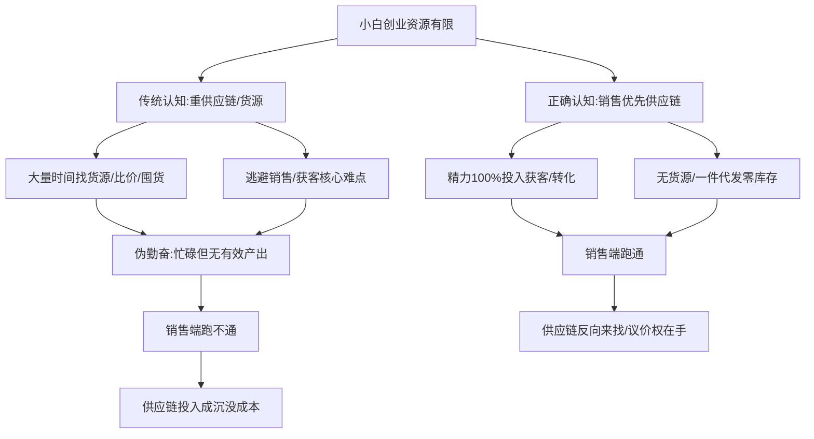

这个图表对比了错误与正确的资源配置路径，揭示了伪勤奋陷阱的形成机制。

### 边界条件

适用于轻资产、低门槛、流量驱动的创业项目（电商、内容、服务等）。重资产、强供应链壁垒行业（制造、医药、硬科技）不适用。销售端跑通前，任何供应链投入都是沉没成本。

[P086]

## 60.8 确定性陷阱与责任内归律 —— 成年人没有包赚的生意

### 为什么需要这个概念？

新手渴望“跟着干包赚”“确定入场时机”“标准化SOP必出结果”，本质是责任外包。任何承诺确定性收益的项目/导师均不可信，成年人创业本质是在不确定性中试错学会赚钱。索要确定性即放弃了企业家应承担的风险溢价权利，注定被收割。

### 核心定义

**确定性陷阱**：将“能否赚钱”、“何时入场”、“跟谁干包赚”等决策责任完全外包给他人的心理陷阱。

**责任内归律**：赚钱概率与承担责任程度正相关，将选项目、执行、结果全链路责任内化为自我认知问题，成功率才显著提升。

> "赚钱是教不会的，但是可以学会的，如果一个项目都是确定性的，那还有谁打工，还有谁去搬砖，这个世界上没有人能逼你赚钱。"  
> ——《P086, p.6》

> "请问当你是一个成年人以后，别人用什么可以逼你赚钱？别人又凭什么去逼你赚钱？"  
> ——《P086, p.6》

### 关键性质

- **无确定性**：世界上没有人能逼你赚钱，别人也凭什么去逼你赚钱
- **试错本质**：成年人创业=在不确定性中通过试错学会赚钱，而非执行确定性指令
- **心智重塑**：从“索要承诺”转向“接受不确定、主动试错、快速迭代”

### 多源对照：知识付费定位与项目分层

**共识**：《P086》与《P162》均确认：知识付费核心价值在于缩短试错周期、规避致命坑点，不承担执行责任、不保证成功。

**分歧**：

- 《P086》侧重“确定性陷阱”心理机制剖析，强调试错是必经之路
- 《P162》进一步构建**项目分层模型**（初/中/高级）与**认知匹配决策法**，提供具体的决策工具

> "知识付费本质：避坑工具而非致富门票，核心价值在于缩短试错周期、跑通标准化流程、规避致命坑点，不承担执行责任、不保证成功。"  
> ——《P162, p.3》

> "项目是分层级的...初级，蓝海电商，执行就有结果...中级，短视频、直播...高级，个人 IP...你只有充分的认知到自己的能力，做对应层级的项目才能更容易拿到结果"  
> ——《P162, p.4》

### 典型例子

**训练营数据**：月费大几千，出单率<50%，月入过万概率<10% —— 低估难度导致高放弃率。

**圈友正向案例**：仅凭一篇简单文章（无操作流程），靠执行力落地月入大几千。

### 方法演进图

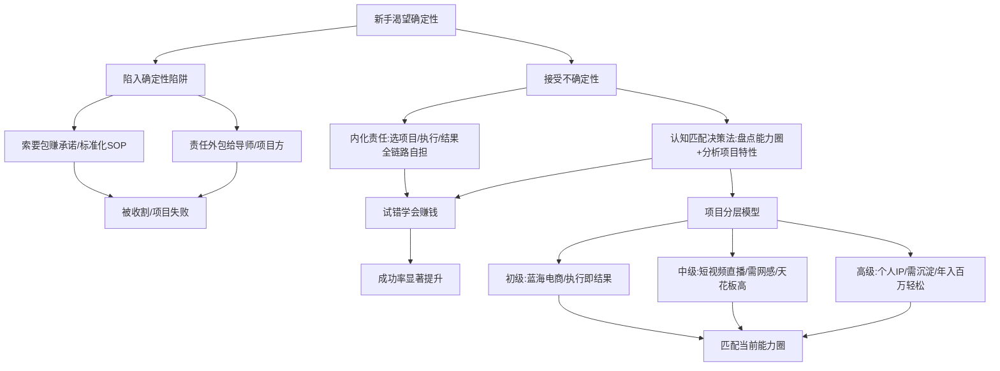

这个图表展示了从确定性陷阱到责任内归的心智重塑路径，以及项目分层匹配的决策工具。

### 边界条件

知识付费本质是“避坑工具”而非“致富门票”。项目分层模型：初/中/高级需匹配能力圈，盲目跟风高阶项目必死。认知匹配决策法：先盘点自身优劣势/能力边界，再分析项目出单周期/琐碎度/天花板/核心能力，双向匹配决策。

[P086, P162]

## 60.9 轻资产工作室模型 —— 社区工作室的低成本规模化复制

### 为什么需要这个概念？

实体仓库模式：高房租、高人力、高库存压力、低利润率，小白必死。需要一种固定成本极低、可快速复制、利润率高的组织形态支撑批量运营。闲鱼等平台账号矩阵运营需标准化SOP与低成本劳动力配合。

### 核心定义

**社区工作室模型**：在小区/低租金场地建立工作室，雇佣兼职大学生按件/按单结算，操作30-50个账号矩阵，通过标准化SOP实现规模化复制。无高额房租、无库存压力，利润率远超实体仓库模式。

### 关键性质

- **低固定成本**：租金低、人力外包按件结算、无库存资金占用
- **高周转**：账号矩阵+标准化SOP实现规模化产出
- **可复制性**：SOP标准化后可快速复制到新社区/新城市

### 典型例子

**老瞿案例**：小区工作室30个闲鱼号卖二手书，利润超1000平米实体仓库。

**大学生兼职**：按件结算，操作账号矩阵，标准化SOP执行。

> "在小区开个工作室做 30 个闲鱼帐号卖二手书无货源赚的多"  
> ——《P086, p.6》

> "实体是投入又大，又累，成本又高，利润又低。前期还是玩点轻。"  
> ——《P086, p.6》

### 方法演进图

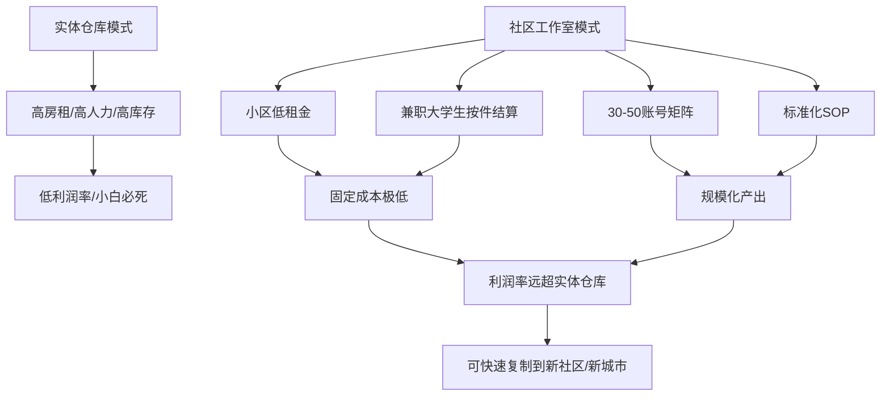

这个图表对比了两种组织形态的成本结构与利润模型，展示了轻资产模式的规模化复制路径。

### 边界条件

依赖成熟的标准化SOP（选品、拍照、上架、定价、客服、发货全流程）。需要稳定的兼职劳动力供给（大学生群体为最佳）。适用于非标品、高客单、需真实感建立信任的交易场景。管理半径有限，单工作室账号数建议30-50个，超额需分裂新工作室。

[P086]

## 60.10 平台规则敬畏机制 —— 成熟期存量博弈的生存底线

### 为什么需要这个概念？

成熟平台存量博弈阶段，暴力玩法（批量铺货/软件采集）必封号。新手常因缺乏敬畏之心，用技术手段挑战平台规则，导致账号损失沉没成本。只有充分遵守平台规则，平台才可能让你赚到钱。

### 核心定义

在成熟平台运营，必须严守反作弊、反垃圾信息等规则作为生存前提。敬畏规则非道德说教，而是基于平台算法机制的理性生存策略。

> "我越发觉得，现在一些成熟的平台都在打击暴力的玩法，我们只有充分遵守平台的规则，他才可能让你赚到钱。"  
> ——《P086, p.2》

### 关键性质

- **强制性**：违规必封，概率趋近100%
- **动态性**：平台规则持续收紧，历史经验快速失效
- **笨功夫优势**：手动精细化运营合规且转化高，技术流暴力玩法违规且转化低

### 典型例子

**批量铺货案例**：找软件一天铺货，几本违禁书+重复铺货处罚，直接封号7天。

**同期对比**：手动精细化运营者存活规模化，技术流批量铺货群体全军覆没。

**训练营印证**：大佬带教一个月，出单率<50%，月入过万<10%，印证合规难度。

> "找个软件，批量铺货，一天下来几本违禁书，几个重复铺货的处罚后，直接封号 7 天。"  
> ——《P086, p.2》

> "他也都是一本本手动上书的，我们工作室也是全部找大学生，精选图片上书的，而同时期开始，那些一开始就各种技术手段的人，都没有拿到太大的结果。"  
> ——《P086, p.3》

> "市面上很多大佬...训练营，一个月大几 K 的费用，一个月下来，出单率不到 50%，月入过万的概率小于 10%。"  
> ——《P086, p.2》

### 方法演进图

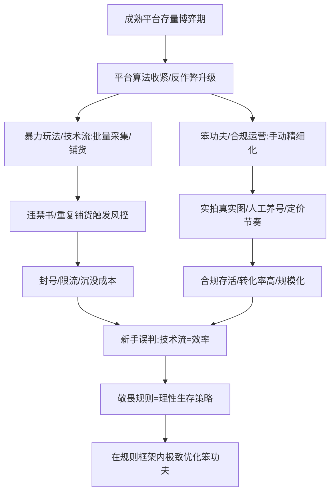

这个图表揭示了成熟平台期暴力玩法必死、合规笨功夫生存的底层逻辑。

### 边界条件

红利期（平台早期）规则宽松，暴力玩法可能有效；成熟期必须转型合规。合规非“守着规则等死”，而是在规则框架内寻找笨功夫的极致优化空间。跨平台运营需针对性研究各平台差异化规则，不可一套打法走天下。

[P086]

## 60.11 陪诊行业变现分层模型 —— 从卖体力到卖资源的四阶跃迁

### 为什么需要这个概念？

陪诊师易陷入“跑腿挂号”低客单价劳动密集型陷阱，月入上限约9000元。必须看清行业变现全景图，规划从基础劳务向资源整合的进化路径。核心护城河不在“陪同”本身，而在“信息差”与“资源获取能力”的产品化。

### 核心定义

**陪诊变现四阶模型** 按劳动密集度与资源稀缺度分四层：

1. **基础劳务层**：自己跑单挂号，一线城市半天300元，日均1单，天花板极低
2. **专业服务层**：试管陪诊（15次/周期高粘性）、派单分成（3:7）、教学、加盟，建立杠杆
3. **流量分发层**：抖音自然流量获客（垂直医疗内容）、私域转化
4. **核心资源整合层**：绿通（5000-20000元买时间）、院内制剂、药械进院、私立/海外就医、基因检测，构建护城河

> "一线城市半天收费标准是300元。我目前的最高记录是跑5单...平均下来一天一单左右。"  
> ——《PSc, p.1》

> "试管婴儿一个周期需要去医院15次左右，我目前跟了11个周期"  
> ——《PSc, p.2》

### 关键性质

- **第一阶段“卖体力”**：自己跑单挂号，一线城市半天300元，日均1单，天花板极低
- **第二阶段“卖专业/卖流量”**：试管陪诊（15次/周期高粘性）、派单分成（3:7）、教学、加盟，建立杠杆
- **第三阶段“卖资源/卖渠道”**：绿通（5000-20000元买时间）、院内制剂、药械进院、私立/海外就医、基因检测，构建护城河
- **合规底线**：必须甄别机构真实性合法性，规避黄牛挂号/非法行医/回扣贿赂红线

### 多源对照：P173 与 PSc 在陪诊变现模型上的共识与差异

**共识**：
- 都认同陪诊行业存在从“基础劳务”向“资源整合”演进的分层路径
- 都指出“试管陪诊”属于高粘性、长周期的核心业务切片
- 都强调合规性是长期存续前提，需规避黄牛挂号、非法行医、回扣红线

**差异**：
- **P173** 侧重梳理 11 种变现方式清单，作为入行者的思考框架与异地就医指南，细节见飞书文档
- **PSc** 进一步将变现路径显式抽象为“三阶段/四层”结构化模型，并给出具体单价、佣金比例、转化数据等量化锚点（如绿通 5000-2万、海外就医佣金 8-20%、基因检测单佣 1000-3000）
- **PSc** 独有：派单分成模型（3:7）、抖音自然流量获客策略（垂直内容+禁投 DOU+）、院内制剂爆款视频复购案例（2万+收益）、癌症生存率数据锚定海外就医话术
- **PSc** 独有：加盟商定价锚点（优德医 5万、陪诊无忧 10万+营收分成）

### 典型验证数据

**试管陪诊**：作者跟进11个周期，单周期15次陪诊，验证高频/长周期/强依赖护城河属性。

**院内制剂**：单条抖音视频（开胃醒脾饮）收益2万+且持续复购，打通公域获客-私域成交-高频复购闭环。

**绿通服务**：中山一附院手术排队2月未果，绿通费5000-2万解决入院，患者支付意愿极高。

**海外就医**：中美日英癌症5年生存率差（中国40.5% vs 美国67.1%）作锚点，佣金8-20%实收。

### 方法演进图

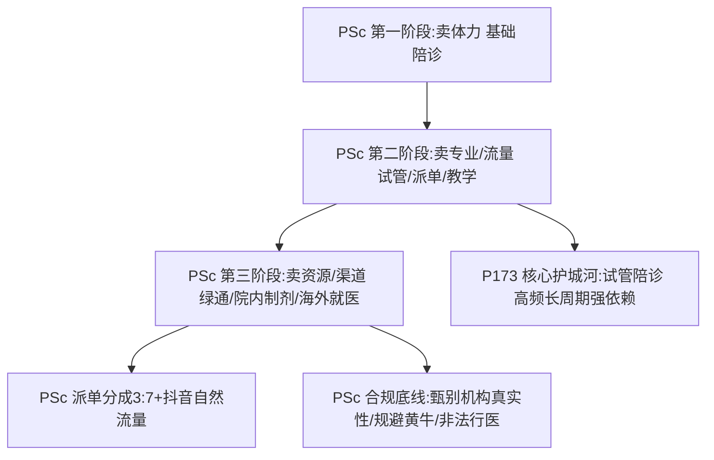

这个图表展示了陪诊行业从基础劳务向资源整合的演进路径，以及核心护城河产品与合规底线的支撑位置。

### 边界条件

核心竞争力在于医院科室资源/医生关系/院外机构合作的深度与广度。抖音自然流量获客：垂直医疗内容获精准流量，行业禁投DOU+。派单分成模型：头部负责流量获取与筛选，派单给同行履约按3:7分成，突破单人服务上限。必须建立项目筛选机制，规避法律红线，合规是长期存续前提。

[P173, PSc]

## 60.12 陪诊师职业倦怠本质 —— 共情过载与心理屏蔽机制

### 为什么需要这个概念？

陪诊师长期接触病患群体，核心风险非体力透支而是心理能量消耗与负面情绪传染。“病气/负能量”积累已成行业共知隐性门槛，甚至衍生出佩戴符咒等非标准化应对。必须从科学（能量场/共情过载）与玄学（符咒/物理隔离）双维度建立边界感。

### 核心定义

**职业倦怠源于“共情过载”而非劳动强度**：长期吸收患者负面情绪导致能量场污染。需通过物理隔离（符咒/心理建设/边界感训练）构建心理屏蔽机制。

> "个人感觉接触多了整个人会很多负能量，玄学上说的是病气"  
> ——《P173, p.2》

> "人生病就是负能量在身上的，科学讲就是能量场，有益能量和有害能量"  
> ——《P173, p.2》

### 关键性质

- **隐蔽性**：不像体力疲劳可休息恢复，心理污染累积隐蔽且难逆转
- **普遍性**：评论区多位从业者/观察者共识确认，属行业共知风险
- **非标准化应对**：目前无成熟心理干预体系，从业者自发探索符咒、冥想、物理隔离等手段

### 多源对照：P173 与 PSc 在职业倦怠认知与应对上的异同

**共识**：
- 都明确指出陪诊师核心职业风险为“负能量/病气”积累，即心理层面的“共情过载”而非体力透支
- 都记录了从业者自发采用“佩戴符咒”这一玄学手段作为物理/心理隔离手段
- 都给出“能量场”科学解释：有益/有害能量场互动导致污染

**差异**：
- **P173** 以评论区讨论为主，呈现“玄学+科学”双重解释并存的现状，未给出制度化应对方案
- **PSc** 虽同源但更强调该风险是“从卖体力向卖资源进化过程中的隐性门槛”，暗示需通过组织化手段（轮岗、督导、团队互助）而非仅靠个人符咒来系统化解决

### 典型例子

**评论区实证**：“个人感觉接触多了整个人会很多负能量，玄学上说的是病气”

**科学解释**：“人生病就是负能量在身上的，科学讲就是能量场，有益能量和有害能量”

**应对手段**：“可以佩戴符咒！在玄学来讲，人生病就是负能量在身上的”

> "因为很多生病的人，身上给人的感觉都是不一样的"  
> ——《PSc, p.3》

> "可以佩戴符咒"  
> ——《PSc, p.3》

### 方法演进图

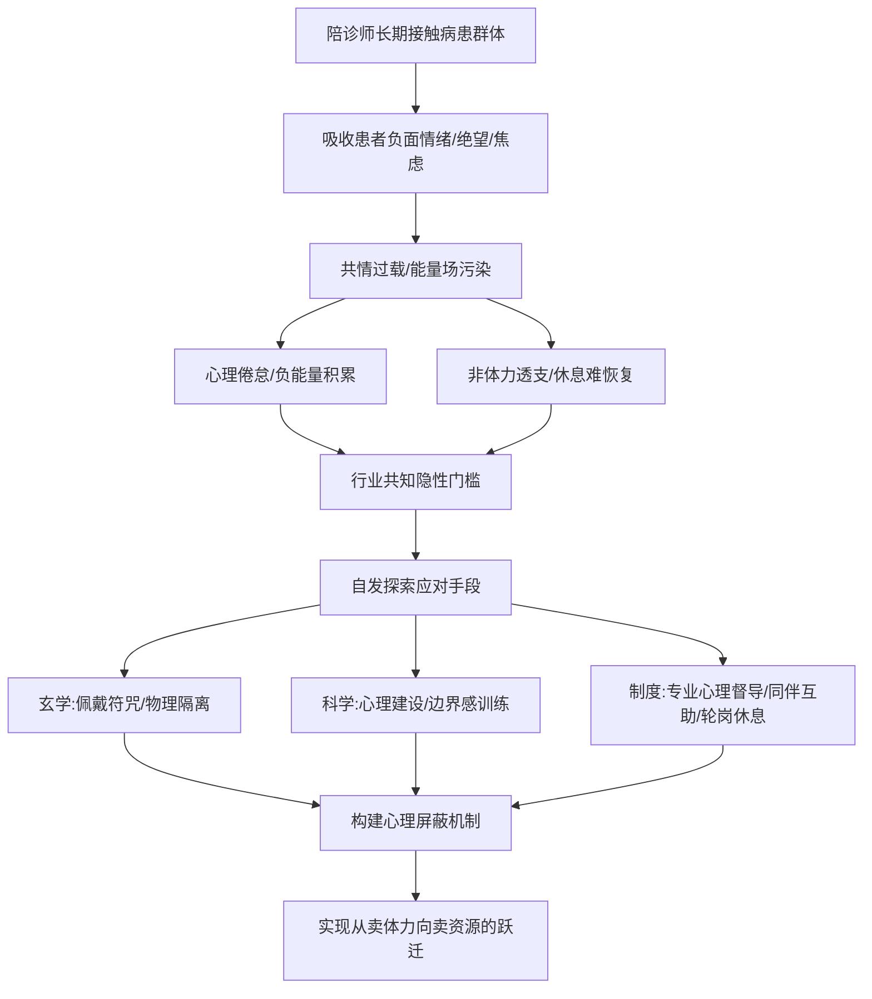

这个图表展示了陪诊师职业倦怠的成因机制与多维度应对体系的构建路径。

### 边界条件

心理屏蔽机制建设需专业指导，单纯靠符咒等玄学手段可能产生依赖。建议引入专业心理督导/同伴互助/轮岗休息等制度化应对方案。该风险是陪诊行业从“卖体力”向“卖资源”进化过程中必须跨越的隐性门槛。

[P173, PSc]

## 60.13 二手书合规红线 —— 年售5万免证，核心风险在违禁书

### 为什么需要这个概念？

二手书经营者常恐惧“无证经营”处罚，实则监管核心查的是书的内容而非资质。明确免证门槛与真实风险点，可大幅降低合规焦虑与运营成本。

### 核心定义

年销售额5万元以下无需出版物经营许可证；被查处根本原因是卖了不该卖的书。多平台分散流水可规避监管阈值，单平台流水不超5万即免证。

> "年销售额在 5 万以下不需要... 你们看到的因为没有出版物经营许可证被查大都是因为卖了不该卖的书，如此而已。"  
> ——《P169, p.5》

### 关键性质

- **合规边界清晰**：证照合规≠经营合规，书目合规才是核心
- **规避策略可行**：多平台铺货（闲鱼/小红书/抖音/视频号）天然分散单平台流水
- **选品审核SOP**：上架前必查版本/印数/品相/内容合规性，建立敏感词库拦截

### 典型例子

**评论区实证**：个体户开第二家店法人认证提示证件已被认证，揭示平台规则对同一主体多店的限制。

**实操建议**：不同主体注册、不同平台分发、SKU分散上架，构建合规护城河。

> "如果多平台的话，每个平台卖几万是不是也很省事。再说在平台引流，微信卖不也很好吗？"  
> ——《P169, p.5》

### 方法演进图

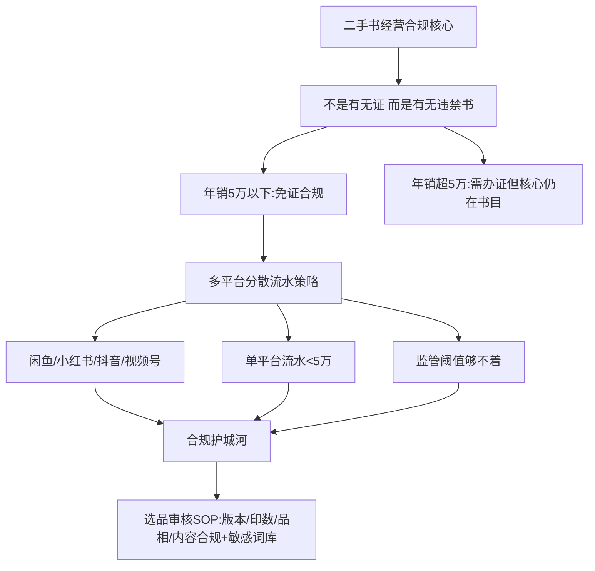

这个图表梳理了二手书经营合规的核心判断逻辑与可操作的规避策略。

### 边界条件

仅适用于二手图书等出版物经营场景。年销售额超5万仍需办证，但核心风控仍在书目内容而非证照本身。免证不等于无序，仍需建立选品合规SOP与敏感词库。

[P169]

## 60.14 医疗服务合规性生存底线 —— 甄别机构真实性合法性

### 为什么需要这个概念？

医疗灰色地带运营中，黄牛挂号/非法行医/回扣贿赂等法律红线隐蔽且高危。无筛选机制必踩雷，合规非道德说教而是生存前提。

### 核心定义

必须建立项目筛选机制，验证合作机构真实性与合法性，规避黄牛挂号/非法行医/回扣红线。合规是业务长期存续的前提条件，而非可选项。

> "在做的过程中会有各种各样的人来找你谈合作，要自己筛选判断合作项目机构的真实性及合法性。"  
> ——《PSc, p.4》

### 关键性质

- **隐蔽性**：灰产披着合法外衣，需专业甄别
- **动态性**：政策/监管/机构资质变化快，需持续监测
- **连带责任**：合作方违规己方担责，筛选机制是核心风控基建

### 典型例子

素材明确列举：黄牛挂号、非法行医、回扣贿赂三大红线。

派单分成模型中，头部负责筛选客户与机构真实性，履约方只管服务，实现风控前置。

> "获取流量后转派给同行分成，自己得3成，接单者分7成。"  
> ——《PSc, p.3》

> "抖音直播挂链接卖课程。"  
> ——《PSc, p.3》

### 方法演进图

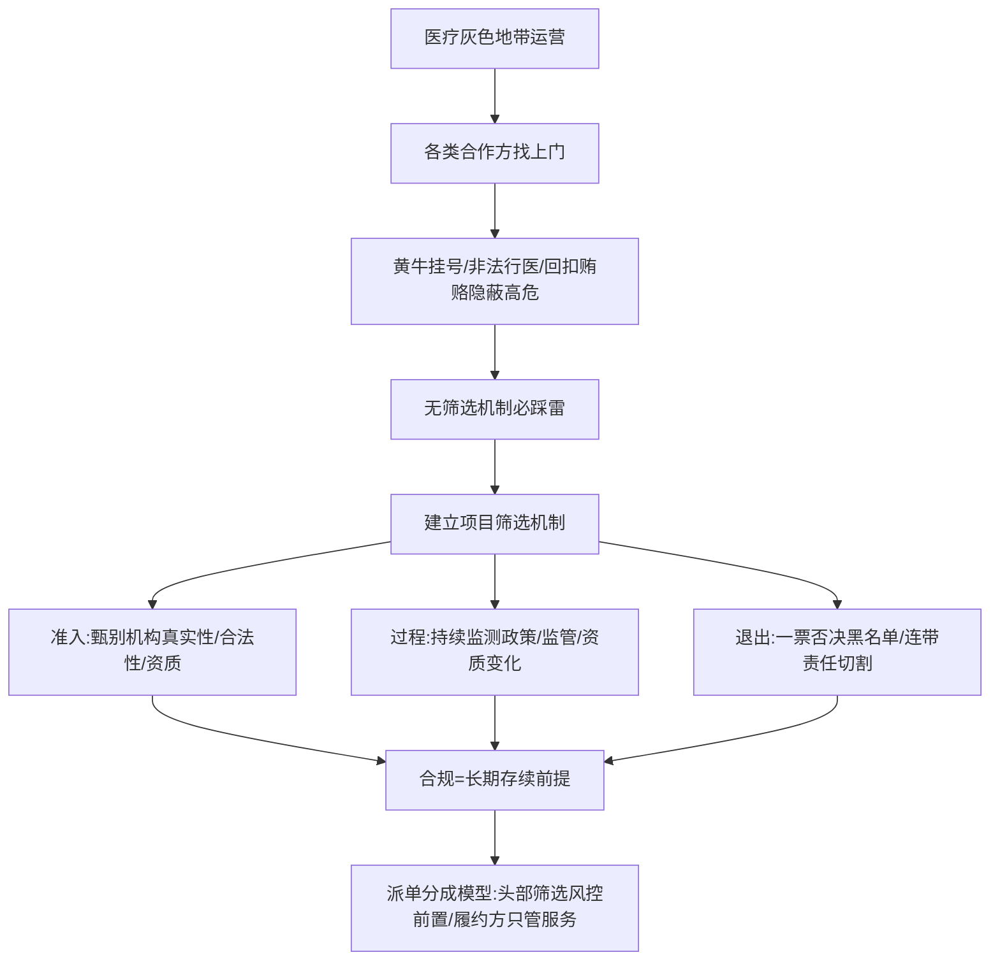

这个图表展示了医疗服务灰色地带运营中，项目筛选机制作为唯一探雷针的全生命周期覆盖逻辑。

### 边界条件

仅适用于陪诊/医疗服务等灰色地带业务。筛选机制需覆盖准入/过程/退出全生命周期。合规成本是不可压缩的准入券，而非运营成本可选项。

[PSc]

## 60.15 银行套利风控 —— 四大行资金自有卡闭环+利息承保

### 为什么需要这个概念？

银行月末/季度末冲指标产生短期大额资金需求，形成无风险套利窗口。必须建立物理隔离与利息兜底机制，规避小银行/第三方代操作风险。

### 核心定义

利用四大行（工农中建邮储）行长揽储考核缺口，通过二类卡/电子户关联一类卡通道，实现自有资金闭环流转赚取超额利息差价。资金全程在自己名下卡内流转，不涉及第三方；利息有承保；仅操作国有大行。

> "这个银行大额拆借套利我们只做农行、工行等四大行，不涉及到小银行，而且是在自己名下银行卡内互转，不对外转给他人，所以在操作上是安全无风险的。"  
> ——《P166, p.2》

### 关键性质

- **资金安全物理隔离**：全程自有卡互转，无代操作/款转他人风险
- **利息兜底**：渠道方/银行端承诺日息/分成模式，本金零风险
- **准入门槛**：单笔百万级起步，属大资金专属玩法

### 典型例子

**自有资金500万**：月度理财+季度末冲量，合计月获利2万。

**对接公司股东3亿资金**：季度末单日获利6万，验证大额高收益模式。

**炒股朋友闲置资金**：日均+月末配合，额外获利2万+。

### 银行套利风控要素对比表

以下是银行套利操作的核心风控要素对比：

| 风控要素 | 安全做法 | 高风险做法 | 核心逻辑 |
|----------|----------|------------|----------|
| 银行选择 | 工农中建邮储等四大行 | 城商行/农信社/小银行 | 国有大行信用背书、兑付有承保 |
| 资金流向 | 自有卡间闭环流转 | 转给第三方/渠道方代操作 | 物理隔离消除挪用/卷款风险 |
| 利息结构 | 渠道方/银行承保日息 | 无承保/仅口头承诺 | 收益锁定、本金零风险 |
| 资金量级 | 百万级起步 | 小资金尝试 | 单笔收益需覆盖操作成本 |

这个表格展示了银行套利操作中，资金安全、收益兜底、准入门槛三大核心维度的红线与绿线。

> "操作时间基本是月末的几天时间，根据步骤操作后，资金保留 24 小时，我们就会把返利打到个人账号上"  
> ——《P166, p.2》

> "要真发生万一。你也就损失理财利息。没赚这种差额嘛。"  
> ——《P166, p.4》

> "风不停 : 小银行的话慎重，我有朋友入坑的"  
> ——《P166, p.5》

> "老胡 : 四大行，资金都在自己卡里，不存在本来损失那些，对于利息的话，是有承保。"  
> ——《P166, p.5》

### 方法演进图

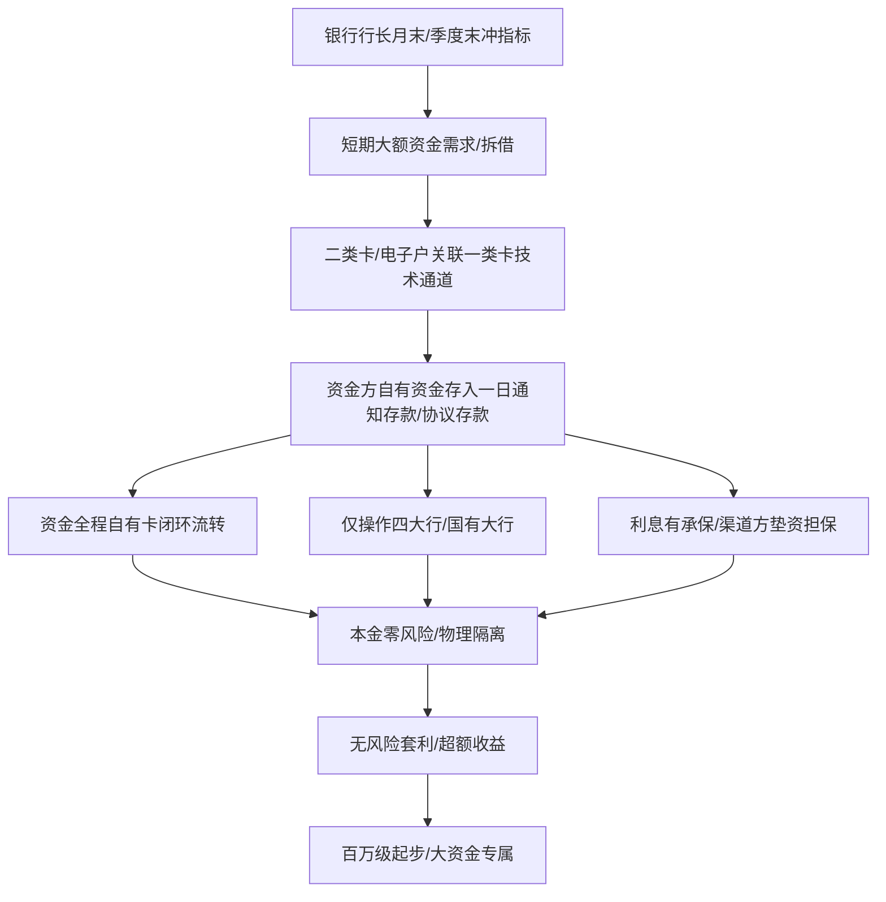

这个图表展示了银行套利从机会挖掘到风控落地的完整操作闭环。

### 边界条件

仅限工农中建邮储等国有大行，小银行存在入坑风险。资金量需百万级起步，小资金无显著杠杆收益。依赖渠道方/银行内部人资源，无渠道不可操作。

[P166]

## 60.16 设计中的取舍

**为什么不用“全员全透明”消除信息过滤？**  
因为权力不对等是组织的客观结构属性，无法通过制度一纸消除。员工面临“说真话得罪直系领导、说假话平安无事”的博弈结构，任何强制透明制度都会被非正式规则绕过。唯一可行的是管理者主动构建交叉验证机制，接受“永远无法完全掌握真相”这一认知边界。

**“笨功夫”看似低效，为何在非标品交易中反而ROI更高？**  
因为非标品交易的核心门槛是“信任建立”，而非“铺货速度”。技术流批量铺货牺牲了实拍真实感与从众心理数据积累，这两者是买家决策的唯一锚点。笨功夫看似慢，实则每一步都在构建转化率的分子，技术流看似快，实则在制造转化率为零的分母。

**为何“销售优先供应链”违背传统创业教科书却更有效？**  
传统教科书假设“产品稀缺、供应链是壁垒”，但当下是“产品过剩、流量稀缺”的时代。小白的核心稀缺能力是“搞流量、能卖货”，货源反而是非稀缺资源。倒置优先级，本质是将有限精力投入到边际收益最高的环节。

**确定性陷阱为何对新手杀伤力最大？**  
新手缺乏“在不确定性中决策”的心理韧性，渴望用“付费买确定性”替代“试错学能力”。但商业世界的底层规律是：风险溢价归承担风险者所有。索要确定性，本质是想免费拿风险溢价，注定被收割。

**陪诊行业为何必须从“卖体力”跃迁到“卖资源”？**  
因为“陪同”本身是标准化程度极低、不可规模化、天花板极低的劳动密集型服务。唯有将“信息差”（流程熟悉度、号源渠道）与“资源获取能力”（绿通、院内制剂、海外就医）产品化、标准化，才能构建护城河、实现规模化溢价。

## 60.17 动手练习

### 练习 1：组织真相获取实战推演

**场景**：你是某电商公司创始人，近期GMV下滑，运营总监汇报‘大促流量分配机制变了，行业普遍下滑’，客服主管离职时说‘想去大厂学规范化管理’。

1. 运用‘潜台词识别法’，分析运营总监汇报与客服主管离职理由背后的隐性信号。
2. 设计一套‘跳级汇报/交叉验证’方案：你将找谁谈话？问什么问题？如何对比不同立场的信息差异拼凑真相？
3. 如果你发现核心问题是‘新上线的自动化投放工具烧钱严重且总监隐瞒不报’，你会如何基于‘心理安全感’原则处理？既要解决问题，又要不破坏‘报告坏消息不罚’的文化。

### 练习 2：闲鱼二手书“笨功夫”SOP设计与对比测试

**假设**你要在闲鱼卖《原则》二手书（成本15元），同款在售50+。

1. 编写一份‘手动精细化上架SOP’，包含：选品验收标准、实拍图拍摄清单（几张、拍什么细节）、定价节奏策略（前3天/第4-7天/稳定期）、互动养号动作（点想要/回复话术/发圈引流）。
2. 对比‘采集软件批量铺货’模式：列出至少5个维度的差异（图片质量、基础数据、定价弹性、违规风险、转化率预期），并解释为何‘真实感+从众心理’是非标品转化核心。
3. 思考：该SOP能否直接迁移到‘卖二手Kindle电纸书’？哪些环节需修改？

### 练习 3：陪诊创业路径规划与风控清单

**你打算在一线城市创业做陪诊，起步资金10万，目标年收入50万。**

1. 基于‘四阶跃迁模型’，规划你的12个月进化路径：每阶段核心动作、预期收入、所需关键资源（医院关系/医生渠道/平台账号/团队）。
2. 识别你路径中涉及的‘合规红线’（黄牛挂号、非法行医、回扣贿赂、虚假宣传），并为每条红线设计一条具体的‘项目筛选/规避机制’。
3. 针对‘共情过载’职业倦怠，设计一套‘心理屏蔽机制’：包含入行前筛选标准、工作中边界感训练、事后疗愈复盘流程、团队互助制度。

### 练习 4：确定性陷阱免疫训练

收集你近期看到的3个‘包赚/跟着干/确定性收益’的创业广告/推销话术（可来自朋友圈、知识付费广告、招商加盟文案）。

1. 用‘确定性陷阱定理’逐条拆解：它们如何利用你的‘恐惧/贪婪/懒惰’将决策责任转嫁给你？
2. 对每个项目，应用‘认知匹配决策法’：列出你的能力圈（优势/劣势/时间/资金），列出项目的核心要求（出单周期/琐碎度/天花板/核心能力），做双向匹配决策：做/不做/小额试错。
3. 写一段给3个月前的自己的建议：如何从‘索要承诺’转向‘接受不确定、主动试错、快速迭代’？

### 练习 5：二手书合规经营压力测试

**你在闲鱼运营二手书店群（18家店铺），月流水20万。**

1. 设计一份‘违禁书自查清单’：覆盖政治敏感、色情、盗版、封禁书目四大类，标注排查频次与责任人。
2. 制定‘多平台流水分散策略’：如何将单平台流水控制在5万以下，同时保持总GMV不降？
3. 应对‘版权投诉/封店’的预案：法律依据、申诉话术、备用店铺启动流程、资金周转缓冲。

### 练习 6：医疗服务合规筛选实战

**你打算在陪诊业务中增加‘院内制剂代购’与‘海外就医中介’两条业务线。**

1. 为每条业务线设计‘三步验货法’：自购体验物流/售后、全员亲测无亲测不推荐、建立赔付兜底基金。
2. 识别‘黄牛挂号/非法行医/回扣贿赂’的5个典型信号特征，建立‘一票否决’准入黑名单。
3. 设计‘合规复盘周报’模板：新增合作机构/风险点/处理动作/责任人，确保留痕可查。

## 60.18 本章小结

这一章中我们学习/了解/讨论了风险识别与合规底线的核心体系。首先，我们剖析了组织信息过滤的成因与破坏力，揭示了权力不对等导致真话缺失的定律，并掌握了跳级汇报、潜台词识别、心理安全感建设三大获取真相的核心手段。其次，我们深度拆解了闲鱼二手书等非标品交易中“笨功夫”优于技术流的底层逻辑，确立了真实感建立信任、从众心理驱动转化的转化律，并确立了小白创业“销售优先于供应链”的资源配置公理。接着，我们建立了“确定性陷阱”免疫机制，内化了责任内归律：接受不确定性、拒绝包赚承诺、通过试错学会赚钱，并掌握了轻资产社区工作室模型的组织形态优势。然后，我们敬畏成熟平台规则，理解合规是存量博弈期的生存底线，构建了陪诊行业变现四阶跃迁认知模型，锁定了试管陪诊等护城河产品与合规红线。最后，我们认知了陪诊师职业倦怠本质为“共情过载”，建立了心理屏蔽机制，识别了二手书经营核心风险在违禁书而非无证，掌握了银行套利风控的四大行自有卡闭环要素，以及医疗服务灰色地带的项目筛选生存底线。

本章我们一起学习了以下概念：

| 概念 | 解释 |
|------|------|
| 组织信息过滤 | 权力不对等导致下级“说真话风险高、说假话成本低”，上级接收信息系统性失真 |
| 管理盲区 | 仅靠正式汇报渠道，管理者必成最后一个知道公司出问题的人 |
| 获取真相三板斧 | 跳级汇报交叉验证、识别“无痛快答应即拒绝”潜台词、建立只罚结果不罚报告的心理安全感 |
| 笨功夫优于技术流 | 非标品交易中，人工实拍图建立真实信任、人工养号积累从众心理数据，转化率碾压批量采集软件 |
| 销售优先于供应链公理 | 产品过剩时代小白核心稀缺能力是获客销售，货源非稀缺资源，销售跑通供应链反向来找 |
| 确定性陷阱 | 索要“包赚/确定入场/跟谁干”即责任外包，成年人创业本质是在不确定性中试错学会赚钱 |
| 责任内归律 | 赚钱概率与承担责任程度正相关，将选项目/执行/结果全链路责任内化为自我认知问题，成功率才显著提升 |
| 轻资产社区工作室 | 小区低租金+兼职大学生按件结算+30-50账号矩阵+标准化SOP，利润率远超重资产实体仓库 |
| 平台规则敬畏 | 成熟平台存量博弈期暴力玩法必封，合规是理性生存策略，笨功夫合规且转化高 |
| 陪诊变现四阶跃迁 | 卖体力→卖专业/流量（试管/派单/教学）→卖资源/渠道（绿通/院内制剂/海外就医/基因检测），护城河在资源整合能力 |
| 陪诊师职业倦怠 | 核心风险是共情过载导致能量场污染（负能量/病气），需建立物理隔离与心理屏蔽机制而非单纯休息 |
| 二手书合规红线 | 年销5万以下免证，核心风险在卖违禁书而非无证经营，多平台分散流水可规避监管阈值 |
| 医疗服务合规底线 | 灰色地带运营必须建立项目筛选机制，规避黄牛挂号/非法行医/回扣贿赂红线，合规是长期存续前提 |
| 银行套利风控要素 | 资金全程四大行自有卡闭环+利息承保，小银行有入坑风险，仅适合大额自有资金操作 |

下一章中，我们将学习如何通过自我迭代底层思维与组合创新起号法，从“改变>思考>学习”的思维层级出发，掌握向有结果的人学习、微循环迭代、组合创新等低成本可复制的起号范式，实现认知与业务的双重跃迁。


