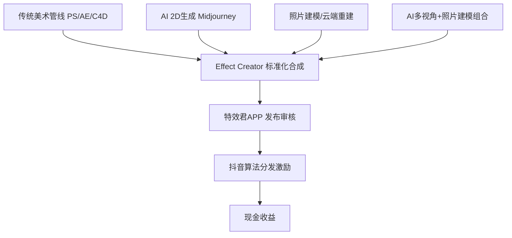
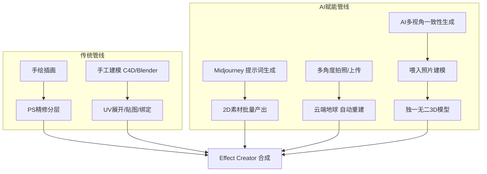
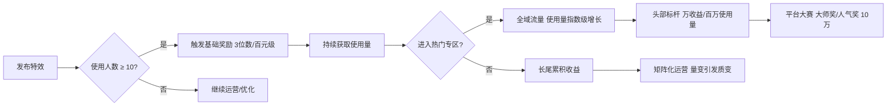
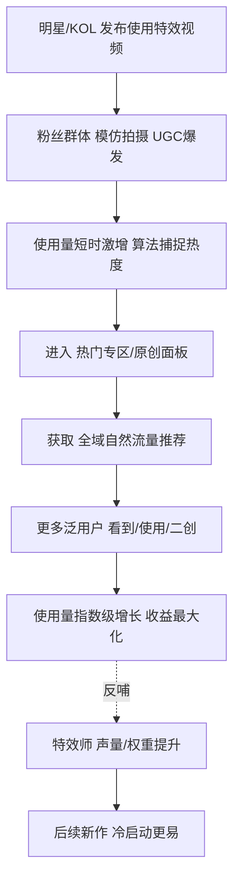
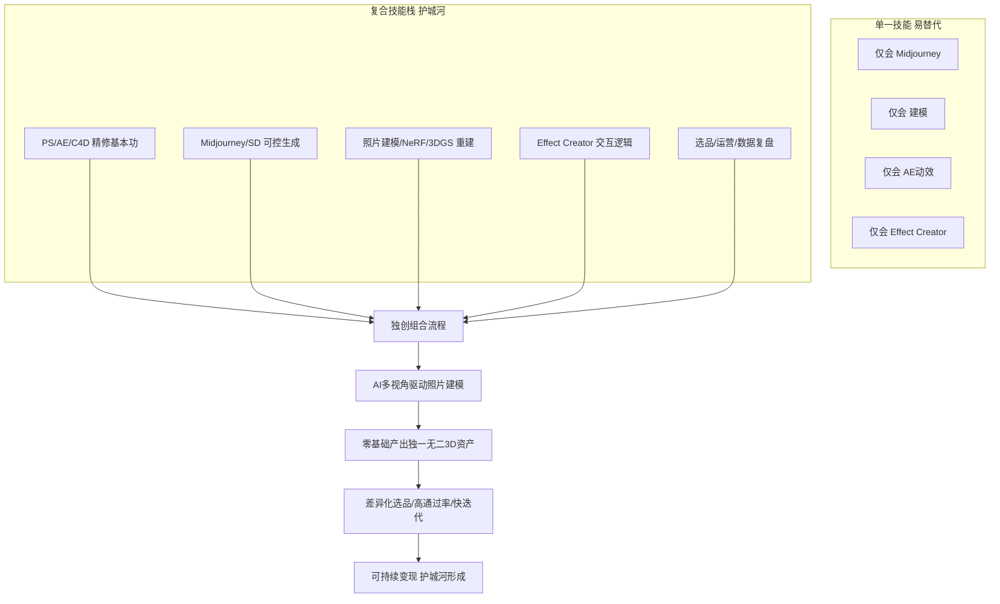

# 第 30 章 抖音AR特效师生态 —— 让创意拥有“零门槛变现”的标准化管线
作者：龙哥

## 学习目标

- 理解抖音AR特效师生态的商业闭环与核心工具链
- 掌握AI赋能特效素材生产的两大路径（2D生成+3D重建）与组合创新范式
- 熟悉特效商业化指标体系（门槛/基础/头部/赛事）与收益预期
- 掌握明星/网红效应驱动传播规律与选品策略
- 理解技能组合差异化竞争策略，构建个人护城河
- 能独立完成从选品到上架变现的最小闭环实操

## 30.1 生活类比

想象抖音AR特效师生态是一个**“数字贴纸工厂+超级分销商场”**：**特效师** = 设计贴纸图案的**独立设计师**；**Effect Creator** = 将设计稿转印成标准贴纸的**印刷机**；**特效君APP** = 把贴纸上架到货架的**入驻申请单**；**抖音算法** = 根据顾客喜好把贴纸推到**显眼货架/热门专区**的**超级导购员**；**10人使用奖励** = 每卖出一张贴纸就有**底薪提成**；**明星带货** = **顶流网红**自带贴纸拍视频，粉丝疯狂模仿，**瞬间清空库存**；**AI绘画/照片建模** = **神笔马良/3D扫描仪**，不会画画、不会建模也能批量生产**独家款贴纸**；**技能组合护城河** = 别人只会**买现成贴纸卖**，你拥有**印刷机+神笔+扫描仪**，能**自主研发独家爆款**。就像商场导购员会把热销贴纸摆在显眼处，抖音算法也会把高使用量特效推向全域流量池。

## 30.2 概念地图

- 抖音AR特效师生态
  - 核心基建
    - 抖音开放平台          —— P001
    - Effect Creator工具链    —— P002
    - 特效君APP发布端         —— P002
    - 审核分发激励机制        —— P001
  - 素材生产路径
    - 传统管线(PS/AE/C4D)     —— P001
    - AI 2D生成(Midjourney)   —— P003
    - 照片建模/云端重建       —— P003
    - AI多视角+照片建模组合   —— P003
  - 商业化指标体系
    - 冷启动门槛: 10人使用    —— P004
    - 基础收益: 上线几日百元  —— P004
    - 头部标杆: 万收益/百万量 —— P004
    - 赛事奖金: 单项10万元    —— P004
  - 传播增长规律
    - 明星/网红效应驱动       —— P005
    - UGC模仿裂变             —— P005
    - 热门专区全域分发        —— P005
  - 竞争策略
    - 单一技能易替代        —— P006
    - 复合技能栈护城河      —— P006
    - 独创AI多视角驱动建模  —— P006

## 30.3 抖音AR特效师生态 —— 让创意拥有“零门槛变现”的标准化管线

### 为什么需要这个概念？

你可能觉得做AR特效是专业美术/建模师的事，离普通人很远。但现实是：**抖音已经把这条赛道的门槛拆得只剩“会用工具”和“肯执行”两根门槛**。

传统AR特效制作需要专业美术基础（手绘/建模/动效），门槛高、周期长，普通人无法参与；缺乏标准化的商业化路径，不知道做什么、怎么卖、能赚多少；平台流量分发机制不透明，优质作品容易沉底，创作者缺乏确定性收益预期。

### 核心定义

> 以抖音开放平台为基建，连接美术素材制作（PS/AE/C4D）与上架发布（特效君APP）的标准化管线，包含审核发布机制、流量分发（原创面板/热门专区）及现金激励体系的完整商业闭环。

> "那些抖音上万收益和百万使用量的 AR 特效道具是怎么做的？"
> 
> ——《docs/202303/20230328_061.md》（P001）

> "抖音方愈加重视这一群体，针对特效师推出了多个扶持政策。比如...获得大师奖和人气奖的特效师均可获得 10 万元。"
> 
> ——《docs/202303/20230328_061.md》（P001）

> "我是在抖音上当特效师，就是在抖音特效开放抖音中制作自己的原创特效作品，然后再上传审核...特效的投稿量越多，特效师的现金奖励也就越多。"
> 
> ——《docs/202303/20230328_061.md》（P001）

### 关键性质

- **低门槛**：无美术基础可用AI绘画/照片建模兜底，人人可做特效师
- **高激励**：10人使用即触发基础奖励，头部单特效万收益/百万使用量，平台大赛单项奖金10万
- **标准化**：Effect Creator工具链固化生产流程，降低技术门槛

### 典型例子

- **李现哪吒特效、Angelababy在逃公主特效**：明星使用引发粉丝模仿UGC爆发，进入热门专区获全域流量
- **作者实测**：单特效上线几日达3位数收益（百元级），验证长尾特效商业可行性

> "一般一个特效，只要有 10 个人用，就有一笔奖励，我每个制作的特效，一般上线几天后，可以达到 3 位数的收益。"
> 
> ——《docs/202303/20230328_061.md》（P001）

### 边界条件

- 需持续产出特效保持收益，单一爆款生命周期短，依赖平台算法分发
- 审核机制不可控，同类特效同质化竞争加剧，需差异化技能组合构建护城河
- 商业变现完全依赖抖音生态，跨平台复用受限（微信/其他平台无法直接使用AR道具）

### 方法演进图



---

## 30.4 Effect Creator工作流 —— 连接“素材生产”与“商业分发”的标准化桥梁

### 为什么需要这个概念？

你在PS/AE/C4D里把素材做好了，怎么变成抖音能识别的特效包？中间缺个“翻译官”。素材制作（PS/AE/C4D）与平台发布之间缺乏标准化中转工具，导致格式不兼容、参数配置繁琐、审核通过率低。创作者需要一个官方认证的、傻瓜式的合成导出工具，专注创意而非技术细节。

### 核心定义

> 抖音官方提供的AR特效合成与导出工具链，是特效师标准化生产管线的核心环节。输入：美术素材（2D图片/3D模型/动效）；输出：符合平台规范的特效包，一键上传特效君APP审核。

> "我主要是用 PS 和 AE、C4D 等一些软件设计图案和模型，然后通过抖音旗下的 Effect Creator 合成特效，最后导出上传到特效君 APP 上"
> 
> ——《docs/202303/20230328_061.md》（P002）

### 关键性质

- **官方背书**：唯一认证的上架工具，保证兼容性与审核通过率
- **管线固化**：将非标准化的美术创作转化为标准化的工程交付物
- **版本迭代快**：需持续跟进平台功能更新（如新增交互组件/物理引擎）

### 典型例子

- **作者流程**：PS/AE/C4D设计素材 → Effect Creator合成调试 → 特效君APP上传审核 → 发布运营

### 边界条件

- 仅支持抖音生态，无法导出通用格式（如Unity/Unreal/WebAR）
- 复杂交互逻辑（如手势识别/面部捕捉/物理模拟）仍需在工具内手动配置，有一定学习曲线

### 方法演进图


---

## 30.5 AI赋能特效素材生产 —— 让“不会画画、不会建模”也能当特效师

### 为什么需要这个概念？

传统2D素材依赖手绘/插画能力，3D模型依赖建模/贴图/拓扑技能，双重门槛劝退90%想入局者。外包素材成本高、沟通成本大、迭代周期长，不适合个人创作者快速试错。

### 核心定义

- **2D赛道**：用Midjourney等生成式AI替代手绘，通过提示词控制风格/构图/元素，分钟级出图
- **3D赛道**：用云端照片建模（如云端地球）替代手工建模，上传多角度照片自动重建模型+纹理
- **组合范式**：AI生成多视角一致性图片 → 喂入照片建模管线 → 得到独一无二3D模型

> "大家可以用目前比较流行 Midjourney AI 绘画等来制作 2D 素材"
> 
> ——《docs/202303/20230328_061.md》（P003）

> "我这边是通过云端地球来直接照片建模的，只需要提供不同方向多角度的照片就可以生成模型"
> 
> ——《docs/202303/20230328_061.md》（P003）

> "因为技能和技能之间的联系，是形成差异化很好的方式，所以 AI 绘画+照片建模是不是会有更多的可能性？大家通过 AI 绘画出多角度图片，再进行照片建模，这样就能生成独一无二的模型"
> 
> ——《docs/202303/20230328_061.md》（P003）

### 关键性质

- **极大降低美术门槛**：零基础也能生产商用级素材
- **极大压缩制作周期**：从天级压缩至小时/分钟级
- **版权风险可控**：AI生成/自拍照片建模，规避素材侵权纠纷

### 关键方法：Midjourney 2D素材生成标准化流程 (7步法)

将Midjourney融入特效素材管线的标准化操作规程：

```
1. 访问 Midjourney AI 的网站，并创建一个账户
2. 选择要制作的 2D 素材类型，例如插图、矢量图形等
3. 选择适合你的项目的样式：手绘、卡通、现实等等
4. 上传你想要转化的素材，例如照片、草图等等（图生图）
5. 对于一些类型的素材，Midjourney AI 可能会需要更多的信息（补全提示词）
6. 运行 Midjourney AI 的算法，并根据你的需要进行微调：调整颜色、线条粗细、阴影等参数
7. 完成后，你可以将结果下载或导出到你的项目中使用
```

> 这段伪代码展示了如何将AI生成纳入标准化素材管线，每一步都有明确的操作指引，让零基础创作者也能按图索骥产出合格素材。

### 关键方法：照片建模/云端重建标准流程 (7步法)

将多视角照片转为可用三维模型的标准化技术流程：

```
1. 建模照片通常指将现实中的照片或者图片转化为计算机可识别的三维模型
2. 搜集照片：收集多张照片，最好是从不同角度和位置拍摄的
3. 图像预处理：对照片进行预处理，以去除任何噪声或其他干扰因素
4. 创建点云：将处理后的图像转换为三维点云（立体匹配和结构光扫描等）
5. 创建表面模型：将点云转换为表面模型（三角剖分算法等方法）
6. 纹理映射：将照片的颜色信息应用于表面模型
7. 渲染和优化
8. 我这边是通过云端地球来直接照片建模的，只需要提供不同方向多角度的照片就可以生成模型
```

> 这段伪代码展示了从物理实体到数字资产的标准化转化路径，云端工具进一步屏蔽了本地算力与算法复杂度。

### 创新范式：AI多视角生成 + 照片建模组合范式

> "因为技能和技能之间的联系，是形成差异化很好的方式，所以 AI 绘画+照片建模是不是会有更多的可能性？大家通过 AI 绘画出多角度图片，再进行照片建模，这样就能生成独一无二的模型"
> 
> ——《docs/202303/20230328_061.md》（P003）

这个组合范式的核心逻辑是：**用AI解决“画不出来”，用照片建模解决“模不出来”，两者串联实现“零建模基础产出独一无二3D资产”**。

### 典型例子

- **Midjourney 7步法**：注册 → 选类型 → 选风格 → 图生图 → 补全提示词 → 调参迭代 → 导出入库
- **云端地球实测**：上传多角度照片 → 云端自动生成模型，无需本地算力与建模技能
- **组合创新**：AI画多视角图 → 照片建模 → 独一无二3D资产，构建差异化护城河

### 边界条件

- AI生成2D素材需后期PS精修（抠图/分层/色值调整）才能入管线，非一键完美
- 照片建模对拍摄角度/光照/重叠度要求高，拍摄不规范重建失败率高
- AI多视角一致性控制难（角色/物体特征漂移），喂入建模易产生伪影/几何错误
- 商用级素材仍需传统软件（PS/AE/C4D）做最终合规性检查与格式转换

### 方法演进图



---

## 30.6 特效商业化指标体系 —— 用“使用人数”和“现金奖励”量化创意价值

### 为什么需要这个概念？

创作者缺乏可量化的收益预期，不知道努力方向、投入产出比、天花板在哪里。平台激励政策碎片化，需建立统一度量衡指导创作决策（做长尾还是冲头部）。

### 核心定义

> 衡量特效道具商业价值的核心量化指标，包括使用人数门槛（10人）、基础收益预期（上线几日达3位数/百元级）、高阶成就（万收益/百万使用量）及平台赛事奖金（10万）。

> "那些抖音上万收益和百万使用量的 AR 特效道具是怎么做的？"
> 
> ——《docs/202303/20230328_061.md》（P004）

> "一般而言，一个特效，只要有 10 个人用，就有一笔奖励，我每个制作的特效，一般上线几天后，可以达到 3 位数的收益。"
> 
> ——《docs/202303/20230328_061.md》（P004）

> "获得大师奖和人气奖的特效师均可获得 10 万元。"
> 
> ——《docs/202303/20230328_061.md》（P004）

这个指标体系展示了从冷启动门槛到头部天花板的完整量化阶梯，让创作者对“努力到什么程度、能拿到什么结果”有清晰预期。

### 关键性质

- **阶梯式正向激励**：从‘有奖励’到‘可养活自己’到‘年入百万’的清晰路径
- **使用量=收益核心驱动力**：分发机制下，使用量直接决定现金流
- **长尾效应显著**：大量长尾特效累积收益可观，非仅依赖头部爆款

### 典型例子

- **作者实测**：每个特效上线几日即达百元级基础收益
- **行业标杆**：存在单特效万收益/百万使用量的头部案例
- **官方大赛**：大师奖/人气奖各10万元，顶级变现锚点

### 边界条件

- 基础奖励金额未公开具体数额，仅知‘3位数’，波动性未知
- 收益高度依赖平台算法分发，算法调整可能导致流量断崖式下跌
- 头部特效往往依赖明星/热点/IP联名等不可控外部变量，难以复制
- 赛事奖金属于稀缺性竞争，非常态化收益来源

### 方法演进图



---

## 30.7 明星/网红效应驱动传播规律 —— 蹭对热点，流量翻百倍

### 为什么需要这个概念？

特效道具同质化严重，靠自然流量极难出圈，需外部势能引爆。创作者不懂选品方向，盲目跟风导致审核通过但无人使用，收益为零。

### 核心定义

> 头部KOL/明星使用特定道具拍摄 → 引发粉丝模仿潮(UGC爆发) → 道具进入热门专区 → 获得全域自然流量 → 使用量指数级增长 → 收益最大化

> "明星的加入也使得不少道具成为短时间内的潮流，从李现的哪吒特效、Angelababy 的在逃公主等都吸引了许多粉丝纷纷模仿拍视频，极大提高了用户参与拍摄同款的热情。"
> 
> ——《docs/202303/20230328_061.md》（P005）

> "如果该特效审核通过后...使用量不错，甚至会出现在热门专区中，这样就会有更多的人使用，收益也会更高。"
> 
> ——《docs/202303/20230328_061.md》（P005）

这个传播链条展示了：外部势能（明星）+ 平台机制（热门专区）= 指数级增长。

### 关键性质

- **确定性高**：明星效应是验证过的最强冷启动杠杆
- **时效性强**：需在热点发酵期（通常24-72小时）内完成制作上架，错过即失效
- **选择性强**：仅适合强社交属性、易模仿、视觉冲击大的道具类型

### 典型例子

- **李现哪吒特效、Angelababy在逃公主**：明星带动粉丝模仿，短时间内成为全民潮流
- **作者策略**：紧跟明星热点或自带强社交传播属性（如情侣互动/心理测试/变装）选品

### 边界条件

- 明星热点不可预测、不可控，属于机会主义而非确定性策略
- 热点赛道竞争极其激烈，大量创作者涌入导致审核延迟、流量分薄
- 纯蹭热点无自有IP积累，热点过后流量归零，难以沉淀长期用户资产

### 方法演进图



---

## 30.8 技能组合差异化竞争策略 —— 单一技能易替代，组合拳筑护城河

### 为什么需要这个概念？

随着AI工具普及，单一技能（如仅会Midjourney/仅会建模/仅会AE）边际价值趋近零。特效师群体同质化竞争加剧，价格战/内卷导致单价下跌、生存空间压缩。

### 核心定义

- 掌握‘AI绘画(2D生成)+ 照片建模(3D重建)+ 传统工业软件(PS/AE/C4D精修)’的复合技能栈
- 核心壁垒：独创‘AI生成多视角驱动照片建模’流程，实现‘零建模基础产出独一无二3D资产’

> "因为技能和技能之间的联系，是形成差异化很好的方式，所以 AI 绘画+照片建模是不是会有更多的可能性？"
> 
> ——《docs/202303/20230328_061.md》（P006）

> "大家通过 AI 绘画出多角度图片，再进行照片建模，这样就能生成独一无二的模型"
> 
> ——《docs/202303/20230328_061.md》（P006）

### 关键性质

- **稀缺性**：跨领域技能组合的学习曲线构天然护城河
- **迁移性**：技能组合可迁移至游戏美术/元宇宙/虚拟直播/电商3D展示等相邻赛道
- **复利性**：技能间相互增强（AI出图提升建模效率，建模反哺AI训练数据），形成正向飞轮

### 典型例子

- **作者路径**：PS/AE/C4D基本功 → 引入Midjourney出2D图 → 引入云端地球做3D → 创新组合‘AI多视角+照片建模’

### 边界条件

- 学习成本高：需同时精进三个领域，时间投入大，适合全职创作者而非兼职尝试
- 工具迭代极快：Midjourney/SD/照片建模工具月级更新，需持续投入精力跟进版本
- 平台规则变动风险：抖音若开放外部模型导入/自研AI生成工具，该技能优势可能失效

### 方法演进图



---

## 30.9 多源对照

本章核心概念主要基于单一核心素材（docs/202303/20230328_061.md）构建，暂无多源冲突证据。若后续引入其他平台（如Spark AR、Lens Studio）或竞品生态素材，可在此补充对照。

### 共识

- AR特效创作正从专业领域向大众化、工具化、平台化演进
- AI生成技术正在重塑素材生产管线，降低门槛、提升效率
- 平台激励与算法分发是创作者收益的核心决定变量

### 分歧

- 建议补充抖音/TikTok/Snapchat/Instagram创作者分成模式、审核标准、工具链开放度的对比研究，以明确跨平台变现策略差异
- 建议引入传统美术外包工作室与AI个人创作者长期博弈的行业报告与案例研究，评估技能护城河的半衰期与迁移路径

---

## 30.10 设计中的取舍

### 为什么不用“纯外包素材”而是“自主AI生产”？

纯外包素材成本高（单模型百元至千元级）、沟通成本大（需反复确认风格/规格/格式）、迭代周期长（修改需排期等待）。自主AI生产将边际成本压至接近零，分钟级出图，想改随时改，完全掌握节奏。代价是需自学提示词工程与后期精修技能，且AI生成的稳定性、一致性不如专业外包。

### 为什么不用“手工建模”而是“照片建模/云端重建”？

手工建模需掌握拓扑/UV展开/贴图绘制/骨骼绑定等专业技能，学习曲线陡峭，单模型耗时数小时至数天。照片建模只需会拍照、会上传，云端工具进一步免去本地算力与软件安装，耗时压缩至分钟级。代价是模型拓扑结构不可控、面数冗余大、复杂交互（如骨骼动画）难以直接支持，需二次精修。

### 这种设计的 trade-off 是什么？

| 维度 | 传统专业管线 | AI+云端建模组合管线 |
|------|--------------|---------------------|
| 门槛 | 高（需专业美术/建模技能） | 低（会用工具+会拍照即可） |
| 成本 | 高（人力/外包/软件授权） | 低（订阅制/按量付费） |
| 周期 | 天/周级 | 分钟/小时级 |
| 可控性 | 强（每个顶点/面/UV可控） | 弱（依赖算法黑盒输出） |
| 质量上限 | 高（工业级交付标准） | 中（需精修兜底） |
| 版权风险 | 低（自主原创/正版采购） | 中（AI生成版权归属灰色地带） |
| 护城河 | 技术壁垒高 | 流程组合/审美/选品壁垒 |

---

## 30.11 动手练习

### 练习 1：设计一个可落地的特效选品方案

**背景**：你是一名零美术基础的新手特效师，拥有Midjourney会员与云端地球工具账号。

**任务**：
1. 选定一个近期热门的明星/网红热点或自带社交传播属性的主题（如情侣互动、心理测试、节日变装），说明选择理由。
2. 设计该特效的核心视觉元素（2D贴纸/3D模型/动效），并规划用Midjourney生成2D素材的提示词关键词（风格/构图/元素）。
3. 若涉及3D模型，描述如何用云端地球完成照片建模（拍摄要求/上传流程/预期产出）。
4. 规划上架后的冷启动动作：如何在前72小时内达成‘10人使用’门槛触发基础奖励？
5. 预估该特效的生命周期收益区间（基础奖励/长尾累积/进热门专区的上限），并标注关键不确定性变量。

**回答问题**：
- 如果该热点在24小时内退热，你的制作上架流程能否跟上？如何通过标准化SOP压缩周期？
- 同质化竞争下，你的‘技能组合’（AI+建模+精修）体现在哪个环节形成了差异化壁垒？

### 练习 2：复刻‘AI多视角驱动照片建模’组合流程最小验证

**目标**：验证‘Midjourney生成多视角图→喂入照片建模→得独一无二3D模型’的技术可行性与效率。

**步骤**：
1. 选定一个简单几何/卡通风格对象（如‘Q版机器人’‘几何水晶’），用Midjourney通过提示词控制生成前/后/左/右/俯/仰 6 视角图，要求风格一致、特征固定。
2. 将6张图上传至云端地球（或同类照片建模工具），观察重建成功率、模型完整度、纹理贴图质量、几何错误（如伪影/漏面）。
3. 对比：同一对象用传统手工建模（Blender/C4D基础操作）耗时 vs 组合流程耗时。
4. 将重建模型导入Effect Creator，挂载简单动效（旋转/缩放），导出测试包在特效君APP预览，检查是否符合发布规范。

**记录指标**：
- Midjourney出图成功率（几轮得到可用6视角）
- 照片建模重建成功/失败及失败原因
- 端到端总耗时
- 最终模型在Effect Creator中的表现（面数/贴图/动效兼容性）

**回答问题**：
- AI生成多视角一致性控制（角色特征漂移/光影不一致）是否为主要瓶颈？如何用ControlNet/参考图缓解？
- 该组合流程对比外包建模（淘宝/自由职业者）在成本/周期/版权/迭代灵活性上优劣如何？

### 练习 3：构建个人特效师‘技能组合护城河’进阶路线图

**现状**：你已跑通1-2个特效上架变现基础流程，月收益几百元，主要靠蹭热点单一品类。

**任务**：设计未来6个月的技能迭代与作品集建设计划，目标是构建‘难以复制的差异化竞争优势’。

1. **技能矩阵自查**：在 PS/AE/C4D精修、Midjourney/SD可控生成、照片建模/NeRF/3DGS重建、Effect Creator交互逻辑配置 四维度打分（1-10分），标注短板。
2. **定制学习冲刺**：每月攻克一个短板工具/技术点，输出1个‘技术验证型特效’（非上架，仅验证技术点），积累可复用组件库。
3. **组合创新专项**：第3个月起，尝试‘AI多视角+照片建模’或‘SD ControlNet控制动效序列帧’等组合流程，产出1-2个‘独家技术路线特效’上架。
4. **选品策略升级**：从‘纯蹭明星热点’转向‘自带社交传播属性的长尾系列’（如：一套‘情绪化表达’系列/‘职业身份梗’系列），建立个人IP标签。
5. **数据复盘仪表盘**：建立表格追踪每个特效的‘投产比=（累计收益）/（制作耗时+推广成本）’，识别高ROI技术路线与选品方向。

**回答问题**：
- 哪个技能维度的边际收益递减最快？为何？
- 如何判断某个‘组合技术路线’是否真正形成了护城河，而非‘伪创新’？
- 当平台推出官方AI生成工具（如抖音自研文生特效），你的护城河会如何迁移/进化？

---

## 30.12 本章小结

这一章中我们学习了抖音AR特效师生态的完整商业闭环与实操方法论。首先，我们拆解了以抖音开放平台为基建、Effect Creator为标准化桥梁、特效君APP为发布端、算法分发与现金激励为驱动的核心生态结构；其次，我们深入讲解了AI赋能素材生产的三大路径——Midjourney 2D生成7步法、云端照片建模7步法、以及创新组合的AI多视角驱动照片建模范式，让零基础创作者也能低成本产出商用级素材；接着，我们建立了从“10人使用触发基础奖励”到“头部万收益/百万使用量”再到“平台大赛单项10万奖金”的量化商业化指标体系，给创作者清晰的收益预期与努力方向；然后，我们揭示了明星/网红效应驱动的UGC裂变传播规律，指出选品必须紧跟热点或自带社交传播属性；最后，我们提出了“AI绘画+照片建模+传统精修”复合技能栈作为差异化护城河，并给出了具体的技能进阶路线图与验证实操。

本章我们一起学习了以下概念：

| 概念 | 解释 |
|------|------|
| 抖音AR特效师生态 | 以开放平台为基建，连接素材制作、工具合成、发布审核、流量分发与现金激励的完整商业闭环 |
| Effect Creator工作流 | 官方标准化合成导出工具链，是连接美术素材与上架发布的核心桥梁，保证兼容性与通过率 |
| AI赋能特效素材生产 | Midjourney生成2D素材+云端照片建模生成3D模型，大幅降低美术门槛与制作周期 |
| AI多视角驱动照片建模 | 用AI生成多视角一致性图片喂入照片建模管线，实现零建模基础产出独一无二3D资产的创新组合范式 |
| 特效商业化指标体系 | 10人使用触发奖励、上线几日达百元基础收益、头部万收益/百万使用量、赛事单项10万的阶梯量化标准 |
| 明星/网红效应传播规律 | KOL使用→粉丝模仿UGC爆发→进热门专区→获全域流量→使用量指数级增长→收益最大化的选品杠杆 |
| 技能组合差异化竞争 | 掌握AI绘画+照片建模+传统软件精修的复合栈，独创AI多视角驱动建模流程构建难以复制的护城河 |
| Midjourney 2D生成7步法 | 注册→选类型→选风格→图生图→补全提示词→调参迭代→导出入库的标准化素材管线操作规程 |
| 照片建模/云端重建流程 | 多角度采集→预处理→点云重建→表面重建→纹理映射→渲染优化→云端一键生成的标准化技术流程 |
| 单特效基础收益验证 | 作者实测：单特效上线几日即达3位数收益，验证长尾特效商业可行性 |
| 云端照片建模工具可用性 | 实测‘云端地球’：上传多角度照片即可云端自动生成模型，大幅降低本地算力与技术门槛 |

下一章中，我们将学习《短剧CPS矩阵实战 —— 校企融合兼职、三阶薪酬迭代、AI去重失效、代理商避坑》。

