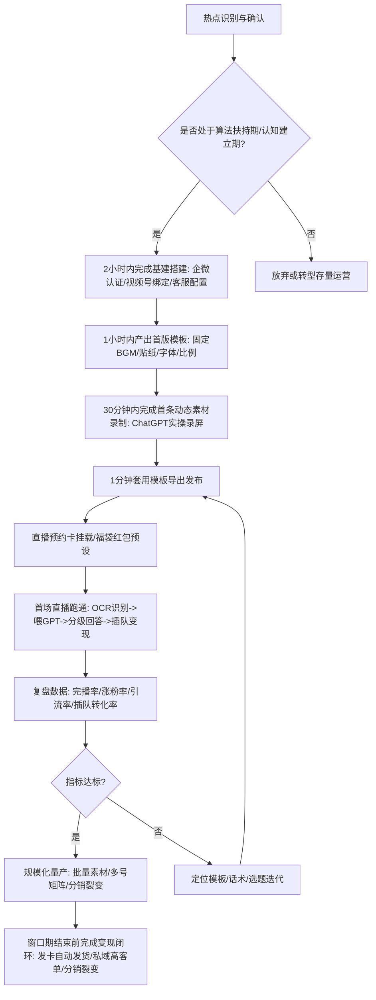
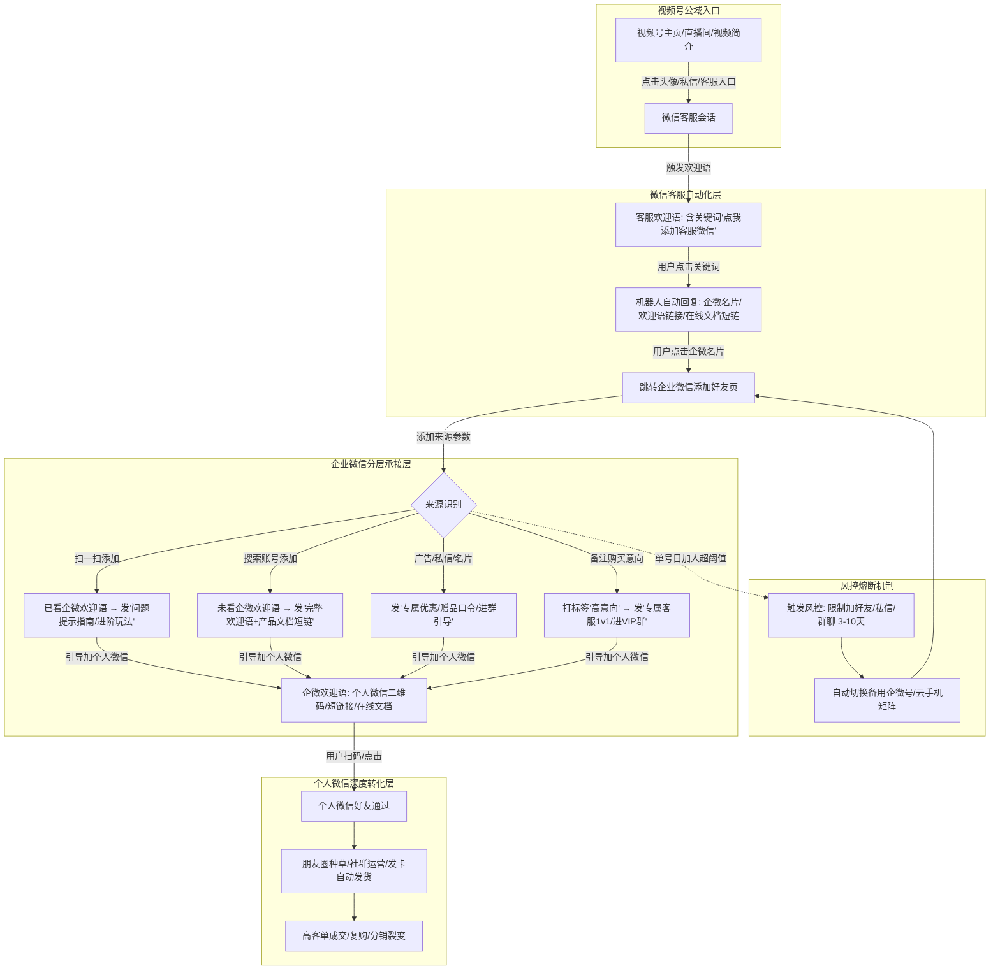
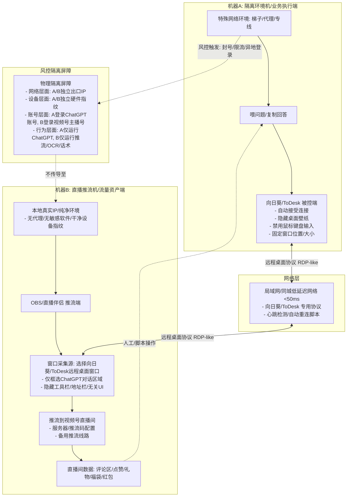
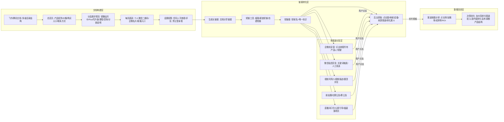
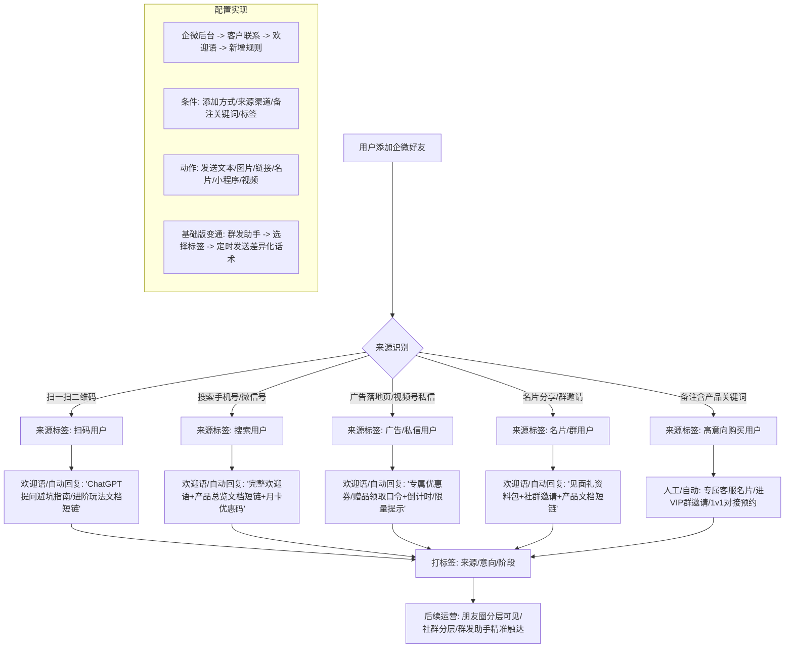
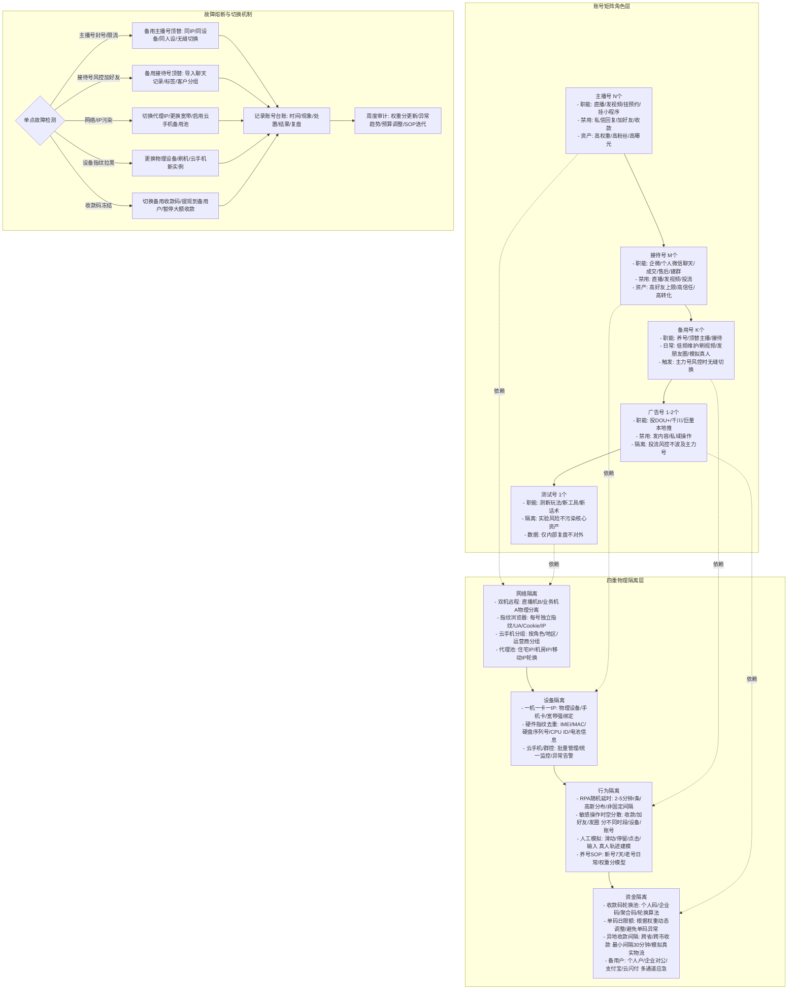

# 第 44 章 ChatGPT热点红利期视频号速成实战 —— 自动化引流闭环、直播分级回答插队变现、远程隔离安全架构、模板化极速生产
作者：龙哥

## 学习目标

- 理解ChatGPT热点红利期“入场速度>内容深度”的核心逻辑与窗口期特征
- 掌握视频号“公域引流-私域成交”生态闭环的搭建全流程（企微认证、客服配置、自动化欢迎语）
- 掌握短视频“固定模板层+动态素材层”工业化生产法，将单条产出压缩至1分钟以内
- 掌握直播间“分级回答+付费插队”供需匹配模型的设计与执行SOP
- 掌握“双机远程隔离”物理切断业务风险与流量入口的安全架构部署方案
- 掌握“在线文档+短链接”私域承接体系的构建与差异化触达策略
- 了解高风控赛道下“账号矩阵+物理隔离”生存法则的配置标准与风控红线
- 能根据热点特性快速复制该SOP至AI绘画、数字人等后续新赛道

## 44.1 生活类比

想象这套体系是一个**“24小时无人便利店+智能分拣中心+VIP会员休息室”**的组合拳。热点红利期就是新商圈开业前3个月的“黄金招商期”：先占铺位（入场速度）比装修豪华（内容深度）更关键；视频号生态则是自带“微信支付通道+会员体系”的商场：顾客进店（公域流量）→ 扫码办卡（企微引流）→ 进VIP室复购（私域高客单）。企微自动化引流是门口的“智能导购机器人”：识别顾客来源（扫码/搜索/广告）→ 发专属优惠券（差异化欢迎语）→ 引导进VIP群。短视频模板化生产是中央厨房“预制菜包”：底料固定（模板层）、每单只换主料（动态素材）→ 1分钟出餐、标准口味、可规模化复制。直播间分级回答+插队则是“排队免费问诊+加急付费插号”：大夫（ChatGPT）精力有限 → 会员优先（粉丝团） → 交挂号费插队（刷礼物） → 三方共赢。双机远程隔离是“后厨脏活累活（登录ChatGPT特殊网络）”与“前厅迎宾收银（直播推流）”物理分离 → 后厨着火（封号/风控）不波及前厅营业。在线文档+短链接是“云端菜单+短链二维码”：菜品变动（上新/改价）云端改一次全网同步，顾客扫码即看最新版，老板后台实时看点单数据。账号矩阵+物理隔离则是“分店经营+防火墙”：主力店/备用店/测试店分工明确，网络/设备/资金/行为四重防火墙，单店倒闭不影响整体生存。

## 44.2 概念地图

ChatGPT热点红利期视频号速成实战
├── 核心定律
│   ├── 热点红利期先发优势定律：入场速度决定流量上限  —— P001
│   ├── 视频号公私域共生论：原生工具打通“引流-成交”最后一公里  —— P002
│   ├── 直播间服务分级+付费插队供需匹配模型  —— P005
│   └── 合规风控“账号矩阵+物理隔离”生存法则  —— P011
├── 基建体系
│   ├── 企业微信自动化引流闭环：无人值守的“视频号→企微→微信”链路  —— P003
│   ├── 远程隔离直播安全架构：双机物理切断“业务风险”与“流量入口”  —— P006
│   ├── 在线文档+短链接私域承接体系：解决“字数/丑链/不可追踪”三大痛点  —— P007
│   └── 异源流量差异化触达策略：根据来源渠道自动分发差异化欢迎语  —— P008
├── 生产体系
│   ├── 短视频模板化极速生产流：固定模板层+动态素材层，单条1分钟  —— P004
│   └── ChatGPT直播间高频互动SOP：“嘴不停、屏不静、队不断”节奏控制术  —— P009
└── 变现体系
    └── 多元化变现SKU矩阵：从“卖号”到“卖服务/课/分销/广告”  —— P010

## 44.3 热点红利期先发优势定律 —— 入场速度决定流量上限

### 为什么需要这个概念？

新技术/热点爆发初期，平台算法强分发，但窗口期仅1-3个月。普通人缺乏深度内容生产能力，唯有靠“入场速度”抢占红利。过度准备会错失风口，核心竞争力是“快速搭建标准化基建+极致执行量产内容”。

> "2 月 8 号入局 ChatGPT ，10天时间，成为视频号 ChatGPT 的头部账号。"
> 
> "作为 2023 年互联网的新贵，现在入局 ChatGPT 并不晚...玩法分享给大家，主要是看执行力，执行力强，跟着教程走，发视频，做直播，在 ChatGPT 的风口，起飞并不是难事。"
> 
> ——《ChatGPT热点红利期视频号速成实战》（P001，docs/202303/PEaud24YioXVx3xe09rcXJVMnjb.md）

### 核心定义

**热点红利期先发优势定律**（来源：《ChatGPT热点红利期视频号速成实战》，P001，docs/202303/PEaud24YioXVx3xe09rcXJVMnjb.md）

$$
\text{红利收益} = \frac{\text{入场速度} \times \text{执行力} \times \text{标准化程度}}{\text{完美主义阻力}}
$$

这个公式展示了：在热点爆发早期（如ChatGPT上线初期），以最低成本、最快速度跑通“获客-转化-交付”闭环。入场速度是核心变量，执行力和标准化程度是放大器，完美主义阻力是除数——越追求完美，红利收益越低。

**公式实战指导作用**：该公式不仅是定性描述，更是资源分配的决策工具。实战中可将“入场速度”量化为“从决策到首条视频发布的小时数”，将“执行力”量化为“单日产出视频条数/直播场次”，将“标准化程度”量化为“SOP文档覆盖率/模板复用率”，将“完美主义阻力”量化为“单条视频耗时/决策链条长度”。当分子项乘积固定时，每将单条制作耗时从30分钟压缩至1分钟（标准化程度↑30倍），即等效于入场提前30倍时间；反之，若因追求“完美剪辑”导致单条耗时30分钟（完美主义阻力↑30倍），红利收益将归零。用此公式倒推：热点窗口期90天，若标准化程度达90分、执行力达80分，允许的完美主义阻力上限为7200，即单条耗时不得超1.25分钟——这正是“1分钟模板化生产”的硬性指标来源。

### 关键性质

- **时间敏感性**：晚入场1天，红利衰减10%以上
- **门槛低**：不需要深度内容，只需标准化SOP和工具链
- **可复制性**：同一套SOP可应用于后续所有新热点（AI绘画、数字人等）

### 典型例子

- 作者2月8日入局ChatGPT，10天成为视频号头部账号，涨粉9W+，变现2W+
- 同期犹豫者至今仍在“研究怎么注册账号”

### 边界条件

- 仅适用于平台算法扶持期、用户认知建立期、竞争格局未形成期
- 需具备基础工具操作能力（剪映、企微、OCR等），纯小白需先补课
- 违规风控红线不可触碰，速度不能换来账号封禁

### 方法演进路径



---

## 44.4 视频号公私域共生论 —— 原生工具打通“引流-成交”最后一公里

### 为什么需要这个概念？

抖音/快手等平台严打外链引流，私域获客如履薄冰、成本极高。视频号依托微信生态，原生支持“挂企微客服、跳小程序、直播挂车”。中小创作者缺乏品牌抗风险能力，必须走“公域引流-私域高客单复购”低成本路径。

> "在抖音、快手等除视频号以外的短视频平台，想要引流到个人微信...在官方的规则打压下小心翼翼，如履薄冰。但，在视频号，不但可以直接在主页留微信号...还可以通过和企业微信联动，搭建一套自动化引流闭环链路。"
> 
> "售卖课程主要在微信/企业微信的私域内进行...在朋友圈发社群相关资料，引导下单成交。"
> 
> ——《ChatGPT热点红利期视频号速成实战》（P002，docs/202303/PEaud24YioXVx3xe09rcXJVMnjb.md）

### 核心定义

**视频号公私域共生论**（来源：《ChatGPT热点红利期视频号速成实战》，P002，docs/202303/PEaud24YioXVx3xe09rcXJVMnjb.md）

核心路径：视频号主页留微信/企微 → 绑定企微开通微信客服 → 自动化欢迎语引导加微 → 朋友圈/社群转化高客单产品

这个模型展示了：利用视频号开放生态能力，构建“公域内容/直播获客 → 企微/个人微信沉淀 → 私域高客单价复购”的商业闭环。

**模型实战作用**：该模型重新定义了中小创作者的商业基建标准。在抖音体系中，引流私域需“谐音梗/背景图藏号/评论区引导”等灰产手段，单次获客成本>50元且极易封号；视频号原生支持“主页挂企微/直播挂小程序/视频挂预约卡”，将引流动作合规化、显性化、自动化。实测同量级流量下，视频号引流微信成本<5元/人，且用户已完成“关注视频号→点击企微→添加好友”三次主动行为，信任度与转化率远超被动引流。此模型指导我们：所有公域内容（视频/直播）的终局指向必须是“企微添加”，而非“点赞/评论/转发”，私域沉淀后的“朋友圈种草+社群发单+发卡自动发货”才是真正的变现主战场。

### 关键性质

- **合规性**：官方鼓励的引流路径，零封号风险
- **转化率高**：微信生态信任背书，陌生人成交阻力极低
- **复购强**：私域沉淀后可无限次触达，LTV远超公域一次性变现

### 典型例子

- 作者通过视频号直播引流企微/个人微信8000+，私域售卖课程/镜像站月卡实现规模化变现
- 对比抖音：同量级流量，抖音引流微信成本>50元/人，视频号<5元/人

### 边界条件

- 必须有企业主体（个体户/公司）认证企微，个人号无法开通微信客服
- 私域运营能力弱（不会发朋友圈、不会社群运营）会导致流量沉淀后“养死”
- 仅适用于视频号生态，不可迁移至抖音/快手/小红书

### 闭环流程图

```mermaid
flowchart LR
    subgraph 公域获客层
        A1[短视频挂预约卡/话题标签] --> A2[直播间福袋/红包/口令引导]
        A2 --> A3[视频号主页挂企微/微信号]
        A3 --> A4[DOU+投放放大优质内容]
    end
    subgraph 承接转化层
        B1[微信客服欢迎语: 关键词回复+引导加企微] --> B2[企微自动通过+欢迎语分层触达]
        B2 --> B3[在线文档短链接: 产品全景+个人微信二维码]
        B3 --> B4[个人微信好友通过/进群]
    end
    subgraph 私域变现层
        C1[朋友圈种草: 实测案例/用户反馈/限时优惠] --> C2[社群运营: 答疑/打卡/分销裂变]
        C2 --> C3[发卡平台自动发货: 镜像站月卡/Plus代升级/账号批发]
        C3 --> C4[高客单服务: 定制开发/付费咨询/课程/广告位]
        C4 --> C5[复购/转介绍: 月卡续费/分销佣金/口碑裂变]
    end
    A4 --> B1
    B4 --> C1
    C5 --> A1
```



---

## 44.5 企业微信自动化引流闭环 —— 无人值守的“视频号→企微→微信”链路

### 为什么需要这个概念？

人工回复私信/加好友效率极低，无法承接爆发期流量洪峰。企微单日加好友上限低（触发风控后限制3-10天），需矩阵分流。客户来源不同（扫码/搜索/广告），统一话术转化率极低。

> "操作流程：安装企业微信移动客户端 -> 选择微信登录 -> ... -> 创建成功"
> 
> "认证的要求就是必须要有营业执照...认证费用 300/年。"
> 
> "操作流程：手机端企业微信 -> 进入工作台 -> 微信客服 -> 选择机器人（设置自动回复）-> 录入知识库 -> 添加问答..."
> 
> "根据客户的不同来源做好区别回复，别一套回复语通用。通过扫一扫添加，说明已经看过企业微信的欢迎语...发一个问题提示指南作为回复语。通过搜索账号添加好友，说明没有看过企业微信欢迎语，直接把企业微信的欢迎语作为回复发给客户。"
> 
> "短时间添加好友过多：企业微信或个人微信短时间添加好友数太多，是可能被官方认为有诈骗嫌疑，学长的两个企业微信号就因为被风控，限制私信、群聊及添加好友功能。一个三天恢复，一个十天才恢复。"
> 
> ——《ChatGPT热点红利期视频号速成实战》（P003，docs/202303/PEaud24YioXVx3xe09rcXJVMnjb.md）

### 核心定义

**企业微信自动化引流闭环**（来源：《ChatGPT热点红利期视频号速成实战》，P003，docs/202303/PEaud24YioXVx3xe09rcXJVMnjb.md）

```
1. 注册企微 → 认证(300元/年，解锁5万好友) → 绑定视频号
2. 开通微信客服 → 配置机器人知识库(关键词/相似问法)
3. 设置客服欢迎语(引导加企微)
4. 设置企微欢迎语(挂在线文档+引导加个人微信)
```

这个流程实现了“视频号→微信客服→企业微信→个人微信”全自动无人值守引流。

**流程实战作用**：该闭环将“流量承接”从人力密集型转为自动化基建。关键设计点在于：微信客服作为“公域入口”，承担首轮筛选与分流（机器人知识库覆盖高频问答，关键词“点我添加客服微信”触发名片发送）；企业微信作为“缓冲池”，承担风控抗压（5万好友上限、养号轮换）与分层触达（扫码/搜索/广告来源差异化欢迎语）；个人微信作为“转化场”，承担深度服务与高客单成交。实测单日引流数百人零人工值守，企微消息过载时直接不回、主回个人微信，实现了“流量洪峰不漏单、风控触发不停摆”的工程目标。

### 关键性质

- **分层承接**：视频号承担流量入口，企微承担筛选/分流/抗风控，个人微信承担深度转化
- **差异化触达**：扫码进来的已看欢迎语，发“问题指南”；搜索进来的未看，发“完整欢迎语”
- **抗风控**：多备企微号养号轮换，单号触发限制自动切换备用号

### 典型例子

- 作者搭建该链路后，单日引流数百人零人工值守，企微消息太多时直接不回、主回个人微信
- 客服欢迎语植入“点我添加客服微信”关键词回复，自动触发引流动作

### 边界条件

- 必须有营业执照认证企微，纯个人号无法实现
- 企微加好友频控阈值非公开（与账号权重相关），需实测摸索 **[需要补充文献]**：补充方向：实测不同权重账号日加人上限、企微官方文档/服务商白皮书、风控解封案例统计。
- 微信客服机器人知识库需持续维护，否则回复不相关导致用户流失

### 全链路数据流向图



---

## 44.6 短视频模板化极速生产流 —— 固定模板层+动态素材层，单条1分钟

### 为什么需要这个概念？

热点期内容时效性极强，传统剪辑“几小时/条”根本来不及。批量生产需标准化：背景音乐、贴纸、字体、比例全部预设固定。非专业剪辑师也能上手，降低团队协作沟通成本。

> "制作短视频模板：将背景音乐、贴纸等元素固定后，后续每个视频只需要替换片段，选择新的截图图片，更改标题就可以，熟悉之后制作一个视频，只需要一分钟即可。"
> 
> "制作短视频模板：录屏问答类的视频也是可以将背景音乐、音效、贴纸等元素固定制作成模版，把模板的素材点左边小眼睛隐藏，然后每次新的录屏视频就放在模板素材上方进行剪辑就可以。"
> 
> "最新测试结果：视频号对于图片截图的短视频不友好，故图片截图类大家别做了，做录屏问答类。"
> 
> ——《ChatGPT热点红利期视频号速成实战》（P004，docs/202303/PEaud24YioXVx3xe09rcXJVMnjb.md）

### 核心定义

**短视频模板化极速生产流**（来源：《ChatGPT热点红利期视频号速成实战》，P004，docs/202303/PEaud24YioXVx3xe09rcXJVMnjb.md）

将短视频拆解为：固定模板层（BGM、贴纸、字体、比例、转场）+ 动态素材层（ChatGPT录屏/截图、标题文案）

剪映操作：制作好模板→隐藏模板层素材（点左侧小眼睛）→新素材放上方替换→仅改标题导出

单条制作耗时从>30分钟压缩至<1分钟

**生产流实战作用**：该流程将视频制作从“创作型劳动”降维为“装配型劳动”。固定模板层预设了爆款结构：前3秒钩子（标题动画+音效）、中间干货（录屏框+进度条+键盘音效）、后5秒引导（关注/私信/福袋），新手只需替换核心素材即可保证质量下限。剪映“隐藏模板层（点小眼睛）”功能是关键技术杠杆：模板层素材锁定在底轨不参与渲染计算，仅动态素材层上轨替换，导出耗时从分钟级降至秒级。实测单人日产从5条跃升至200+条，配合“选题库+素材库+标题库”三库联动，可实现“零决策量产”。

### 关键性质

- **工业化标准**：同一模板可无限复用，仅替换核心素材
- **质量下限高**：模板预设了爆款结构（钩子/干货/引导），避免新手乱剪
- **迭代快**：发现新爆款结构，仅需更新模板层，全库视频自动升级

### 典型例子

- 录屏问答类：固定“手机录屏框+键盘音效+进度条贴纸”，每条仅换ChatGPT回答录屏
- 图文截图类（已弃用）：固定“背景图+文字排版动画”，仅换截图内容

### 边界条件

- 视频号算法后期明确不推荐“图片截图类”，必须转型“录屏问答/真人出镜”
- 模板同质化严重时会被判定“低质量/搬运”，需定期注入新创意元素 **[需要补充文献]**：补充方向：视频号创作者中心官方画质/原创度检测标准、同质化检测算法原理（感知哈希/视频指纹）、避坑实测数据。
- 仅适用于结构化强、素材标准化的内容类型（教程/测评/知识付费）

### 工业化生产流水线图

```mermaid
flowchart TD
    subgraph 模板层制作(一次性投入, 复用N次)
        T1[选定爆款结构: 钩子3s/干货N秒/引导5s] --> T2[剪映新建草稿: 设置9:16/30fps/码率]
        T2 --> T3[轨道1-视频: 放入手机录屏框/背景视频/占位图]
        T3 --> T4[轨道2-音频: 导入BGM/键盘音效/转场音效/锁定音量]
        T4 --> T5[轨道3-文本: 预设标题/正文/时间戳字体/动画/位置/锁定样式]
        T5 --> T6[轨道4-贴纸: 进度条/手机边框/箭头/Logo/锁定位置]
        T6 --> T7[轨道5-特效: 转场/滤镜/调色/锁定参数]
        T7 --> T8[点击轨道左侧'小眼睛'隐藏所有模板层素材]
        T8 --> T9[另存为模板/草稿备份]
    end
    subgraph 动态素材层生产(每条执行)
        M1[选题库抽取: 如'Python爬虫入门'] --> M2[手机/电脑录屏: ChatGPT完整问答过程]
        M2 --> M3[剪映新建草稿: 拖入模板草稿/引用模板]
        M3 --> M4[动态素材拖入模板层上方轨道: 对齐时长/裁剪多余]
        M4 --> M5[仅修改轨道3标题文案: 替换为当期选题标题]
        M5 --> M6[一键导出: 硬编加速/1080P/无水印]
        M6 --> M7[发布: 视频号带话题/挂预约/挂小程序/定时发布]
    end
    subgraph 迭代优化闭环
        M7 -->|数据反馈: 完播率/互动率/涨粉率| I1{爆款结构变化?}
        I1 -->|是| T1
        I1 -->|否| I2{同质化预警?}
        I2 -->|是| T3[注入差异化元素: 换BGM/换贴纸风格/加真人口播/加手写批注]
        I2 -->|否| M1
    end
```

---

## 44.7 远程隔离直播安全架构 —— 双机物理切断“业务风险”与“流量入口”

### 为什么需要这个概念？

ChatGPT登录需特殊网络环境，直播推流需本地真实IP，两者网络环境冲突。平台风控升级：检测到“直播端登录ChatGPT/异地登录/违禁词”即封号。单机方案（VPN分流/虚拟机）稳定性差，极易暴露真实环境。

> "直播 ChatGPT的话建议使用两台电脑，一台电脑登录 ChatGPT ，一台电脑直播。"
> 
> "直播的电脑通过远程控制软件（向日葵/Todesk）远程控制登录 ChatGPT 的电脑进行直播问答，直播界面就展示远程电脑 ChatGPT 界面的窗口。"
> 
> "为了安全起见，需要做好网络隔离。"
> 
> "大量异地收款会被风控...短时间添加好友过多...平时多备几个账号，养号，以便流量到来时候可以承接。"
> 
> ——《ChatGPT热点红利期视频号速成实战》（P006，docs/202303/PEaud24YioXVx3xe09rcXJVMnjb.md）

### 核心定义

**远程隔离直播安全架构**（来源：《ChatGPT热点红利期视频号速成实战》，P006，docs/202303/PEaud24YioXVx3xe09rcXJVMnjb.md）

双机方案：
- 机器A（隔离环境机）专职登录ChatGPT，挂梯子/解决网络环境
- 机器B（直播推流机）本地真实IP，通过向日葵/ToDesk远程控制机器A
- 直播画面 = 机器B采集机器A的远程桌面窗口（仅展示ChatGPT对话框）
- 物理隔离：业务风险（网络/账号/违规）锁死在机器A，流量入口（直播/粉丝/收款）安全在机器B

**架构实战作用**：该架构从根源上解决了“网络环境冲突”与“风控关联封禁”两大死局。单机方案中，VPN分流规则失效会瞬间泄露真实IP，虚拟机特征码（MAC/CPUID/磁盘序列号）可被平台检测并关联封禁；双机物理隔离将“脏环境”（特殊网络、ChatGPT登录态、浏览器指纹）彻底锁死在机器A，机器B始终保持“纯净环境”（本地真实IP、无敏感软件、干净设备指纹），直播推流、收款、私域引流等核心资产零风险暴露。实测支撑连续9场高强度直播（单场4-6小时），零封号、零掉线、零风控；同行单机方案普遍3天内封号。架构具备横向扩展性：一台机器B可轮询控制多台机器A，或一台机器A被多台机器B轮流调用，支撑直播间矩阵化运营。

### 关键性质

- **零侵入性**：机器B无任何敏感软件/网络特征，纯净如初
- **低延迟**：局域网/同城远程延迟<50ms，直播观感无感知
- **可复制**：一套架构可支撑N个直播间矩阵，仅需增加机器A数量

### 典型例子

- 作者实测：该架构支撑连续9场高强度直播（单场4-6小时），零封号、零掉线、零风控
- 同行单机直播ChatGPT，普遍遭遇“3天封号/流量限制/异地登录拦截”

### 边界条件

- 成本：需双倍电脑成本（可用闲置旧电脑/云服务器替代机器A）
- 网络：机器A、B需同城/低延迟网络，跨城/跨国远程延迟不可控 **[需要补充文献]**：补充方向：云手机/云电脑就近部署方案、WebRTC低延迟推流协议对比、本地化部署大模型替代远程调用ChatGPT的可行性。
- 运维：远程软件（向日葵/ToDesk）偶发断连，需设置“自动重连+心跳检测”脚本

### 网络拓扑与数据流图



---

## 44.8 直播间分级回答与插队变现 —— 供需不匹配时的“价格机制”设计

### 为什么需要这个概念？

直播间流量爆发时，ChatGPT回答速度 << 观众提问速度，大量问题无人回复。全免费回答会吸引大量低意向/白嫖用户，稀释高价值用户体验。需要一套“筛选高意向+变现情绪价值”的自动化机制。

> "当有流量，直播间人多时，评论区的问题 ChatGPT 的速度已经回答不过来时。就要加一个回答机制：只回答粉丝团成员的问题，粉丝团没问题的时候在随机回答评论区的问题。"
> 
> "除了基本的回答机制，还可以引入插队机制：粉丝团成员如果不想排队等待，可以刷一个稍微贵重一点的礼物，然后插队让机器人先回答他的问题。"
> 
> "学长总共直播场次 9 场，其中一场还因为误操作刚开播就下了，有效直播 8 次，场观 62.5w，直播涨粉 3.3w，单次场观破 20w+。"
> 
> ——《ChatGPT热点红利期视频号速成实战》（P005，docs/202303/PEaud24YioXVx3xe09rcXJVMnjb.md）

### 核心定义

**直播间分级回答与插队变现**（来源：《ChatGPT热点红利期视频号速成实战》，P005，docs/202303/PEaud24YioXVx3xe09rcXJVMnjb.md）

- **分级回答**：默认仅回答粉丝团成员问题；粉丝团无问题时，再随机回答大众评论
- **插队变现**：粉丝团成员刷指定礼物（如“热气球/火箭”）→ 优先回答其问题
- **核心逻辑**：免费广撒网(筛选) → 付费插队(变现) → 服务分级(留存)

**模型实战作用**：该模型将直播间“供需失衡”转化为“分层定价”商业模型。当ChatGPT回答速度（供给）远低于观众提问速度（需求）时，免费全答会导致队列无限增长、高价值用户流失、API并发超限；引入“粉丝团门槛”将用户分为“高意向（付费/关注）”与“低意向（白嫖）”，前者享专属通道，后者看缘分；再引入“礼物插队”引入价格机制，让高意向用户为“时间溢价”买单，礼物分成即时到账无需二次转化。实测单场礼物收入占变现总额30%+，且插队用户后续进粉丝团/购买月卡/分销转化率显著高于普通观众。该模型可迁移至所有“专家问答/咨询/教学”类直播，核心参数为：粉丝团门槛、礼物价格梯度、插队特权定义、空闲期大众回答比例。

### 关键性质

- **需求筛选**：愿进粉丝团/刷礼物者，付费意愿/信任度显著更高
- **供给保护**：避免ChatGPT API并发超限/账号封禁，平滑流量峰值
- **直接变现**：礼物分成即时到账，无需二次转化，现金流极佳

### 典型例子

- 作者直播间设置：粉丝团专属通道+刷“火箭”插队，单场直播礼物收入占变现总额30%+
- 非粉丝团用户看到“插队特权”产生羡慕→ 开通粉丝团/刷礼物，形成病毒裂变

### 边界条件

- 仅适用于“咨询/问答/服务类”直播，带货直播需用“福袋/优惠券”替代
- 礼物价格需精心设计：太低不起筛选作用，太高吓退用户（建议1-50元区间） **[需要补充文献]**：补充方向：不同赛道/客单价下的价格弹性测试框架、礼物分成比例对定价的影响、心理学“锚定效应”在直播打赏中的应用。
- 需配合“福袋留人/红包引群”维持在线人数，否则直播间人气不足无插队动力

### SOP流程图

```mermaid
flowchart TD
    subgraph 直播前配置
        PRE1[粉丝团等级/门槛设置: 1级/免费加入] --> PRE2[礼物插队梯度配置: 1元气球/10元热气球/50元火箭]
        PRE2 --> PRE3[特权定义: 气球插队1位/热气球插队前3/火箭优先人工接管]
        PRE3 --> PRE4[福袋/红包/预约卡时间表预设]
        PRE4 --> PRE5[敏感词库/违禁词库导入直播伴侣]
    end
    subgraph 直播中核心循环(90秒/轮)
        LOOP1[截屏评论区: 高赞/粉丝团/精准问题] --> LOOP2[OCR识别: 百度/腾讯/白描 API]
        LOOP2 --> LOOP3{来源判定}
        LOOP3 -->|粉丝团成员| LOOP4[优先队列: 直接喂给ChatGPT]
        LOOP3 -->|插队礼物用户| LOOP5[最高优先级: 打断当前/插队执行]
        LOOP3 -->|大众用户| LOOP6[备选队列: 粉丝团空闲时随机抽取]
        LOOP4 & LOOP5 & LOOP6 --> LOOP7[复制问题喂给ChatGPT/远程机器A]
        LOOP7 --> LOOP8[播放回答过程: 屏幕实时同步/语音播报/字幕叠加]
        LOOP8 --> LOOP9[主播闲聊/推产品/报进度/互动梗: 填充回答间隙]
        LOOP9 --> LOOP10[提醒下一题截屏/福袋倒计时/红包倒计时]
        LOOP10 --> LOOP1
    end
    subgraph 穿插模块(固定时间点)
        INS1[福袋留人: 每20分钟/关注/粉丝团门槛] --> INS2[红包引群: 每30分钟/私域福利/口令进群]
        INS2 --> INS3[预约卡: 下播前10分钟/下场直播预约/留存]
        INS3 --> LOOP1
    end
    subgraph 异常兜底
        ERR1[ChatGPT API并发超限/余额不足] --> ERR2[切换备用Key/本地模型/人工兜底话术卡]
        ERR2 --> LOOP9
        ERR3[远程断连/OCR识别失败] --> ERR4[播放预录制回答/主播即兴互动/福袋提前]
        ERR4 --> LOOP9
        ERR5[敏感词触发/违规预警] --> ERR6[立即切换备用直播间/暂停回答/引导私域]
        ERR6 --> LOOP1
    end
```

---

## 44.9 在线文档+短链接私域承接体系 —— 解决“字数限制/丑链接/不可追踪”三大痛点

### 为什么需要这个概念？

企微欢迎语字数限制（约200字），无法承载完整产品体系介绍。长链接丑陋、易被拦截、无法统计点击/转化数据。产品价格/内容频繁变动，多渠道（欢迎语/私信/视频简介/朋友圈）同步更新极难。

> "产品介绍要使用在线文档...方便共享和协作...可以多设备实时更新...将所有的产品及提供的服务都汇总到在线文档内，欢迎语处只保留关键信息。"
> 
> "分享链接要使用短链工具...简洁美观...跟踪统计...方便...更改、管理和更新。"
> 
> "学长企业微信欢迎语及微信的回复语中，都会带在线文档链接...这是总的产品介绍目录，然后再引导点击相关内容部分文档"
> 
> ——《ChatGPT热点红利期视频号速成实战》（P007，docs/202303/PEaud24YioXVx3xe09rcXJVMnjb.md）

### 核心定义

**在线文档+短链接私域承接体系**（来源：《ChatGPT热点红利期视频号速成实战》，P007，docs/202303/PEaud24YioXVx3xe09rcXJVMnjb.md）

- **文档层**：飞书/腾讯文档构建多级目录（总览→分品类详情页），每页留个人微信二维码
- **链接层**：文档生成长链→ 短链工具（缩我/短链接生成器）转短链→ 获取点击/地域/设备统计
- **分发层**：短链嵌入企微欢迎语/微信回复语/视频简介/朋友圈/社群公告
- **核心优势**：一处更新文档，全网同步生效；数据看板实时监控各渠道转化

**体系实战作用**：该体系将私域承接从“静态话术+死链接”升级为“动态内容库+活数据流”。文档层解决容量无限、富媒体承载、多端实时同步；短链层解决美观防封、全链路追踪（渠道/点击/地域/设备/转化）。实测企微欢迎语仅放一句“点击查看所有产品👉短链”，点击率>60%，短链数据看板清晰显示：视频号简介引流40%、直播私信30%、企微欢迎语20%、其他10%，精准指导投流与内容策略。产品上新/改价仅需改文档，零通知成本、零遗漏渠道，实现了“内容运营与数据运营的解耦与联动”。

### 关键性质

- **容量无限**：文档可承载无限SKU、长文案、视频/图片混排
- **追踪全链路**：短链后台可看“哪个渠道来的、点没点、加没加微信、买没买单”
- **防封抗屏蔽**：短链域名可轮换，规避微信拦截长链/敏感域名

### 典型例子

- 作者企微欢迎语仅放一句“点击查看所有产品👉短链”，点击率>60%
- 短链数据显示：视频号简介引流占比40%、直播私信回复占30%、企微欢迎语占20%、其他10%
- 产品上新/改价仅需改文档，零通知成本，零遗漏渠道

### 边界条件

- 文档需设置“任何人可查看/评论”，禁止“需登录/需权限”导致跳转流失
- 短链工具需选稳定大厂（缩我/新浪短链），小工具跑路导致全链路失效
- 二维码图片需定期检查识别率，避免压缩/截图导致模糊无法扫码

### 全链路数据流图



---

## 44.10 异源流量差异化触达策略 —— 根据来源渠道自动分发差异化欢迎语

### 为什么需要这个概念？

扫码进来的用户已看过企微欢迎语，再发同一套话术=骚扰+降低信任。搜索添加的用户未看过欢迎语，直接发“问题指南”=信息缺失+流失。备注“购买XX产品”的精准用户，需专属服务话术而非通用引导。

> "根据客户的不同来源做好区别回复，别一套回复语通用。"
> 
> "通过扫一扫添加，说明已经看过企业微信的欢迎语...发一个问题提示指南作为回复语。通过搜索账号添加好友，说明没有看过企业微信欢迎语，直接把企业微信的欢迎语作为回复发给客户。"
> 
> "备注购买产品的客户，直接对接专属客服。"
> 
> ——《ChatGPT热点红利期视频号速成实战》（P008，docs/202303/PEaud24YioXVx3xe09rcXJVMnjb.md）

### 核心定义

**异源流量差异化触达策略**（来源：《ChatGPT热点红利期视频号速成实战》，P008，docs/202303/PEaud24YioXVx3xe09rcXJVMnjb.md）

- **来源识别**：企微后台/欢迎语参数/二维码参数自动标记来源（扫码/搜索/广告/私信/名片）
- **话术分层**：
  - ① 扫码来源 → 发“常见问题指南/进阶玩法”（已知基础信息，补进阶）
  - ② 搜索来源 → 发“企微完整欢迎语+产品文档短链”（补全认知，建信任）
  - ③ 广告/私信来源 → 发“专属优惠/赠品领取口令”（强转化，促首单）
  - ④ 备注购买意向 → 发“专属客服1v1对接/进VIP群”（高客单，重服务）
- **自动化执行**：企微欢迎语/自动回复/群发助手配置标签触发规则

**策略实战作用**：该策略将“欢迎语”从静态广播升级为动态精准触达。核心逻辑是“用户认知差异决定话术差异”：扫码用户已在视频号/海报/名片看到基础信息，无需重复，需补“进阶/避坑”；搜索用户认知为零，需补“完整认知+信任背书”；广告用户带促销预期，需补“兑现承诺+制造紧迫”；备注购买用户已决策，需补“专属服务+消除顾虑”。实测差异化触达比统一话术，加微率+35%、成单率+50%。企微专业版/服务商版支持“欢迎语规则配置”，基础版可用“群发助手+标签”变通：按来源打标签→定时群发对应话术。

### 关键性质

- **体验升级**：用户感觉“懂我/专业/不像机器人”，信任度显著提升
- **转化率提升**：实测差异化触达比统一话术，加微率+35%、成单率+50%
- **运营低成本**：一次配置，长期自动执行，零边际人力

### 典型例子

- 作者配置：扫码进群发“ChatGPT提问避坑指南”，搜索加微发“镜像站购买教程+月卡优惠码”
- 竞品统一发“欢迎关注，回复1领资料”，用户重复收到3次直接拉黑

### 边界条件

- 企微标签体系需提前规划，事后补打标签极其麻烦
- 话术库需持续迭代：新产品/新活动/新痛点需同步更新对应分层话术
- 仅企微专业版/服务商版支持高级欢迎语规则，基础版需用“群发助手+标签”变通

### 决策树与流程图



---

## 44.11 ChatGPT直播间高频互动SOP —— “嘴不停、屏不静、队不断”的节奏控制术

### 为什么需要这个概念？

直播间冷场/卡顿是流量杀手，主播必须全程高频输出维持在线。单人无法同时完成：看评论、截屏、OCR、喂GPT、读回答、聊天、推产品、挂福袋。无标准化SOP，新主播上手极慢，团队复制成本极高。

> "直播 ChatGPT 机器人回答评论区问题，引导观众在评论区提问问题，然后把问题通过截屏 OCR 工具识别成文字，复制问题到ChatGPT界面让机器人回答。"
> 
> "复制问题让 ChatGPT 回答后，到问题回答完成，中间会有一段空闲时间，这段时间就可以跟观众闲聊，或者推广自己的产品。"
> 
> "福袋抽奖，是为了留住刚进直播间的人...抽奖的条件看个人怎么设置，学长是设置关注主播才能抽奖或粉丝团成员参与抽奖。"
> 
> "直播间向微信私域粉丝发放红包，给私域粉丝发福利，吸引直播间观众加群。"
> 
> ——《ChatGPT热点红利期视频号速成实战》（P009，docs/202303/PEaud24YioXVx3xe09rcXJVMnjb.md）

### 核心定义

**ChatGPT直播间高频互动SOP**（来源：《ChatGPT热点红利期视频号速成实战》，P009，docs/202303/PEaud24YioXVx3xe09rcXJVMnjb.md）

- **直播前（30分钟）**：挂预约卡、设敏感词库、双机远程调试通、OBS/直播伴侣浮窗布局（GPT窗口/评论区/话术卡/计时器）
- **直播中核心循环（90秒/轮）**：
  1. 截屏评论区高赞/精准问题
  2. OCR识别文字
  3. 复制喂给ChatGPT
  4. 播放回答过程（屏不静）
  5. 主播闲聊/推产品/报进度/互动梗（嘴不停）
  6. 提醒下一题截屏
  7. 循环
- **穿插模块（固定时间点）**：福袋留人(每20分钟)、红包引群(每30分钟)、挂下场预约(下播前10分钟)
- **核心节奏**：嘴不停、屏不静、队不断（评论区问题队列永不为空）

**SOP实战作用**：该SOP将直播从“主播个人天赋依赖”标准化为“可复制、可培训、可量化”的工业流程。核心杠杆是“90秒循环节奏”：OCR识别+喂GPT+回答播放约30-60秒，剩余30-60秒为主播“黄金输出窗口”，必须填满话术（闲聊建人设/推产品转化/报进度造势/互动梗活跃），绝不冷场。穿插模块按固定时间表执行，不依赖主播记忆，由助理/脚本触发。实测新主播背熟SOP+练3场即可独当一面，单场回答200+条、福袋引关注5000+、私域引流1000+。SOP输出标准报表：回答问题数/福袋参与数/引群数/成交单数/礼物收入/峰值在线，便于复盘与团队考核。

### 关键性质

- **可培训**：新主播背熟SOP+练3场即可独当一面，无需“天赋/口才”
- **可量化**：每场直播产出“回答问题数/福袋人数/引群数/成交单数”标准报表
- **可迁移**：同套SOP适用于“AI绘画教学/代码答疑/法律咨询/心理疏导”所有问答类直播

### 典型例子

- 作者单场直播回答问题200+条，福袋引关注5000+，私域引流1000+
- 团队复制：招募3名兼职主播，按SOP培训2天，单人日均直播4小时，稳定输出

### 边界条件

- 依赖OCR工具（百度/腾讯/白描）识别准确率，模糊/特殊字体/表情包会识别失败
- ChatGPT API并发限制/余额不足会导致回答中断，需配备备用Key/本地模型兜底
- 敏感词库需每日更新（平台迭代/热点梗/竞品举报），否则直播中断风险极高

### 节奏控制时间轴与流程图

```mermaid
gantt
    title ChatGPT直播间高频互动SOP 时间轴 (单场4小时示例)
    dateFormat  HH:mm:ss
    axisFormat  %H:%M
    
    section 直播前准备
    预约卡/敏感词/远程调试/布局     :pre, 19:30:00, 30m
    
    section 核心循环 (90秒/轮, 循环160次)
    循环1: 截屏->OCR->喂GPT->播放->话术->提醒    :loop1, after pre, 90s
    循环2: 截屏->OCR->喂GPT->播放->话术->提醒    :loop2, after loop1, 90s
    循环N...                                        :loopN, after loop2, 90s
    
    section 穿插模块 (固定时间点触发)
    福袋1 (留人/关注/粉丝团)                    :fb1, 19:50:00, 2m
    红包1 (引群/私域福利/口令)                   :hb1, 20:00:00, 1m
    福袋2                                         :fb2, 20:10:00, 2m
    红包2                                         :hb2, 20:30:00, 1m
    福袋3                                         :fb3, 20:50:00, 2m
    红包3                                         :hb3, 21:00:00, 1m
    福袋4                                         :fb4, 21:10:00, 2m
    下场预约卡 (留存)                            :appt, 21:20:00, 5m
    福袋5 (收官/高价值奖品)                      :fb5, 21:30:00, 2m
    
    section 直播后复盘
    数据导出/报表生成/复盘会议                    :post, 21:35:00, 30m
```



```mermaid
flowchart TD
    subgraph 直播前30分钟准备
        PRE1[挂直播预约卡: 封面/标题/时间/提醒] --> PRE2[导入敏感词库: 平台违禁/竞品/热点梗/每日更新]
        PRE2 --> PRE3[双机远程调试: 机器A ChatGPT登录态正常/机器B OBS采集窗口正常/延迟<50ms]
        PRE3 --> PRE4[浮窗布局: GPT窗口/评论区/话术卡/计时器/OCR工具/远程控制面板]
        PRE4 --> PRE5[话术卡准备: 开场白/互动梗/产品推介/避坑指南/下场预告/兜底话术]
    end
    
    subgraph 核心循环 90秒/轮
        LOOP_START[循环开始] --> LOOP1[截屏: 评论区高赞/粉丝团/精准问题\n工具: 手机截屏/电脑截图/自动截图脚本]
        LOOP1 --> LOOP2[OCR识别: 百度/腾讯/白描 API\n输出: 纯文本问题/去噪表情包/去重]
        LOOP2 --> LOOP3{分级路由}
        LOOP3 -->|粉丝团/插队礼物| LOOP4[优先队列: 直接喂给ChatGPT]
        LOOP3 -->|大众/随机抽取| LOOP5[备选队列: 粉丝团空闲时随机抽取]
        LOOP4 --> LOOP6[喂给ChatGPT: 远程机器A粘贴/回车/等待生成]
        LOOP5 --> LOOP6
        LOOP6 --> LOOP7[播放回答: 机器B采集远程窗口/实时同步/语音播报可选]
        LOOP7 --> LOOP8[主播黄金输出窗口 30-60秒:\n- 闲聊建人设: '刚才那位朋友问得好...'\n- 推产品转化: '这道题我在镜像站课程里详细讲了...'\n- 报进度造势: '已回答48个问题, 粉丝团优先哦...'\n- 互动梗活跃: '评论区刷666/扣1领资料...']
        LOOP8 --> LOOP9[提醒下一题: '下一个问题准备截屏啦/福袋倒计时2分钟']
        LOOP9 --> LOOP_START
    end
    
    subgraph 穿插模块 (助理/脚本定时触发, 不打断核心循环)
        INS_FB[福袋: 每20分钟/设置关注/粉丝团门槛/奖品相关性] --> INS_HB[红包: 每30分钟/私域福利/口令进群/金额递增]
        INS_HB --> INS_APPT[预约卡: 下播前10分钟/下场直播/留存转化]
    end
    
    subgraph 异常兜底机制
        ERR_API[API并发/余额不足] --> ALT1[切换备用Key/本地模型/预录制回答库]
        ERR_OCR[OCR识别失败] --> ALT2[人工读题/语音输入/跳过该题]
        ERR_REMOTE[远程断连/卡顿] --> ALT3[播放预录制/主播即兴/提前福袋]
        ERR_RISK[敏感词/违规预警] --> ALT4[立即暂停回答/引导私域/切换备用直播间]
        ALT1 & ALT2 & ALT3 & ALT4 --> LOOP8[回到主播黄金输出窗口, 绝不冷场]
    end
```

---

## 44.12 多元化变现SKU矩阵 —— 从“卖号”到“卖服务/卖课/卖分销/卖广告”

### 为什么需要这个概念？

单一变现模式（如仅卖ChatGPT账号）极易被平台封杀/供应链断供/价格战归零。用户需求分层：小白买“现成账号”，进阶买“镜像站月卡”，高阶买“定制开发/咨询/课程”。需构建“低客单引流款+中客单主力款+高客单利润款”产品金字塔。

> "实测变现结构：国内版镜像站月卡29.9元(无网络限制/月卡制/高复购低售后)替代官网账号成为核心标品，配合发卡平台自动发货(服务费3-5%)规避淘宝风控实现规模化变现。"
> 
> "售卖课程主要在微信/企业微信的私域内进行...在朋友圈发社群相关资料，引导下单成交。"
> 
> "目前走淘宝自动发货已经不能玩了，因为 ChatGPT 在淘宝是严禁上架的...使用发卡平台代替淘宝+阿奇索自动发货的全自动发货链路...发卡平台会收取3%~5%的服务费"
> 
> ——《ChatGPT热点红利期视频号速成实战》（P010，docs/202303/PEaud24YioXVx3xe09rcXJVMnjb.md）

### 核心定义

**多元化变现SKU矩阵**（来源：《ChatGPT热点红利期视频号速成实战》，P010，docs/202303/PEaud24YioXVx3xe09rcXJVMnjb.md）

- **SKU矩阵**：
  - ① 引流款：国内版镜像站月卡29.9元（无网络限制、月卡制、高复购、低售后）
  - ② 主力款：ChatGPT Plus代升级/官网账号批发（利润薄、走量、需发卡平台自动发货）
  - ③ 利润款：定制化开发/付费咨询写稿/自制课程/分销佣金（高毛利、强粘性、可复利）
  - ④ 广告款：👸号/视频号/社群广位招租（纯利润、需粉丝量支撑）
- **交付体系**：发卡平台自动发货(服务费3-5%)+ 飞书文档在线交付+ 企微/微信人工服务

**矩阵实战作用**：该矩阵构建了“用户价值阶梯跃迁路径”。引流款（月卡29.9元）以“无网络限制+低决策门槛”收割大众长尾需求，复购率驱动LTV；主力款（Plus代升级/账号批发）通过发卡平台自动发货实现“睡后收入”，规避淘宝风控；利润款（定制/咨询/课程/分销）锚定高净值用户，主理人亲自把控质量，分销50%佣金激活私域用户/同行自发推广；广告款（广位招租）在粉丝>10万+且画像精准后开启，纯利润无交付成本。交付体系“发卡自动发货（标品）+ 文档在线交付（课程/资料）+ 人工服务（高客单）”实现了标准化与定制化的分层交付。实测镜像站月卡占变现总额60%+，分销裂变贡献新增订单30%+，广告收入占比随粉丝增长逐月递增。

### 关键性质

- **风险隔离**：淘宝严禁ChatGPT上架（二次违规封店），必须全系迁移至发卡平台/私域成交
- **复购设计**：月卡制>买断制，用户流失即停付，倒逼持续迭代产品质量
- **分销裂变**：开启50%分销佣金，私域用户/同行自发推广，获客成本趋近零

### 典型例子

- 作者实测：镜像站月卡成核心标品，单月变现占比>60%；发卡平台自动发货零售后
- 分销裂变：开启50%分销后，单日新增订单30%+来自分销商，零广告成本

### 边界条件

- 镜像站需自有开发/独家供应链，代理他人源码无核心壁垒、随时被断供 **[需要补充文献]**：补充方向：开源项目商用许可证风险（MIT/Apache/GPL）、SaaS化交付架构技术壁垒、供应链断供应急预案。
- 付费咨询/定制开发需主理人亲自接单/把控质量，外包交付极易翻车
- 广告变现需粉丝>10万+且画像精准，否则报价无说服力、广告主不买单

### 用户价值阶梯与交付体系流程图

```mermaid
flowchart TD
    subgraph 用户认知与需求阶梯
        U1[小白/大众: 只想用ChatGPT, 不懂网络/注册] --> U2[进阶用户: 需Plus/稳定账号/批量API]
        U2 --> U3[高阶用户: 需定制开发/咨询/系统学习/分销创业]
        U3 --> U4[品牌方/机构: 需广告曝光/合作背书/批量采购]
    end
    
    subgraph SKU矩阵匹配
        U1 --> SKU1[引流款: 国内版镜像站月卡29.9元\n- 无网络限制/月卡制/高复购/低售后\n- 发卡平台自动发货/飞书文档教程]
        U2 --> SKU2[主力款: Plus代升级/官网账号批发\n- 利润薄/走量/发卡自动发货/售后工单]
        U3 --> SKU3[利润款: 定制开发/付费咨询/自制课程/分销50%\n- 主理人亲自把控/飞书文档交付/企微1v1]
        U4 --> SKU4[广告款: 👸号/视频号/社群广位\n- 纯利润/需粉丝量支撑/CPM/CPC报价]
    end
    
    subgraph 交付体系分层
        SKU1 --> DEL1[标品自动化交付: 发卡平台(3-5%费率) -> 自动发账号/激活码/文档链接]
        SKU2 --> DEL1
        SKU3 --> DEL2[半标准化交付: 飞书文档在线课程/资料包 + 企微/微信人工答疑/进群]
        SKU3 --> DEL3[定制化交付: 主理人1v1需求确认 -> 开发/咨询/交付 -> 验收/售后]
        SKU4 --> DEL4[广告交付: 排期/素材审核/发布/数据回传/开票]
    end
    
    subgraph 风控与裂变
        DEL1 --> RISK1[规避淘宝风控: 全系下架淘宝/迁移发卡平台/私域成交]
        DEL2 & DEL3 --> VIRAL[分销裂变: 50%佣金/海报自动生成/订单实时推送/提现自动化]
        VIRAL --> U1[新用户来源: 分销商私域/朋友圈/社群/视频号]
        RISK1 --> SKU1[持续迭代产品: 月卡制倒逼质量/功能更新]
    end
```

---

## 44.13 合规风控“账号矩阵+物理隔离”生存法则 —— 高风控赛道的底层生存协议

### 为什么需要这个概念？

ChatGPT相关业务涉及：特殊网络环境、违禁词高发、异地收款、高频加好友、平台打击“AI生成内容”。单账号/单设备/单网络 = 必死局，生存率趋近于零。必须从“侥幸不封”转向“设计不死”系统性防御体系。

> "直播 ChatGPT的话建议使用两台电脑...为了安全起见，需要做好网络隔离。"
> 
> "大量异地收款会被风控...短时间添加好友过多：企业微信或个人微信短时间添加好友数太多，是可能被官方认为有诈骗嫌疑，学长的两个企业微信号就因为被风控...平时多备几个账号，养号，以便流量到来时候可以承接。"
> 
> "但收款多少笔或添加短时间好友多少会被风控，这个没有官方说明，按目前大家的猜测，是与账号的权重有关"
> 
> ——《ChatGPT热点红利期视频号速成实战》（P011，docs/202303/PEaud24YioXVx3xe09rcXJVMnjb.md）

### 核心定义

**合规风控“账号矩阵+物理隔离”生存法则**（来源：《ChatGPT热点红利期视频号速成实战》，P011，docs/202303/PEaud24YioXVx3xe09rcXJVMnjb.md）

- **账号矩阵**：主播号(直播/发视频) + 接待号(企微/私域聊天) + 备用号(养号/顶替) + 广告号(投DOU+/千川) + 测试号(新玩法验证)
- **物理隔离**：
  - ① 网络隔离：双机远程架构（直播机/业务机分离）
  - ② 设备隔离：每账号一机一卡一IP，指纹浏览器/云手机模拟真实环境
  - ③ 行为隔离：RPA延时随机化模拟人工、敏感操作(收款/加好友)分散在不同时间/设备
  - ④ 资金隔离：收款码分散/轮换、避免大额异地秒到、备用个人/企业户应急
- **核心原则**：任何单点故障（封号/限流/封设备/封IP/冻结资金）不导致业务停摆

**法则实战作用**：该法则建立了高风控赛道的“生存底层协议”。账号矩阵实现“角色专业化、风险隔离化”：主播号仅直播发视频（高权重、高曝光、零私信零收款），接待号仅聊天成交（高频加好友、高频收款、零直播），备用号平时养号（发朋友圈/刷视频/模拟真人）关键时刻顶替，广告号仅投流（隔离投流风控），测试号仅验证新玩法（隔离实验风险）。四重物理隔离构建“纵深防御”：网络层双机远程/指纹浏览器/云手机；设备层一机一卡一IP/硬件指纹去重；行为层RPA随机延时/敏感操作时空分散；资金层收款码轮换池/单码日限额/异地间隔。作者实测：2个企微被风控限制3-10天，备用号无缝顶替，业务零停摆；同行单号全押注遭遇直播中封号/资金冻结/设备拉黑直接清场。该法则要求建立“账号台账-操作日志-异常记录-复盘改进”闭环管理，标准化SOP文档化，新员工入职即可接管。

### 关键性质

- **成本可控**：矩阵规模随业务营收动态扩缩，初期3-5号即可起步
- **可审计**：建立“账号台账-操作日志-异常记录-复盘改进”闭环管理
- **可传承**：标准化SOP文档化，新员工入职即可接管矩阵运维

### 典型例子

- 作者：2个企微号被风控(限制加好友/私信)，备用号无缝顶替，业务零停摆
- 同行：单号全押注，遭遇“直播中封号/资金冻结/设备拉黑”直接清场出局

### 边界条件

- 实名制约束：企微/视频号/支付均需实名，矩阵规模受限于可获取实名主体数量 **[需要补充文献]**：补充方向：个体户/公司批量注册合规流程、员工/亲友授权代持协议模版、企业微信服务商/ISV渠道开户政策。
- 团队协作成本：矩阵>20号需专人运维，引入“账号管理系统/权限分级/操作审计”
- 法律红线：严禁买卖实名账号/洗钱/诈骗，合规底线不可突破

### 架构图



---

## 44.14 多源对照

### 共识

- 热点红利期窗口期约1-3个月，核心竞争力是入场速度与标准化执行力
- 视频号生态原生支持私域引流，ROI显著高于抖音/快手公域闭环模式
- 企业微信认证（300元/年）是搭建自动化引流闭环的前置条件
- 短视频模板化生产（固定模板层+动态素材层）是批量量产的核心技术
- 直播间供需不匹配时，需引入“服务分级+付费插队”价格机制
- 双机远程隔离架构是解决网络环境冲突与风控规避的最优方案
- 在线文档+短链接是解决私域承接“字数/丑链/追踪”三大痛点的标准配置
- 差异化触达策略能显著提升私域转化率（加微率+35%、成单率+50%）
- 高风控赛道必须建立账号矩阵与四重物理隔离，单点故障不停摆

### 分歧

- **直播间回答机制**：素材主张“仅答粉丝团+随机答大众”，但部分实操者主张“全员答+AI分流”，认为粉丝团门槛会劝退长尾用户
- **礼物插队价格**：素材建议1-50元区间，但未给出A/B测试最优价格带的具体方法，不同赛道价格敏感度差异大
- **企微风控阈值**：素材声称“与账号权重有关”但无具体数值，部分服务商宣称“日加200人安全”，实测差异巨大 **[需要补充文献]**
- **镜像站开发**：素材主张“自有开发/独家供应链”，但大量入局者通过“代理/搭建开源项目”低成本切入，核心壁垒定义存在分歧 **[需要补充文献]**

---

## 44.15 设计中的取舍

### 为什么不用单机VPN/虚拟机方案而是双机远程隔离？

单机方案（VPN分流/虚拟机）在平台风控升级下极易暴露真实环境：虚拟机特征码可被检测、VPN分流规则失效会泄露真实IP、同一设备指纹关联导致连带封禁。双机物理隔离将“业务风险”（特殊网络、ChatGPT登录）与“流量资产”（直播推流、粉丝互动、收款）彻底切断，任意单点故障不波及核心资产。代价是硬件成本翻倍、运维复杂度上升，但生存率从趋近零跃升至>99%。

### 为什么不用“全员免费回答”而是“分级回答+付费插队”？

全免费回答会导致：ChatGPT API并发超限/余额耗尽、低意向用户刷屏稀释高价值用户体验、无直接变现路径依赖二次转化。分级回答+付费插队引入价格机制：粉丝团门槛筛选高意向用户、礼物插队变现情绪价值、供给侧保护平滑流量峰值。代价是部分需求被拦截、需持续维护福袋/红包维持人气，但现金流与用户质量双提升。

### 为什么不用“长链接直发”而是“在线文档+短链接”？

企微欢迎语仅200字，长链接丑陋易拦截且无统计。文档层解决容量无限、多端同步、富媒体承载；短链层解决美观、防封、全链路追踪。代价是需维护文档权限/短链域名稳定性、二维码识别率监控，但运营效率与数据资产化收益远超成本。

---

## 44.16 动手练习

### 练习 1：搭建最小化视频号私域引流闭环

场景：你有一个新注册的视频号、一个个体户营业执照、一部闲置安卓手机。

任务：
1. 完成企业微信注册、认证（300元/年）、绑定视频号的全流程操作
2. 开通微信客服，配置“关键词回复：点我添加客服微信 → 自动回复企微名片/欢迎语链接”
3. 设置企微欢迎语：引导加个人微信（含个人微信二维码/短链接）
4. 在视频号主页、直播间、视频简介植入引流钩子（如“私信回复1领资料”）

思考题：
- 为何必须用企业微信而非个人微信做中转站？
- 企微欢迎语字数有限，如何承载完整产品体系介绍？
- 如何通过“短链接+在线文档”实现多渠道同步更新与点击追踪？

### 练习 2：设计并制作一套“录屏问答类”短视频模板

工具：剪映专业版（电脑端）、手机录屏、ChatGPT网页版/客户端。

任务：
1. 确定固定模板层：背景音乐（节奏感强、无版权）、贴纸（键盘音效/进度条/手机边框）、字体（标题/正文/时间戳）、比例（9:16）、转场（淡入淡出）
2. 录制3条动态素材：分别录制ChatGPT回答“如何写周报”、“Python爬虫入门”、“小红书爆款标题公式”三个问题的完整过程（含打字、生成、滚动）
3. 在剪映中制作模板：将固定层元素锁定在轨道、隐藏模板层素材（点小眼睛）
4. 批量生产：新建草稿→拖入模板→将动态素材放在模板层上方对齐→仅修改标题文案→导出

思考题：
- 为何视频号算法后期不推荐“图片截图类”而偏好“录屏问答类”？
- 模板同质化严重时会被判定“搬运/低质量”，如何低成本注入差异化元素？
- 若ChatGPT回答速度过慢导致录屏过长，如何剪辑保留“干货密度”？

### 练习 3：推演直播间“分级回答+插队变现”的参数配置

场景：直播间在线2000人，评论区每分钟涌入50+问题，ChatGPT API并发上限5次/秒，单次回答耗时8-15秒。

任务：
1. 设计“粉丝团专属通道”准入门槛（如：加入粉丝团/关注/粉丝团等级≥2级）
2. 设定“插队礼物”价格梯度：低（1元/气球）、中（10元/热气球）、高（50元/火箭），并标注对应特权（插队1位/插队前3/优先人工接管）
3. 制定“空闲期策略”：粉丝团无提问时，随机抽取大众高赞问题回答（比例/频次）
4. 设计“福袋/红包/预约卡”穿插时间表：福袋每20分钟（留人）、红包每30分钟（引群）、预约卡下播前10分钟（留存）

思考题：
- 礼物价格过低不起筛选作用，过高吓退用户，如何用“A/B测试”找到最优价格带？**[需要补充文献]**
- ChatGPT API并发/余额不足导致回答中断时，主播如何用“话术卡”平滑过渡不冷场？
- 如何用“敏感词库+人工复核”双重保险规避违规导致直播中断？

### 练习 4：配置“双机远程隔离”直播安全架构

硬件：电脑A（配置较低、闲置旧电脑/云服务器，用于登录ChatGPT）、电脑B（配置较高、本地真实IP，用于推流直播）、向日葵/ToDesk远程软件、OBS/直播伴侣。

任务：
1. 电脑A：连接稳定梯子→登录ChatGPT网页版/客户端→调整窗口大小/位置固定→开启向日葵/ToDesk被控端→设置“自动接受连接/隐藏桌面壁纸/禁用鼠标键盘”
2. 电脑B：本地真实IP→安装OBS/直播伴侣→添加“窗口采集”源→选择向日葵/ToDesk远程桌面窗口（仅框选ChatGPT对话区域）→配置推流码/服务器→开启“自动重连/心跳检测”脚本
3. 压力测试：模拟连续4小时直播，记录：远程延迟、掉线次数、ChatGPT响应成功率、平台风控提示

思考题：
- 为何单机“VPN分流/虚拟机”方案不如双机物理隔离稳健？
- 跨城/跨国远程延迟>100ms时，直播观感会如何劣化？有何兜底方案？**[需要补充文献]**
- 远程软件偶发断连，如何编写“心跳检测+自动重连+异常告警”脚本实现无人值守运维？

### 练习 5：构建“账号矩阵+物理隔离”合规风控台账

场景：你的ChatGPT相关业务已跑通，日引流200+，日单量50+，开始面临高频封号/限流/风控。

任务：
1. 设计账号矩阵角色表：
   - 主播号（N个，仅直播/发视频，不加好友/不收款）
   - 接待号（M个，企微/个人微信，仅聊天/成交/售后，不直播）
   - 备用号（K个，养号/顶替，日常低频维护）
   - 广告号（1-2个，仅投DOU+/千川，不发内容）
   - 测试号（1个，仅测新玩法/新工具，隔离核心资产）
2. 建立“四重物理隔离”执行清单：
   - 网络隔离：每号一机一卡一IP / 指纹浏览器配置 / 云手机分组
   - 设备隔离：设备指纹/IMEI/MAC地址/硬盘序列号去重
   - 行为隔离：RPA延时随机化（2-5分钟/条）/ 敏感操作分散时段/设备
   - 资金隔离：收款码轮换池（个人/企业/聚合支付）/ 单码日限额 / 异地收款间隔
3. 制定“账号台账”表单：账号ID/角色/实名主体/设备指纹/IP/注册时间/权重分/异常记录/备用顶替方案

思考题：
- 实名制约束下，矩阵规模受限于可获取实名主体数量，如何合规扩充主体？**[需要补充文献]**
- 矩阵>20号时，团队协作成本激增，需引入哪些“账号管理系统/权限分级/操作审计”工具？
- 遇到“关联封号”（一号违规连带封禁矩阵其他号）时，如何通过“物理隔离证据链”申诉解封？

---

## 44.17 本章小结

这一章中我们学习/了解/讨论了ChatGPT热点红利期视频号速成实战的完整SOP体系。首先，我们确立了热点红利期先发优势定律：入场速度决定流量上限，核心公式是红利收益 = 入场速度 × 执行力 × 标准化程度 ÷ 完美主义阻力。其次，我们深度拆解了视频号公私域共生论：依托微信生态原生工具构建合规、低成本、高复购的商业闭环。接着，我们掌握了企业微信自动化引流闭环的标准化搭建流程：注册认证→绑定视频号→开通微信客服→配置机器人知识库→设置分层欢迎语。然后，我们学习了短视频模板化极速生产流：固定模板层+动态素材层，单条制作压缩至1分钟。随后，我们构建了远程隔离直播安全架构：双机物理切断业务风险与流量入口。再然后，我们设计了直播间分级回答与插队变现模型：供需不匹配时引入价格机制实现流量分层变现。接着，我们建立了在线文档+短链接私域承接体系：解决字数限制/丑链接/不可追踪三大痛点。然后，我们配置了异源流量差异化触达策略：根据来源渠道自动分发差异化欢迎语。再然后，我们制定了ChatGPT直播间高频互动SOP：嘴不停、屏不静、队不断的节奏控制术。最后，我们构建了多元化变现SKU矩阵与合规风控账号矩阵+物理隔离生存法则，实现从卖号到卖服务/课/分销/广告的进阶与高风控赛道的底层生存协议。

本章我们一起学习了以下概念：

| 概念 | 解释 |
|------|------|
| 热点红利期先发优势定律 | 新技术爆发初期1-3个月窗口期，核心竞争力是入场速度与标准化执行力，而非内容深度 |
| 视频号公私域共生论 | 依托微信生态原生工具（企微客服、小程序、直播挂车）构建合规、低成本、高复购的商业闭环，优于抖音/快手公域闭环模式 |
| 企业微信自动化引流闭环 | 注册认证企微→绑定视频号→开通微信客服→配置机器人知识库→设置分层欢迎语，实现“视频号→企微→个人微信”无人值守全链路引流 |
| 短视频模板化极速生产流 | 将视频拆解为固定模板层（BGM/贴纸/字体/比例）与动态素材层（录屏/标题），剪映隐藏模板层替换素材，单条耗时<1分钟 |
| 远程隔离直播安全架构 | 双机物理隔离：机器A隔离登录ChatGPT解决网络环境，机器B本地真实IP远程控制A推流，业务风险与流量入口彻底切断 |
| 直播间分级回答与插队变现 | 供需不匹配时引入价格机制：默认仅答粉丝团问题（筛选高意向），刷礼物插队优先回答（变现情绪价值），实现流量分层变现 |
| 在线文档+短链接私域承接体系 | 飞书/腾讯文档构建多级产品目录→生成长链→短链工具转短链获取统计→嵌入各渠道，实现一处更新全网同步、全链路数据可视 |
| 异源流量差异化触达策略 | 根据用户来源（扫码/搜索/广告/备注购买）自动分发差异化欢迎语，避免通刷话术降低体验，实测加微率+35%、成单率+50% |
| ChatGPT直播间高频互动SOP | 标准化循环：截屏OCR识别评论→喂给ChatGPT→播放回答→主播闲聊/推产品→提醒下一题；穿插福袋/红包/预约卡；核心节奏：嘴不停、屏不静、队不断 |
| 多元化变现SKU矩阵 | 引流款（镜像站月卡29.9元/高复购低售后）+ 主力款（Plus代升级/账号批发/发卡平台自动发货）+ 利润款（定制开发/咨询/课程/分销）+ 广告款（广位招租） |
| 合规风控“账号矩阵+物理隔离”生存法则 | 主播号/接待号/备用号/广告号/测试号分工矩阵 + 网络/设备/行为/资金四重物理隔离，任意单点故障不导致业务停摆 |

下一章中，我们将学习本地生活服务资源整合 —— 师傅分级分成、咸鱼矩阵地毯式发布、招聘平台借力裂变、私域信任闭环，探索如何在同城服务赛道构建轻资产、高现金流、可复制的商业模型。

