# 第 49 章 校园新生季创业实战与通用流量变现底层逻辑

## 学习目标

- 理解新生季时间窗口红利的特征与核心价值
- 掌握学长学姐信任背书人设的建立与转化逻辑
- 掌握校园全渠道SEO矩阵的布局与执行SOP
- 理解公域流量向私域（表白墙）沉淀的模型与漏斗设计
- 掌握校园表白墙冷启动的‘金钱激励+KOL介入’组合拳打法
- 理解校园最后一公里物流协同的利益绑定与兜底机制
- 掌握单品突破（床品）策略的选品标准与交付体系
- 理解表白墙商业化变现体系的定价、运营与资产化路径
- 掌握地推裂变模式的组织设计与利润分成机制
- 内化校园创业‘执行力>方案，小步快跑验证闭环’的铁律
- 理解流量获取底层逻辑：公域引流+私域变现闭环
- 掌握‘研究-模仿-超越’(RMS)方法论进行案例拆解
- 掌握内容生产三阶跃迁：抄-杂交-原创
- 理解私域流量价值分层三阶论(L1-L3)
- 掌握红利期捕捉与迁移定律
- 理解IP崛起三阶段：自说-他说-传说
- 掌握私域管理五步法：培育-激活-转化-关怀-复购
- 掌握流量获取六大方法论+三渠道矩阵
- 理解刚需/高频/高粘性产品优先论

## 49.1 生活类比

想象校园新生季创业是一场**“限时开放的新生迎新集市”**：**新生季时间窗口** = 每年仅开放2个月的“黄金摆摊期”，错过等明年；**学长学姐人设** = 穿着志愿者马甲的“老学长”，不卖货只指路，最易获得信任；**全渠道SEO矩阵** = 在新生必经的十字路口（贴吧、QQ群、小红书、🧣）都竖起指向你摊位的大牌子；**表白墙** = 校园里最火的“民主墙”，大家来贴条子、找东西、吐槽，你是墙的管理员，掌握话语权；**床品单品** = 所有新生进校必买的“入场券”，客单价高、利润厚、无库存压力；**最后一公里物流** = 既然快递站不送上楼，你就自己组织“送被子突击队”，甚至老板亲自上阵；**地推裂变** = 发动自家宿舍兄弟姐妹，人均分工、日结现金、利益绑定，战斗力最强；**执行力铁律** = 别在宿舍里琢磨完美方案了，先摆摊卖第一单，边卖边改，跑通闭环才是硬道理。想象通用流量变现是一条**“公域捕鱼、私域养鱼”的渔业生产线**：**公域平台** = 不同鱼塘（抖音/小红书/视频号/知乎/百家号）；**内容/钩子** = 鱼饵，价值越高鱼饵越香；**私域微信** = 自己的鱼塘，水质可控、可长期养殖、可复利收割；**RMS模型** = 观摩隔壁高手怎么钓鱼(研究)，照葫芦画瓢(模仿)，再造新鱼竿(超越)；**私域为王** = 别人家鱼塘(公域)随时可能断水，自己鱼塘(私域)才是根基；**长期主义** = 渔场红利轮换(1-2年)，渔技(方法论)可带走迁移新鱼塘。

## 49.2 概念地图

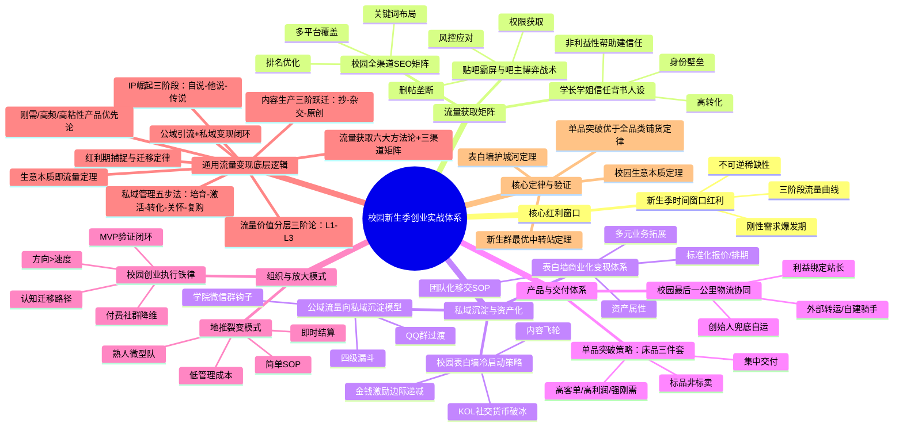

## 49.3 新生季时间窗口红利 —— 只争朝夕的「刚性需求爆发期」

### 为什么需要这个概念？

大学生创业者资源有限，必须抓住确定性高、竞争相对公平的特定时间节点。新生入学前 2-3 个月是刚需集中爆发、决策链路最短、信任成本最低的黄金窗口。错过窗口流量归零，该赛道具备天然的「到期作废」稀缺性，倒逼极致执行。

### 核心定义

**新生季时间窗口红利**（来源：《docs/202303/Qb1ldkXAkoQSbpxr6M8cWibDnXg.md》）

> 指高考结束至大一开学前的特定时期（约 6 月底 - 8 月底），新生及家长对学校信息、生活物资（床品等）存在强烈、集中、刚性的获取需求。
> 
> 特征：需求刚性强、决策周期短、信任成本低、单客价值高、时间不可逆。

这个概念展示了校园创业必须锚定的时间坐标：只有在「新生不知情、家长焦虑、学校未统一发放」的真空期，个人创业者才拥有公平竞争的入场券。

### 关键性质

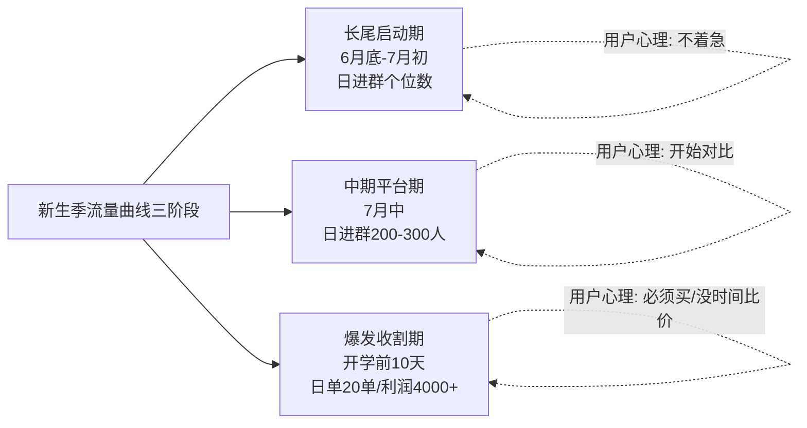

- **流量呈现「长尾启动 - 中期平台 - 开学前十天爆发」的三阶段分布曲线**
  
  作者实测：6月底开始布局，前十几天效果极差（日进群个位数）；7月中迎来第一波小高峰（日进群200-300人）；离开学前10天进入爆发期（十天卖出近百单、日利润近4000元）。
  
  这个三阶段曲线揭示了用户决策心理：**早期「不着急」、中期「开始对比」、后期「必须买、没时间比价」**。你的布局必须早于用户决策启动。

- **核心流量入口为搜索型（贴吧、QQ群、小红书、🧣），而非推荐型**
  
  新生主动搜索「学校名+新生群/床品/宿舍」的意图极强，推荐算法难以精准触达这一特定人群。

- **窗口期内「信息差」价值最高，掌握学校宿舍、分数线、食堂等本地化信息即掌握定价权**
  
  作者通过「学长学姐人设」免费提供选专业参考、宿舍情况、避坑指南，建立信任后再推销床品，实现「助人-信任-转化」闭环。

### 典型例子

> 作者 6 月底开始布局，7 月中旬迎来第一波高峰（日进群 200-300 人），离开学前 10 天单日卖 20 单、日利润近 4000 元。合伙人三人包揽全校床品引流营销，实现「三百单、利润 10 万 +」。

### 边界条件

- 仅适用于标品、高频、强刚需、可集中交付的品类（如床品、军训用品）
- 依赖学校规模、新生数量、快递基建承载力等物理条件，单校天花板明显
- 需提前 1-2 个月布局 SEO 与账号养号，临时起意无法捕捉早期长尾流量

---

## 49.4 学长学姐信任背书人设 —— 用「非利益性帮助」换取「最高转化率信任」

### 为什么需要这个概念？

校园市场新生防备心重，直接推销极易被拉黑、屏蔽、举报。在校生身份是天然的「熟人背书」，利用「热心学长/学姐」人设可绕过商业推销的信任防御机制。信任是校园生意的核心货币，人设建立成本极低（仅需真实在校身份 + 耐心解答）。

### 核心定义

**学长学姐信任背书人设**（来源：《docs/202303/Qb1ldkXAkoQSbpxr6M8cWibDnXg.md》）

> 利用在校生身份优势，以「热心学长/学姐」而非商家身份介入新生群体，通过提供选专业、查宿舍、避坑指南、分数线参考等非利益性帮助建立权威与信任，再顺势推荐自营产品（床品、表白墙入群），实现「助人 - 信任 - 转化」闭环。

这个定义展示了人设的核心逻辑：**身份标签（学长）+ 助人行为（非利益性）= 信任资产（可变现）**。

### 关键性质

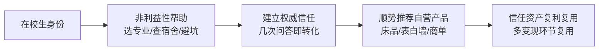

- **信任建立速度极快：从加群到下单仅需几次问答互动**
  
  作者自我介绍为学长，帮助新生参考分数线、了解宿舍情况，获取信任后销售床品三件套。

- **人设具有强「排他性」：竞争对手难以复制真实的在校身份与同理心服务**
  
  外地代理、微商团队无法伪造「在校生」身份，更难提供「我刚经历过、我最懂你」的同理心服务。

- **可迁移性强：同一人设可复用于床品销售、表白墙引流、后续商单变现等多个变现环节**
  
  同一「学长」人设先卖床品，后引流表白墙，再接驾校/校园卡商单，信任资产复利复用。

### 典型例子

> 作者自我介绍为学长，帮助新生参考分数线、了解宿舍情况，获取信任后销售床品三件套。同人设运营表白墙，以「万能墙」身份帮助新生解答问题、寻找组织，建立校园基础设施级 IP。

### 边界条件

- 必须真实在校，一旦被识破「非本校生」或「纯商家」信任瞬间崩塌
- 仅在「新生不熟悉环境、急需指引」的特定语境下有效，老生市场失效
- 人设维护成本随咨询量增加而上升，需配合标准化话术库与团队分工规模化

---

## 49.5 校园全渠道 SEO 矩阵 —— 铺满新生「搜索路径」的每一个入口

### 为什么需要这个概念？

新生获取信息的主动行为是「搜索」，而非「等待推荐」，必须占据所有搜索入口。单一平台流量有上限且易被竞品截流，多平台矩阵可实现流量互补与风险分散。SEO 流量免费、精准、长尾效应强，边际成本趋近零，适合无预算的学生创业者。

### 核心定义

**校园全渠道 SEO 矩阵**（来源：《docs/202303/Qb1ldkXAkoQSbpxr6M8cWibDnXg.md》）

> 针对目标用户高频使用平台（贴吧、QQ群、小红书、🧣、抖音、B站、知乎、今日头条等），通过关键词布局、内容分发、排名优化、多账号矩阵，覆盖「学校名 + 新生/床品/群」等核心长尾词，实现对新生搜索路径的全链路截获，形成「搜即见、见即信、信即进」的流量闭环。

这个定义展示了流量获取的底层动作：**平台全覆盖 + 关键词全覆盖 + 排名靠前 = 确定性流量**。

### 关键性质

以下是平台差异化分工表：

> 该表格展示了不同平台在校园全渠道SEO矩阵中的核心作用与关键动作分工。

| 平台 | 核心作用 | 关键动作 |
|------|----------|----------|
| 贴吧 | 长文信任、搜索权重高 | 投资吧主关系获删帖权、高频顶帖、多号轮番占坑 |
| QQ群 | 精准获群、高转化 | 关键词命名、资料塞入攻略、养号刷等级、多小号轮流发言 |
| 小红书 | 图文种草、搜索流量长尾 | 发布宿舍图/美食攻略/分数线笔记、评论区挂钩子引流 |
| 🧣 | 高频曝光、女生用户多 | 贴吧长文二次分发、超话/同城定位、评论区置顶引流 |

- **竞争本质是「算法博弈 + 人力博弈」：顶帖、养号、投资吧主关系、多小号轮换**
  
  贴吧初期通过搞定吧主获得删帖权垄断首页；被撤权后转为「高频顶帖 + 多号轮番占坑」维持曝光。这是对平台规则与人力资源的双重博弈。

- **内容一次生产、多端分发：贴吧长文拆解为小红书笔记、🧣短文案，边际成本极低**
  
  「贴吧长文 → 小红书图文笔记（封面+干货+钩子） → 🧣短文案（高频+超话+置顶）」，实现内容资产复用。

### 典型例子

> QQ群命名「学校名 + 2022 新生群」，塞入攻略文件、每日刷等级、多小号轮流发言，实现群排名 Top 3 霸屏。贴吧投资吧主关系获删帖权限清理竞品，被撤权后转为高频顶帖 + 多号轮番占坑。小红书发布宿舍图、美食攻略、分数线图文笔记，评论区挂钩子引流加群。

### 边界条件

- 依赖平台搜索算法规则，算法变更（如贴吧权重下降、QQ群搜索改版）可能导致策略失效
- 需投入大量人力维护账号矩阵（养号、顶帖、回复），非技术流可规模化复制
- 仅在「新生季」这一特定时间窗口内 ROI 极高，平时运营边际收益递减

---

## 49.6 公域流量向私域（表白墙）沉淀模型 —— 把「一次性流量」变成「可复利资产」

### 为什么需要这个概念？

公域流量（QQ群、贴吧）随新生季结束即失效，沉淀成本高、留存率低、不可复用。微信私域（个人号 + 群聊）具备高触达、强关系、可长期运营、多次变现的资产属性。表白墙兼具「社交货币」与「信息基础设施」双重属性，是校园场景下最优的私域承接容器。

### 核心定义

**公域流量向私域（表白墙）沉淀模型**（来源：《docs/202303/Qb1ldkXAkoQSbpxr6M8cWibDnXg.md》）

> 利用新生 🐧 群作为过渡池，设置管理员引导添加「校园墙」账号好友，以建立「学院微信新生群」为钩子，将流量沉淀至微信私域（个人号 + 分学院群聊），构建「公域引流 → QQ群过渡 → 表白墙好友 → 微信分群」四级沉淀漏斗，实现流量资产化。

这个模型展示了私域沉淀的标准化漏斗：**每一级都是下一级的钩子，每一级都提升信任与粘性**。

### 关键性质

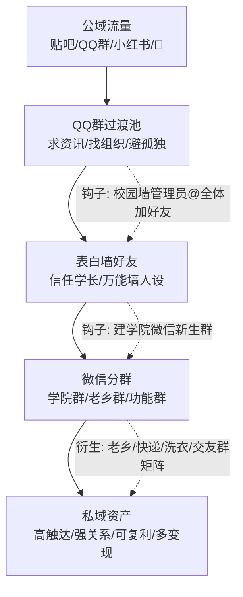

- **沉淀路径设计符合用户心理：「求资讯进 🐧 群 → 信任学长加表白墙好友 → 为进学院群加微信 → 留存私域」**
  
  每一步都有明确的用户动机，非强制跳转。

- **表白墙承载匿名表白、吐槽、失物招领、兼职发布等高频功能，用户留存率远高于纯广告号**
  
  它是「校园基础设施」，不是「广告牌」。

- **私域资产具备复利属性：粉丝画像精准（同校同届）、广告定价权、可衍生矩阵群（老乡群、快递群、洗衣群）**
  
  作者建立两个总微信群 + 多个学院分群，墙号为群主掌握影响力，7 个月持续接商单（月 10 条、单价 128-168 元）。

### 典型例子

> 作者建立两个总微信群 + 多个学院分群，墙号为群主掌握影响力，7 个月持续接商单（月 10 条、单价 128-168 元）。衍生运营老乡群、快递代拿群、洗衣群、唠嗑交友群矩阵，实现流量的多元化变现与长尾复利。

### 边界条件

- 微信个人号加好友有上限（约 5000 人），规模化需布局矩阵号或迁移企业微信
- 表白墙内容运营需持续投入（审核投稿、举办活动、维护氛围），否则活跃度快速衰减
- 商单变现需严控频次与质量，过度商业化导致用户反感、举报、封号，核心护城河即「社交基础设施」属性

---

## 49.7 校园表白墙冷启动「金钱激励 + KOL 介入」组合拳

### 为什么需要这个概念？

UGC 平台面临「无内容无流量、无流量无内容」的冷启动死循环。单纯金钱激励只能引发短期投机行为，无法建立真实的社区氛围与内容生产飞轮。引入校内 KOL（校花/校草/大V）利用其社交影响力制造「热闹」，触发羊群效应，是破解冷启动的关键。

### 核心定义

**校园表白墙冷启动策略**（来源：《docs/202303/Qb1ldkXAkoQSbpxr6M8cWibDnXg.md》）

> 前期：现金红包/实物奖品激励投稿，打破「零内容」僵局。
> 中期：抖音私信邀请校内 KOL 带头投稿/互动，制造「名人效应」与「社交货币」。
> 后期：持续发布优质投稿、回复互动，建立「万能墙」人设，形成内容生产 - 算法推荐 - 用户投稿的正向飞轮。

这个策略揭示了冷启动的三阶段跃迁：**经济激励破零 → 社交货币破冰 → 内容飞轮自转**。

### 关键性质

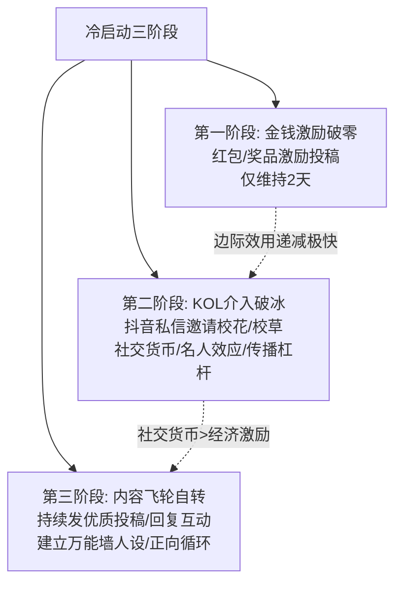

- **金钱激励边际效用递减极快（仅维持 2 天），KOL 介入具有「破冰 + 示范 + 传播」三重杠杆作用**
  
  作者发红包活动邀请 100+ 同学，2 天后热度骤降；转而抖音私信邀请校内美女帅哥，投稿量显著回升并进入良性循环。

- **核心逻辑：社交货币属性 > 经济激励，用户投稿动机从「拿奖品」转变为「被看见、被围观、社交展示」**
  
  KOL 投稿自带流量，其粉丝跟随进群、关注，实现「借势起号」。

- **KOL 筛选标准：在校生、颜值/才艺高、粉丝基数大、愿意配合互动**
  
  这是「低成本、高杠杆」的启动燃料。

### 典型例子

> 作者发红包活动邀请 100 + 同学，2 天后热度骤降；转而抖音私信邀请校内美女帅哥，投稿量显著回升并进入良性循环。KOL 投稿自带流量，其粉丝跟随进群、关注，实现「借势起号」。

### 边界条件

- 依赖学校是否存在高影响力 KOL 且愿意低成本配合（如互粉、互推）
- 金钱激励成本需控制在可承受范围，避免「羊毛党」薅羊毛导致账号标签混乱
- 仅解决「0 到 1」冷启动问题，后续运营仍需依靠内容质量与社区文化维持活跃

---

## 49.8 校园最后一公里物流协同 —— 用「利益绑定 + 兜底自运」攻克大件集中交付难题

### 为什么需要这个概念？

校园大件商品（床品）集中到货极易导致快递站爆仓拒收、派送时效失控、丢件破损率高。公共快递基建不具备「大件 + 集中 + 时效」的弹性服务能力，必须自建或强绑定派送体系。物流体验直接决定复购、口碑与退货率，是电商履约环节的核心竞争力与风控底线。

### 核心定义

**校园最后一公里物流协同**（来源：《docs/202303/Qb1ldkXAkoQSbpxr6M8cWibDnXg.md》）

> 针对开学高峰期床品等大件集中到货，通过多维手段确保准时、完好送达宿舍：
> 1. **利益绑定**：送烟酒、请客锁定快递站长/菜鸟站长合作优先权
> 2. **资源整合**：调用外部大车转运至中转站、组建临时电动车骑手团队
> 3. **兜底自运**：创始人亲自顶大太阳派送至晚上 10 点，不因外包不可控环节崩盘

这个定义展示了物流攻关的「三级防御体系」：**商业合作锁核心节点 → 外包团队跑常规流程 → 创始人兜底极端情况**。

### 关键性质

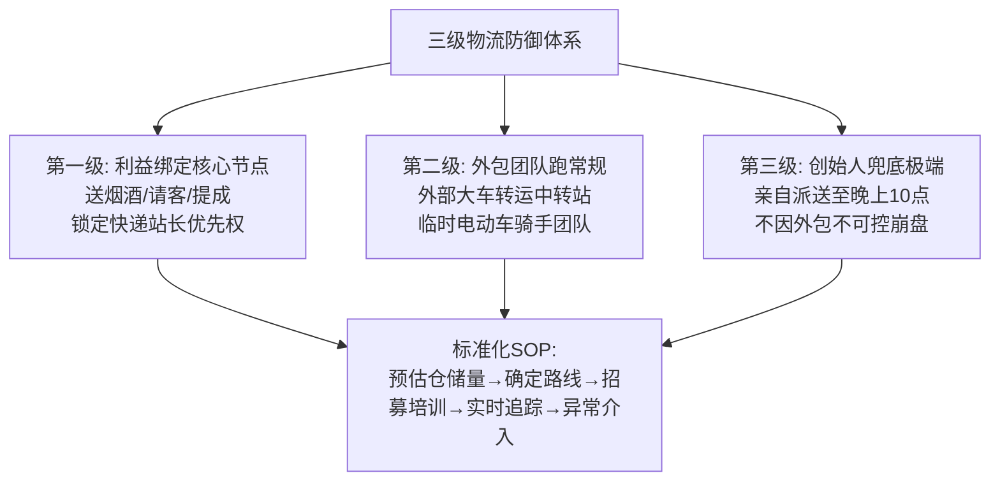

- **物流成本结构：快递费（顺丰 35 元 +）+ 人工派送费 + 礼品成本 + 兜底自运时间成本**
  
  这是「赚辛苦钱」的真实写照，每一单利润里都压着物流成本。

- **协同对象分层：核心快递站（利益绑定）> 外部转运车队（商业合同）> 临时骑手团队（兼职雇佣）> 创始人自运（最后兜底）**
  
  每一层解决一个确定性问题，形成容错链条。

- **标准化 SOP：提前联系站长预估仓储量 → 确定转运路线与中转点 → 招募培训骑手话术 → 实时追踪派送进度 → 异常即时介入**
  
  这是可复制、可交接的作业手册。

### 典型例子

> 300 套床品致使校内三大快递站全部爆仓；菜鸟站长人情放行但需自提自派；外包骑手因高温罢工，创始人带舍友亲送至晚上 10 点。提前联系快递站、调用大车搬运四大车被子、自组电动车队派送，最终完成闭环交付。

### 边界条件

- 仅适用于「集中到货 + 大件 + 强时效」场景，日常零散订单无需自建物流
- 自运成本极高（创始人时间成本），仅作为最后兜底，核心仍需建立稳定商业合作关系
- 规模化扩张需引入专业仓储物流服务商（如云仓、同城配送），摆脱创始人体力瓶颈

---

## 49.9 单品突破（床品）策略 —— 聚焦「高客单 + 高利润 + 强刚需」打造极致交付体验

### 为什么需要这个概念？

学生创业者精力、资金、供应链管理能力均有限，全品类铺货极易导致库存积压、运营分心、交付失控。床品具备高客单价（400-600 元）、高利润率（单利 180 +）、强刚需（人均 1 套）、标品非标卖、集中交付五大优势，是单品突破的最优标的。聚焦单品可将有限资源集中于供应链把控、物流攻关、话术打磨，快速跑通 0-1 闭环。

### 核心定义

**单品突破策略：床品三件套**（来源：《docs/202303/Qb1ldkXAkoQSbpxr6M8cWibDnXg.md》、《docs/202303/20230328_084.md》）

> 基于「必需品、高频、标品、利润空间可控」四大标准筛选床品三件套/六件套/九件套。解决新生「到校即需、比价成本高、质量难辨」痛点，建立供应链议价能力与标准化交付流程。通过「学长学姐人设 + 真实宿舍图 + 避坑指南」差异化销售，将标品卖出非标溢价。

这个策略展示了选品的「一票否决」逻辑：**产品属性决定商业模式上限**。

### 关键性质

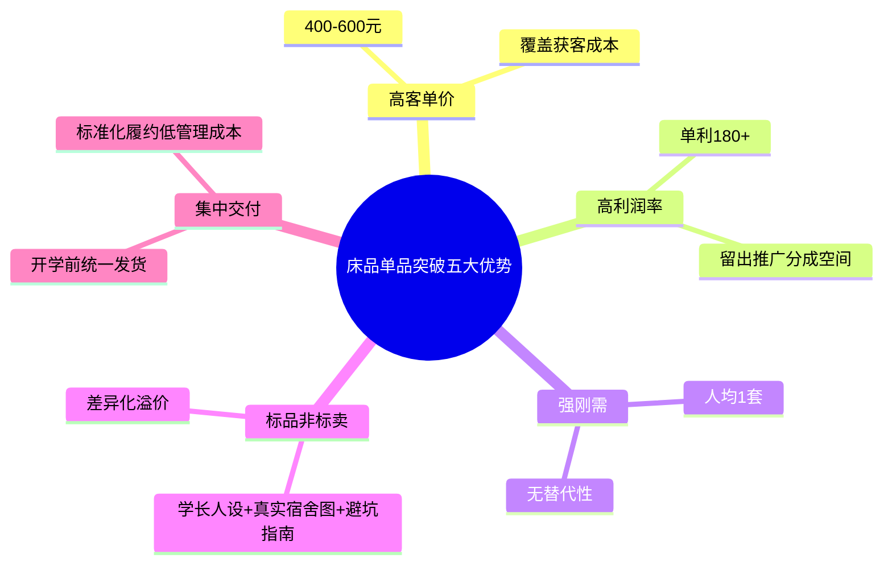

- **供应链模式：对接棉被厂商一手货源，小程序选品、零库存、按单采购、工厂直发或自建仓中转**
  
  零库存模式将资金占用压至最低，单量大时再谈价、建仓。

- **定价策略：六件套 449 元、九件套 598 元，单套利润约 180 元，量大可再谈价**
  
  高客单价覆盖获客成本，留出推广与分成空间。

- **交付模式：开学前统一发货、集中派送、售后仅处理质量问题（退货率极低）**
  
  集中爆发期标准化交付，避开日常零散订单的高管理成本。

### 典型例子

> 作者从零对接厂商、搭建小程序选品，总销量 300 + 套，总利润 10 万 +，峰值日单 20 单。后期让厂家多发 30 套线下兜售，进一步挖掘存量流量价值。

### 边界条件

- 依赖学校不统一床品规格、允许自带床品的政策环境，若学校强制统一发放则模式失效
- 仅适用于开学季集中爆发期，平时复购率极低，需配合表白墙等私域资产实现流量复利
- 供应链议价能力随单量提升而增强，前期小单量利润空间可能被压缩，需垫资过渡

---

## 49.10 表白墙商业化变现体系 —— 从「流量工具」进化为「可估值校园媒体资产」

### 为什么需要这个概念？

单一佣金模式（卖床品）受限于时间窗口，收入具有一次性、周期性、不可持续的缺陷。表白墙沉淀的精准校园流量具备长尾价值，可开发广告、CPS、导流、服务等多元变现路径。将表白墙从「引流工具」升级为「校园媒体资产」，拥有独立 IP、定价权、可转让性，实现资产化沉淀。

### 核心定义

**表白墙商业化变现体系**（来源：《docs/202303/Qb1ldkXAkoQSbpxr6M8cWibDnXg.md》）

> 建立标准化商单运营模型：报价体系（微信 128 元/条、🐧+微信 168 元/条）、排期管理（月接 10 条）、业务拓展（驾校/校园卡/快递代拿/洗衣 CPS）、团队化移交 SOP。
> 核心资产：微信 5000 + 粉丝 + 🐧 2500 + 粉丝 + 多个垂直细分群矩阵（老乡群、快递群、洗衣群、交友群）。
> 变现逻辑：流量精准（同校同届）、信任背书（墙号人设）、转化路径短（群内直接下单/加微信）。

这个体系展示了校园媒体资产的「标准化运营 + 多元化变现 + 团队化交付」三位一体模式。

### 关键性质

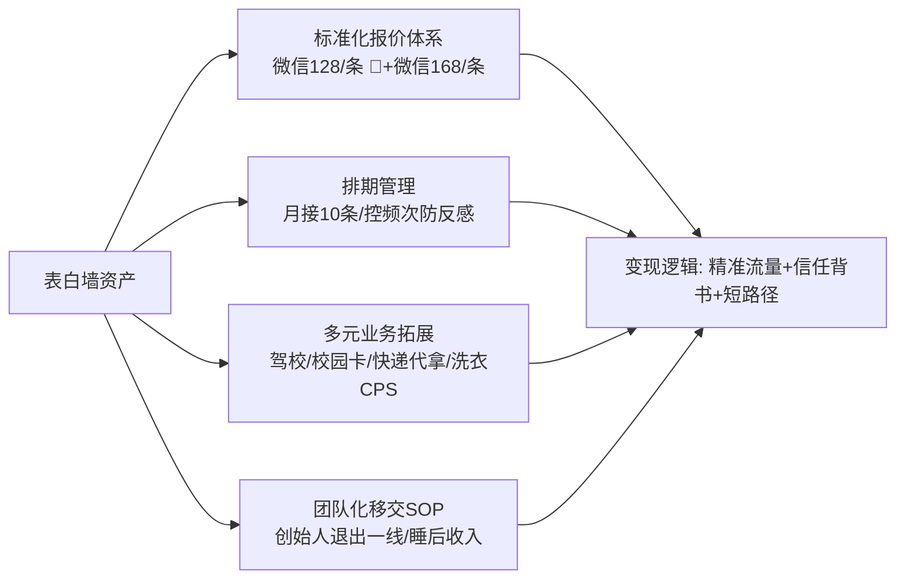

- **广告定价基于「注意力稀缺性」：校园垂直流量无替代性，商家议价能力弱**
  
  标准化报价体系消除了议价成本，月接 10 条控制频次防用户反感。

- **业务拓展遵循「高频刚需 > 低频非刚需」：驾校、校园卡、快递代拿、洗衣均为高频复购场景**
  
  这些业务本身具备高复购、高 LTV，表白墙仅作精准导流入口。

- **团队化运营：创始人退出一线，通过标准化 SOP 移交运营，实现「睡后收入」**
  
  这是从「打工者」到「资产持有者」的关键跃迁。

### 典型例子

> 月接 10 条商单，月流水 1.5-2 万，持续 7 个月验证可持续性。曾接单次投票活动广告费估计 1 万 +、用户刷礼物流水 3 万，但因开发商跑路零收入，证实「结算风控 > 流量变现能力」。

### 边界条件

- 严控商单频次与质量，过度商业化导致用户反感、举报、封号，核心护城河即「社交基础设施」属性
- 依赖学校规模与活跃度，小规模/低活跃学校商单天花板极低
- 需建立款项托管/分账/对公打款等结算风控机制，规避「甲方跑路」风险

---

## 49.11 地推裂变模式：「熟人信任 + 即时结算 + 简单 SOP」的最小可行性组织

### 为什么需要这个概念？

校园地推面临「招人难、管人难、信任成本高、执行力不可控」的组织难题。利用宿舍/同学熟人关系降维打击陌生推销信任壁垒，即时现金结算解决代理动力与风控问题。验证了「低门槛、重执行、强现金流」业务模式下，微型团队可快速复制放大。

### 核心定义

**地推裂变模式**（来源：《docs/202303/Qb1ldkXAkoQSbpxr6M8cWibDnXg.md》）

> 宿舍 4-5 人组建微型地推队，单日获单 100 +，单利润 5 元（扣礼品后），人均月入 2000 +。团队负责人抽成 1 元/单，代理无垫资风险、日结现金、简单话术（送礼品 + 加群 + 推销床品）。标准化 SOP：食堂/路边/寝室楼定点摆摊、统一着装/物料、微信群汇报进度、晚间对账分成。

这个模式展示了最小可行性组织的三要素：**熟人强约束 + 现金流正循环 + 标准化动作包**。

### 关键性质

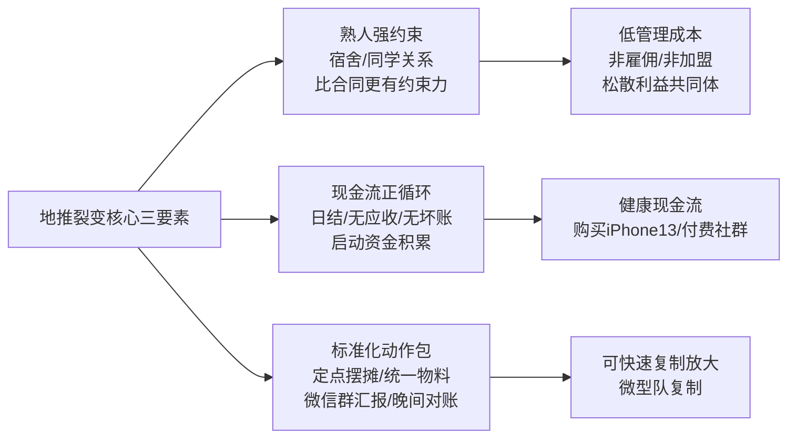

- **组织形态：非雇佣制、非加盟制、松散的「利益共同体」，边际管理成本趋近零**
  
  无劳动合同、无社保、无固定成本，纯佣金制。

- **信任基础：熟人社会强约束，代理不敢偷单、不敢跑路、执行力自觉性高**
  
  宿舍关系、同学情谊比合同更有约束力。

- **现金流特征：日结、无应收账款、无坏账风险，现金流极其健康，可作为创业启动资金积累**
  
  地推收入购买 iPhone 13、支付付费社群学费，验证「地推赚钱 → 买认知 → 做更高阶项目」的跃迁路径。

这一组织模式的核心意义在于：**用最低的管理成本换取最高的执行力，通过现金流的即时闭环解决初创期资金与信任的双重瓶颈。**

### 典型例子

> 高中宿舍 4-5 人组队，单日 100 + 单，人均月入 2000 + 覆盖生活费。地推收入购买 iPhone 13、支付付费社群学费。

### 边界条件

- 仅适用于「低客单、高频、标品、当面交付」场景（如床品、快递代拿、办卡），高客单/非标服务难复制
- 依赖学校允许地推的政策环境，严管校园商业活动的学校模式失效
- 规模化受限于熟人网络半径，跨校区/跨城市扩张需重新建立信任体系，边际收益递减

---

## 49.12 校园创业「执行力 > 方案，小步快跑验证闭环」铁律

### 为什么需要这个概念？

学生创业者普遍陷入「完美计划 - 迟迟不行动 - 机会溜走」的认知陷阱。资源有限时，完美的计划不如立即执行的「烂方案」；通过付费社群降低认知门槛，快速跑通最小闭环。执行力是将认知转化为结果的唯一杠杆，战略规划与执行力缺一不可。

### 核心定义

**校园创业执行铁律**（来源：《docs/202303/Qb1ldkXAkoQSbpxr6M8cWibDnXg.md》、《docs/202303/20230328_084.md》）

> 不追求完美方案，先跑通「进货 - 卖货 - 收钱」最小商业闭环（MVP），再迭代优化流程、工具、团队。核心动作：加入付费社群学习标杆案例 → 选品测款 → 低成本引流 → 首单成交 → 复盘标准化 → 规模化放大。评论区共识：战略规划与执行力缺一不可，执行力是普通人逆袭的核心变量。

这个铁律揭示了新手创业的正确姿态：**方向大致正确 + 极致执行 + 快速反馈 + 持续迭代 = 结果**。

### 关键性质

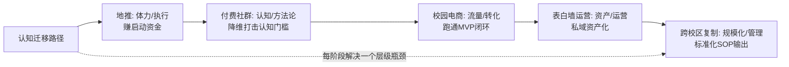

- **试错成本极低：床品项目前期仅需垫资样品费、小程序认证费、少量推广费，总投入 < 5000 元**
  
  可承受的失败成本是行动的前提。

- **反馈周期极短：从发布引流贴到首单成交仅需数天，数据即时可见，便于快速调整策略**
  
  快速正反馈是持续行动的燃料。

- **认知迁移路径：地推（体力/执行） → 付费社群（认知/方法论） → 校园电商（流量/转化） → 表白墙运营（资产/运营） → 跨校区复制（规模化/管理）**
  
  每一阶段解决一个层级的瓶颈，螺旋上升。

### 典型例子

> 作者从高中闲鱼倒卖、网拍刷单、演讲训练、美团地推，到大二暑假跑通床品 + 表白墙模式，每一步都是「小步快跑、快速验证」。加入付费社群（星球）一年不断学习，将社群方法论（RMS 模型、私域运营、SEO 矩阵）直接落地校园场景。

### 边界条件

- 仅适用于「可快速验证、试错成本可控、反馈周期短」的轻资产项目
- 重资产/长周期/强合规项目（如医疗、金融、重制造）不可盲目套用「小步快跑」
- 执行力必须建立在「正确方向」之上，盲目执行错误方向只会加速失败

---

## 49.13 生意本质即流量定理

### 为什么需要这个概念？

创业者常陷入产品、技术、团队等细节而忽视流量这一源头活水。无流量则无转化、无成交、无交付、无复购，一切商业闭环的起点都是流量。该定理将复杂商业模型还原为「流量→转化→成交→交付→复购/留存→新客增长」的单一核心链条。

### 核心定义

**生意本质即流量定理**（来源：《docs/202303/NQrwdjKZ4oOEFpxGD1Hcjc9wnwf.md》）

> 所有好生意本质都是流量生意，商业闭环为：流量 → 转化 → 成交 → 交付 → 复购/留存 → 新客增长。流量是启动飞轮唯一钥匙，无流量则无生意。

这个定理把商业还原到最底层：**流量是因，其他皆是果**。

### 关键性质

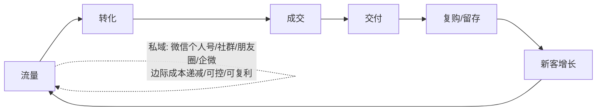

- **流量来源分公域（抖音/小红书/视频号/知乎/百家号等）与私域（微信个人号/社群/朋友圈/企微）**
- **公域流量边际成本递增、不可控，私域流量边际成本递减、可控、可复利**
- **流量获取成本（CAC）与用户生命周期价值（LTV）的比率决定商业模式生死**

这一闭环结构揭示了商业的第一性原理：**所有商业动作最终都要回到“如何以可接受成本获取精准流量”这一源头问题上。**

### 典型例子

- 校园床品+表白墙模式：公域SEO引流 → 人设信任转化 → 私域沉淀表白墙 → 长尾商单变现
- 视频号带货：短视频爆款引流直播 → 直播承接转化 → 私域沉淀复购 → 利润指数级增长

### 边界条件

- 仅适用于以流量为核心杠杆的轻/中资产模式，重资产/强供应链模式另论
- 流量质量>流量数量，精准流量的转化率与LTV远超泛流量

---

## 49.14 公域引流+私域变现闭环

### 为什么需要这个概念？

公域流量获取成本递增、生命周期短，私域流量可长期运营、高复购、高LTV。微信生态是几乎所有高客单价或长周期项目的最终归宿。需要标准化的引流路径与私域承接容器设计。

### 核心定义

**公域引流+私域变现闭环**（来源：《docs/202303/NQrwdjKZ4oOEFpxGD1Hcjc9wnwf.md》、《docs/202303/Qb1ldkXAkoQSbpxr6M8cWibDnXg.md》）

> 在抖音/小红书/视频号/知乎/百家号等公域平台通过内容/直播/钩子获客，沉淀至微信私域（个人号/社群/朋友圈/企微）完成高客单转化、复购裂变，构建可长期运营、多次变现的用户资产。

这个闭环展示了现代流量生意的标准化拓扑结构：**公域做加法（广撒网），私域做乘法（深挖井）**。

### 关键性质

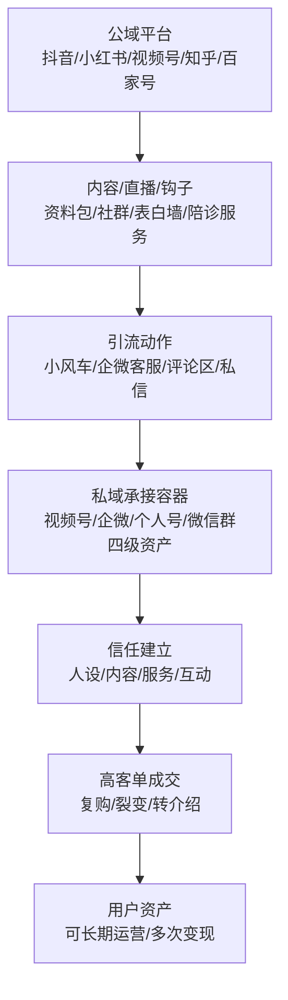

- **引流钩子设计：资料包、社群、表白墙、陪诊服务等，钩子价值决定引流转化率**
- **私域承接容器分级：视频号/企微/个人号/微信群四级资产，优先沉淀至可控资产**
- **转化路径：公域内容/直播 → 钩子 → 私域加好友/进群 → 信任建立 → 高客单成交 → 复购/裂变**

### 典型例子

- 孕晚期准妈妈通过视频号10天涨粉1000+引流私域
- 普通人做小红书0元建社群单月变现8W+
- 抖音直播引流私域6个方法
- 小红书研报账号3周引流私域600+

### 边界条件

- 私域运营需持续投入内容/活动/服务，否则僵尸粉比例上升、活跃度衰减
- 引流动作需合规（如视频号小风车/企微客服），规避外链封杀风险

---

## 49.15 内容生产三阶跃迁：抄-杂交-原创

### 为什么需要这个概念？

零基础创作者无法凭空产出原创爆款，必须站在巨人肩膀上起步。直接创作原创内容成本高、周期长、失败率高，三阶跃迁提供确定性成长路径。素材库积累是核心护城河，实现「捡钱式变现」。

### 核心定义

**内容生产三阶跃迁**（来源：《docs/202303/NQrwdjKZ4oOEFpxGD1Hcjc9wnwf.md》）

> - 初期：直接抄袭竞品爆款内容（一帧一帧像素级模仿）
> - 中期：杂交重组多源素材（标题A+文案B+封面C+选品D）
> - 后期：沉淀原创方法论（结构化SOP、选题逻辑、话术库），实现稳定输出

这个跃迁路径揭示了内容能力的进化规律：**模仿是基础，重组是桥梁，原创是终点**。

### 关键性质

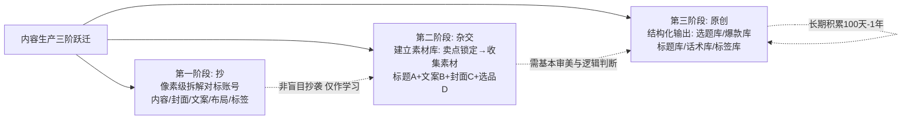

- **抄袭非盲目，需像素级拆解对标账号（内容/封面/文案/布局/标签）**
- **杂交需建立素材库：卖点锁定 → 收集相关素材 → 素材多了赚钱就是捡钱**
- **原创非凭灵感，而是结构化输出：选题库/爆款库/标题库/话术库/标签库**

### 典型例子

- 小红书无货源像素级模仿：对标账号一帧一帧比对图片/文案/布局
- 视频号矩阵：搬运→混剪→仿拍→实拍原创进化路径
- AI辅助：ChatGPT写文案、AI绘画生成图片，人工注入情绪价值

### 边界条件

- 抄袭阶段需规避版权/平台风控，仅作学习用途不可商用
- 杂交阶段需具备基本审美与逻辑判断能力，纯新手易生成低质内容
- 原创阶段需长期积累（100天-1年），心态急功近利易放弃

---

## 49.16 红利期捕捉与迁移定律

### 为什么需要这个概念？

创业者常追逐过期红利或盲目跟风，缺乏对平台周期的宏观认知。红利期具有确定的时间窗口与演变规律，掌握规律可实现跨平台复利。核心能力非单一平台技巧，而是可迁移的方法论与嗅觉。

### 核心定义

**红利期捕捉与迁移定律**（来源：《docs/202303/NQrwdjKZ4oOEFpxGD1Hcjc9wnwf.md》）

> - 平台红利周期约 1-2 年一次（邮箱/百度/淘宝/拼多多/美团/视频号/小红书）
> - 核心能力：敏锐嗅觉 + 快速执行力 + 方法迁移能力
> - 看到详细教程分享时红利已过，方法论可迁移至下一流量池

这个定律揭示了平台红利的「周期性、可迁移性、教程滞后性」三大特征。

### 关键性质

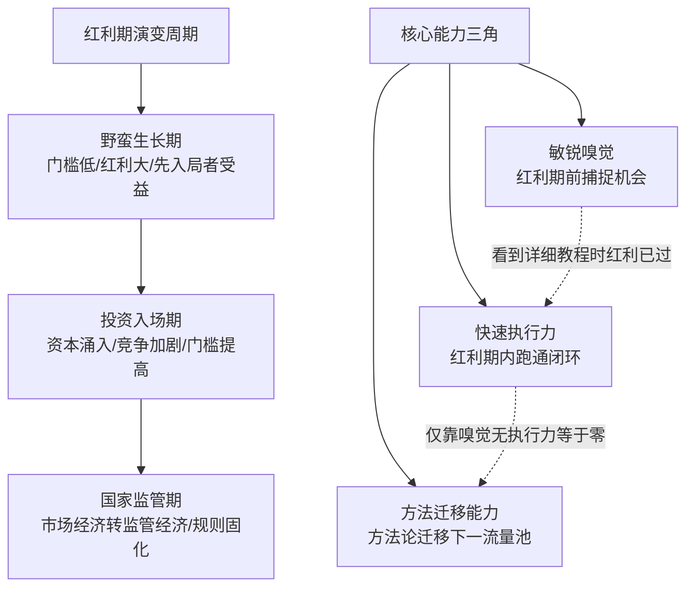

- **红利期演变：野蛮生长 → 投资入场 → 国家监管（市场经济转监管经济）**
- **迁移能力表现为：跨平台方法论复用（如SEO矩阵、RMS模型、内容三阶跃迁）**
- **执行力是捕捉红利的物理前提，认知是认知红利的认知前提**

### 典型例子

- 视频号/小红书当前处于红利期，早期入局者已跑通变现闭环
- 方法论从校园SEO迁移至小红书/视频号/抖音等平台验证有效

### 边界条件

- 红利期判断需结合平台政策、竞争格局、用户心智多维度评估
- 方法迁移需适配新平台算法/用户画像/商业规则，非完全照搬
- 仅靠嗅觉无执行力等于零，仅靠执行无嗅觉易踩坑

---

## 49.17 IP崛起三阶段：自说-他说-传说

### 为什么需要这个概念？

个人品牌建设非一日之功，存在客观成长规律，违背规律必遭挫折。三阶段模型提供了可预期的成长路标，避免盲目追求速成。信任是IP变现的核心货币，三阶段对应信任深度的递进。

### 核心定义

**IP崛起三阶段**（来源：《docs/202303/NQrwdjKZ4oOEFpxGD1Hcjc9wnwf.md》）

> - 自说：自我输出内容，建立初步认知（视频>图文、出镜>不出镜）
> - 他说：他人传播背书/引用/推荐，信任外溢（KOL背书、媒体报道）
> - 传说：品牌资产化自传播，用户主动分享/捍卫/传播（无需主动推广）

这个模型描绘了个人品牌从「自证」到「他证」再到「自传播」的信任跃迁路径。

### 关键性质

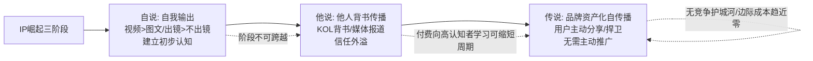

- **阶段不可跨越，但可通过付费向高认知者学习缩短痛苦周期**
- **视频/出镜/真人建立信任效率远高于图文/隐身/虚拟形象**
- **传说阶段具备「无竞争」护城河，商业变现边际成本趋近零**

### 典型例子

- 校园表白墙：从学长人设(自说)→万能墙IP(他说)→校园基础设施(传说)
- 视频号书豪：追热点起号(自说)→垂直IP+团队(他说)→连续年入百万(传说)

### 边界条件

- 仅适用于内容驱动型个人IP，非标服务/重资产模式另论
- 传说阶段需5-10年深耕，一年不赚钱准备是常态

---

## 49.18 私域管理五步法：培育-激活-转化-关怀-复购

### 为什么需要这个概念？

私域运营常陷入「只加人不运营」或「硬广刷屏」的低级玩法。五步法提供标准化运营框架，将私域从流量池升级为资产池。每一步对应具体执行动作与考核指标，可复制、可落地。

### 核心定义

**私域管理五步法**（来源：《docs/202303/NQrwdjKZ4oOEFpxGD1Hcjc9wnwf.md》）

> - **培育**：标签化分层（高意向/普通/流失）、完善用户画像档案
> - **激活**：欢迎语/福利包/新人引导、建立首次互动与情感连接
> - **转化**：低价引流品/阶梯定价/钩子产品、最简单成交是做客户引领者
> - **关怀**：节日问候/专属权益/生日惊喜、维护情感账户与长期信任
> - **复购**：会员体系/裂变激励/转介绍奖励、挖掘老客LTV最大化

这个五步法把私域运营标准化为「用户生命周期管理」的标准动作序列。

### 关键性质

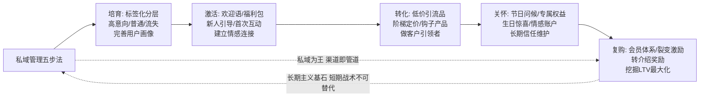

- **私域为王、渠道即管道：公域是租来的地，私域是自家的地**
- **最简单成交方式是做客户引领者，而非推销员**
- **五步法是长期主义基石，短期战术无法替代长期运营体系**

### 典型例子

- 视频号私域：短视频引流 → 直播承接 → 朋友圈种草 → 高客单复购
- 小红书私域：笔记引流 → 群运营 → 朋友圈专栏化 → 阶梯定价变现

### 边界条件

- 仅适用于微信生态私域，其他平台（抖音粉丝群/快手粉丝团）运营逻辑不同
- 需配合CRM/SCRM工具实现规模化，纯手工管理上限约2000人

---

## 49.19 流量获取六大方法论+三渠道矩阵

### 为什么需要这个概念？

单一流量获取手段易失效、天花板低，组合拳提供容错与放大空间。六大战术覆盖流量获取全链路，三渠道适配不同内容生产能力。核心心法：内容即诱饵，价值决定流量成本。

### 核心定义

**流量获取六大方法论+三渠道矩阵**（来源：《docs/202303/NQrwdjKZ4oOEFpxGD1Hcjc9wnwf.md》）

> - **六大战术**：留诱饵/留钩子、共情/共鸣、量变质、打磨IP、做好后端
> - **三渠道**：音频（喜马拉雅）、视频（抖音/快手/视频号/B站/小红书）、图文（知乎/👸号）
> - **矩阵组合**：6战术 × 3渠道 = 18种可落地组合拳

这个矩阵提供了流量获取的「战术×渠道」标准化组合库。

### 关键性质

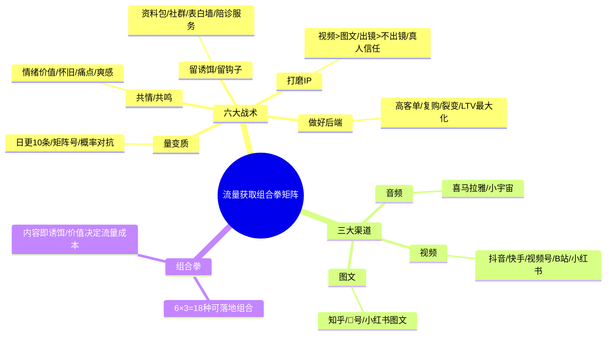

- **内容即诱饵：优质内容降低流量获取成本，垃圾内容需付费买量**
- **共情/共鸣：情绪价值内容（如怀旧/痛点/爽感）天然自带传播属性**
- **量变质：大基数发布（如日更10条/矩阵号）以概率对抗单点不确定性**

### 典型例子

- 校园SEO矩阵：图文(贴吧/知乎)+视频(抖音/B站)+音频(小宇宙/喜马拉雅)
- 视频号矩阵：30-60号搬运测品 → 筛选优质号升级直播 → 付费流量 → 私域 → 裂变

### 边界条件

- 仅适用于内容驱动型流量获取，付费投流/技术流量另论
- 矩阵运营需团队/工具/RPA支撑，单人上限约3-5账号

---

## 49.20 流量价值分层三阶论：L1空手套白狼→L2平台稳健→L3伟大公司

### 为什么需要这个概念？

创业者常混淆流量变现层级，导致战略错位：想做L3却在做L1的事。三阶论提供清晰的进阶路标与资源配置指引。核心差异在于资产归属权：L1无资产、L2寄生生存、L3自建护城河。

### 核心定义

**流量价值分层三阶论**（来源：《docs/202303/NQrwdjKZ4oOEFpxGD1Hcjc9wnwf.md》）

> - **L1 空手套白狼**：卖别人货（分销/代理/联盟），红利过走人，无资产沉淀
> - **L2 平台稳健生意**：自有产品+平台规则，寄生生存，有品牌但无独立护城河
> - **L3 伟大公司**：流量沉淀自有平台，口碑裂变，建立护城河（如微信/淘宝/字节）

这个分层揭示了商业进化的终局：**从借力到自力，从寄生到生态**。

### 关键性质

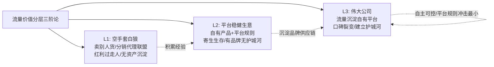

- **进阶逻辑：L1积累经验 → L2沉淀品牌/供应链 → L3自建平台/生态**
- **建议追求 L2/L3，L1仅作启动垫板而非长期驻留**
- **平台规则变化对L1冲击最大，对L3冲击最小（自主可控）**

### 典型例子

- 校园模式：地推卖床品(L1) → 床品自营+表白墙私域(L2) → 校园媒体资产化(L3)
- 视频号：带货分销(L1) → 自营供应链+私域沉淀(L2) → 矩阵化+团队化运营(L3)

### 边界条件

- L3需巨额资金/团队/时间，非普通人可企及，建议以L2为战略目标
- 即便达到L3，仍需警惕平台政策/监管风险，无绝对安全

---

## 49.21 刚需/高频/高粘性产品优先论

### 为什么需要这个概念？

选品是创业成败的「一票否决」项，产品属性决定商业模式上限与运营难度。该定律为选品提供可量化的决策标准，规避「好看但不赚钱」的陷阱。核心逻辑：产品属性（刚需/高频/粘性/客单价）决定商业模式可行性边界。

### 核心定义

**刚需/高频/高粘性产品优先论**（来源：《docs/202303/NQrwdjKZ4oOEFpxGD1Hcjc9wnwf.md》）

> - **刚需**：奶粉/考证/祛斑等生命/职业刚性需求，无替代性、决策快、抗周期
> - **高频**：复购周期短（日/周/月），用户习惯养成、LTV高、现金流稳定
> - **高粘性**：低退货率（祛斑30% vs 服饰高退货）、强依赖、转化率高
> - **高客单价**：利润空间覆盖获客成本，支撑付费流量与私域运营投入

这个论断给出了选品的「四维评分卡」：**刚需性 × 频次 × 粘性 × 客单价 = 商业模式上限**。

### 关键性质

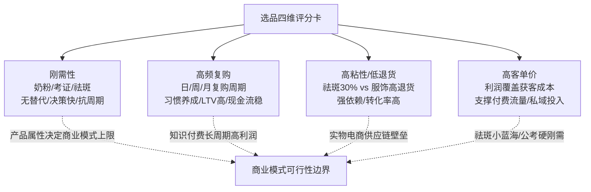

- **产品属性决定商业模式上限：知识付费长周期高利润/实物电商供应链壁垒**
- **祛斑类：小蓝海、退货率30%左右、粘性强、适合私域沉淀**
- **公考/教育：高利润硬刚需、知识付费变现模式、制作周期长、适合长期主义**

### 典型例子

- 奶粉：硬通产品，有孩子出生就要喝，属于刚需产品
- 祛斑：综合退货率30%左右，比较低，产品粘性强，适合做私域
- 公考/教育付费：高利润硬刚需、知识付费变现模式、制作时间长，适合长期做

### 边界条件

- 仅适用于以产品为核心杠杆的商业模式，纯流量/纯技术模式另论
- 刚需不等于高利润，需匹配转化能力与供应链把控

---

## 49.22 多源对照

本章核心概念主要基于三篇核心素材构建，其中校园创业实战体系主要源自 `Qb1ldkXAkoQSbpxr6M8cWibDnXg.md` 与 `20230328_084.md`，通用流量变现底层逻辑主要源自 `NQrwdjKZ4oOEFpxGD1Hcjc9wnwf.md`。三篇素材在「公域引流+私域变现」「内容生产三阶跃迁」「执行力优先」等核心观点上形成高度共识。

### 共识

- **公私域联动是主流变现模型**：三篇素材均验证「公域获客 → 私域沉淀 → 高客单转化 → 复购裂变」为当下最确定的商业闭环。
- **内容生产遵循「抄-杂交-原创」进阶规律**：`NQrwdjKZ4oOEFpxGD1Hcjc9wnwf.md` 系统阐述，`Qb1ldkXAkoQSbpxr6M8cWibDnXg.md` 校园SEO矩阵实操中体现（贴吧长文→小红书笔记→🧣短文）。
- **执行力大于完美方案**：`Qb1ldkXAkoQSbpxr6M8cWibDnXg.md` 强调「小步快跑验证闭环」，`NQrwdjKZ4oOEFpxGD1Hcjc9wnwf.md` 强调「速度和执行力」捕捉红利，`20230328_084.md` 评论区共识「战略规划执行力，缺一不可」。

### 分歧

- **校园场景 vs 通用场景的策略侧重**：`Qb1ldkXAkoQSbpxr6M8cWibDnXg.md`/`20230328_084.md` 聚焦「时间窗口红利、学长人设、校园SEO、表白墙、最后一公里物流」等校园特有要素；`NQrwdjKZ4oOEFpxGD1Hcjc9wnwf.md` 聚焦「跨平台通用方法论、直播模型、代运营体系、OEM模式」等泛商业要素。
- **冷启动策略差异**：校园表白墙采用「金钱激励+KOL介入」双轨制；`NQrwdjKZ4oOEFpxGD1Hcjc9wnwf.md` 中视频号矩阵采用「30-60号搬运测品→筛选升级→付费流量」三步走，小红书无货源采用「像素级模仿+长尾词布局」，核心逻辑一致（低成本验证→筛选放大）但战术细节因平台属性而异。

---

## 49.23 设计中的取舍

### 为什么不用「全品类铺货」而是「单品突破」？

全品类铺货看似分散风险，实则稀释了有限的精力、资金与供应链管理能力。床品作为「高客单+高利润+强刚需+标品非标卖+集中交付」的五星级标的，聚焦单品可将资源集中于供应链把控、物流攻关、话术打磨，快速跑通 0-1 闭环。作者实测：300+单床品实现10万+利润，若分散到军训用品、文具、日用品等多个SKU，单品单量不足以建立供应链议价权，物流也无法标准化，最终陷入「多品类都不赚钱」的泥潭。

### 这种设计的 trade-off 是什么？

**得**：极致的资源聚焦、供应链议价权、标准化交付体验、快速跑通闭环。
**失**：抗风险能力较弱（单品依赖）、政策风险暴露（学校强制统一床品即失效）、复购率低（四年买一次）、规模天花板受限于单校新生数量。
**对冲**：通过表白墙沉淀私域资产实现流量复利，开发驾校/校园卡/快递代拿等高频业务补足复购缺口，跨校区复制模式突破单校天花板。

### 为什么不用「纯付费投流」而是「免费SEO+人设信任」？

新生季窗口期短（60天）、预算极低（学生创业者）、决策链路短（搜索即购）。付费投流学习成本高、测试周期长、ROI 不确定；免费SEO布局一次受益全周期，学长人设零成本建立最高转化率信任。作者实测：全渠道SEO矩阵零成本获取精准流量3000+ QQ群成员，转化率远超同期投流同行。

### 为什么表白墙冷启动必须「金钱激励+KOL介入」组合拳？

单纯金钱激励只能吸引「羊毛党」，2天热度即归零；单纯KOL介入无初始内容支撑，KOL不愿为空号背书。组合拳逻辑：**钱破「零内容」僵局 → KOL破「无氛围」僵局 → 内容飞轮自转**。这是解决 UGC 平台「双边市场冷启动」的标准化打法。

---

## 49.24 动手练习

### 练习 1：新生季流量布局实战推演

假设你所在高校今年新生约5000人，开学前60天为作战窗口：

1. 设计一个‘学长学姐’人设的朋友圈/空间内容发布计划（前20天/中间20天/最后20天各3条核心内容主题）
2. 列出你需要布局的5个核心流量平台，并针对每个平台写出1个‘关键词命名策略’和1个‘排名/曝光提升关键动作’
3. 计算：若单套床品利润180元，目标利润5万元，需销量多少？按转化率5%估算，需引流多少精准新生进群？

回答问题：
- 为什么说‘前期效果差是常态，后期爆发才是主流’？这与用户决策心理有何关系？
- 如果学校禁止地推、严控贴吧发帖、QQ群排名机制改版，你的Plan B是什么？

### 练习 2：表白墙从0到1冷启动方案设计

你刚注册了一个‘某某大学万能墙’微信👸号/视频号，当前零粉丝、零投稿：

1. 设计前3天的‘金钱激励’活动规则（预算100元内），包含奖品设置、参与门槛、引导关注/投稿动作
2. 制定‘KOL邀请名单’筛选标准（在哪找？看什么指标？怎么联系？邀请话术核心钩子是什么？）
3. 规划第4-14天的‘内容运营节奏’：每日发布频次、栏目设置（表白/吐槽/失物/问答/吃瓜）、互动机制（置顶/回复/精选）

回答问题：
- 为什么纯金钱激励只能维持2天？KOL介入的核心杠杆作用是什么？
- 如何界定‘过度商业化’的红线？商单频次与用户留存的关系如何量化监控？

### 练习 3：校园物流攻关与单品交付SOP设计

预计销售300套床品（单件体积大、重），集中在开学前3天到货，校内3个快递站日处理上限各200件：

1. 设计‘利益绑定’话术与成本预算：如何搞定菜鸟/顺丰/邮政站长？烟酒/请客/提成预算各多少？
2. 制定‘外部转运+自建骑手+兜底自运’三级派送方案：中转点选址、骑手招募渠道与日薪、调度微信群SOP、异常处理预案（暴雨/骑手罢工/丢件）
3. 设计客户收货确认与售后标准流程：验货标准、拒收/退换货话术、好评引导钩子

回答问题：
- 为什么说‘创始人亲自送货至晚上10点’是最后兜底而非常态？如何量化这个兜底动作的时间成本上限？
- 若学校明年强制统一床品、禁止自带，你的单品突破策略如何平移？

### 练习 4：通用流量变现实战复盘演练

基于‘研究-模仿-超越’(RMS)方法论，选取一个你熟悉的公域平台(抖音/小红书/视频号/知乎/百家号)上的头部账号作为标杆：

1. 拆解其商业模式要素：流量来源、转化路径、产品结构、变现方式
2. 应用‘内容生产三阶跃迁’：抄取3条爆款内容→杂交重组生成3条新内容→尝试原创输出1条内容
3. 设计‘公域引流+私域变现’闭环：钩子设计、引流路径、私域承接容器、转化话术、复购裂变机制
4. 规划‘红利期捕捉与迁移’：当前平台处于红利期哪个阶段？方法论如何迁移至下一流量池？

回答问题：
- 为什么说‘看到详细教程时红利已过’？如何在红利期前通过嗅觉捕捉机会？
- 如何判断内容是否具备‘价值杠杆’？火过的内容重拍10遍仍有效的底层逻辑是什么？

### 练习 5：IP人设与私域运营沙盘推演

假设你已在某垂类平台(如视频号育儿/小红书职场/知乎好物)建立1000粉丝账号：

1. 定义你的IP人设：核心标签、差异化定位、信任背书来源、人格化表达风格
2. 设计私域管理五步法落地动作：培育(标签/分群)、激活(欢迎语/福利)、转化(低价引流品/阶梯定价)、关怀(节日/专属)、复购(会员/裂变)
3. 应用‘流量获取六大方法论’：为你的账号配置留诱饵/钩子/共情/量变质/打磨IP/做好后端的具体执行动作
4. 规划‘流量价值分层’进阶路径：从L1(卖别人货)→L2(自有产品)→L3(自建平台)的关键节点与资源需求

回答问题：
- 为什么说‘渠道即管道，私域为王’？公域流量与私域流量在资产属性上有何本质区别？
- 如何通过‘做客户引领者’实现最简单成交？这与传统推销话术有何不同？

---

## 49.25 本章小结

这一章中我们学习了校园新生季创业的完整实战体系与通用流量变现的底层逻辑。首先我们拆解了新生季时间窗口红利的三阶段流量曲线与不可逆稀缺性，其次掌握了学长学姐信任背书人设如何用非利益性帮助换取最高转化率信任，接着构建了校园全渠道SEO矩阵覆盖新生搜索路径的每一个入口，然后设计了公域流量向私域（表白墙）沉淀的四级漏斗模型，接着攻克了表白墙冷启动的「金钱激励+KOL介入」组合拳与校园最后一公里物流协同的三级防御体系，之后聚焦单品突破策略锁定床品三件套的高客单高利润强刚需属性，进而将表白墙进化为可估值的校园媒体资产体系，验证了地推裂变模式下熟人信任与即时结算的最小可行性组织，最后内化了执行力大于方案的校园创业铁律。同时我们系统梳理了生意本质即流量定理、公域引流私域变现闭环、内容生产三阶跃迁、红利期捕捉迁移定律、IP崛起三阶段、私域管理五步法、流量获取六大方法论与三渠道矩阵、流量价值分层三阶论、刚需高频高粘性产品优先论等通用流量变现底层逻辑，构建了从校园微观实战到商业宏观认知的完整知识跃迁。

本章我们一起学习了以下概念：

| 概念 | 解释 |
|------|------|
| 新生季时间窗口红利 | 高考后至开学前2-3个月，需求刚性强、决策快、信任成本低、时间不可逆的黄金创业窗口 |
| 学长学姐信任背书人设 | 利用在校生身份以热心学长/学姐身份提供非利益性帮助建立权威信任，顺势转化销售 |
| 校园全渠道SEO矩阵 | 覆盖贴吧、QQ群、小红书、🧣等新生高频搜索平台，通过关键词布局与排名优化截获精准流量 |
| 公域流量向私域沉淀模型 | 以QQ群为过渡池，以‘建学院微信群’为钩子，引导流量沉淀至微信私域（个人号+群聊）构建可复利资产 |
| 表白墙冷启动组合拳 | 前期金钱激励破零，中期引入校内KOL制造社交货币热度，后期建立内容飞轮实现良性循环 |
| 最后一公里物流协同 | 利益绑定快递站长、整合外部运力、组建临时骑手团队、创始人兜底自运，攻克大件集中交付难题 |
| 单品突破策略（床品） | 聚焦高客单、高利润、强刚需、标品非标卖、集中交付的床品单品，极致资源聚焦打造交付体验 |
| 表白墙商业化变现体系 | 标准化报价/排期/拓展（驾校/校园卡/快递/洗衣CPS），团队化SOP移交，打造可估值校园媒体资产 |
| 地推裂变模式 | 宿舍微型队、熟人信任、即时现金结算、简单SOP，验证低门槛重执行强现金流组织形态 |
| 校园创业执行铁律 | 执行力大于方案，小步快跑跑通MVP最小闭环，付费社群降维打击认知门槛，方向正确前提下执行力是核心变量 |
| 生意本质即流量定理 | 所有好生意本质都是流量生意，商业闭环为流量→转化→成交→交付→复购/留存→新客增长，流量是启动飞轮唯一钥匙 |
| 公域引流+私域变现闭环 | 在公域平台通过内容/直播/钩子获客，沉淀至微信私域完成高客单转化、复购裂变，流量尽头是微信私域 |
| 内容生产三阶跃迁 | 初期直接抄袭爆款，中期杂交重组多源素材，后期沉淀原创方法论；配合素材库积累实现捡钱式变现 |
| 红利期捕捉与迁移定律 | 平台红利周期约1-2年一次；核心能力非单一平台技巧，而是敏锐嗅觉+快速执行力+方法迁移能力；看到详细教程时红利已过，方法论可迁移至下一流量池 |
| IP崛起三阶段 | 个人品牌成长规律：自我输出→他人传播背书→品牌资产化自传播；视频>图文、出镜>不出镜、真人建立信任加速转化 |
| 私域管理五步法 | 私域为王、渠道即管道；最简单成交方式是做客户引领者，私域管理五步法是长期主义基石 |
| 流量获取六大方法论+三渠道矩阵 | 6大战术(留诱饵/钩子/共情/量变质/打磨IP/做好后端)×3渠道(音频/视频/图文)=可落地组合拳；内容即诱饵，价值决定流量成本 |
| 刚需/高频/高粘性产品优先论 | 选品核心标准：刚需(奶粉/考证/祛斑)>高频复购>低退货率(祛斑30% vs 服饰高退货)>高客单利润空间；产品属性决定商业模式上限 |

下一章中，我们将学习第 50 章的内容（待大纲提供）。

