# 第 49 章 校园新生季创业实战与通用流量变现底层逻辑

## 学习目标

- 理解新生季时间窗口红利的特征与核心价值
- 掌握学长学姐信任背书人设的建立与转化逻辑
- 掌握校园全渠道SEO矩阵的布局与执行SOP
- 理解公域流量向私域（表白墙）沉淀的模型与漏斗设计
- 掌握校园表白墙冷启动的‘金钱激励+KOL介入’组合拳打法
- 理解校园最后一公里物流协同的利益绑定与兜底机制
- 掌握单品突破（床品）策略的选品标准与交付体系
- 理解表白墙商业化变现体系的定价、运营与资产化路径
- 掌握地推裂变模式的组织设计与利润分成机制
- 内化校园创业‘执行力>方案，小步快跑验证闭环’的铁律
- 理解流量获取底层逻辑：公域引流+私域变现闭环
- 掌握‘研究-模仿-超越’(RMS)方法论进行案例拆解
- 掌握内容生产三阶跃迁：抄-杂交-原创
- 理解私域流量价值分层三阶论(L1-L3)
- 掌握红利期捕捉与迁移定律
- 理解IP崛起三阶段：自说-他说-传说
- 掌握私域管理五步法：培育-激活-转化-关怀-复购
- 掌握流量获取六大方法论+三渠道矩阵
- 理解刚需/高频/高粘性产品优先论

## 49.1 生活类比

想象校园新生季创业是一场**“限时开放的新生迎新集市”**：**新生季时间窗口** = 每年仅开放2个月的“黄金摆摊期”，错过等明年；**学长学姐人设** = 穿着志愿者马甲的“老学长”，不卖货只指路，最易获得信任；**全渠道SEO矩阵** = 在新生必经的十字路口（贴吧、QQ群、小红书、🧣）都竖起指向你摊位的大牌子；**表白墙** = 校园里最火的“民主墙”，大家来贴条子、找东西、吐槽，你是墙的管理员，掌握话语权；**床品单品** = 所有新生进校必买的“入场券”，客单价高、利润厚、无库存压力；**最后一公里物流** = 既然快递站不送上楼，你就自己组织“送被子突击队”，甚至老板亲自上阵；**地推裂变** = 发动自家宿舍兄弟姐妹，人均分工、日结现金、利益绑定，战斗力最强；**执行力铁律** = 别在宿舍里琢磨完美方案了，先摆摊卖第一单，边卖边改，跑通闭环才是硬道理。

想象通用流量变现是一条**“公域捕鱼、私域养鱼”的渔业生产线**：**公域平台** = 不同鱼塘（抖音/小红书/视频号/知乎/百家号）；**内容/钩子** = 鱼饵，价值越高鱼饵越香；**私域微信** = 自己的鱼塘，水质可控、可长期养殖、可复利收割；**RMS模型** = 观摩隔壁高手怎么钓鱼(研究)，照葫芦画瓢(模仿)，再造新鱼竿(超越)；**私域为王** = 别人家鱼塘(公域)随时可能断水，自己鱼塘(私域)才是根基；**长期主义** = 渔场红利轮换(1-2年)，渔技(方法论)可带走迁移新鱼塘。

## 49.2 概念地图

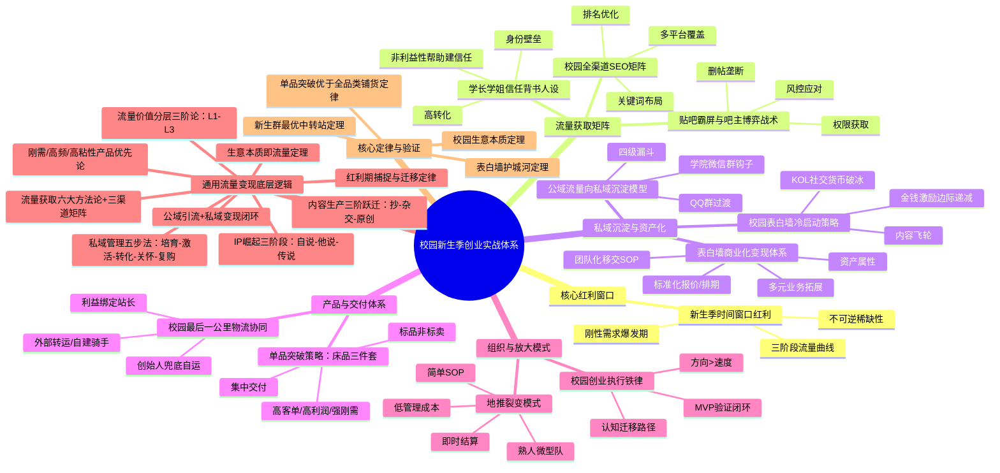

## 49.3 新生季时间窗口红利 —— 只争朝夕的「刚性需求爆发期」

### 为什么需要这个概念？

大学生创业者资源有限，必须抓住确定性高、竞争相对公平的特定时间节点。新生入学前 2-3 个月是刚需集中爆发、决策链路最短、信任成本最低的黄金窗口。错过窗口流量归零，该赛道具备天然的「到期作废」稀缺性，倒逼极致执行。

### 核心定义

**新生季时间窗口红利**（来源：《docs/202303/Qb1ldkXAkoQSbpxr6M8cWibDnXg.md》）

> 指高考结束至大一开学前的特定时期（约 6 月底 - 8 月底），新生及家长对学校信息、生活物资（床品等）存在强烈、集中、刚性的获取需求。
> 
> 特征：需求刚性强、决策周期短、信任成本低、单客价值高、时间不可逆。

这个概念展示了校园创业必须锚定的时间坐标：只有在「新生不知情、家长焦虑、学校未统一发放」的真空期，个人创业者才拥有公平竞争的入场券。

### 方法演进图：新生季流量曲线三阶段演进模型

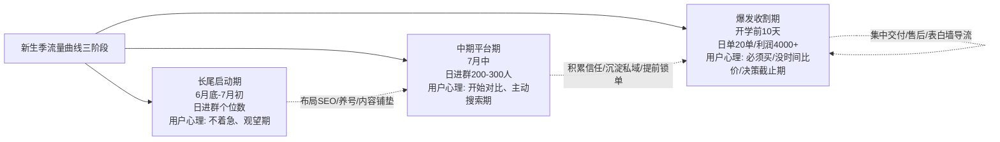

### 关键性质

新生季流量并非均匀分布，而是呈现典型的「长尾启动 - 中期平台 - 爆发收割」三阶段曲线。作者实测：6月底开始布局，前十几天效果极差（日进群个位数），因为此时离开学还有一个多月，很多同学都不着急买，处于观望期；7月中迎来第一波小高峰（日进群200-300人），用户开始主动搜索对比；离开学前10天进入爆发期（十天卖出近百单、日利润近4000元），用户心理转为「必须买、没时间比价」。这个三阶段曲线揭示了用户决策心理的演变规律：**你的布局必须早于用户决策启动，在「不着急」期完成SEO占位与人设建立，在「开始对比」期积累信任与私域沉淀，在「必须买」期完成收割**。

核心流量入口为搜索型（贴吧、QQ群、小红书、🧣），而非推荐型。新生主动搜索「学校名+新生群/床品/宿舍」的意图极强，推荐算法难以精准触达这一特定人群。这意味着流量获取的本质是「搜索入口的占位权」，而非「内容分发的推荐权」。

窗口期内「信息差」价值最高，掌握学校宿舍、分数线、食堂等本地化信息即掌握定价权。作者通过「学长学姐人设」免费提供选专业参考、宿舍情况、避坑指南，建立信任后再推销床品，实现「助人-信任-转化」闭环。这种信息差不仅是流量钩子，更是定价权的来源——新生愿意为「确定性信息」支付溢价。

### 典型例子

> 作者 6 月底开始布局，7 月中旬迎来第一波高峰（日进群 200-300 人），离开学前 10 天单日卖 20 单、日利润近 4000 元。合伙人三人包揽全校床品引流营销，实现「三百单、利润 10 万 +」。——《docs/202303/Qb1ldkXAkoQSbpxr6M8cWibDnXg.md》

### 边界条件

- 仅适用于标品、高频、强刚需、可集中交付的品类（如床品、军训用品）
- 依赖学校规模、新生数量、快递基建承载力等物理条件，单校天花板明显
- 需提前 1-2 个月布局 SEO 与账号养号，临时起意无法捕捉早期长尾流量

---

## 49.4 学长学姐信任背书人设 —— 用「非利益性帮助」换取「最高转化率信任」

### 为什么需要这个概念？

校园市场新生防备心重，直接推销极易被拉黑、屏蔽、举报。在校生身份是天然的「熟人背书」，利用「热心学长/学姐」人设可绕过商业推销的信任防御机制。信任是校园生意的核心货币，人设建立成本极低（仅需真实在校身份 + 耐心解答）。

### 核心定义

**学长学姐信任背书人设**（来源：《docs/202303/Qb1ldkXAkoQSbpxr6M8cWibDnXg.md》）

> 利用在校生身份优势，以「热心学长/学姐」而非商家身份介入新生群体，通过提供选专业、查宿舍、避坑指南、分数线参考等非利益性帮助建立权威与信任，再顺势推荐自营产品（床品、表白墙入群），实现「助人 - 信任 - 转化」闭环。

这个定义展示了人设的核心逻辑：**身份标签（学长）+ 助人行为（非利益性）= 信任资产（可变现）**。

### 方法演进图：信任背书人设转化路径

```mermaid
flowchart LR
    A[在校生身份<br/>真实性锚点] --> B[非利益性帮助<br/>选专业/查宿舍/避坑指南/分数线参考]
    B --> C[建立权威信任<br/>几次问答互动即转化<br/>从"陌生人"变"自己人"]
    C --> D[顺势推荐自营产品<br/>床品三件套/表白墙入群/后续商单]
    D --> E[信任资产复利复用<br/>多变现环节复用/跨周期沉淀]
    E -.->|反哺强化人设| A
```

### 关键性质

信任建立速度极快：从加群到下单仅需几次问答互动。作者自我介绍为学长，帮助新生参考分数线、了解宿舍情况，获取信任后销售床品三件套。这种「非利益性帮助」打破了新生对商家的天然防御——当你不卖货、只指路时，你反而成了最值得信赖的「自己人」。

人设具有强「排他性」：竞争对手难以复制真实的在校身份与同理心服务。外地代理、微商团队无法伪造「在校生」身份，更难提供「我刚经历过、我最懂你」的同理心服务。这是一种基于「身份壁垒」的竞争优势，而非单纯的技术或资金壁垒。

可迁移性强：同一人设可复用于床品销售、表白墙引流、后续商单变现等多个变现环节。同一「学长」人设先卖床品，后引流表白墙，再接驾校/校园卡商单，信任资产复利复用。这种「一鱼多吃」的资产复用能力，大幅降低了后续业务的获客成本。

### 典型例子

> 作者自我介绍为学长，帮助新生参考分数线、了解宿舍情况，获取信任后销售床品三件套。同人设运营表白墙，以「万能墙」身份帮助新生解答问题、寻找组织，建立校园基础设施级 IP。——《docs/202303/Qb1ldkXAkoQSbpxr6M8cWibDnXg.md》

### 边界条件

- 必须真实在校，一旦被识破「非本校生」或「纯商家」信任瞬间崩塌
- 仅在「新生不熟悉环境、急需指引」的特定语境下有效，老生市场失效
- 人设维护成本随咨询量增加而上升，需配合标准化话术库与团队分工规模化

---

## 49.5 校园全渠道 SEO 矩阵 —— 铺满新生「搜索路径」的每一个入口

### 为什么需要这个概念？

新生获取信息的主动行为是「搜索」，而非「等待推荐」，必须占据所有搜索入口。单一平台流量有上限且易被竞品截流，多平台矩阵可实现流量互补与风险分散。SEO 流量免费、精准、长尾效应强，边际成本趋近零，适合无预算的学生创业者。

### 核心定义

**校园全渠道 SEO 矩阵**（来源：《docs/202303/Qb1ldkXAkoQSbpxr6M8cWibDnXg.md》）

> 针对目标用户高频使用平台（贴吧、QQ群、小红书、🧣、抖音、B站、知乎、今日头条等），通过关键词布局、内容分发、排名优化、多账号矩阵，覆盖「学校名 + 新生/床品/群」等核心长尾词，实现对新生搜索路径的全链路截获，形成「搜即见、见即信、信即进」的流量闭环。

这个定义展示了流量获取的底层动作：**平台全覆盖 + 关键词全覆盖 + 排名靠前 = 确定性流量**。

### 方法演进图：校园全渠道SEO矩阵数据流向

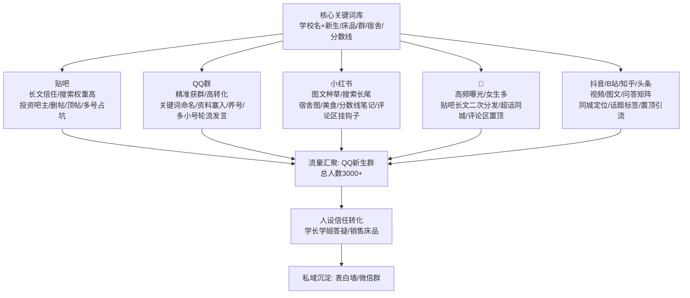

### 关键性质

以下是平台差异化分工表：

> 该表格展示了不同平台在校园全渠道SEO矩阵中的核心作用与关键动作分工。

| 平台 | 核心作用 | 关键动作 |
|------|----------|----------|
| 贴吧 | 长文信任、搜索权重高 | 投资吧主关系获删帖权、高频顶帖、多号轮番占坑 |
| QQ群 | 精准获群、高转化 | 关键词命名、资料塞入攻略、养号刷等级、多小号轮流发言 |
| 小红书 | 图文种草、搜索流量长尾 | 发布宿舍图/美食攻略/分数线笔记、评论区挂钩子引流 |
| 🧣 | 高频曝光、女生用户多 | 贴吧长文二次分发、超话/同城定位、评论区置顶引流 |

竞争本质是「算法博弈 + 人力博弈」：顶帖、养号、投资吧主关系、多小号轮换。贴吧初期通过搞定吧主获得删帖权垄断首页；被撤权后转为「高频顶帖 + 多号轮番占坑」维持曝光。这是对平台规则与人力资源的双重博弈。作者回忆：「我当时由于和贴吧吧主在之前打好了关系，刚刚开始十几天的时候同行发帖子我就给他们删除了，真的是霸道了哈哈哈。吧主很快就发现了我这样子做...后来就把我这个小吧主给撤销了。之后的大量同行的帖子发布，并且也在不断的评论区顶帖，顶贴的目的是为了把自己的帖排名冲到本吧前面并且在百度首页有展示。」

内容一次生产、多端分发：贴吧长文拆解为小红书笔记、🧣短文案，边际成本极低。「贴吧长文 → 小红书图文笔记（封面+干货+钩子） → 🧣短文案（高频+超话+置顶）」，实现内容资产复用。作者操作：「通过图文的形式，给同学们介绍本校近年来的录取分数线，宿舍各个学院是几人寝室，本校的风景，美食等等来引导大家加群」「一般关注🧣的女同学很多，我们就把在百度贴吧内发的帖子，图片以及新生可能会遇到的问题，重新在🧣里复制粘贴一遍。」

### 典型例子

> QQ群命名「学校名 + 2022 新生群」，塞入攻略文件、每日刷等级、多小号轮流发言，实现群排名 Top 3 霸屏。贴吧投资吧主关系获删帖权限清理竞品，被撤权后转为高频顶帖 + 多号轮番占坑。小红书发布宿舍图、美食攻略、分数线图文笔记，评论区挂钩子引流加群。——《docs/202303/Qb1ldkXAkoQSbpxr6M8cWibDnXg.md》

### 边界条件

- 依赖平台搜索算法规则，算法变更（如贴吧权重下降、QQ群搜索改版）可能导致策略失效
- 需投入大量人力维护账号矩阵（养号、顶帖、回复），非技术流可规模化复制
- 仅在「新生季」这一特定时间窗口内 ROI 极高，平时运营边际收益递减

---

## 49.6 公域流量向私域（表白墙）沉淀模型 —— 把「一次性流量」变成「可复利资产」

### 为什么需要这个概念？

公域流量（QQ群、贴吧）随新生季结束即失效，沉淀成本高、留存率低、不可复用。微信私域（个人号 + 群聊）具备高触达、强关系、可长期运营、多次变现的资产属性。表白墙兼具「社交货币」与「信息基础设施」双重属性，是校园场景下最优的私域承接容器。

### 核心定义

**公域流量向私域（表白墙）沉淀模型**（来源：《docs/202303/Qb1ldkXAkoQSbpxr6M8cWibDnXg.md》）

> 利用新生 🐧 群作为过渡池，设置管理员引导添加「校园墙」账号好友，以建立「学院微信新生群」为钩子，将流量沉淀至微信私域（个人号 + 分学院群聊），构建「公域引流 → QQ群过渡 → 表白墙好友 → 微信分群」四级沉淀漏斗，实现流量资产化。

这个模型展示了私域沉淀的标准化漏斗：**每一级都是下一级的钩子，每一级都提升信任与粘性**。

### 方法演进图：四级沉淀漏斗数据流模型

```mermaid
flowchart TD
    A[公域流量<br/>贴吧/QQ群/小红书/🧣<br/>搜索意图强/一次性] --> B[QQ群过渡池<br/>求资讯/找组织/避孤独<br/>管理员@全体加墙号好友]
    B --> C[表白墙好友<br/>信任学长/万能墙人设<br/>匿名社交/失物/吐槽高频功能]
    C --> D[微信分群<br/>学院群/老乡群/快递群/洗衣群/交友群<br/>墙号为群主掌握影响力]
    D --> E[私域资产<br/>高触达/强关系/可复利/多变现<br/>微信5000+/QQ2500+/矩阵群]
    
    B -.->|钩子1: 校园墙管理员身份| C
    C -.->|钩子2: 建学院微信新生群| D
    D -.->|衍生矩阵群: 垂直场景细分| E
```

### 关键性质

沉淀路径设计符合用户心理：「求资讯进 🐧 群 → 信任学长加表白墙好友 → 为进学院群加微信 → 留存私域」。每一步都有明确的用户动机，非强制跳转。作者操作：「通过在QQ群里设置校园墙管理员，@全体成员加好友，把人引流到了QQ墙，但是微信的私域价值更大，我就想到了通过建微信的新生群，然后通过校园墙QQ发公告引导建个个学院的新生加我微信然后拉他们进自己学院的微信群」。

表白墙承载匿名表白、吐槽、失物招领、兼职发布等高频功能，用户留存率远高于纯广告号。它是「校园基础设施」，不是「广告牌」。这种「社交基础设施」属性是其核心护城河——用户离不开它提供的社交功能，从而被动接受商业信息。

私域资产具备复利属性：粉丝画像精准（同校同届）、广告定价权、可衍生矩阵群（老乡群、快递群、洗衣群）。作者建立两个总微信群 + 多个学院分群，墙号为群主掌握影响力，7 个月持续接商单（月 10 条、单价 128-168 元）。作者描述：「如今的话，账号一个学期，学校的各种老乡群，快递代拿群，洗衣群，唠嗑交友群都是我们团队在运营，校园墙人数也做到了微信5000+，QQ2500+。平时就接一些靠谱的商家推广，每个月大概接十条，一条单微信收费是128加QQ一起，共168/条，持续至今至今七个月。」

### 典型例子

> 作者建立两个总微信群 + 多个学院分群，墙号为群主掌握影响力，7 个月持续接商单（月 10 条、单价 128-168 元）。衍生运营老乡群、快递代拿群、洗衣群、唠嗑交友群矩阵，实现流量的多元化变现与长尾复利。——《docs/202303/Qb1ldkXAkoQSbpxr6M8cWibDnXg.md》

### 边界条件

- 微信个人号加好友有上限（约 5000 人），规模化需布局矩阵号或迁移企业微信
- 表白墙内容运营需持续投入（审核投稿、举办活动、维护氛围），否则活跃度快速衰减
- 商单变现需严控频次与质量，过度商业化导致用户反感、举报、封号，核心护城河即「社交基础设施」属性

---

## 49.7 校园表白墙冷启动「金钱激励 + KOL 介入」组合拳

### 为什么需要这个概念？

UGC 平台面临「无内容无流量、无流量无内容」的冷启动死循环。单纯金钱激励只能引发短期投机行为，无法建立真实的社区氛围与内容生产飞轮。引入校内 KOL（校花/校草/大V）利用其社交影响力制造「热闹」，触发羊群效应，是破解冷启动的关键。

### 核心定义

**校园表白墙冷启动策略**（来源：《docs/202303/Qb1ldkXAkoQSbpxr6M8cWibDnXg.md》）

> 前期：现金红包/实物奖品激励投稿，打破「零内容」僵局。
> 中期：抖音私信邀请校内 KOL 带头投稿/互动，制造「名人效应」与「社交货币」。
> 后期：持续发布优质投稿、回复互动，建立「万能墙」人设，形成内容生产 - 算法推荐 - 用户投稿的正向飞轮。

这个策略揭示了冷启动的三阶段跃迁：**经济激励破零 → 社交货币破冰 → 内容飞轮自转**。

### 方法演进图：表白墙冷启动三阶段飞轮模型

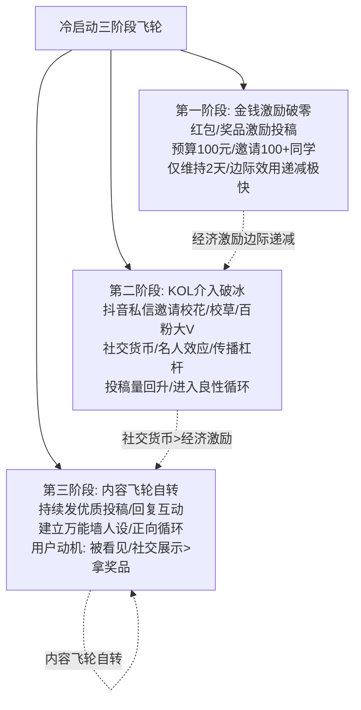

### 关键性质

金钱激励边际效用递减极快（仅维持 2 天），KOL 介入具有「破冰 + 示范 + 传播」三重杠杆作用。作者发红包活动邀请 100+ 同学，2 天后热度骤降；转而抖音私信邀请校内美女帅哥，投稿量显著回升并进入良性循环。作者复盘：「通过一波活动，邀请了一百多位同学参加，刚刚开始有人投稿，毕竟是金钱的魅力，但是没过2天，大家就没那么多新鲜感了。我就在抖音上面一个个的私信，让本校的美女帅哥邀请大家参加，果然是主动才会有故事，通过这次的活动，万能墙号的投稿量就起来了。」

核心逻辑：社交货币属性 > 经济激励，用户投稿动机从「拿奖品」转变为「被看见、被围观、社交展示」。KOL 投稿自带流量，其粉丝跟随进群、关注，实现「借势起号」。这是「低成本、高杠杆」的启动燃料——KOL 不需要付费，只需互粉、互推等社交货币交换即可配合。

KOL 筛选标准：在校生、颜值/才艺高、粉丝基数大、愿意配合互动。这一阶段的关键在于「主动出击」：作者一个个私信邀请，而非等待上门。这种主动性是打破冷启动僵局的关键动作。

### 典型例子

> 作者发红包活动邀请 100 + 同学，2 天后热度骤降；转而抖音私信邀请校内美女帅哥，投稿量显著回升并进入良性循环。KOL 投稿自带流量，其粉丝跟随进群、关注，实现「借势起号」。——《docs/202303/Qb1ldkXAkoQSbpxr6M8cWibDnXg.md》

### 边界条件

- 依赖学校是否存在高影响力 KOL 且愿意低成本配合（如互粉、互推）
- 金钱激励成本需控制在可承受范围，避免「羊毛党」薅羊毛导致账号标签混乱
- 仅解决「0 到 1」冷启动问题，后续运营仍需依靠内容质量与社区文化维持活跃

---

## 49.8 校园最后一公里物流协同 —— 用「利益绑定 + 兜底自运」攻克大件集中交付难题

### 为什么需要这个概念？

校园大件商品（床品）集中到货极易导致快递站爆仓拒收、派送时效失控、丢件破损率高。公共快递基建不具备「大件 + 集中 + 时效」的弹性服务能力，必须自建或强绑定派送体系。物流体验直接决定复购、口碑与退货率，是电商履约环节的核心竞争力与风控底线。

### 核心定义

**校园最后一公里物流协同**（来源：《docs/202303/Qb1ldkXAkoQSbpxr6M8cWibDnXg.md》）

> 针对开学高峰期床品等大件集中到货，通过多维手段确保准时、完好送达宿舍：
> 1. **利益绑定**：送烟酒、请客锁定快递站长/菜鸟站长合作优先权
> 2. **资源整合**：调用外部大车转运至中转站、组建临时电动车骑手团队
> 3. **兜底自运**：创始人亲自顶大太阳派送至晚上 10 点，不因外包不可控环节崩盘

这个定义展示了物流攻关的「三级防御体系」：**商业合作锁核心节点 → 外包团队跑常规流程 → 创始人兜底极端情况**。

### 方法演进图：三级物流防御体系与SOP流程

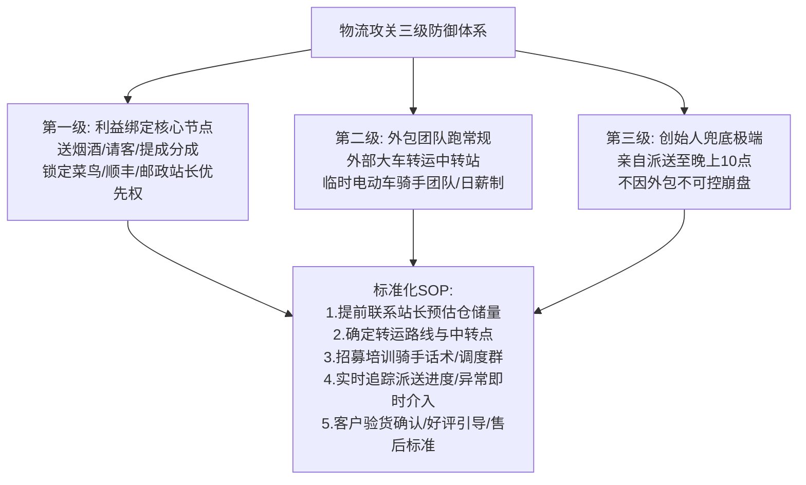

### 关键性质

物流成本结构：快递费（顺丰 35 元 +）+ 人工派送费 + 礼品成本 + 兜底自运时间成本。这是「赚辛苦钱」的真实写照，每一单利润里都压着物流成本。作者记录：「顺丰单个要三十五元以上...雇人一个一个的骑电动车把被子送到大家的宿舍」。

协同对象分层：核心快递站（利益绑定）> 外部转运车队（商业合同）> 临时骑手团队（兼职雇佣）> 创始人自运（最后兜底）。每一层解决一个确定性问题，形成容错链条。作者实操：「300来套被子，在暑假中就提前联系了学校的个个快递站...菜鸟的老板也说他们那里满了，放不下。但是那个哥看我这样子也挺不容易的，于是答应帮我，开着大车和我一起去快递中转站搬了四大车的被子」「当时找的送被子团队不靠谱，送了几套太热了没人送了，自己顶着大太阳送了一天，没有吃饭，差不多晚上的时候带着舍友送到晚上十点多。」

标准化 SOP：提前联系站长预估仓储量 → 确定转运路线与中转点 → 招募培训骑手话术 → 实时追踪派送进度 → 异常即时介入。这是可复制、可交接的作业手册。

### 典型例子

> 300 套床品致使校内三大快递站全部爆仓；菜鸟站长人情放行但需自提自派；外包骑手因高温罢工，创始人带舍友亲送至晚上 10 点。提前联系快递站、调用大车搬运四大车被子、自组电动车队派送，最终完成闭环交付。——《docs/202303/Qb1ldkXAkoQSbpxr6M8cWibDnXg.md》

### 边界条件

- 仅适用于「集中到货 + 大件 + 强时效」场景，日常零散订单无需自建物流
- 自运成本极高（创始人时间成本），仅作为最后兜底，核心仍需建立稳定商业合作关系
- 规模化扩张需引入专业仓储物流服务商（如云仓、同城配送），摆脱创始人体力瓶颈

---

## 49.9 单品突破（床品）策略 —— 聚焦「高客单 + 高利润 + 强刚需」打造极致交付体验

### 为什么需要这个概念？

学生创业者精力、资金、供应链管理能力均有限，全品类铺货极易导致库存积压、运营分心、交付失控。床品具备高客单价（400-600 元）、高利润率（单利 180 +）、强刚需（人均 1 套）、标品非标卖、集中交付五大优势，是单品突破的最优标的。聚焦单品可将有限资源集中于供应链把控、物流攻关、话术打磨，快速跑通 0-1 闭环。

### 核心定义

**单品突破策略：床品三件套**（来源：《docs/202303/Qb1ldkXAkoQSbpxr6M8cWibDnXg.md》、《docs/202303/20230328_084.md》）

> 基于「必需品、高频、标品、利润空间可控」四大标准筛选床品三件套/六件套/九件套。解决新生「到校即需、比价成本高、质量难辨」痛点，建立供应链议价能力与标准化交付流程。通过「学长学姐人设 + 真实宿舍图 + 避坑指南」差异化销售，将标品卖出非标溢价。

这个策略展示了选品的「一票否决」逻辑：**产品属性决定商业模式上限**。

### 方法演进图：床品单品突破五大优势与交付闭环

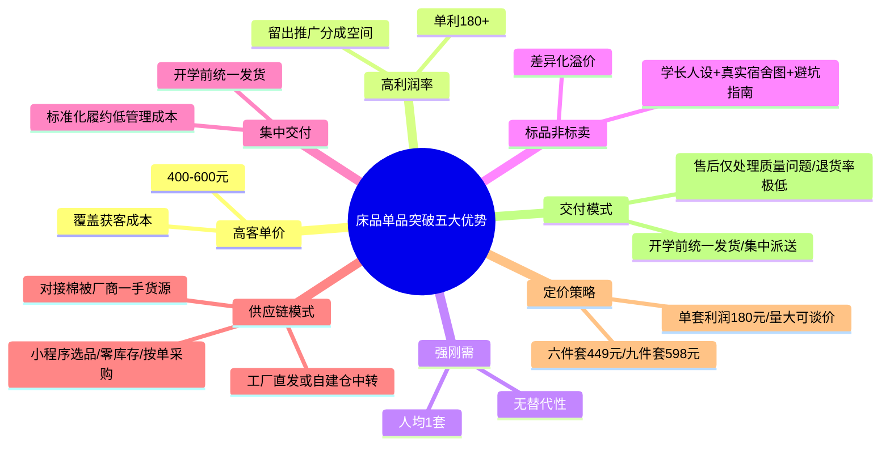

### 关键性质

供应链模式：对接棉被厂商一手货源，小程序选品、零库存、按单采购、工厂直发或自建仓中转。零库存模式将资金占用压至最低，单量大时再谈价、建仓。作者描述：「床品是线下的互联网公司去对接的棉被商的货源，从零开始做小程序去选品，去做床品类目的小程序」。

定价策略：六件套 449 元、九件套 598 元，单套利润约 180 元，量大可再谈价。高客单价覆盖获客成本，留出推广与分成空间。作者数据：「产品有449的六件套和598的九件套，一单利润180左右」「单量三百单以上单价更高...一共三百多套」。

交付模式：开学前统一发货、集中派送、售后仅处理质量问题（退货率极低）。集中爆发期标准化交付，避开日常零散订单的高管理成本。

### 典型例子

> 作者从零对接厂商、搭建小程序选品，总销量 300 + 套，总利润 10 万 +，峰值日单 20 单。后期让厂家多发 30 套线下兜售，进一步挖掘存量流量价值。——《docs/202303/Qb1ldkXAkoQSbpxr6M8cWibDnXg.md》

### 边界条件

- 依赖学校不统一床品规格、允许自带床品的政策环境，若学校强制统一发放则模式失效
- 仅适用于开学季集中爆发期，平时复购率极低，需配合表白墙等私域资产实现流量复利
- 供应链议价能力随单量提升而增强，前期小单量利润空间可能被压缩，需垫资过渡

---

## 49.10 表白墙商业化变现体系 —— 从「流量工具」进化为「可估值校园媒体资产」

### 为什么需要这个概念？

单一佣金模式（卖床品）受限于时间窗口，收入具有一次性、周期性、不可持续的缺陷。表白墙沉淀的精准校园流量具备长尾价值，可开发广告、CPS、导流、服务等多元变现路径。将表白墙从「引流工具」升级为「校园媒体资产」，拥有独立 IP、定价权、可转让性，实现资产化沉淀。

### 核心定义

**表白墙商业化变现体系**（来源：《docs/202303/Qb1ldkXAkoQSbpxr6M8cWibDnXg.md》）

> 建立标准化商单运营模型：报价体系（微信 128 元/条、🐧+微信 168 元/条）、排期管理（月接 10 条）、业务拓展（驾校/校园卡/快递代拿/洗衣 CPS）、团队化移交 SOP。
> 核心资产：微信 5000 + 粉丝 + 🐧 2500 + 粉丝 + 多个垂直细分群矩阵（老乡群、快递群、洗衣群、交友群）。
> 变现逻辑：流量精准（同校同届）、信任背书（墙号人设）、转化路径短（群内直接下单/加微信）。

这个体系展示了校园媒体资产的「标准化运营 + 多元化变现 + 团队化交付」三位一体模式。

### 方法演进图：表白墙商业化变现运营闭环

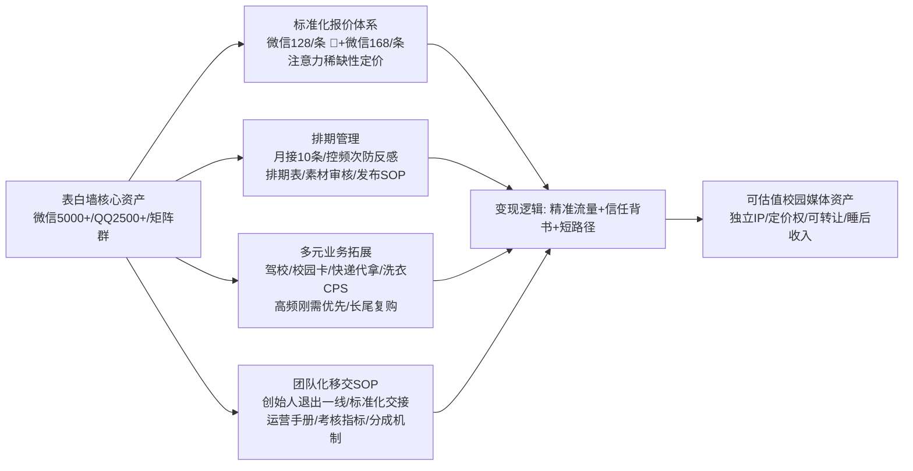

### 关键性质

广告定价基于「注意力稀缺性」：校园垂直流量无替代性，商家议价能力弱。标准化报价体系消除了议价成本，月接 10 条控制频次防用户反感。作者数据：「平时就接一些靠谱的商家推广，每个月大概接十条，一条单微信收费是128加QQ一起，共168/条，持续至今至今七个月。」

业务拓展遵循「高频刚需 > 低频非刚需」：驾校、校园卡、快递代拿、洗衣均为高频复购场景。这些业务本身具备高复购、高 LTV，表白墙仅作精准导流入口。作者操作：「平时帮朋友推广一下驾校和校园卡业务」。

团队化运营：创始人退出一线，通过标准化 SOP 移交运营，实现「睡后收入」。这是从「打工者」到「资产持有者」的关键跃迁。作者状态：「自己也慢慢放手交给团队去运营账号。」

风控教训：曾接单次投票活动广告费估计 1 万 +、用户刷礼物流水 3 万，但因开发商跑路零收入，证实「结算风控 > 流量变现能力」。作者复盘：「很快就接到一个关于投票活动的推广...十天左右的时间，浏览量达到了十几万，广告费都估计一万多了。同学们通过刷礼物的钱，我大致算了一下有近3万...最后礼品邮寄了前七名的礼品（不到两千块的东西），我们一分钱没拿到。」

### 典型例子

> 月接 10 条商单，月流水 1.5-2 万，持续 7 个月验证可持续性。曾接单次投票活动广告费估计 1 万 +、用户刷礼物流水 3 万，但因开发商跑路零收入，证实「结算风控 > 流量变现能力」。——《docs/202303/Qb1ldkXAkoQSbpxr6M8cWibDnXg.md》

### 边界条件

- 严控商单频次与质量，过度商业化导致用户反感、举报、封号，核心护城河即「社交基础设施」属性
- 依赖学校规模与活跃度，小规模/低活跃学校商单天花板极低
- 需建立款项托管/分账/对公打款等结算风控机制，规避「甲方跑路」风险

---

## 49.11 地推裂变模式：「熟人信任 + 即时结算 + 简单 SOP」的最小可行性组织

### 为什么需要这个概念？

校园地推面临「招人难、管人难、信任成本高、执行力不可控」的组织难题。利用宿舍/同学熟人关系降维打击陌生推销信任壁垒，即时现金结算解决代理动力与风控问题。验证了「低门槛、重执行、强现金流」业务模式下，微型团队可快速复制放大。

### 核心定义

**地推裂变模式**（来源：《docs/202303/Qb1ldkXAkoQSbpxr6M8cWibDnXg.md》）

> 宿舍 4-5 人组建微型地推队，单日获单 100 +，单利润 5 元（扣礼品后），人均月入 2000 +。团队负责人抽成 1 元/单，代理无垫资风险、日结现金、简单话术（送礼品 + 加群 + 推销床品）。标准化 SOP：食堂/路边/寝室楼定点摆摊、统一着装/物料、微信群汇报进度、晚间对账分成。

这个模式展示了最小可行性组织的三要素：**熟人强约束 + 现金流正循环 + 标准化动作包**。

### 方法演进图：地推裂变模式组织架构与现金流闭环

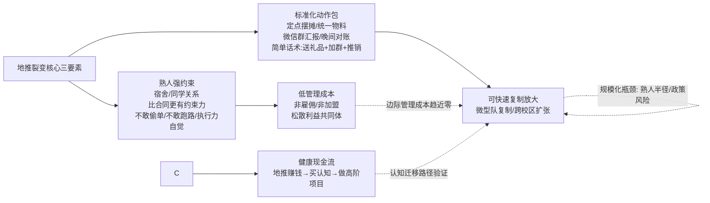

### 关键性质

组织形态：非雇佣制、非加盟制、松散的「利益共同体」，边际管理成本趋近零。无劳动合同、无社保、无固定成本，纯佣金制。

信任基础：熟人社会强约束，代理不敢偷单、不敢跑路、执行力自觉性高。宿舍关系、同学情谊比合同更有约束力。


这一组织模式的核心意义在于：**用最低的管理成本换取最高的执行力，通过现金流的即时闭环解决初创期资金与信任的双重瓶颈。**

### 典型例子


### 边界条件

- 仅适用于「低客单、高频、标品、当面交付」场景（如床品、快递代拿、办卡），高客单/非标服务难复制
- 依赖学校允许地推的政策环境，严管校园商业活动的学校模式失效
- 规模化受限于熟人网络半径，跨校区/跨城市扩张需重新建立信任体系，边际收益递减

---

## 49.12 校园创业「执行力 > 方案，小步快跑验证闭环」铁律

### 为什么需要这个概念？


### 核心定义

**校园创业执行铁律**（来源：《docs/202303/Qb1ldkXAkoQSbpxr6M8cWibDnXg.md》、《docs/202303/20230328_084.md》）


这个铁律揭示了新手创业的正确姿态：**方向大致正确 + 极致执行 + 快速反馈 + 持续迭代 = 结果**。

### 方法演进图：认知迁移路径与MVP验证闭环

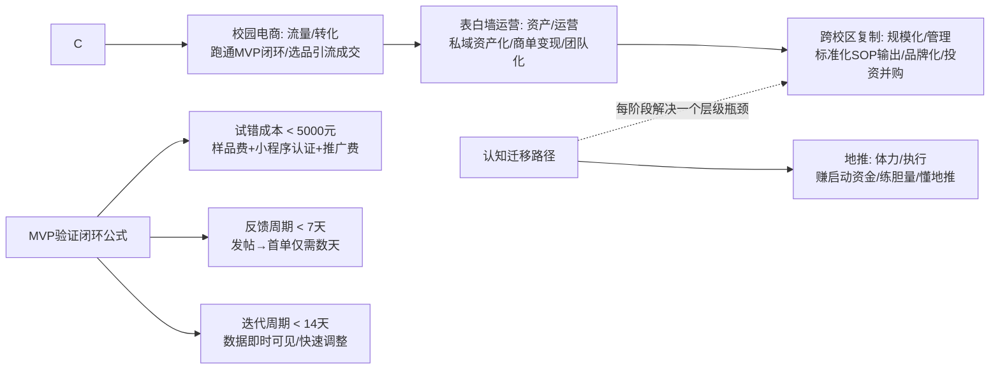

### 关键性质

试错成本极低：床品项目前期仅需垫资样品费、小程序认证费、少量推广费，总投入 < 5000 元。可承受的失败成本是行动的前提。

反馈周期极短：从发布引流贴到首单成交仅需数天，数据即时可见，便于快速调整策略。快速正反馈是持续行动的燃料。


评论区共识强化了这一铁律：「战略规划执行力，缺一不可」。作者自述：「每天都是最晚下班，最早到公司，可也是最焦虑...都是自己一步一个脚印，一点一点积累，一个一个问题回答，一个又一个困难解决，一个坑一个坑踩出来的。」

### 典型例子


### 边界条件

- 仅适用于「可快速验证、试错成本可控、反馈周期短」的轻资产项目
- 重资产/长周期/强合规项目（如医疗、金融、重制造）不可盲目套用「小步快跑」
- 执行力必须建立在「正确方向」之上，盲目执行错误方向只会加速失败

---

## 49.13 生意本质即流量定理

### 为什么需要这个概念？

创业者常陷入产品、技术、团队等细节而忽视流量这一源头活水。无流量则无转化、无成交、无交付、无复购，一切商业闭环的起点都是流量。该定理将复杂商业模型还原为「流量→转化→成交→交付→复购/留存→新客增长」的单一核心链条。

### 核心定义

**生意本质即流量定理**（来源：《docs/202303/NQrwdjKZ4oOEFpxGD1Hcjc9wnwf.md》）

> 所有好生意本质都是流量生意，商业闭环为：流量 → 转化 → 成交 → 交付 → 复购/留存 → 新客增长。流量是启动飞轮唯一钥匙，无流量则无生意。

这个定理把商业还原到最底层：**流量是因，其他皆是果**。

### 公式推导：商业飞轮闭环模型

```
商业闭环 = 流量 × 转化率 × 客单价 × 复购率 × 推荐系数
```

**推导过程：**

1. **流量**：所有商业的起点，无流量则后续环节均为0
2. **转化率**：流量转化为付费客户的比例，取决于信任度、产品匹配度、销售话术
3. **客单价**：单次交易金额，决定单客收入上限
4. **复购率**：老客户再次购买的概率，决定用户生命周期价值(LTV)
5. **推荐系数**：老客带新客的病毒系数，决定有机增长能力

**为什么可以这样变？** 因为商业本质是「用户价值的挖掘与放大」，每个环节都是对前一环节的乘法放大。任一环节为0，总结果为0。流量作为乘法链条的第一个乘数，是启动飞轮的唯一钥匙。

> 这个公式揭示了商业的第一性原理：所有商业动作最终都要回到“如何以可接受成本获取精准流量”这一源头问题上。公域流量边际成本递增、不可控，私域流量边际成本递减、可控、可复利。流量获取成本（CAC）与用户生命周期价值（LTV）的比率决定商业模式生死。

### 关键性质

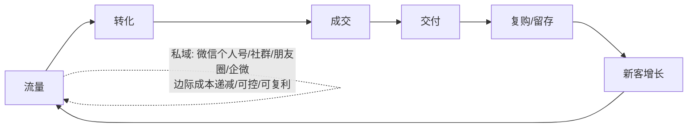

- 流量来源分公域（抖音/小红书/视频号/知乎/百家号等）与私域（微信个人号/社群/朋友圈/企微）
- 公域流量边际成本递增、不可控，私域流量边际成本递减、可控、可复利
- 流量获取成本（CAC）与用户生命周期价值（LTV）的比率决定商业模式生死

### 典型例子

- 校园床品+表白墙模式：公域SEO引流 → 人设信任转化 → 私域沉淀表白墙 → 长尾商单变现
- 视频号带货：短视频爆款引流直播 → 直播承接转化 → 私域沉淀复购 → 利润指数级增长

### 边界条件

- 仅适用于以流量为核心杠杆的轻/中资产模式，重资产/强供应链模式另论
- 流量质量>流量数量，精准流量的转化率与LTV远超泛流量

---

## 49.14 公域引流+私域变现闭环

### 为什么需要这个概念？

公域流量获取成本递增、生命周期短，私域流量可长期运营、高复购、高LTV。微信生态是几乎所有高客单价或长周期项目的最终归宿。需要标准化的引流路径与私域承接容器设计。

### 核心定义

**公域引流+私域变现闭环**（来源：《docs/202303/NQrwdjKZ4oOEFpxGD1Hcjc9wnwf.md》、《docs/202303/Qb1ldkXAkoQSbpxr6M8cWibDnXg.md》）

> 在抖音/小红书/视频号/知乎/百家号等公域平台通过内容/直播/钩子获客，沉淀至微信私域（个人号/社群/朋友圈/企微）完成高客单转化、复购裂变，构建可长期运营、多次变现的用户资产。

这个闭环展示了现代流量生意的标准化拓扑结构：**公域做加法（广撒网），私域做乘法（深挖井）**。

### 方法演进图：公私域联动标准化漏斗

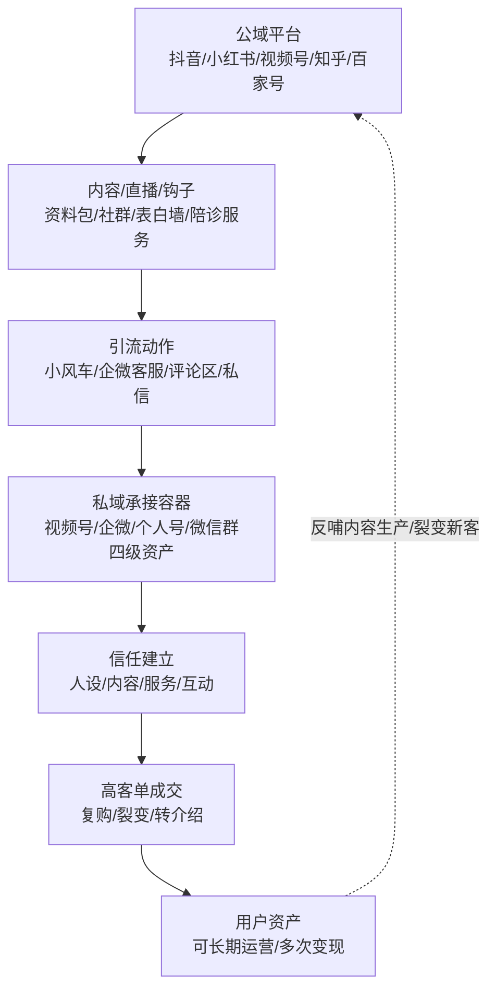

### 关键性质

引流钩子设计：资料包、社群、表白墙、陪诊服务等，钩子价值决定引流转化率。素材中提到：「免费领全套胎教音乐为诱饵，吸引粉丝进群，设置钩子“加好友进孕妈福利群/羊毛群” 进入私域」。

私域承接容器分级：视频号/企微/个人号/微信群四级资产，优先沉淀至可控资产。素材强调：「流量的尽头是微信私域」。

转化路径：公域内容/直播 → 钩子 → 私域加好友/进群 → 信任建立 → 高客单成交 → 复购/裂变。这是所有高客单价或长周期项目的标准化转化路径。

### 典型例子

- 孕晚期准妈妈通过视频号10天涨粉1000+引流私域
- 普通人做小红书0元建社群单月变现8W+
- 抖音直播引流私域6个方法
- 小红书研报账号3周引流私域600+

### 边界条件

- 私域运营需持续投入内容/活动/服务，否则僵尸粉比例上升、活跃度衰减
- 引流动作需合规（如视频号小风车/企微客服），规避外链封杀风险

---

## 49.15 内容生产三阶跃迁：抄-杂交-原创

### 为什么需要这个概念？

零基础创作者无法凭空产出原创爆款，必须站在巨人肩膀上起步。直接创作原创内容成本高、周期长、失败率高，三阶跃迁提供确定性成长路径。素材库积累是核心护城河，实现「捡钱式变现」。

### 核心定义

**内容生产三阶跃迁**（来源：《docs/202303/NQrwdjKZ4oOEFpxGD1Hcjc9wnwf.md》）

> - 初期：直接抄袭竞品爆款内容（一帧一帧像素级模仿）
> - 中期：杂交重组多源素材（标题A+文案B+封面C+选品D）
> - 后期：沉淀原创方法论（结构化SOP、选题逻辑、话术库），实现稳定输出

这个跃迁路径揭示了内容能力的进化规律：**模仿是基础，重组是桥梁，原创是终点**。

### 方法演进图：内容生产三阶跃迁进化路径

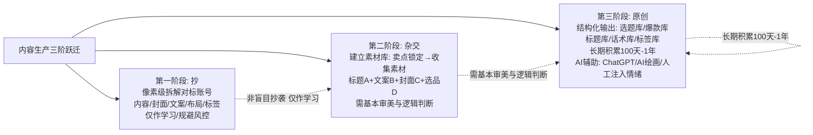

### 关键性质

抄袭非盲目，需像素级拆解对标账号（内容/封面/文案/布局/标签）。素材中小红书无货源案例：「查找对标账号像素级模仿，一帧一帧的比对，一模一样的图片展示引发流量。持续去做。」

杂交需建立素材库：卖点锁定 → 收集相关素材 → 素材多了赚钱就是捡钱。素材原文：「卖点锁定了，跟卖点有关的素材都收集起来。收集的素材多了，赚钱就是捡钱，捡钱就是赚钱。」

原创非凭灵感，而是结构化输出：选题库/爆款库/标题库/话术库/标签库。素材要求：「稳定的输出爆款，就要提前准备10000条行业选题，100条爆过的。」「火过的内容还会在火，重复拍10遍打底」。

### 典型例子

- 小红书无货源像素级模仿：对标账号一帧一帧比对图片/文案/布局
- 视频号矩阵：搬运→混剪→仿拍→实拍原创进化路径
- AI辅助：ChatGPT写文案、AI绘画生成图片，人工注入情绪价值

### 边界条件

- 抄袭阶段需规避版权/平台风控，仅作学习用途不可商用
- 杂交阶段需具备基本审美与逻辑判断能力，纯新手易生成低质内容
- 原创阶段需长期积累（100天-1年），心态急功近利易放弃

---

## 49.16 红利期捕捉与迁移定律

### 为什么需要这个概念？

创业者常追逐过期红利或盲目跟风，缺乏对平台周期的宏观认知。红利期具有确定的时间窗口与演变规律，掌握规律可实现跨平台复利。核心能力非单一平台技巧，而是可迁移的方法论与嗅觉。

### 核心定义

**红利期捕捉与迁移定律**（来源：《docs/202303/NQrwdjKZ4oOEFpxGD1Hcjc9wnwf.md》）

> - 平台红利周期约 1-2 年一次（邮箱/百度/淘宝/拼多多/美团/视频号/小红书）
> - 核心能力：敏锐嗅觉 + 快速执行力 + 方法迁移能力
> - 看到详细教程分享时红利已过，方法论可迁移至下一流量池

这个定律揭示了平台红利的「周期性、可迁移性、教程滞后性」三大特征。

### 方法演进图：红利期演变周期与核心能力三角

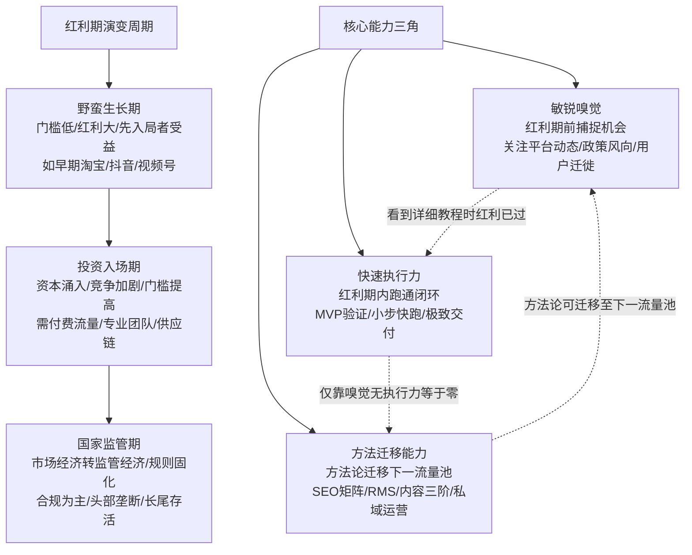

### 关键性质

红利期演变：野蛮生长 → 投资入场 → 国家监管（市场经济转监管经济）。素材原文：「这样的机会，每一两年就会出现一次，需要的就是速度和执行力。 现在就是视频号和小红书两个大平台。」「等你看到别人分享出来详细的内容的时候，说明这个事已经提高门槛或者已经过时了。但是他们的方法是可以迁移到下一个流量池的。」

迁移能力表现为：跨平台方法论复用（如SEO矩阵、RMS模型、内容三阶跃迁）。作者将校园SEO矩阵方法论迁移至小红书、视频号、抖音等平台验证有效。

执行力是捕捉红利的物理前提，认知是认知红利的认知前提。仅靠嗅觉无执行力等于零，仅靠执行无嗅觉易踩坑。

### 典型例子

- 视频号/小红书当前处于红利期，早期入局者已跑通变现闭环
- 方法论从校园SEO迁移至小红书/视频号/抖音等平台验证有效

### 边界条件

- 红利期判断需结合平台政策、竞争格局、用户心智多维度评估
- 方法迁移需适配新平台算法/用户画像/商业规则，非完全照搬
- 仅靠嗅觉无执行力等于零，仅靠执行无嗅觉易踩坑

---

## 49.17 IP崛起三阶段：自说-他说-传说

### 为什么需要这个概念？

个人品牌建设非一日之功，存在客观成长规律，违背规律必遭挫折。三阶段模型提供了可预期的成长路标，避免盲目追求速成。信任是IP变现的核心货币，三阶段对应信任深度的递进。

### 核心定义

**IP崛起三阶段**（来源：《docs/202303/NQrwdjKZ4oOEFpxGD1Hcjc9wnwf.md》）

> - 自说：自我输出内容，建立初步认知（视频>图文、出镜>不出镜）
> - 他说：他人传播背书/引用/推荐，信任外溢（KOL背书、媒体报道）
> - 传说：品牌资产化自传播，用户主动分享/捍卫/传播（无需主动推广）

这个模型描绘了个人品牌从「自证」到「他证」再到「自传播」的信任跃迁路径。

### 方法演进图：IP崛起三阶段信任跃迁模型

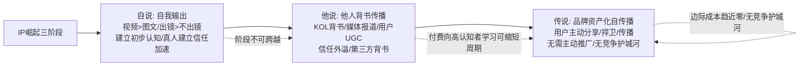

### 关键性质

阶段不可跨越，但可通过付费向高认知者学习缩短痛苦周期。素材建议：「ip崛起的三个阶段：自说，他说，传说」「视频比图文效率高，出镜比不出镜信任高，信任是转化的关键，这个是IP火的原因」。

视频/出镜/真人建立信任效率远高于图文/隐身/虚拟形象。这是信任建立的「媒介效率」差异——视频承载的信息密度（表情、语调、环境、真实感）远超图文，出镜真人比虚拟形象的信任转化率高出数倍。

传说阶段具备「无竞争」护城河，商业变现边际成本趋近零。当品牌成为「传说」，用户主动传播、捍卫、捍卫，品牌方无需投入推广成本即可获得流量，这是商业终局的理想状态。

### 典型例子

- 校园表白墙：从学长人设(自说)→万能墙IP(他说)→校园基础设施(传说)
- 视频号书豪：追热点起号(自说)→垂直IP+团队(他说)→连续年入百万(传说)

### 边界条件

- 仅适用于内容驱动型个人IP，非标服务/重资产模式另论
- 传说阶段需5-10年深耕，一年不赚钱准备是常态

---

## 49.18 私域管理五步法：培育-激活-转化-关怀-复购

### 为什么需要这个概念？

私域运营常陷入「只加人不运营」或「硬广刷屏」的低级玩法。五步法提供标准化运营框架，将私域从流量池升级为资产池。每一步对应具体执行动作与考核指标，可复制、可落地。

### 核心定义

**私域管理五步法**（来源：《docs/202303/NQrwdjKZ4oOEFpxGD1Hcjc9wnwf.md》）

> - **培育**：标签化分层（高意向/普通/流失）、完善用户画像档案
> - **激活**：欢迎语/福利包/新人引导、建立首次互动与情感连接
> - **转化**：低价引流品/阶梯定价/钩子产品、最简单成交是做客户引领者
> - **关怀**：节日问候/专属权益/生日惊喜、维护情感账户与长期信任
> - **复购**：会员体系/裂变激励/转介绍奖励、挖掘老客LTV最大化

这个五步法把私域运营标准化为「用户生命周期管理」的标准动作序列。

### 方法演进图：私域管理五步法用户生命周期闭环

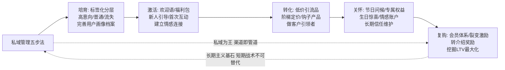

### 关键性质

私域为王、渠道即管道：公域是租来的地，私域是自家的地。素材核心观点：「渠道的意义就在于人家想买的时候就能够买到你...渠道就是联通品牌和消费者之间的管道。」「流量的尽头是微信私域」「私域管理：培育，激活，转化，关怀，复购」「最简单的成交方式是做客户的引领者」。

最简单成交方式是做客户引领者，而非推销员。引领者意味着：你比客户更懂他的痛点、更懂解决方案、更懂避坑路径，你是在「帮他做决定」而非「推销产品」。

五步法是长期主义基石，短期战术无法替代长期运营体系。每一步都需要持续投入，而非一次性动作。

### 典型例子

- 视频号私域：短视频引流 → 直播承接 → 朋友圈种草 → 高客单复购
- 小红书私域：笔记引流 → 群运营 → 朋友圈专栏化 → 阶梯定价变现

### 边界条件

- 仅适用于微信生态私域，其他平台（抖音粉丝群/快手粉丝团）运营逻辑不同
- 需配合CRM/SCRM工具实现规模化，纯手工管理上限约2000人

---

## 49.19 流量获取六大方法论+三渠道矩阵

### 为什么需要这个概念？

单一流量获取手段易失效、天花板低，组合拳提供容错与放大空间。六大战术覆盖流量获取全链路，三渠道适配不同内容生产能力。核心心法：内容即诱饵，价值决定流量成本。

### 核心定义

**流量获取六大方法论+三渠道矩阵**（来源：《docs/202303/NQrwdjKZ4oOEFpxGD1Hcjc9wnwf.md》）

> - **六大战术**：留诱饵/留钩子、共情/共鸣、量变质、打磨IP、做好后端
> - **三渠道**：音频（喜马拉雅）、视频（抖音/快手/视频号/B站/小红书）、图文（知乎/👸号）
> - **矩阵组合**：6战术 × 3渠道 = 18种可落地组合拳

这个矩阵提供了流量获取的「战术×渠道」标准化组合库。

### 方法演进图：流量获取组合拳矩阵全景图

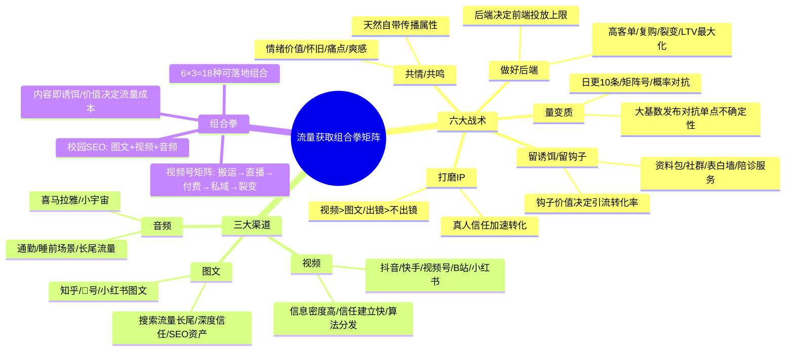

### 关键性质

内容即诱饵：优质内容降低流量获取成本，垃圾内容需付费买量。素材金句：「内容永远是撬动流量最好的杠杆，好内容没有标准，取决于用户审美的进步速率。」「产生优质内容跟平台换流量，产生内容的能力决定了流量成本的高低。」

共情/共鸣：情绪价值内容（如怀旧/痛点/爽感）天然自带传播属性。素材列举：「6个方法论：1. 留好诱饵... 2. 留好钩子... 3. 共情... 4. 量变质... 5. 持续的打磨自己... 6. 做好后端服务...」

量变质：大基数发布（如日更10条/矩阵号）以概率对抗单点不确定性。视频号矩阵案例：「第一步，做大批量的账号（30-60），靠低成本的搬运视频模式...」「做好六个方法论+3个渠道，搞不来流量就没天理了。」

### 典型例子

- 校园SEO矩阵：图文(贴吧/知乎)+视频(抖音/B站)+音频(小宇宙/喜马拉雅)
- 视频号矩阵：30-60号搬运测品 → 筛选优质号升级直播 → 付费流量 → 私域 → 裂变

### 边界条件

- 仅适用于内容驱动型流量获取，付费投流/技术流量另论
- 矩阵运营需团队/工具/RPA支撑，单人上限约3-5账号

---

## 49.20 流量价值分层三阶论：L1空手套白狼→L2平台稳健→L3伟大公司

### 为什么需要这个概念？

创业者常混淆流量变现层级，导致战略错位：想做L3却在做L1的事。三阶论提供清晰的进阶路标与资源配置指引。核心差异在于资产归属权：L1无资产、L2寄生生存、L3自建护城河。

### 核心定义

**流量价值分层三阶论**（来源：《docs/202303/NQrwdjKZ4oOEFpxGD1Hcjc9wnwf.md》）

> - **L1 空手套白狼**：卖别人货（分销/代理/联盟），红利过走人，无资产沉淀
> - **L2 平台稳健生意**：自有产品+平台规则，寄生生存，有品牌但无独立护城河
> - **L3 伟大公司**：流量沉淀自有平台，口碑裂变，建立护城河（如微信/淘宝/字节）

这个分层揭示了商业进化的终局：**从借力到自力，从寄生到生态**。

### 方法演进图：流量价值分层进阶路径

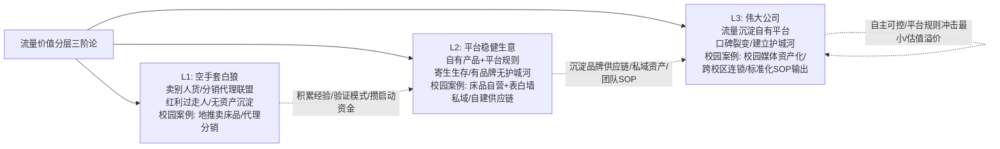

### 关键性质

进阶逻辑：L1积累经验 → L2沉淀品牌/供应链 → L3自建平台/生态。素材原文：「流量变现层级递进：卖别人货红利过走人→自有产品寄生生存→流量沉淀自有平台建护城河；建议追求L2/L3。」

建议追求 L2/L3，L1仅作启动垫板而非长期驻留。作者通过地推（L1）积累启动资金与执行力，转入校园电商自营+表白墙私域（L2），最终规划跨校区复制与媒体资产化（L3雏形）。

平台规则变化对L1冲击最大，对L3冲击最小（自主可控）。这是资产归属权差异带来的抗风险能力分层。

### 典型例子

- 校园模式：地推卖床品(L1) → 床品自营+表白墙私域(L2) → 校园媒体资产化(L3)
- 视频号：带货分销(L1) → 自营供应链+私域沉淀(L2) → 矩阵化+团队化运营(L3)

### 边界条件

- L3需巨额资金/团队/时间，非普通人可企及，建议以L2为战略目标
- 即便达到L3，仍需警惕平台政策/监管风险，无绝对安全

---

## 49.21 刚需/高频/高粘性产品优先论

### 为什么需要这个概念？

选品是创业成败的「一票否决」项，产品属性决定商业模式上限与运营难度。该定律为选品提供可量化的决策标准，规避「好看但不赚钱」的陷阱。核心逻辑：产品属性（刚需/高频/粘性/客单价）决定商业模式可行性边界。

### 核心定义

**刚需/高频/高粘性产品优先论**（来源：《docs/202303/NQrwdjKZ4oOEFpxGD1Hcjc9wnwf.md》）

> - **刚需**：奶粉/考证/祛斑等生命/职业刚性需求，无替代性、决策快、抗周期
> - **高频**：复购周期短（日/周/月），用户习惯养成、LTV高、现金流稳定
> - **高粘性**：低退货率（祛斑30% vs 服饰高退货）、强依赖、转化率高
> - **高客单价**：利润空间覆盖获客成本，支撑付费流量与私域运营投入

这个论断给出了选品的「四维评分卡」：**刚需性 × 频次 × 粘性 × 客单价 = 商业模式上限**。

### 方法演进图：选品四维评分卡与商业模式边界

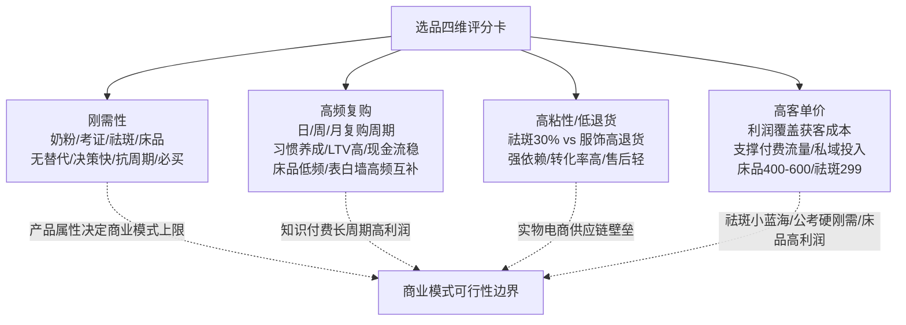

### 关键性质

产品属性决定商业模式上限：知识付费长周期高利润/实物电商供应链壁垒。素材对比：「奶粉是硬通产品，只要有孩子出生就要喝奶粉。属于刚需产品。」「祛斑属于小蓝海，综合退货率30%左右，比较低，产品粘性强，适合做私域。」「公考...教育付费的高利润硬刚需...知识付费变现模式...制作时间比较长，适合长期做。」

校园床品案例完美契合：高客单价（400-600）、高利润（180+）、强刚需（人均1套）、低退货率（标品质量稳定）、集中交付（管理成本低）。但复购频次低（四年一买），需通过表白墙私域资产引入高频业务（快递代拿、洗衣、驾校、校园卡）补足频次短板，实现「单品突破+私域多元变现」的组合拳。

### 典型例子

- 奶粉：硬通产品，有孩子出生就要喝，属于刚需产品
- 祛斑：综合退货率30%左右，比较低，产品粘性强，适合做私域
- 公考/教育付费：高利润硬刚需、知识付费变现模式、制作时间长，适合长期做

### 边界条件

- 仅适用于以产品为核心杠杆的商业模式，纯流量/纯技术模式另论
- 刚需不等于高利润，需匹配转化能力与供应链把控

---

## 49.22 多源对照

### 共识

- **公私域联动是主流变现模型**：三篇素材均验证「公域获客 → 私域沉淀 → 高客单转化 → 复购裂变」为当下最确定的商业闭环。校园案例中：SEO矩阵引流QQ群 → 表白墙沉淀微信 → 床品销售+商单变现；通用案例中：视频号/小红书引流 → 微信私域 → 高客单复购。
- **内容生产遵循「抄-杂交-原创」进阶规律**：《NQrwdjKZ4oOEFpxGD1Hcjc9wnwf.md》 系统阐述，`Qb1ldkXAkoQSbpxr6M8cWibDnXg.md` 校园SEO矩阵实操中体现（贴吧长文→小红书笔记→🧣短文）。
- **执行力大于完美方案**：《Qb1ldkXAkoQSbpxr6M8cWibDnXg.md》 强调「小步快跑验证闭环」，`NQrwdjKZ4oOEFpxGD1Hcjc9wnwf.md` 强调「速度和执行力」捕捉红利，`20230328_084.md` 评论区共识「战略规划执行力，缺一不可」。
- **单品聚焦优于全品类铺货**：校园案例聚焦床品单品跑通闭环；通用案例中祛斑、奶粉、公考均为单品深耕。

### 分歧

- **校园场景 vs 通用场景的策略侧重**：《Qb1ldkXAkoQSbpxr6M8cWibDnXg.md》/`20230328_084.md` 聚焦「时间窗口红利、学长人设、校园SEO、表白墙、最后一公里物流」等校园特有要素；《NQrwdjKZ4oOEFpxGD1Hcjc9wnwf.md》 聚焦「跨平台通用方法论、直播模型、代运营体系、OEM模式」等泛商业要素。
- **冷启动策略差异**：校园表白墙采用「金钱激励+KOL介入」双轨制；《NQrwdjKZ4oOEFpxGD1Hcjc9wnwf.md》 中视频号矩阵采用「30-60号搬运测品→筛选升级→付费流量」三步走，小红书无货源采用「像素级模仿+长尾词布局」，核心逻辑一致（低成本验证→筛选放大）但战术细节因平台属性而异。
- **组织形态差异**：校园地推采用「熟人微型队+日结现金」松散组织；通用代运营采用「前端/全案分层+策划费门槛+电话邀约沙龙」专业服务组织。

---

## 49.23 设计中的取舍

在校园新生季创业实战体系的设计中，面临多个关键决策节点的取舍，每个选择都深刻影响了商业模式的成败。

**为什么不用「全品类铺货」而是「单品突破」？** 全品类铺货看似分散风险，实则稀释了有限的精力、资金与供应链管理能力。床品作为「高客单+高利润+强刚需+标品非标卖+集中交付」的五星级标的，聚焦单品可将资源集中于供应链把控、物流攻关、话术打磨，快速跑通 0-1 闭环。作者实测：300+单床品实现10万+利润，若分散到军训用品、文具、日用品等多个SKU，单品单量不足以建立供应链议价权，物流也无法标准化，最终陷入「多品类都不赚钱」的泥潭。这种设计的 trade-off 是：**得**极致的资源聚焦、供应链议价权、标准化交付体验、快速跑通闭环；**失**抗风险能力较弱（单品依赖）、政策风险暴露（学校强制统一床品即失效）、复购率低（四年买一次）、规模天花板受限于单校新生数量。**对冲**策略是：通过表白墙沉淀私域资产实现流量复利，开发驾校/校园卡/快递代拿等高频业务补足复购缺口，跨校区复制模式突破单校天花板。

**为什么不用「纯付费投流」而是「免费SEO+人设信任」？** 新生季窗口期短（60天）、预算极低（学生创业者）、决策链路短（搜索即购）。付费投流学习成本高、测试周期长、ROI 不确定；免费SEO布局一次受益全周期，学长人设零成本建立最高转化率信任。作者实测：全渠道SEO矩阵零成本获取精准流量3000+ QQ群成员，转化率远超同期投流同行。这是「时间换空间」与「信任换金钱」的学生创业者特有策略。

**为什么表白墙冷启动必须「金钱激励+KOL介入」组合拳？** 单纯金钱激励只能吸引「羊毛党」，2天热度即归零；单纯KOL介入无初始内容支撑，KOL不愿为空号背书。组合拳逻辑：**钱破「零内容」僵局 → KOL破「无氛围」僵局 → 内容飞轮自转**。这是解决 UGC 平台「双边市场冷启动」的标准化打法。金钱激励解决「内容供给」启动问题，KOL介入解决「社交认同」启动问题，二者缺一不可。

---

## 49.24 动手练习

### 练习 1：新生季流量布局实战推演

假设你所在高校今年新生约5000人，开学前60天为作战窗口：

1. 设计一个‘学长学姐’人设的朋友圈/空间内容发布计划（前20天/中间20天/最后20天各3条核心内容主题）
2. 列出你需要布局的5个核心流量平台，并针对每个平台写出1个‘关键词命名策略’和1个‘排名/曝光提升关键动作’
3. 计算：若单套床品利润180元，目标利润5万元，需销量多少？按转化率5%估算，需引流多少精准新生进群？

**回答问题**：
- 为什么说‘前期效果差是常态，后期爆发才是主流’？这与用户决策心理有何关系？
- 如果学校禁止地推、严控贴吧发帖、QQ群排名机制改版，你的Plan B是什么？

> **参考答案要点**：
> 1. 内容计划：前期（信任建立期）发布避坑指南/宿舍实拍/分数线参考；中期（对比决策期）发布床品测评/同学好评/对比图；后期（爆发收割期）发布限时优惠/发货通知/物流时效承诺。
> 2. 五平台：贴吧（关键词：学校名+新生避坑/动作：投资吧主/顶帖）、QQ群（关键词：学校名+202X新生群/动作：资料塞入/养号刷级）、小红书（关键词：学校名+宿舍/床品/动作：封面图+评论区钩子）、🧣（关键词：学校名+新生/动作：超话+置顶）、抖音（关键词：学校名+同城/动作：同城定位+话题标签）。
> 3. 计算：目标销量=50000/180≈278套；需引流精准新生=278/5%=5560人（超新生总数，需提高转化率或利润）。
> 4. 前期效果差因用户处于「不着急」观望期，决策心理演变：不着急→开始对比→必须买；Plan B：重心转向微信生态（视频号/👸号/社群裂变）、校内社团/学长帮代理、线下迎新现场合作。

### 练习 2：表白墙从0到1冷启动方案设计

你刚注册了一个‘某某大学万能墙’微信👸号/视频号，当前零粉丝、零投稿：

1. 设计前3天的‘金钱激励’活动规则（预算100元内），包含奖品设置、参与门槛、引导关注/投稿动作
2. 制定‘KOL邀请名单’筛选标准（在哪找？看什么指标？怎么联系？邀请话术核心钩子是什么？）
3. 规划第4-14天的‘内容运营节奏’：每日发布频次、栏目设置（表白/吐槽/失物/问答/吃瓜）、互动机制（置顶/回复/精选）

**回答问题**：
- 为什么纯金钱激励只能维持2天？KOL介入的核心杠杆作用是什么？
- 如何界定‘过度商业化’的红线？商单频次与用户留存的关系如何量化监控？

> **参考答案要点**：
> 1. 金钱激励：预算100元设「最佳表白奖」20元×1、「最热吐槽奖」10元×3、「参与奖」奶茶券/文创×20人；门槛：关注👸号/视频号+投稿+转发朋友圈；动作：自动回复领奖流程。
> 2. KOL筛选：抖音/小红书搜「学校名+校花/校草/大V」；指标：粉丝>1000、近期活跃、在校生认证、颜值/才艺高；联系：抖音私信/小红书私信；钩子：「邀请你做首批『墙主』/共建校园地标/互推涨粉」。
> 3. 运营节奏：日更3-5条；栏目：表白墙/吐槽大会/失物招领/新生问答/吃瓜爆料/老乡寻组织；互动：每条必回复、精选置顶、周评「本周最佳」发周边。
> 4. 纯金钱激励吸引羊毛党，无社交动机，边际效用递减极快；KOL核心杠杆：社交货币（被围观/身份认同）>经济激励，其粉丝跟随进群实现「借势起号」。
> 5. 红线：月商单≤10条、单条间隔≥2天、拒绝博彩/贷款/擦边；监控：留存率<30%/举报率>1%/打开率下降20%即暂停商单、调整内容比例。

### 练习 3：校园物流攻关与单品交付SOP设计

预计销售300套床品（单件体积大、重），集中在开学前3天到货，校内3个快递站日处理上限各200件：

1. 设计‘利益绑定’话术与成本预算：如何搞定菜鸟/顺丰/邮政站长？烟酒/请客/提成预算各多少？
2. 制定‘外部转运+自建骑手+兜底自运’三级派送方案：中转点选址、骑手招募渠道与日薪、调度微信群SOP、异常处理预案（暴雨/骑手罢工/丢件）
3. 设计客户收货确认与售后标准流程：验货标准、拒收/退换货话术、好评引导钩子

**回答问题**：
- 为什么说‘创始人亲自送货至晚上10点’是最后兜底而非常态？如何量化这个兜底动作的时间成本上限？
- 若学校明年强制统一床品、禁止自带，你的单品突破策略如何平移？

> **参考答案要点**：
> 1. 利益绑定：菜鸟站长（核心）送烟酒500元+请客300元+提成1元/单；顺丰/邮政送烟酒300元+提成0.5元/单；总预算约2000元。
> 2. 三级方案：中转点选校外仓库/空闲教室/创始人宿舍楼下；骑手招募：兼职群/宿舍/社团，日薪150-200元/单提成5元；调度群：派单/确认收货/异常上报/实时定位；预案：暴雨→延迟通知+防水包装/骑手罢工→创始人+舍友兜底/丢件→先行赔付+追责快递站。
> 3. 验货：当面拆箱检查款式/数量/破损/脏污；拒收话术：「亲这是厂家直发/质量问题我们包退换/运费我们出」；好评钩子：好评返现5元/送洗衣液/进VIP群享后续折扣。
> 4. 兜底非常态因创始人时间成本极高（小时折算>利润）、不可复制、不可规模化；量化上限：创始人时薪×兜底小时数<单品利润总额×5%（如时薪200元，兜底不超10小时）。
> 5. 平移策略：转型「床品升级包」（加厚被芯/抗菌枕头/床帘/收纳神器）→「军训必备包」（防晒/速干/鞋垫）→「宿舍神器盲盒」→对接学校后勤谈「个性化定制」入围供应商。

### 练习 4：通用流量变现实战复盘演练

基于‘研究-模仿-超越’(RMS)方法论，选取一个你熟悉的公域平台(抖音/小红书/视频号/知乎/百家号)上的头部账号作为标杆：

1. 拆解其商业模式要素：流量来源、转化路径、产品结构、变现方式
2. 应用‘内容生产三阶跃迁’：抄取3条爆款内容→杂交重组生成3条新内容→尝试原创输出1条内容
3. 设计‘公域引流+私域变现’闭环：钩子设计、引流路径、私域承接容器、转化话术、复购裂变机制
4. 规划‘红利期捕捉与迁移’：当前平台处于红利期哪个阶段？方法论如何迁移至下一流量池？

**回答问题**：
- 为什么说‘看到详细教程时红利已过’？如何在红利期前通过嗅觉捕捉机会？
- 如何判断内容是否具备‘价值杠杆’？火过的内容重拍10遍仍有效的底层逻辑是什么？

> **参考答案要点**：
> 1. 拆解维度：流量来源（搜索/推荐/直播/私域回流）、转化路径（内容→钩子→私域→成交）、产品结构（引流品/爆品/利润品/附属品）、变现方式（直带/私域高客单/广告/代运营）。
> 2. 三阶实操：抄（像素级拆解文案/镜头/音乐/标签）、杂交（标题A+钩子B+结尾C+选品D）、原创（结合用户反馈沉淀选题库/话术库/标签库）。
> 3. 闭环设计：钩子（资料包/社群/工具/体验课）→ 路径（小风车/评论区/私信/主页链接）→ 容器（企微/个人号/群/视频号）→ 话术（引领者而非推销员）→ 裂变（转介绍送权益/分销佣金/会员体系）。
> 4. 红利判断：野蛮生长期（教程少/入局易/自然流量大）→投资期（教程多/付费流量占比高/CPM上涨）→监管期（规则严/头部垄断/长尾难）；迁移核心：RMS模型+内容三阶+私域运营+SEO矩阵。
> 5. 教程滞后性：教程产出需「跑通→复盘→整理→发布」数月，期间红利已衰退；嗅觉捕捉：监控平台政策动向/新功能上线/头部玩家动作/跨平台内容迁徙/早期数据异常（完播率/互动率/转化率远超均值）。
> 6. 价值杠杆判断：解决强痛点/提供稀缺信息/引发强情绪/降低决策成本；火过内容重拍有效因：人性底层需求不变（贪/懒/虚/恐/痒）、新用户持续涌入未看过、算法偏好验证过的内容结构、执行细节差异产生差异化体验。

### 练习 5：IP人设与私域运营沙盘推演

假设你已在某垂类平台(如视频号育儿/小红书职场/知乎好物)建立1000粉丝账号：

1. 定义你的IP人设：核心标签、差异化定位、信任背书来源、人格化表达风格
2. 设计私域管理五步法落地动作：培育(标签/分群)、激活(欢迎语/福利)、转化(低价引流品/阶梯定价)、关怀(节日/专属)、复购(会员/裂变)
3. 应用‘流量获取六大方法论’：为你的账号配置留诱饵/钩子/共情/量变质/打磨IP/做好后端的具体执行动作
4. 规划‘流量价值分层’进阶路径：从L1(卖别人货)→L2(自有产品)→L3(自建平台)的关键节点与资源需求

**回答问题**：
- 为什么说‘渠道即管道，私域为王’？公域流量与私域流量在资产属性上有何本质区别？
- 如何通过‘做客户引领者’实现最简单成交？这与传统推销话术有何不同？

> **参考答案要点**：
> 1. IP人设示例（育儿垂类）：核心标签「二胎宝妈/儿科护士/科学育儿实操派」；差异化「不焦虑/只干货/敢说真话/拒绝智商税」；信任背书「护士证/二胎实战/医院内部视角」；表达风格「语速快/金句多/案例实/接地气/偶尔吐槽」。
> 2. 五步法落地：培育（标签：孕期/0-3岁/3-6岁/二胎/高龄；分群：按阶段/痛点）；激活（欢迎语送《疫苗时间表/辅食日历/睡眠训练表》三件套）；转化（9.9元《科学育儿避坑指南》→299元《全阶段育儿陪跑营》→2999元《1v1定制方案》）；关怀（节日送绘本/生日送体检包/专属客服）；复购（会员制续费/转介绍送课时/裂变拼团）。
> 3. 六大方法论配置：诱饵（全套育儿资料包）、钩子（进群领资料/加微信送方案）、共情（吐槽带娃崩溃瞬间/分享踩坑血泪史）、量变质（日更3条/矩阵3号/测爆款）、IP（出镜真人/穿护士服/医院背景/真实家庭）、后端（课程体系/社群陪跑/1v1咨询/母婴好物店）。
> 4. 进阶路径：L1（选品带货/分销佣金/月入1万验证选品能力）→L2（自研课程/自建供应链/私域沉淀/月入10万验证品牌力）→L3（育儿社区APP/连锁线下门店/品牌孵化/年入千万验证生态力）；关键节点：自有产品上线/私域GMV占比>50%/团队>10人/融资或现金流为王。
> 5. 公域=租来的地（算法变/封号/限流/无触达保障/无资产属性）；私域=自家的地（可控触达/可沉淀资产/可复利/可估值/可转让）；本质区别：所有权与控制权归属。
> 6. 做引领者：帮客户诊断问题→提供方案→对比利弊→推荐最优→陪伴执行；传统推销：吹产品好→催下单→忽略痛点→售后失联。引领者赚「专业费」，推销员赚「差价」。

---

## 49.25 本章小结

这一章中我们学习了校园新生季创业的完整实战体系与通用流量变现的底层逻辑。首先我们拆解了新生季时间窗口红利的三阶段流量曲线与不可逆稀缺性，其次掌握了学长学姐信任背书人设如何用非利益性帮助换取最高转化率信任，接着构建了校园全渠道SEO矩阵覆盖新生搜索路径的每一个入口，然后设计了公域流量向私域（表白墙）沉淀的四级漏斗模型，接着攻克了表白墙冷启动的「金钱激励+KOL介入」组合拳与校园最后一公里物流协同的三级防御体系，之后聚焦单品突破策略锁定床品三件套的高客单高利润强刚需属性，进而将表白墙进化为可估值的校园媒体资产体系，验证了地推裂变模式下熟人信任与即时结算的最小可行性组织，最后内化了执行力大于方案的校园创业铁律。同时我们系统梳理了生意本质即流量定理、公域引流私域变现闭环、内容生产三阶跃迁、红利期捕捉迁移定律、IP崛起三阶段、私域管理五步法、流量获取六大方法论与三渠道矩阵、流量价值分层三阶论、刚需高频高粘性产品优先论等通用流量变现底层逻辑，构建了从校园微观实战到商业宏观认知的完整知识跃迁。

本章我们一起学习了以下概念：

| 概念 | 解释 |
|------|------|
| 新生季时间窗口红利 | 高考后至开学前2-3个月，需求刚性强、决策快、信任成本低、时间不可逆的黄金创业窗口 |
| 学长学姐信任背书人设 | 利用在校生身份以热心学长/学姐身份提供非利益性帮助建立权威信任，顺势转化销售 |
| 校园全渠道SEO矩阵 | 覆盖贴吧、QQ群、小红书、🧣等新生高频搜索平台，通过关键词布局与排名优化截获精准流量 |
| 公域流量向私域沉淀模型 | 以QQ群为过渡池，以‘建学院微信群’为钩子，引导流量沉淀至微信私域（个人号+群聊）构建可复利资产 |
| 表白墙冷启动组合拳 | 前期金钱激励破零，中期引入校内KOL制造社交货币热度，后期建立内容飞轮实现良性循环 |
| 最后一公里物流协同 | 利益绑定快递站长、整合外部运力、组建临时骑手团队、创始人兜底自运，攻克大件集中交付难题 |
| 单品突破策略（床品） | 聚焦高客单、高利润、强刚需、标品非标卖、集中交付的床品单品，极致资源聚焦打造交付体验 |
| 表白墙商业化变现体系 | 标准化报价/排期/拓展（驾校/校园卡/快递/洗衣CPS），团队化SOP移交，打造可估值校园媒体资产 |
| 地推裂变模式 | 宿舍微型队、熟人信任、即时现金结算、简单SOP，验证低门槛重执行强现金流组织形态 |
| 生意本质即流量定理 | 所有好生意本质都是流量生意，商业闭环为流量→转化→成交→交付→复购/留存→新客增长，流量是启动飞轮唯一钥匙 |
| 公域引流+私域变现闭环 | 在抖音/小红书/视频号通过内容/直播/钩子获客，沉淀至微信私域完成高客单转化、复购裂变，流量尽头是微信私域 |
| 内容生产三阶跃迁 | 初期直接抄袭爆款，中期杂交重组多源素材，后期沉淀原创方法论；配合素材库积累实现捡钱式变现 |
| 红利期捕捉与迁移定律 | 平台红利周期约1-2年一次；核心能力非单一平台技巧，而是敏锐嗅觉+快速执行力+方法迁移能力；看到详细教程时红利已过，方法论可迁移至下一流量池 |
| IP崛起三阶段 | 个人品牌成长规律：自我输出→他人传播背书→品牌资产化自传播；视频>图文、出镜>不出镜、真人建立信任加速转化 |
| 私域管理五步法 | 私域为王、渠道即管道；最简单成交方式是做客户引领者，私域管理五步法是长期主义基石 |
| 流量获取六大方法论+三渠道矩阵 | 6大战术(留诱饵/钩子/共情/量变质/打磨IP/做好后端)×3渠道(音频/视频/图文)=可落地组合拳；内容即诱饵，价值决定流量成本 |
| 刚需/高频/高粘性产品优先论 | 选品核心标准：刚需(奶粉/考证/祛斑)>高频复购>低退货率(祛斑30% vs 服饰高退货)>高客单利润空间；产品属性决定商业模式上限 |

下一章中，我们将学习第 50 章的内容（待大纲提供）。


