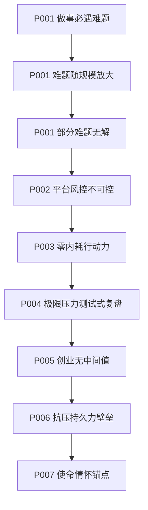
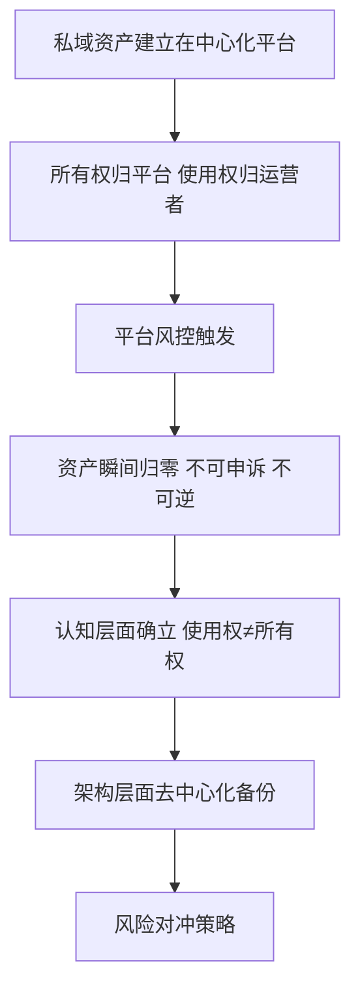
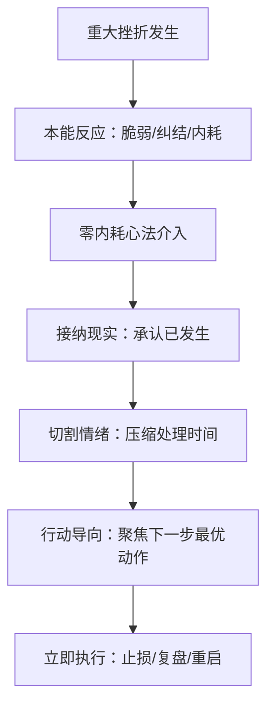
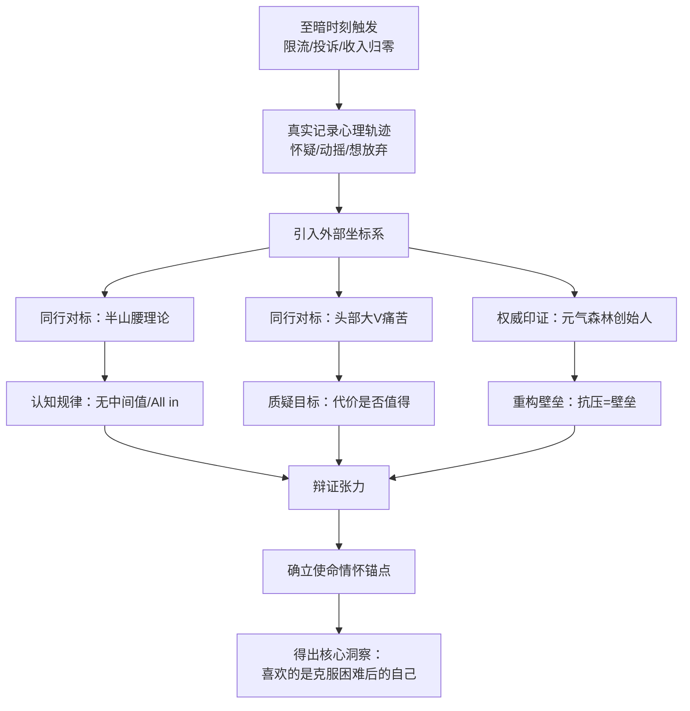
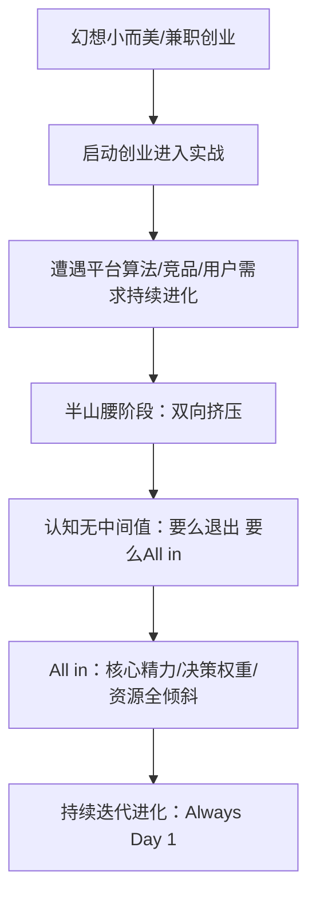
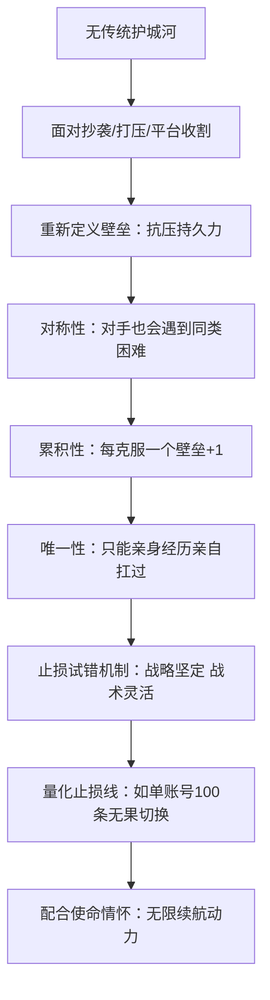
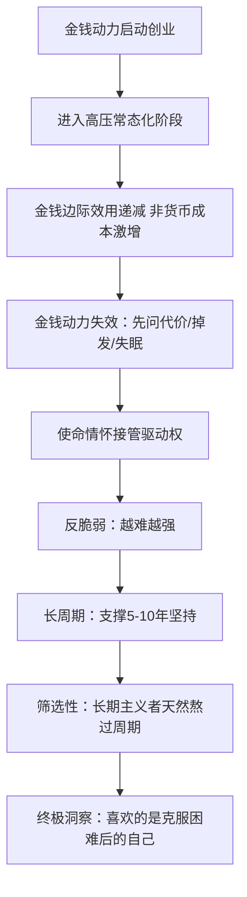

# 第 9 章 实战复盘与风控应对 —— 无脆弱、无纠结、无内耗，干就完了
作者：龙哥

## 学习目标

- 理解做事必然遇到难题且难题随规模放大、甚至存在无解难题的客观规律
- 认清私域流量资产归属权本质：所有权在平台、运营者仅有使用权，需建立去中心化备份思维
- 掌握零内耗行动力核心模型：接纳现实、切割情绪、行动导向，将心理能量 100% 转化为执行能量
- 学会极限压力测试式复盘法：在至暗时刻通过真实记录、同行对标、权威印证完成认知重构
- 确立创业无中间值二元认知：要么不做，要么 All in (Always Day 1)，拒绝“小而美”幻想
- 重新定义普通创业者核心壁垒：抗压持久力（比对手更能扛、活得更久），而非传统资源壁垒
- 建立使命情怀锚点：超越金钱动力的边际效用递减，以虚无缥缈的使命/愿景支撑穿越至暗时刻的无限续航

## 9.1 生活类比

想象创业是一场没有终点线的马拉松，赛道上随机分布着“坑”（难题）和“陷阱”（平台风控）。跑者（创业者）必须主动奔跑（推进事务），跑得越远（规模越大），遇到的坑越深、越多。坑（难题）是赛道标配，有的能填平（可解），有的无底洞（无解/系统性风险），绕不开只能跨过去。陷阱（平台风控）是赛道管理员（平台）随时可能挖的大坑，把你辛苦积累的里程碑（私域资产）瞬间抹零，你只有使用权没有所有权。零内耗心法是掉进坑里不哭不闹不怪路（接纳现实），立刻爬起来拍拍土继续跑（行动导向），情绪处理压缩到极致。抗压持久力不是跑得最快，而是摔得最惨爬得最快、坚持跑完全程的人，最后赢的不是天赋最好而是“比别人多活一天”的人。使命情怀是口袋里那张写着“为什么要跑”的纸条，当腿跑断了、钱花光了、没人喝彩时，只有它能让你再迈出一步。

## 9.2 概念地图

实战复盘与风控应对
├── 环境认知层
│   ├── 做事难题必然性（常态化、规模正相关、部分无解）  —— P001
│   ├── 私域资产归属风险（中心化平台所有权、不可抗力、迁移成本高）  —— P002
│   └── 平台风控不可控性（不讲情面、不通知、不可申诉、不可逆）  —— P001
├── 心智模型层
│   ├── 零内耗行动力（接纳现实、切割情绪、行动导向）  —— P003
│   ├── 创业无中间值/Always Day 1（二元状态、强制进化、双向挤压）  —— P005
│   ├── 抗压持久力壁垒（对称性、累积性、唯一性）  —— P006
│   └── 使命情怀锚点（反脆弱、长周期、筛选性）  —— P007
└── 方法论层
    ├── 极限压力测试式复盘法（真实性、对标性、辩证性）  —— P004
    └── 止损试错机制（战略坚定、战术灵活、量化止损线）  —— P006

## 9.3 做事难题必然性 —— 承认“坑”是路的一部分

### 9.3.1 为什么需要这个概念？

很多新手幻想找到“无坑指南”或“避坑地图”，试图绕过困难直接拿结果。现实是：只要在推进事务，就会持续遭遇新难题，且事业规模越大、难题等级越高。甚至存在根本无解的结构性难题（如平台风控、宏观环境变化），逃避无用，唯有直面。

> "只要在做事，就会不停的遇到新的难题，事情做的越大，要解决的难题就越大，好多问题甚至是无解的。"
> 
> ——《亦仁：生财有术新一期拉新复盘》（P001 / docs/202303/20230328_033.md）

这段话直接指出了做事的底层规律：难题不是异常，是标配。你想做大事，必遭大难题；不想遭难题，只能做小事甚至不做。这个认知能帮你把“为什么是我”转化为“既然来了，怎么解决”。

### 9.3.2 核心定义与关键性质

**做事难题必然性**（来源：《亦仁：生财有术新一期拉新复盘》P001 / docs/202303/20230328_033.md）

定义：推进事务过程中，难题持续涌现、规模正相关、部分无解的客观规律。

核心变量：
- 事务规模（正相关）
- 难题可解性（部分为零）
- 心理预期（常被低估）

这个定义展示了难题与事务规模的正相关关系，以及“无解难题”作为系统性风险的必然存在。

**定义的作用**：该定义将“遭遇难题”从异常状态还原为常态规律，揭示了事务规模与难题等级的正相关性，并点明“无解难题”是系统性风险的必然组成部分，为后续心智建设（零内耗、抗压壁垒、使命锚点）提供了认知前提。

关键性质：
难题具有常态化特征，即难题非异常状态，而是执行过程的标配；具有规模正相关特征，即想做大事必遭大难题，不想遭难题只能做小事甚至不做；具有部分无解特征，即存在系统性风险（如平台封号），无法通过技术手段规避，只能通过策略对冲。

### 9.3.3 典型例子与边界条件

**典型例子**：
生财有术新一期拉新：预约群达 6000+ 人规模，看似胜利在望，实则触发微信风控导致群全封、核心账号永封、损失数万好友。元气森林创始人坦言：创业者都没硬壁垒，会持续被打，唯一的壁垒是比对手更能扛（来源：《刘晨昊：创业至暗时刻复盘》P002 / docs/202303/20230328_036.md）。

> "结果昨天触发微信风控，群都被封了。昨天鱼丸也被莫名其妙永封了好几个号，失去了几万个好友。"
> 
> ——《亦仁：生财有术新一期拉新复盘》（P001 / docs/202303/20230328_033.md）

这个案例展示了“规模越大、难题越大”以及“平台风控属于无解难题”的双重打击。

**边界条件**：
仅适用于“主动推进事务”的主体，躺平者不产生新难题（但面临被淘汰的大难题）；无解难题的比例随系统复杂度上升（如依赖平台生态、涉及重监管行业）；认知该规律不等于拥有解题能力，仅是心智建设的前置条件。

### 9.3.4 方法演进图

## 9.4 私域资产归属权 —— 你的私域其实是“租来的”

### 9.4.1 为什么需要这个概念？

运营者习惯称微信群、好友、账号为“我的私域资产”，产生控制权错觉。忽视了底层基础设施（微信）掌握在平台手中，规则变更、风控触发时，资产瞬间归零。必须在认知层面确立“使用权≠所有权”，才能在架构层面做去中心化备份与风险对冲。

### 9.4.2 核心定义与关键性质

**私域资产归属风险**（来源：《亦仁：生财有术新一期拉新复盘》P001 / docs/202303/20230328_033.md）

定义：建立在中心化平台（微信/抖音/小红书）之上的流量池（群、好友、账号、数据），所有权与最终控制权归平台，运营者仅拥有阶段性、可撤销的使用权。

这个定义揭示了私域资产“伪所有权”的本质，也是后续去中心化备份策略的认知前提。

关键性质：
私域资产具有不可抗力特征，即平台风控不讲情面、不通知、不可申诉、不可逆；具有资产脆弱性，即单点故障导致全盘崩塌（如核心号被封、总群被封）；具有迁移成本高特征，即好友关系链、群组织结构、历史信任沉淀难以在新账号/新平台低成本复现。

### 9.4.3 典型例子

亦仁团队拉新群 6000+ 人被封、核心运营号“鱼丸”多号永封、数万好友归零。评论区成员“盐铁”呼吁：有没有方法导出微信好友，找回未来的生财大军（反映资产被锁定的无力感）。

> "盐铁 : 有没有方法可以导出微信好友，找回咱未来的生财大军！"
> 
> ——《亦仁：生财有术新一期拉新复盘》（P001 / docs/202303/20230328_033.md）

这个呼声直接暴露了私域资产“不可导出、不可迁移”的硬伤。

### 9.4.4 方法演进图

### 9.4.5 边界条件

企业微信/视频号等官方工具虽提供部分数据导出能力，但核心社交图谱仍受管控。去中心化协议（如 Nostr、Lens、Farcaster）理论上解决归属权，但当前用户迁移成本极高、生态未成熟，相关实证研究（如《SoK: Decentralized Social Networks》及 a16z 研报）显示其用户留存率与图谱可携带性仍面临显著摩擦。合规经营可降低触发概率，但无法消除平台单方面修改规则导致的系统性风险。

## 9.5 零内耗行动力 —— 情绪不解决问题，行动才能

### 9.5.1 为什么需要这个概念？

面对群被封、号被封、损失数万好友等重大挫折，人类本能反应是脆弱（自我怀疑）、纠结（反复复盘）、内耗（情绪消耗）。这些情绪反应零产出，反而延误了止损、复盘、重启的黄金时间窗口。必须建立“接受现实 → 调整策略 → 立即执行”的条件反射，将心理能量 100% 转化为行动能量。

### 9.5.2 核心定义与关键性质

**零内耗行动力**（来源：《亦仁：生财有术新一期拉新复盘》P001 / docs/202303/20230328_033.md）

定义：面对不可控重大挫折时，不产生脆弱/纠结/内耗等负面情绪消耗，立即接受既定事实，将认知带宽全部释放给“下一步怎么干”的执行特质。

这个定义展示了从情绪反应到执行反应的认知重构路径。

关键性质：
零内耗行动力包含接纳现实，即不问“为什么是我”，只认“已经发生了”；包含切割情绪，即将情绪处理时间压缩至极限（分钟级），甚至直接带着情绪干活；包含行动导向，即唯一关注点是“当前资源下，能做的最优动作是什么”。

### 9.5.3 典型例子

亦仁面对拉新群全封、核心号全封：“没有脆弱没有纠结没有内耗，干就完了，继续前进”。团队协作层面：成员“六妹”见证团队“完全没有内耗，没有沮丧，只有办法和行动”。

> "没有脆弱没有纠结没有内耗，干就完了，继续前进。"
> 
> ——《亦仁：生财有术新一期拉新复盘》（P001 / docs/202303/20230328_033.md）

> "六妹 : 一起参与其中，团队完全没有内耗，没有沮丧，只有办法和行动"
> 
> ——《亦仁：生财有术新一期拉新复盘》（P001 / docs/202303/20230328_033.md）

这两段原文分别展示了创始人层面和团队层面的零内耗实证。

### 9.5.4 方法演进图

### 9.5.5 边界条件

非逃避复盘：事后必须复盘技术原因（如拉新动作触发风控阈值），但复盘与情绪内耗是两码事。非盲目蛮干：行动基于对现状的理性评估（剩余账号、可用渠道、时间窗口），非情绪化冲锋。需要长期心智训练支撑：平时练习“小挫折零内耗”，关键时刻才能“大挫折不崩塌”。

## 9.6 极限压力测试式复盘 —— 在自我怀疑中提炼底层逻辑

### 9.6.1 为什么需要这个概念？

创业/做事过程中，认知重构往往发生在“至暗时刻”（收入归零、被平台打压、遭恶意攻击、自我彻底怀疑）。舒适区的复盘只能产出“正确的废话”，唯有极限压力下的诚实记录与思辨，能提炼出可迁移的底层逻辑。需要一套方法论：将主观痛苦客观化、将个案经验普遍化、将模糊感受结构化。

### 9.6.2 核心定义与关键性质

**极限压力测试式复盘法**（来源：《刘晨昊：创业至暗时刻复盘》P004 / docs/202303/20230328_036.md）

定义：第一人称记录真实创业节点（离职/限流/投诉/收入归零）的心理轨迹，引入同行对标与权威观点印证，在自我怀疑与释怀的张力中完成认知重构（无中间值/壁垒本质/动机重构）。

这个定义展示了复盘的三大支柱：真实记录、外部对标、辩证重构。

关键性质：
极限压力测试式复盘法具有真实性，即记录丑陋、软弱、动摇、甚至想放弃的真实念头，不美化、不事后诸葛亮；具有对标性，即引入同阶段同行（如 90 后社群创业者焦虑出海）、头部大 V（40w 粉付出代价）、权威观点（元气森林创始人）作为外部坐标系；具有辩证性，即在“怀疑初衷→认知规律→观察同行痛苦→引入权威重构→确立使命锚点”的张力中完成跃迁。

### 9.6.3 典型例子：刘晨昊的认知跃迁路径

刘晨昊复盘全过程：

1. **事实触发**：因职场 PUA 离职 → 小红书限流收入断崖 → 怀疑初衷想放弃
2. **同行对标**：聊天得知“半山腰”理论 → 对标头部大 V 痛苦质疑目标
3. **权威印证**：引入元气森林创始人“抗压=壁垒”观点
4. **认知重构**：释怀确立“使命情怀”锚点 → 得出“我们喜欢的是克服困难后的自己”

> "今年 2 月初我做了一个自己的社群...3 月初开始，整个小红书账号被限流...收入自然也是断崖式的下跌"
> 
> "今天中午和一个科技公司的创始人聊天...今天我们社群里还聊到了一个同样的 90 后社群创业者...上周我的社群请来了小红书 40w 粉丝的直播带货大 v"
> 
> "元气森林创始人最近发的视频号火了...然后我就释怀了"
> 
> "创业这件事情，好像没有中间值，你要么不做，要做就要 all in"
> 
> "我们普通人能做的创业项目其实是没有壁垒的，出来后被抄袭被打压一定是正常的"
> 
> "其实创业者还是需要一些使命情怀愿景的，因为只有这些虚无缥缈的东西才会支撑你度过一个又一个至暗时刻"
> 
> "我们也许喜欢的都不是钱，是那个克服一个又一个困难的自己吧"
> 
> ——《刘晨昊：创业至暗时刻复盘》（P004 / docs/202303/20230328_036.md）

这段长对话展示了从“至暗时刻”到“认知重构”的完整心理轨迹，是极限压力测试式复盘的教科书级案例。

### 9.6.4 流程图：复盘过程中的认知流转

### 9.6.5 边界条件

仅适用于已投入实战、遭遇实质性挫折的主体，旁观者无法触发同等认知强度。需具备基础认知储备（如知晓“半山腰”、“Always Day 1”等概念），否则极限压力只会导致崩溃而非重构。复盘产出的底层逻辑需在后续实战中反复验证，否则仅是事后合理化的叙事。

## 9.7 创业无中间值 —— 要么不做，要么 All in

### 9.7.1 为什么需要这个概念？

很多新手幻想“小而美”、“兼职创业”、“赚点零花钱就收手”，追求舒适区中间值。现实是：创业一旦启动，即进入“Always Day 1”模式，每天被迫解决新问题、不断迭代自我，不存在稳态。认清“无中间值”，能让人在启动前校准预期，启动后拒绝幻想“歇会儿”，只能全力以赴。

### 9.7.2 核心定义与关键性质

**创业状态二元论**（来源：《刘晨昊：创业至暗时刻复盘》P004 / docs/202303/20230328_036.md）

定义：创业不存在舒适的中间状态，要么不做（零投入、零风险、零收益），要么 All in（全身心投入、持续迭代、被迫成长）。

这个定义展示了创业状态的二元性质，打破了“小而美”的幻觉。

关键性质：
创业状态二元论包含强制进化，即平台算法迭代、竞争对手进化、用户需求升级，倒逼创业者必须同步进化，停滞即退场；包含双向挤压，即半山腰阶段，比你小的嫉妒攻击、比你大的降维打击，不做大就只能死；包含无兼职选项，即兼职/半退休是伪命题，要么不做，要做就要 all in。

### 9.7.3 典型例子

刘晨昊：起初只想做小生意赚稳定钱，发现“一旦创业，真的就是 always day 1，每天都必须被迫不断解决新的问题、不断迭代自己”。头部大 V（40w 粉）：为增长陷入焦虑、疯狂输出、做线下活动、甚至想出海洗海外市场，付出远超想象。

> "创业这件事情，好像没有中间值，你要么不做，要做就要 all in"
> 
> "他说他起初也就想做个小生意...结果会发现一旦创业，真的就是 always day 1，每天都必须被迫不断解决新的问题、不断迭代自己"
> 
> "长期来看，其实很难存在小而美的生意模式的，因为你小你压根也不赚什么钱，你最后会放弃；你不做大呢其实你会一直被人干，只要你想做这个事儿，你就必须逼自己不断的成长"
> 
> ——《刘晨昊：创业至暗时刻复盘》（P004 / docs/202303/20230328_036.md）

这段对话揭示了“小而美”是不存在的稳态，创业者被环境强制推向 All in。

### 9.7.4 方法演进图

### 9.7.5 边界条件

适用于平台型、个人 IP 型、高不确定性创业模式；重资产、强牌照、强监管的传统实体生意可能存在相对稳态。管理学与经济学文献（如 Effectuation 理论与 Causal 理论的对比，Teece 2007、Sull 2009 关于高不确定性环境下动态能力的研究）证实：平台型创业面临的不确定性显著高于传统实体，其生存逻辑遵循“涌现式战略”而非“因果式规划”。“All in”非指盲目拼命，指“核心精力、决策权重、资源优先级”全倾斜，而非物理时间的 24 小时工作。启动前必须评估：我是否接受“未来 3-5 年无舒适期、持续高强度解题”？不接受则不建议启动。

## 9.8 抗压持久力壁垒 —— 比对手多活一天，就是赢

### 9.8.1 为什么需要这个概念？

普通创业者缺乏专利、技术、品牌、资金等传统护城河，面对抄袭、打压、平台收割显得赤裸裸。传统壁垒理论导致新手陷入“找壁垒”焦虑，实则在高不确定性环境下，唯一可控、可积累、不可复制的壁垒是生存韧性。将“壁垒”重新定义为“抗压持久力”，能极大降低新手认知负担，聚焦核心变量：活下来、扛过去。

### 9.8.2 核心定义与关键性质

**抗压持久力壁垒**（来源：《刘晨昊：创业至暗时刻复盘》P006 / docs/202303/20230328_036.md &《元气森林创始人观点》P002）

定义：对于无硬核护城河的普通创业者，核心壁垒不是“拥有什么稀缺资源”，而是“比竞争对手更早、更狠地克服同类困难”所形成的生存韧性与经验资产。

这个定义将壁垒从“静态资产”重构为“动态能力”，极具实战指导意义。

关键性质：
抗压持久力壁垒具有对称性，即你遇到的困难，竞争对手迟早也会遇到；你先克服、克服得更彻底，就是建立壁垒；具有累积性，即每克服一个“自认为克服不了”的难题，壁垒厚度 +1，形成复利；具有唯一性，即无法购买、无法复制、无法外包，只能亲身经历、亲自扛过。

### 9.8.3 典型例子

元气森林创始人：创业者都没壁垒，会持续被打，唯一壁垒是比对手能扛；克服那些你认为克服不了的问题，你就有了壁垒了（来源：《刘晨昊：创业至暗时刻复盘》P002 / docs/202303/20230328_036.md）。刘晨昊：人生在世，主打一个比谁活的更久，比谁更能抗下去（来源：《刘晨昊：创业至暗时刻复盘》P006 / docs/202303/20230328_036.md）。

> "元气森林创始人最近发的视频号火了，大概讲的就是创业者其实都没什么壁垒，你会持续被打，你唯一的壁垒就是你比你对手能扛。现在你遇到的所有困难，也是你竞争对手之后也会遇到的事，当你克服了那些你认为克服不了的问题，你就有了壁垒了"
> 
> "我们普通人能做的创业项目其实是没有壁垒的，出来后被抄袭被打压一定是正常的"
> 
> "人生在世，主打一个比谁活的更久，比谁更能抗下去"
> 
> ——《刘晨昊：创业至暗时刻复盘》（P002/P006 / docs/202303/20230328_036.md）

这三段原文分别从权威观点、创业者自述、实战心法三个维度确立了“抗压持久力=核心壁垒”的定论。

### 9.8.4 方法演进图

### 9.8.5 边界条件

非盲目硬抗：需结合“止损试错机制”（如单账号 100 条无果切换项目），在战略方向正确的前提下战术灵活抗压。该止损阈值来源于作者实战经验值，理论上可参照 Eric Ries《精益创业》中“创新会计/最小可行性产品迭代周期”及敏捷开发 Sprint 复盘节奏：在单一战术通道（如单账号内容分发）投入标准化迭代周期（100 条内容/约 2-3 个 Sprint）仍无正向反馈时，应判定该战术失效并切换，而非盲目坚持。非自我感动：抗压的终点是“克服困难后形成的新能力/新资源/新认知”，而非单纯熬时间。需配合“使命情怀”锚点：纯靠意志力抗压会枯竭，唯有使命/情怀提供无限续航动力。

## 9.9 使命情怀锚点 —— 穿越至暗时刻的无限续航燃料

### 9.9.1 为什么需要这个概念？

金钱动力具有边际效用递减、高非货币成本（掉发、失眠、焦虑）、在至暗时刻易失效的特点。创业周期长、波动大，需要一种虚无缥缈但功能极强的内在锚点，支撑穿越一个个“至暗时刻”。使命/情怀/愿景虽不可触摸，但具备无限续航力，是长期主义者的核心燃料。

### 9.9.2 核心定义与关键性质

**使命情怀锚点**（来源：《刘晨昊：创业至暗时刻复盘》P007 / docs/202303/20230328_036.md）

定义：超越金钱层面的、具有超越性意义的内在驱动力（使命/情怀/愿景/价值观），在金钱边际效用递减、非货币成本高企的至暗时刻，提供无限续航动力，支撑创业者持续克服困难、形成层层壁垒。

这个定义揭示了使命情怀作为“反脆弱燃料”的独特机制。

关键性质：
使命情怀锚点具有反脆弱特征，即越是艰难时刻，使命感越能激发潜能（金钱动力相反）；具有长周期特征，即支撑 5-10 年甚至更长周期的坚持，而非短期冲刺；具有筛选性，即能被使命驱动的人，天然具备长期主义特质，更易熬过周期。心理学与组织行为学实证研究（如 Ryan & Deci 的自我决定理论、Baumeister 的意义感心理学、Grant 2008 及 Rosso et al. 2010 关于“Prosocial Motivation / Mission-Driven Work”的研究）证实：内在意义感驱动的韧性显著强于外部奖赏驱动，且使命导向能有效筛选出长周期生存者。

### 9.9.3 典型例子

刘晨昊：起初觉得使命情怀“无聊甚至无病呻吟”，至暗时刻才发现“只有这些虚无缥缈的东西才会支撑你度过一个又一个至暗时刻”。从“给 1000 万让我干啥干啥”转变为“先问代价/吃苦/掉发/失眠”，实证金钱动力在高压下的边际替代率上升。

> "我起初看到这个题目时我觉得无聊甚至无病呻吟...但是站在当下这个节点，我确实觉得我会先问一句：需要我具体付出多大代价？吃多少苦？掉多少头发？一夜不眠多少次？"
> 
> "其实创业者还是需要一些使命情怀愿景的，因为只有这些虚无缥缈的东西才会支撑你度过一个又一个至暗时刻，克服一个又一个困难，最后形成你自己的一层又一层壁垒"
> 
> "我们也许喜欢的都不是钱，是那个克服一个又一个困难的自己吧"
> 
> ——《刘晨昊：创业至暗时刻复盘》（P007 / docs/202303/20230328_036.md）

这段心路历程展示了金钱动力在高压下失效、使命情怀接管驱动权的完整切换过程。

### 9.9.4 方法演进图

### 9.9.5 边界条件

非空谈情怀：使命必须转化为具体的“帮谁、解决什么问题、创造什么价值”，否则是自我感动。非排斥赚钱：赚钱是验证价值、维持生存、复投资源的必要手段，使命决定方向，赚钱保障续航。需真实信仰：伪装的使命在至暗时刻会瞬间崩塌，只能源于真实的认知与体验。

## 9.10 多源对照

### 9.10.1 共识

两份素材在核心认知上高度一致。首先，难题常态化：P001 与 P002 均确认“做事必遇难题、规模越大难题越大、存在无解难题”。其次，私域资产不归个人：P001 实证微信风控导致群封号封、好友归零；P002 隐含平台依赖风险。再次，零内耗/行动力是核心：P001 提出“无脆弱无纠结无内耗，干就完了”；P002 团队层面印证“完全没有内耗，只有办法和行动”。此外，创业无中间值：P002 明确“创业没有中间值，要么不做，要么 All in”；P001 隐含“继续前进”即 All in。抗压=壁垒：P002 引用元气森林创始人观点确立“抗压持久力=唯一壁垒”；P001 隐含“继续前进”即抗压。最后，使命情怀支撑长周期：P002 明确“只有虚无缥缈的使命情怀才能支撑穿越至暗时刻”。

### 9.10.2 分歧

两份素材在关注维度与理论深度上存在显著差异。复盘颗粒度上，P001（亦仁视角）聚焦单点事件复盘（拉新被封），结论导向行动；P002（刘晨昊视角）覆盖全周期心路历程复盘（离职→限流→投诉→重构），结论导向认知重构。壁垒定义来源上，P001 隐含在“继续前进”中，非显性理论化；P002 显性引用元气森林创始人，理论化为“抗压持久力壁垒”。动机层级上，P001 未展开，隐含“赚钱/成长”双重动力；P002 显性解构：金钱动力失效→使命情怀接管→终极动机是“克服困难后的自己”。应对无解难题上，P001 采用策略对冲（换号、换渠道、继续干）；P002 采用认知重构（接受无解、重新定义壁垒、锚定使命）。团队视角上，P001 评论区“六妹”印证团队零内耗；P002 无团队协作视角，聚焦个体心智进化。

## 9.11 设计中的取舍

为何不采用“避坑指南/完美规划”方案？因为高不确定性环境下，不确定性来源（平台算法、竞品动作、宏观政策、用户心理）具有不可预测性、不可控性、不可复制性。任何试图通过“完美规划”规避所有坑的方案，本质是试图用有限认知控制无限变量，必然失败。这种设计的 trade-off 是什么？获得：心理韧性（接受无解）、行动速度（零内耗）、核心壁垒（抗压持久力）、无限续航（使命情怀）。失去：安全感幻觉（以为能避开所有坑）、舒适区幻想（小而美）、短期效率（需投入大量试错成本）、确定性收益预期。核心洞察：不确定性环境下，唯一的“确定性”是“持续遭遇不确定性”。与其花费精力试图消除不确定性，不如建立“在不确定性中高效前进”的心智与体系。

## 9.12 动手练习

### 练习 1：复盘一次真实的“至暗时刻”

回顾你经历过的一次重大挫折（项目失败、账号被封、核心客户流失、收入归零等），按以下步骤书面复盘：

1. **事实还原**：发生了什么？损失量化多少？当时的第一反应念头是什么？
2. **情绪审计**：你经历了“脆弱/自我怀疑”、“纠结/反复复盘”、“内耗/情绪消耗”哪些阶段？各持续多久？
3. **行动切割**：你何时从情绪切换到“下一步怎么干”？中间隔了多长时间？
4. **认知重构**：事后你引入了什么外部坐标系（同行案例、权威观点、理论模型）来理解这次挫折？
5. **底层逻辑提炼**：这次经历让你确立/修正了什么核心认知？（如：壁垒本质、动机层级、生存法则）

**回答问题**：
- 如果下周同等挫折再次发生，你的“情绪处理时间”能否压缩至小时/分钟级？
- 你目前的“使命情怀锚点”是什么？它能支撑你在无收入、被攻击、想放弃的时刻继续前行吗？

### 练习 2：私域资产“去中心化”压力测试

假设你的核心微信账号此刻永久封禁、所有社群被解散、好友关系链归零，请在 30 分钟内完成：

1. **资产盘点**：列出当前所有私域资产载体（个人号、企微、视频号、👸号、社群、邮件列表、电话簿等）及各自粉丝/用户规模
2. **归属权标注**：对每个载体标注“平台所有/我仅有使用权”或“我掌握所有权（如自建数据库、去中心化协议账号）”
3. **迁移预案**：为“平台所有”的核心资产设计最小可行性迁移方案（如：企微好友导出→导入新号/邮件通知→引导加新号/社群公告→迁移）
4. **容灾演练**：选定 1 个高价值社群/好友列表，**实际操作一次**“不依赖原平台功能”的触达/迁移测试（如：导出 CSV→群发邮件/短信→统计到达率）。**提示：此为实操演练，需预留实际操作时间。**

**回答问题**：
- 你的核心用户资产中，有多少比例是“真正归我所有” vs “租住在平台上”？
- 如果明天微信彻底不可用，你能在 24 小时内恢复与前 20% 核心用户的联系吗？关键瓶颈在哪里？

### 练习 3：“创业无中间值”决策模拟

你正考虑启动一个副业/创业项目（如：做小红书带货、开发 AI 工具、运营同城服务等），请进行以下“二元决策”压力测试：

1. 写下你对这个项目的“小而美”幻想预期（如：兼职做、月入 3-5 万、不招人、不露脸、轻松愉快、随时可停）
2. 对照“Always Day 1”现实清单逐项核销：
   - 每天必须产出内容/解决新问题/迭代自我，不可暂停
   - 平台算法/竞品/用户需求持续进化，你不进化即退场
   - 前 1-2 年大概率无稳定收入，需投入大量时间/精力/金钱
   - 会遭遇恶意投诉/限流/封号/抄袭/攻击，无法完全规避
   - 唯一壁垒是“比对手更能扛”，需亲自克服自认为克服不了的难题
3. **动机校准**：若去掉“赚钱”这个选项，你仍愿意为“帮谁解决什么问题”坚持 3-5 年？该使命是否足以支撑你在至暗时刻不放弃？
4. **二元决策**：基于以上现实，你选择“不做”还是“All in”？若 All in，你的“止损线”在哪里？（如：连续 6 个月无正反馈、投入超预算 2 倍、核心账号被永封）

**回答问题**：
- 你的“小而美幻想”中，哪 3 项最不符合“Always Day 1”铁律？
- 你的“使命情怀”能否通过“给 1000 万让你干这事，你先问代价/吃苦/掉发/失眠”的极限拷问？

## 9.13 本章小结

这一章中我们学习了在高不确定性环境下的生存哲学。首先，我们认清了**做事难题必然性**：只要推进事务，难题就是常态，且随规模放大、部分无解，这是客观规律而非异常。其次，我们看透了**私域资产归属风险**：建立在微信等中心化平台之上的流量池，所有权在平台、运营者仅有可撤销使用权，随时面临归零。接着，我们掌握了**零内耗行动力**：面对重大挫折不产生脆弱/纠结/内耗，立即接受现实、调整策略、继续前进，将心理能量 100% 转化为执行能量。然后，我们学会了**极限压力测试式复盘法**：在至暗时刻通过第一人称真实记录、同行对标、权威印证，在自我怀疑与释怀张力中完成认知重构。最后，我们确立了三大核心心智锚点：**创业无中间值**（要么不做，要么 All in）、**抗压持久力壁垒**（比对手更能扛、活得更久）、**使命情怀锚点**（超越金钱边际效用递减的无限续航燃料）。

本章我们一起学习了以下概念：

| 概念 | 解释 |
|------|------|
| 做事难题必然性 | 推进事务中难题持续涌现、随规模放大、部分无解，是客观规律而非异常 |
| 私域资产归属风险 | 微信群/好友/账号所有权归平台，运营者仅有可撤销使用权，随时面临归零 |
| 零内耗行动力 | 面对重大挫折不产生脆弱/纠结/内耗，立即接受现实、调整策略、继续前进 |
| 极限压力测试式复盘 | 在至暗时刻通过真实记录、同行对标、权威印证完成认知重构 |
| 创业无中间值 | 创业不存在舒适中间态，要么不做，要么 All in 持续迭代进化 |
| 抗压持久力壁垒 | 普通创业者唯一核心壁垒：比对手更早更狠克服同类困难形成的生存韧性 |
| 使命情怀锚点 | 超越金钱边际效用递减的虚无缥缈驱动力，支撑穿越至暗时刻的无限续航燃料 |

下一章中，我们将学习**顶层投资认知与财富心法** —— 如何站在巨人肩膀上跨越认知鸿沟，通过复盘百亿级投资人的实战认知，实现财富认知的阶跃式提升。

