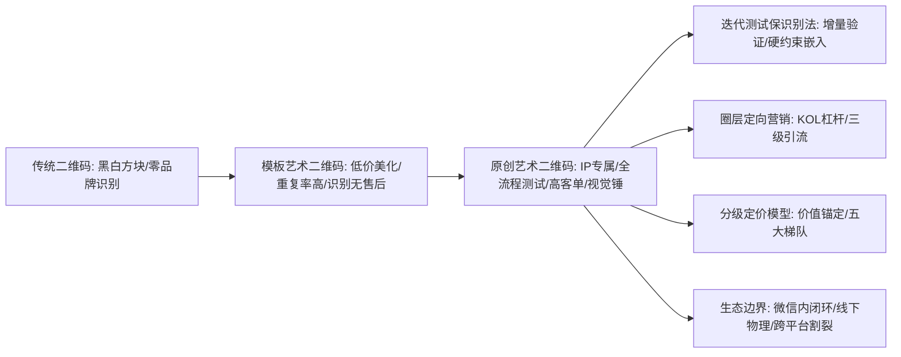
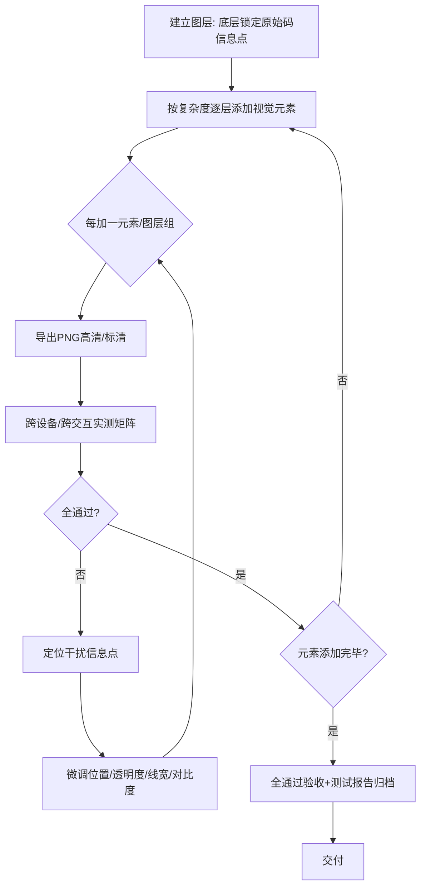
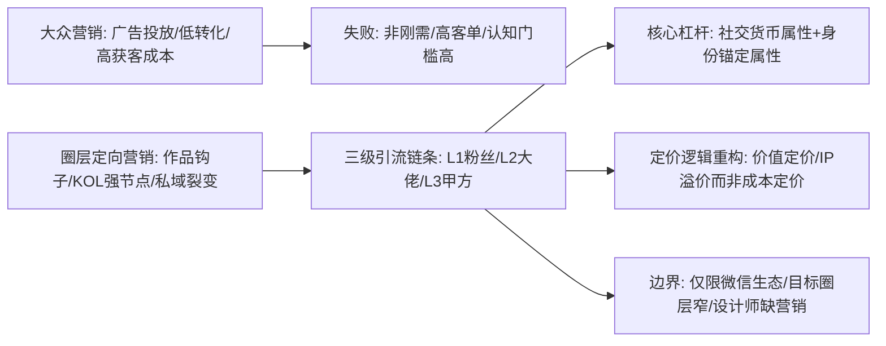
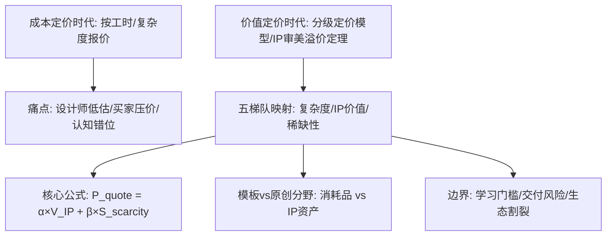
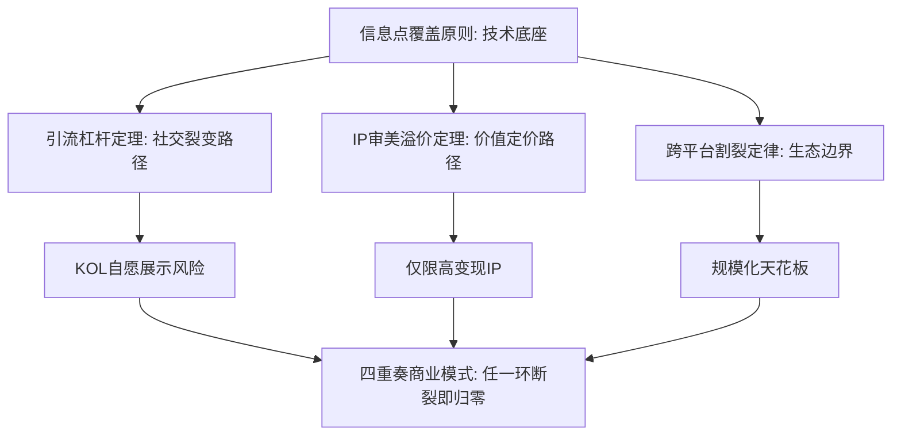

# 第 71 章 艺术二维码商业化实战 —— 从“黑白方块”到“IP视觉锤”的连锁变现闭环
作者：龙哥

## 学习目标

- 理解艺术二维码的核心定义、技术原理（信息点覆盖）与时效性硬约束
- 掌握“迭代测试保识别法”工程化流程，将可识别性作为创作全程硬约束
- 了解“圈层定向营销策略”：为何放弃大众营销精准锚定自媒体IP圈层及其三级引流链条机制
- 掌握“分级定价模型”：按复杂度、原创度、IP信息密度划分五大梯队，实现价格锚定IP价值而非制作成本
- 了解“IP审美溢价定理”与“跨平台生态割裂定律”，识别商业模式的核心杠杆与边界条件
- 能根据自身资源判断是否适合切入艺术二维码赛道（设计能力、营销能力、目标圈层触达）

## 71.1 生活类比

想象艺术二维码是**定制版“电子名片”与“VIP通行证”的结合体**。
- **普通二维码** = 白纸黑字的临时工牌：功能够用但零记忆点，扫完即忘
- **模板艺术二维码** = 批量印刷的会员卡：稍微好看但撞款率高，关键时刻（识别）可能掉链子，无售后
- **原创艺术二维码** = **镶嵌个人IP基因的限量版金属名片**：
  - **信息点覆盖** = 精密的防伪工艺：每一处雕花都不能遮挡核心芯片（识别点），否则刷不开门
  - **迭代测试** = 出厂前的极限压力测试：高温/低温/水洗/磨损（跨设备/跨交互）全测一遍，保证进VIP通道零失误
  - **圈层定向营销** = 只发给“懂行的大佬”：送给不懂价值的人是浪费，送给行业头部KOL（梁靠谱），他一晒（展示），同圈层大佬跟着买、粉丝跟着加、甲方跟着下单
  - **IP审美溢价** = 大佬买的不是“张卡片”，是“进VIP通道的捷径”与“身份勋章”：边际收益（流量/品牌）远超成本，所以敢付3万；普通人买的是“好看”，只愿付两位数
  - **跨平台割裂** = 这张卡片**只能在微信大楼（生态）里刷门、在线下物理会所刷门**，去抖音/小红书大楼直接被保安拦下（判违规），限制了规模化复制

就像顶级商务社交中，一张设计精良、防伪严格、仅限核心圈层流通的限量版金属名片，能撬动远超其制作成本的商业价值与社交杠杆。

## 71.2 概念地图

艺术二维码商业化体系
├── 核心概念与定义
│   ├── 艺术二维码定义：视觉重构+功能保持 —— P001
│   ├── 时效性硬约束：仅限永久原始码 —— P001
│   ├── 信息点覆盖原则：识别性技术底线 —— P001
│   └── 视觉锤：IP品牌记忆点与认知降维载体 —— P001
├── 工程化制作方法论
│   └── 迭代测试保识别法：增量验证+全维度覆盖+硬约束嵌入 —— P001
├── 商业化定价与营销体系
│   ├── 分级定价模型：五梯队（两位数~3万）映射复杂度/IP价值 —— P001
│   ├── 圈层定向营销：锚定自媒体IP+三级引流链条 —— P001
│   ├── IP审美溢价定理：定价锚定IP商业价值而非制作成本 —— P001
│   └── 艺术二维码引流杠杆定理：社交货币+身份锚定触发裂变 —— P001
├── 边界条件与行业洞察
│   ├── 跨平台生态割裂定律：仅限微信生态/线下，无法全域流通 —— P001
│   ├── 模板vs原创劣势对比：重复率高/无售后/识别性不稳定 —— P001
│   ├── 行业发展四大停滞原因：传播弱/营销缺/需求错位/生态割裂 —— P001
│   └── 从业者稀缺性：仅几千人，构成教学变现高门槛高潜力 —— P001
└── 实证案例与数据验证
    ├── 单张二维码连锁转化案例：零投放触达KOL→大佬→甲方 —— P001
    ├── 价格-周期-复杂度正相关实测数据：识别性测试为核心瓶颈 —— P001
    └── 模板二维码识别性风险实测：喜欢的样式不识别无售后 —— P001

## 71.3 艺术二维码 —— 让黑白方块进化成IP视觉锤

### 为什么需要这个概念？

传统二维码单调丑陋，难以承载个人IP的品牌辨识度与审美价值。自媒体时代流量昂贵，每一个独特视觉点都可能成为吸引流量的关键钩子。普通模板二维码重复率高、识别性无售后保障，无法满足商业IP差异化包装需求。正如作者所言：“自媒体时代，流量最贵。每一个独特的点，都可能成为你吸引流量的奇招。”【P001】

### 核心定义与技术原理

> "艺术二维码就是把二维码的小黑方块，换成图案、文字、小插画、2.5D图案等等形式，让它不再是单调的黑色块。在保有基本信息的基础上，变的更好看和独特。"
> 
> ——《docs/202303/AoT0dlRipo0RN6xDSo3cdckpnyf.md》 【P001】

**艺术二维码**的定义（来源：《docs/202303/AoT0dlRipo0RN6xDSo3cdckpnyf.md》 【P001】）：

$$
\text{艺术二维码} = \text{视觉重构}(\text{个性化图案/插画/2.5D形态}) \;\text{s.t.}\; \text{识别功能完好}(\text{扫一扫}/\text{长按识别}/\text{跨系统兼容})
$$

**公式逐步推导与解释**：
1. **变量拆解**：左侧“视觉重构”代表设计师的创作自由度（替换黑白模块为图案/插画/2.5D形态）；右侧“s.t.”（subject to）引入硬约束——识别功能必须完好，涵盖扫一扫、长按识别、跨系统（iOS/Android/鸿蒙）兼容。
2. **约束转化**：二维码识别依赖功能模块（定位点、校正点、版本信息、数据码字）的拓扑结构完整。视觉重构本质是在不破坏该拓扑结构的前提下，用视觉元素“覆盖”信息点。
3. **数学符号化**：将“在保有基本信息基础上变好看”形式化为带约束的优化问题：目标函数为视觉重构自由度，约束条件为识别功能完好。

这个定义展示了两个核心约束：视觉层面的“重构自由度”与功能层面的“识别性硬底线”。

> "艺术二维码的设计原理并不难，关键点就在于信息点的覆盖。用线条、图像合理覆盖，保证信息可识别。一个完美的艺术二维码，必须让你扫也扫的出来，长按也能按的出来。安卓鸿蒙的能识别，IOS也得能识别。一两个点的绘制错误，就会导致二维码的不识别。"
> 
> ——《docs/202303/AoT0dlRipo0RN6xDSo3cdckpnyf.md》 【P001】

**信息点覆盖原则**（来源：《docs/202303/AoT0dlRipo0RN6xDSo3cdckpnyf.md》 【P001】）：

这是艺术二维码的“设计图纸”。二维码的功能模块（定位点、校正点、版本信息、数据码字等）构成了不可触碰的“关键信息点”。设计师的任务是在不破坏这些点拓扑结构的前提下，用线条、色块、插画进行视觉重构。这就像在密集的电路板上画画：每一笔都不能短路关键走线。

**公式作用与边界说明**：该公式确立了艺术二维码创作的“可行域边界”——所有创意发挥必须在识别功能完好的超平面内进行。适用边界：仅限永久有效的原始二维码；微信“换个样式”导致底码变更、临时码过期等场景均会使约束条件失效，导致公式左侧全部归零。

### 关键性质

**1. 时效性硬约束：仅限永久原始码**  
艺术二维码强绑定特定的二维码数据载体。一旦底层数据（原始码）发生变更（过期、用户手动换样式），前期所有的视觉重构工作全部归零。素材明确指出：“【有时效限制的二维码不可以！】原因在于，原创的艺术二维码本身设计需要时间，如果7天后用于做设计的原始二维码失效了，那么甲方爸爸可以和设计师一起哭了。而且一旦提供出二维码做设计，就不能再更换原始二维码。例如微信二维码下面有个【换个样式】按钮，从此你就可以跟它说拜拜了。”【P001】这意味着必须在合同中明确“原始码不得变更”条款，交付前必须核验客户二维码的永久性，这是导致“模板二维码”无法承载高客单商业价值的根本原因之一。

**2. 识别性是硬门槛：全维度兼容**  
素材强调：“一个完美的艺术二维码，必须让你扫也扫的出来，长按也能按的出来。安卓鸿蒙的能识别，IOS也得能识别。”【P001】识别性测试矩阵覆盖交互方式（扫一扫/长按识别）、操作系统（iOS/Android/鸿蒙）、客户端版本（微信主流版本/视频号直播间展示）、物理介质（屏幕显示/印刷打印/线下展示），所有维度均需100%通过。

**3. 双重属性：社交货币 + 身份锚定**  
社交货币属性指新奇独特引发炫耀/分享传播。作者发朋友圈后，KOL梁靠谱主动找上门定制，并在星球/群展示，引发“来加靠谱好友的人数已经堆满一屏幕”【P001】。身份锚定属性指专属元素强化IP辨识，素材指出：“将IP的特点展示在艺术二维码上，可以快速的让观众对个人或者IP有初步的认识...缩短认知成本。”【P001】

### 典型例子：吉果个人艺术二维码的连锁转化

> "当天的朋友圈不知道发什么，就把艺术二维码的图片发出去了。然后这张艺术二维码，让我见识到了什么叫著名圈友梁靠谱的影响力...专属于梁靠谱的艺术二维码出炉...来加靠谱好友的人数已经堆满一屏幕...突然很多大佬来加我...最后...有两位甲方爸爸下单了。"
> 
> ——《docs/202303/AoT0dlRipo0RN6xDSo3cdckpnyf.md》 【P001】

这个案例完美演示了“零投放、靠作品钩子、借KOL杠杆、触发三级引流”的商业闭环。

### 价格梯队概览

以下为艺术二维码按复杂度与IP价值划分的五大价格梯队对照表：

| 梯队 | 典型特征 | 价格区间 | 制作周期 |
|------|----------|----------|----------|
| 1 | 基础换色/单一元素替换 | 两位数 | 几小时 |
| 2 | 3-5个原创图案覆盖信息点 | 三位数 | 5-7天 |
| 3 | 明确专属图案+大量个人信息/配海报 | 1-2千 / 3-5千 | 5-7天 |
| 4 | 毕加索风格/含设计理念 | 五位数 | 1-2周 |
| 5 | 2.5D高难度/顶级定制 | 五位数 (最高3万) | 一个月 |

### 边界条件

1. **无法跨平台流通**：微信二维码发抖音/小红书会被判违规，仅限微信生态内及线下物理场景使用。【P001】
2. **传播载体弱**：无法承载大面积文案，劝退急于展示产品的小商家。【P001】
3. **从业者稀缺**：市场上会做原创艺术二维码的设计师仅几千人，教学变现潜力大但推广难。【P001】

### 多源对照：原创 vs 模板艺术二维码

**共识**：两者都旨在解决“黑白方块丑、无品牌识别度”问题。

**分歧**：

| 维度 | 原创艺术二维码 | 模板艺术二维码 |
|------|----------------|----------------|
| **核心价值** | 承载IP资产、高识别、可溯源、高客单 | 解决基础美化、低价/免费 |
| **识别性保障** | 全过程迭代测试、售后兜底 | 无针对性测试、无售后、喜欢的样式不识别只能换 |
| **专属性** | 独一无二、含IP专属信息/理念 | 模板有限、重复率高、无个性化元素 |
| **商业定位** | 引流工具/身份勋章（IP审美溢价） | 临时装饰品（成本定价） |

> "而且可识别性不稳定，没人给你售后。喜欢的样式如果不识别，只能换个样式。"
> 
> ——《docs/202303/AoT0dlRipo0RN6xDSo3cdckpnyf.md》 【P001】

### 方法演进图



## 71.4 迭代测试保识别法 —— 把“能不能扫出来”做成创作全程的硬约束

### 为什么需要这个方法？

艺术二维码核心价值在于“能识别”，一旦失效即造成甲乙双方时间金钱双重损失。视觉元素每增加一层，识别风险叠加，传统“画完再测”返工成本极高。跨设备（iOS/Android/鸿蒙）、跨交互（扫一扫/长按）兼容性需全覆盖验证。【P001】

### 核心定义与流程

> "所以为了保证识别性，在绘制的过程中，要不断地测试。简单来说，我加了一个花，二维码扫的出来吗？测一下。再加个草呢？再测测。"
> 
> ——《docs/202303/AoT0dlRipo0RN6xDSo3cdckpnyf.md》 【P001】

**迭代测试保识别法**（来源：《docs/202303/AoT0dlRipo0RN6xDSo3cdckpnyf.md》 【P001】）：

```
1. 在AI矢量软件（Illustrator/Figma等）中建立图层结构：底层=原始码信息点参考层（锁定不编辑），上层=视觉创作层
2. 按视觉复杂度从低到高逐层添加元素（如：背景色 → 几何框架 → IP形象线稿 → 装饰花草 → 文字信息 → 光影特效）
3. 每增加一个关键视觉元素/图层组，立即执行【跨设备/跨交互识别测试】：
   - 导出当前版本PNG（高清/标清双版本）
   - 在iOS设备、Android设备、鸿蒙设备上分别测试：微信“扫一扫”、微信“长按识别”、视频号直播间展示识别
   - 记录通过/失败，失败则定位遮挡/干扰的具体信息点
4. 微调：调整元素位置/透明度/线条粗细/颜色对比度，消除对关键信息点的干扰
5. 循环步骤3-4，直至所有计划元素添加完毕且全测试矩阵通过
6. 最终交付前执行【全通过验收】：全矩阵100%通过，出具测试报告截图存档
```

这个流程展示了将“可识别性”从事后验收指标前置为创作全程的“硬约束条件”。每一笔创作都在风险可控的边界内推进。

### 关键性质

**增量式验证：避免最后推倒重来**  
传统工作流：创意构思 → 全稿绘制 → 统一测试 → 发现大面积失败 → 推倒重来（沉没成本极高）。迭代工作流：每加一个元素即测一次 → 发现问题即时微调 → 单元风险可控 → 总周期虽长但确定性高。

**全维度覆盖：三大系统双交互**  
测试矩阵 = {iOS, Android, 鸿蒙} × {扫一扫, 长按识别} × {屏幕, 打印, 视频号直播间}。任何一个维度失败都视为版本不合格。

**耗时瓶颈：识别性测试是制作周期的核心耗时**  
素材指出：“根据设计要求，图案内容的复杂程度，设计周期从几个小时到一个月不等。”【P001】复杂度与测试轮次的近似关系如下：

| 梯队 | 典型复杂度 | 预估测试轮次 | 制作周期 |
|------|------------|--------------|----------|
| T1 入门级 | 简单替换 | ~10轮 | 几小时 |
| T2 进阶级 | 3-5原创图案 | ~50轮 | 5-7天 |
| T3 专业级 | 专属图案+海报 | ~80轮 | 5-7天 |
| T4 专家级 | 毕加索/含理念 | ~150轮 | 1-2周 |
| T5 大师级 | 2.5D/顶级定制 | ~300+轮 | 一个月 |

**公式：价格-周期-复杂度正相关模型**（来源：《docs/202303/AoT0dlRipo0RN6xDSo3cdckpnyf.md》 【P001】）：

$$
T_{total} \approx T_{draw} + \sum_{i=1}^{N_{elements}} \big( t_{test} \times f(complexity_i) \big)
$$

**公式逐步推导与解释**：
1. **总耗时拆解**：制作总周期 $T_{total}$ 由基础绘制时间 $T_{draw}$ 与累计测试时间构成。
2. **测试累计时间建模**：每个视觉元素 $i$ 触发的测试轮次为 $f(complexity_i)$，单轮测试耗时 $t_{test}$（含导出、多设备实测、记录、微调）。
3. **超线性函数 $f(\cdot)$ 构成逻辑**：新元素本身需测试（基础轮次）；新元素可能干扰已验证元素，触发回归测试（叠加轮次）；复杂元素（2.5D光影、密集线条）单轮排查耗时更长（$t_{test}$ 随复杂度上升）。
4. **结果**：测试轮次随复杂度指数级上升，成为核心耗时瓶颈。

**公式作用与边界说明**：该模型揭示了“识别性测试”而非“绘制”才是制作周期的主导变量。适用边界：假设设计师熟练度恒定、测试环境标准化；若引入自动化检测工具，$t_{test}$ 与 $f(\cdot)$ 系数将显著下降，模型需重新拟合。

### 典型例子

作者与梁靠谱二维码制作周期5-7天，核心时间消耗在反复测试识别上。毕加索风格需1-2周，2.5D风格更久，复杂度与测试轮次正相关。【P001】

### 边界条件

1. **依赖经验与直觉**：缺乏量化自动化检测工具，信息点覆盖边界判断靠设计师经验（如“这一笔线条粗到多少会干扰校正点？”）。
2. **模板二维码的反面教材**：因缺乏针对性测试与售后，常出现“喜欢的样式不识别，只能换个样式”的不可用风险。【P001】

### 方法流程图



## 71.5 圈层定向营销策略 —— 精准锚定“懂流量、有预算、重差异”的自媒体IP

### 为什么需要这个策略？

艺术二维码高客单价、审美上层、非刚需，大众营销转化极低、获客成本高。知识付费/自媒体IP圈层：付费能力强、极度在意差异化包装、深谙流量价值，天然匹配。将产品从“装饰品”重新定义为“引流工具”与“身份勋章”，提升客户支付意愿。【P001】

> "艺术二维码的原创性，导致价格并不亲民...属于最上层的需求...不是所有人都能接受。在知识付费领域、自媒体IP领域，大家更注重自己的差异性和账号的审美包装。定位和圈层对了，结果也就对了。"
> 
> ——《docs/202303/AoT0dlRipo0RN6xDSo3cdckpnyf.md》 【P001】

### 核心定义

**圈层定向营销策略**（来源：《docs/202303/AoT0dlRipo0RN6xDSo3cdckpnyf.md》 【P001】）：

1. **放弃大众普及营销**，精准锚定“知识付费/自媒体IP”目标圈层
2. **利用头部KOL在私域/社群展示触达**，激活“社交货币”与“身份锚定”双重属性
3. **通过“专属定制”制造稀缺性**，引发目标圈层从众竞逐与商业转化

### 关键性质

**零广告投放：作品钩子 + 强节点放大 + 圈层裂变**  
素材指出：“自媒体时代，流量最贵。每一个独特的点，都可能成为你吸引流量的奇招。”【P001】营销漏斗不走付费广告，而走：高质量作品钩子（朋友圈/小红书/即刻发布过往精品案例，含头部IP背书案例）、弱关系网络强节点触达（识别能触达目标圈层的KOL/社群主理人/航海教练，零成本请求“体验定制”）、圈层裂变（KOL展示 → 粉丝围观 → 同层大佬跟单 → 精准甲方下单）。

**三级引流链条机制**  

> "此时第一波引流功能+表达者红利出现了...我以为很多人知道有这个东西，但是很多人其实没见过这种艺术二维码。这说明，艺术二维码是有宣传空间的。此时第二波引流功能出现了：在靠谱展示出艺术二维码的几分钟内，来加靠谱好友的人数已经堆满一屏幕。此时第三波引流功能出现了：突然很多大佬来加我，大家很好奇艺术二维码是怎么做的？...尤其有很多是常常看到，但我一直不好意思链接的大佬。"
> 
> ——《docs/202303/AoT0dlRipo0RN6xDSo3cdckpnyf.md》 【P001】

| 引流级数 | 触发主体 | 触发动作 | 受益方 | 核心心理机制 |
|----------|----------|----------|--------|--------------|
| L1 | KOL (梁靠谱) | 星球/群展示定制二维码 | KOL本人 | 社交货币：新奇独特引发粉丝炫耀/分享/加好友 |
| L2 | 同圈层大佬 | 看到KOL展示 → 好奇溯源 → 主动加设计师微信 | 设计师 | 身份锚定：专属元素强化IP辨识，大佬需同款差异化包装 |
| L3 | 精准甲方 | 看到大佬/同行都在用 → 从众/竞逐 → 直接下单定制 | 设计师 | 商业FOMO：头部都在用的引流工具，我不买就落后了 |

这个链条展示了：**单次KOL展示 = 同时触达“粉丝流量池”“同层决策者池”“精准甲方池”**，边际获客成本趋近于零。

**定价锚定IP商业价值而非制作成本**  
素材指出：“普通人只是为了好看和独特，一两千买个图片，他是不愿意的。但自媒体IP需要引流，尤其是那些全方位包装自己的大IP更需要引流。”【P001】这就是**IP审美溢价定理**的直观体现：大IP买的是“流量杠杆”，边际收益>>成本；普通人买的是“审美消费”，边际收益≈心理满足。

### 典型例子：吉果的冷启动复盘

1. **钩子**：个人艺术二维码发朋友圈（零成本）
2. **强节点**：梁靠谱（生财有术头部KOL、知识付费圈层核心节点）主动定制
3. **放大**：梁靠谱在星球/群展示（高信任背书）
4. **裂变**：L1粉丝加KOL → L2大佬加设计师 → L3甲方下单（2单成交）
5. **复利**：后续大佬背书持续带来新询盘

### 边界条件

1. **目标圈层极窄**：仅限“自媒体IP/知识付费”等高客单、重品牌、懂流量的群体。传统实体商家、中小电商卖家虽有需求但付费意愿低、决策链路长。
2. **平台生态割裂限制规模化**：无法跨平台引流，商业模式难以在微信生态外复制。【P001】
3. **设计师普遍缺乏营销能力**，导致好产品滞销，行业发展长期停滞。【P001】

### 方法演进图



## 71.6 艺术二维码分级定价模型 —— 让价格锚定IP价值而非制作工时

### 为什么需要这个模型？

设计师常按工时定价导致低估商业价值，买家按“买张图”心理压价，双方认知错位。需要一套标准化价格体系，将复杂度、原创度、IP信息密度、衍生应用量化为可报价梯队。解决“普通用户嫌贵、大IP嫌便宜”的定价悖论，实现价值定价而非成本定价。【P001】

### 核心定义：五大梯队

**分级定价模型**（来源：《docs/202303/AoT0dlRipo0RN6xDSo3cdckpnyf.md》 【P001】）：

以下为五大定价梯队的详细对照表：

| 梯队 | 核心特征 | 典型交付物 | 价格区间 | 制作周期 | 识别测试轮次(估算) |
|------|----------|------------|----------|----------|-------------------|
| **T1 入门级** | 基础换色/单一元素替换全部黑块 | 单张二维码图片 | 两位数 (¥10-99) | 几小时 | ~10轮 |
| **T2 进阶级** | 3-5个原创图案覆盖信息点 | 单张二维码图片 | 三位数 (¥100-999) | 5-7天 | ~50轮 |
| **T3 专业级** | 明确专属IP图案+大量个人信息/配合海报设计 | 二维码+海报/名片套系 | 1-2千 / 3-5千 | 5-7天 | ~80轮 |
| **T4 专家级** | 毕加索风格/含设计理念/强叙事性 | 二维码+全套VI延展规范 | 五位数 (¥10k-50k) | 1-2周 | ~150轮 |
| **T5 大师级** | 2.5D高难度/顶级定制/极致细节 | 二维码+3D建模源文件+全场景应用指南 | 五位数 (最高¥30k) | 一个月 | ~300+轮 |

> "例如最简单的换个颜色，或用非常简单且单一的元素替换全部黑方块，可以便宜到两位数。用3-5个原创图案覆盖信息点的艺术二维码价格在三位数。而像我个人的艺术二维码...能在二维码的图案中有明确的图案以及能放入大量的个人专属信息的艺术二维码，就已经来到1-2千元。还有包含设计理念和颜色的艺术二维码、2.5D绘画的艺术二维码，价格可以达到五位数。目前听说过的最贵的艺术二维码，大概3万元左右。根据设计要求，图案内容的复杂程度，设计周期从几个小时到一个月不等。"
> 
> ——《docs/202303/AoT0dlRipo0RN6xDSo3cdckpnyf.md》 【P001】

### 关键性质

**价格-周期-复杂度强正相关**  
识别性测试轮次随复杂度指数级上升，成核心耗时瓶颈。详见 71.4 节公式模型推导。

**IP审美溢价定理**  

**IP审美溢价定理**（来源：《docs/202303/AoT0dlRipo0RN6xDSo3cdckpnyf.md》 【P001】）：

$$
P_{quote} = \alpha \times V_{IP} + \beta \times S_{scarcity} \quad \text{而非} \quad P_{quote} = C_{labor} \times (1+margin)
$$

**公式逐步推导与解释**：
1. **左侧“价值定价”项拆解**：$V_{IP}$ = 客户IP的商业变现能力（年GMV、私域体量、单次引流价值）。素材中“年变现300万的IP主理人”愿付溢价，验证了 $V_{IP}$ 为核心锚点。$S_{scarcity}$ = 设计师稀缺度/作品不可复制性。素材“从业者仅几千人”、“原创不可复制”验证了稀缺性溢价。$\alpha, \beta$ = 议价权系数，随设计师知名度、过往头部案例数上升。
2. **右侧“成本定价”项对比**：$C_{labor}$ 为工时成本，$(1+margin)$ 为固定利润率。素材中“普通人不愿付千元，大IP愿付万元”实证左侧模型解释力强于右侧。
3. **非数学严格推导说明**：该公式为商业定价逻辑的形式化表达，非微积分推导而来。核心洞见：**定价锚点从“投入侧（工时）”平移到“价值侧（IP收益+稀缺性）”**。

**公式作用与边界说明**：适用于“客户具备可量化商业变现能力（IP）”且“设计师具备不可替代稀缺性”的双边市场。边界条件：若客户无IP变现能力（$V_{IP} \approx 0$）或设计师可替代性强（$S_{scarcity} \approx 0$），公式退化为成本定价，溢价空间归零。

**模板 vs 原创：本质是两种商品**  

| 维度 | 模板二维码 | 原创艺术二维码 |
|------|------------|----------------|
| **定价逻辑** | 成本定价（工时×倍率） | 价值定价（IP收益分成逻辑） |
| **识别性** | 不稳定、无售后 | 全流程测试、签署识别性承诺 |
| **复用性** | 底码可换、模板可复用 | **强绑定原始码**、不可复用、一次性交付 |
| **资产属性** | 消耗品 | IP资产（可计入品牌资产表） |

### 典型例子

吉果个人二维码：含专属信息+海报级设计，定价1-2千，周期5-7天，对应T3梯队。梁靠谱定制版：触发三级引流链条，验证高客单价产品的商业杠杆效应，对应T4梯队。【P001】

### 边界条件

1. **学习门槛高**：需掌握AI矢量软件+设计思维+识别性测试经验，从业者仅几千人。【P001】
2. **交付风险大**：一旦原始码失效或客户改需求，前期沉没成本极高（无法复用底码）。
3. **跨平台受限**：仅微信生态可用，无法成为全域流量入口，限制商业规模化上限。【P001】

### 方法演进图



## 71.7 多源对照：核心定律的互文验证

本章涉及的三大核心定律均源自同一篇核心素材（P001），但在不同维度上形成了自洽的理论闭环。我们在此梳理它们的共识与互补关系。

### 共识：商业价值源于“识别性硬约束”下的“视觉重构自由度”

三大定律共同建立在**“信息点覆盖原则”**这一技术底座之上：
- **引流杠杆定理**要求：必须识别，否则KOL无法展示、粉丝无法扫码、链条断裂
- **IP审美溢价定理**要求：必须识别，否则“引流工具”失效、IP价值归零、溢价无依据
- **跨平台割裂定律**本质是：平台通过“识别/拦截二维码”这一技术手段切割生态

### 分歧/互补：价值实现的不同路径与边界

以下为三大定律在价值实现路径、核心杠杆与主要边界上的对比：

| 定律 | 价值实现路径 | 核心杠杆 | 主要边界 |
|------|--------------|----------|----------|
| **引流杠杆定理** | 社交裂变（KOL展示→三级链条） | 社交货币+身份锚定 | 依赖强节点（KOL）自愿展示，不可控 |
| **IP审美溢价定理** | 价值定价（锚定IP商业收益） | IP边际收益>>成本 | 仅限高变现能力IP，普通用户付不起 |
| **跨平台割裂定律** | 生态锁定（微信内闭环/线下） | 平台规则壁垒 | 无法全域获客，规模化天花板低 |

**综合洞察**：艺术二维码商业模式 = **“技术硬约束（识别性） × 视觉稀缺性（原创） × 圈层精准度（KOL杠杆） × 生态封闭性（微信内）”** 的四重奏。任何一环断裂（识别失效/模板化/大众营销/跨平台违规）都会导致商业价值归零。

### 方法演进图



## 71.8 设计中的取舍

### 为什么不用“模板化生成器+自动化识别性检测”走量取胜？

既然识别性测试这么耗时，为什么不开发“模板化生成器+自动化识别性检测”，把单价降到两位数，走量取胜？这会切断商业模式的核心护城河。第一，价值定价逻辑崩塌：模板化=成本定价=两位数=无IP溢价=无法筛选高质量圈层→引流杠杆失效。第二，识别性风险外包给用户：自动化检测无法覆盖全矩阵（特别是线下印刷、视频号直播间等边缘场景），一旦失效，品牌声誉受损，设计师无法兜底。第三，从业者稀缺性消失：门槛降低→涌入大量竞争者→红海价格战→行业回归“模板二维码”低价值竞争。这种设计的 trade-off 是：放弃了规模化复制、低门槛入局、全平台流通、标准化交付，换取了高客单价（千元-万元）、高信任背书（KOL自发传播）、高壁垒护城河（识别性工艺+圈层准入）、高复购潜力（IP全生命周期视觉资产迭代）。

### 为什么不研发“跨平台通用二维码”打破生态割裂？

微信生态割裂这么严重，为什么不研发“抖音/小红书也能识别的通用二维码”？技术上不可行，商业上伪需求。技术层面：各平台二维码协议私有、加密、动态变更，无法逆向工程出通用码。微信二维码=微信ID的唯一映射，抖音不识别微信协议。商业层面：平台刻意割裂是为了留存流量。试图绕过规则属于“灰产”，账号封禁风险极高，不符合“合规生存”底线。这种设计的 trade-off 是：放弃了全域流量获取、规模化复制上限，换取了微信生态内的绝对信任红利（私域转化率极高）、合规安全的长期主义生存空间、线下物理场景的独特变现路径（展会/名片/周边/实体店）。

## 71.9 动手练习

### 练习 1：艺术二维码识别性压力测试设计

**场景**：假设你要为一位拥有50万粉丝的知识付费博主制作毕加索风格艺术二维码（价格五位数），该博主强调“必须在安卓、iOS、鸿蒙、微信扫一扫、长按识别、视频号直播间展示六大场景全通过”。

**任务**：请设计一份《迭代测试保识别法》执行清单，包含：
1. 绘制阶段的增量测试节点（至少5个关键元素添加后的测试动作）
2. 每个节点的测试环境矩阵（设备/系统/交互方式）
3. 识别失败时的定位与微调标准动作（SOP）
4. 最终交付前的“全通过”验收标准

**思考题**：
- 为什么说“识别性测试是制作周期的核心耗时瓶颈”？复杂度每增加一级，测试轮次大概如何增长？
- 如果客户在交付后第3天使用了微信“换个样式”功能导致二维码失效，责任归属如何界定？合同中应如何约定？

### 练习 2：圈层定向营销实战推演

**场景**：你是一位刚入行的艺术二维码设计师，手中有3个过往作品（含1个为某头部自媒体IP定制的案例），目标是获取首个5000元以上的商单。

**任务**：请基于“圈层定向营销策略”与“艺术二维码引流杠杆定理”，制定一份《冷启动获客行动方案》，包含：
1. 目标圈层画像清单：列出5类“懂流量、有预算、重差异”的精准目标用户标签（如：年变现>100万的知识付费主理人、万粉以上书单博主等）
2. “钩子作品”包装策略：如何用现有3个作品（尤其是头部IP案例）制作朋友圈/小红书/即刻等平台的“钩子内容”，触发“社交货币属性”？
3. 弱关系网络强节点触达路径：识别你现有人脉中能触达目标圈层的“关键节点人物”（KOL/社群主理人/航海教练），设计“零成本请求定制/体验”话术
4. 三级引流链条预演：若某KOL展示了你为其定制的二维码，预测后续72小时内可能发生的“粉丝加KOL→大佬加你→甲方下单”各环节关键动作与你的配合动作

**思考题**：
- 为什么“大众营销”对艺术二维码必死无疑？核心矛盾是什么？
- 若目标KOL拒绝免费体验，仅愿意“付费定制”，这是信号好还是坏？如何决策？

### 练习 3：分级定价与IP审美溢价谈判实战

**场景**：一位年变现300万的自媒体IP主理人（非头部大V，但商业闭环跑通）找你定制艺术二维码，预算3000元，要求“包含专属IP形象、配合海报设计、衍生到名片/周边/课程封面”，并希望“买断版权、源文件交付”。

**任务**：请基于“分级定价模型”与“IP审美溢价定理”，完成：
1. 需求拆解与定价梯队定位：该需求对应哪个梯队？核心价值点在哪里？（提示：衍生应用范围扩大）
2. 价值锚定话术设计：如何向客户解释“价格不等于工时”，而是“锚定你的IP商业价值”？给出3句核心谈判金句。
3. 版权与源文件条款博弈：买断版权+源文件交付对你意味着什么风险（提示：时效性约束、衍生修改失控、原始码变更）？设计《版权授权与源文件交付补充协议》核心条款3条，保护设计师利益。
4. 最终报价单结构：含基础定制费、衍生授权费、源文件托管费、原始码失效免责条款，总价不低于6000元。

**思考题**：
- 为什么“普通用户嫌贵、大IP嫌便宜”？定价模型如何同时服务两类人群？
- 若客户坚持“不懂设计，只看效果，3000元封顶”，你是放单还是走人？决策依据是什么？

### 练习 4：跨平台生态割裂下的商业模式破局头脑风暴

**场景**：已知：艺术二维码仅限微信生态（朋友圈/群/👸号/视频号）及线下物理场景流通，抖音/小红书/快手等平台判定为“引流违规”直接屏蔽。

**任务**：请为一位想“全域获客”的艺术二维码设计师，设计《跨平台合规引流组合拳》，要求：
1. 微信生态内玩法（现有优势）：视频号直播/切片展示制作过程、👸号长文沉淀案例库、私域社群“以图换群”裂变
2. 抖音/小红书/快手合规玩法（破局关键）：不能发二维码图片/链接，如何用“内容”合法引流？给出3个具体内容选题方向（如：制作过程ASMR、避坑指南、IP案例拆解）及对应的“私域钩子”设计
3. 线下物理场景放大：展会/见面会/同城沙龙的“实体展示+扫码体验”SOP
4. 组合拳ROI测算模型：假设投入100小时内容生产，预估各渠道引流私域人数、转化率、客单价，算出哪个渠道ROI最高，资源应向哪倾斜？

**思考题**：
- 平台生态割裂是“护城河”还是“天花板”？对设计师、对平台、对用户分别意味着什么？
- 若微信未来开放“小程序码可跨平台跳转”或“视频号可挂外链”，艺术二维码商业模式将如何重构？

## 71.10 本章小结

这一章中我们学习了艺术二维码从“黑白方块”进化为“IP视觉锤”的完整商业化路径。首先，我们拆解了**核心定义与技术底线**：艺术二维码是在“信息点覆盖原则”硬约束下的视觉重构，强绑定永久原始码，识别性是不可妥协的生命线。其次，我们掌握了**迭代测试保识别法**这一工程化制作流程，将可识别性前置为创作全程的硬约束，用增量验证对抗复杂度带来的指数级风险。接着，我们深入理解了**圈层定向营销策略**与**三级引流链条**：放弃大众营销，精准锚定自媒体IP圈层，借KOL杠杆触发“社交货币+身份锚定”双重裂变，实现零广告高客单获客。然后，我们建立了**分级定价模型**与**IP审美溢价定理**：五大梯队映射复杂度与IP价值，价格锚定客户商业收益而非制作工时，解决“普通用户嫌贵、大IP嫌便宜”的定价悖论。最后，我们认清了**跨平台生态割裂定律**与行业结构性停滞原因：微信生态封闭既是护城河也是天花板，从业者稀缺（仅几千人）构成教学变现的高门槛高潜力。

本章我们一起学习了以下概念：

以下为本章核心概念总结对照表：

| 概念 | 解释 |
|------|------|
| 艺术二维码 | 将二维码黑白方块替换为个性化图案/插画/2.5D形态，在保持识别功能前提下实现审美升级与IP专属表达的视觉载体 |
| 时效性硬约束 | 仅适用永久有效原始码；临时码或使用‘换个样式’导致底码变更即失效，设计沉没成本极高 |
| 信息点覆盖原则 | 设计核心技术原理：线条/图像合理覆盖关键信息点，保证扫一扫/长按识别/跨系统（iOS/Android/鸿蒙）兼容，一两个点错误即不识别 |
| 迭代测试保识别法 | 工程化制作流程：逐层绘制→每加一元素即跨设备/跨交互实测→失败微调→循环至全通过，将可识别性作为创作全程硬约束 |
| 圈层定向营销策略 | 放弃大众营销，精准锚定‘知识付费/自媒体IP’圈层（付费强/重差异/懂流量），将产品重定义为‘引流工具’与‘身份勋章’ |
| 三级引流链条 | KOL展示 → 粉丝加KOL/大佬加设计师/精准意向客户下单，零广告投放靠社交货币与身份锚定属性裂变 |
| 分级定价模型 | 五梯队：基础换色(两位数/几小时)→3-5原创图案(三位数/5-7天)→专属图案+信息/海报(1-5千)→毕加索/含理念(五位数/1-2周)→2.5D/顶级(3万/月) |
| IP审美溢价定理 | 定价锚点在于承载的IP商业价值与稀缺性，大IP边际收益远超成本愿付溢价，普通用户仅付模板成本 |
| 跨平台生态割裂定律 | 微信二维码无法在抖音/小红书引流（判违规），仅限微信生态内及线下物理场景，限制商业模式规模化复制 |
| 模板vs原创劣势 | 模板：便宜但重复率高、无专属元素、识别性不稳定无售后；原创：承载IP资产、高识别、可溯源、高客单 |
| 行业四大停滞原因 | 传播载体弱(无法承载文案劝退小商家)、设计师缺营销能力、历史需求错位(大品牌时代尝鲜无案例/个人IP兴起时设计师流失)、平台生态割裂 |
| 从业者稀缺性 | 市场会做原创艺术二维码的设计师仅几千人，构成知识付费教学的高门槛与高潜力 |

下一章中，我们将学习如何构建个人IP与内容变现体系，探索“表达者红利”、“视觉钩子”、“朋友圈专栏化”、“低成本高杠杆”等核心方法论，助你在自媒体时代建立可复利的个人品牌资产。


