# 第 67 章 商业认知与执行体系

## 学习目标

- 理解增量生意思维与分享即获客定律的商业逻辑
- 掌握失败常态化公理与首个正反馈的心智重构方法
- 熟练运用六十分即冲原则与看见即相信降低行动门槛
- 掌握新人三步起盘法与项目筛选决策树的标准化启动流程
- 理解耐受时间与贵人跃迁在非线性增长中的关键作用
- 掌握航海制与社群生态位构建法实现低成本试错与资源链接
- 理解SOP复制放大论与项目公司化核算的规模化放大模型
- 掌握极简成交闭环与低价信任代偿机制的转化设计技巧
- 理解IP不可复制性护城河与信任先于变现原则的长期主义壁垒
- 掌握五维项目筛选指标体系与反卷生存法则的赛道选择策略
- 理解心力撑开机制与信息增量阈值的认知进阶路径
- 掌握时薪外包决策法与确定性招人准则的组织扩张标准
- 理解学生私域全生命周期LTV矩阵与韭菜大队自嘲文化的变现模型
- 掌握线下连接协议与主理人亲历原则的深度社交与管理智慧

## 67.1 生活类比

想象商业成长是一场马拉松比赛。增量思维意味着赛道无限宽，你跑得好不妨碍别人，反而吸引更多人一起跑，形成集团优势；失败常态化意味着路上摔倒是常态（十之八九），不怕摔倒，怕的是不敢跑，每次爬起积累经验；首个正反馈就是完成第一公里，证明自己能跑完全程，建立“我能行”的信心基石；耐受时间是前10公里没观众喝彩、甚至想放弃，但坚持跑下来的人才能见到终点风景；六十分即冲是不用等完美装备/完美天气/完美状态，穿上鞋（60分）就出发，跑着跑着自然专业；贵人跃迁是个人努力是匀速跑（线性），搭上领跑员/教练车（贵人）实现变速超车（指数级）；SOP复制放大是训练出一套标准跑法，教给100人一起跑，团队总成绩远超个人极限；IP护城河是装备/配速/战术都能买/抄，但“跑了10年马拉松的身体和故事”无法复制；心力撑开是每次突破极限（崩溃/受伤/想放弃），心理肌肉就粗壮一圈，下次面对同等难题“不过如此”；反卷生存是别在“比谁跑得快”的红海卷，而要在“比谁跑得久/比谁懂科学训练/比谁有团队”的蓝海建壁垒。

## 67.2 概念地图

第67章：商业认知与执行体系
├── 核心心法重塑
│   ├── 增量生意思维  —— P001, P013, P014
│   ├── 失败常态化公理  —— P002, P004, P013
│   ├── 首个正反馈  —— P003, P004, P013
│   ├── 耐受时间  —— P004, P002, P013
│   ├── 贵人跃迁  —— P005, P004, P013
│   ├── 信息增量阈值  —— P006, P013
│   ├── 六十分即冲原则  —— P007, P004, P013
│   ├── 看见即相信  —— P015, P003, P013
│   ├── 心力撑开机制  —— P013, P004, P002
│   ├── 高维特质画像  —— P014, P013
│   └── 反卷生存法则  —— P019, P013, P011
├── 启动与决策框架
│   ├── 新人三步起盘法  —— P016, P013
│   ├── 项目筛选决策树  —— P017, P013
│   ├── 五维项目筛选指标体系  —— P010, P001, P002
│   └── 止损试错机制  —— P017, P011, P010
├── 社群杠杆与生态位
│   ├── 航海制  —— P008, P013
│   ├── 社群生态位构建法  —— P020, P013
│   ├── 线下连接协议  —— P021, P013
│   ├── 信任前置链接律  —— P013
│   └── 主理人亲历原则  —— P013, P011
├── 规模化与自动化放大
│   ├── SOP复制放大论  —— P009, P013, P011
│   ├── 项目公司化核算  —— P011, P009
│   ├── 极简成交闭环  —— P011, P009
│   ├── 低价信任代偿机制  —— P011, P010
│   ├── 躺赚项目矩阵  —— P011
│   ├── 沉没成本付费墙  —— P011
│   ├── 矩阵式站群批量化  —— P011
│   └── 版权风险隔离策略  —— P011
├── 长期壁垒与品牌资产
│   ├── IP不可复制性护城河  —— P012, P001, P002
│   ├── 信任先于变现原则  —— P012, P010
│   ├── 学生私域全生命周期LTV矩阵  —— P011, P001, P002
│   ├── 韭菜大队自嘲文化  —— P011, P001
│   └── 阶梯定价信任模型  —— P011, P001, P002
├── 组织与人才体系
│   ├── 时薪外包决策法  —— P018, P013
│   ├── 确定性招人准则  —— P013
│   ├── 成就型动机识别  —— P011
│   └── 流程喂养/AI化员工模型  —— P011
└── 行业周期与信息差
    ├── 绝技现世即行业没落律  —— P011
    ├── 信息差蓝海非数据可得  —— P011
    └── 红利期藏拙衰退期现世  —— P011

## 67.3 增量生意思维 —— 让分享成为获客的复利引擎

### 为什么需要这个概念？

传统认知认为分享经验会培养竞争对手、稀释利益（存量博弈视角），导致创业者吝啬输出、错失品牌建立与资源链接的最低成本路径。实际商业环境中，多数新兴赛道属于可无限扩容的增量市场。

### 核心定义

**增量生意思维** 指非存量博弈、可无限扩容的业务模式。其核心逻辑：公开分享经验不稀释自身利益，反而吸引同频者、链接资源、建立品牌，实现“越分享越幸运”的复利效应。

> "如果做的不是存量生意，而是增量生意，越分享越幸运"
> ——《P013, 摘要》

> "我的项目模式，引流模式，核心玩法，给无数个人说过，但是没有第二个我。"
> ——《P014, 摘要》

### 关键性质

**适用边界**：仅适用于增量市场（如知识付费、社群运营、新兴平台红利期）。存量市场（如固定名额考试、独家代理权）不适用，甚至有害。信息公开度与商业价值呈正相关，打破“秘密即护城河”的传统认知。

**核心护城河要求**：核心护城河必须是“不可复制的时间积累”（如IP信任资产、情感连接、长期主义坚守）。若核心壁垒仅在于“信息差/玩法/渠道”，则分享即自杀。需具备“筛选同频者”的能力，避免引入低质量竞争或无效社交。

### 典型例子

**亦仁**公开分享生财有术运营心法、风向标解读，反而强化了社群头部IP地位，吸引顶尖合伙人与项目。【来源：docs/202303/TZZwdy53eofCYQxu2xucdoV1nod.md】

**乔合**将学生私域运营全套玩法公开（价格策略、引流渠道、选品标准），无人能复制其“7年陪伴成长”的IP护城河。【来源：docs/202303/20230328_090.md、docs/202303/20230328_100.md】

### 边界条件

- 核心护城河必须是“不可复制的时间积累”（如IP信任资产、情感连接、长期主义坚守）
- 若核心壁垒仅在于“信息差/玩法/渠道”，则分享即自杀
- 需具备“筛选同频者”的能力，避免引入低质量竞争或无效社交

### 方法演进图

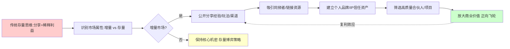

图解说明：该流程图展示了从传统存量博弈思维向增量生意思维的认知跃迁路径。核心在于判断市场属性：在增量市场中，分享行为触发“吸引同频→链接资源→建立品牌→筛选合伙→放大价值”的正向飞轮，实现越分享越幸运的复利效应；而在存量市场则需保持核心机密。

## 67.4 失败常态化公理 —— 把“怕失败”改装成“试错预算”

### 为什么需要这个概念？

创业者普遍受“成功学”毒害，追求一次成功、零失误，导致决策瘫痪、不敢试错。实际上商业成功率天然极低（十之八九失败），抗拒失败反而降低试错次数与容错率。需要将“失败”从情感负担重构为“概率成本”，建立科学的试错心智模型。

### 核心定义

**失败常态化公理**：赚钱项目的成功率天然低（十之八九失败），失败是常态而非意外。接受失败常态化可消除恐惧，将精力从“避免失败”转移至“增加试错次数与容错率”。成功视为多元素叠加的概率事件（运气×执行×时机×认知）。

> "失败是常态，十之八九。如果你有这个预期，做很多事情都不会怕失败，反而觉得成功是多元素加持运气值。"
> ——《P013, 摘要》

### 关键性质

**心理重构**：将“失败=我不行”重构为“失败=这条路不通/这招不好使”，切断自我价值与项目成败的绑定。

**资源配置**：预留“试错预算”（时间/金钱/精力），单次试错成本可控，支持高频实验。

**反脆弱机制**：每次失败积累“反面经验库”，缩小后续决策的不确定性区间。

### 典型例子

**家蒙**知乎好物前3月仅入账1.37元，坚持耐受期后年入百万，验证“耐受时间”是跨越关键变量。【来源：docs/202303/TZZwdy53eofCYQxu2xucdoV1nod.md】

**亦仁**建议其换赛道但其坚持原赛道深耕成功，证明“导师建议”不绝对，自身试错判断权更高。【来源：docs/202303/TZZwdy53eofCYQxu2xucdoV1nod.md】

### 边界条件

- 非提倡盲目试错，需结合“六十分即冲”原则：低成本、可逆、可验证的MVP试错
- 核心生存资源（房贷、家庭医疗、团队工资）不可作为试错筹码
- 需建立“止损线”机制：单项目连续N次无正反馈/亏损超阈值，必须果断切换而非硬扛

### 方法演进图

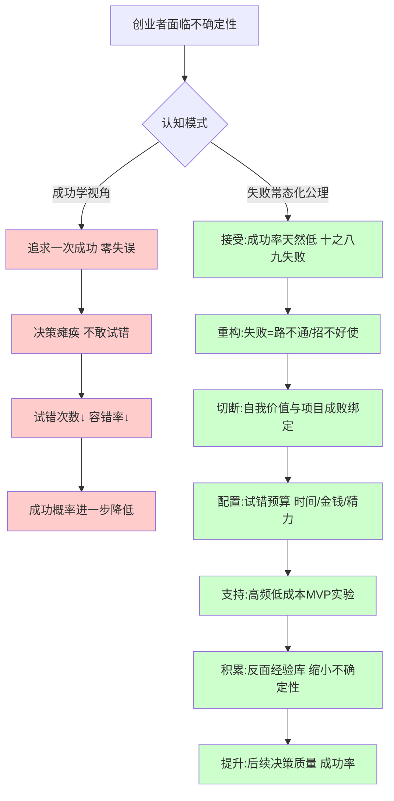

图解说明：对比了“成功学视角”与“失败常态化公理”两种认知模式导致的截然不同结果。前者陷入“决策瘫痪→试错减少→成功率更低”的死循环；后者通过心理重构、试错预算配置、反面经验库积累，形成“高频实验→缩小不确定性→决策质量提升”的正向螺旋。

## 67.5 首个正反馈 —— 打破“上班思维”的信心基石

### 为什么需要这个概念？

长期职场/教育体制形成“被推着走、等标准答案”的依赖路径，缺乏“自己摸路、自己负责”的主体性。缺乏“我能赚到钱”的真实体感，导致认知层面不敢相信、行动层面不敢投入。需要一个极低门槛、极短周期的“第一块钱”来完成认知跃迁。

### 核心定义

**首个正反馈** 指从0到1赚到的第一块钱及其带来的信心确立。核心价值不在于钱本身，而在于打破固有认知路径、确立“相信才能做到”的心智基石。小成功是成功之母，成功具有惯性（正反馈循环）。

> "最重要的是第一个正反馈，赚到第一块钱，不只是钱，你赚到了信心。因为相信才能做到。小成功才是成功之母，成功是有惯性的。"
> ——《P013, 摘要》

### 关键性质

**认知跃迁**：从“专家/老板才能赚钱” → “普通人我也能赚钱” → “我有能力解决问题换钱”。

**门槛极低**：不要求金额大、不要求可持续、只要求真实发生过“陌生人因价值付费给我”。

**复利种子**：首个正反馈后，大脑开始主动搜寻“赚钱机会”而非“避坑理由”。

### 典型例子

**白杨**通过小报童专栏“内测6天售出80单、GMV 1.5万”获得首个正反馈，确立“知识内容港湾”产品方向。【来源：docs/202303/20230328_098.md】

**新发地水果小李哥**40天实战：单日破9000、复购38%、0粉1.5万赞，验证“源头现采+私域团购”模型跑通。【来源：docs/202303/20230328_156.md】

### 边界条件

- 必须是真实的市场交易（陌生人付费），非亲友捧场、非平台补贴、非刷单
- 避免陷入“小而美”陷阱：首个正反馈后必须立即思考“如何标准化/放大/延长生命周期”
- 警惕“幸存者偏差”：单一正反馈不代表模型必然可复制，需二次三次验证才能确立SOP

### 方法演进图

```mermaid
flowchart LR
    A[上班思维/被动依赖] --> B[缺乏"我能行"体感]
    B --> C[认知不敢信 行动不敢投]
    C --> D[寻找极低门槛MVP]
    D --> E[执行:陌生人因价值付费]
    E --> F[首个正反馈:第一块钱+信心]
    F --> G[认知跃迁:普通人也能赚钱]
    G --> H[心智基石:相信才能做到]
    H --> I[大脑重塑:搜寻机会非避坑]
    I --> J[成功惯性:正反馈循环启动]
    J --> K[后续:标准化/放大/延长周期]
    
    style A fill:#ffcccc
    style B fill:#ffcccc
    style C fill:#ffcccc
    style F fill:#ffff00
    style H fill:#ccffcc
    style J fill:#ccffcc
    style K fill:#ccffcc
```

图解说明：展示了从“上班思维”到“首个正反馈”再到“成功惯性”的完整认知重构链条。关键节点在于F（首个正反馈）：它既是认知跃迁的触发点，也是正反馈飞轮的启动键，核心价值在于建立“相信才能做到”的心智基石，而非金额本身。

## 67.6 耐受时间 —— 非线性增长前的必经暗黑期

### 为什么需要这个概念？

多数创业者预期“付出即回报”线性增长，实际前期长期无正向收益（如前3月仅1.37元）。认知偏差导致过早放弃：将“耐受期”误判为“模式无效/赛道错误/自己不行”。需要将“时间跨度”显性化为核心变量，建立“熬过耐受期=跨越门槛”的预期管理。

### 核心定义

**耐受时间** 指在项目前期无正向收益甚至极低收益时，坚持不放弃的时间跨度。是区分普通人与跨越者的关键变量，属于非线性增长前的必经沉淀期。

核心公式：
$$\text{耐受时间} = \frac{\text{心理预期收益} - \text{实际收益}}{\text{坚持动力来源（信仰/沉没成本/微弱信号）}}$$

> "（1）耐受时间：每个人的耐受时间不一样，比如家蒙前3个月的收入是1.37，但他没放弃"
> ——《P013, 摘要》

> "一年才有收获的事，做的人就少一些；五年才有收获的事，能做的人凤毛麟角； 十年才有收获的事，没有竞争，一片空白。"
> ——《P014, 摘要》

### 公式推导与逐步解释

**变量定义**：
- **心理预期收益**：创业者主观设定的“此时该赚多少钱”的目标值（单位：元/月或元/周期），源于行业宣传/幸存者案例/自身愿望，往往高估早期回报。
- **实际收益**：项目运行期内真实产生的现金流入（单位：元/月或元/周期），早期常为0或极低值。
- **坚持动力来源**：支撑创业者继续投入的心理/资源合力（单位：抽象动力单位），包含三大成分：①信仰/使命感（虚无但高能量）、②沉没成本（已投入的时间/金钱/精力，产生“亏了不甘心”心理）、③微弱信号（技能提升/用户好评/同行认可/数据微增等正向反馈）。

**推导逻辑**：
1. **落差驱动放弃**：当“心理预期收益”远大于“实际收益”时，会产生巨大的心理落差（分子）。落差越大，心理痛苦越强，放弃冲动越强烈。
2. **动力对抗落差**：只有“坚持动力来源”（分母）足够强，才能抵消分子的落差压力，维持创业者继续行动。
3. **耐受时间 = 落差 ÷ 动力**：分子越大（预期过高）、分母越小（动力不足），耐受时间越短，越易放弃；反之，降低预期、强化微弱信号识别、建立信仰/沉没成本锚点，可延长耐受时间。

**单位量纲分析**：分子为货币单位（元），分母为抽象动力单位，商为“时间跨度”（月/周），符合“耐受时间”的物理意义。

**为什么分子除以分母**：因为心理落差（分子）是放弃的推力，动力来源（分母）是坚持的拉力。二者此消彼长，商数即为“在放弃冲动压倒坚持意愿之前，能维持行动的时间长度”。

### 公式作用说明

该公式量化了耐受时间的三大决定因素——心理预期与现实的落差（分子）、支撑坚持的动力源（分母）。分子越大（预期过高）、分母越小（动力不足），耐受时间越短，越易放弃。管理耐受时间的关键在于：降低不切实际的预期、强化微弱信号识别、建立信仰/沉没成本等坚持动力。

### 关键性质

**非线性特征**：前期投入产出比极低（甚至为负），突破临界点后呈指数级跃升。

**心理机制**：依赖“过程即奖赏”心法（技能增长/认知迭代/资源积累）对抗“结果焦虑”。

**筛选器**：耐受期天然筛掉90%追求速成者，为坚持者留出低竞争空间。

### 典型例子

**家蒙**知乎好物前3月收入1.37元，坚持深耕最终年入百万。【来源：docs/202303/TZZwdy53eofCYQxu2xucdoV1nod.md】

**乔合**学生IP坚持7年、**白杨**内容积累多年、**视频号书豪**连续3年年入百万，均验证“时间复利”。【来源：docs/202303/20230328_090.md、docs/202303/20230328_054.md】

### 边界条件

- 区分“坚持”与“死磕”：需有“微弱正向信号”（如技能提升、用户好评、同行认可）支撑，纯盲目硬扛是赌博
- 设定“复盘节点”：每月/每季复盘，若核心指标（流量/转化/产品力）连续N期零增长且无优化空间，应止损
- 资源托底：现金流/家庭支持需覆盖耐受期生存成本，避免因生存压力被迫短视决策

### 方法演进图

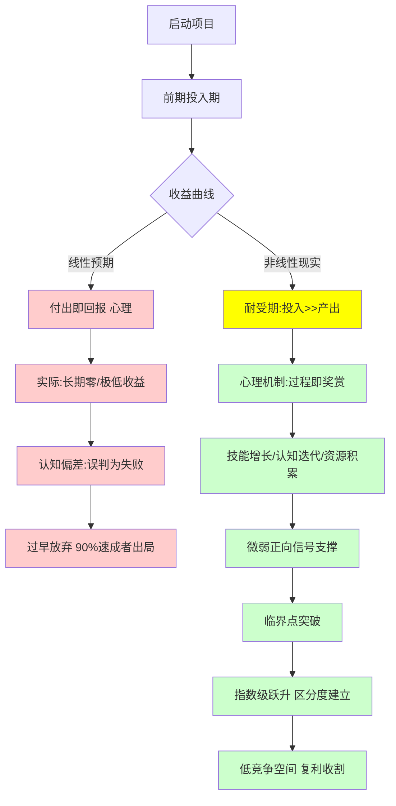

图解说明：对比了“线性预期”与“非线性现实”两条路径。核心在于耐受期（H）：它是非线性增长的必经暗黑期，唯有依赖“过程即奖赏”心法（I）、积累微弱正向信号（K）者，才能跨越临界点（L）进入指数级跃升区（M-N），享受时间复利筛选出的低竞争空间。

## 67.7 贵人跃迁 —— 让线性努力撬动非线性机会

### 为什么需要这个概念？

个人努力呈线性增长（单位时间产出固定），但商业机会呈指数级分布（头部效应）。单纯靠“自己闷头干”无法跨越阶层/认知天花板，必须借力外部高维节点。缺乏“被看见”的机制，再大努力也可能淹没在信息噪音中。

### 核心定义

**贵人跃迁** 指个人努力呈线性增长时，通过链接高维认知/资源持有者（贵人），使努力被更多人看见，捕获机会、实现跨越式增长的非线性路径。

核心公式：
$$\text{成果} = \text{个人努力（线性）} \times \text{贵人杠杆（指数级）}$$

> "每个人的拼搏努力是线性的，如果想获得跨越性增长需要1.机会 2.贵人，链接不同的人，自己的努力被更多人看到，才能迎接更多机会。"
> ——《P013, 摘要》

贵人本质：认知比你高1-2维度、掌握关键资源/分发渠道、愿意因“价值互换”给你背书。

### 公式推导与逐步解释

**变量定义**：
- **个人努力（线性）**：单位时间内个人投入的执行量（如产出内容数、客户拜访数、代码行数），假设单位产出恒定，总产出随时间线性增长，记为 $E$。
- **贵人杠杆（指数级）**：贵人提供的资源放大倍数，包括：①分发渠道放大（如大号推荐带来的流量指数级暴增）、②背书信任放大（如权威背书将转化率提升数倍）、③认知维度跃迁（如高手指点避开重大坑、直接锁定核心赛道），记为 $L$。$L$ 具有指数级特征：微小的认知/资源差异，经放大后产生数量级不同的成果。

**推导逻辑**：
1. **无杠杆基线**：无贵人时，成果 $= E \times 1 = E$，上限受限于个人时间/精力线性累积。
2. **接入贵人**：当个人努力 $E$ 被贵人捕获（通过显性价值输出），获得杠杆 $L$，成果 $= E \times L$。
3. **非线性跃迁**：$L$ 远大于 1（通常 10-1000 倍），使成果从线性增长跃迁为指数级增长。例如：个人日产 1 篇内容（$E$），经大佬转发触达 10 万粉丝（$L=10^5$），成果 $= 10^5$ 曝光，远超个人自发分发的几百曝光。

**单位量纲分析**：$E$ 为“单位产出/时间”，$L$ 为“无量纲放大倍数”，乘积为“总产出/时间”，符合“成果”的物理意义。

**为什么相乘而非相加**：因为贵人杠杆是对个人努力的“乘数效应”，而非“加数效应”。相加意味着贵人仅提供固定增量（如额外给 1000 流量），相乘意味着贵人放大每一份努力的边际产出（每篇内容都获 1000 倍曝光），前者边际递减，后者边际递增，符合“跃迁”语义。

### 公式作用说明

该公式揭示了个人成果的非线性放大机制。个人努力（线性）是基数，贵人杠杆（指数级）是乘数。无贵人杠杆时，成果=线性努力，上限受限于个人时间/精力；接入贵人后，努力被高维节点放大、分发、背书，触达指数级更大的受众与机会池，实现跨越式增长。

### 关键性质

**触发条件**：主动提供显性价值（内容/服务/资源/执行力）→ 被高维节点捕获 → 获得背书/推荐/合伙。

**互换法则**：纯索取者无法留住贵人，必须建立“利他先行、价值互换”的长期关系账户。


### 典型例子

**郑小焦**：传统酒店经理 → 通过社群链接大佬 → 认知与身份跨越，验证“线性努力+高维链接=非线性增长”。【来源：docs/202303/TZZwdy53eofCYQxu2xucdoV1nod.md】

**乔合**：通过生财有术链接大佬合作2个项目变现30万+，圈友知识付费、获取项目信息。【来源：docs/202303/20230328_090.md】

**白杨**：社群内“瞌睡送枕头”式巧合，遇孙哲/老徐老师获工具/玩法/同伴支持。【来源：docs/202303/20230328_098.md】

### 边界条件

- 贵人不等于“救世主”：核心动力必须来自自身执行力，贵人只提供“加速度”而非“初速度”
- 识别“伪贵人”：只收费不赋能/只画饼不落地/认知维度不高于你的人，非贵人而是收割者
- 信任前置：低信任社群中直接找大佬效率极低，优策略是先链接高信任大节点（如涛哥/船长），借其背书辐射

### 方法演进图


图解说明：展示了贵人跃迁的完整触发-放大-反哺闭环。关键在于B→C→D：个人必须主动在高贵人密度区（如生财有术）提供显性价值，才能被高维节点捕获（E）；贵人筛选标准（F）确保链接质量；获得背书后（G），个人努力获得指数级放大（H），实现跃迁（J）；最后通过持续利他（K）维系关系账户，形成飞轮。

## 67.8 信息增量阈值 —— 大脑CPU的“连点成线”时刻

### 为什么需要这个概念？

信息过载时代，多数人陷入“收集=学习、囤积=拥有”的虚假勤奋陷阱。缺乏“量变引发质变”的认知机制，输入再多仍碎片化、无模式识别、无决策支撑。需要建立“高密度输入→模式识别→洞察输出”的认知加工流水线。

### 核心定义

**信息增量阈值** 指大脑通过大量信息输入（量变）形成模式识别小模型，最终连点成线产生质变洞察的临界点。亦仁半小时处理常人3-4小时信息，源于长期积累的高速消化吸收能力（模式识别模型库）。

核心机制：
$$\text{信息输入量达成一定值} \rightarrow \text{大脑CPU自动连点成线} \rightarrow \text{形成跨维度的小模型} \rightarrow \text{秒级分类判断}$$

> "你看了非常多之后，你对信息增量和模块会非常快……信息会在各个维度上给你提供小模型。"
> ——《P013, 摘要》

> "信息输入量达成一定值，你的大脑CPU会连点成线，自动把很多东西连起来。"
> ——《P004, 摘要》

### 机制推导与逐步解释

**四阶段质变过程**：
1. **量变积累（高密度信息输入）**：每日固定时间（如半小时）强制输入高信噪比信息（精华帖/风向标/书籍/友商动态/经典书籍），而非碎片化刷短视频/聊天。输入质量>输入量，垃圾信息无法建立有效模型。
2. **自动连点（大脑CPU跨维度关联）**：当输入量跨越临界阈值，大脑皮层已建立足够密集的神经连接网络，新信息输入即自动触发跨维度关联（如看到“新平台红利”自动关联“选品逻辑/流量模型/转化框架/风控规律”等既有模型），无需逐个有意识分析。
3. **模型形成（提炼可复用的小模型/心智模板）**：跨维度关联的结果固化为“小模型”（如“选品三要素：利润覆盖广告+价格不透明+能打过同行”、“项目筛选五维：难度/规则/绿色/批量/周期”），这些模型具有迁移性，可复用于新赛道/新平台/新业务。
4. **秒级判断（新信息秒级分类/预判/决策）**：面对新信息/新机会，大脑在秒级内完成：分类（属于哪类模型）、预判（大概率走向）、决策（做/不做/怎么做）。亦仁半小时处理常人3-4小时信息的本质，是其大脑已建立大量跨维度小模型，新信息输入即自动匹配分类，无需逐个分析。

**为什么叫“阈值”**：低于阈值时“看不懂/迷茫/焦虑/只见树木不见森林”；跨越阈值后“秒懂/有框架/能预判/一眼穿透本质”。阈值到达时间因人而异（半年/三年/十年），但“每日高密度输入”是必要条件。

### 机制作用说明

该机制描述了认知加工的四阶段质变过程：①量变积累（高密度信息输入）→ ②自动连点（大脑CPU跨维度关联）→ ③模型形成（提炼可复用的小模型/心智模板）→ ④秒级判断（新信息秒级分类/预判/决策）。亦仁半小时处理常人3-4小时信息的本质，是其大脑已建立大量跨维度小模型，新信息输入即自动匹配分类，无需逐个分析。

### 关键性质

**非线性跃迁**：低于阈值时“看不懂/迷茫/焦虑”，跨越阈值后“秒懂/有框架/能预判”。

**训练路径**：强制每日半小时高密度输入（精华帖/风向标/书籍/友商动态），以量变引发质变。

**迁移能力**：建立的模式识别模型可迁移至新赛道/新平台/新业务，形成“认知迁移能力>学习能力”。

### 典型例子

**亦仁**每日处理社群精华/风向标/书籍/友商星球，耗时仅半小时，效率是常人6-8倍。【来源：docs/202303/TZZwdy53eofCYQxu2xucdoV1nod.md】

**斩天（作者）**通过长期站长经验积累，能秒级识别“躺赚项目共性/红利周期/风控逻辑”，实现跨周期认知复用。【来源：docs/202303/20230328_101.md】

### 边界条件

- 输入质量>输入量：垃圾信息/营销文/重复内容无法建立有效模型，需精选高信噪比源（头部实战者/权威数据/经典书籍）
- 必须配合“输出倒逼输入”：公开写作/复盘/教学/讨论，强制大脑结构化整理，加速模型固化
- 个体差异大：阈值到达时间因人而异（半年/三年/十年），不可强求统一标准，但“每日高密度输入”是必要条件

### 方法演进图

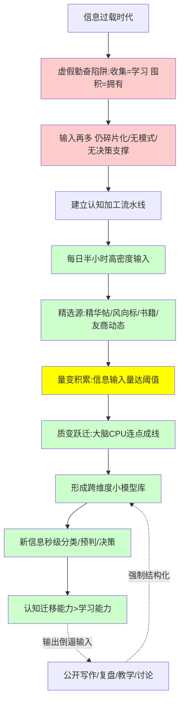

图解说明：从“虚假勤奋陷阱”出发，通过“每日高密度输入+精选源”积累量变，跨越阈值触发“质变跃迁”，形成“小模型库”支撑“秒级决策”与“认知迁移能力”。关键增强回路：输出倒逼输入（L），强制大脑结构化整理，加速模型固化与迭代。

## 67.9 六十分即冲原则 —— 用“行动修正”替代“完美策划”

### 为什么需要这个概念？

完美主义导致“分析瘫痪”：纠结选最优项目/最优合伙人/最优时机，最终错过窗口期。“最优解”成本极高且需“配得上资格”，当下资源禀赋下根本拿不到最优解。市场反馈比主观推演准100倍，行动中修正优于犹豫中观望。

### 核心定义

**六十分即冲原则** 反对寻找“最优解”，主张在当下资源禀赋下，评分60分（不讨厌、可行、不违规）即可启动。核心逻辑：执行力消解焦虑，市场反馈指引迭代，最优解在行动中涌现而非策划中诞生。配套“看见即相信”：普通人通过“看见”（微小结果/他人案例）建立“相信”，降低行动门槛。

> "不是要选择一个最优的什么东西……不期待选到最优，因为成本极高。目前当下还不配，当你配得上的时候，自然而然就出现了。什么东西六十分、差不多，其实就可以冲了。"
> ——《P013, 摘要》

### 关键性质

**启动门槛极低**：不要求热爱、不要求擅长、只要求“不讨厌、能执行、不违法”。

**迭代机制**：启动后通过“正反馈确立→深度聚焦”动态调整，而非静态预设完美路径。

**机会成本视角**：纠结1个月的机会成本远超“试错3次找到方向”的成本。

### 典型例子

**涛哥新人三步起盘法**：盘点手中牌→确立流量产品双核→从小红书切入（不讨厌即可开始）。【来源：docs/202303/TZZwdy53eofCYQxu2xucdoV1nod.md】

**白杨**：把自己当用户体验竞品→两三天订阅10+专栏分析→立即申请开通→一夜搭建框架→次日上线。【来源：docs/202303/20230328_098.md】

**乔合**：16岁兴趣分享软件→7年深耕学生IP→非一日规划成型，而是“干着干着就成了”。【来源：docs/202303/20230328_090.md】

### 边界条件

- 红线不可触：法律/道德/平台核心规则/核心生存资源为硬边界，60分不含“可违规/可赌博”
- 核心方向不可随意变：战略层面（如“做私域/做长期主义/做利他”）需深思熟虑定盘，战术层面才适用60分即冲
- 复盘机制强制性：每周/每月必须复盘，无复盘的“冲”是盲动，有复盘的“冲”是进化

### 方法演进图


图解说明：对比了“完美主义路径”（A-C）与“六十分即冲路径”（D-J）。核心差异在于：前者在策划中追求最优解，成本极高且错过窗口；后者在行动中通过市场反馈迭代涌现最优解。“看见即相信”（K）作为辅助机制，通过微弱正反馈降低启动门槛，形成正向飞轮。

## 67.10 航海制 —— 普通人低成本跑通MVP的“陪跑基建”

### 为什么需要这个概念？

普通人缺乏“标准化SOP/实战教练/同伴互助/正向反馈”四大基建，单打独斗极易偏离/放弃。传统知识付费“只卖课不陪跑”导致学员知行分离、落地率极低。需要一个“结构化训练营”产品形态，将成功路径标准化、陪伴化、社群化。

### 核心定义

**航海制** 生财核心交付产品形态：具备手册SOP、教练陪伴、志愿者协作、圈友共战的结构化训练营。核心价值：降低新人试错成本，通过“跟着走”获得首个正反馈与成长惯性。非传统培训：不讲大道理、只给标准动作、强制打卡、群体见证、导师点评。

> "最好的方式就是跟着航海。因为航海有很多手册、有经验的教练、志愿者，有很多圈友一起在战斗。"
> ——《P013, 摘要》

### 关键性质

**标准化交付**：核心玩法沉淀为《手册》，人人可执行、可复制、可考核。

**陪伴机制**：教练/船长/志愿者提供“即时答疑/进度追踪/情绪托底/作业点评”。

**群体动力**：圈友共战形成“社会性促进效应”，打卡/作业/分享/复盘构建微型确定性系统。

**阶梯设计**：小航海（低门槛/单点技能）→ 大航海（系统项目/商业闭环）→ 航海家俱乐部（资源整合/合伙人）。

### 典型例子

**浅色喵**：社恐萌新 → 航海2月变现1.9万+（门票回本5倍） → 从透明人变主动答疑志愿者。【来源：docs/202303/20230328_035.md】

**高杰**：基于中标风向标，3天完成账号改造/内容生产/全平台分发/私域引流/首单成交，获双料第一。【来源：docs/202303/20230328_110.md】

**作者**：连续11期（231天）航海，全手册精读+100+高手复盘+211次全勤打卡+10篇公开输出+1次线下聚会。【来源：docs/202303/SSizdBAA6oXBmkxRkF7cRwp4n6e.md】

### 边界条件

- 非“交钱躺赚”：航海提供“地图/装备/向导/队友”，走路必须靠自己，执行力为0则收益为0
- 单期专注：建议单次报1-2条船，专注单一项目拿结果，贪多（如年报30+条）必导致消化不良
- 方法论迁移：航海核心价值在于习得“MVP思维/SOP构建/复盘迭代”元能力，而非单一项目玩法

### 方法演进图

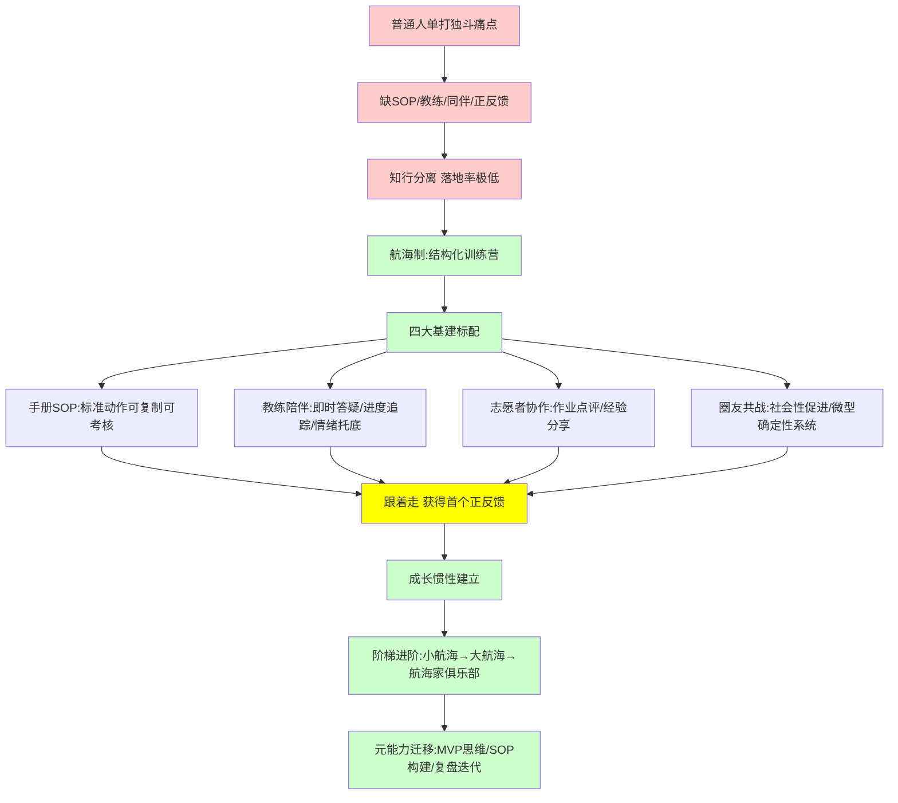

图解说明：展示了航海制如何通过“四大基建”（手册SOP、教练陪伴、志愿者协作、圈友共战）解决普通人“缺基建、知行分离、落地率低”的核心痛点。关键产出是“首个正反馈+成长惯性”，最终目标是习得可迁移的“元能力”（MVP思维/SOP构建/复盘迭代），而非单一项目玩法。

## 67.11 SOP复制放大论 —— 将“会做”变成“能教、能复制、能放大”

### 为什么需要这个概念？

个人单打独斗天花板极低（时间/精力/技能有上限），必须通过“标准化+他人执行”突破。绝大多数项目死于“无SOP”：核心动作藏在创始人脑中、靠口头传授、质量波动大、无法规模化。只有具备SOP的项目才具备“商业资产”属性，可复制、可交易、可估值、可融资。

### 核心定义

**SOP复制放大论** 项目若具备标准化操作手册（SOP），即可通过社群/团队/外包/自动化复制放大规模与收益。

核心公式：
$$\text{商业规模} = \text{单模型产能} \times \text{SOP执行人数} \times \text{执行周期} \times \text{质量合格率}$$

> "（1）如果有项目可以让圈友迅速上手，获得价值；（2）如果已经有SOP，复制给圈友可以放大。"
> ——《P013, 摘要》

生财商业价值在于筛选/孵化具备SOP潜力的项目，而非单纯提供流量或资金。

### 公式推导与逐步解释

**变量定义**：
- **单模型产能**：单人单位时间（如小时/天）在标准化流程下的稳定产出量（如产出内容条数、成交单数、代码行数），记为 $P$。假设SOP执行者按流程可稳定产出70-80分结果。
- **SOP执行人数**：同时执行该SOP的执行主体数量（团队成员/社群圈友/外包人员/RPA脚本/自动化工具），记为 $N$。SOP将创始人隐性知识显性化，使普通人也能稳定执行，打破“执行人数上限=创始人精力上限”的瓶颈，实现 $N$ 的无边界复制。
- **执行周期**：SOP持续有效执行的时间长度（天/月/年），记为 $T$。包含项目生命周期内的持续运营期。
- **质量合格率**：执行产出符合“70分合格制”标准的比例，记为 $Q$（0<Q≤1）。通过“季度复盘/半年重构”机制维持Q在高位。

**推导逻辑**：
1. **单人极限**：无SOP时，创始人单打独斗，商业规模 $= P \times 1 \times T \times Q_{founder}$，受限于创始人时间/精力上限。
2. **SOP接入**：有SOP后，创始人不再亲自执行，而是招募 $N$ 个执行主体（$N$ 可大幅>1），每人产能 $P$、合格率 $Q$。
3. **规模化放大**：总规模 $= P \times N \times T \times Q$。核心杠杆在于 $N$ 的指数级可扩展性——SOP使“执行人数”从“1（创始人）”变为“N（团队/社群/外包/自动化）”，在 $P、T、Q$ 相对固定时，商业规模随 $N$ 线性放大，若 $N$ 自身随时间指数增长（如裂变/自动化），则商业规模呈指数级增长。

**单位量纲分析**：$P$（产出/人·时间）× $N$（人）× $T$（时间）× $Q$（无量纲）= 总产出（无量纲商业规模指标），量纲一致。

**为什么四因素相乘**：因为四因素构成“商业产出”的完整乘法模型——单人产能（强度）× 执行规模（广度）× 时间跨度（长度）× 质量保障（厚度），缺一不可。若任何因子为0（如无SOP导致Q≈0、无执行人N=0、周期T=0），总规模归零。

### 公式作用说明

该公式量化了SOP驱动的规模化放大机制。单模型产能（单人单位时间产出）固定时，通过增加SOP执行人数（团队/社群/外包）、延长执行周期（持续运营）、提升质量合格率（70分合格制+持续迭代），实现商业规模的指数级增长。核心杠杆在于“执行人数”的无边界复制——SOP将创始人的隐性知识显性化，使普通人也能稳定产出70-80分结果。

### 关键性质

**SOP构建三步法**：穷尽题库（全客户旅程高频问题）→ 建内容库（标准答案文档/视频/音频）→ 拆解任务（分发/剪辑/排版/SEO/回复外包分工）。

**“70分合格制”**：不追求100分完美，让普通人按流程产出70-80分稳定结果，通过量变对抗质变。

**AI喂养模式**：核心业务拆解为标准化问题库与SOP，像“喂养AI”一样“喂料”给员工/RPA/自动化脚本。

### 典型例子

**斩天**：内容工业化生产线——创始人梳理问题库→半个月集中产出答案库→外包分发/剪辑/多平台同步→季度迭代。【来源：docs/202303/20230328_101.md】

**乔合**：百度答题SOP“机器人给答案-人工修改-复制粘贴”+模拟器多开 → 近1000学员操作、单号日利润20元、周回本。【来源：docs/202303/20230328_090.md】

**视频号航海教练李诚**：1000+账号拆解表工具包+标准化拆解驱动快速出单，支撑40+店铺/120+账号/月销200万+。【来源：docs/202303/20230328_139.md】

### 边界条件

- 非标服务难SOP：高度依赖个人天赋/经验/判断的服务（如高端咨询/艺术创作/复杂手术）难以标准化
- SOP需持续迭代：平台规则变/用户需求变/工具迭代，固化SOP即死亡，需建立“季度复盘/半年重构”机制
- 核心决策不可SOP：战略选择/人才定级/资源分配/危机处理等高杠杆决策，必须由主理人亲历把控

### 方法演进图

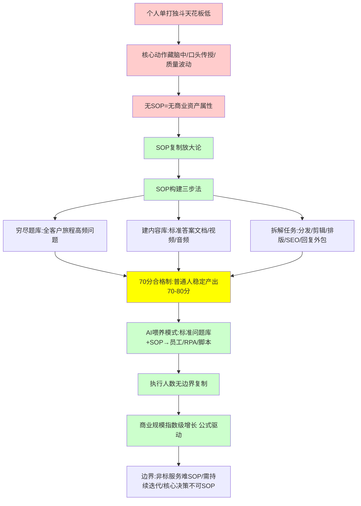

图解说明：从“个人天花板”问题出发，通过SOP三步法（穷尽题库→建内容库→拆解任务）构建“70分合格制”标准，接入“AI喂养模式”实现执行人数无边界复制，由核心公式驱动商业规模指数级增长。底部标注三大边界条件，提醒SOP应用的适用范围与维护要求。

## 67.12 项目筛选五维指标体系 —— 乔合的“避坑雷达”

### 为什么需要这个概念？

创业者面对海量机会无从下手，或因贪多/贪快/贪大陷入“伪需求/红海/违规/不可复制”陷阱。缺乏标准化评估框架，决策靠直觉/运气/大佬推荐，成功率极低。需要一套可量化、可操作、可迭代的项目筛选清单，将主观判断客观化。

### 核心定义

**五维项目筛选指标体系** 乔合总结的选品标准化框架，包含五个维度：

1. **操作难度**：需可复制粘贴/傻瓜化执行，无高技能门槛
2. **平台规则**：顺应平台鼓励方向，非对抗算法/钻漏洞
3. **项目绿色**：合规安全，无法律/账号/资金风险
4. **可批量化**：支持多号/模拟器/矩阵放大收益
5. **周期与利润**：长期主义+快速回本（如百度答题周回本），拒绝长周期慢变现

> "项目考量的指标在以下几个方面： 1）操作难度 2）平台规则 3）项目绿色 4）可不可批量化 5）项目周期和利润"
> ——《P010, 摘要》

### 关键性质

**一票否决制**：任一维度不达标（如违规/高难度/不可批量/长周期无回本）直接PASS。

**场景化权重**：新人期权重“操作难度/绿色/快回本” > “利润上限”；规模期权重“可批量/平台规则/利润” > “操作难度”。

**动态更新**：平台规则变/红利期过/竞争加剧，指标阈值需随之调整（如百度答题从蓝海变红海）。

### 典型例子

**百度答题**：操作难度低（复制粘贴改答案）、平台鼓励（需专业答主）、绿色合规、模拟器多开批量化、单号日利润20元/周回本 → 通过筛选。【来源：docs/202303/20230328_090.md】

**劳务/求职模式**：用户流失率高（非全生命周期刚需）、难批量化、合规风险大 → 被乔合筛掉。【来源：docs/202303/20230328_090.md】

**闲鱼二手书**：笨功夫优于技术流（人工精选/手动上架/人工养号）→ 符合“绿色/可批量/平台规则”但操作难度稍高。【来源：docs/202303/20230328_086.md】

### 边界条件

- 非绝对真理：指标体系基于“学生私域/知识付费/轻资产”模型总结，重资产/重技术/重品牌模型需调整权重
- 需配合“止损机制”：单账号累计100条作品无单果断切换（短剧CPS止损线）【来源：docs/202303/20230328_146.md】
- 核心判断力不可外包：指标是工具，决策是人。无判断力时选“不讨厌”即可开始（六十分即冲），有判断力时用指标优化

### 方法演进图

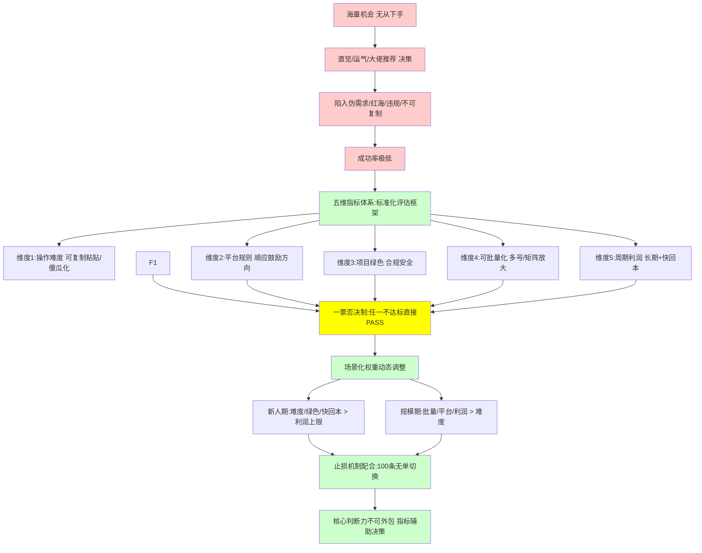

图解说明：展示了从“海量机会决策困境”到“五维指标体系标准化筛选”的完整路径。核心机制是“一票否决制”（G）配合“场景化权重动态调整”（H），并内置“止损机制”（I）。最终强调指标是工具，核心判断力不可外包（J），无判断力时回归“六十分即冲”原则。

## 67.13 学生私域全生命周期LTV矩阵 —— “韭菜大队”自嘲下的商业闭环

### 为什么需要这个概念？

单一变现模式（如仅做培训/仅卖货）天花板低、抗风险弱、用户生命周期短。学生群体从入校→在校→毕业→求职→入职，需求全维度变化，单一产品无法覆盖。需要构建“低客单引流→高客单复购→多品类交叉→分销裂变”的立体变现体系。

### 核心定义

**学生私域全生命周期LTV矩阵** 围绕学生群体全生命周期需求，布局多元业务矩阵最大化单用户终身价值（LTV）：

1. **知识付费**（副业入门/技能进阶）：低客单价（188-388）快速回本建信任，高客单价（2588-5888）深度变现
2. **流量卡**（通讯刚需）：高频、高复购、决策链路短、全人群覆盖
3. **潮牌/球鞋**（身份认同消费）：非项目参与用户的主力变现路径，利润率高、品牌溢价强
4. **分销佣金**：用户转化为渠道，零成本获客

核心策略：规避劳务/求职等“用户流失率高、单次变现、高流失”的非刚需赛道。

> "我们在项目这里，做了个价格策略——低价的客单价，让第一次上我们项目的客户回本，增加信任感，后期再推荐上千或者几千客单价的项目。"
> ——《P010, 摘要》

### 关键性质

**阶梯定价信任模型**：低价快速回本（7-10天）建立极强信任 → 高复购率 → 高客单价自然转化。

**“韭菜大队”自嘲文化**：群名自我调侃，幽默化解“割韭菜”刻板印象，增强归属感与裂变动力。

**信任先于变现**：极致利他（帮学生解决零花钱）建立商业信任基石，信任是变现前置条件。

**刚需全覆盖**：副业/通讯/消费/分销四大刚需业务，实现“流量零浪费、全周期变现”。

### 典型例子

**乔合**：累计私域40-50万粉丝，分销榜第一名（1000单+），合作大佬项目变现30万+，验证模型商业有效性。【来源：docs/202303/20230328_090.md】

**百度答题实测**：近1000学员、单号日利润20元、188元学费周回本，构建信任阶梯基石。【来源：docs/202303/20230328_090.md】

### 边界条件

- 人群特异性强：该模型高度依赖“15-20岁学生”画像（易带节奏/无心眼/赚钱欲望强/潮牌消费力），迁移至宝妈/职场/银发需重构画像与产品
- IP强绑定：核心护城河是“乔合个人IP”，模式/玩法/渠道可复制，但“陪伴成长的情感连接”不可复制
- 平台风险：私域沉淀于微信生态，若微信封号/限流/政策变化，流量资产面临归零风险，需多平台分流

### 方法演进图

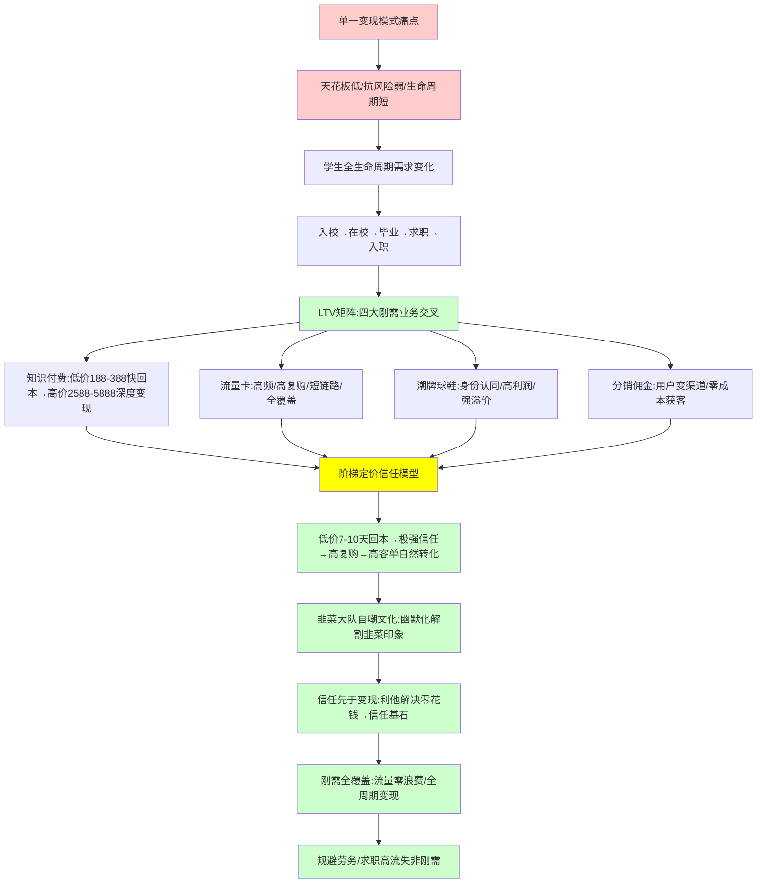

图解说明：从“单一变现痛点”出发，针对学生全生命周期需求变化（D），构建四大刚需业务矩阵（E-F1~F4），通过“阶梯定价信任模型”（G-H）实现低价快回本→信任→高复购→高客单的转化链条；“韭菜大队自嘲文化”（I）与“信任先于变现”（J）作为心理与战略双护城河，最终实现“刚需全覆盖、流量零浪费”（K）并规避高流失赛道（L）。

## 67.14 IP不可复制性护城河 —— 时间陪伴筑起的绝对垄断

### 为什么需要这个概念？

玩法/渠道/工具/模式均可复制、公开、贩卖，唯有“时间积累的信任资产”不可复制、不可购买、不可转移。多数创业者过度投入“寻找秘密玩法”，而忽视“建立长期信任资产”的复利本质。需要将“个人IP”重新定义为“陪伴用户成长的情感连接+长期主义坚守”，而非“人设包装/流量收割”。

### 核心定义

**IP不可复制性护城河** 核心壁垒在于：项目模式/引流玩法/运营细节可公开复制，但“人”的成长历程、与用户共同成长的情感连接、长期主义的坚守构成的个人IP是唯一不可复制的核心护城河。

- **信任资产复利**：私域高成交核心基础是长期累积信任资产（线下服务信任/社群分享信任/朋友圈持续输出信任）
- **时间护城河**：抱着“一年不赚钱”准备去做，坚持5-10年，形成“十年无竞争”绝对垄断

> "我的项目模式，引流模式，核心玩法，给无数个人说过，但是没有第二个我。"
> ——《P010, 摘要》

> "很多给我付费的学生用户，都是从初中到毕业，看着我成长的，我也是看着我粉丝长大的。"
> ——《P010, 摘要》

### 关键性质

**陪伴者定位**：知识IP本质是“从知道到做到的陪伴者”，核心价值在于帮助客户消化知识、落地实操、获得真实改变。

**信任显性化**：通过朋友圈专栏化（观念/专业/生活/附加价值）、社群高频互动、线下见面会、免费咨询等动作显性化信任资产。

**反向筛选**：高客单价（如5888元）本身即是筛选优质客群的门槛，提升成交率与服务质量。

### 典型例子

**乔合**：7年坚持，粉丝从初中看到毕业，“没有第二个我”，分销榜第一名、合作大佬变现30万+。【来源：docs/202303/20230328_090.md】

**李诚（视频号航海教练）**：连续3年年入百万、矩阵30万粉、1000+账号拆解表工具包，深度服务学员建立IP护城河。【来源：docs/202303/20230328_139.md】

**叁叁（孕期垂直IP）**：专业人设信任背书×高频内容曝光量×低门槛私域转化路径×MVP快速变现，10天涨粉1000+引流私域。【来源：docs/202303/20230328_161.md】

### 边界条件

- 需“内容+服务”双轮驱动：纯内容无服务=低信任/低客单；纯服务无内容=无流量/无杠杆
- 避免“专家诅咒”：创始人越专业越易“以专业为中心而非用户为中心”，需刻意保持“松弛/真诚/示弱”姿态
- 平台分发权不等于IP所有权：公域粉丝归平台，仅私域信任资产归自己，必须持续“公域引流→私域沉淀”

### 方法演进图

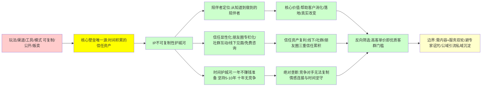

图解说明：对比了“可复制要素”（A）与“核心壁垒唯一源”（B），确立IP护城河的三大支柱：陪伴者定位（D1）、信任显性化（D2）、时间护城河（D3）。三者汇聚于“反向筛选”（H）：高客单价本身即筛选门槛，提升成交率与服务质量。边界条件（I）提醒双轮驱动、避专家诅咒、公私域联动。

## 67.15 心力撑开机制 —— 主动承接不确定性的成长健身房

### 为什么需要这个概念？

创业过程本质是“不确定性接力赛”，回避难题=回避成长，导致能力半径永远覆盖不了业务半径。多数人陷入“舒适区陷阱”：只做会做的事、避开不会做的事、用勤奋掩盖战略懒惰。需要建立“主动找难题、主动解难题、主动复盘难题”的心力训练闭环。

### 核心定义

**心力撑开机制** 将心力比作肌肉，通过主动承接更大难题、经历更多不确定性（好与坏），被动“撑开”认知格局。

核心心法：你做的事情越大，遇到的难题越大。心力不断被撑开。经历多了，格局打开，“都经历过，不过如此”，形成抗压韧性：如体育锻炼般，通过高强度间歇训练（HIIT）式的创业挑战，建立心理免疫系统。

> "你做的事情越大，遇到的难题越大。心力不断被撑开。经历多了，格局打开，很多事情“都经历过，不过如此”，抵抗力自然就强了，就像体育锻炼一样。"
> ——《P013, 摘要》

> "无技术护城河时，唯一壁垒是‘比对手更能扛、活得更久’；克服自认为克服不了的困难，即构建了壁垒。"
> ——《P036, 摘要》

### 关键性质

**非被动承受**：非指“熬着熬着就过去了”，而是“主动拆解难题→调动资源解决→复盘提炼方法论→沉淀SOP”。

**痛苦即课程**：每个崩溃/焦虑/恐惧/挫折时刻，都是认知升级的最佳窗口，需建立“创伤→复盘→成长”转化通道。

**规模效应**：抗压持久力是普通创业者唯一核心壁垒（元气森林创始人语），比对手更能扛、活得更久即赢。

### 典型例子

**亦仁**：从“融资败光→贪快亏损→承认平凡深耕二手书年利润百万→有基本盘谋求高天花板”四阶段实证轨迹。【来源：docs/202303/20230328_004.md】

**王永超**：辍学打工→疫情居家创业→入生财认知跃迁→闲鱼3天出单7天利润破百→视频号带货放弃→重拾闲鱼雇2人操作20号矩阵。【来源：docs/202303/20230328_036.md】

**晓飞**：短剧CPS投入10.2万、月流水77万、分成到手60万，深度拆解人员筛选/薪酬迭代/原创度洗稿/代理商避坑全过程。【来源：docs/202303/20230328_036.md】

### 边界条件

- 需建立“心理安全网”：家庭支持/现金流托底/导师兜底/社群陪伴，避免单次重创导致彻底崩溃
- 区分“成长性痛苦”与“消耗性痛苦”：前者可转化为能力/认知/资产，后者仅耗损身心（如无效内耗/恶性纠纷/赌博性投机）
- 配合“臣服当下”：认知“无常”为常态，通过“瞅了瞅”具象化创伤将恐惧转化为可应对对象，聚焦“从创伤走出来的自己”

### 方法演进图

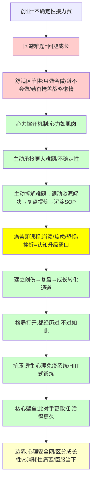

图解说明：从“创业本质=不确定性接力赛”出发，揭示“舒适区陷阱”（C）的危害，引入“心力撑开机制”（D）作为对策。核心路径：主动承接难题（E）→ 标准化解题闭环（F）→ 痛苦即课程转化（G-H）→ 格局打开与抗压韧性形成（I-J）→ 构建核心壁垒（K）。边界条件（L）确保过程可控、可持续。

## 67.16 高维特质画像 —— 赚大钱者的“隐形简历”

### 为什么需要这个概念？

外界过度关注“技术/方法/工具/项目”，而忽视决定上限的“底层特质/心智模式/价值观”。招聘/合伙/投资/学习榜样时，缺乏识别“高维玩家”的标准画像，易被表象迷惑。需要提炼可观察、可验证、可模仿的高维特质清单，作为自我进化与人才筛选的北极星。

### 核心定义

**高维特质画像** 概括赚到大钱者的五大共性（亦仁/杨涛/资深投资人观察）：

1. **谦虚真诚**：反向求教、不装大、敢承认不懂
2. **好学敏感**：新事物即试、保持好奇、快速上手
3. **反常规选择**：主动避开红海、走差异化路径、敢于孤独
4. **松弛状态**：不焦虑、不急躁、从容掌控节奏
5. **直击本质**：一针见血、穿透现象看本质、不纠结枝节

外在映射：物欲低、低调不张扬。

> "（1）谦虚。（2）好学。（3）选择异于常人。（4）状态是放松悠闲的。（5）思考直击本质。"
> ——《P013, 摘要》

> "（1）谦逊低调不张扬。（2）物欲很低"
> ——《P015, 摘要》

### 关键性质

**可习得性**：非天生基因，而是长期“高质量输入+高强度实战+高频复盘”训练出的心智肌肉。

**相互强化**：谦虚→得真传→好学→建模型→反常规→避红海→松弛→抗压→直击本质→决策精准，形成正向飞轮。

**识别启发式**：真大佬鼓励而非贬低、分享细节而非卖课、关注你成长而非你钱包。

### 典型例子

**亦仁**：半小时处理常人3-4小时信息、主动看帖/复盘/办线下局、连续多期担任航海教练、拒收红包但感知诚意给深度指导。【来源：docs/202303/TZZwdy53eofCYQxu2xucdoV1nod.md】

**斩天**：PC时代站长→主动躺平构建矩阵→极简成交闭环+低价信任代偿+项目公司化核算→分享“绝技现世律”预警新人。【来源：docs/202303/20230328_101.md】

**乔合**：16岁起步坚持7年、分享全套玩法无人能复制、利他优先（帮学生解决零花钱）、物欲低（未提奢华消费）。【来源：docs/202303/20230328_090.md】

### 边界条件

- 非道德评价体系：非指“要做好人”，而是“这些特质在商业博弈中胜率最高”
- 阶段性差异：早期需“反常规/好学/谦虚”突围，后期需“松弛/直击本质/直觉”掌舵
- 伪装成本高：伪装谦虚/松弛/直击本质极难持久，实战压力测试下极易露馅（如面对挫折时的情绪反应）

### 方法演进图

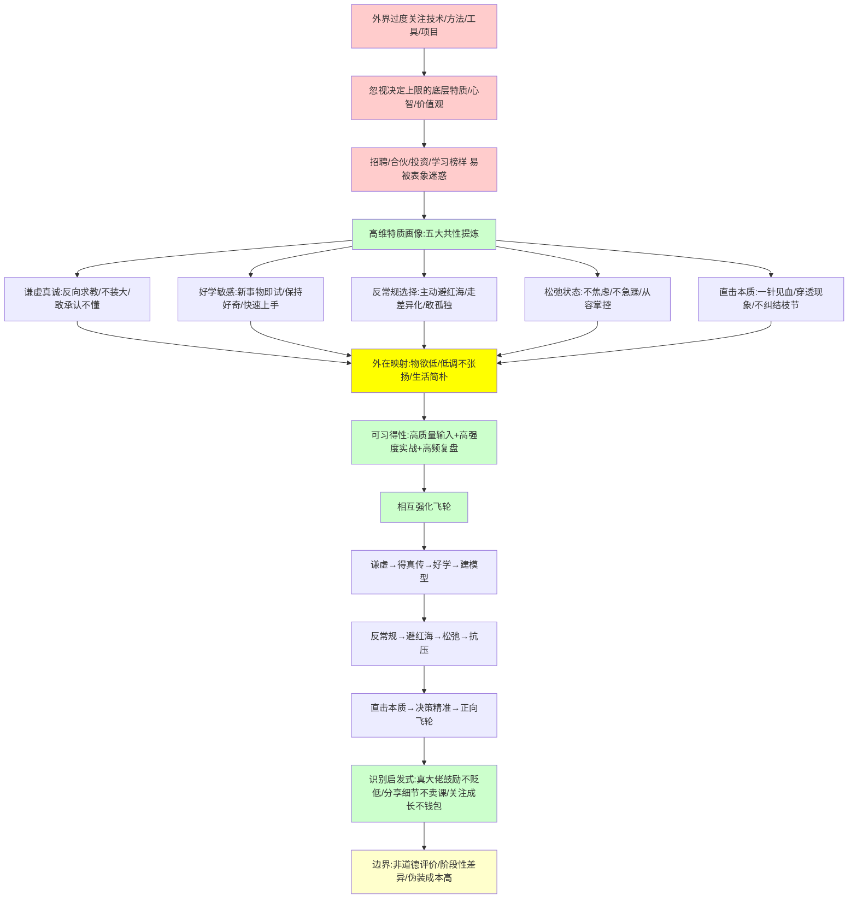

图解说明：从“外界关注偏差”（A-B）出发，提炼“五大共性”（D-E1~E5）与“外在映射”（F），揭示“可习得性”（G）与“相互强化飞轮”（H-H3）机制，提供“识别启发式”（I）作为实操工具，标注边界条件（J）防止误用。

## 67.17 看见即相信 —— 降低行动门槛的认知跳板

### 为什么需要这个概念？

传统心理学主张“相信才能看见”，导致普通人陷入“缺乏信心→不敢行动→无结果→更缺乏信心”死循环。普通人缺乏“内生性信心”，必须依靠“外源性证据”（微小结果/他人案例/实战演练）启动行动。需要反转因果链条，建立“行动→微小结果→信心→更大行动”的正向飞轮。

### 核心定义

**看见即相信** 修正“相信才能看见”的因果倒置，主张普通人通过“看见”（航海实战/他人案例/微小结果）建立“相信”。

核心逻辑：先有“行为/执行”，产出“可见反馈”，大脑据此生成“能力信念”，进而驱动更大规模行动。降低行动门槛：不需要“确信成功”才开始，只需要“看见可能”即可启动。

> "我们是普通人，可能做不到因为相信所以看见，但我们都可以因为看见所以相信。"
> ——《P013, 摘要》

> "当你真正开始的时候，你会喜欢这种感觉。"
> ——《P098, 摘要》

### 关键性质

**微弱信号放大**：一个赞/一条评论/一单成交/一条复盘，被放大为“我能行”的关键证据。

**社群放大器**：高密度实战社群（如航海）提供密集的“看见机会”——他人出单/打卡/复盘/分享，持续注入信心。

**正向循环**：当你真正开始的时候，你会喜欢这种感觉（多巴胺/成就感/掌控感），过程即奖赏。

### 典型例子

**作者**：付费加入生财后强迫自己首发，获得社群正向互动，验证“主动输出破圈”即时有效性。【来源：docs/202303/TZZwdy53eofCYQxu2xucdoV1nod.md】

**白杨**：刷朋友圈立马订阅竞品专栏→“我=大多数用户”→当即申请开通专栏→一夜搭建框架→6天售出80单。【来源：docs/202303/20230328_098.md】


### 边界条件

- 非盲目乐观：必须基于真实的市场反馈（哪怕极微弱），而非自我催眠/鸡汤/幸存者偏差案例
- 需“最小可行性行动”：（MVP/首发/首单/首次打卡），大动作无法启动时，拆解到“能立即做完的微动作”
- 防“虚假正反馈”：亲友捧场/平台补贴/刷单/数据造假不产生真实信心，反而扭曲决策模型

### 方法演进图

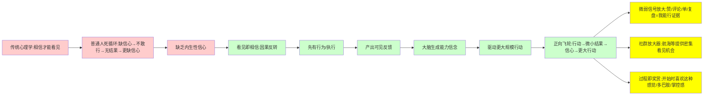

图解说明：对比了“传统因果链”（A-B）导致的死循环与“看见即相信”重构的正向飞轮（D-L）。关键在于因果反转（D）：行动在前，信念在后。三大放大机制（J-L）协同工作：微弱信号放大（J）将微小结果转化为信心证据；社群放大器（K）提供密集的看见机会；过程即奖赏（L）通过即时正向体验强化行动倾向。

## 67.18 新人三步起盘法 —— 从“手中牌”到“流量+产品”双核引擎

### 为什么需要这个概念？

新人常陷入“技术准备/工具选择/平台研究/完美策划”的伪勤奋，迟迟不敢启动核心动作。缺乏“资源盘点→核心变量锁定→最小行动启动”的标准化启动流程。需要一个“防伪勤奋、防工具中毒、防决策瘫痪”的极简起盘清单。

### 核心定义

**新人三步起盘法** 涛哥针对小白的标准化启动流程：

1. **盘点手中牌**：钱（启动资金/容错预算）、时间（可投入时长/周期）、资源（人脉/渠道/技能/信息）、技能（硬技能/软技能/认知模型）
2. **确立双核心变量**：赚钱只有2件事——流量（从哪来人）+ 产品（卖什么/怎么转化）
3. **去工具中毒**：平台只是工具，不要中毒，建议从小红书切入（门槛低、转化强、去中心化算法）

> "（1）码一下你手上的牌有什么……（2）一个观念：赚钱真的不难，只有2件事流量和产品；（3）不要中毒：互联网所有的平台都是工具而已……个人建议从小红书开始。"
> ——《P013, 摘要》

### 关键性质

**极简主义**：砍掉所有非“流量/产品”动作（如注册公司/办商标/买课/学工具/搭官网/设VI）。

**动态匹配**：根据“手中牌”选择匹配的项目级别（初/中/高），避免“手里拿把AK却去打水漂”。

**启动导向**：盘点完成即刻启动“流量获取/产品交付”最小动作，而非继续完善计划。

### 典型例子

**浅色喵**：盘点“社恐/时间碎片/擅长整理” → 确立“朋友圈整理/资料分享”产品 → 小红书/生财社群获流 → 2月航海变现1.9万+。【来源：docs/202303/20230328_035.md】

**高杰**：盘点“ChatGPT认知/内容生产力” → 确立“风向标MVP”产品 → 3天跑通全链路 → 获双料第一。【来源：docs/202303/20230328_110.md】

**白杨**：盘点“知识付费运营经验/内容资产/公司背书” → 确立“小报童专栏”产品 → 一日速成上线。【来源：docs/202303/20230328_098.md】

### 边界条件

- “手中牌”需诚实盘点：虚报资源/高估技能/低估时间成本会导致项目级别错位，陷入“资源不匹配”的死局
- “流量+产品”双核缺一不可：有流量无产品=流量浪费；有产品无流量=库存积压
- 平台选择非绝对：小红书适合“非标/内容/私域/低门槛”，标品/直播/重投流/男性用户可能更适配抖音/视频号/快手。【来源：docs/202303/20230328_069.md】

### 方法演进图

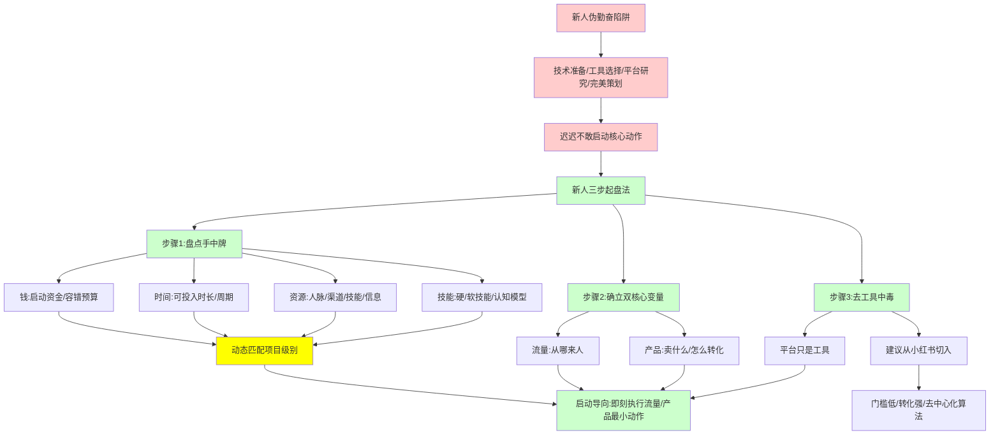

图解说明：从“伪勤奋陷阱”（A-C）出发，三步起盘法（D）提供标准化启动流程：步骤1盘点四维资源（E1a-E1d），步骤2锁定流量产品双核（E2a-E2b），步骤3去工具中毒聚焦小红书（E3a-E3c）。核心输出：动态匹配项目级别（F）→ 即刻启动最小动作（G），避免“资源不匹配死局”与“继续完善计划”的拖延。

## 67.19 项目筛选决策树 —— 从“纠结选最优”到“低成本试错快速验证”

### 为什么需要这个概念？

新人无判断力时陷入“纠结选最优”的决策瘫痪，或盲目跟风大佬项目导致资源错配。缺乏“入口低→试错验证→正反馈确立→深度聚焦”的动态决策框架。需要一套“防决策瘫痪、防资源错配、防沉没成本”的标准化决策流程图。

### 核心定义

**项目筛选决策树** 亦仁与涛哥联合提出的项目选择框架：

- 入口低（不讨厌即可，六十分即冲）
- → 试错验证（航海/随意选一条船/低成本MVP）
- → 正反馈确立（赚到钱/沉淀资源/拿到微弱信号）
- → 深度聚焦（时间价值高则专注长期，建立护城河）

核心判断点：你是希望通过这个项目沉淀资源，还是只想赚钱？多长时间赚到多少钱？

> "当你没有判断力的时候，不需要特地去选“最适合自己的项目”，只需要选一个不讨厌的就可以开始。"
> ——《P013, 摘要》

### 关键性质

**非线性决策**：不预设完美路径，在行动中发现适合自己的路（如家蒙坚持知乎好物、乔合深耕学生IP）。

**止损机制内置**：单项目累计100条作品无单果断切换（短剧CPS）、亏损300元止损（百度竞价）【来源：docs/202303/20230328_146.md、docs/202303/20230328_172.md】。

**资源动态匹配**：时间价值低时“广撒网/多试错”，时间价值高时“专注深耕/建壁垒”。

### 典型例子

**家蒙**：入圈零基础 → 知乎好物前3月入账1.37元 → 坚持耐受期 → 年入百万，亦仁曾建议换赛道但其坚持成功。【来源：docs/202303/TZZwdy53eofCYQxu2xucdoV1nod.md】

**乔合**：16岁兴趣分享软件 → 非一日规划，而是“干着干着就成了” → 7年深耕学生IP成护城河。【来源：docs/202303/20230328_090.md】

**白杨**：嗅觉发现小报童平台 → 两三天订阅10+竞品分析 → 立即申请 → 一夜框架 → 次日上线 → 内测6天1.5万GMV。【来源：docs/202303/20230328_098.md】

### 边界条件

- “不讨厌”≠“随便选”：需通过“五维指标体系”初筛（绿色/合规/可批量/操作难度可控/周期利润可预期）
- “试错”需设定预算：时间预算（如21天/1个月）、金钱预算（如学费/测品费/投流费）、精力预算（不影响主业/健康）
- 正反馈定义需量化：收入>0 / 获客成本<阈值 / 复购率>阈值 / 沉淀种子用户>阈值 / 产出可复用SOP/内容资产

### 方法演进图

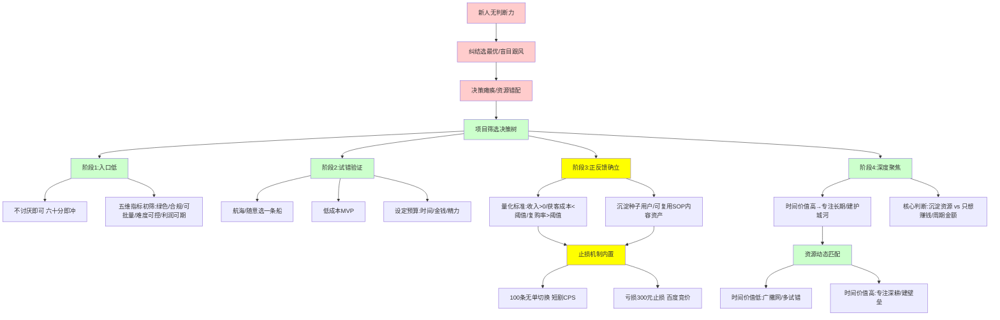

图解说明：展示了决策树的四阶段流程（入口低→试错验证→正反馈确立→深度聚焦）及其关键机制。核心创新在于：①入口低门槛（E1）配合五维指标初筛（E2）防随意；②试错设定三维预算（F3）防失控；③正反馈量化定义（G1-G2）防虚假；④内置止损机制（I1-I2）防沉没；⑤资源动态匹配（J1-J2）适配不同阶段。

## 67.20 时薪外包决策法 —— 用“买时间”换“战略高度”

### 为什么需要这个概念？

创业者常陷入“省钱不雇人、自己干细节、CEO变成高薪打工仔”的陷阱，战略视野被执行细节吞噬。缺乏“何时雇人、雇什么人、怎么管人”的量化决策标准，要么过早雇人拖垮现金流，要么过晚雇人错失规模窗口。需要基于“个人时薪 vs 雇佣成本时薪”的数学模型指导组织扩张决策。

### 核心定义

**时薪外包决策法** 创业者基于自身时薪（月收入/有效工时）与助理市场时薪的比价，决策何时雇佣助理释放高价值时间。

核心公式：
$$\text{若 个人时薪} \gg \text{雇佣成本时薪，立即组建团队}$$
例：月入10万、有效工时50h → 时薪2000元；雇助理时薪100元 → 杠杆率20倍 → 必须立即雇人。

> "你一个月赚10w，时薪￥2k，就应该请一个时薪￥100的助理，把你的时间释放出来。"
> ——《P013, 摘要》

### 公式推导与逐步解释

**变量定义**：
- **个人有效时薪**：$ \frac{\text{月收入（税后净利润/可支配现金流）}}{\text{有效工作工时（扣除无效会议/通勤/娱乐/睡眠后的纯执行/决策时间）}} $，单位：元/小时。例如：月入10万、有效工时50h → 时薪2000元/小时。
- **雇佣成本时薪**：市场上雇佣可胜任“执行/运营/客服/剪辑/发布/数据录入”等非核心决策工作的人员/外包/自动化工具的小时成本，单位：元/小时。例如：兼职助理/外包剪辑/客服外包约100元/小时。
- **杠杆率**：$ \frac{\text{个人有效时薪}}{\text{雇佣成本时薪}} $，无量纲。

**推导逻辑**：
1. **机会成本视角**：创业者每亲自执行1小时低价值工作（如剪辑视频/回复客服/整理数据），即放弃了1小时高价值工作（战略决策/IP建设/核心谈判/链接贵人）的机会。该1小时的机会成本 = 个人有效时薪 - 雇佣成本时薪。
2. **决策边界**：当杠杆率 > 5-10倍时，每小时亲自执行低价值工作的隐性损失显著为正，且随时间累积呈指数级放大。此时“买时间”（雇人/外包）的ROI远高于“省钱自己干”。
3. **立即行动**：一旦跨越边界，应立即组建团队/外包，将低价值工作剥离，释放高价值时间聚焦战略/决策/IP建设。

**单位量纲分析**：个人时薪（元/小时）÷ 雇佣时薪（元/小时）= 杠杆率（无量纲），符合倍率定义。

**为什么用“远大于”而非“等于”**：因为雇佣/管理存在隐性成本（招聘成本/磨合期/沟通开销/风险溢价），仅当杠杆率显著>1（建议5-10倍）时，净收益为正且足以覆盖隐性成本。

### 公式作用说明

该公式提供了一个清晰的数学决策边界。当个人时薪显著高于雇佣成本时薪（杠杆率>5-10倍），每亲自执行一小时低价值工作，即等于损失（个人时薪-雇佣成本）的机会成本。决策逻辑：计算个人有效时薪 → 对比市场雇佣时薪 → 若杠杆率达标立即组建团队 → 释放高价值时间聚焦战略/决策/IP建设。

### 关键性质

**确定性前置**：业务确定性高（已跑通SOP/有稳定现金流/有清晰SOP）时招人买时间；探索期（未跑通/现金流不稳）不招人避成本。

**分层外包**：核心决策/战略方向/关键谈判/IP建设由主理人亲历；执行/运营/客服/剪辑/发布/数据录入全外包/雇佣。

**成本结构优化**：固定成本（工资/房租/工具）压至最低，变动成本（佣金/外包/按需采购）随业务波动。

### 典型例子

**亦仁**：主理人亲历原则——亲自审阅风向标/精华帖，仅靠下属汇报会导致信息失真、方向跑偏，认知高度决定组织上限。【来源：docs/202303/TZZwdy53eofCYQxu2xucdoV1nod.md】

**斩天**：单枪匹马躺赚矩阵，技术入股力气、资金入股钱、回报率阈值超正负即迭代或放弃，无固定团队成本。【来源：docs/202303/20230328_101.md】

**李诚**：40+店铺/120+账号/月销200万+，团队化运营但核心方向把控权未委托，标准化拆解驱动快速出单。【来源：docs/202303/20230328_139.md】

### 边界条件

- 核心方向把控权不可委托：主理人必须亲审一线信息，认知高度决定组织上限
- 招人重“成就型动机”轻“技能匹配”：筛选“信愿景/图成长”而非“图钱/图稳”，前者更适应创业高不确定性
- 避免“圣母心”：人岗不匹配果断调整，拒绝硬留不合适的人，依据业务阶段匹配岗位

### 方法演进图

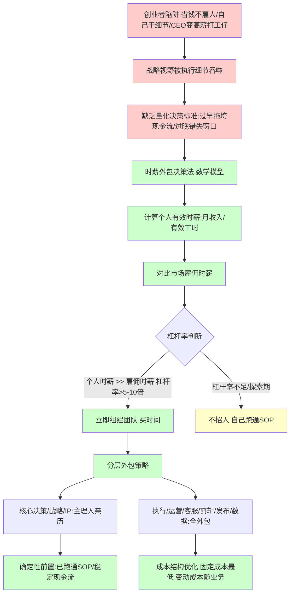

图解说明：从“CEO变高薪打工仔”陷阱（A-B）出发，通过数学模型（D-F）计算杠杆率，形成明确决策分叉（G）：高杠杆率立即组建团队（H），低杠杆/探索期自己跑通SOP（I）。团队组建后执行“分层外包”（J）：核心由主理人亲历（J1），执行全外包（J2），前提是“确定性前置”（K），目标是“成本结构优化”（L）。

## 67.21 反卷生存法则 —— 避开蛮力红海，寻找认知护城河

### 为什么需要这个概念？

“努力即有结果”的赛道（如发传单/刷单/搬运/基础剪辑）吸引大量低成本竞争者（学生/宝妈/兼职），陷入无限内卷。后发者时间成本低、边际成本低、容错率高，先发者无法靠“更努力”建立壁垒，只能靠“认知/资源/品牌”差异化。需要建立“主动避开红海、主动寻找高门槛赛道”的战略选择框架。

### 核心定义

**反卷生存法则** 在“努力即有结果”的赛道上，后发者将面临无限内卷（年轻人时间成本低）。高手应主动避开纯靠蛮力堆砌的红海，转向需认知门槛/资源门槛/品牌护城河的非标准化赛道。核心策略：保证效率3倍同时时间3倍，他人永远追不上（复利护城河）。

> "以前自己也很卷，现在会避开需要非常努力才能拿到结果的事情。因为一件事如果努力就有结果，就会有很多年轻人卷进来，你是卷不过他们的。"
> ——《P013, 摘要》

> "我要保证我的工作效率是别人3倍的同时，工作时间也是别人的3倍，这样别人就永远追不上我了"
> ——《P011, 摘要》

### 关键性质

**赛道特征识别**：纯执行/标准化/低门槛/可量化/即时反馈/无品牌溢价 = 红海（必卷）；非标/需判断/需信任/需积累/长周期/高客单/强品牌/强IP = 蓝海（可建壁垒）。

**竞争维度跃迁**：从“比谁快/比谁多/比谁便宜” → “比谁懂/比谁信/比谁稳/比谁久”。

**组织进化**：从“人海战术” → “SOP+工具/AI+少数核心人才” → “品牌/IP/生态/平台”。

### 典型例子

**斩天**：放弃“精耕细作单一项目”，转向“躺赚矩阵+SEO免费流量+极简成交+低价信任”，用“模式创新”对抗“执行内卷”。【来源：docs/202303/20230328_101.md】

**乔合**：主流大佬看不上学生市场（认知门槛），乔合深耕7年建立“十年无竞争”绝对垄断IP。【来源：docs/202303/20230328_090.md】

**视频号书豪**：放弃“追热点/搬运混剪”红海，转向“原创内容+垂直IP+团队化+直播高客单”，构建长期主义护城河。【来源：docs/202303/20230328_054.md】

### 边界条件

- 非完全放弃执行：执行力是1，认知/策略/方向是放大器；执行力为0，任何神策略收益为0
- 认知门槛需真实：伪装的“高认知/高门槛”经不起市场检验，需具备真实的“知识壁垒/资源壁垒/品牌壁垒/数据壁垒”
- 动态调整：红利期可“蛮力冲规模”，成熟期必须“认知建壁垒”，衰退期需“资源找出口”，阶段性策略不可固化

### 方法演进图

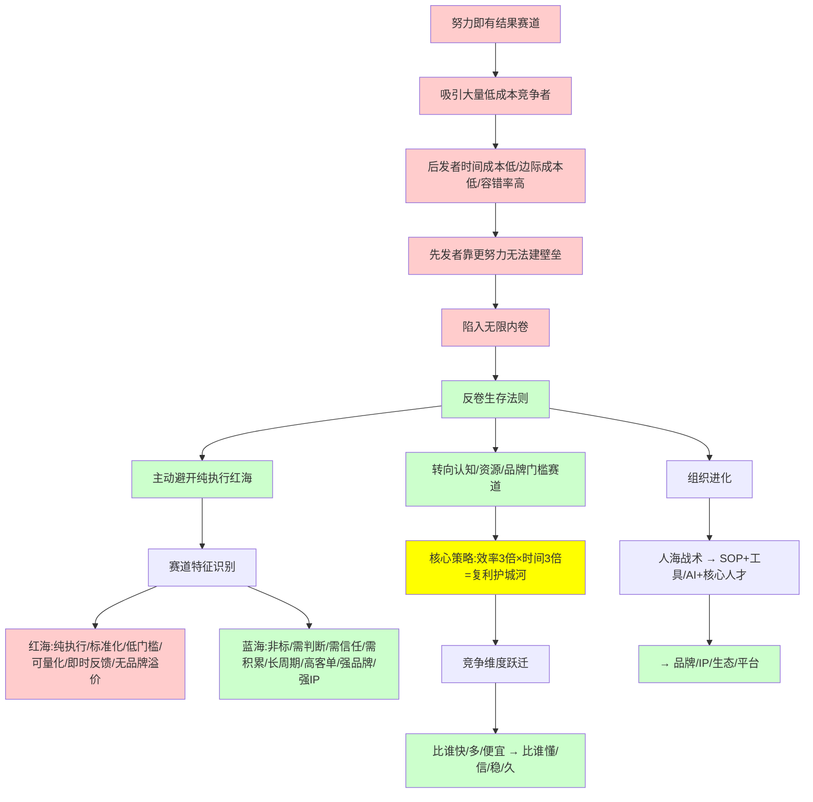

图解说明：从“努力即有结果赛道”推导出“必卷逻辑”（A-E），反卷法则（F）提供破局路径：避开红海特征（H1）、识别蓝海特征（H2）、转向高门槛赛道（I）、实施“效率×时间双3倍”复利策略（J）、完成竞争维度跃迁（K-K1）与组织进化（L-L2）。

## 67.22 社群生态位构建法 —— 先给予，后索取的长期主义社交

### 为什么需要这个概念？

新人进入高质量社群常陷入“潜水/伸手党/索取/焦虑”模式，长期边缘化、无法链接核心资源。缺乏“价值交换”的社交思维：社群本质是价值交换市场，无价值输出无法获得高质量连接。需要一套“从透明人→被看见→被信任→链接资源”的标准化融入路径。

### 核心定义

**社群生态位构建法** 新人融入大型成熟社群的路径：主动提供显性价值（写内容、做志愿者、办线下局、速记整理、复盘分享） → 持续曝光（高频出现在高质量信息流中） → 被看见/被信任（建立“靠谱/专业/利他/执行力强”人设标签） → 链接资源/合伙人/贵人（借力社群网络效应实现跃迁）。核心法则：先给予，后索取；价值输出前置，需求满足在后。

> "新人如何找到自己的生态位，比如你可以写内容、做志愿者帮助别人、见面会给别人提供价值。只要你持续的去做，就会慢慢被人看见了。"
> ——《P013, 摘要》

### 关键性质

**显性价值形式**：速记整理（如易从容摘录核心心法）、资料工具箱（如4T运营工具箱）、复盘手册、线下见面会组织、志愿者服务。

**长期主义**：持续输出高质量干货（工具箱/方法论/复盘）筛选同频伙伴，获点赞/作业打卡/尊重/商业资源正向反馈。

**杠杆效应**：社群放大器——个人微小价值在社群网络中被放大、传播、匹配、转化为商业机会。

### 典型例子

**作者**：资料军火库文获125赞+200作业打卡；4000G工具箱文获400+赞；正反馈直接筛选出合伙人/导师/变现线索。【来源：docs/202303/SSizdBAA6oXBmkxRkF7cRwp4n6e.md】

**七小**：整理学习手册入核心层获商单(3k-1w+)/私群邀请，验证“资料整理+长曝光”路径高确定性。【来源：docs/202303/20230328_015.md】

**高杰**：航海中产出高质量复盘/思维导图，获教练/圈友认可，成为教练/合伙人。【来源：docs/202303/20230328_110.md】

### 边界条件

- 价值必须“显性化/可消费/可传播”：内心认同/默默点赞/私下夸奖不产生社群资产，必须产出“文档/视频/音频/图片/链接/活动”
- 避免“巨婴陷阱”：纯付费不参与/纯索取不付出均无法建立真实连接，付费仅为入场券，参与才是会员权
- 核心圈层不可买：真核心圈子邀请制，只能通过持续价值输出被邀请进入；付费圈仅为外围筛选层

### 方法演进图

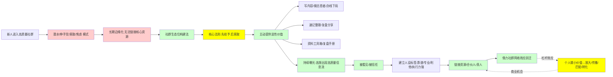

图解说明：从“新人错误模式”（B-C）出发，通过“先给予后索取”核心法则（E），执行“主动提供显性价值”（F-F3）→“持续曝光”（G）→“被看见/被信任/建立人设”（H-H1）→“链接资源跃迁”（I-J）的标准化路径。关键在于“杠杆效应”（K）：社群网络将个人微小价值放大、传播、匹配、转化为商业机会，形成正向飞轮。

## 67.23 线下连接协议 —— 小局深度大于大局广度

### 为什么需要这个概念？

线下社交常陷入“酒局/吹牛/名片互换/加微信不说话/大型聚会尴尬”低质量模式，ROI极低。缺乏“规模/主题/组织/目标”标准化设计，导致时间/精力/金钱浪费在无效社交上。需要区分“宽度局（大型/广度/弱连接）”与“深度局（小型/深度/强连接）”的差异化运营策略。

### 核心定义

**线下连接协议** 高质量线下社交的标准化动作：

1. 规模上限8人（4-8人最佳），保证深度交互、真诚开放、全员参与感
2. 必须有明确主题（如：复盘/拆解/实战/心法/资源对接），拒绝闲聊
3. 由城市负责人/发起人统筹（控场/掌控节奏/保证产出/善后转化）
4. 目标为深度连接而非广度社交，配合大型局（500人）做宽度，小局做深度
5. 核心产出：单次小局产出10份定制方案文档（私董会模式），或形成深度合作/合伙/投资关系

> "要么做特别大的局一次连接特别多人，要么做特别小的局6-8人深度聊深度连接。"
> ——《P013, 摘要》

### 关键性质

**沉浸式场域**：横幅/举牌/香薰/茶点/纸笔“五大件”调动五感建立仪式感；手机隔离协议（投票表决+组局者带头+定时休息）物理保障专注。

**三段式流程**：破冰（模板化自我介绍+刮刮卡1h）→ 分享（投票选题+PPT主题分享1.5h）→ 私董会（单人15分钟阐述难题→全员轮询献策→组局者教练复盘）。

**善后转化**：现场拍照黄金期（主题分享后、私董会前）+ 阶梯式产品设计（参会费抵扣3位数产品/膨胀为定金4位数产品）。

### 典型例子

**生财有术见面会**：组局者SOP精准邀约+付费筛选（鸽子费/定位费）到场率90%+，沉浸式场域+三段式流程+善后转化闭环。【来源：docs/202303/20230328_111.md】

**作者**：参会视为“最小创业”，观察主持控场/组织流程/互动模式获取隐性组织经验，从微小成功积累自信。【来源：docs/202303/20230328_115.md】

**速记志愿者**：石墨文档实时协作记录+ChatGPT秒级生成思维导图 → “嘉宾话音落、导图同步完成” → 低成本建立专业人设。【来源：docs/202303/20230328_111.md】

### 边界条件

- 组局者需“高执行力/强控场/懂商务/重交付”，不适合“社恐/佛系/完美主义/不善结尾”者发起
- 参会者需“带任务/带笔记/带复盘/带分享”，拒绝“来吃饭/听大佬吹牛/蹭饭/发呆”心态
- 线下组局小白挤出效应：小白远超大佬盲目组局致核心大佬流失，纯社交无利益绑定线下局必崩，需严格筛选

### 方法演进图

```mermaid
flowchart TD
    A[线下社交低质量模式] --> B[酒局/吹牛/名片互换/加微不说话/大型尴尬]
    B --> C[ROI极低 无标准化设计]
    C --> D[线下连接协议:深度局vs宽度局]
    D --> E[深度局标准化动作]
    E --> E1[规模:4-8人最佳]
    E --> E2[主题:明确垂直 拒绝闲聊]
    E --> E3[统筹:城市负责人控场/节奏/产出/转化]
    E --> E4[目标:深度连接 配合大型局做宽度]
    E --> E5[核心产出:10份定制方案/深度合作/合伙投资]
    E1 --> F[沉浸式场域]
    F --> F1[五大件:横幅/举牌/香薰/茶点/纸笔 调动五感]
    F --> F2[手机隔离协议:投票表决+组局者带头+定时休息]
    E2 --> G[三段式流程]
    G --> G1[破冰:模板化自我介绍+刮刮卡 1h]
    G --> G2[分享:投票选题+PPT主题分享 1.5h]
    G --> G3[私董会:单人15min阐述→全员轮询→教练复盘]
    G3 --> H[善后转化闭环]
    H --> H1[拍照黄金期:分享后私董会前]
    H --> H2[阶梯式产品:参会费抵扣3位数/膨胀为定金4位数]
    
    style A fill:#ffcccc
    style B fill:#ffcccc
    style C fill:#ffcccc
    style D fill:#ccffcc
    style E fill:#ccffcc
    style F fill:#ccffcc
    style G fill:#ccffcc
    style H fill:#ccffcc
```

图解说明：从“低质量线下社交痛点”（A-C）出发，确立“深度局vs宽度局”差异化策略（D），深度局执行五大标准化动作（E1-E5），通过“沉浸式场域”（F-F2）保障专注，“三段式流程”（G-G3）保障产出，“善后转化闭环”（H-H2）实现商业变现。核心产出：单次小局产出10份定制方案文档或形成深度合作关系。

## 67.24 多源对照

### 共识

- **增量市场中分享正向循环**：P013、P014、P001均认同在非存量博弈场景下，公开分享反而能吸引资源、建立品牌、筛选同频者，实现“越分享越幸运”。
- **失败是常态而非意外**：P013、P004、P036均指出商业成功率天然低（十之八九失败），接受失败常态化能消除恐惧，将精力转向增加试错次数。
- **首个正反馈是信心基石**：P013、P003、P098均强调从0到1赚到第一块钱的核心价值在于打破固有认知路径、确立“相信才能做到”的心智基石。
- **耐受时间是非线性增长前的必经期**：P013、P002、P054均验证项目前期长期无收益是常态，熬过耐受期才能跨越门槛，时间复利是核心变量。
- **SOP是规模化前提**：P013、P011、P027均主张只有具备标准化操作手册的项目才具备商业资产属性，可复制、可放大。
- **IP核心壁垒是时间积累的信任资产**：P010、P014、P161均认同项目玩法可复制，唯有“陪伴用户成长的情感连接+长期主义坚守”构成不可复制的核心护城河。

### 分歧

- **平台选择策略**：P013建议新人统一切入小红书（门槛低、转化强），而P069指出小红书适合“非标/内容/私域/低门槛”，标品/直播/重投流/男性用户更适配抖音/视频号/快手。【来源：docs/202303/20230328_069.md】
- **试错预算设定**：P013主张预留“试错预算”支持高频实验，P172则给出具体量化止损线（低价产品亏300元止损、高价产品3倍预算测试），后者更具操作性。【来源：docs/202303/20230328_172.md】
- **贵人链接方式**：P013强调“利他先行、价值互换”长期关系账户，P027则提出“诚意=成本”（付费咨询/红包≥200元）作为链接高手的显性门槛，后者更强调显性成本支付的筛选作用。【来源：docs/202303/20230328_027.md】
- **执行力与认知的权重**：P013提出“执行力是1，认知是放大器”，P004则主张“认知迁移能力>学习能力”，后者更强调认知层面的迁移复用能力。【来源：docs/202303/20230328_004.md】

## 67.25 设计中的取舍

为什么不用“追求最优解”而是“六十分即冲”？追求最优解需要完美的信息、充足的资源、无限的时间，现实中三者皆无。最优解成本极高且需“配得上资格”，当下资源禀赋下根本拿不到。六十分即冲承认资源约束，用市场反馈替代主观推演，行动中修正优于犹豫中观望。Trade-off：牺牲初始方案的完美度，换取更快的市场验证速度和更低的机会成本。

为什么不“自己干所有细节”而要“时薪外包”？CEO时间单价若高于雇佣成本，自己干执行细节就是在用高薪买低价值时间，战略视野被吞噬。时薪外包决策法用数学模型量化这一边界：个人时薪 >> 雇佣成本时薪时立即组建团队。Trade-off：增加固定成本和管理复杂度，换取战略高度的释放和规模化的时间杠杆。

为什么不“在红海卷执行”而要“反卷寻找蓝海”？努力即有结果的赛道必然吸引无限低成本竞争者，后发者时间成本更低，先发者无法靠“更努力”建立壁垒。反卷生存法则要求主动避开纯执行红海，转向需认知/资源/品牌门槛的蓝海，保证效率与时间双3倍优势。Trade-off：放弃确定性高、见效快的低门槛赛道，承担高门槛赛道的不确定性和长周期验证成本。

为什么不“免费做服务建立信任”而要“低价信任代偿”？免费服务缺乏契约约束，导致提供者敷衍交付、接收者低估价值，双输局面。将客单价压低至用户“不在乎被骗”阈值，以极低决策成本替代传统信任建立机制，同时利用免费流量优势对抗付费流量竞品。Trade-off：牺牲单客利润率，换取极高的转化率、极低的售后成本和极快的现金流周转。

为什么不“靠信息差赚快钱”而要“靠认知差建长期壁垒”？信息差随时间衰减（公开即失效），数据分析能力再强也分析不出“不在数据内的项目”。真正的蓝海存在于非公开渠道（人脉/小圈子/冷门平台）。认知差通过长期高密度输入建立模式识别模型，具有迁移性和复利性。Trade-off：放弃短期暴利的信息差套利，投入长周期的认知建设成本，换取可持续的竞争优势。

## 67.26 动手练习

### 练习 1：个人商业模式增量思维自检

针对你正在做或计划做的项目，回答以下问题：
1. 该项目属于增量市场还是存量市场？判断依据是什么？
2. 你目前的核心玩法/渠道/信息差是否公开分享过？分享后是否带来了同频者链接或资源放大？
3. 你的核心护城河是什么？如果仅靠“信息差/玩法/渠道”，一旦公开是否会失效？
4. 设计一个“分享即获客”的微行动：本周输出一篇实战复盘/方法论/工具箱，观察反馈与链接效果

### 练习 2：首个正反馈极速验证实战

选择一个你“不讨厌、可行、不违规”的微项目（六十分即冲），目标：7天内跑通首个正反馈。
1. 定义MVP范围：最小可行性产品/服务是什么？单次交付耗时<2小时，成本<100元。
2. 设定止损线：连续3天无咨询/无成交即复盘调整或切换。
3. 执行“看见即相信”：记录每一个微弱信号（浏览/咨询/下单），用作信心燃料。
4. 复盘问题：首个正反馈来自哪个渠道/动作？是否可复制放大？是否暴露了产品/流程的核心短板？

### 练习 3：五维指标筛选你的备选项目库

列出3-5个你感兴趣的备选项目，逐项打分（1-5分）：
维度1：操作难度（1=需高技能/经验，5=傻瓜化复制粘贴即可上手）
维度2：平台规则（1=对抗算法/钻漏洞，5=顺应平台鼓励方向）
维度3：项目绿色（1=高法律/账号/资金风险，5=完全合规安全）
维度4：可批量化（1=强依赖个人不可复制，5=支持多号/矩阵/自动化放大）
维度5：周期利润（1=长周期慢变现/不确定，5=短周期快回本+长期复利）

分析：哪个项目总分最高？最低分维度是否为一票否决项？根据当下资源禀赋，先启动哪一个？

### 练习 4：个人IP护城河可复制性审计

对你的个人品牌/项目进行“可复制性压力测试”：
1. 列出你的核心玩法/引流渠道/转化话术/产品结构，逐项标注：可公开教会他人（是/否）、竞争对手3个月内能否复刻（是/否）。
2. 识别不可复制资产：你的成长故事/与用户共同经历的关键事件/长期坚持的公开承诺/陪伴用户成长的具体案例。
3. 设计“信任显性化”动作：本周在朋友圈/社群/视频号输出一条“陪伴/成长/真实/示弱”内容，观察互动质量。
4. 反思：你是否陷入“专家诅咒”（以专业为中心而非用户为中心）？如何保持“松弛/真诚/示弱”姿态？

### 练习 5：21天高密度信息输入挑战

验证“信息增量阈值”理论，建立个人模式识别模型：
1. 精选3-5个高信噪比信息源（如：生财精华/风向标/头部实战者👸号/经典商业书籍/友商动态）。
2. 承诺：每日固定30分钟（早/午/晚），仅做“输入+结构化笔记”，不刷短视频/不聊天/不处理杂务。
3. 记录：每周日复盘——本周新建立/强化了哪些“小模型”（如：选品逻辑/流量模型/转化框架/风控规律）？
4. 测试：第21天尝试用5分钟完成一份“某新赛道机会分析报告”，对比第1天耗时与质量差异。

### 练习 6：线下深度小局策划与执行

应用“线下连接协议”策划并执行一次4-8人的深度见面会：
1. 主题设定：聚焦一个具体业务难题/认知困惑/资源需求（如：如何跑通小红书冷启动/如何设计阶梯定价/如何寻找合伙人）。
2. 邀约筛选：发起“主题钩子+鸽子费（打卡退）/定位费（预付场地）”三重过滤，确保到场率>90%。
3. 流程执行：破冰（模板化自我介绍30分钟）→ 分享（投票选题+核心干货分享60分钟）→ 私董会（单人15分钟阐述难题→全员轮询献策→发起人教练复盘）。
4. 沉浸保障：准备“五大件”（横幅/举牌/香薰/茶点/纸笔），执行手机隔离协议（投票表决+发起人带头+定时休息）。
5. 善后转化：现场拍照黄金期抢拍合影，设计阶梯式产品（参会费抵扣低价产品/膨胀为定金高价产品），当场成交。

## 67.27 本章小结

这一章中我们学习了商业认知与执行体系的完整框架。首先重塑核心心法：确立增量生意思维让分享成为获客复利引擎，接受失败常态化公理将试错从情感负担转为概率成本，通过首个正反馈打破上班思维建立信心基石，理解耐受时间作为非线性增长前必经暗黑期的关键作用，掌握贵人跃迁让线性努力撬动非线性机会，突破信息增量阈值建立大脑模式识别能力，应用六十分即冲原则用行动修正替代完美策划，践行看见即相信降低行动门槛。其次建立启动决策框架：新人三步起盘法从手中牌锁定流量产品双核，项目筛选决策树实现低成本试错快速验证，五维指标体系作为避坑雷达标准化筛选项目，止损试错机制内置量化退出红线。再次构建社群杠杆与生态位：航海制提供陪跑基建降低试错成本，社群生态位构建法通过先给予后索取实现深度融入，线下连接协议以小局深度撬动高价值连接。接着掌握规模化放大模型：SOP复制放大论将单模型产能通过标准化实现指数级扩张，项目公司化核算引入ROI阈值科学决策，极简成交闭环与低价信任代偿机制重塑转化设计，躺赚项目矩阵以量变引发质变。然后筑牢长期壁垒：IP不可复制性护城河确立时间陪伴的绝对垄断，信任先于变现原则重构客户关系底层逻辑，学生私域LTV矩阵验证全生命周期变现闭环。最后建立组织人才体系：时薪外包决策法量化买时间边界，确定性招人准则以成就型动机识别核心人才，心力撑开机制主动承接不确定性锻炼抗压韧性，高维特质画像勾勒赚大钱者的隐形简历，反卷生存法则指引避开蛮力红海寻找认知护城河，绝技现世即行业没落律预警红利周期拐点。

本章核心概念对照表如下：

| 概念 | 解释 |
|------|------|
| 增量生意思维 | 非存量博弈下分享经验不稀释利益，反而吸引同频者、链接资源、建立品牌，实现越分享越幸运的复利 |
| 失败常态化公理 | 成功率天然低（十之八九失败），接受失败为常态消除恐惧，将精力从避免失败转向增加试错次数与容错率 |
| 首个正反馈 | 从0到1赚到第一块钱及其带来的信心，打破固有认知路径，确立‘相信才能做到’的心智基石，成功具有惯性 |
| 耐受时间 | 项目前期无正向收益时坚持不放弃的时间跨度，是区分普通人与跨越者的关键变量，非线性增长前的必经沉淀期 |
| 贵人跃迁 | 个人努力呈线性时，通过链接高维认知/资源持有者使努力被更多人看见，捕获机会实现跨越式增长的非线性路径 |
| 信息增量阈值 | 大脑通过大量信息输入形成模式识别模型，最终连点成线产生质变洞察的临界点 |
| 六十分即冲原则 | 反对寻找最优解，主张当下资源禀赋下评分60分（不讨厌、可行）即可启动，行动中修正优于犹豫中观望 |
| 看见即相信 | 修正‘相信才能看见’因果倒置，主张普通人通过‘看见’（微小结果/他人案例）建立‘相信’，降低行动门槛 |
| 新人三步起盘法 | 盘点手中牌（钱/时间/资源/技能）→ 确立双核心（流量+产品）→ 去工具中毒（从小红书切入） |
| 项目筛选决策树 | 入口低（不讨厌）→ 试错验证（航海/MVP）→ 正反馈确立（赚钱/沉淀）→ 深度聚焦（时间价值高则专注长期） |
| 五维项目筛选指标 | 操作难度/平台规则/项目绿色/可批量化/周期利润，一票否决制，动态权重匹配阶段 |
| 航海制 | 具备手册SOP/教练陪伴/志愿者协作/圈友共战的结构化训练营，通过‘跟着走’获得首个正反馈与成长惯性 |
| 社群生态位构建法 | 主动提供显性价值→持续曝光→被看见/被信任→链接资源，核心法则：先给予，后索取 |
| 线下连接协议 | 小局深度大于大局广度：4-8人、明确主题、城市负责人统筹、三段式流程（破冰/分享/私董会）、善后转化闭环 |
| SOP复制放大论 | 项目具备标准化操作手册即可通过社群/团队/自动化复制放大，商业规模=单模型产能×执行人数×周期×合格率 |
| 极简成交闭环 | 去除注册/售前/售后环节，压缩为‘流量→成交（即付即用即走）’，利用沉没成本付费墙提升转化 |
| 低价信任代偿机制 | 缺乏品牌/服务时，将客单价压低至用户‘不在乎被骗’阈值，以极低决策成本替代传统信任建立机制 |
| IP不可复制性护城河 | 玩法/渠道/工具均可复制，唯有‘时间积累的信任资产’与‘陪伴用户成长的情感连接’构成不可复制的核心壁垒 |
| 信任先于变现原则 | 低信任/低付费能力群体中，必须通过极低门槛/极短回本产品完成信任预存款，信任建立后高客单复购才可能 |
| 学生私域全生命周期LTV矩阵 | 围绕学生全生命周期布局知识付费/流量卡/潮牌/分销多元业务，阶梯定价（188-5888）+韭菜大队自嘲文化实现高LTV |
| 心力撑开机制 | 将心力比作肌肉，主动承接更大难题/不确定性，经历多了格局打开，形成‘都经历过，不过如此’的抗压韧性 |
| 高维特质画像 | 赚大钱者五大共性：谦虚真诚/好学敏感/反常规选择/松弛状态/直击本质，外在映射为物欲低/低调不张扬 |
| 反卷生存法则 | 努力即有结果的赛道必卷，高手主动避开纯蛮力红海，转向需认知/资源/品牌门槛的非标赛道，保证效率与时间双3倍 |
| 时薪外包决策法 | 个人时薪>>雇佣成本时薪时立即组建团队买时间；业务确定性高时招人，探索期不招人避免固定成本拖垮现金流 |
| 确定性招人准则 | 招人时机取决于业务确定性而非规模，重‘成就型动机’（信愿景/图成长）轻‘技能匹配’，人岗不匹配果断调整 |
| 主理人亲历原则 | 核心方向把控权不可委托，主理人必须亲审一线信息（风向标/精华），认知高度决定组织上限 |
| 绝技现世即行业没落律 | 核心绝技大规模公开传播是行业红利耗尽强信号，真高手红利期藏拙，衰退期现世收割尾款 |
| 信息差蓝海非数据可得 | 真正冷门高潜力蓝海项目存在于公开数据/榜单之外，只能通过非公开渠道（人脉/小圈子/冷门平台）获取 |

下一章中，我们将学习如何将这些认知与执行体系具体应用到AI工具入门与环境配置、提示词工程核心范式、AI绘画可控生成与商业变现等前沿技术实战中，实现“认知×工具”的双重杠杆放大。

（如果没有下一章，则是：感谢你读到了这里，恭喜你，你已经完成了商业认知与执行体系的完整构建，愿你在不确定的世界中，用确定性的心法与方法，跑出属于你的复利曲线。）

