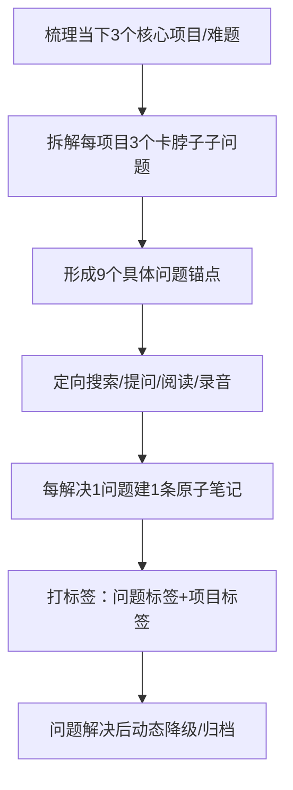
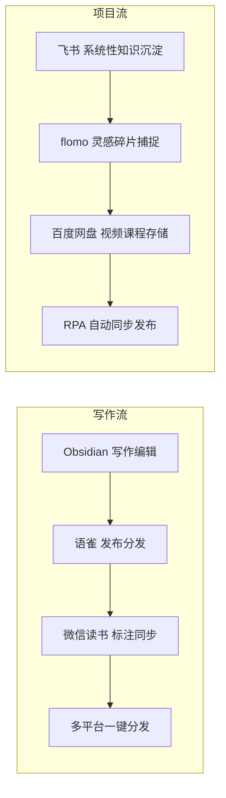
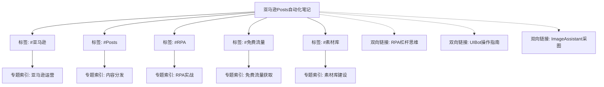
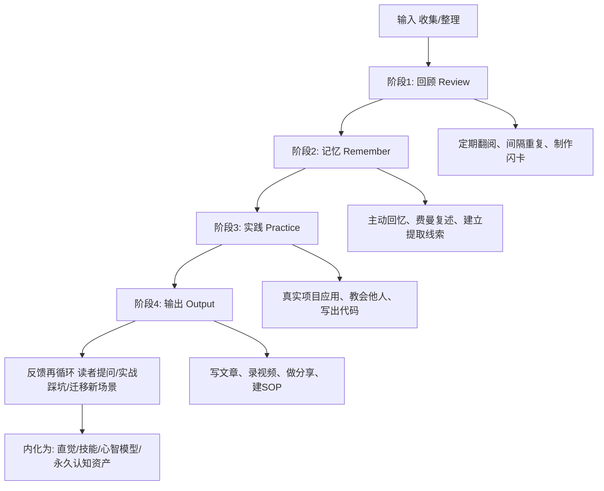
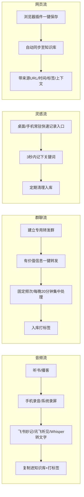

# 第 1 章 知识管理与个人效能 —— 从“囤积焦虑”到“内化进化”
作者：龙哥

## 学习目标

- 理解知识管理实用主义原则：好用比好看重要，解决问题才是硬道理
- 掌握问题导向输入法：以当下痛点为锚点捕获知识，拒绝无效囤积
- 掌握本源概念优先策略：种树看树干不看叶子，构建可迁移抗周期的知识结构
- 建立多工具协作生态：善假于物，各工具各司其职，数据松耦合可迁移
- 掌握标签与双向链接多维归类：一文多放不冲突，支持网状知识检索
- 建立定期规整与断舍离机制：帕累托迁移策略处理历史包袱，让知识库保持高信噪比
- 跑通知识内化闭环：整理≠掌握，必须经历回顾-记忆-实践-输出四阶段转化
- 搭建碎片信息结构化捕获流：音频/群聊/灵感/网页四大流水线，不让高价值信息溜走
- 应用长文精华提炼存储法：核心观点入库、全文留链接，平衡密度与效率

## 1.1 生活类比

想象知识管理是**打造一把趁手的「瑞士军刀」而非建一个「标本博物馆」**。实用主义原则就像判断刀具好不好用，不看刀鞘多漂亮、收纳盒多整齐；问题导向输入就像遇到拧螺丝才找螺丝刀头，不把所有螺丝刀头挂墙上供着；本源概念优先就像掌握「杠杆原理」这一把主刀，比收集 100 种螺丝刀头更管用；多工具协作就像主刀用钢材好、随手记用塑料轻、大文件仓用帆布袋装，各司其职；标签双链就像同一把螺丝刀头既挂在「十字」挂钩，又链接在「精密维修」工具包里；定期规整就像每周擦拭刀刃、扔掉卷刃的、把常用的挂前面、生锈的磨锋利；内化闭环就像只有真拧过螺丝、拧滑过、总结过力度角度，这把刀才真成你手里的功夫。就像木匠不因工具箱整齐而成匠，而因木活做得好而成匠；知识管理的终点是「让人过得更好」，不是「让库看起来更好」。

## 1.2 概念地图

```mermaid
graph TD
    A[知识管理与个人效能体系] --> B[核心原则层]
    A --> C[输入捕获层]
    A --> D[组织存储层]
    A --> E[维护进化层]
    A --> F[内化产出层]
    
    B --> B1[实用主义原则（唯一标准：使用方便/解决问题）]
    B --> B2[主观归属原则（归档位置由认知结构决定）]
    B --> B3[内化转化原则（整理≠掌握，需经回顾-记忆-实践-输出）]
    B --> B4[舍得与容错原则（敢断舍离、容不完美、容包袱、容混乱）]
    B --> B5[终极价值导向（让人过得更好）]
    
    C --> C1[问题导向输入法（以痛点为锚点反向收集）]
    C --> C2[本源概念优先（提炼树干树枝，不收叶子）]
    C --> C3[碎片信息结构化捕获流]
    C3 --> C3a[音频流：录音→转文字→入库打标]
    C3 --> C3b[群聊流：转发群→定时批量处理]
    C3 --> C3c[灵感流：极速记录入口→定期清理]
    C3 --> C3d[网页流：插件一键保存→自动同步]
    C --> C4[长文精华提炼存储法（核心观点入库+原文链接）]
    
    D --> D1[多工具协作生态（核心库+随手记+大文件仓+阅读标注+自动化中转）]
    D --> D2[标签与双向链接多维归类（多标签/双链/索引页MOC动态聚合）]
    D --> D3[分阶段学科沉淀（初阶/进阶/高阶/实践四层融合存储）]
    D --> D4[理论实践融合存储（书本输入与实操经验不分离）]
    
    E --> E1[定期规整与断舍离机制（周/月/季节奏+帕累托迁移策略）]
    E --> E2[杂学箱缓冲机制（临时存放→定期归档/清理）]
    E --> E3[历史遗留数据分批迁移（新资料新平台，旧资料按优先级20%迁移）]
    
    F --> F1[知识内化闭环（回顾→记忆→实践→输出→反馈再循环）]
    F --> F2[费曼式输出倒逼（写文章/录视频/建SOP/教他人）]
    F --> F3[速查手册外包工具型知识（快捷键/API/配置项即时检索）]
    F --> F4[核心本源概念深度内化为心智模型（永久认知资产）]
```



## 1.3 知识管理实用主义 —— 好用比好看更重要

### 为什么需要这个概念？

大多数人陷入「工具洁癖」与「囤积焦虑」，花费大量时间追求完美的分类体系、统一的工具平台、美观的笔记排版，却很少真正使用这些知识解决问题。信息爆炸时代，试图建立「All in one」的完美系统不切实际，反而增加认知负担，导致知行分离。知识管理的本质是服务于行动与生活改善，而非建立标本馆。

### 核心定义与四大支柱原则

素材中提炼了四大支柱原则，构成了实用主义的骨架：

**实用主义原则**（来源：《知识管理实战笔记》）

> "知识管理的目的其实是让自己方便，所以并不是说有一个标准答案。信息整理不是为了好看，也不是为了满足自己的虚荣心，而是为了使用方便。工具不重要，想好自己要解决什么问题才重要。"

这个原则告诉你：FOMO（错失恐惧症）是知识囤积的最大推手。真正重要的信息具有「复现性」，会在不同渠道、不同时间反复出现。你不需要抓住每一条，只需要建立一套让关键信息「二次触达」的机制。

**主观归属原则**（来源：《知识管理实战笔记》）

> "不是一定要把工作的资料归工作，学习的归学习，而是该问自己，在你的知识结构中，这份资料该沉淀到哪里。"

这是一个反直觉但极其关键的洞见：传统分类按「来源」（工作/生活/学习）分，但实用主义按「你的认知结构」分。同一份「RPA自动化」资料，对运营是「流量获取手段」，对技术是「工程实现细节」，对老板是「降本增效杠杆」——它应该放在你最容易调用的那个认知抽屉里。

**内化转化原则**（来源：《知识管理实战笔记》）

> "知识整理过后并不属于你，只有通过回顾、记忆、实践、输出才能慢慢转化成你自己的知识。恰当的知识管理的过程，也是自我进化的过程。"

这个原则划定了红线：**整理 ≠ 掌握**。把文件从下载文件夹移到 Notion 里，只是完成了「物理搬运」；只有当你能在没有笔记的情况下、凭直觉在实战中调用它，它才真正成为你的知识资产。

**舍得与容错原则**（来源：《知识管理实战笔记》）

> "All in one 可能很美，但如果做不到，可以在多个平台都建分类即可。越是信息爆炸，越要学会舍弃，敢于断舍离。"

信息过载时代，完美主义是最大的敌人。容忍「多平台并存」（飞书沉淀深度、flomo 记灵感、网盘存大文件），容忍「历史包袱分批迁移」（新资料新平台，旧资料按优先级迁移前 20%），容忍「暂时混乱」（建立杂学箱缓冲），这才是成年人的知识管理姿态。

**终极价值导向**（来源：《知识管理实战笔记》）

> "知识整理的最终目的，是让人过得更好。"

这句话是本章的「北极星」。无论你用 Obsidian 还是飞书，打标签还是建文件夹，每一个动作都要接受这个拷问：**它让我离「过得更好」近了一步吗？**

### 关键性质速览

下表展示了本节核心性质汇总：

| 性质 | 说明 |
|------|------|
| **主观归属性** | 归档位置由个人当前认知结构决定，而非客观来源 |
| **过程即进化** | 整理过程本身就是认知更新与自我进化的过程 |
| **闭环导向** | 单纯整理≠掌握，必须经历「回顾-记忆-实践-输出」四阶段完成内化 |

### 典型反面教材与正面例子

**反面教材**：微信收藏夹三年前的内容——大量囤积从未打开，虚假的「拥有感」阻碍真实内化。

**正面例子**：
- **多平台协作**：飞书/Notion 沉淀深度内容、flomo 捕捉灵感碎片、云盘存储大文件，各司其职比强行统一高效
- **长文存「核心总结+原文链接」**：平衡信息密度与检索效率，避免知识库臃肿

### 边界条件

⚠️ 仅适用于「以用为本」的个人知识管理，不适用于团队协作需强制规范、合规归档的企业级知识库场景。核心高频知识需精细化沉淀，边缘低频资料可放入「杂学箱」定期清理，切勿追求全收录。历史遗留数据建议「新资料新平台、旧资料按优先级分批迁移」，约 50% 低优先级内容可就地封存不动。

### 设计中的取舍

**为什么不追求「All in one」完美统一？**

**回答**：单一工具在「深度写作、碎片捕捉、大文件存储、多端同步」四大需求上无法同时达到最优。强行统一会导致：写作时卡顿、捕捉时延迟、大文件同步失败、手机端体验差。松耦合的多工具生态虽增加了「同步成本」，但换来的是每个环节的「最优体验」——正如瑞士军刀不把锯子、剪刀、开瓶器做成同一个刀片，而是模块化组合。

---

## 1.4 问题导向输入法 —— 以痛点为锚点捕获知识

### 为什么需要这个概念？

被动收集（转发、收藏、下载）导致知识库充斥着「当下觉得有用、未来从未用过」的垃圾信息。缺乏明确检索意图的输入，事后根本找不到、用不上，造成「囤积不等于拥有」的认知假象。只有绑定具体问题的知识，才具备高调用率与高转化价值。

### 核心定义与操作流程

**问题导向输入法**（来源：《知识管理实战笔记》）

**操作步骤**：
1. **梳理当下问题清单**：列出你正在推进的 3 个项目/难题（如：搭建 RPA 自动化流程、策划小红书选品、学习提示词工程）
2. **拆解卡脖子子问题**：针对每个项目写出 3 个最具体的阻碍点（如：RPA 防封策略、选品数据源对比、Prompt 结构化范式）
3. **定向收集**：仅针对这 9 个问题去搜索/提问/阅读/录音
4. **即时入库**：每解决一个问题，建一条原子笔记入库，打上「问题标签」+「项目标签」
5. **动态降级**：问题解决后，相关笔记可降级归档或清理

下图展示了问题导向输入法的完整流程：



该流程图展示了如何从具体行动需求出发，反向驱动知识获取，形成「问题-行动-笔记」的闭环，避免无效囤积。

### 关键性质

下表展示了本概念的关键性质：

| 性质 | 说明 |
|------|------|
| **行动强关联** | 知识库与当前行动需求强绑定，检索即可用 |
| **反向驱动** | 由输出倒逼输入，避免无效囤积 |
| **动态调整** | 问题解决后，相关知识可降级归档或清理 |

### 典型例子

- **场景**：遇到「RPA 自动化发帖」难题
- **动作**：专门搜集 RPA 工具对比、反封策略、素材库搭建等针对性资料
- **结果**：入库即用 → 问题解决 → 笔记自动升级为「已验证方案」

- **场景**：听播客听到高价值点
- **动作**：手机录音 → 飞书妙记转文字 → 标记对应问题标签入库
- **结果**：碎片时间也能完成「问题导向」捕获

### 边界条件

- 适用于有明确项目推进、技能习得、难题攻关的主动学习场景
- 不适用于纯兴趣驱动的泛博览阅读（可放入「杂学箱」定期筛选）
- 需配合「定期规整」机制，防止「杂学箱」变成垃圾场

### 设计中的取舍

**为什么不用「泛泛收藏」模式？**

**回答**：泛泛收藏看似广博，实则调用率极低。素材中提到「如果不整理，下次遇到类似的东西，可能你还会再收一次。不断重复」，这揭示了被动收集的根本缺陷——缺乏检索线索与应用场景绑定。问题导向输入法虽然前期投入较大（需梳理问题、拆解子问题），但每一条入库笔记都自带「使用场景」，事后检索即命中，长期 ROI 远高于被动收集。

---

## 1.5 本源概念优先 —— 种树不看叶子看树干

### 为什么需要这个概念？

海量碎片化信息（新闻、热点、工具更新）时效性极强，全收录会淹没核心认知，全不收又怕错过底层逻辑。表层信息（叶子）随季节凋零，本源概念（树干树枝）支撑起可迁移的知识结构，是抗周期的核心资产。认知带宽有限，必须优先投入高杠杆的本源概念建设。

### 核心定义

**本源概念优先**（来源：《知识管理实战笔记》）

面对时效性强的资料，**优先提炼并存储核心本源概念**（第一性原理、底层模型、通用框架），而非收集表层时效性信息。

下表展示了本源概念与表层信息的对照：

| 领域 | 本源概念（树干/树枝） | 表层信息（叶子） |
|------|----------------------|------------------|
| 提示词工程 | IPO模型、库内概念、RLHF交互 | 成百上千个具体 Prompt 模板 |
| 知识管理 | 实用主义、问题导向、内化闭环 | Notion 模板、Obsidian 插件配置 |
| 流量获取 | 公域引流+私域转化闭环 | 抖音 SEO 关键词表、小红书发布时间表 |
| 电商选品 | 刚需/高频/高客单/非标品 | 具体爆款单品链接、某周销量榜 |

### 关键性质

下表展示了本源概念的关键性质：

| 性质 | 说明 |
|------|------|
| **高迁移性** | 本源概念可推导出无数表层应用，一招破万法 |
| **抗衰减** | 底层逻辑随时间沉淀增值，而非贬值 |
| **低维护** | 一旦内化，无需频繁更新，只需挂载新案例 |

### 典型例子

- **「知识管理实用主义」是本源，「Notion 模板」是叶子** → 换工具不换法
- **「流量=公域引流+私域转化」是本源，「抖音 SEO 关键词表」是叶子** → 换平台不换逻辑

### 边界条件

- 初学者需先积累一定量「叶子」（案例、模板、操作细节）才能提炼出「树干」，不可空谈本源
- 快速迭代的前沿技术（如 AI 模型版本更新），需维护「版本映射表」型叶子节点辅助决策
- 本源概念需定期复盘验证，避免形成「伪核心」僵化思维

### 设计中的取舍

**为什么不收集所有「叶子」再慢慢提炼？**

**回答**：认知带宽是稀缺资源。收集叶子的边际成本极低（转发、收藏、下载几秒钟），但处理、筛选、提炼的边际成本极高。素材指出「大部分资料可能并不需要收集，因为时效性会有点强」，直接锚定本源概念，相当于在信息源头装了「高杠杆过滤器」——只让结构性知识进入知识库，表层噪音止步于「杂学箱」或直接丢弃。这不是偷懒，是战略性资源配置。

---

## 1.6 多工具协作生态 —— 善假于物，各司其职

### 为什么需要这个概念？

单一工具无法覆盖「深度沉淀、碎片捕捉、大文件存储、多端同步」全生命周期需求，强行 All in one 导致体验割裂。不同形态知识对存储、检索、编辑能力要求差异巨大。工具迭代极快，绑定单一工具风险极高（倒闭、涨价、功能阉割、导出受限）。

### 核心定义：功能定位组合拳

**多工具协作生态**（来源：《知识管理实战笔记》）

工具链的功能定位组合拳如下：

下表展示了推荐的工具链配置：

| 功能定位 | 推荐工具类型 | 核心要求 |
|----------|--------------|----------|
| **核心知识库** | 飞书 / Notion / 语雀 / Obsidian | 支持双链/标签/图谱/大纲，数据可导出 |
| **随手记/灵感捕获** | flomo / 备忘录 / 语音备忘录 | <3秒记入、跨端同步 |
| **大文件/素材仓** | 百度网盘 / 阿里云盘 / NAS | 容量大、不限速、支持直链 |
| **阅读标注同步** | 微信读书 / MarginNote / Readwise | 高亮/笔记一键导出 |
| **自动化中转** | Zapier / Make / RPA / 飞书多维表单 | API 友好、可编程 |

**核心原则**：数据可导出、格式通用（Markdown/JSON）、跨平台同步、检索高效。

下图展示了作者的工具链实战配置：



该图示展示了写作流与项目流两条并行链路，各工具在各自擅长的环节发挥作用，通过标准格式与自动化中转实现数据流动。

### 关键性质

下表展示了多工具协作生态的关键性质：

| 性质 | 说明 |
|------|------|
| **职责分离** | 各工具只做最擅长的事，避免大而全的平庸 |
| **松耦合** | 通过标准格式、双向链接、标签关联实现数据流动，而非强绑定 |
| **可替代** | 单点工具失效可快速切换同类替代品，核心知识资产不受威胁 |

### 典型例子：作者的工具链实战

```
写作流：
Obsidian（写作编辑）→ 语雀（发布分发）→ 微信读书（标注同步）→ 多平台一键分发

项目流：
飞书（系统性知识沉淀）→ flomo（灵感碎片捕捉）→ 百度网盘（视频课程存储）→ RPA（自动同步发布）
```

### 边界条件

- 工具数量建议控制在 3-5 个核心工具 + 若干专用小工具，避免「工具折腾」成为新的拖延症
- 必须建立「主知识库」唯一事实源头，其他工具为卫星节点，防止数据碎片化失控
- 团队协作场景需统一核心协作工具（如飞书/Notion），个人端可保留个性化工具链

### 设计中的取舍

**为什么要容忍「多数据源」而不是强行同步到单一平台？**

**回答**：同步成本与数据完整性的博弈。强行同步大文件（视频、安装包）到文档型知识库会导致同步失败、存储爆仓、检索卡顿；强行把碎片灵感塞进结构化文档库会破坏文档完整性、增加整理负担。松耦合接受「数据暂时分散在多平台」，但通过「统一标签体系+双向链接+定期规整」在逻辑层统一。代价是检索时可能需跨平台，但换来的是各环节零妥协的最优体验。

---

## 1.7 标签与双向链接多维归类 —— 一文多放不冲突

### 为什么需要这个概念？

传统文件夹树形结构强制单一归属，导致跨领域知识（如「AI+教育」、「RPA+电商」）无法归类，或产生大量副本造成维护地狱。现实中知识天然是网状关联的，树形结构是对认知的降维打击。检索时往往从多个维度切入（按项目、按技术、按平台、按阶段），单一分类无法满足。

### 核心定义

**标签与双向链接多维归类**（来源：《知识管理实战笔记》）

- **打破「一文一类」限制**：同一笔记可打多标签（如 `#RPA #亚马逊 #选品 #自动化`）、建双向链接关联多个专题页/索引页
- **索引页（MOC）作为动态聚合入口**：如「RPA自动化专题」自动聚合所有含 `#RPA` 标签的笔记

下图展示了多维归类的网状关联结构：



该图展示了单一笔记如何通过多标签与双向链接同时归属多个专题索引，形成网状知识结构而非树形孤岛。

### 关键性质

下表展示了标签与双向链接多维归类的关键性质：

| 性质 | 说明 |
|------|------|
| **多维检索** | 支持按任意组合标签、反向链接、时间、作者等维度秒级定位 |
| **知识涌现** | 关联密度高处自然形成新专题、新洞察，而非预设分类 |
| **维护低成本** | 修改标签即更新所有关联视图，无需移动文件物理位置 |

### 典型例子

一篇「亚马逊 Posts 自动化」笔记：
- 打标签：`#亚马逊 #Posts #RPA #免费流量 #素材库`
- 自动出现在：「亚马逊运营」「RPA实战」「免费流量获取」三个专题索引中
- 双向链接：在「RPA杠杆思维」笔记中链接「UIBot操作指南」「ImageAssistant采图」，形成技能树

### 受控词表：防止标签爆炸的必要手段

标签体系必须建立「受控词表」：
- 定期合并同义标签：`#RPA` / `#自动化脚本` / `#机器人流程自动化` → 统一为 `#RPA`
- 设定标签层级：一级标签（领域）、二级标签（技术/平台）、三级标签（具体场景）
- 核心知识库工具需原生支持标签/双链/反链/图谱视图（Obsidian/Logseq/飞书/Notion/语雀）

### 边界条件

非结构化工具（如微信收藏、本地文件夹）难以落地，需迁移至支持工具。

### 设计中的取舍

**为什么不用传统文件夹树形分类？**

**回答**：树形分类强制单一归属，跨领域知识只能二选一或制造副本。副本导致维护地狱：更新一处、遗漏他处、版本不一致。标签+双链支持「一文多类」，检索维度任意组合，维护成本仅是「改标签」而非「移文件」。代价是需要工具原生支持、需建立受控词表防止标签爆炸。

---

## 1.8 定期规整与断舍离机制 —— 帕累托迁移策略

### 为什么需要这个概念？

知识库若无规整，必然膨胀为「垃圾场」：过期信息、重复片段、低质摘录、失效链接，检索信噪比趋近于零。历史遗留数据迁移是最大心理障碍：数据量大、格式杂、情感依恋强，导致迁移新工具时「不敢动、动不完、乱套」。认知结构随时间演进，旧分类体系必然失配，必须定期重构。

### 核心定义

**定期规整与断舍离机制**（来源：《知识管理实战笔记》）

**三级节奏**：

下表展示了三级节奏的具体安排：

| 节奏 | 动作 | 耗时预算 |
|------|------|----------|
| **周** | 清理「杂学箱」/收件箱，处理本周新增碎片 | 30 分钟 |
| **月** | 合并同类标签、清理失效链接、检查核心专题页完整性 | 1 小时 |
| **季** | 重构顶层分类、验证本源概念有效性、归档已完成项目 | 2-3 小时 |

**帕累托迁移策略**（处理历史遗留数据）：
> "首先新的资料统一用一个平台，其次把其他平台资料按优先级排列，放优先级最高的且自己会常用到的。其他就放在原平台上。这就至少 50%的内容不用动了。然后平时偶尔想起来，可以去搜搜，有用的就搬过来，每周固定整理一个文件夹。过段时间，你会发现以前很多收藏的东西，有用的都搬走了，剩下的都是边角料，不动也罢。"

**操作步骤**：
1. **新资料统一新平台**：确立主知识库，新内容只进这一个库
2. **旧平台资料分优先级**：高频调用、核心本源、高价值案例 = P0；其余 = P1/P2
3. **仅迁移 P0（约 20%~30%）**：其余就地封存，设为「只读归档」
4. **用时搬运**：平时真用到旧平台资料，再临时搬运入主库
5. **定期清理归档**：每年检查一次，确认无调用彻底删除

**断舍离判断标准**：
满足以下三个条件之一即可删除：能关联当前任一活跃问题/项目？过去 1 年是否被主动调用/搜索过？是否可被搜索引擎/官方文档 1 分钟内替代？若三个问题答案均为「否」，则直接删除。

### 关键性质

下表展示了定期规整与断舍离机制的关键性质：

| 性质 | 说明 |
|------|------|
| **增量低成本** | 日常仅处理增量，避免大爆发式整理崩溃 |
| **自然淘汰** | 时间是最好的筛选器，高价值内容会被反复调用、主动迁移，低价值自然沉底 |
| **认知同步** | 规整过程强制复盘知识体系，更新心智模型 |

### 典型例子

- **微信收藏夹三年前内容**：定期翻看，有用的搬入知识库，无用的删，剩下的边角料不动也罢
- **迁移 Notion 到飞书**：仅导出近 1 年高频笔记（约 200 篇），其余 3000 篇旧笔记留在 Notion 只读，用时搜索搬运

### 历史资料迁移的帕累托现象（实证发现）

> "过段时间，你会发现以前很多收藏的东西，有用的都搬走了，剩下的都是边角料，不动也罢，不信你看看你的微信收藏夹三年前的内容。"

实践发现：采用「优先级分批迁移」策略时，约 50% 低优先级内容可就地封存无需迁移；随时间推移，高价值资料会被主动搬运，剩余多为低价值边角料。这就是知识管理版的「二八定律」——**20% 的核心资料产生 80% 的调用价值，其余 80% 只要「知道在哪」就行，不用「搬过来」。**

### 边界条件

- 核心资产（本源概念、核心 SOP、高价值案例）必须 100% 迁移并验证完整性
- 法务/合规/税务相关资料受留存年限强制约束，不可随意断舍离，需独立归档
- 规整动作本身不产生直接价值，需严格时间盒（如周日早 1 小时），防止「整理成瘾」替代真实产出

### 设计中的取舍

**为什么要「新资料新平台、旧资料分批迁」而不是「一次性全量迁移」？**

**回答**：一次性全量迁移的心理阻力极大（数据量大、格式杂、情感依恋），常导致「不敢动、动不完、乱套」最后放弃迁移。帕累托策略利用「时间是最好的筛选器」：高价值内容会被反复调用、主动搬运；低价值内容留在旧平台「只读」也无妨。代价是短期内需在两平台检索，但换来的是迁移成功率从 <10% 提升到 >90%。

---

## 1.9 知识内化闭环 —— 整理不是终点，内化才是

### 为什么需要这个概念？

许多人陷入「收藏即学会」「整理即掌握」的虚假进步感，笔记软件里躺着数千条从未复习、从未实践的笔记。知识若不经大脑加工、实战检验、输出倒逼，永远是外部数据，无法在决策时刻调用。

### 核心定义：四阶段内化流水线

**知识内化闭环**（来源：《知识管理实战笔记》）

下图展示了知识内化的四阶段流水线：



该流程图展示了知识从外部输入到内化为己有认知资产的完整路径。四个阶段环环相扣：回顾负责筛选与复习高价值内容，记忆通过主动回忆建立长期提取线索，实践在真实场景中验证与深化理解，输出倒逼系统化整理并接受外部反馈，反馈再次触发新一轮回顾，形成正向飞轮。

### 关键性质

下表展示了知识内化闭环的关键性质：

| 性质 | 说明 |
|------|------|
| **必经性** | 跳过任一阶段均无法完成内化（如只回顾不实践=纸上谈兵，只实践不输出=经验不升华） |
| **正向飞轮** | 输出倒逼实践，实践深化记忆，记忆聚焦回顾，形成「费曼学习法」闭环 |
| **复利增长** | 内化知识成为永久性认知资产，边际调用成本趋近零，可无限组合创新 |

### 典型例子：RPA 自动化学习闭环

下表展示了 RPA 自动化学习闭环的各阶段具体动作与产出物：

| 阶段 | 具体动作 | 产出物 |
|------|----------|--------|
| **输入** | 阅读《非技术人员 RPA 落地指南》、观看教学视频 | 原始素材入「杂学箱」 |
| **回顾** | 速读核心章节，标出「延时随机化」「场景化素材」「防封策略」三大金句 | 3 条核心金句卡片 |
| **记忆** | 合上教程，用自己话复述三大金句原理，制作 Anki 闪卡 | Anki 卡片 3 张 |
| **实践** | 脱离教程，独立搭建「亚马逊 Posts 发帖」完整流程，跑通 10 条实测 | 可运行的 RPA 流程文件 |
| **输出** | 写《非技术人员 RPA 落地避坑指南》发布社群，读者提问补全盲区 | 公开文章 + 反馈清单 |

### 知识内化分级策略

并非所有知识都需深度内化，建议分级处理。下表展示了知识内化分级策略：

| 知识类型 | 内化深度 | 处理方式 |
|----------|----------|----------|
| **核心本源概念** | 深度内化成心智模型 | 走完四阶段闭环，制作闪卡、写复盘、教他人 |
| **边缘操作知识** | 建立 SOP/清单外包给工具/流程 | 文档化存入核心库，用时调用即可 |
| **工具型知识** | 即时检索，无需记忆 | 建立「速查手册」（快捷键/API参数/配置项） |

### 边界条件

- 输出质量 > 输出数量：一篇深度复盘 > 十条转发摘录，输出必须包含「原理+实战细节+踩坑避雷+迁移建议」
- 「杂学箱」机制本身就是内化触发器：每周整理时被迫回顾、判断、归类、丢弃，完成微型内化循环

### 设计中的取舍

**为什么必须强制要求「实践」阶段，不能跳过直接「输出」？**

**回答**：无实践的输出是「二手知识搬运工」。素材强调「知识整理过后并不属于你，只有通过回顾、记忆、实践、输出才能慢慢转化成你自己的知识」。跳过实践直接输出，产出的只是「读书笔记」而非「实战指南」——前者在真实场景中不可用，后者包含了参数调优、异常处理、边界条件等只有实战才能获得的隐性知识。费曼学习法的核心正是「能教会别人」，教会的前提是自己先跑通。

---

## 1.10 碎片信息结构化捕获流 —— 不让灵感溜走

### 为什么需要这个概念？

碎片时间（通勤、等待、睡前）产生的高价值信息（播客金句、群聊干货、突发灵感）若不即时捕获，极大概率永久丢失。直接转发/收藏/截图无法直接进入知识库，事后整理成本极高，导致「收藏夹吃灰」。需要一套「极低阻力捕获 → 标准化预处理 → 批量入库」的流水线。

### 核心定义：四大捕获流水线

**碎片信息结构化捕获流**（来源：《知识管理实战笔记》）

下图展示了四大捕获流水线的完整流程：



该流程图展示了四类碎片信息源（音频、群聊、灵感、网页）各自的标准化捕获通道，均遵循「即时低阻力记录 → 批量标准化处理 → 结构化入库」的模式，将碎片时间转化为结构化知识资产。

### 关键性质

下表展示了碎片信息结构化捕获流的关键性质：

| 性质 | 说明 |
|------|------|
| **捕获即时性** | 将「记录」动作阻力降至最低（<10秒），延迟处理「整理」动作 |
| **批量处理** | 聚合同源碎片统一清洗，避免频繁上下文切换 |
| **元数据自带** | 自动附带来源 URL、时间、标签、上下文，保全溯源链路 |

### 典型例子

**音频流实战**：
> 听播客学「提示词工程」 → 听到「库内概念替代法」 → 手机录音 30 秒 → 飞书妙记转文本 → 复制进 Obsidian 打 `#Prompt #库内概念` 标签 → 周末整理时展开成完整笔记

**群聊流实战**：
> 群聊见大佬分享「选品方法论」 → 转发进「每日精读群」 → 晚间集中阅读 → 提炼入「选品方法论」专题页

### 工具推荐清单

下表展示了各捕获类型的推荐工具：

| 捕获类型 | 推荐工具 | 关键优势 |
|----------|----------|----------|
| 音频转文字 | 飞书妙记 / 讯飞听见 / Whisper | 中文准确率高、免费额度大、支持导出 |
| 群聊中转 | 微信专用群（仅自己/极少数可信伙伴） | 零成本、原生转发、不跨平台 |
| 灵感捕获 | flomo / 苹果备忘录 / 语音备忘录 | 启动快、跨端同步、支持语音 |
| 网页剪藏 | 简悦 / Readwise / Notion Web Clipper | 保留排版、高亮同步、标签自动带入 |

### 边界条件

- 转文字工具准确率受方言、专业术语、背景噪音影响，关键术语需人工校对
- 群聊转发群需严格限制成员（仅自己/极少数可信伙伴），防止隐私泄露与噪音污染
- 定期清理「收件箱/快速记录/转发群」是刚性动作，积压超 1 周即信息破产，建议设置日历提醒强制执行

### 设计中的取舍

**为什么不直接把碎片信息「原样」存入知识库？**

**回答**：原样存入（转发、截图、收藏链接）看似省事，实则制造了「二次处理债」。素材指出「直接转发/收藏/截图无法直接进入知识库，事后整理成本极高」。结构化捕获流将「整理」延迟到批量处理时刻，但要求「捕获」时就附带最小元数据（来源、时间、标签），这相当于在借款时约定好「还款方式」，避免日后利息复利爆炸。即时捕获的低阻力与延迟整理的批量效率，是经过实战验证的最优平衡点。

---

## 1.11 长文精华提炼存储法 —— 核心观点入库，全文留链接

### 为什么需要这个概念？

全文存入知识库导致库体臃肿、检索噪音大、阅读压力大，且大部分细节随时间贬值。读长文本身是高成本动作，二次阅读成本更高，必须在首次阅读时完成「压缩」。核心观点（洞察、模型、金句、反直觉结论）才是高留存价值资产。

### 核心定义

**长文精华提炼存储法**（来源：《知识管理实战笔记》）

**操作模板**：
```
【核心观点】：用自己的话写出 1-3 条最有启发的洞察/模型/金句
【原文定位】：章节/页码/视频时间戳/音频分钟数
【我的感悟/迁移想法】：结合当前项目，这怎么用？能迁移到哪？
【来源链接】：原文 URL / 本地路径 / 书籍 ISBN
```

### 关键性质

下表展示了长文精华提炼存储法的关键性质：

| 性质 | 说明 |
|------|------|
| **高信噪比** | 知识库仅存「精华」，检索即得精华，无需再次筛选 |
| **低维护** | 链接失效不影响核心资产，仅丢失可选的原文参考 |
| **促进内化** | 提炼过程本身是深度加工，强制理解与重构 |

### 典型例子

- **读《原则》500 页**：不全文摘抄，仅提炼「生活原则：痛点+反思=进步」「工作原则：极度透明+算法化决策」等 10 条核心公式入库，书籍链接备查
- **看 3 小时技术大会视频**：仅记「RPA 防封核心是『延时随机化+场景化素材』」「Posts 素材核心是受众场景共鸣」2 条金句+时间戳入库

### 边界条件

- 极少数「反复研读的经典」（如《原则》《穷查理宝典》《高效能人士七个习惯》）可考虑全文/逐章精读笔记入库
- 法律条文、技术规范、标准流程等「必须精确引用」的资料，需全文/条款级存储
- 提炼质量取决于阅读深度，「速读提炼」易产生误解，核心资料建议精读后再提炼

### 设计中的取舍

**为什么不全文存库「以防万一以后要用」？**

**回答**：「以防万一」是囤积癖的借口。全文存库的边际成本是：存储膨胀、检索噪音、认知负荷。素材指出「一篇资料很长，想要放进知识库，不要全部复制放进去，可以挑一个对你最有启发的，总结以下再放进去，长文可以放个链接」。链接保留了溯源路径，核心观点完成了压缩存储。真正需要精读时，顺着链接回溯原文即可。这不是丢失信息，而是建立「索引-全文」两级存储架构——高频访问精华，低频回溯全文。

---

## 1.12 分阶段学科沉淀与理论实践融合

### 分阶段学科沉淀（来源：《知识管理实战笔记》）

> "沉淀一个学科的知识，要从初阶、进阶、高阶分阶段进行学习和记录，还有实践。"

针对单一学科知识，按四层融合记录，匹配认知负荷曲线。下表展示了分阶段学科沉淀的内容侧重与存储形式：

| 阶段 | 内容侧重 | 存储形式 |
|------|----------|----------|
| **初阶** | 基础概念、术语表、核心框架 | 思维导图 + 术语卡片 |
| **进阶** | 方法论、操作流程、案例拆解 | SOP 文档 + 案例库 |
| **高阶** | 底层逻辑、第一性原理、迁移模型 | 本源概念卡片 + 心智模型图 |
| **实践** | 真实项目复盘、踩坑记录、迁移建议 | 复盘日志 + 避坑清单 |

### 理论实践融合存储（来源：《知识管理实战笔记》）

> "对于某一学科的知识，一种是书本的输入，一种是通过这种输入的实操经验所得，不要分开放，知识整理是为了方便自己，不要过于追求形式。"

**错误做法**：书本笔记放「理论」文件夹，实操笔记放「实践」文件夹，调用时来回切换。
**正确做法**：同一知识节点下，理论与实践融合存储。如「RPA 防封策略」节点下同时存：理论原理（为什么要延时随机化）、实操参数（延时 2000-5000ms 随机）、踩坑案例（固定延时被封）、迁移建议（应用到知乎发帖需调整为 3-8 秒）。

下图展示了理论实践融合存储的结构对比：

```mermaid
graph TD
    subgraph 错误做法：分离存储
        E1[理论文件夹] --> E1a[RPA防封原理]
        E2[实践文件夹] --> E2a[RPA防封参数]
        E2 --> E2b[RPA踩坑案例]
    end
    
    subgraph 正确做法：融合存储
        C1[RPA防封策略 统一节点] --> C1a[理论原理: 为什么要延时随机化]
        C1 --> C1b[实操参数: 延时2000-5000ms随机]
        C1 --> C1c[踩坑案例: 固定延时被封]
        C1 --> C1d[迁移建议: 知乎发帖调整3-8秒]
    end
```

该对比图展示了融合存储如何将理论与实践打通在同一认知节点下，符合大脑调用知识的自然规律。

### 设计中的取舍

**为什么不按「理论/实践」二级目录分离存放？**

**回答**：分离存放符合「图书馆分类学」，但违背「认知提取规律」。大脑调用知识时，是以「问题/场景」为线索检索「原理+参数+案例+迁移」的完整包，而非先找理论再找实践。融合存储虽然打破了学科分类的纯粹性，但极大降低了提取时的认知切换成本。素材明确指出：「知识整理是为了方便自己，不要过于追求形式。」

---

## 1.13 多源对照

本章核心方法论主要基于《知识管理实战笔记》单一文献构建，暂无其他素材对同一概念提出不同解释。若引入其他知识管理流派（如 PARA、Zettelkasten、GTD），可补充如下对照：

### 共识
- **都反对「收藏即学会」**：强调知识必须经过主动加工才能内化
- **都主张「原子化笔记」**：单条笔记聚焦单一概念，便于组合复用
- **都重视「检索与复习机制」**：无复习的知识库是「数字坟场」

### 分歧

下表展示了不同流派在核心维度上的分歧对照：

| 维度 | 本章（实用主义） | PARA | Zettelkasten | GTD |
|------|------------------|------|--------------|-----|
| **组织单元** | 问题/项目/本源概念 | 项目/领域/资源/归档 | 原子卡片+双链 | 收件箱/下一步/将来/参考 |
| **分类逻辑** | 主观归属（认知结构） | 行动导向（可执行性） | 关联导向（网状连接） | 状态导向（处理阶段） |
| **工具要求** | 多工具松耦合 | 单一工具 All in one | 原生双链工具 | 列表/清单工具 |
| **维护成本** | 低（容忍不完美） | 中（需定期审查四区） | 高（需持续建链） | 中（需周审查） |

---

## 1.14 设计中的取舍

### 为什么不用「All in one」单一工具？

**回答**：单一工具在「深度写作、碎片捕捉、大文件存储、多端同步」四大需求上无法同时达到最优。强行统一会导致：写作时卡顿、捕捉时延迟、大文件同步失败、手机端体验差。松耦合的多工具生态虽增加了「同步成本」，但换来的是每个环节的「最优体验」——正如瑞士军刀不把锯子、剪刀、开瓶器做成同一个刀片，而是模块化组合。

### 为什么不追求「完美分类」而选择「标签+双链」？

**回答**：树形分类强制单一归属，跨领域知识（AI+教育）只能二选一或制造副本。标签+双链支持「一文多类」，检索维度任意组合，维护成本仅是「改标签」而非「移文件」。代价是需要工具原生支持、需建立受控词表防止标签爆炸。

### 为什么要「新资料新平台、旧资料分批迁」而不是「一次性全量迁移」？

**回答**：一次性全量迁移的心理阻力极大（数据量大、格式杂、情感依恋），常导致「不敢动、动不完、乱套」最后放弃迁移。帕累托策略利用「时间是最好的筛选器」：高价值内容会被反复调用、主动搬运；低价值内容留在旧平台「只读」也无妨。代价是短期内需在两平台检索，但换来的是迁移成功率从 <10% 提升到 >90%。

---

## 1.15 动手练习

### 练习1：建立你的「问题导向」知识捕获清单
1. 列出你当前正在推进的 3 个具体项目/难题（如：搭建RPA自动化流程、策划小红书选品、学习提示词工程）
2. 针对每个项目，写出 3 个最卡脖子的具体问题（如：RPA防封策略、选品数据源对比、Prompt结构化范式）
3. 仅针对这 9 个问题，在未来 3 天内进行定向信息收集（搜索/提问/阅读/录音），每解决一个问题就建一条原子笔记入库
4. 观察对比：此前「泛泛收藏」模式下，这 9 个问题的相关资料调用率是多少？
回答问题：
- 如果某问题解决后，相关笔记还需保留吗？如何降级处理？
- 如何判断一条收藏是「真有用」还是「虚假拥有感」？

### 练习2：搭建个人「多工具协作」最小可行性知识链
1. 审视现有工具栈，按功能定位填表：
   - 核心知识库（结构化沉淀、支持双链/标签/图谱）：______
   - 随手记/灵感捕获（<3秒记入、跨端同步）：______
   - 大文件/素材仓（视频/音频/安装包/参考资料）：______
   - 阅读标注同步（电子书高亮/笔记自动导出）：______
   - 自动化中转（RPA/Zapier/Make/飞书多维表单）：______
2. 确保每类至少有 1 个主力工具，且核心知识库支持 Markdown/JSON 导出
3. 运行 1 周，记录：因工具切换/数据孤岛/导出受限导致的卡顿次数
回答问题：
- 如果核心知识库明天倒闭/涨价/阉割导出，你的迁移成本是多少小时？
- 哪个工具是「鸡肋」？能否用现有工具组合替代并删减？

### 练习3：执行一次「知识内化闭环」微型实战
1. 从知识库中挑选 1 条 3 个月前收藏、从未复习、自认为「很重要」的长笔记/文章/视频
2. 执行四阶段闭环（限时 60 分钟）：
   - 回顾（10分）：速读/倍速看，标出 3 个核心金句
   - 记忆（10分）：合上原文，用自己话复述 3 个金句含义，制作 1 张 Anki/实体闪卡
   - 实践（30分）：结合当前 1 个真实任务，应用其中 1 个核心概念/方法产出 1 个可交付物（如：一段配置代码、一版SOP草稿、一条朋友圈文案）
   - 输出（10分）：写 200 字微复盘「原文观点+我的应用+踩坑/迁移建议」发布到任意公开/半公开渠道（群/朋友圈/👸号/飞书文档）
3. 记录全程体感：哪个阶段最难？哪个阶段产生了「啊哈时刻」？
回答问题：
- 如果跳过「实践」直接「输出」，会有什么后果？
- 如何建立机制，让高价值知识自动进入「周期性回顾-实践」队列，而非躺在收藏夹吃灰？

### 练习4：对「杂学箱」与「历史遗留数据」动手术
1. 打开你最老的收藏夹/网盘/笔记本（≥2年前），随机抽取 50 条资料
2. 对每条判断：① 能关联当前任一活跃问题/项目？② 过去 1 年是否被主动调用/搜索过？③ 是否可被搜索引擎/官方文档 1 分钟内替代？
3. 执行分流：
   - 全「是」→ 立即迁移至核心知识库并打标签
   - 有「否」→ 移入「杂学箱」设定 30 天清理期限
   - 全「否」→ 直接删除（截图留证防悔恨）
4. 统计：删除比例、迁移比例、杂学箱存留比例
回答问题：
- 为什么「舍得删除」比「全留着」更能提升知识库信噪比？
- 如何制定「受控词表」防止标签系统在迁移过程中爆炸式膨胀？

---

## 1.16 本章小结

这一章中我们学习了如何从「囤积焦虑」走向「内化进化」，构建一套以解决问题为导向、以实用主义为内核的个人知识管理体系。首先我们确立了**实用主义原则**——知识管理唯一标准是「使用方便」与「解决问题」，拒绝形式主义与虚荣收藏；其次掌握了**问题导向输入法**——以当下具体痛点为锚点反向捕获知识，确保知识库与行动强关联；接着学习了**本源概念优先策略**——提炼树干树枝级底层逻辑而非收集叶子级时效性碎片，构建可迁移抗周期的知识结构；然后建立了**多工具协作生态**——核心库/随手记/大文件仓/阅读标注/自动化中转各司其职，数据松耦合可替代；随后掌握了**标签与双向链接多维归类**——打破单一归属限制，一文多标/多链，支持网状检索与知识涌现；紧接着建立了**定期规整与断舍离机制**——周/月/季节奏清理，帕累托迁移策略处理历史包袱，高价值浮现低价值沉底；然后跑通了**知识内化闭环**——整理≠掌握，必须经历回顾-记忆-实践-输出四阶段转化为己有认知资产；接着搭建了**碎片信息结构化捕获流**——音频/群聊/灵感/网页四大低阻力捕获通道+批量清洗入库，不让灵感溜走；最后应用了**长文精华提炼存储法**——仅存核心观点+原文链接，不存全文，提炼过程即深度加工内化。

本章我们一起学习了以下概念：

下表展示了本章核心概念与解释的对照：

| 概念 | 解释 |
|------|------|
| 实用主义原则 | 知识管理唯一标准是「使用方便」与「解决问题」，拒绝形式主义与虚荣收藏 |
| 问题导向输入法 | 以当下具体痛点为锚点反向捕获知识，确保知识库与行动强关联 |
| 本源概念优先 | 提炼树干树枝级底层逻辑，而非收集叶子级时效性碎片，构建可迁移知识结构 |
| 多工具协作生态 | 核心库/随手记/大文件仓/阅读标注/自动化中转各司其职，数据松耦合可替代 |
| 标签与双向链接 | 打破单一归属限制，一文多标/多链，支持网状检索与知识涌现 |
| 定期规整断舍离 | 周/月/季节奏清理，帕累托迁移策略处理历史包袱，高价值浮现低价值沉底 |
| 知识内化闭环 | 整理≠掌握，必须经历回顾-记忆-实践-输出四阶段转化为己有认知资产 |
| 碎片捕获流水线 | 音频/群聊/灵感/网页四大低阻力捕获通道+批量清洗入库，不让灵感溜走 |
| 长文精华提炼法 | 仅存核心观点+原文链接，不存全文，提炼过程即深度加工内化 |
| 分阶段学科沉淀 | 单一学科按初阶/进阶/高阶/实践四层融合记录，匹配认知负荷曲线 |
| 理论实践融合存储 | 书本理论与实操经验不分离存放，融合存储符合认知调用规律 |
| 杂学箱缓冲机制 | 暂存难归类资料降低即时决策压力，定期整理归档或清理防成垃圾场 |

下一章中，我们将学习 **时间管理与习惯养成 —— 从“碎片技巧”到“原则驱动的长期迭代”**，探讨如何建立以核心原则为锚点、经长周期实践迭代自然涌现的时间管理体系，以及如何通过「21天定律+持续航海」高强度训练营模式将外部约束转化为内驱习惯，治愈精神内耗，实现过程目标对结果目标的反向保护。

