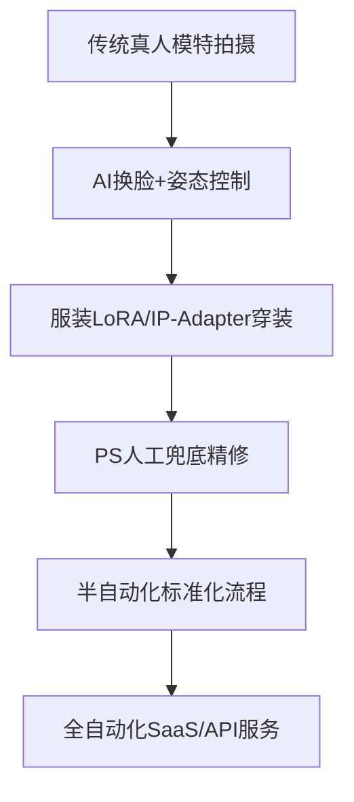
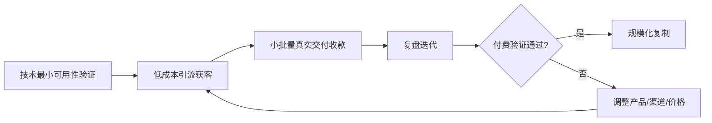
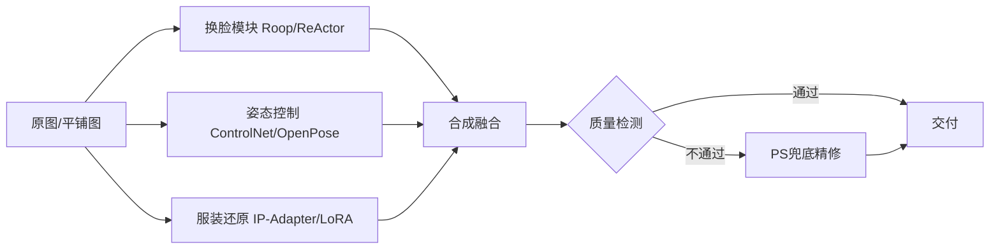
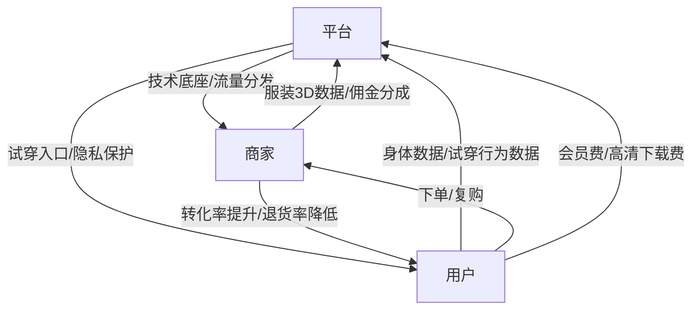
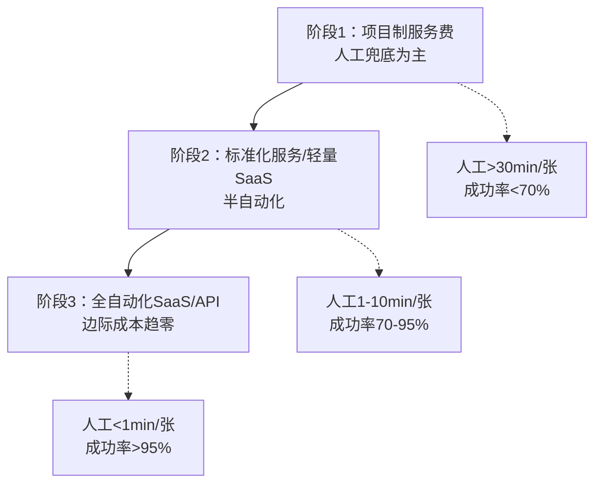

# 第 21 章 AI模特与电商摄影降本增效
作者：龙哥

## 学习目标

- 理解AI模特技术在电商摄影中的商业替代逻辑与红利窗口
- 掌握‘7天跑通变现闭环’的敏捷验证方法论与关键执行动作
- 熟悉Stable Diffusion生态下ControlNet、LoRA、IP-Adapter等技术栈的组合应用与复杂款式攻关策略
- 洞察C端虚拟试穿平台级机会的商业模型设计与多方博弈共生机制
- 预判技术迭代确定性驱动的商业模式演进规律（服务费→SaaS费）及关键跨越指标

## 21.1 生活类比

想象AI模特技术是服装店的“魔法试衣镜”进化史：第一阶段（现状）镜子能把你的脸换上模特身、按姿势站好，但衣服纹理会“穿帮”，需专业裁缝（PS师）在旁边实时补针修补，虽省去模特排期，裁缝成本仍高；第二阶段（过渡期）镜子升级，常款衣服能完美贴合，只需裁缝偶尔改改领口袖口，店主开始按“单次试衣”收费，不再养裁缝团队；第三阶段（终局）镜子成熟为“全自动虚拟试衣间”，顾客输身高体重即生成专属试穿视频，店主接入API按量付费，裁缝彻底退出历史舞台。就像试衣镜从“半自动+人工兜底”进化为“全自动SaaS”，AI模特商业模式也必经“服务费→SaaS费”跃迁。

## 21.2 概念地图

- 第21章：AI模特与电商摄影降本增效
  - 核心商业机会
    - 电商摄影AI替代方案（卖铲人切入）  —— P001
    - 变现闭环敏捷验证法（7天跑通）  —— P002
    - C端虚拟试穿平台级终局  —— P004
  - 技术实现与攻关
    - AI模特技术栈组合（三层架构+PS兜底）  —— P003
    - 复杂款式瓶颈（纹理/结构错误率高）  —— P003
    - 成功率与款式复杂度强负相关  —— P003
  - 商业模式演进
    - 阶段1：项目制服务费（人工兜底为主）  —— P005
    - 阶段2：标准化产品/轻量SaaS（半自动化）  —— P005
    - 阶段3：全自动化SaaS/API（边际成本趋零）  —— P005
    - 跨越关键指标（人工<1min/成功率>95%/批量API）  —— P005
  - 关键风险与边界
    - 平台自建工具替代风险  —— P004
    - 合规/版权/伦理监管不确定性  —— P005
    - 纯技术无人值守交付当前不可行  —— P003

## 21.3 电商摄影AI替代方案 —— 从“卖铲人”切入抢占降本增效红利

### 21.3.1 核心概念解析

**为什么需要这个概念？**

传统电商摄影依赖真人模特，成本高、周期长、排期难，商家痛点极其强烈。生成式AI技术快速迭代，已具备基础换脸、姿态控制能力，出现了“以技术替代人力”的历史性窗口。谁能率先跑通“AI生成+人工兜底”的商业闭环，谁就能成为行业“卖铲人”收割首波红利。

**核心定义**（来源：P001，origin）

电商摄影AI替代方案定义为：利用Stable Diffusion生态（ControlNet/OpenPose/LoRA等）生成虚拟模特试穿图，替代真人拍摄环节；核心流水线：原图换脸 → 骨架垫图控制姿态 → 服装垫图/LoRA训练套装 → PS后期精修兜底；商业模式演进：早期收“服务费”（人工兜底为主） → 后期收“SaaS/软件费”（全自动化为主）。

这个定义展示了三个层次：技术层面是Stable Diffusion生态的组合应用；流程层面是四步走的标准化流水线；商业层面是从人工密集型服务向技术密集型SaaS的演进路径。

> "决定入局 AI 模特项目，尝试用 AI 模特代替真人模特，入局电商摄影，做第一波“买铲子的人”"
> 
> ——《docs/202303/20230328_050.md》（P001，origin）

> "我们 7 天时间，引流了 100+位商家，跑通了变现闭环，目前测试下来商家付费率在 15%左右"
> 
> ——《docs/202303/20230328_050.md》（P002，origin）

这段数据直接验证了市场需求的真实性。100+商家咨询、15%付费转化率，说明电商商家对“AI模特降本增效”有真实且强烈的付费意愿。这不是概念验证，而是商业验证。

**关键性质**

技术就绪度与商业化成本呈剪刀差：技术指标突破≠商业价值释放，当前仍需人工PS兜底。复杂款式（细节丰富/特殊材质）是核心技术瓶颈，纹理结构错误率高，单图时间成本高。成功率呈概率分布：简单款可稳定出图，复杂款严重依赖随机种子运气，需批量生成筛选。

**典型例子**

作者团队7天引流100+商家咨询，实现15%付费转化率，验证市场真实付费意愿。简单款式：T恤、基础款裙装，AI可一次成图或少量PS即可交付。复杂款式：蕾丝、镂空、多层叠加、特殊面料，AI生成衣服变形、纹理错乱，必须重度PS。

**边界条件**

仅适用于“服装平铺图/模特图有版权/可获取”的标品/非标品场景。无法解决：极复杂结构服装、需模特做高难度动作演示、需展示面料微观手感等场景。当前阶段：必须配备专业修图师团队，纯技术无人值守交付不可行。

**素材溯源**

- 来源：docs/202303/20230328_050.md
- 角色：origin（核心实战复盘素材，提供全流程数据与技术细节）

### 21.3.2 方法演进图

该演进图展示了从传统人工拍摄向全自动化SaaS服务的五阶段跃迁路径，每个阶段对应技术成熟度的提升与商业模式的迭代。

## 21.4 变现闭环敏捷验证法 —— 7天跑通“有人买单”才是硬道理

### 21.4.1 核心方法论

**为什么需要这个概念？**

创业初期最大的不确定性是“市场需不需要、愿不愿付费”，而非“技术能不能完美实现”。传统创业易陷入“闭门造车打磨产品”陷阱，错过市场窗口期。需要一套以“付费”为唯一验证标准的极速验证方法论。

**核心定义**（来源：P002，origin）

变现闭环敏捷验证法定义为：核心指标是有人愿意为当前版本（含缺陷）付费；标准动作是技术最小可用性验证 → 低成本引流获客 → 小批量真实交付收款 → 复盘迭代；兜底机制是技术短板由人工服务（PS修图/人工客服/人工运营）补齐，不因技术不完美阻断商业流程。

这个方法论展示了四个关键点：验证标准唯一（付费）、流程标准化（四步走）、兜底机制明确（人工补技术短板）、节奏极快（7天）。

> "我们 7 天时间，引流了 100+位商家，跑通了变现闭环，目前测试下来商家付费率在 15%左右"
> 
> ——《docs/202303/20230328_050.md》（P002，origin）

> "调研过不少了... 1，是取巧的办法，但是要规模商业化不能用这个。 2 和 3...对于细节的处理还需要 ps 的加持"
> 
> ——《docs/202303/20230328_050.md》（P003，origin）

**关键性质**

速度优于完美：7天完成从0到1的商业闭环验证。真实付费是唯一真理：免费试用/口头意向/点赞收藏均不算数，只有到账才算验证通过。规模化前置条件：单笔订单可复制、可交付、有利润空间。

**典型例子**

本案例：7天引流100+商家，15%付费率，单笔订单通过“AI出图+PS修补”完成交付。对比反例：某团队耗时3个月打磨“完美AI模特系统”上线，发现商家不愿为“全自动但效果一般”付费。

**边界条件**

仅适用于：高频刚需、决策链路短、边际成本可控、人工兜底可行的服务型/软件型项目。不适用于：重资产、长周期研发、强合规、无法人工兜底技术缺口的项目（如芯片、生物医药、自动驾驶）。必须设定止损线：如连续N天0付费、或单客获客成本>客户终身价值，必须果断转型或放弃。

**素材溯源**

- 来源：docs/202303/20230328_050.md
- 角色：origin（实战复盘中体现的验证方法论）

### 21.4.2 验证流程图

该流程图将敏捷验证法固化为可执行的四步闭环，并明确了“付费验证通过”作为进入规模化的唯一决策门槛。

## 21.5 AI模特技术栈组合与复杂款式攻关实战

### 21.5.1 技术栈架构设计

**为什么需要这个概念？**

单一AI模型（如仅用txt2img或单一LoRA）无法满足商业级电商摄影的多样化需求。电商摄影要求：模特身材一致、姿态可控、服装细节零误差、肤色光影自然统一。必须组合多种控制手段，构建“乐高式”技术栈，针对不同难度款式动态调用。

**核心定义**（来源：P003，origin）

AI模特技术栈组合定义为三层技术栈组合：基础层：原图修改换脸（Roop/ReActor等），解决模特面部版权与一致性；控制层：ControlNet/OpenPose骨架垫图控制姿态，解决动作指定；Depth/Canny控制构图；服装层：服装垫图（IP-Adapter/Reference Only）+ 服装LoRA训练，解决衣服穿身还原；兜底层：Photoshop专业修图（液化/蒙版/调色/合成），解决AI生成的细节瑕疵、穿帮、逻辑错误。

这个架构展示了模块化设计思想：每层解决一个正交问题，层与层之间通过标准接口（图像输入输出）衔接，兜底层作为最后安全网。

> "他们只能说在原图上修改一下模特的脸，这个目前可以实现；"
> 
> "垫图然后根据骨架产生类似动作模型，但是衣服还是不同"
> 
> "人物垫图服装 我看了生成的衣服也是不对的"
> 
> "对于细节的处理还需要 ps 的加持"
> 
> "处理了 N 张 运气好出了 1-2 刚好随机种子碰上了 概率非常小"
> 
> ——《docs/202303/20230328_050.md》（P003，origin）

**关键性质**

模块化可替换：随着技术迭代，单一模块可升级替换（如新版ControlNet替代旧版）。成本阶梯分布：简单款≈纯AI成本（低）；中等款≈AI+轻度PS；复杂款≈重度PS（人工成本占比>80%）。成功率与款式复杂度强负相关：基础款>90%，复杂款<30%（需大量重掷筛选）。

**典型例子**

简单款：纯色T恤换色，仅需原图换脸+服装垫图，1分钟出图，0 PS。中等款：常规西装套装，需骨架控制姿态+服装LoRA+轻度PS修领口褶皱，10分钟/张。复杂款：蕾丝拼接露肩长裙，AI生成蕾丝纹理断裂、露肩结构崩塌，需PS重绘细节，1小时+/张。

**边界条件**

训练服装LoRA需：干净平铺图/多角度实拍图 ≥ 20张，训练成本约1-2 GPU小时。ControlNet对输入图分辨率敏感，建议统一预处理至1024x1024或512x768。当前SDXL/SD1.5生态下，手部/脚部/复杂纹理/透视结构仍为通病，不可完全依赖模型。

**素材溯源**

- 来源：docs/202303/20230328_050.md
- 角色：origin（技术栈细节与实战踩坑记录）

### 21.5.2 数据流图

该数据流图描绘了从多模态输入到最终交付的完整管线，突出了“质量检测”节点作为自动化与人工分流的关键决策点。

## 21.6 C端虚拟试穿平台级终局 —— 解决“退货率”与“买不到合身”双重痛点

### 21.6.1 战略预判

**为什么需要这个概念？**

B端降本（帮商家省拍摄费）市场天花板低、竞争红海、易被平台自建工具替代。电商核心痛点从未解决：用户买不到合身衣服（尺码不标准）、退货率高（服装类30%-50%）。谁能让用户“输入身体数据→一键生成专属试穿图→如同实地穿衣”，谁就能重塑电商交易闭环。

**核心定义**（来源：P004，extension）

C端虚拟试穿平台定义为：面向C端用户的虚拟试穿平台/小程序/APP；核心交互：用户输入身高/体重/三围/体型偏好 → AI生成穿着目标服装的专属试穿视频/图 → 支持多角度/动态/换装对比；商业模式：平台提供技术底座 → 商家入驻上传服装3D/平铺数据 → 用户免费试穿/会员高清下载 → 直接下单/分佣/广告/数据变现。

这个定义揭示了从B端工具到C端平台的战略跃迁：用户侧交互极简（输入数据→生成试穿），商家侧标准化入驻（上传数据），平台侧构建三方共生生态。

> "这……可能是淘宝最后的机会了... 利用现在的技术，让会员输入自己的身体各项指数，在线生成真人模特...一键试穿，如同实地穿衣一样的效果。更是避免了实体要面对面的尴尬，社恐的福音。"
> 
> ——《docs/202303/20230328_050.md》（P004，extension）

**关键性质**

多方博弈共生：平台给流量/技术，商家给货品/数据，用户给需求/数据，三方利益必须精准对齐。技术门槛跃迁：从“静态图生成”进化为“4D一致性视频生成/物理仿真布料模拟/个性化身形建模”。数据飞轮效应：用户试穿数据反哺选品/设计/生产/库存，实现C2M柔性供应链。

**典型例子**

作者愿景：淘宝/拼多多/抖音电商接入“虚拟试衣间”，用户一键试穿全店商品，退货率预期降低50%+。海外参照：Google虚拟试穿、Zalando试穿技术、Vue.ai，但均受限于生成质量与身形精度，未大规模落地。

**边界条件**

必须解决：用户身体数据获取隐私信任、服装3D/平铺数据标准化入库、生成延迟<10秒、真实度通过“肉眼不可辨别”测试。非服装品类（鞋帽/箱包/首饰/美妆）需单独建模，无法复用服装模型。早期需平台补贴商家建模成本，跑通冷启动；成熟期转为商家主动付费建模（因带来转化提升）。

**素材溯源**

- 来源：docs/202303/20230328_050.md
- 角色：extension（作者基于技术演进趋势的战略预判与商业洞察）

### 21.6.2 三方博弈模型

该模型展示了平台、商家、用户三方的价值交换闭环，核心在于数据与流量的双向流动形成正向飞轮。

## 21.7 技术迭代确定性与商业模式演进规律 —— 从“服务费”向“SaaS费”跨越

### 21.7.1 演进三阶段

**为什么需要这个概念？**

许多AI创业者误判技术成熟节点，要么过早做SaaS（技术不稳定导致流失），要么过晚做服务（错过规模化窗口）。需要理解：技术成熟度是连续变量，商业模式是离散跃迁，两者存在可预测的映射关系。

**核心定义**（来源：P005，extension）

商业模式演进规律定义为三阶段跃迁：阶段1（技术早期/现状）：成功率低、耗时长、强依赖人工 → 模式：项目制/服务费/外包模式，核心资产是“交付团队”；阶段2（技术过渡期）：成功率提升、标准化SOP成熟、半自动化 → 模式：服务标准化产品化/按单收费/轻量化SaaS，核心资产是“标准化流程”；阶段3（技术成熟期）：全自动化、API可调用、边际成本趋近零 → 模式：SaaS订阅/按量计费/平台分成，核心资产是“技术护城河/用户网络”。

这个规律展示了技术成熟度驱动商业模式跃迁的必然路径：人工密集型→流程标准化→技术密集型。

> "不过技术在进步，之后的成本会越来越低。"
> 
> "本着“打不过就加入”的想法，决定入局 AI 模特项目...做第一波“买铲子的人”"
> 
> ——《docs/202303/20230328_050.md》（P005，extension）

**关键性质**

跨越关键指标：单张图人工干预时间 < 1分钟、生成成功率 > 95%、支持批量API调用、无需专业修图师。跨越标志事件：头部电商平台/服务商接入API、出现垂直领域“AI模特中台”公司、客户自助下单无人工沟通。估值逻辑跃迁：服务业估值≈1-2倍营收 → SaaS估值≈10-20倍ARR。

**典型例子**

Midjourney：从Discord Bot（服务形态）→ Web/API/SaaS（平台形态），实现指数级规模化。除背景工具：早期人工抠图服务 → remove.bg API → 批量处理SaaS → 被Canva/Adobe收购集成。本案例预判：AI模特将沿用此路径，当前处于阶段1向阶段2过渡期。

**边界条件**

技术迭代速度不可控：受限于开源社区/头部大厂模型发布节奏，创业者只能“跟随+微调+应用层封装”。合规/版权/伦理风险可能倒逼模式变革：如模特肖像权立法、服装设计版权争议、深度伪造监管。竞争格局突变：若淘宝/抖音官方免费内置同级功能，第三方SaaS窗口期将瞬间关闭。

**素材溯源**

- 来源：docs/202303/20230328_050.md
- 角色：extension（作者基于行业演进规律的抽象总结与预判）

### 21.7.2 阶段演进图

该演进图将三阶段的商业模式与对应的技术关键指标（KPI）对齐，直观呈现跨越门槛。

### 21.7.3 阶段跨越关键指标对照表

以下表格汇总了商业模式跨越的关键指标对照，展示了随着技术指标改善，商业模式如何发生质变：人工成本占比从>80%降至<5%，估值逻辑从服务业跃迁为SaaS。

| 阶段 | 核心模式 | 人工干预/张 | 成功率 | 交付形态 | 核心资产 | 估值倍数 |
|------|----------|-------------|--------|----------|----------|----------|
| 阶段1 | 项目制服务费 | >30分钟 | <70% | 人工交付 | 交付团队 | 1-2×营收 |
| 阶段2 | 轻量化SaaS/标准化服务 | 1-10分钟 | 70-95% | 半自动化 | 标准化流程 | 5-10×ARR |
| 阶段3 | 全自动化SaaS/API | <1分钟 | >95% | API自助 | 技术护城河/用户网络 | 10-20×ARR |

## 21.8 多源对照

### 共识

AI模特技术基于Stable Diffusion生态，核心依赖ControlNet/OpenPose姿态控制、IP-Adapter/LoRA服装还原。当前阶段复杂款式必须依赖PS人工兜底，纯技术无人值守不可行。商业模式必经“服务费→SaaS费”演进，跨越关键指标为单图人工<1min、成功率>95%。

### 分歧

技术乐观派（素材作者）认为技术迭代确定性强，成本必然趋近零，C端虚拟试穿是确定性终局。技术谨慎派（行业观察）指出版权/合规/伦理风险可能成为硬约束，平台自建工具替代风险极高。商业落地派主张当前应聚焦“简单款标准化+复杂款拒单/外包”，避免在技术瓶颈上过度投入。

## 21.9 设计中的取舍

**为什么不用“纯技术全自动化”方案？**

当前Stable Diffusion生态在复杂纹理、透视结构、手脚生成上存在本质缺陷，强行全自动会导致交付质量不可控、退单率极高、品牌信任崩塌。人工PS兜底虽然边际成本高，但作为“最后一道质检关”，是当前阶段商业闭环的必要条件。

**这种设计的trade-off是什么？**

用“高人工成本、低规模化上限”换取“高交付质量、真实商业验证、客户信任积累”。在技术跨越临界点前，这是唯一可行的商业化路径。一旦技术指标跨越临界点（人工<1min/成功率>95%），必须果断砍掉人工环节，转型SaaS模式，否则会被全自动化竞争者碾压。

**深层分析：人工兜底的战略价值与退出时机**

人工兜底不仅是技术短板的补丁，更是商业模式验证期的“护城河”。它让团队在技术不成熟时就能触达真实客户、收集真实款式数据、建立真实交付SOP、积累真实品牌信誉。这些非技术资产（客户关系、款式数据库、交付标准、定价体系）在转型SaaS时极难被纯技术玩家复制。

退出时机的判断不能仅看单一指标，而需建立“技术-商业双维仪表盘”：技术侧监控单图人工时长、成功率、API稳定性；商业侧监控客单价、复购率、获客成本、毛利率。当技术侧指标连续4周达标且商业侧毛利率>50%时，触发“全自动化切换计划”；若技术指标达标但商业指标未达标，说明产品市场契合度不足，需优先解决商业问题而非继续打磨技术。

## 21.10 动手练习

### 练习1：设计一个AI模特项目的7天冷启动验证计划

背景：你有一套基于Stable Diffusion的AI模特出图流水线（含ControlNet姿态控制、服装LoRA训练、PS修图团队），目标验证电商商家付费意愿。

任务：设计7天执行清单，包含：
1. 第1-2天：最小可用性验证（定义‘简单款/中等款/复杂款’各3个标准测试用例，测算出图成功率、人工耗时、综合成本）
2. 第3天：低成本引流动作设计（朋友圈/社群/竞品评论区/冷启动渠道，预算<500元）
3. 第4-6天：咨询接待与报价策略（分款式报价/打样免费策略/交付承诺SLA）
4. 第7天：复盘指标（咨询量/打样量/付费转化率/客单价/单笔毛利/PS师人均工时）

思考题：
- 若第7天付费转化率<5%，你会判定为‘需求不存在’还是‘产品/渠道/价格不匹配’？如何在第8-14天快速A/B测试？
- 复杂款单张耗时1小时+、毛利为负，是否应在冷启动期直接拒单？拒单对品牌信任有何影响？

### 练习2：技术栈组合决策：为某服装品牌设计分级交付方案

背景：某女装品牌月需1000张模特图，款式分布：基础T恤/卫衣40%、常规裙装/西装40%、复杂蕾丝/礼服/功能性面料20%。

任务：基于当前技术成熟度（简单款纯AI、中等款AI+轻PS、复杂款重PS），设计分级交付SOP与报价表：
1. 定义三级款式判定标准（可量化指标：面料类别/结构件数/细节密度/遮挡关系）
2. 设计三条生产线配置：纯AI线/混合线/人工主导线，各配置GPU算力、PS师编制、预估产能、单图成本
3. 制定动态分流规则：新款式来单→自动化预测难度等级→分流至对应生产线→实时监控良率
4. 计算全品类加权平均成本与建议报价（含30%毛利），对比传统摄影成本测算降本幅度

思考题：
- 当复杂款占比从20%升至50%（如高定品牌），商业模式是否仍可行？临界点在哪里？
- 如何设计‘技术迭代红利分享机制’：当模型升级使复杂款成功率从30%→60%，降低的成本如何与品牌方分配？

### 练习3：推演C端虚拟试穿平台的冷启动博弈模型

背景：你计划切入‘C端虚拟试穿’赛道，开发微信小程序，用户输入身高/体重/三围→生成穿着目标服装试穿图→跳转电商下单。

任务：构建三方博弈冷启动模型：
1. 用户侧：获客成本(CAC)、试穿生成延迟容忍度、隐私信任门槛、复用率驱动因子
2. 商家侧：建模成本(3D/平铺图标准化)、转化率提升预期、佣金/分成接受上限、数据反哺价值
3. 平台侧：流量分发权重、技术底座投入、商家入驻门槛、数据资产归属
4. 设计三阶段冷启动策略：
   种子期：平台补贴建模费+种子用户白嫖体验→积累案例数据
   爆发期：商家自付建模费+平台算法加权分发+会员制高清下载
   成熟期：C2M数据反哺选品/生产+开放API接入多电商端+广告/数据变现

思考题：
- 若生成延迟从30秒降至5秒，用户留存率预期提升多少？如何用A/B测试验证？
- 当淘宝/抖音官方上线同功能，第三方小程序的生存空间在哪里？差异化护城河是什么？

## 21.11 本章小结

这一章中我们学习了AI模特技术在电商摄影中的商业化全景图。首先理解了“卖铲人”切入策略，利用AI替代真人模特抢占降本增效红利窗口；其次掌握了7天跑通变现闭环的敏捷验证方法论，以真实付费为唯一标准，人工兜底补齐技术短板；接着深入剖析了三层技术栈组合（换脸/姿态/服装）与PS兜底层的模块化架构，以及复杂款式攻关的概率性本质；然后展望了C端虚拟试穿平台级终局，揭示三方博弈共生机制与数据飞轮效应；最后预判了技术迭代确定性驱动的商业模式演进规律，明确了从服务费向SaaS费跨越的关键指标与风险边界。

本章我们一起学习了以下概念：

| 概念 | 解释 |
|------|------|
| 电商摄影AI替代方案 | 利用生成式AI替代真人模特拍摄，切入‘卖铲人’角色抢占降本增效红利窗口 |
| 变现闭环敏捷验证法 | 7天内以‘有人付费’为唯一标准跑通商业闭环，技术短板用人工兜底，不等技术完美 |
| AI模特技术栈组合 | 基础换脸层+姿态控制层+服装还原层+PS兜底层，模块化组合应对不同难度款式 |
| 复杂款式攻关瓶颈 | 蕾丝/镂空/多层叠加等复杂服装AI生成纹理结构错误率高，严重依赖人工PS修补 |
| C端虚拟试穿终局 | 用户输入身体数据一键生成专属试穿图，解决退货率与买不到合身双痛点，需平台/商家/用户三方协同 |
| 商业模式演进规律 | 随技术成熟度跃迁：服务费(人工主导)→标准化服务/轻SaaS(半自动)→SaaS订阅/按量计费(全自动) |
| 技术跨越关键指标 | 单图人工干预<1分钟、生成成功率>95%、支持批量API调用、无需专业修图师 |
| 核心风险边界 | 平台自建工具替代、合规版权风险、技术迭代节奏不可控、纯技术无人值守当前不可行 |

下一章中，我们将学习本地生活服务资源整合 —— 师傅分级分成、咸鱼矩阵地毯式发布、招聘平台借力裂变、私域信任闭环。

