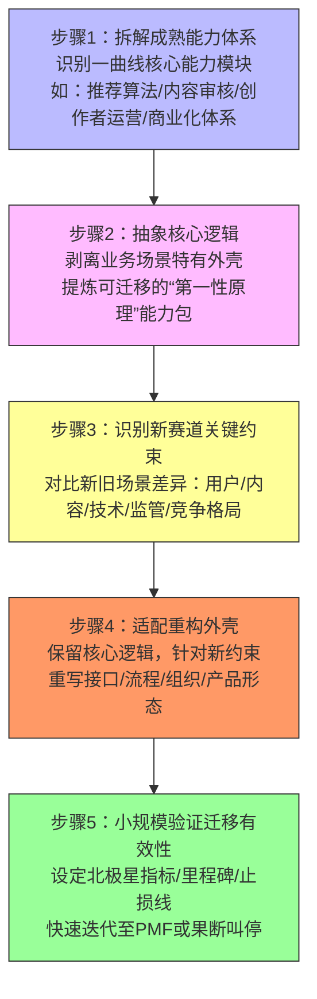
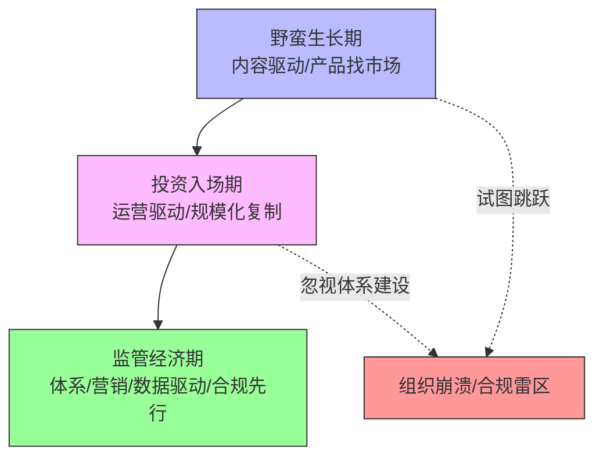
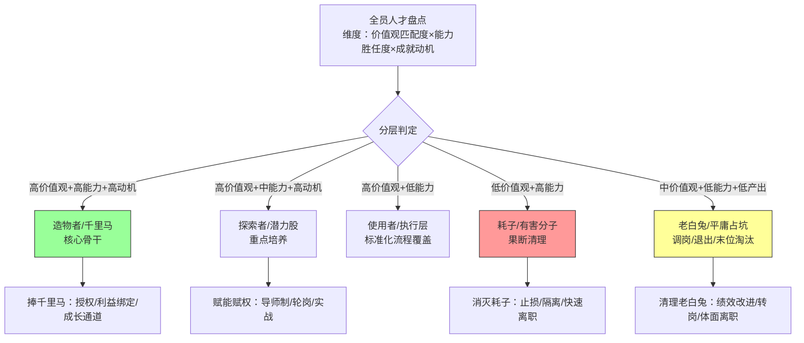
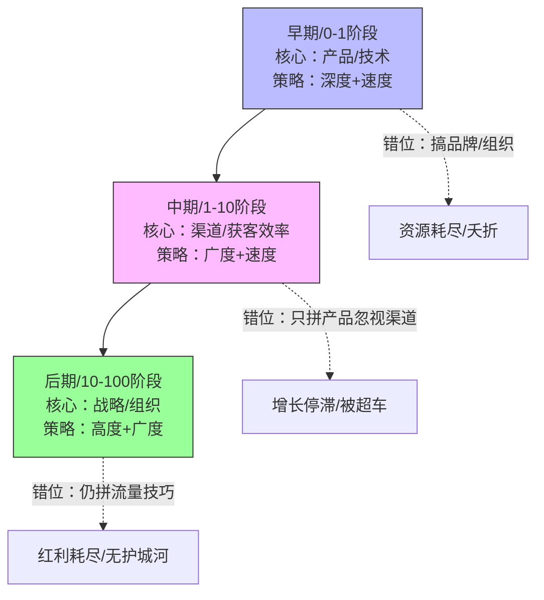
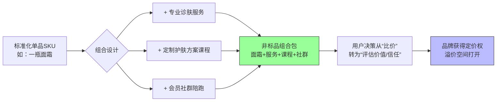
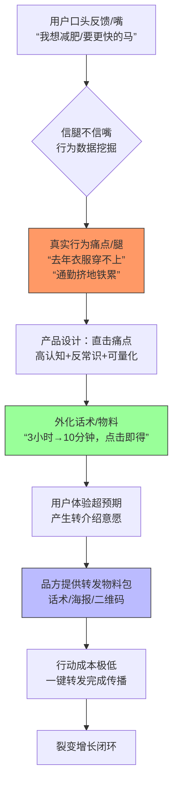

# 第 54 章 组织管理与商业设计核心体系

## 学习目标

- 理解组织信息过滤的成因与管理者认知盲区的必然性
- 掌握打破单一汇报渠道、通过跳级汇报与多层级交叉验证获取真相的方法
- 掌握识别语言潜台词（如“未痛快答应即拒绝”）的非显性信号解码技巧
- 理解商业即设计的核心逻辑：认知决定边界、体系决定上限、标准化决定规模
- 掌握阶段性战略匹配法：早期比产品、中期比渠道、后期比战略组织
- 掌握经营策略四选二与目标对齐六遍法，避免贪多嚼不烂
- 理解人才三层次模型与价值观优先原则：招参与者、价值观=1能力=0
- 掌握人岗匹配大于激励机制、捧千里马消灭耗子清理老白兔的人才盘点法
- 理解零和/非零和博弈决定战略必要性、农业经济周期律与商业社会化临界点
- 掌握标品/非标品定价权定理与通过SKU组合获取定价权的方法
- 掌握用户洞察“信腿不信嘴”法与产品效果外化“高认知、反常识、可量化”三要素
- 理解转介绍触发机制：超预期体验+准备好转发物料

## 54.1 生活类比

想象组织管理是一场**“破案游戏”**。**管理者**就像只能坐在办公室里通过汇报材料了解案情的**局长**；**中层汇报**像只报喜不报忧、为了业绩包装真相的**分局长**；**一线员工**像知道真凶是谁但怕担责不敢作证的**知情群众**；**信息过滤**则是层层加码的‘好消息’滤镜，让局长看到的全是‘治安大好’的假报告。局长若只看材料、不出门，永远破不了案。而**跳级汇报/交叉验证**，就是局长私下微服出访、分别询问派出所民警、社区大妈、出租车司机，从他们口中**拼凑出真实拼图**；**语言潜台词识别**，则是老刑警听嫌疑人说“我再考虑考虑”、“下次吧”，一听就明白：**这是拒绝**。就像破案不能只听汇报，管理也不能只信单一渠道；必须主动打破信息茧房，通过多维交叉、读懂弦外之音，才能拼凑出组织的真实面貌。

## 54.2 概念地图

组织管理与商业设计核心体系
├── 组织信息获取与真相机制
│   ├── 组织信息过滤 —— P001
│   ├── 管理盲区与认知滞后 —— P002
│   ├── 权力不对等导致真话缺失定律 —— P001
│   ├── 语言潜台词识别：未痛快答应即拒绝 —— P002
│   ├── 跳级汇报/多层级交叉验证法 —— P002
│   └── 心理安全感建设与离职真相挖掘 —— P001
├── 商业设计顶层逻辑
│   ├── 商业即设计定理：认知决定边界/体系决定上限/标准化决定规模 —— P003
│   ├── 创始人认知瓶颈与迁移能力 > 学习能力 —— P003
│   ├── 三类业务形态：改造型/替代型/创造型 —— P003
│   ├── 阶段不可跨越定理：野蛮生长→投资入场→监管经济 —— P003
│   ├── 第二曲线判据与组织能力溢出公式 —— P003
│   └── 正确寻找第二曲线时机：第一曲线最好时而非衰退期 —— P003
├── 组织管理与人才体系
│   ├── 管理三阶层：自我/团队/组织管理(直接→间接) —— P004
│   ├── 人才三层次：使用者→探索者→造物者(招参与者) —— P004
│   ├── 价值观优先原则：价值观=1/能力=0 —— P004
│   ├── 人岗匹配 > 激励机制：人是1/机制是0 —— P004
│   ├── 捧千里马/消灭耗子/清理老白兔人才盘点 —— P004
│   ├── 合伙人性格相融法：宽容理解差异 —— P004
│   ├── 招人要慢开人要快与管理底线即员工行为底线 —— P004
│   ├── 内训失效根因：只有赋能系统无赋权系统 —— P004
│   └── 标准化分层：软件易/人难是规模化瓶颈 —— P004
├── 阶段性战略与经营策略
│   ├── 阶段性战略匹配：早期比产品/中期比渠道/后期比战略组织 —— P005
│   ├── 直播业务三阶段：拼流量→拼供应链→拼品牌 —— P005
│   ├── 经营策略四选二：广度/深度/高度/速度每阶段选二 —— P005
│   ├── 目标对齐六遍法：不可能→有意思→可能→可试→应该能→肯定能 —— P005
│   ├── 新业务孵化：老人做新事(配互联网人才)/新人做老事(收购原老大) —— P005
│   ├── 零和/非零和博弈决定战略必要性：上升期非零和/存量期零和 —— P005
│   ├── 农业经济周期律：春种秋收夏耘冬藏违背必反噬 —— P005
│   └── 商业社会化临界点：体量达规模需担社会责任 —— P005
├── 商业模式与定价权
│   ├── 商业模式本质是经营方式：用户停留时长决定清晰度 —— P006
│   ├── 平台博弈定理：弱则靠平台/强则造平台 —— P006
│   ├── 标品/非标品定价权定理：理性比价无权/感性评估有权 —— P006
│   ├── SKU组合非标化获取定价权 —— P006
│   ├── 战略决定组织：以旧组织执行新战略必败 —— P006
│   ├── 免费流量不确定需工程化/付费流量相对确定拼ROI —— P006
│   └── 小红书去重算法窗口期仅剩半年(素材宣称) —— P006
└── 用户洞察与产品外化
    ├── 用户洞察信腿不信嘴：看行为数据而非口头反馈 —— P007
    ├── 产品效果外化三要素：高认知/反常识/可量化外化到行动 —— P007
    ├── 转介绍触发机制：超预期体验+准备好转发物料降低行动成本 —— P007
    ├── 服务本质外向型：问客户需求/调动资源解决问题而非卖现有能力 —— P007
    └── 业务停滞3-6月判定：方向错而非执行不力果断止损 —— P007

## 54.3 组织信息过滤 —— 权力不对等导致的真话缺失

### 为什么需要这个概念？

管理者处于信息金字塔顶端，却往往是最后一个知道公司出问题的人。员工基于利益保护、面子顾虑、权力不对等，系统性隐瞒负面真相。信息失真导致决策失误，甚至引发组织灾难（如袁世凯83天倒台）。

### 核心定义

**组织信息过滤** 指组织层级结构导致信息在上传下达中被筛选、修饰、隐瞒的现象。下级面临“说真话风险高、说假话成本低”的博弈结构，导致上级接收信息系统性失真。

> "员工不会完全说真话，你要努力了解公司的真相"
> 
> ——《小马宋创业46条第八条》(P001)

> "你的下属，你下属的下属，可能反馈的信息都不同，因为每个人都是站在自己的立场说问题的"
> 
> ——《小马宋创业46条第八条》(P001)

### 关键性质

组织信息过滤具有**普遍性**——不限于老板-下属，同级间也存在；具有**隐蔽性**——员工给出社会通用借口（如“想读书”）掩盖真实不满；具有**破坏性**——管理者仅接收过滤后的“好消息”，对基层矛盾一无所知。

这就好比“破案游戏”里，分局长为了业绩考核，把派出所上报的“治安恶化”压成“平稳可控”，局长手里拿着的全是经过层层美化的“治安大好”报表，自然无法破案。

### 核心方法：语言潜台词识别 —— 常见“非痛快答应”信号及其真实含义

在管理实践中，识别员工或合作伙伴回应中的“非痛快答应”信号，是穿透信息过滤、获取真实意图的关键微技能。以下对照表汇总了高频信号及其背后的潜台词含义，供管理者快速研判：

| 表层回应 | 潜台词（真实意图） |
|----------|-------------------|
| “再看看/下周再说” | 拒绝/不优先 |
| “有点难/需要请示” | 不想做/无权限 |
| “我考虑一下” | 委婉拒绝 |
| “没问题，但...” | 有保留/有条件 |

> 表：常见“非痛快答应”信号及其真实含义对照表，来源于《小马宋创业46条第八条》(P001)与《商业设计特训营课程精华》(P003-P007)的综合整理，用于管理者快速识别隐性拒绝信号。

### 典型例子

**案例 1：袁世凯的“假报纸”误判**

> "据说来袁世凯要复辟前...每份报纸对他都是赞美之词...登基83天后被迫撤销帝制"
> 
> ——《小马宋创业46条第八条》(P001)

这个案例展示了极端权力结构下，信息过滤如何导致决策者完全脱离现实，最终在 83 天内崩盘。

**案例 2：离职面谈的“社会通用借口”**

> "一个自己辞职的员工，你问他为什么离开公司，他可能会说想要读一个书，或者去别的行业看看，但很可能背后的原因是，他对公司有些方面很不满。但他碍于面子，也不会直说"
> 
> ——《小马宋创业46条第八条》(P001)

这就是典型的“显性理由掩盖隐性真相”。

**案例 3：员工视角的“说真话风险”**

> "无数次经历告诉我，如果我跟老板说真话，先把我的直系领导（安全总监）给得罪了...有时候不是不说，而是不能说（评论区 双平）"
> 
> ——《小马宋创业46条第八条》(P001)

> "老板都是很聪明的有时候不是看不到，而是衡量各方面的得失后，装作看不到（评论区 双平）"
> 
> ——《小马宋创业46条第八条》(P001)

### 边界条件

- 仅靠正式汇报渠道（单一渠道）必成最后知情者
- 必须主动构建获取真相机制（跳级汇报、交叉验证、识别潜台词）才能打破
- 心理安全感缺失时，任何制度设计都无法强迫员工说真话

---

## 54.4 管理盲区与真相获取 —— 打破单一渠道的交叉验证法

### 为什么需要这个概念？

管理者仅依赖正式汇报，必然成为组织中最后一个知晓核心问题的人。权力不对等导致下级不敢说真话，上级听不到真话。必须主动打破信息茧房，建立多维度的真相拼图机制。

### 核心定义

**管理盲区**：管理者因处于信息金字塔顶端，仅接收过滤后的“好消息”，对基层真实矛盾一无所知的认知偏差状态。

**真相获取机制**：通过跳级汇报、多层级交叉验证、语言潜台词识别、建立心理安全感等组合手段主动拼凑真相。

> "有些老板会天真地以为，自己没啥问题，其实他有可能是最后一个知道公司出问题的人"
> 
> ——《小马宋创业46条第八条》(P001)

### 关键性质

真相获取机制具有**主动性**——真相不会自动上浮，必须管理者主动去“挖”，正如局长必须微服出访；具有**交叉性**——需对比“不同立场人”（下属、下属的下属、同僚）的反馈差异；具有**解码性**——需识别“未痛快答应即拒绝”等非显性信号，正如老刑警听出嫌疑人“我考虑一下”实为拒绝。

### 核心方法：跳级汇报/多层级交叉验证

> "你的下属，你下属的下属，可能反馈的信息都不同，因为每个人都是站在自己的立场说问题的"
> 
> ——《小马宋创业46条第八条》(P001)

**方法步骤：**
1. 绕过直接下属，直接询问“下属的下属”真实感受
2. 对比一线与中层反馈的差异
3. 从不同立场的信息差异中拼凑真相拼图

> "管理者不应仅依赖直接下属汇报，而应主动跨越层级获取信息，对比不同立场信息差异以拼凑真相"
> 
> ——《商业设计特训营课程精华》(P003-P007)

### 核心方法：语言潜台词识别

> "我常常说：一个人没有痛快的答应，通常就是拒绝的意思"
> 
> ——《小马宋创业46条第八条》(P001)

**识别逻辑：** 缺乏“痛快答应”的回应（拖延/模糊/找借口）本质即为拒绝。通过观察回应的**及时性、确定性、热情度**判断真实意图。

> "通过观察对方回应的及时性/确定性/热情度判断真实意图：缺乏痛快答应的回应本质即为拒绝"
> 
> ——《商业设计特训营课程精华》(P003-P007)

### 典型例子

**离职真相挖掘**：通过非正式渠道（如同事侧写）获知员工真实离职原因是薪资/氛围，而非“读书/换行业”。

### 边界条件

- 无法通过制度强制“说真话”，只能通过降低说真话成本（心理安全感）诱导
- 管理者自身认知偏见（如确认偏误）会过滤掉不符合预期的真相
- 交叉验证成本高，仅适用于核心岗位/关键节点，不可全员全时覆盖

---

## 54.5 商业即设计 —— 认知决定边界，体系决定上限

### 为什么需要这个概念？

创业者常误以为靠努力/运气/执行就能成功，忽视顶层设计的决定性作用。业务成败、赚钱上限从 Day 1 就由创始人认知与战略设计锁定。认知边界即业务边界，创始人理解越深，成功概率越高。

### 核心定义

**商业设计**：指业务能不能赚钱、最多能赚多少钱，从业务生长第一天就已确定的顶层逻辑。

**核心公式**：**认知决定边界 → 体系决定上限 → 标准化决定规模**

> "所有的商业都是设计出来的，一个业务能不能赚钱，最多能赚到多少钱，从业务生长出来的第一天就已经确定了"
> 
> ——《商业设计特训营课程精华》(P003-P007)

> "一个业务能不能成，取决于创始人对这个业务的理解，创始人的认知是这个业务最大的瓶颈"
> 
> ——《商业设计特训营课程精华》(P003-P007)

### 关键性质

商业设计具有**先发性**——设计在先、执行在后，以旧组织执行新战略必败；具有**迁移性**——核心竞争力非学习能力，而是认知迁移能力（如头条图文分发 → 抖音视频分发）；具有**分层性**——业务仅三种形态——改造型（提效）、替代型（线上化）、创造型（新物种）。

### 方法演进图：认知迁移实操五步法流程图



### 关键概念：三类业务形态

> "所有的业务只有三种形态：改造型：就是改善原有行业里某个环节的效率...替代型：就是把线下的东西往线上搬...创造型：创造了新的服务、产品或发现新的商业模式..."
> 
> ——《商业设计特训营课程精华》(P003-P007)

以下对照表梳理了三类业务形态的核心逻辑与典型案例，帮助创始人判断业务本质竞争逻辑与护城河构建路径。表格来源于《商业设计特训营课程精华》(P003-P007)并结合《从0到1》(彼得·蒂尔)关于“垄断型新物种”论述、《独角兽公司》中“定义新品类”案例、《创新者的窘境》中“新市场颠覆”理论综合整理。对比维度选取依据为：价值创造方式、竞争护城河本质、典型增长路径。读者可用此表对照自查：你的业务本质属于哪一类？核心竞争要素是否匹配该类型的胜出逻辑？

| 业务形态 | 核心逻辑 | 典型案例 | 学术佐证来源 |
|----------|----------|----------|--------------|
| **改造型** | 提升原有环节效率，标准化重塑行业 | 好未来/链家招大学生标准化重塑行业 | 素材原文(P003-P007) |
| **替代型** | 线下搬线上，核心矛盾转移（如从“找货”到“流量匹配”） | 二手书电商：核心矛盾从“找货”转移到“流量识别与匹配” | 素材原文(P003-P007) |
| **创造型** | 创造新物种/新模式，定义新品类，建立垄断型市场 | 共享单车（重新定义短途出行“随借随还”）、Airbnb（闲置资源变现新模式）、特斯拉（电动化+智能化重塑汽车） | 《从0到1》垄断论、《独角兽公司》定义新品类、《创新者的窘境》新市场颠覆 |

> 表：三类业务形态对比表。

### 关键概念：认知迁移能力 > 学习能力

> "比学习能力更重要的是迁移能力，头条到抖音，其实是图文分发能力到视频分发能力的迁移"
> 
> ——《商业设计特训营课程精华》(P003-P007)

这段话揭示了：**不是学会了新技能，而是把旧能力迁移到新场景**。头条不是“学会了短视频”，而是将“图文分发算力”迁移为“视频分发算力”。

### 关键概念：阶段不可跨越定理

> "企业发展过程中的每个阶段都需要创始人亲身经历一遍...阶段不可以跨越，但可以缩短，找到周围认知最高的人，花钱学习，缩短痛的时间！"
> 
> ——《商业设计特训营课程精华》(P003-P007)

**阶段演进路径：**
- 个人发展 → 公司 → 集团
- 内容驱动 → 运营驱动 → 体系驱动 → 营销驱动 → 数据驱动
- 野蛮生长 → 投资入场 → 监管经济（市场经济转监管经济）

### 方法演进图：阶段演进路径图



### 关键发现：第二曲线寻找时机反常识

> "从企业创新的角度，找第二曲线一定要在企业发展最好的时间段，但往往大部分企业在衰退的时候才想起来找第二曲线"
> 
> ——《商业设计特训营课程精华》(P003-P007)

**第二曲线判据（三硬指标）：**
1. 有商业模式，利润过亿
2. 处于市场经济而非监管经济
3. 一曲线经历过大规模营销驱动

**组织能力溢出公式：**

```
组织能力溢出 = 组织迁移能力 + 大规模需求溢出
```

> "组织能力溢出=组织迁移能力+大规模需求溢出"
> 
> ——《商业设计特训营课程精华》(P003-P007)

**公式逐步推导与逻辑解释：**

**Step 1 定义目标函数**：我们要判断企业是否具备孵化第二曲线的**内生条件**，即“组织能力溢出”这一因变量。

**Step 2 分解自变量**：第二曲线的成功需要两个必要条件同时满足——
- **内因（能不能做）**：企业能否将一曲线积累的核心能力（技术、运营、供应链、品牌、文化）抽象化、标准化后，向新赛道迁移复用。定义为**组织迁移能力**。
- **外因（有没有机会做）**：一曲线充分竞争、规模化运营后，产生的超出现有业务承接能力的用户需求、流量、数据、资金等外部资源溢出。定义为**大规模需求溢出**。

**Step 3 确定函数关系**：二者为**必要非充分**的“与”关系，缺一不可。
- 只有迁移能力无需求溢出 = “技术找场景”的伪创新（有锤子找钉子）；
- 只有需求溢出无迁移能力 = “裸奔扩张”的盲目多元化（有机会无能力）；
- 两者必须**同时具备**才能形成真正的组织能力溢出。故采用**加法关系（+）**：溢出 = 迁移能力 + 需求溢出。若任一为 0，总溢出即判定为不成立（实质为逻辑“与”，用加法表达“双零即零、单零不溢出”的门槛特性）。

**Step 4 验证边界条件**：
- 适用场景：一曲线已跑通、利润过亿、处于上升期或成熟早期。
- 局限性：无法量化“迁移能力”具体阈值；“需求溢出”易被虚假繁荣误判。需结合“三硬指标”综合研判。

**公式作用与适用场景：** 该公式用于判断企业是否具备孵化第二曲线的**内生条件**，适用于一曲线已跑通、利润过亿、处于上升期或成熟早期的企业。

### 边界条件

- 创始人越专业越易犯“以专业为中心而非用户为中心”错误，导致产品自嗨
- 只能通过付费向高认知者学习缩短痛苦周期，不能跳过阶段
- 阶段不可跨越，但可通过“花钱买认知”缩短痛苦周期

---

## 54.6 人才三层次与价值观优先 —— 招参与者而非使用者

### 为什么需要这个概念？

早期核心资源稀缺，激励机制（0）无法弥补人岗不匹配（人非 1）的损耗。能力可培养，价值观难改；价值观不合能力再强风险越大。必须建立科学的人才识别、分层、盘点体系，避免“圣母心”留错人。

### 核心定义

**人才三层次**：
- **使用者**（观察者/执行既定动作）
- **探索者**（思考者/能优化流程）  
- **造物者**（参与者/主动发现并解决问题）

**招聘铁律**：招参与者（造物者）

> "人才分为三个层次，第一层是使用者视角...第二层是探索者视角...第三层是造物者视角...招聘人才一定要招参与者"
> 
> ——《商业设计特训营课程精华》(P003-P007)

**人才筛选公式**：**价值观 = 1，能力 = 0**

> "对于公司人才，价值观是 1，能力是 0，价值观越吻合，风险就会越低，因为能力是可以培养的"
> 
> ——《商业设计特训营课程精华》(P003-P007)

### 关键性质

人才体系建设遵循**人岗匹配 > 激励机制**——人是 1，机制是 0，优先投入时间找成就型动机且能力匹配的核心人才；遵循**分层运营**——核心骨干（捧千里马）、有害分子（消灭耗子）、平庸占坑者（清理老白兔）；遵循**合伙人选“性格相融”**——宽容理解差异，而非单纯互补或相似。

### 方法演进图：人才分层盘点流程图



### 核心方法：剥洋葱面试法

**原理**：层层追问 STAR 细节验证真实性，造假难度随深度指数上升。

**成就型动机识别关键问法**：
1. “原公司做过什么有成就感的事？”
2. “平时喜欢干什么？”

筛选“信愿景/图成长”者，而非“金钱型动机”者。

### 核心方法：人才盘点“捧千里马/消灭耗子/清理老白兔”

> "公司人才盘点要提高坏流失率，降低好流失率。捧千里马，消灭耗子，清理老白兔"
> 
> ——《商业设计特训营课程精华》(P003-P007)

| 类别 | 对象 | 行动 |
|------|------|------|
| **捧千里马** | 核心骨干/高潜人才 | 重点培养、授权、利益绑定 |
| **消灭耗子** | 有害分子/价值观不合者 | 果断清理、止损 |
| **清理老白兔** | 平庸占坑/产出低于成本者 | 调岗/退出/末位淘汰 |

> 表：人才盘点分类处理表，来源于《商业设计特训营课程精华》(P003-P007)，用于指导季度/半年度人才盘点会的分类决策。

### 关键发现：内训失效根因

> "企业内部培训没有效果，是因为只有赋能系统，而没有赋权系统"
> 
> ——《商业设计特训营课程精华》(P003-P007)

**赋能系统（教）** ≠ **赋权系统（用）**。学以致用闭环未打通，培训必然失效。

### 关键定理：招聘快慢法则

> "招人要慢，开人要快，你对员工有一丁点不满的时候，其实她/他是能感受得到的，如果你不想用她/他，就应该第一时间开了她/他，别让沉没成本越来越大"
> 
> ——《商业设计特训营课程精华》(P003-P007)

### 关键定理：管理底线即员工行为底线

> "员工的行为底线就是管理者的管理底线，员工和小孩一样，他在不断试探管理者的底线，直到突破管理者的最后一条底线"
> 
> ——《商业设计特训营课程精华》(P003-P007)

### 边界条件

- 标准化分层：软件/系统标准化易解，人的标准化最难，是规模化关键瓶颈
- 合伙人选“性格相融”（宽容理解差异），核心指向认知宽容度
- 最大的矛盾是“你怎么这么对我”，最大的和解是“他就是这个德行”

---

## 54.7 阶段性战略匹配与经营策略四选二 —— 避免贪多嚼不烂

### 为什么需要这个概念？

不同发展阶段核心竞争要素完全不同，错位投入资源必败。企业经营策略仅四种（广度/深度/高度/速度），每阶段最多选两种。目标下达需反复沟通 6 遍，完成团队从“不可能”到“肯定能”的心理建设。

### 核心定义

**阶段性战略匹配**：早期比产品/技术，中期比渠道/获客效率，后期比战略/组织。

> "竞争早期产品为王，比的是谁的技术领先，竞争中期渠道、营销为王，比的是谁的获客效率高，竞争后期战略、组织为王，比的是谁战略和组织强"
> 
> ——《商业设计特训营课程精华》(P003-P007)

**经营策略四选二**：广度、深度、高度、速度，每阶段聚焦最多两种。

> "一个企业的经营策略只有 4 种，广度、深度、高度、速度，每个阶段同时最多选 2 种"
> 
> ——《商业设计特训营课程精华》(P003-P007)

**目标对齐六遍法**：不可能 → 有意思 → 可能 → 可试 → 应该能 → 肯定能

> "定业务目标一定要反复跟团队过，至少过 6 遍...过第 6 遍：大家才会肯定可以完成"
> 
> ——《商业设计特训营课程精华》(P003-P007)

### 关键性质

战略匹配具有**动态性**——直播业务一阶段拼流量、二阶段拼供应链、三阶段拼品牌；具有**聚焦性**——避免“贪多嚼不烂”，资源集中在当阶段决定性要素上；具有**心理建设性**——目标对齐非一次性宣讲，而是反复打磨团队共识的过程。

### 方法演进图：阶段战略匹配演进图



### 典型例子

**直播业务三阶段：**
> "直播业务第一阶段拼流量，第二阶段拼供应链，第三阶段拼品牌"
> 
> ——《商业设计特训营课程精华》(P003-P007)

以下对照表梳理了直播业务在三个发展阶段的核心比拼维度与关键动作，用于阶段性诊断与资源配置决策。表格来源于《商业设计特训营课程精华》(P003-P007)。对比维度选取依据为：各阶段决定生死的核心变量、资源投入重心、组织能力建设重点。读者可用此表对照自查：你的直播业务处于哪个阶段？当前资源投入是否匹配该阶段的核心比拼维度？

| 阶段 | 核心比拼 | 关键动作 |
|------|----------|----------|
| 一期 | 流量获取能力 | 选品测款、起号、自然流/付费流 |
| 二期 | 供应链护城河 | 选品深度、货盘稳定性、履约效率 |
| 三期 | 品牌资产/组织 | IP建设、私域沉淀、团队复制 |

> 表：直播业务三阶段演进对比表。

**新业务孵化“老人做新事、新人做老事”法：**

> "老人做新事，新人做老事！传统业务发展线上新业务时，创新线上业务老大一定要用互联网背景人才，再给他配一个线下业务熟悉的副手。收购业务后，原业务老大一定要调到集团..."
> 
> ——《商业设计特训营课程精华》(P003-P007)

### 关键定理：零和/非零和博弈决定战略必要性

> "行业处于上升期，非零和博弈，不管企业有没有竞争战略，都能实现业绩增长！行业规模或整体经济增长放缓，零和博弈，一定要有竞争战略！"
> 
> ——《商业设计特训营课程精华》(P003-P007)

- **上升期（非零和）**：蛋糕变大，无战略也能涨
- **存量期（零和）**：蛋糕固定，必须有竞争战略

### 关键定理：农业经济周期律

> "所有业务发展都需要遵循农业经济的规律，春种秋收夏耘冬藏"
> 
> ——《商业设计特训营课程精华》(P003-P007)

违背周期强行催熟必反噬。

### 关键定理：商业社会化临界点

> "当商业体量大到一定规模就不是单纯的商业了，必须考虑社会责任和社会影响"
> 
> ——《商业设计特训营课程精华》(P003-P007)

---

## 54.8 商业模式本质与定价权 —— 经营方式创新与标品非标化

### 为什么需要这个概念？

创业者常混淆商业模式与盈利模式，忽视用户停留时长决定模式清晰度。交易型电商卖标品无定价权（用户理性比价），内容型卖非标品有定价权（用户感性评估）。必须通过 SKU 组合将标品非标化，获取定价权与溢价空间。

### 核心定义

**商业模式本质是经营方式**，创新商业模式即创新经营方式。

> "商业模式的本质是经营方式，创新商业模式就是创新经营方式"
> 
> ——《商业设计特训营课程精华》(P003-P007)

**互联网时代商业模式清晰度取决于用户在平台停留时间**，停留越长模式越清晰。

> "互联网时代，商业模式取决于用户在你平台上的停留时间，停留时间越长，商业模式越清晰"
> 
> ——《商业设计特训营课程精华》(P003-P007)

### 关键定理：标品/非标品定价权定理

> "交易型电商卖的是标品，用户上来就比价看差评，理性评估，没有定价权；内容型电商卖的是非标品，没有差评，只能看好评，感性评估，有定价权。可以通过不同 SKU 组合，成为非标品，变的有定价权"
> 
> ——《商业设计特训营课程精华》(P003-P007)

以下对照表对比了交易型与内容型电商在用户决策模式、定价权归属及核心竞争维度上的本质差异，揭示了“非标化”获取定价权的底层逻辑。表格来源于《商业设计特训营课程精华》(P003-P007)。对比维度选取依据为：用户决策心理模式、定价权归属、核心竞争壁垒。读者可用此表判断自家业务定价权归属，并以此为依据设计 SKU 非标化组合方向。

| 维度 | 交易型电商（标品） | 内容型电商（非标品） |
|------|-------------------|---------------------|
| **用户决策** | 理性比价、看差评 | 感性评估、看好评 |
| **定价权** | 无（平台/市场定价） | 有（品牌/内容定价） |
| **核心竞争** | 价格/效率/供应链 | 内容/信任/差异化 |

> 表：交易型与内容型电商定价权对比表。

### 核心方法：SKU 组合非标化获取定价权

将标准化 SKU 打包组合（如：商品 + 服务 + 课程 + 社群），使其成为“非标品”，从而获取定价权。

### 方法演进图：SKU非标化组合流程图



### 关键定理：平台博弈定理

> "弱则靠平台，强则造平台。技术、算法、平台服务于人，商业模式很清晰，人服务于技术、算法、平台，商业模式不清晰"
> 
> ——《商业设计特训营课程精华》(P003-P007)

### 关键定理：战略决定组织

> "战略决定组织，组织跟随战略，战略调整完，相应的组织和人也要进行调整，有太多的企业试图以旧的组织结构实施新的战略"
> 
> ——《商业设计特训营课程精华》(P003-P007)

### 关键发现：免费/付费流量确定性差异

> "免费流量都是不确定的，需要规模化、工程化，付费流量相对确定，拼的是花钱的效率"
> 
> ——《商业设计特训营课程精华》(P003-P007)

- **免费流量**：本质不确定 → 需工程化、规模化对冲
- **付费流量**：相对确定 → 核心拼 ROI 效率
- **新手策略**：商业化/专业化程度低的平台博免费流量；求确定性则选高商业化平台买付费流量

### 素材宣称：小红书去重算法窗口期

> "小红书平台目前还没有上去重算法，窗口期可能只有半年"
> 
> ——《商业设计特训营课程精华》(P003-P007)

> **注**：该结论为素材宣称的时效性判断（约2023年初视角），实际算法上线时间需以平台官方公告或第三方权威测评报告为准。建议替代方案：① 引用小红书官方《社区治理白皮书》或技术博客中关于“内容去重/原创保护算法”的公开表述；② 引用第三方机构（如 QuestMobile、克劳锐）的《小红书平台算法演进研究报告》；③ 若无权威文献，建议改写为“平台算法迭代周期通常为 6-12 个月，建议实操前通过小规模 A/B 测试验证当前去重机制状态”，并删除具体时间窗口宣称。

---

## 54.9 用户洞察与产品外化 —— 信腿不信嘴、高认知反常识可量化

### 为什么需要这个概念？

用户口头说“想要”≠真需求，真需求表现为具体行为痛点（如“去年衣服穿不上”）。产品效果外化必须满足：用户高认知（懂价值）、反常识（超预期）、外化到行动（有场景、可感知、可量化）。转介绍不会自动发生，需同时满足：超预期产品/服务 + 准备好转发物料（降低行动成本）。

### 核心定义

**用户洞察“信腿不信嘴”法**：看行为数据（腿）而非口头反馈（嘴）。

> "洞察人性背后的诉求，找到增长爆破点，不要相信用户的嘴，要相信用户的腿...真正要减肥的会说，我去年的衣服/裤子穿不到了"
> 
> ——《商业设计特训营课程精华》(P003-P007)

**产品效果外化三要素**：**高认知 + 反常识 + 可量化外化到行动**

> "产品效果外化要让用户高认知和反常识，并且效果外化要外化到行动上，有场景、可感知、可量化"
> 
> ——《商业设计特训营课程精华》(P003-P007)

**转介绍触发机制**：**超预期体验 + 低行动成本物料准备**

> "用户不会主动转介绍，一定是你提供了超预期的产品或服务，而且还帮她/他准备好了物料"
> 
> ——《商业设计特训营课程精华》(P003-P007)

### 关键性质

用户洞察与外化遵循**场景化**——真需求总在具体场景中显现，而非抽象问卷中；遵循**反常识性**——产品必须超出用户预期（如“本以为很难，结果三步搞定”）；遵循**物料化**——用户懒得组织语言，必须帮 ta 准备好可直接转发的文案/图片/链接。

### 方法演进图：用户洞察到外化闭环图



### 典型例子

**减肥需求洞察：**
- 嘴上说：“我想减肥” → 不可信
- 腿上表现：“去年衣服穿不上” → **真需求**

**产品外化话术重写：**
- ❌ “我们用了最新 AI 技术”
- ✅ “帮你把 3 小时的工作缩短到 10 分钟，点击即得结果”

**转介绍物料包：**
不仅服务超预期，还给客户准备好“发给朋友的推荐话术 + 二维码海报”。

### 关键发现：业务停滞判定法则

> "一个业务如果 3-6 个月没有进展，大多数情况下是方向错了"
> 
> ——《商业设计特训营课程精华》(P003-P007)

业务停滞 3-6 个月大概率是战略方向错而非执行不力，需果断止损调向。

### 边界条件

- 用户洞察需结合数据验证，单凭访谈极易陷入“用户说要更快的马”陷阱
- 产品外化的“高认知”门槛：用户必须具备一定专业知识才能懂价值，否则需先科普
- 服务本质外向型：问客户需求、调动一切资源解决问题，而非卖现有能力

> "服务客户的时候，不是你有什么，而是客户需要什么？你能调动什么资源？能帮到客户什么？"
> 
> ——《商业设计特训营课程精华》(P003-P007)

---

## 54.10 多源对照

本章核心概念主要基于《小马宋创业46条第八条》（以下简称 P001）与《商业设计特训营课程精华》（以下简称 P003-P007）构建，两者在**组织真相获取**与**商业顶层设计**维度形成互补。

### 共识

1. **认知决定成败**：无论是组织管理还是业务增长，创始人/管理者的认知深度是核心瓶颈
2. **主动获取真相**：真相不会自动上浮，必须主动构建机制（跳级汇报/交叉验证/付费学习）
3. **阶段性匹配**：组织形态、经营策略、人才需求必须与业务阶段严格对齐
4. **价值观优先**：人才筛选中价值观权重 > 能力权重

### 分歧

以下对照表梳理了两份核心素材在核心关注、方法论风格、人性假设、解决路径及典型工具上的分歧，展现了微观组织视角与宏观商业视角的互补张力。表格来源于对 P001 与 P003-P007 的深度对比分析。对比维度选取依据为：理论关注层级、方法论范式、人性本质假设、核心解决路径、代表性工具集。读者可用此表理解为何需要同时掌握微观组织管理与宏观商业设计两套思维工具箱。

| 维度 | P001（组织微观视角：《小马宋创业46条第八条》） | P003-P007（商业宏观视角：《商业设计特训营课程精华》） |
|------|--------------------------------------------------|--------------------------------------------------------|
| **核心关注** | 信息流通的阻力与真相获取：聚焦权力不对等下的博弈结构、心理安全感缺失、语言潜台词解码 | 商业体系的顶层设计与演进规律：聚焦认知边界、标准化体系、阶段跨越、定价权构建 |
| **方法论风格** | 侧重“破解博弈”：识别潜台词、建立心理安全感、多渠道交叉验证获取软性真相 | 侧重“构建体系”：标准化分层、认知迁移、阶段匹配、SKU组合非标化、目标对齐六遍法 |
| **对人性假设** | 人自利、避险、不敢说真话、需降低说真话成本；老板常“装作看不到” | 人可塑、可迁移、按阶段成长；创始人认知可通过付费学习跃迁；组织能力可标准化溢出 |
| **解决路径** | 降低说真话成本、多渠道交叉、识别非显性信号、正视管理之难 | 提升认知维度、建立标准化体系、按阶段配置资源、通过组合创新获取定价权 |
| **典型工具** | 跳级汇报、离职真相挖掘、潜台词识别表 | 组织能力溢出公式、四选二策略、六遍对齐法、人才三层次模型、SKU非标化组合法 |

> 表：核心素材多源对照分歧表。

---

## 54.11 设计中的取舍

**为什么不用“完善汇报制度”而要“跳级汇报”？** 完善汇报制度仍在“单一渠道、自上而下”的框架内，无法解决权力不对等导致的根本博弈：下级依然会为了迎合上级预期而过滤信息。跳级汇报直接打破层级壁垒，从源头获取未经过滤的一线信息，用“多立场交叉”替代“单一渠道信任”。Trade-off：跳级汇报可能削弱中层权威、增加管理者精力成本，但换来的是决策基于真实地形而非假地图——这是生死存亡的区别。

**为什么“价值观=1，能力=0”而不是“能力优先”？** 能力是显性、可训练、边际递减的；价值观是隐性、难改变、决定长期协作上限的。早期资源稀缺时，人岗不匹配的损耗（人非1）远大于激励机制的收益（机制是0）。招错一个价值观不合的高能力者，毁掉的是团队信任基因；招对一个价值观吻合的中能力者，时间会把他练成高手。

**为什么“经营策略四选二”而不是“全要”？** 资源稀缺是常态。广度/深度/高度/速度四种策略背后的资源配置逻辑互斥：追求广度（多品类/多渠道）必然分散深度（单品极致/单渠道深耕）的资源。每阶段只选两种，是用“战略性放弃”换取“战役性胜利”。

**为什么“标品要非标化”而不是“拼成本/拼流量”？** 标品竞争的终局是价格战、流量战、效率战——这是大厂/头部的主场，中小玩家无胜算。非标化（SKU组合、内容赋能、服务包装）将比价维度从“价格”转移到“价值”，把“理性比价”的博弈变成“感性评估”的博弈，这是弱者唯一的生存空间。

---

## 54.12 动手练习

### 练习 1：诊断你的组织信息链路

回顾最近一次业务重大失误或延误：

1. 事前是否有下级通过正式渠道预警？为何预警未到达决策层？
2. 事后复盘时，一线员工是否早知风险？为何未上报？
3. 你是否有“跳级汇报”机制？上次直接询问“下属的下属”真实感受是什么时候？
4. 列出 3 个你常听到的“非痛快答应”回应（如“再看看/有点难/下周再说”），它们真实意图是什么？

**回答问题：**
- 如果明天发生类似危机，你能在 2 小时内通过非正式渠道获取真相吗？如何做？
- 如何降低员工“说真话”的风险成本？设计一条具体措施。

### 练习 2：为你的业务做一次“商业设计”体检

针对你正在做或计划做的业务：

1. 判断其属于三类业务形态中的哪一类？（改造型/替代型/创造型）核心竞争要素是什么？
2. 当前处于哪个竞争阶段？（早期/中期/后期）核心投入是否匹配该阶段要素？（产品 vs 渠道 vs 组织）
3. 列出你正在并行的经营策略，是否超过“四选二”限制？需砍掉哪些？
4. 你的产品/服务是标品还是非标品？用户是理性比价还是感性评估？是否有定价权？
5. 能否通过 SKU 组合将标品非标化？设计一个组合方案。

**回答问题：**
- 创始人认知边界在哪里？是否已成为业务最大瓶颈？
- 如果业务停滞 3 个月，你会先查方向还是查执行？依据是什么？

### 练习 3：人才筛选与盘点实战演练

针对你的核心团队（或计划招募的团队）：

1. 将现有成员按“使用者/探索者/造物者”三层次分类，造物者占比多少？
2. 设计 3 个“剥洋葱”面试追问，用于验证候选人“成就型动机”（信愿景/图成长）而非“金钱型动机”。
3. 执行“捧千里马/消灭耗子/清理老白兔”盘点：谁是必须捧的核心骨干？谁是必须清理的平庸占坑者？谁是隐性有害分子？
4. 你的合伙人/核心合作者是否“性格相融”？最大的矛盾点是什么？最大的和解是什么？

**回答问题：**
- 为什么“招人要慢、开人要快”违背直觉却是生存铁律？
- 如果只有赋能系统（培训）没有赋权系统（实战授权），内训必然失效，你的组织是否存在此问题？如何打通？

### 练习 4：用户洞察与产品外化话术重写

选择一个你熟悉的产品/服务：

1. 采用“信腿不信嘴”法：观察目标用户的真实行为数据（而非问卷），提炼 3 个具体场景痛点（如“去年衣服穿不上”）。
2. 重写产品介绍，必须同时包含三要素：
   - 高认知：用一句专业但可懂的话点出核心价值
   - 反常识：对比传统方案，强调“本以为 XX，结果 OO”的超预期体验
   - 可量化外化：给出具体场景、可感知、可量化的结果承诺（如“3 小时缩至 10 分钟，点击即得”）
3. 设计一套“转发物料包”：包含推荐话术、海报图、二维码链接，将用户转介绍行动成本降至最低。

**回答问题：**
- 为什么“帮客户准备好转发物料”比“服务做得好”更能触发转介绍？
- 你的产品外化是否触达了用户的“高认知”门槛？如果用户不懂专业术语，如何先科普再外化？

---

## 54.13 本章小结

这一章中我们学习了如何**打破组织信息茧房获取真相**、如何**从顶层设计业务而非盲目执行**、如何**配置人才与策略匹配阶段**、以及如何**洞察真需求并外化产品价值**。

首先我们看透了**组织信息过滤的本质**：权力不对等导致“说真话风险高、说假话成本低”，管理者若不主动跳级汇报、交叉验证、识别潜台词，必然成为最后知情者。正如局长若不微服出访，永远只能看到分局长编造的“治安大好”假报告。其次我们确立了**商业即设计的顶层逻辑**：认知决定边界、体系决定上限、标准化决定规模；业务仅三种形态（改造/替代/创造），核心竞争力是认知迁移而非单纯学习。接着我们掌握了**阶段性战略匹配**：早期比产品、中期比渠道、后期比组织；经营策略四选二、目标对齐六遍法，避免贪多嚼不烂。然后我们深入**人才体系**：招参与者（造物者）、价值观=1能力=0、人岗匹配大于激励、捧千里马/消灭耗子/清理老白兔。随后我们理解了**商业模式本质是经营方式**，标品/非标品定价权差异，通过 SKU 组合非标化获取定价权。最后我们掌握了**用户洞察“信腿不信嘴”**与**产品外化三要素（高认知/反常识/可量化）**，以及转介绍触发机制。

本章我们一起学习了以下概念：

以下总结表汇聚了本章 18 个核心概念的精炼定义，供快速回顾与检索。表格汇总自本章各节核心定义。读者可用此表作为本章知识体系的“速查卡”，在实战决策前快速校准思维模型。

| 概念 | 解释 |
|------|------|
| 组织信息过滤 | 权力不对等导致下级说真话风险高、说假话成本低，上级接收信息系统性失真 |
| 管理盲区 | 仅依赖正式汇报渠道的管理者，必然成为组织中最后一个知晓核心问题的人 |
| 跳级汇报/交叉验证 | 主动跨越层级获取信息，对比不同立场反馈差异以拼凑真相的核心手段 |
| 语言潜台词识别 | “未痛快答应即拒绝”：通过及时性/确定性/热情度解码非显性拒绝信号 |
| 商业即设计 | 业务成败上限从Day 1即由创始人认知与战略设计锁定，执行只能在边界内优化 |
| 认知迁移能力 | 比学习能力更关键：将成熟能力体系迁移至新赛道(如图文分发→视频分发) |
| 三类业务形态 | 改造型(提效)、替代型(线上化)、创造型(新物种)，决定竞争逻辑与护城河 |
| 阶段性战略匹配 | 早期比产品/技术，中期比渠道/获客效率，后期比战略/组织；错位投入必败 |
| 经营策略四选二 | 广度/深度/高度/速度四种策略每阶段最多选两种，避免贪多嚼不烂 |
| 目标对齐六遍法 | 目标下达需反复沟通6遍，完成团队从“不可能”到“肯定能”的心理建设 |
| 人才三层次与价值观优先 | 使用者→探索者→造物者(招参与者)；价值观=1能力=0，价值观难改能力可培养 |
| 人岗匹配大于激励 | 人是1机制是0，早期核心资源稀缺时激励无法弥补人岗不匹配损耗 |
| 零和/非零和博弈 | 上升期非零和(无战略也涨)，存量期零和(必须有战略)，战略必要性由周期决定 |
| 标品/非标品定价权 | 交易型卖标品理性比价无定价权；内容型卖非标品感性评估有定价权；可通过SKU组合非标化 |
| 用户洞察信腿不信嘴 | 真需求表现为具体行为痛点(如"去年衣服穿不上")，而非口头说"我想减肥" |
| 产品效果外化三要素 | 高认知(懂价值)+反常识(超预期)+可量化外化到行动(有场景/可感知/可量化) |
| 转介绍触发机制 | 超预期产品/服务 + 准备好转发物料(降低行动成本) = 用户主动转介绍 |

下一章中，我们将学习**股权与顾问模式**，探讨动态公平分股、顾问记账法、咨询即尽调等早期组织治理的核心机制设计。


