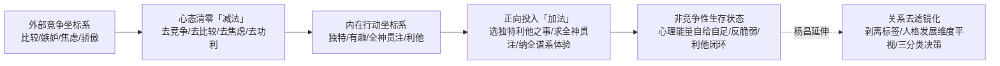
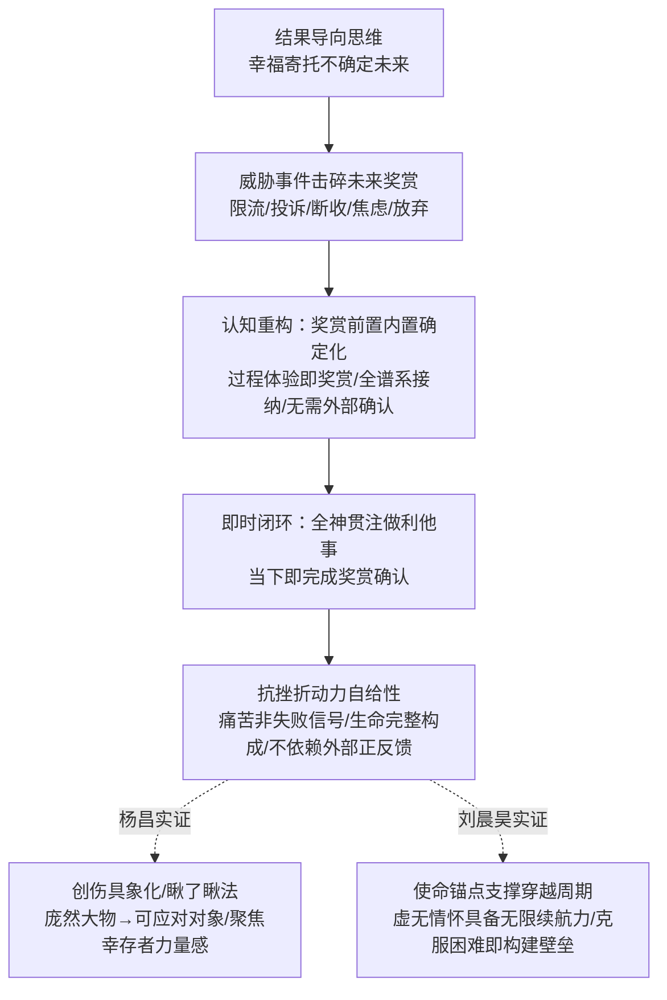
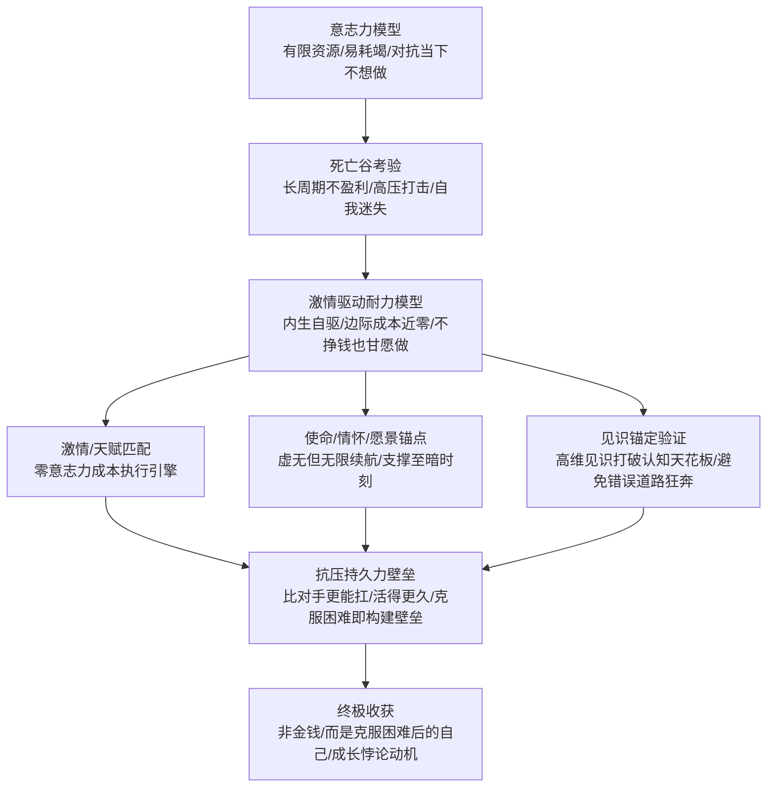
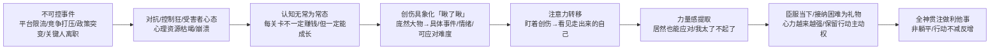
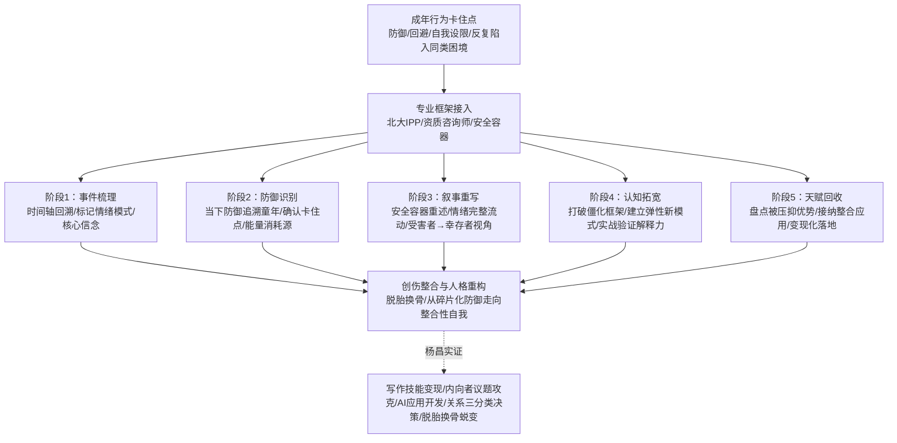
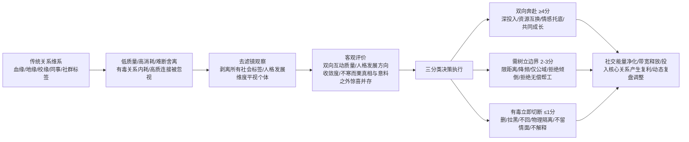

# 第 4 章 创业心法与成长动力 —— 过程即奖赏，使命穿越周期

## 学习目标

- 理解非竞争性生存状态的心理机制与实践路径
- 掌握'过程本身就是奖赏'的即时奖赏机制与抗挫折应用
- 洞察赚钱与成长的辩证统一关系及阶段性权重分配策略
- 建立激情驱动耐力模型，识别穿越死亡谷的使命锚点
- 掌握人生无常与臣服当下的心力转化术（创伤具象化、力量感提取）
- 理解童年创伤再叙事疗法的结构化路径（防御解开、认知拓宽、天赋回收）
- 掌握关系去滤镜化与分层边界的三分类决策模型（双向奔赴、限距离、切断）

## 4.1 生活类比

想象创业者的心智进化是一场**独自登山的旅程**。你不盯着旁边登山者的速度、装备、高度，只专注于自己的呼吸节奏与脚下路——这就是**非竞争性生存状态**。每一步踩实、每一次呼吸调整、每一处风景驻足（含暴风雨、悬崖恐惧），本身就是登山的意义，山顶只是副产品——这就是**过程本身就是奖赏**。补给（赚钱）是为了继续登山（成长），而非囤积在背包里炫耀；轻装上阵（筛选错位的钱）才能走得更远——这就是**赚钱与成长的辩证统一**。不是靠意志力硬撑（意志力会耗尽），而是因为"热爱登山本身"（使命/激情），才能穿越"死亡谷"（至暗时刻）——这就是**激情驱动耐力模型**。遇到塌方（不可控困难）不咒骂天气、不怪路不好，而是"走近看一眼"，发现不过是块可搬开的石头，搬开它的过程让你变强壮——这就是**人生无常与臣服当下**的**创伤具象化**与**力量感提取**。整理儿时背包里塞的"石头"（创伤防御），扔掉沉重无用的，把误扔的"宝石"（天赋）捡回来装进口袋——这就是**童年创伤再叙事疗法**。不因对方是"老乡/同学/亲戚"（标签）就背着他上山，只看"此人能否与我同频共振、互相扶持"（人格匹配），不能则礼貌分道扬镳——这就是**关系去滤镜化与分层边界**。

## 4.2 概念地图

创业心法与成长动力
├── 核心心境重构
│   ├── 非竞争性生存状态 —— P001
│   ├── 过程本身就是奖赏 —— P002
│   └── 人生无常与臣服当下 —— P005
├── 动力模型与决策框架
│   ├── 赚钱与成长的辩证统一 —— P003
│   ├── 激情驱动耐力模型 —— P004
│   └── 阶段性权重分配策略（赚钱/成长/筛选） —— P003
├── 深层心理建设
│   ├── 童年创伤再叙事疗法 —— P006
│   │   ├── 防御模式识别与解开
│   │   ├── 认知模式拓宽
│   │   └── 天赋优势回收
│   ├── 创伤具象化与力量感提取（瞅了瞅法） —— P005
│   └── 关系去滤镜化与分层边界 —— P007
│       ├── 双向奔赴（深投入）
│       ├── 需树立边界（限距离）
│       └── 有毒立即切断
└── 典型验证案例
├── 亦仁：非竞争/过程即奖赏/生财有术实践 —— P001, P002
├── 小冯妮儿：第一桶金信心/天赋匹配/见识锚定/收费契约 —— P003, P004
├── 刘晨昊：半山腰/无中间值/抗压壁垒/使命锚点/成长动机 —— P004, P005
├── 杨昌：Self-Caring Year/童年再叙事/关系重构/脱胎换骨 —— P006, P007
└── 元气森林创始人：抗压持久力=核心壁垒 —— P004

## 4.3 非竞争性生存状态 —— 超越比较框架的内在坐标系

### 为什么需要这个概念？

创业者常陷入与同行比较的焦虑：嫉妒对手强、自卑自己弱、恐惧被超越、骄傲于领先。外部竞争坐标系导致心力内耗，决策易偏离长期价值，陷入零和博弈的短视陷阱。我们需要一套不依赖外部评价的内在行动指南针，实现心理能量的自给自足。

> "我几乎不把谁当作我的竞争对手，不觉得生财有术和谁是同行，不会产生竞争感，也很少产生危机感，不嫉妒别人收入比我高，不觉得自己增长慢，不会觉得自卑，也不觉得自己有多厉害，不产生骄傲感"
> 
> ——《docs/202303/20230328_010.md, p.1》

> "不觉得要加速前进，不追求收益最大化。就是做一件独特的、有趣的、全神贯注的、利于他人的事情"
> 
> ——《docs/202303/20230328_010.md, p.1》

> "跳出各种血缘关系、乡谊关系、学校关系、同事关系、社群关系等，如实客观地在'现实人生与人格发展'层面进行观察和评价"
> 
> ——《docs/202303/20230328_113.md, p.2》

这段话揭示了亦仁的核心心境：**彻底卸下"竞争对手”这个概念包袱**。你不必把同行当作假想敌，也不必把行业榜单当作人生KPI。取而代之的是四个内在标准：**独特、有趣、全神贯注、利他**。这四个标准构成了你的内在坐标系——只要当下的行动满足它们，你就处于"正确"的轨道上，无论外界风向如何。杨昌进一步将这一心境延伸至关系维度：剥离所有社会标签，在"人格发展"层面平视个体，建立纯粹连接。

**非竞争性生存状态定义**（来源：《docs/202303/20230328_010.md》、《docs/202303/20230328_113.md》）

- **核心原则**：不将他人视为竞争对手，消解竞争感、危机感、嫉妒心、自卑感、骄傲感
- **内在标准**：以"独特、有趣、全神贯注、利他"四大标准替代外部排名指标
- **关系观**：超越血缘/地缘/校缘等社会标签，在"人格发展"维度建立纯粹连接

这个定义展示了三个关键性质：

1. **反脆弱性**：屏蔽外部波动干扰，心理能量随时间积累而非消耗
2. **即时奖赏机制**：过程体验本身即反馈，无需等待结果确认
3. **利他闭环**：帮他人解决问题的同时，完成自我价值的内在确认

**典型例子**

- **亦仁**：不把任何人当竞争对手，不追求收益最大化，仍能持续运营"生财有术"等高影响力项目
- **杨昌**：跳出亲友同事标签，以"人格发展"维度重构关系，实现"脱胎换骨"式蜕变

**边界条件**

- 非逃避现实：需具备独立生存能力与专业交付能力为前提
- 非无目标：内在标准（独特/有趣/利他）的执行要求反而更高、更严
- 非单向付出：利他需建立在边界清晰、价值匹配的双向奔赴基础上

### 非竞争性生存状态的方法演进



这个流程图展示了非竞争性生存状态的形成路径：先做**心态清零的"减法"**（卸下外部比较包袱），再做**正向投入的"加法"**（建立内在四标准），最终形成**心理能量自给自足的反脆弱状态**；杨昌将此进一步延伸至关系维度，实现社交能量的精准配置。

## 4.4 过程本身就是奖赏 —— 将延迟满足折叠为当下体验

### 为什么需要这个概念？

结果导向思维让创业者将幸福寄托于不确定的未来（上市、退出、爆款），导致当下焦虑、放弃、内耗。威胁性事件（限流、投诉、断收）随时击碎"未来奖赏"，摧毁行动动力。我们需要一种将奖赏前置、内置、确定化的机制，使行动能量自持续。

> "那些让我奔溃的感受，这些都构成了我生命的一部分"
> 
> ——《docs/202303/20230328_010.md, p.1》

> "过程本身就是奖赏"
> 
> ——《docs/202303/20230328_010.md, p.1》

> "以前想到创伤的时候，会把它想象成可怕的庞然大物... 哦，原来也没那么可怕嘛。比起关心创伤，我更关注那个从创伤中走出来的自己"
> 
> ——《docs/202303/20230328_113.md, p.2-3》

> "其实创业者还是需要一些使命情怀愿景的，因为只有这些虚无缥缈的东西才会支撑你度过一个又一个至暗时刻"
> 
> ——《docs/202303/20230328_036.md, p.9》

**过程即奖赏定义**（来源：《docs/202303/20230328_010.md》、《docs/202303/20230328_113.md》、《docs/202303/20230328_036.md》）

- **核心主张**：行动过程中的全神贯注体验（含美好、痛苦、崩溃）本身即为最终回报
- **无需外部确认**：无需等待外部结果（金钱、地位、速度）作为奖赏确认
- **全谱系接纳**：接纳全谱系感受：好的、坏的、让人崩溃的，皆构成生命实质

这个定义展示了三个关键性质：

1. **奖赏即时性**：每一个"全神贯注做利他事"的当下即完成闭环
2. **抗挫折性**：痛苦/崩溃不再是失败信号，而是生命完整性的构成要素
3. **动力自给性**：不依赖外部正反馈（点赞、销量、夸奖）维持行动

**典型例子**

- **亦仁**：在小红书限流、收入断崖、被大量投诉的至暗时刻，仍坚持"过程即奖赏"穿越周期
- **杨昌**：在心理咨询中"瞅了瞅"创伤，将"可怕庞然大物"转化为"走出来的自己"的力量感来源
- **刘晨昊**：遭遇平台限流、恶意投诉、收入归零，最终确立"克服困难后的自己"才是真爱

**边界条件**

- 非忽视结果：仍需具备基本商业闭环能力（产品/服务/变现）维持生存
- 非自虐情结：接纳痛苦是为了提取力量感，而非沉溺受害者叙事
- 非低标准："全神贯注、独特、利他"对执行质量要求极高，非随意摆烂

### 过程即奖赏的认知重构演进



这个流程图展示了从结果导向的脆弱性到过程即奖赏的抗挫折自给性的认知重构路径，并标注了杨昌与刘晨昊的两条实证支撑路径。

## 4.5 赚钱与成长的辩证统一 —— 目的即手段，过程即目的

### 为什么需要这个概念？

创业者常陷入二元对立：要么唯钱是图沦为工具，要么唯成长论导致经济窘迫。"赚钱买自由"往往异化为"为赚钱失去自由"，需重构二者动态关系。缺乏框架判断：什么钱能赚、什么钱不能赚、何时重赚钱、何时重成长。

> "赚钱和成长相爱相杀，最好的方式是赚能够利于成长的钱，仅为了赚钱，可能沦为赚钱工具而无法实现内在价值，仅考虑成长则有可能经济窘迫。"
> 
> ——《docs/202303/20230328_012.md, p.1》

> "赚到第一块钱的手感和信心非常重要，它的价值远远高于你做什么项目，是什么商业模式。"
> 
> ——《docs/202303/20230328_012.md, p.1》

> "目的只是手段，过程才是目的。"
> 
> ——《docs/202303/20230328_012.md, p.2》

> "在起步阶段，创业副业赚钱的比例可以占的比重更高... 当你不为生计发愁，有的钱让赚的你不舒服，我劝你宁可不赚。"
> 
> ——《docs/202303/20230328_012.md, p.3》

> "价值不是被任何人定义出来的，而是当你接触到越来越多的人的时候发现自己「被需要」。"
> 
> ——《docs/202303/20230328_012.md, p.2》

**赚钱与成长辩证统一定义**（来源：《docs/202303/20230328_012.md》、《docs/202303/20230328_036.md》）

- **核心关系**：赚钱是驱动进化的手段，成长（对抗不确定性的能力迭代）才是目的
- **第一桶金认知价值**：核心价值在于建立"我也能行"的自我效能感，远超金额本身
- **钱的分类**：赚取"能促进成长的钱"，拒绝"与成长对立的钱"

这个定义展示了三个关键性质：

1. **阶段性权重动态分配**：起步重赚钱(建信心)→稳定重成长(求实现)→富足重筛选(只赚对的钱)
2. **价值由外部需求定义**：价格=被需要程度，非自我评估成本
3. **收费即责任与保护**：建立契约倒逼专业交付，同时防"白嫖"内耗

**典型例子**

- **小冯妮儿**：写公号赚第一桶金建立信心→卖保险匹配"话唠"天赋零意志力成本→见前辈卖亿元单打开格局→建立收费机制双赢
- **简历修改案例**：提供者视"小菜一碟"，需方视"改变命运"，价值鸿沟即定价空间
- **刘晨昊**：从"给1000万随便干"转变为"先问掉发/失眠代价"，印证金钱边际效用递减与非货币成本成为核心决策变量

**边界条件**

- 非否定赚钱：起步期赚钱比例可更高，承认生存压力下的现实优先级
- 非盲目成长：成长必须服务于商业闭环，非单纯读书/听课的虚假充实
- 经济基础决定上层建筑：筛选"错位的钱"前提是"不为生计发愁"

### 4.5.1 价值共振定价观：价格源于外部需求的"发现"

> "如何才能越卖越贵，越卖越有底气？和这个世界更加激烈的碰撞。在我的眼里，价格=价值，价值不是被任何人定义出来的，而是当你接触到越来越多的人的时候发现自己「被需要」。"
> 
> ——《docs/202303/20230328_012.md, p.2》

**价值共振定价观定义**（来源：《docs/202303/20230328_012.md》）

- **核心主张**：价值非自我定义，而是通过高频、多元客户碰撞被"需要"而确立
- **定价空间来源**：提供者视角的"小菜一碟"与需方"改变命运"的价值鸿沟
- **底气来源**：被外部需求反复验证后产生的"被需要"确信感

这个公式展示了定价的本质：**价格不是成本加成，而是价值被发现的过程**。你不需要给自己贴标签，市场会通过"愿不愿意付费"告诉你值多少钱。

> **作用解释**：价值共振定价观将定价从"主观定价"转向"市场验证"。提供者不再纠结"我值多少钱"，而是通过高频接触客户，在"被需要"的反馈中发现价值鸿沟——你的"小菜一碟"可能是他人的"改变命运"。这种认知转换消解了定价焦虑，建立了越卖越贵、越卖越有底气的正向循环。

### 4.5.2 收费即责任与保护契约

> "收钱才是最大的负责。收了钱就有了责任，有了责任就不能随便一干，随口一说，你必须逼着自己好好帮别人解决问题。"
> 
> ——《docs/202303/20230328_012.md, p.3》

> "收钱才是对自己最大的保护。别人问你业务上的问题，如果你不主动收钱，就要想好承担被别人白嫖后的心理不适。"
> 
> ——《docs/202303/20230328_012.md, p.3》

**收费边界设定协议**（来源：《docs/202303/20230328_012.md》）

```
1. 建立标准化收费流程与话术
2. 将"不收费=不负责/自损"内化为原则
3. 通过显性契约管理客户预期
4. 保护提供者心力，筛选高意向客户
```

这个伪代码展示了收费的双重功能：**对外是责任契约，倒逼专业交付；对内是保护屏障，防止心理内耗**。

> **作用解释**：收费边界设定协议解决了创业者"不敢收钱/不好意思收钱"的心理卡点。它将收费重构为双赢机制：对客户，收费建立责任契约，倒逼提供者全力交付，避免免费服务的敷衍；对自己，收费设立心理边界，拒绝"白嫖"带来的隐性怨恨与精力消耗。标准化流程与话术进一步降低了执行阻力，使收费成为自然、专业、得体的常态动作。

### 4.5.3 见识溢价效应：格局由见识上限决定

> "想赚更多钱，先花钱去买见识。一个敢出高价卖的人往往不是自己来的迷之自信，而是他亲眼看到了别人能卖这么多，并且能卖出去。"
> 
> ——《docs/202303/20230328_012.md, p.3》

> "我的信仰被充值了，我的格局打开了，原来还有这样的远方。"
> 
> ——《docs/202303/20230328_012.md, p.3》

**见识溢价效应定义**（来源：《docs/202303/20230328_012.md》）

- **核心机制**：高价格信心源于亲眼目睹高阶商业模式/定价锚点
- **行动路径**：主动付费购买见识（认知更高阶案例）打破认知天花板
- **杠杆作用**：见识是撬动格局跃迁的最短路径

这个方法展示了为什么"眼见为实"能改变命运：**认知边界决定商业上限，见识是唯一能推动边界的工具**。

> **作用解释**：见识溢价效应揭示了格局跃迁的最短路径——不是靠自我催眠的"迷之自信"，而是靠"亲眼看见"更高阶的商业模式与定价锚点。小冯妮儿目睹前辈瞄准福布斯富豪榜、冲击亿元保单，直接重塑了对行业上限的认知。主动付费购买见识（进高阶社群、买大佬时间、观摩标杆案例），是打破认知天花板、重塑定价锚点的最高杠杆动作。

### 4.5.4 阶段性权重分配策略

以下表格总结了小冯妮儿的动态平衡策略：**不同时期，赚钱与成长的"主次"会倒置，关键是清醒地知道当下处于哪个阶段**。

| 阶段 | 赚钱权重 | 成长权重 | 核心策略 |
|------|----------|----------|----------|
| 起步期 | 高 | 低 | 快速跑通商业闭环，建立"我也能行"的自我效能感 |
| 稳定期 | 中 | 高 | 追求自我实现，优化产品/服务质量，拒绝低质量订单 |
| 富足期 | 低 | 高 | 只赚对的钱，拒绝错位订单，主动筛选高匹配度客户 |

> **表格说明**：该策略并非线性固化，而是要求创业者具备"阶段自觉"——在起步期不因追求成长而放弃生存信心建立，在富足期不因贪恋钱财而接错位订单。刘晨昊的案例印证了这一点：高压阶段金钱边际效用递减，决策变量转向"代价/掉发/失眠"，若仍按起步期策略强行赚错位钱，极易导致心力崩溃与反噬。

## 4.6 激情驱动耐力模型 —— 穿越死亡谷的无限续航燃料

### 为什么需要这个概念？

意志力有限、易耗竭，无法支撑创业中漫长的"死亡谷"（不盈利期、挫折期）。金钱边际效用递减，高压下甚至成为负激励（问代价不问金额）。我们需要一种不依赖外部回报、内生自驱、边际成本近零的持久动力源。

> "很多生意做到最后，都是在日复一日的打磨中拼耐力。如果没有持续的激情注入，那种不挣钱也甘愿去做的耐力，做到后面你就会自我迷失。"
> 
> ——《docs/202303/20230328_012.md, p.2》

> "元气森林创始人...创业者其实都没什么壁垒，你会持续被打，你唯一的壁垒就是你比你对手能扛。"
> 
> ——《docs/202303/20230328_036.md, p.7》

> "我们也许喜欢的都不是钱，是那个克服一个又一个困难的自己吧。"
> 
> ——《docs/202303/20230328_036.md, p.10》

> "其实创业者还是需要一些使命情怀愿景的，因为只有这些虚无缥缈的东西才会支撑你度过一个又一个至暗时刻。"
> 
> ——《docs/202303/20230328_036.md, p.9》

**激情驱动耐力模型定义**（来源：《docs/202303/20230328_012.md》、《docs/202303/20230328_036.md》）

- **核心燃料**：找到"不挣钱也甘愿做"的激情所在，并一头扎进去
- **耐力构成**：激情注入的耐力 = 日复一日打磨的持久力 + 面对自我迷失时的锚点
- **使命续航**：使命/情怀/愿景虽虚无但具备无限续航力，支撑层层壁垒形成

这个定义展示了三个关键性质：

1. **非理性计算**：超越投入产出比，在"无望"时依然选择坚持
2. **抗周期性**：平台限流、恶意投诉、收入归零等外部打击下仍能持续行动
3. **复利放大**：每次克服"自认为克服不了的困难"，壁垒厚度+1

**典型例子**

- **元气森林创始人**：唯一壁垒是"比对手更能扛、活得更久"，克服困难即构建壁垒
- **刘晨昊**：从"给1000万随便干"转变为"先问掉发/失眠代价"，最终确立"克服困难后的自己"才是真爱

**边界条件**

- 非盲目热爱：激情需匹配天赋优势区（零意志力成本执行)，非单纯喜好
- 非反商业：激情驱动的最终指向仍是商业闭环，非公益慈善
- 需见识锚定：激情方向需经高维见识验证，避免"在错误道路上狂奔"

### 4.6.1 天赋优势区：零意志力成本的执行引擎

> "赚钱要发挥自己的天赋优势，去做不需要用意志力就能坚持的事，这样更容易成功。"
> 
> ——《docs/202303/20230328_012.md, p.2》

> "比如我是个话唠，每天都会找几个朋友聊天，做保险一个核心点就是你要每天聊够足够多的人，然而这件事是我的日常，我不需要用意志力逼迫自己就能实现。"
> 
> ——《docs/202303/20230328_012.md, p.2》

**天赋优势区定义**（来源：《docs/202303/20230328_012.md》）

- **识别标准**：无需意志力即可日常高频执行的行为模式（如社交、写作、分析）
- **映射策略**：将其映射为业务核心动作（如销售、内容营销、咨询）
- **执行效果**：实现高绩效低阻力执行，把"天性"变成"业务基本功"

这个方法展示了如何找到你的"零阻力赛道"：**别练习自律，去发现你本来就爱做、且能直接变现的事**。

> **作用解释**：天赋优势区是激情驱动耐力模型的"执行层落地"。激情提供"想做"的动力，天赋优势区提供"能做、易做、持续做"的机制。小冯妮儿将"话唠"天性映射为保险核心KPI"日聊足量人数"，实现零意志力成本的高绩效执行。识别方法：回溯你日常高频、自然发生、不觉得累的行为模式，寻找其与商业核心动作的映射点。

### 激情驱动耐力模型的动力结构演进



这个流程图展示了从意志力模型失效到激情驱动耐力模型建立的完整动力结构演进，包含三大支柱（激情/使命/见识）与最终形成的核心壁垒——抗压持久力。

## 4.7 人生无常与臣服当下 —— 接纳困难作为礼物的心力转化术

### 为什么需要这个概念？

创业充满不可控：平台算法变、竞争对手打、政策突变、关键人离职。对抗不可控导致控制狂崩溃、受害者心态滋生、心理资源枯竭。我们需要一套将"不可控"转化为"可接纳"、将"创伤"转化为"礼物"的认知操作系统。

> "人生无常，每个关卡不一定赚钱，但一定能成长。把遇到每个困难当作是礼物，接纳并接住它，你的心力会越来越强。"
> 
> ——《docs/202303/20230328_012.md, p.3》

> "臣服当下，一切都是最好的安排。"
> 
> ——《docs/202303/20230328_012.md, p.3》

> "以前想到创伤的时候，会把它想象成可怕的庞然大物。参加完免费心理咨询试验过后，终于走进瞅了瞅它，哦，原来也没那么可怕嘛。"
> 
> ——《docs/202303/20230328_113.md, p.2》

> "再后来，比起关心创伤，我更关注那个从创伤中走出来的自己。天啦，那样的情况，我居然也可以应对，我太了不起了。"
> 
> ——《docs/202303/20230328_113.md, p.3》

> "然后我就释怀了...人生在世，主打一个比谁活的更久，比谁更能抗下去"
> 
> ——《docs/202303/20230328_036.md, p.10》

**人生无常与臣服当下定义**（来源：《docs/202303/20230328_012.md》、《docs/202303/20230328_113.md》、《docs/202303/20230328_036.md》）

- **无常认知**：认知"无常"为常态，非常态；每个关卡不一定赚钱，但一定能成长
- **创伤具象化（"瞅了瞅"）**：将抽象恐惧转化为可观察、可应对的具体对象
- **臣服当下**：一切都是最好的安排，接纳并接住困难，心力越来越强

这个定义展示了三个关键性质：

1. **认知重构杠杆**：微小视角切换（庞然大物→可应对对象）撬动巨大心理能量释放
2. **力量感提取锚点**：聚焦"从创伤走出来的自己"而非"创伤本身"
3. **非宿命论**：臣服非躺平，而是在接纳基础上保留行动主动权（全神贯注做利他事）

**典型例子**

- **杨昌**：北大IPP心理咨询中"走进瞅了瞅"童年创伤，从"可怕庞然大物"秒变"没那么可怕"，提取"居然也能应对"的力量感
- **刘晨昊**：收入断崖、被投诉至暗时刻，最终释怀"主打比谁活得久、谁更能抗"

**边界条件**

- 非逃避责任：臣服后仍需"全神贯注做利他事"，行动不减反增
- 需专业框架：深度创伤疗愈建议在专业心理咨询/疗愈体系下进行
- 非瞬间达成：需"重走童年路"、持续咨询、长期复盘的周期性积累

### 4.7.1 创伤具象化与力量感提取（"瞅了瞅"法）

> "以前想到创伤的时候，会把它想象成可怕的庞然大物。参加完免费心理咨询试验过后，终于走进瞅了瞅它，哦，原来也没那么可怕嘛。"
> 
> ——《docs/202303/20230328_113.md, p.2》

> "比起关心创伤，我更关注那个从创伤中走出来的自己。天啦，那样的情况，我居然也可以应对，我太了不起了。"
> 
> ——《docs/202303/20230328_113.md, p.3》

**创伤具象化方法（瞅了瞅法）**（来源：《docs/202303/20230328_113.md》）

```
1. 意识到内心有"可怕的庞然大物"（抽象恐惧/创伤投射）
2. 在专业安全容器中（咨询/疗愈框架），主动"走近看一眼"
3. 发现恐惧对象具象化为：具体的事件、情绪、身体感受、可应对的难度
4. 将注意力从"创伤本身"转移到"应对创伤并走出来的自己"
5. 提取力量感："天啦，那样情况，我居然也能应对，我太了不起了"
6. 将力量感内化为人格重构的基石，支撑后续"不知疲倦的抗压持久力"
```

这个方法展示了暴露疗法的核心机制：**回避维持恐惧，接近消解恐惧，幸存者视角重塑自我效能感**。

> **作用解释**："瞅了瞅"法是创伤疗愈的关键微操作。它将抽象、压倒性的恐惧（庞然大物）具象化为可观察、可处理的具体对象（具体事件/情绪/身体感受），并完成了注意力的关键转移：从"盯着创伤受害"转向"看见幸存者力量"。这种微小的视角切换，撬动了巨大的心理能量释放——"居然也能应对"的力量感，成为后续面对创业至暗时刻（限流、投诉、断收）的核心心力储备。

### 臣服当下的心力转化演进



这个流程图展示了从对抗不可控到臣服当下的心力转化完整路径，核心杠杆在于"瞅了瞅"的具象化操作与注意力转移带来的力量感提取。

## 4.8 童年创伤再叙事疗法 —— 解开防御、拓宽认知、回收天赋的结构化路径

### 为什么需要这个概念？

成年人行为模式（防御、回避、自我设限）多源于童年未完成体验的固化。单纯"懂道理"无法改变深层神经回路，需在专业框架下重新体验、叙事、整合。创伤中往往藏着被误判为"无用/赚不到钱"而忽略的天赋优势。

> "重走了"童年路"。把自己的童年中印象深刻的事情，重新梳理一遍，重新叙事一遍。"
> 
> ——《docs/202303/20230328_113.md, p.1》

> "把某些卡在某个童年的创伤/逆境里的防御模式解开，帮自己从那种情绪里解救出来，进而拓宽自己的认知模式。"
> 
> ——《docs/202303/20230328_113.md, p.1》

> "另外一方面，也把之前误以为没有用、赚不到钱就忽略了天赋和优势，慢慢捡了起来。"
> 
> ——《docs/202303/20230328_113.md, p.1》

**童年创伤再叙事疗法定义**（来源：《docs/202303/20230328_113.md》）

- **专业框架**：在专业心理框架下（如北大IPP临床心理实验室），系统梳理童年关键事件
- **五步法**：识别卡住的防御模式 → 重新叙事解开防御 → 拓宽认知模式 → 回收被忽视的天赋优势
- **完成目标**：创伤整合与人格重构，实现"脱胎换骨"级蜕变

这个定义展示了三个关键性质：

1. **结构化分阶段**：事件梳理 → 防御识别 → 叙事重写 → 认知拓宽 → 天赋回收
2. **专业托底**：非独自独处反刍，需专业咨询师提供安全容器与引导
3. **具象化操作**："瞅了瞅"创伤、书写重述、角色扮演等具体技术

**典型例子**

- **杨昌**：通过北大IPP免费试验，重走童年路、解开防御、拓宽认知、捡回天赋，实现整个人"脱胎换骨"
- 从"误以为没用/赚不到钱就忽略天赋"到"慢慢捡起天赋优势"变现化

**边界条件**

- 非速成：需"挺长一段时间"的坚持咨询与复盘
- 非全员必需：针对有明确"卡住感"、反复陷入同类困境的个体
- 专业门槛：建议寻找正规机构/资质咨询师，避免二次伤害

### 4.8.1 童年创伤再叙事疗法实操流程

> "重走了"童年路"。把自己的童年中印象深刻的事情，重新梳理一遍，重新叙事一遍。"
> 
> ——《docs/202303/20230328_113.md, p.1》

> "把某些卡在某个童年的创伤/逆境里的防御模式解开，帮自己从那种情绪里解救出来，进而拓宽自己的认知模式。"
> 
> ——《docs/202303/20230328_113.md, p.1》

> "另外一方面，也把之前误以为没有用、赚不到钱就忽略了天赋和优势，慢慢捡了起来。"
> 
> ——《docs/202303/20230328_113.md, p.1》

**童年创伤再叙事疗法实操**（来源：《docs/202303/20230328_113.md》）

```
阶段1：事件梳理
- 在专业咨询师引导下，按时间轴回溯童年关键事件
- 重点标记：反复出现的情绪模式、被压抑的需求、形成的核心信念

阶段2：防御识别
- 识别当下行为中的防御模式（回避/合理化/投射/否认等）
- 追溯防御模式与童年事件的因果链条
- 确认"卡住点"：哪个未完成体验在持续消耗心理能量

阶段3：叙事重写
- 在安全容器中重新体验、讲述童年事件
- 允许被压抑的情绪完整流动、表达、被看见
- 从"受害者视角"转向"幸存者/观察者视角"重述故事

阶段4：认知拓宽
- 打破童年形成的僵化认知框架（如"我不配""世界危险""必须完美"）
- 建立更弹性、更现实、更有利于成长的新认知模式
- 验证新模式在当下生活/创业中的解释力与预测力

阶段5：天赋回收
- 盘点因防御/认知扭曲而被忽略/压抑的天赋优势
- 将天赋重新接纳、整合、应用到当下的商业/创作/关系中
- 完成"脱胎换骨"级人格重构：从碎片化防御走向整合性自我
```

这个流程展示了从"被过去困住"到"重写未来"的完整路径：**不是忘记过去，而是重新拥有过去**。

> **作用解释**：童年创伤再叙事疗法是深层心理建设的"底层代码重写"。它不是简单的复盘，而是在专业安全容器中，通过五个结构化阶段，完成三个关键转化：防御模式从"自动运行"变为"可被看见、可被解开"；认知模式从"僵化单一"变为"弹性多元"；天赋优势从"被误判压抑"变为"被接纳变现"。杨昌的案例证明：这一过程是"脱胎换骨"级蜕变的真实基石，支撑了后续所有维度的跃迁（写作变现、议题攻克、关系重构）。

### 童年创伤再叙事疗法的结构化演进



这个流程图展示了童年创伤再叙事疗法的五阶段结构化路径，及其通向人格重构与杨昌实证成果的完整演进链条。

## 4.9 关系去滤镜化与分层边界 —— 基于人格发展的双向匹配决策模型

### 为什么需要这个概念？

传统关系依靠血缘/地缘/校缘/同事/社群标签维系，往往低质量、高消耗、难断舍离。缺乏客观评估工具，导致"有毒关系"长期内耗、"高质量连接"被忽视。我们需要一套可操作的关系审计与分类决策标准，实现社交资源的精准配置。

> "跳出各种血缘关系、乡谊关系、学校关系、同事关系、社群关系等，如实客观地在"现实人生与人格发展"层面进行观察和评价"
> 
> ——《docs/202303/20230328_113.md, p.2》

> "去掉关系的滤镜，平视去看他们个体本身。"
> 
> ——《docs/202303/20230328_113.md, p.2》

> "现在基本上非常明确了，什么样的人是双向奔赴的，什么样的人是要树立边界的，还有哪些有毒关系是要立马一刀两断的。"
> 
> ——《docs/202303/20230328_113.md, p.2》

> "有不寒而栗的真相，也有意料之外的惊喜。"
> 
> ——《docs/202303/20230328_113.md, p.2》

**关系去滤镜化与分层边界定义**（来源：《docs/202303/20230328_113.md》、《docs/202303/20230328_010.md》）

- **去滤镜原则**：剥离所有社会标签（血缘/乡谊/校友/同事/社群），在"现实人生与人格发展"维度平视个体
- **三分类决策**：双向奔赴（深投入）、需树立边界（限距离）、有毒立即切断（一刀两断）
- **成人关系本质**：基于人格发展层面的双向匹配，而非标签绑定

这个定义展示了三个关键性质：

1. **客观性**：去除滤镜后，看清"不寒而栗的真相"与"意料之外的惊喜"并存
2. **决策力**：从模糊纠结转为明确执行（深投入/限距离/切断），边界感极强
3. **动态性**：随人格发展阶段变化，关系分类需定期复盘调整

**典型例子**

- **杨昌**：实施关系重构后，明确何人双向奔赴、何人立边界、何人一刀两断，社交能量显著净化
- **亦仁**：不把谁当竞争对手，不嫉妒/自卑/骄傲，超越标签建立纯粹利他连接

**边界条件**

- 非冷酷无情：切断是基于"双向匹配度极低"的理性判断，非情绪报复
- 非绝对静态：边界可随双方成长调整，核心原则是"保护各自成长空间"
- 自身为准：关系质量评估的前提是自己具备清晰的人格发展坐标系

### 4.9.1 关系审视与分层决策模型

> "跳出各种血缘关系、乡谊关系、学校关系、同事关系、社群关系等，如实客观地在"现实人生与人格发展"层面进行观察和评价朋友圈的、身边的人"
> 
> ——《docs/202303/20230328_113.md, p.2》

> "去掉关系的滤镜，平视去看他们个体本身。"
> 
> ——《docs/202303/20230328_113.md, p.2》

> "现在基本上非常明确了，什么样的人是双向奔赴的，什么样的人是要树立边界的，还有哪些有毒关系是要立马一刀两断的。"
> 
> ——《docs/202303/20230328_113.md, p.2》

**关系三分类决策模型**（来源：《docs/202303/20230328_113.md》）

| 分类 | 判定标准 | 执行策略 | 能量流向 |
|------|----------|----------|----------|
| **双向奔赴** | 人格发展方向收敛、互动高质量、情绪/资源双向流动 | 深投入：定期深度交流、核心资源互换、情感托底、共同成长 | 净增正向 |
| **需树立边界** | 单向索取/情绪倾倒、人格发展方向发散、互动消耗大于滋养 | 限距离：降低频次、仅公域交流、拒绝情绪倾倒、拒绝无偿帮工、物理/心理隔离 | 止损平衡 |
| **有毒立即切断** | 持续打压/操控/背叛/价值观根本冲突、无改善可能、严重消耗核心能量 | 一刀两断：删除/拉黑/不回/物理隔离、不留情面、不解释 | 彻底止损 |

这个表格展示了关系管理的**可执行性**：不再靠感觉，而用"人格发展维度的匹配度"作为唯一裁决标准。

> **表格说明**：该模型将关系管理从"情感纠结"转化为"理性决策"。判定标准唯一锚定在"人格发展维度的匹配度"，而非关系标签或历史渊源。执行策略具有强操作性：双向奔赴给资源、给时间、给情感托底；需树立边界通过降频、限域、拒绝倾倒实现止损；有毒关系直接物理隔离，不留解释空间。杨昌的实证显示：执行后社交能量显著净化，释放的带宽投入核心关系产生复利增量。

### 关系去滤镜化的审视决策演进



这个流程图展示了关系去滤镜化的完整审视决策链条：从标签维系的弊端出发，通过剥离标签、平视个体、客观评价，落地为可执行的三分类决策，最终实现社交能量净化与复利增量。

## 4.10 多源对照：非竞争性生存状态的不同诠释

不同素材对"非竞争性生存状态"给出了互补的解释视角。

**共识**：
- 核心都是**超越外部比较框架**，建立内在行动坐标系
- 都强调**利他/价值创造**作为核心行动导向
- 都主张**过程体验本身即奖赏**，不依赖外部结果确认

**分歧**：

| 素材来源 | 侧重维度 | 核心诠释 | 素材ID |
|----------|----------|----------|--------|
| 《docs/202303/20230328_010.md》（亦仁） | **心境层面的"减法"** | 主动卸下竞争感/危机感/嫉妒/骄傲，通过"不把谁当对手"获得心理自由 | P001 |
| 《docs/202303/20230328_113.md》（杨昌） | **关系层面的"重构"** | 通过剥离社会标签、在人格发展维度平视个体，实现社交能量的精准配置 | P006/P007 |
| 《docs/202303/20230328_036.md》（刘晨昊） | **生存层面的"残酷认知"** | 半山腰阶段必被两头夹击，无小而美稳态，非竞争非主动选择而是被环境倒逼的生存清醒 | P004/P005 |

> **多源对照说明**：三份素材从心境、关系、生存三个维度互补构建了非竞争性生存状态的立体图景。亦仁展示了"主动选择"的高段位心境；杨昌提供了"关系落地"的操作模板；刘晨昊揭示了"被动倒逼"的残酷现实。三者共同指向：非竞争非逃避竞争，而是建立不依赖外部评价的内在行动指南针。

## 4.11 设计中的取舍

**为什么不用"竞争激励法"而是"非竞争内驱力"？**

竞争激励短期有效（如排名、PK、奖金），但长期会将个体锁定在外部评价体系中：一旦排名下滑、奖金取消、对手消失，动力即刻崩塌。非竞争内驱力（独特/有趣/全神贯注/利他）虽然启动门槛高（需要深度自省与价值澄清），但一旦建立，**心理能量成为可再生资源**，不再受制于外部环境波动。

> **权衡分析**：竞争激励适合短期冲刺、明确规则的有限博弈；非竞争内驱力适合长周期、规则模糊、高不确定性的创业生存。本章选择后者，是因为创业本质是"无限博弈"——没有终点、规则常变、对手不定，唯有内在坐标系能穿越周期。

**为什么不用"意志力坚持"而是"激情驱动耐力"？**

意志力是有限资源（如电池），高强度创业压力下极易耗竭；且意志力对抗的是"当下不想做"，而激情驱动的是"长期想做"。死亡谷往往长达数月甚至数年，只有"不挣钱也甘愿做"的激情/使命，才能提供**无限续航**的燃料。

> **权衡分析**：意志力适合短期突击、明确任务的执行层面；激情驱动耐力适合战略层面的方向坚持与周期穿越。本章将二者分层：战略层用激情/使命/天赋匹配定方向、供燃料；战术层用习惯/流程/契约辅助执行。刘晨昊案例印证：高压下意志力失效，唯有使命锚点支撑穿越。

**为什么用"三分类关系决策"而非"广泛社交/弱连接理论"？**

弱连接理论强调广度与信息获取，但忽略了低质量连接的隐性心力成本（情绪倾倒、认知负荷、决策干扰）。三分类模型承认社交带宽稀缺，主张**精准配置而非广泛撒网**，通过"切断/限距离"止损，将资源集中于"双向奔赴"的高杠杆连接。

> **权衡分析**：弱连接适合早期探索、信息搜集阶段；三分类决策适合深耕期、资源聚焦阶段。本章定位创业者深耕期，选择后者。亦仁"不把谁当竞争对手"实则也是高标准筛选——只与"利他/独特/有趣"者深度连接，隐含了同质的边界逻辑。

**这种设计的 trade-off 是什么？**

- **优势**：抗周期性极强、心理能量自给自足、决策更长期主义、人际关系更纯粹高效
- **劣势**：启动期认知门槛高（需突破"比较本能"）、易被外界误解为"缺乏进取心/不思进取"、对专业能力与商业闭环有硬性前置要求（否则易变成"自我感动式摆烂"）

> **核心权衡总结**：本章所有核心模型（非竞争状态、过程即奖赏、激情耐力、臣服当下、再叙事疗法、三分类关系）共享同一个底层逻辑：**用高认知门槛换取高心理自由度、高抗周期性、高长期复利**。这是创业者从"打工者思维"（外部驱动、短期反馈、依赖环境）向"企业家思维"（内部驱动、延迟满足、塑造环境）跃迁的必经代价。

## 4.12 动手练习

### 练习1：我的'竞争对手'清单清零实验

1. 列出你目前心中前3个'竞争对手'或'比较参照系'，写下他们引发你的具体情绪（嫉妒/焦虑/优越感/恐慌）
2. 针对每一个，问自己：若完全不看TA，仅凭'独特/有趣/全神贯注/利他'四标准，我下一步最想做的行动是什么？
3. 连续7天，每天记录：今天我因'看对方动态'产生的情绪波动时长 vs 因'沉浸自己利他行动'产生的充实感时长
回答问题：
- 当你停止'偷看'对手，把注意力收回'手里的活'，你的行动质量与心情稳定性发生了什么变化？
- '利他'标准如何帮你判断'该不该做这件事'，而不再纠结'别人会不会做得比我好'？

### 练习2：复盘一次'至暗时刻'的臣服与力量提取

1. 回溯一次你经历过的创业/生活重大挫折（限流/投诉/断收/被背叛/重病等），按时间轴记录：事件→当时解读（灾难/羞耻/无能）→情绪反应→后续实际应对行动
2. 标记出'瞅了瞅'的时刻：你何时从'可怕的庞然大物'转变为'哦，原来也没那么可怕/我居然应对过来了'？
3. 提炼'从创伤走出来的自己'身上展现的3个具体能力/特质（如：抗压/沟通/决策/求资源/情绪稳定）
回答问题：
- 如果把这次挫折视为'礼物'，它强制你升级了哪项核心能力？这项能力现在如何服务于你的主业务？
- 下一次面对同级别不确定性时，你能否直接跳过'灾难化解读'，启动'瞅了瞅→提取力量感→全神贯注做利他事'的缩短版流程？

### 练习3：关系资产审计与边界重构

1. 列出你常联系/高投入的前10位非核心家庭成员（含亲友/同事/社群大佬/合伙人），标注关系标签（血缘/校友/前同事/社群/客户等）
2. 剥离标签，仅基于'过去半年双向互动质量'与'对方人格发展方向与我是否收敛'两维度，给每人打分（1-5分）
3. 按三分类决策处理：≥4分→双向奔赴（明确深投入动作：定期通话/资源互换/情感托底）；2-3分→立边界（降频/仅公域/拒绝情绪倾倒/拒绝无偿帮工）；≤1分→切断（删/拉黑/不回/物理隔离）
回答问题：
- 执行'切断/立边界'后，你释放了多少周边时间/情绪带宽？这些资源投入'双向奔赴'关系产生了什么新增量？
- 哪些'不寒而栗的真相'让你最抗拒？为何'标签'曾长期掩盖了这些真相？

### 练习4：激情-天赋-变现三角验证

1. 写下3件'不挣钱也甘愿坚持半年以上'的事（激情候选项）
2. 对每件事，测试：①零意志力成本？（日常高频自然发生）②能否映射为商业核心动作？（销售/写作/教学/设计/组织/谈判等）③是否有外部需求愿付费验证？（找3个陌生人测试付费意愿）
3. 筛选出同时满足三条的项，作为'激情驱动耐力'的商业锚点；其余项归类为'纯爱好/需补齐商业闭环/需找新映射'
回答问题：
- 你的'激情'是否真能转化为'零意志力成本的执行引擎'？若不能，缺失的是商业映射还是外部需求验证？
- 见过同领域高手'卖更贵/量更大'的案例吗？若未见，你的'格局天花板'在哪里？计划何时去'买见识'？

## 4.13 本章小结

这一章中我们学习了创业者心智进化的完整路径：首先建立**非竞争性生存状态**，卸下外部比较包袱，确立内在四标准（独特/有趣/全神贯注/利他）；其次确立**过程即奖赏**机制，将延迟满足折叠为当下体验，接纳全谱系感受获得抗挫折动力；接着重构**赚钱与成长的辩证统一**，明确赚钱是手段成长是目的，掌握阶段性权重分配、价值共振定价、收费契约、见识溢价四大操作工具；然后建立**激情驱动耐力模型**，用使命/天赋匹配替代意志力硬撑，识别穿越死亡谷的无限续航燃料；随后掌握**人生无常与臣服当下**的心力转化术，通过"瞅了瞅"具象化创伤、提取幸存者力量感；进而实施**童年创伤再叙事疗法**，在专业框架下完成防御解开、认知拓宽、天赋回收的结构化重构；最后落地**关系去滤镜化与分层边界**，剥离社会标签，按人格发展维度执行双向奔赴/限距离/切断的三分类决策。

本章我们一起学习了以下概念：

| 概念 | 解释 |
|------|------|
| 非竞争性生存状态 | 超越社会比较框架，以独特/有趣/全神贯注/利他为内在坐标，消解竞争感/嫉妒/自卑/骄傲 |
| 过程本身就是奖赏 | 将延迟满足折叠为当下体验：全神贯注做利他事的过程（含痛苦/崩溃）即生命完整性与即时回报 |
| 赚钱与成长的辩证统一 | 赚钱是驱动进化的手段，成长（对抗不确定性的能力迭代）才是目的；阶段性动态分配权重 |
| 第一桶金认知价值 | 核心价值非金额，而是建立'我也能行'的自我效能感，作为面对后续不确定性的强心剂 |
| 价值共振定价观 | 价格源于外部需求的'发现'（被需要），而非自我定义成本；提供者'小菜一碟'与需方'改变命运'的鸿沟即定价空间 |
| 收费即责任与保护 | 收费建立责任契约倒逼专业交付，同时防止'白嫖'导致心理内耗，是双赢边界机制 |
| 见识溢价效应 | 高价格信心源于亲眼目睹高阶商业模式/定价锚点；主动付费买见识是打破认知天花板的最短路径 |
| 激情驱动耐力模型 | 意志力有限易耗竭，唯有'不挣钱也甘愿做'的激情/使命情怀具备无限续航力，支撑穿越死亡谷 |
| 人生无常与臣服当下 | 认知无常为常态，接纳困难作为礼物；创伤具象化（瞅了瞅）将恐惧转化为可应对对象 |
| 创伤力量感提取 | 聚焦'从创伤走出来的自己'而非创伤本身，提取'居然也能应对'的力量感作为人格重构基石 |
| 童年创伤再叙事疗法 | 专业框架下：梳理关键事件→识别防御→重新叙事→拓宽认知→回收天赋，完成创伤整合与人格重构 |
| 关系去滤镜化 | 剥离血缘/地缘/校缘标签，在'现实人生与人格发展'维度客观观察个体 |
| 关系三分类决策 | 双向奔赴（深投入）、需树立边界（限距离）、有毒立即切断（一刀两断） |

下一章中，我们将学习**个人商业变现体系**，从定价、收钱、见识到天赋匹配，构建从"不敢收钱"到"越卖越贵"的完整变现闭环。

