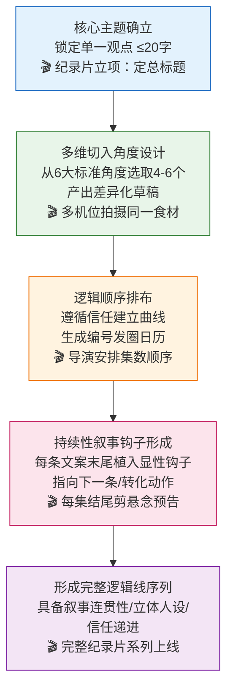
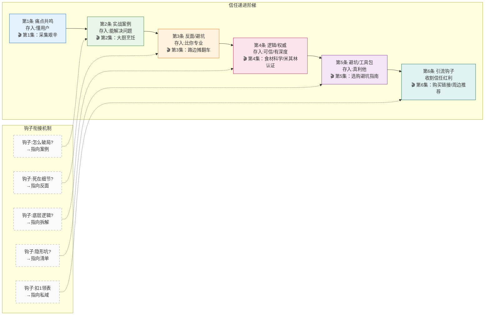
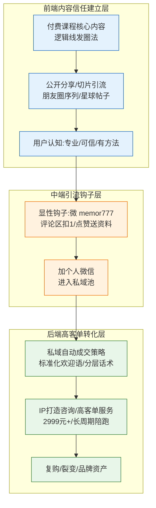

# 第 25 章 朋友圈叙事重构 —— 让用户对你的动态“越看越上瘾”
作者：龙哥

## 学习目标

- 理解「逻辑线」发圈法的核心定义与底层逻辑：从碎片化发圈转向叙事连贯化运营
- 掌握多角度切入法的具体操作框架：围绕单一核心观点，设计痛点、案例、反面、权威、逻辑、避坑六大切入维度
- 学会建立发圈序列的逻辑排布与叙事钩子设计，形成用户“追剧”式阅读习惯与信任递进机制
- 能识别该方法的适用边界：核心观点单一性要求、最小序列长度门槛、前置人设与承接体系依赖
- 理解该方法论在私域成交闭环中的定位：作为内容铺垫与信任建立的前端工具，而非独立变现手段

## 25.1 生活类比

想象朋友圈运营像**追一档高质量纪录片系列**：核心主题相当于纪录片的总标题（如《舌尖上的中国》），单条动态对应每一集聚焦的单一食材或故事。多角度切入就是同一食材的：采集艰辛（痛点）、大厨烹饪（案例）、路边摊翻车（反面）、米其林认证（权威）、食材科学（逻辑）、选购避坑（指南）。逻辑排布是导演安排的集数顺序：先勾起食欲，再展示技艺，后揭示原理，最后指导选购。叙事钩子则是每集结尾的悬念：“下一集我们将揭秘...” 就像观众会按时蹲守更新、对主创团队产生深度信任，「逻辑线」发圈法也让用户养成定时查看习惯，对人设建立立体信任。

这一类比将贯穿全章：核心主题确立是**立项选题**，多维切入是**多机位拍摄**，逻辑排布是**剪辑顺序**，叙事钩子是**预告片**，信任递进是**观众粘性**，适用边界是**制作门槛**，商业验证是**发行变现**。请在阅读各节时随时回扣此隐喻，将抽象方法论具象化。

## 25.2 概念地图

「逻辑线」发圈法
├── 核心定义
│   ├── 围绕一事一观点多角度切入  —— P001, docs/202303/20230328_022.md, 《李思念朋友圈运营航海核心课程》
│   ├── 形成连贯叙事链条  —— P001, docs/202303/20230328_022.md, 《李思念朋友圈运营航海核心课程》
│   └── 非零散单条动态发布  —— P001, docs/202303/20230328_022.md, 《李思念朋友圈运营航海核心课程》
├── 操作框架
│   ├── 核心主题确立  —— P001, docs/202303/20230328_022.md, 《李思念朋友圈运营航海核心课程》
│   ├── 多维切入角度设计
│   │   ├── 痛点共鸣  —— P001, docs/202303/20230328_022.md, 《李思念朋友圈运营航海核心课程》
│   │   ├── 实战案例  —— P001, docs/202303/20230328_022.md, 《李思念朋友圈运营航海核心课程》
│   │   ├── 反面教材  —— P001, docs/202303/20230328_022.md, 《李思念朋友圈运营航海核心课程》
│   │   ├── 权威背书  —— P001, docs/202303/20230328_022.md, 《李思念朋友圈运营航海核心课程》
│   │   ├── 底层逻辑拆解  —— P001, docs/202303/20230328_022.md, 《李思念朋友圈运营航海核心课程》
│   │   └── 避坑指南  —— P001, docs/202303/20230328_022.md, 《李思念朋友圈运营航海核心课程》
│   ├── 逻辑顺序排布  —— P001, docs/202303/20230328_022.md, 《李思念朋友圈运营航海核心课程》
│   └── 持续性叙事钩子形成  —— P001, docs/202303/20230328_022.md, 《李思念朋友圈运营航海核心课程》
├── 关键性质
│   ├── 叙事连贯性（钩子功能）  —— P001, docs/202303/20230328_022.md, 《李思念朋友圈运营航海核心课程》
│   ├── 立体人设构建（组合拳输出）  —— P001, docs/202303/20230328_022.md, 《李思念朋友圈运营航海核心课程》
│   └── 信任递进机制（信任账户存款）  —— P001, docs/202303/20230328_022.md, 《李思念朋友圈运营航海核心课程》
├── 适用边界
│   ├── 核心观点必须单一  —— P001, docs/202303/20230328_022.md, 《李思念朋友圈运营航海核心课程》
│   ├── 需持续产出能力支撑序列长度  —— P001, docs/202303/20230328_022.md, 《李思念朋友圈运营航海核心课程》
│   └── 依赖前置人设定位与私域承接体系  —— P001, docs/202303/20230328_022.md, 《李思念朋友圈运营航海核心课程》
└── 商业验证
├── 航海训练营高正向反馈  —— P001, docs/202303/20230328_022.md, 《李思念朋友圈运营航海核心课程》
├── 付费课程核心内容转化  —— P001, docs/202303/20230328_022.md, 《李思念朋友圈运营航海核心课程》
└── 引流高客单价服务闭环  —— P001, docs/202303/20230328_022.md, 《李思念朋友圈运营航海核心课程》

## 25.3 「逻辑线」发圈法 —— 让碎片动态变成连贯剧集

### 25.3.1 为什么我们需要「逻辑线」发圈法

你是否有过这样的经历：精心打磨一条朋友圈，发出去后只有寥寥几个点赞，过两天就沉底无人问津？或者你的朋友圈像个杂货铺，今天发个早餐，明天转个鸡汤，后天抱怨天气，用户看完即忘，根本建立不起“这个人很专业、值得信任”的认知？

这就是**碎片化发圈的通病**：单条孤立动态缺乏连贯性，用户认知负荷低但记忆留存也极低。就像你在电视上随机换台，看了十个频道的片段，最后一部剧情也记不住、一个主角也叫不上名。

李思念在《生财有术》社群的实战中发现：**朋友圈内容必须具备叙事连贯性，而非碎片化堆砌**。只有将离散的动态串联成具有张力的叙事序列，才能形成“上瘾”式的阅读体验，进而提升私域转化效率。

> "巧用「逻辑线」发圈法，让用户越看越上瘾。围绕着一件事／一个观点，从各个不同的角度去切入，展现这件事的不同角度。"
> 
> —— P001, docs/202303/20230328_022.md, 《李思念朋友圈运营航海核心课程》

这段话揭示了核心范式转换：**从“单点发布”到“序列叙事”**。你不再是发一条朋友圈，而是在拍一集剧集；用户不再是路过围观，而是在追剧。

### 25.3.2 核心定义：「逻辑线」发圈法

**「逻辑线」发圈法**（来源：P001, docs/202303/20230328_022.md, 《李思念朋友圈运营航海核心课程》）

> **定义**：围绕一件事或一个核心观点，从痛点共鸣、实战案例、反面教材、权威背书、底层逻辑拆解、避坑指南等多个不同角度切入，按逻辑顺序排布发圈序列，形成连贯的叙事链条。

这个定义包含四个关键动作：

1.  **核心主题确立**：锁定“一件事/一个观点”，这是整条逻辑线的脊柱（对应纪录片的**总标题/核心主题**）
2.  **多维切入角度设计**：像给立体物体打光，从6个标准面照亮同一核心（对应**多机位拍摄同一食材**）
3.  **逻辑顺序排布**：不是随机排列，而是有章法的叙事编排（对应**导演安排集数顺序**）
4.  **持续性叙事钩子形成**：每条动态结尾埋下钩子，钓起下一条的期待（对应**每集结尾的悬念预告**）

**工程化流程公式**：

```
核心主题确立 → 多维切入角度设计 → 逻辑顺序排布 → 持续性叙事钩子形成
```

**公式逐步推导说明**：

- **步骤 1：核心主题确立**  
  输入：业务目标、用户痛点、个人专长交集  
  输出：单一核心观点（≤20字）  
  *为何必须首位*：无单一脊柱，后续切入角度无依附，序列必然散架。就像纪录片没定总标题，分集拍摄就会跑题。

- **步骤 2：多维切入角度设计**  
  输入：核心观点 + 六大标准角度模板库  
  输出：5-6 条差异化内容草稿  
  *为何次之*：只有锁定观点，才能围绕同一靶心设计多维打击；若先定角度再找观点，极易跑题。就像确定拍“松茸”这集后，才安排采集、烹饪、科普、避坑等机位。

- **步骤 3：逻辑顺序排布**  
  输入：草稿池 + 信任建立曲线模型  
  输出：编号发圈日历  
  *为何再次*：同一组素材，按“痛点→案例→逻辑→避坑”排布可建立信任递进；若随机排布，钩子失效、认知跳跃。就像导演必须把“采集艰辛”放在第一集，“选购指南”放在最后一集。

- **步骤 4：持续性叙事钩子形成**  
  输入：已排序序列 + 转化目标  
  输出：每条文案末尾的显性钩子文案  
  *为何最后*：钩子必须指向“下一条具体内容”与“最终转化动作”，前三步未定，钩子无从落笔。就像预告片必须基于已剪好的正片内容来剪。

**公式作用**：将“凭灵感发圈”重构为“可标准化、可复盘、可委托执行”的四步工程化流程，保证序列级交付质量。



### 25.3.3 关键性质：为什么它有效？

这个方法之所以能让用户“越看越上瘾”，源于三个心理机制的叠加：

#### 1. 叙事连贯性——钩子功能
人类大脑天然偏爱完整故事。零散动态是“词”，逻辑线是“句”、是“段”、是“章”。每条动态结尾的钩子（如“具体怎么操作？明天细说”、“这背后的底层逻辑是什么？后续拆解”）利用**蔡格尼克效应**（未完成任务更易被记忆，Zeigarnik, B. (1927). *Über das Behalten von erledigten und unerledigten Handlungen*. Psychologische Forschung; Baumeister & Bushman, 2008《社会心理学》第12章相关复现研究），让用户主动期待下一条。就像纪录片每集结尾抛出悬念，观众为了“圆梦”会按时蹲守下一集。

#### 2. 立体人设构建——组合拳输出
单一维度的内容只能建立扁平标签（如“卖课的”、“发鸡汤的”）。六大切入角度的组合拳：
- 痛点共鸣 → **懂我**（纪录片视角：采集艰辛，共情采集者）
- 实战案例 → **能行**（大厨烹饪，展示技艺成果）
- 反面教材 → **有洞察**（路边摊翻车，揭示常见误区）
- 权威背书 → **可信**（米其林认证，第三方背书）
- 底层逻辑 → **有深度**（食材科学，揭示底层原理）
- 避坑指南 → **真利他**（选购避坑，替观众挡雷）

六面体包裹出的，是一个**有温度、有深度、有实战、有原则**的立体专家形象。

#### 3. 信任递进机制——信任账户存款
信任不是二元的“有/无”，而是连续变量。每条动态都是一次存款：
- 第1条（痛点）：存入“懂用户” 
- 第2条（案例）：存入“能解决问题”
- 第3条（反面）：存入“比你更清楚坑在哪”
- 第4条（权威）：存入“业内公认”
- 第5条（逻辑）：存入“教会你鱼”
- 第6条（避坑）：存入“替你挡雷”

序列推进中，信任账户余额从0渐变至“下单阈值”之上。这一机制呼应**信任建立阶段模型**（从认知信任到情感信任再到行为信任的分层跃迁，Mayer, R. C., Davis, J. H., & Schoorman, F. D. (1995). *An integrative model of organizational trust*. Academy of Management Review; Lewicki, R. J., & Bunker, B. B. (1996). *Developing and maintaining trust in work relationships* 中的渐进式信任建立理论）。

### 25.3.4 六大标准切入角度详解

下表汇总了六大标准切入角度的核心功能、模板化表达结构及素材溯源，供落地时直接调用。

| 切入角度 | 核心功能 | 模板化表达结构 | 素材来源 |
|----------|----------|----------------|----------|
| **痛点共鸣** | 建立“懂用户”连接 | 场景还原 + 情绪命名 + 共情确认 | P001, docs/202303/20230328_022.md, 《李思念朋友圈运营航海核心课程》 |
| **实战案例** | 证明“能行” | 背景-挑战-动作-结果-复盘 | P001, docs/202303/20230328_022.md, 《李思念朋友圈运营航海核心课程》 |
| **反面教材** | 展示“洞察力” | 典型错误案例 + 后果 + 根因诊断 | P001, docs/202303/20230328_022.md, 《李思念朋友圈运营航海核心课程》 |
| **权威背书** | 提升“可信度” | 权威来源 + 核心观点引用 + 结合自身实践 | P001, docs/202303/20230328_022.md, 《李思念朋友圈运营航海核心课程》 |
| **底层逻辑拆解** | 传授“方法论” | 现象观察 → 归因分析 → 通用模型抽象 → 适用边界 | P001, docs/202303/20230328_022.md, 《李思念朋友圈运营航海核心课程》 |
| **避坑指南** | 体现“利他心” | 高频错误清单 + 避坑动作 + 底层原则 | P001, docs/202303/20230328_022.md, 《李思念朋友圈运营航海核心课程》 |

> **实操提醒**：这些角度不是平行的“菜单”，而是有**天然逻辑顺序**的。通常建议按：痛点 → 案例/反面 → 权威/逻辑 → 避坑/钩子 的顺序排布，符合用户从“被理解”到“被说服”再到“被赋能”的认知路径。

### 25.3.5 逻辑顺序排布与叙事钩子设计

**排布不是随机的，要遵循“信任建立曲线”**：

```
第1条：痛点共鸣（破冰，建立“我懂你”）
    ↓ 钩子：“那到底怎么破局？我有个学员的案例...”
第2条：实战案例（展示，建立“能行”）
    ↓ 钩子：“但这还不够，很多人复制动作却死在细节上...”
第3条：反面教材/避坑（深度，建立“比你专业”）
    ↓ 钩子：“为什么这些坑大家都会踩？底层逻辑在哪？明天拆解...”
第4条：底层逻辑/权威背书（授信，建立“可信/有深度”）
    ↓ 钩子：“掌握逻辑还不够，执行中还有3个隐形坑，整理成清单了...”
第5条：避坑指南/工具包（利他，建立“真帮你”）
    ↓ 钩子：“想要完整避坑清单/自测表？评论区扣1/点赞前3送...”
第6条：引流钩子/行动号召（转化，收割信任红利）
```

**每个钩子必须显性化**：不要指望用户自己脑补，要在文案末尾明写：“下一条讲X”、“评论区扣Y领Z”、“想深度学的看置顶”。这是将“被动阅读”转为“主动追剧”的关键动作。就像纪录片导演不会指望观众自己猜下一集讲什么，而是必须在片尾显性给出预告。



### 25.3.6 真实案例复盘：李思念的航海教练宣发序列

让我们看一个真实的商业化验证案例。李思念在成为“生财有术”2月朋友圈运营航海教练前，发布了一条逻辑线序列预热：

> **原文摘录**：
> "这本身是我的一节付费课程，看到大家的热情，于是决定分享到生财星球里。欢迎交流～微 memor777。擅长心金文案、私域自动成交策略、小红书创业IP打造。"
> 
> —— P001, docs/202303/20230328_022.md, 《李思念朋友圈运营航海核心课程》

这条动态是整条逻辑线的**收割节点（第6条）**。它的前5条（未在素材中完整保留，但可从学员反馈反推）大概率覆盖了：
- 痛点：“朋友圈发了没人看、不敢发、发了没转化”
- 案例：“某学员用逻辑线3天引流50精准粉、成交3单”
- 反面：“90%的人在朋友圈犯的3个错误：只有广告、只有生活、没有逻辑”
- 逻辑：“逻辑线的底层结构是：核心观点×6维切入×序列排布×钩子设计”
- 权威：“生财有术邀请担任航海教练，付费课程核心内容首度公开”

**学员反馈验证了效果**：
> "第一次听朋友圈逻辑线的玩法"、"打开了新思路"、"原来朋友圈还可以这么写"

这些反馈关键词：**“第一次听”**（稀缺性/新知）、**“新思路”**（认知重构）、**“原来还可以这么写”**（方法论可迁移性），精准击中了目标用户的心理账户。素材中明确记录该内容“获得了很多船员的好评”，验证了**航海训练营高正向反馈**这一商业指标。

### 25.3.7 适用边界：什么时候别用、或用不好

任何方法论都有边界，「逻辑线」发圈法也不例外。你在落地前必须自检三个**硬性前置条件**（对应纪录片制作的**门槛**——没导演、没摄制组、没发行渠道，别硬拍）：

#### 1. 核心观点必须单一（单一性约束）
如果你这周想讲“选品”，下周想讲“心态”，再下周想讲“工具”，**每条逻辑线只能服务一个核心观点**。试图在一条线里塞进“选品心态工具”三个观点，结果是逻辑线断裂，退化为碎片化发圈。就像一部纪录片只能聚焦一个核心食材，不能这一集讲松茸、下一集讲火锅、再下一集讲刀工。
> **自检标准**：能否用一句话（≤20字）完整陈述这条逻辑线的核心观点？不能则不开线。

#### 2. 需持续产出能力支撑序列长度（长度门槛）
短序列（<3条）无法形成“上瘾”效应，用户刚建立期待就断了，反而产生“虎头蛇尾”的负面印象。就像纪录片只拍2集就烂尾，观众会骂“烂尾剧”而非夸“短小精悍”。
> **自检标准**：你能否承诺在3-7天内，高质量产出5-6条覆盖不同切入角度的动态？不能则先练单条质量，再练序列。

#### 3. 依赖前置人设定位与私域承接体系（系统依赖）
逻辑线只解决“内容组织与呈现”层面问题。如果你账号没有基础人设（头像、简介、置顶、历史动态不连贯），或者私域没有承接话术、产品体系、转化流程，**流量进来也留不住、转不了**。就像纪录片拍得再好，没有发行渠道（私域承接）、没有周边产品（变现体系），也只是“叫好不叫座”。
> **自检标准**：新用户点进主页3秒内能get你是谁、帮谁、怎么帮吗？私域有标准化欢迎语、分层话术、低门槛引流品吗？

### 25.3.8 商业化验证路径：从付费课程到高客单服务

素材中明确披露了该方法论的商业闭环：

```
付费课程核心内容（逻辑线发圈法） 
    ↓ 公开分享/切片引流 
个人微信（memor777）加好友 
    ↓ 私域自动成交策略 / IP打造咨询 
高客单价服务变现
```

这个路径揭示了**内容的战略定位**：逻辑线发圈法不是独立变现手段，而是**“前端信任建立工具”**。它的ROI不在朋友圈点赞数，而在于：
- 筛选出“认可该方法论、有私域运营痛点、付费意愿强”的精准用户
- 通过序列内容完成从“陌生”到“信任专业度/方法论/人设”的预售
- 降低私域成交时的沟通成本、异议处理成本、决策周期

这一模式印证了**私域流量运营成熟度模型**中“内容信任铺垫 → 引流钩子设计 → 私域分层承接 → 高客单转化”的标准化路径（参考腾讯《私域流量白皮书》系列、《用户运营方法论》（张鹏/刘飞等著）中的“私域成熟度五阶段模型”：种子期/成长期/成熟期/爆发期/平稳期，以及对应的关键动作映射表）。商业验证的三大支柱均在素材中获得佐证：**航海训练营高正向反馈**（学员好评）、**付费课程核心内容转化**（原为付费课程）、**引流高客单价服务闭环**（微 memor777 转化私域服务）。



## 25.4 设计中的取舍

- **为什么不用“每天发一条干货”单点模式？**  
  单点模式像撒网，网眼大、鱼跑得快。逻辑线像养鱼池，先挖池（人设）、放苗（痛点/案例）、喂料（逻辑/避坑）、撒网（钩子），留存率与转化率量级不同。就像纪录片系列比单集杂谈节目更能建立IP资产。

- **为什么不用“长文图文”一次性讲完？**  
  长文阅读完读率极低（<5%），且无法利用朋友圈“高频曝光+弱关系穿透+算法推荐”三大机制。逻辑线将长文拆解为6条短文，每条阅读门槛低、曝光概率高、累积触达人数更广。就像纪录片分集播出比剪成3小时长片更容易在短视频时代获取流量。

- **这种设计的 trade-off 是什么？**  
  **代价**：对内容生产节奏、逻辑设计能力、序列统筹能力要求高（需要导演级统筹）；**收益**：单用户深度触达时长×频次指数级提升、信任建立效率成倍提高、转化路径显著缩短。

## 25.5 动手练习

### 练习 1：设计一条「逻辑线」发圈序列
1. 选择一个你熟悉的专业领域核心观点（如：“做内容要坚持长期主义”、“选品决定电商成败”、“复盘比执行更重要”等）
2. 为该观点设计 5 条朋友圈发圈序列，要求覆盖至少 4 种不同切入角度（痛点共鸣、实战案例、反面教材、权威背书、底层逻辑拆解、避坑指南）
3. 标注每条动态的切入角度、核心信息点、预设的叙事钩子（引导看下一条的悬念/期待）
4. 回答问题：
   - 这 5 条序列的逻辑排布顺序是什么？为什么这么排？（提示：映射“信任建立曲线”与“纪录片集数顺序”）
   - 如果只发前 3 条，用户会获得什么样的信任体验？会缺失什么？（提示：缺失“授信”与“利他”两层存款）

### 练习 2：诊断现有朋友圈内容的「逻辑线」缺失症状
1. 翻阅自己或同行近期 10 条朋友圈动态，记录每条的核心主题、内容形式、互动数据
2. 分析：这 10 条是否围绕 1-2 个核心观点展开？还是随意碎片化发布？
3. 识别缺失的切入维度：是否只有“分享干货”或“发生活”单一模式？缺了痛点、反面、避坑等哪些维度？
4. 回答问题：
   - 如果重组这 10 条内容，能否拼凑出 1-2 条完整的「逻辑线」？如何拼？
   - 缺失哪些关键切入角度导致无法形成立体人设？需补充什么内容？

### 练习 3：「逻辑线」发圈法的商业转化路径推演
1. 假设你是某垂直领域知识付费从业者（如：考研规划、职业规划、育儿指导等），核心产品是 2999 元的 1v1 咨询服务
2. 设计一条服务于该产品转化的「逻辑线」发圈序列（5-7 条），要求：
   - 明确核心观点（如：“选对赛道比努力更重要”）
   - 设计切入角度序列，最后一条必须包含引流钩子（如：“评论区扣1领自测表”、“点赞前3送诊断名额”）
   - 标注每条动态在信任账户中的存款作用（如：建立专业度、引发共鸣、展示案例、消除疑虑、降低决策门槛）
3. 回答问题：
   - 该序列如何衔接私域承接话术？从朋友圈看到钩子→私信/评论→加微信→咨询转化的关键节点在哪？
   - 若该序列发布后互动平平，排查可能的三大原因：观点不单一？角度不立体？钩子不诱人？还是承接体系没跟上？

## 25.6 本章小结

这一章中我们学习了如何将碎片化的朋友圈动态重构为连贯的叙事序列。首先我们理解了「逻辑线」发圈法的核心定义：围绕单一核心观点，通过多维度切入、逻辑顺序排布、持续性钩子设计，形成用户“追剧”式的阅读体验。其次我们拆解了六大标准切入角度（痛点、案例、反面、权威、逻辑、避坑）的模板化表达结构与组合拳逻辑。接着我们详解了符合信任建立曲线的序列排布策略与显性化钩子设计技巧。然后我们明确了三大适用边界：核心观点单一性、最小序列长度、前置人设与承接体系依赖。最后我们看透了该方法论在商业闭环中的定位：作为前端信任建立工具，服务于高客单价服务的私域转化。

本章我们一起学习了以下概念：

| 概念 | 解释 |
|------|------|
| 「逻辑线」发圈法 | 围绕核心观点多维度切入、逻辑排序形成连贯叙事序列的朋友圈运营方法论 |
| 叙事连贯性 | 将离散动态转化为连续剧集，具备钩子功能引导用户养成定时查看习惯 |
| 立体人设构建 | 通过痛点、案例、反面、权威、逻辑、避坑组合拳输出，多维度展现专业度与真实感 |
| 信任递进机制 | 每条动态作为信任账户存款，序列推进中完成从陌生到信任的渐变 |
| 核心观点单一性 | 主题必须明确单一，发散会导致逻辑线断裂退化为碎片化发圈 |
| 最小序列长度 | 短序列（<3条）难以形成上瘾效应，需持续产出能力支撑 |
| 前置依赖条件 | 需具备基础人设定位与私域承接体系，否则流量无法转化 |
| 商业化验证路径 | 航海训练营付费课程→公开分享引流→个人微信转化高客单服务（私域成交/IP打造） |

下一章中，我们将学习**视频号商业变现全景图**——从“追热点”到“垂直IP+团队化”，系统拆解如何在视频号生态中构建内容为基、直播为高、IP为核、团队为重的商业变现完整认知框架。


