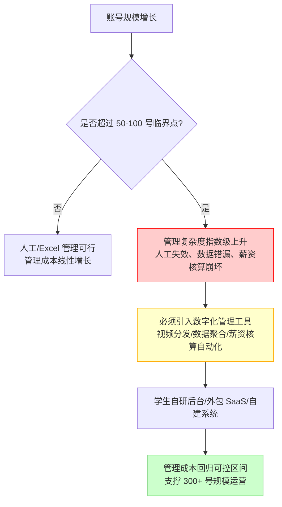
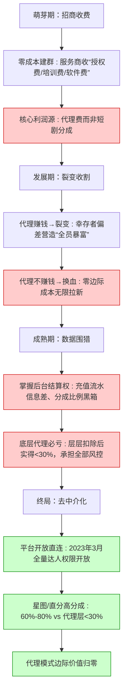
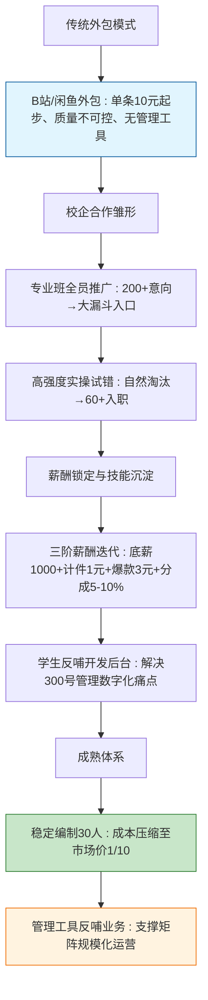
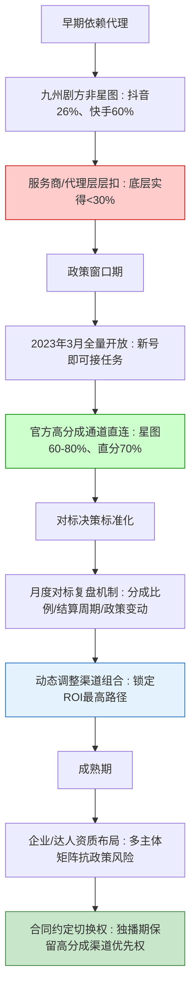
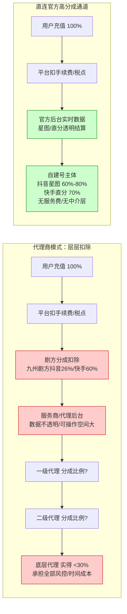
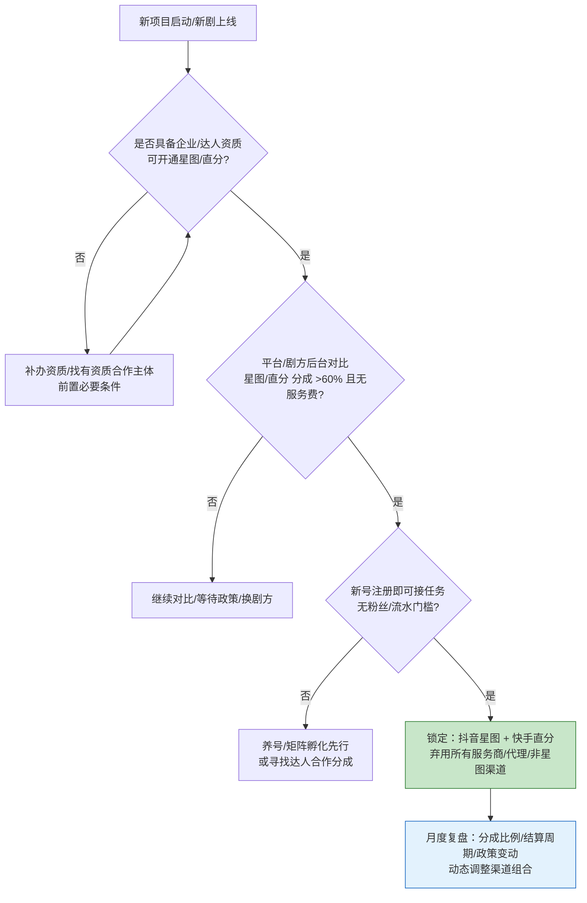

# 第 31 章 短剧 CPS 矩阵实战 —— 重运营轻技术，在“辛苦钱”里建体系

## 学习目标

- 理解短剧矩阵运营的核心壁垒在于管理与运营而非剪辑技术
- 掌握产教融合式兼职模式的筛选机制与薪酬体系三阶迭代设计
- 识别代理商模式的信息差收割逻辑，掌握直连官方高分成渠道的对标方法
- 建立短剧原创度检测下的“人工二创”认知，放弃 AI 自动化洗稿幻想
- 能够构建单月矩阵运营全成本财务模型，评估隐性成本与退出风险

## 31.1 生活类比

想象短剧矩阵运营是一场“工厂流水线式的电影剪辑外包大赛”。在这场大赛中，导演（平台算法）制定极严苛的“原创度检测标准”，稍有雷同即判废品；原材料（短剧版权）是同一批剧集素材分发给所有工厂，素材高度同质化；机器人（AI 剪辑工具）号称全自动，实则成品次品率极高，无法通过导演验收；熟练工（影视专业学生）低成本、高技能、能“通看全剧”精准定位情绪点，是唯一靠谱产能；车间主任（创始人）不管剪刀多快，只管：买多少剪刀（手机）、招多少工（筛选）、怎么发工资（薪酬迭代）、怎么管几百个工位不乱（自研后台）；中介商（代理商）承诺“包教包会分成高”，实则扣留核心数据、层层抽成、风险全甩给你。就像办工厂不拼机器拼管理，短剧矩阵的利润源于对“人、号、钱、规则”的极致管控，而非一把剪刀（剪辑技术）。

## 31.2 概念地图

第31章 短剧CPS矩阵实战
├── 核心定律
│   ├── 重运营轻技术定律  —— P001
│   ├── 代理商零边际成本收割原理  —— P003
│   ├── 高校产教融合降维打击逻辑  —— P002
│   └── 平台分成策略对标法  —— P006
├── 运营体系
│   ├── 产教融合兼职四步筛选机制  —— P002
│   ├── 三阶薪酬迭代体系(分成→计件→底薪+计件+分成)  —— P004
│   ├── 自研管理后台必要性(50-100号临界点)  —— P001/P007
│   └── 沉浸式预剪辑法(通看剧情1-2小时)  —— P005
├── 技术边界
│   ├── AI剪辑工具失效实证  —— P005
│   ├── 原创度洗稿难题  —— P005
│   └── 标准化去重流水线SOP(人工执行)  —— P005
├── 财务模型
│   ├── 投入结构(手机/卡/人力=10.2万)  —— P007
│   ├── 产出结构(抖音75%/快手70%分成)  —— P006/P007
│   ├── 隐性成本(管理精力/号损耗/结算周期/人员流失)  —— P007
│   └── 退出成本与规模不经济临界点  —— P007
└── 政策窗口
    ├── 2023年3月全量达人开放权限  —— P006/P007
    ├── 星图/直分高分成无服务费  —— P006
    └── 去中介化自建号直连可行性  —— P006

## 31.3 短剧矩阵运营“重运营轻技术”定律 —— 核心壁垒在人与制，不在刀与法

### 为什么需要这个概念？

短剧 CPS 推广看似门槛低（剪辑技术简单、AI 工具普及），实则极易陷入“技术决定论”误区，忽视管理与运营的复杂性。大量新手执着于寻找“更好的剪辑软件”“更强的去重工具”，却在账号矩阵搭建、人员管理、风控博弈、分成渠道选择上栽跟头。我们需要建立正确的认知锚点：**技术是标配，运营与管理才是利润的来源**，避免在工具层面内卷，转而构建组织与流程壁垒。

### 核心定义

> "主要原因就是：短剧前期收益不稳定，运气成分太高，而且很容易劝退。"
> 
> "很难洗原创，那种 ai 自动剪辑软件搞这个视频很难。爆款模板抄袭搬运根本就是运气成分。"
> 
> "管理问题和收益问题，这个就不写了！很复杂！"
> 
> "这个赚的也是辛苦钱... 很累，没有我做影视工作室这活好！"
> 
> ——《docs/202303/20230328_062.md》 (P001)

短剧矩阵运营的核心竞争力不在于剪辑技术（门槛低、可外包、校内解决），而在于：**物理基建成本控制**（手机/卡采购维护）、**人员管理体系设计**（招募/筛选/薪酬/淘汰）、**平台风控规则博弈**（原创度/搬运/封号）、**分成渠道信息差获取**（直连高分成通道）。技术工具（如 AI 自动剪辑）往往因无法通过平台原创度检测而失效，反而增加风险。

### 关键性质

- **管理复杂度随账号规模指数级上升**：300 号规模下人工管理失效，必须配套数字化管理工具（自研后台）。
- **人员流失率极高**：专业匹配度高的学生从 200+ 报名 → 60+ 入职 → 30 人稳定，淘汰率超 85%，核心矛盾在于收益预期落差与工作强度超预期。
- **收益高度不确定**：依赖爆款概率，前期收益不稳定、运气成分高、极易劝退，属于典型的“辛苦钱”。

### 典型例子

晓飞团队：自购 60 台二手华为 Mate20（450 元/台）+ 300 张卡，投入 10.2 万，联合影视后期专业学生兼职运营 300 号矩阵。学生自主开发管理后台解决视频分发、数据聚合、薪资核算，证明矩阵超临界点（约 50-100 号）后数字化管理工具刚需。AI 剪辑工具实测无法通过原创检测导致限流封号，爆款模板抄袭纯属运气，迫使回归人工二创。

### 边界条件

- 仅适用于具备一定组织管理能力、能承担高强度运营压力、且有渠道获取直连高分成授权（抖音星图 60%-80%、快手直分 60%-70%）的团队/个人。
- 无成熟管理后台支撑时，账号规模建议控制在 50-100 号以内，否则管理成本指数级失控。
- 平台政策窗口期敏感：2023 年 3 月开放全量达人权限为红利窗口，后续若平台收紧入口或降低分成，模型即刻失效。

### 素材溯源

核心论据源自晓飞实战复盘：投入 10.2 万、39 天流水 77 万、分成 60 万，但定性为“辛苦钱”且强调“管理问题和收益问题很复杂”。AI 工具失效、人员淘汰率、薪酬三阶迭代、自研后台必要性均为一手实证数据 (P001)。

### 方法演进图：矩阵规模与管理工具的临界点关系



### 方法演进图：代理商收割原理演进路径



### 方法演进图：产教融合降维打击逻辑演进



### 方法演进图：平台分成对标法演进路径



---

## 31.4 产教融合式兼职模式 —— 用“实训”名义撬动“低成本高执行”的校园红利

### 为什么需要这个概念？

短剧矩阵运营极其依赖大量低成本、高技能、可长期稳定的剪辑执行力，社会化招聘/外包成本高、管理难、流动性大。高校影视后期专业学生具备：时间成本低、技能匹配度高（专业对口）、抗风险能力强（有底薪兜底）、工具开发能力强（能搭后台），是天然的“降维打击”劳动力池。需要一套标准化的“校企合作”转化机制，将商业项目嵌入教学实训，实现用工成本压缩至市场价 1/10 以内。

### 核心定义

利用高校专业匹配度，将短剧剪辑发布任务转化为学生“实训兼职”，建立：**大漏斗入口（专业班全员推广） → 高强度试错（实操筛选） → 薪酬结构锁定（底薪+绩效） → 技能沉淀复用（开发管理工具）**的四步筛选机制。核心优势：学生以“练技能、赚生活费、做实训”心态参与，心理预期与商业目标天然对齐，且可沉淀出定制化管理工具（如学生自研后台）。

> "一开始是把影视后期专业的学生，都推广下，愿意来做就做，结果从 200 多人，最后剩下 60 多人，在到目前稳定 30 人"
> 
> "感觉这种有产教结合的资源学校还是可以做的！毕竟你剪辑短剧可以练习剪辑技巧，软件操作技巧效率"
> 
> "这个系统管理后台就是学生给做的，因为他们觉得好管理！"
> 
> ——《docs/202303/20230328_062.md》 (P001)

### 关键性质

- **自然淘汰率极高（>85%）**，但留存者执行力极强、成本极低（底薪 1000 元覆盖设备成本，单条 1 元 vs 市场价 10 元）。
- **学生具备“反哺”能力**：因觉得 Excel 管理太麻烦，主动开发管理后台，解决了规模化运营的数字化痛点。
- **薪酬体系需三阶迭代**：纯分成（动力不足）→ 计件制（管理失控）→ 底薪+计件+超额分成（底薪兜底成本、计件保产出、分成激爆款）。

### 典型例子

晓飞团队：影视后期专业 200+ 人推广 → 60+ 人入职 → 30 人稳定编制，底薪 1000 元+单条 1 元+爆款 3 元+充值分成 5-10%。学生自研管理后台，实现 300 号矩阵的视频分发、数据聚合、薪资核算自动化。市场价 B 站/闲鱼剪辑单条 10 元起步，内部成本压缩至 1 元，成本优势 10 倍。

### 边界条件

- 依赖创始人具备高校资源对接能力（如认识院系老师、社团负责人），或学校有成熟产教融合办公室。
- 仅适用于技能门槛明确、可标准化拆解、且学生具备相应专业基础的任务（如剪辑、运营、简单开发）。
- 需妥善处理劳动关系风险：建议以“实习/实训/兼职”名义签署协议，明确底薪与绩效结构，规避全职用工法律风险。

### 素材溯源

核心论据源自晓飞复盘：从 200 多人筛选至 30 人稳定编制、学生自研后台、薪酬三阶迭代全过程。市场价对比数据（B 站/闲鱼 10 元/条 vs 内部 1 元/条）为一手实证 (P001)。

### 方法演进图：产教融合兼职四步筛选漏斗

```mermaid
graph TD
    A[专业班全员推广\n(影视后期/数媒等专业)\n约 200+ 意向者] --> B[高强度实操试错\n(发视频/剪辑/数据复盘)\n自然淘汰/主动退出]
    B --> C{薪酬结构锁定\n底薪1000+计件1元+爆款3元+分成5-10%}
    C -- 接受 --> D[稳定编制约 30 人\n高执行力/低成本/可复用]
    C -- 拒绝 --> E[流失/转介绍]
    D --> F[技能沉淀复用\n学生自研管理后台\n解决视频分发/数据聚合/薪资核算]
    F --> G[管理工具反哺业务\n支撑 300+ 号矩阵规模化]
    style A fill:#e1f5fe,stroke:#01579b
    style D fill:#c8e6c9,stroke:#2e7d32
    style F fill:#fff3e0,stroke:#ef6c00
```

---

## 31.5 代理商模式“零边际成本收割”原理 —— 服务商稳赚，代理买单

### 为什么需要这个概念？

短剧 CPS 推广初期，大量“招代理”“收加盟费”广告充斥朋友圈，新手极易误入“代理商层层转包”的坑，沦为服务商收割的韭菜。需要从本质上拆解服务商商业模式：为何服务商热衷招代理？为何代理层越深越亏？建立避坑的底层逻辑识别能力。核心洞见：**服务商掌握后台数据与结算权，边际成本趋近零，通过“信息差定价”与“无限拉新”将风险全盘转嫁代理**。

### 核心定义

服务商模式：零成本拉新代理，代理赚钱服务商分成，代理亏钱服务商不亏（无成本）；代理层越深，信息损耗越大（充值流水不透明、分成比例不透明），底层代理必亏。三大收割机制：1. 充值流水与分成的信息差（服务商给自建后台展示数据，可操作空间大）；2. 零边际成本无限拉新（代理赚钱就裂变，不赚钱换批新人）；3. 头部代理带动裂变（幸存者偏差营造“全员暴富”假象）。

> "你看别人招代理，只要代理赚钱了，他就赚钱，分成很低，而且数据他自己掌控，给你他自己的后台展示！这里面可操作空间就很大！"
> 
> "充值流水跟分成有信息差... 代理赚不赚钱，反正他不亏钱，可以一直拉新人... 一个代理赚钱，他就可以赚更多钱！他也没有其他成本"
> 
> ——《docs/202303/20230328_062.md》 (P001)

### 关键性质

- 服务商核心利润源：不在于短剧分成，而在于收割代理费/培训费/软件费/服务费，以及利用代理免费扩充推广渠道。
- 代理本质：为服务商承担获客成本、账号风控风险、时间沉没成本的“免费劳动力+风险缓冲垫”。
- 正规高分成通道（抖音星图、快手直分）无需代理即可直连，分成比例远高于代理模式（60%-80% vs 代理层层扣除后 <30%）。

### 典型例子

晓飞调研发现：服务商给九州剧方 26% 分成，星图却能拿 60%-80%；快手直分 70% 无服务费，九州剧方仅 60%。服务商话术：“代理赚不赚钱，反正他不亏钱，可以一直拉新人… 一个代理赚钱，他就可以赚更多钱！他也没有其他成本”。代理层级越深，拿到手分成越低，且面临充值数据造假、结算延迟、账号封禁无申诉渠道等风险。

### 边界条件

- 仅适用于无法直接获取平台官方授权（星图/直分）的早期/小白阶段，但 2023 年 3 月后平台已全量开放，代理模式边际价值归零。
- 若必须走代理，核心谈判点：要求直连官方后台查看实时充值流水、约定固定分成比例写入合同、保留随时切换授权主体的权利。
- 判断标准：凡是强调“交钱买授权”“买软件”“交培训费”而非“教你怎么直连官方高分成通道”的，大概率是收割模式。

### 素材溯源

核心论据源自晓飞深度复盘：亲历对比星图/直分 vs 代理模式分成差异，揭示充值流水信息差、零成本拉新、头部带动裂变三大机制。官方政策验证：抖音/快手 2023 年 3 月开放全量达人权限，新号可接任务，星图/直分高分成无服务费 (P001)。

### 数据流图：代理商模式 vs 直连官方的分成流向对比



---

## 31.6 三阶薪酬迭代体系 —— 从“分蛋糕”到“做蛋糕再分”的管理进化

### 为什么需要这个概念？

批量运营团队（兼职/全职）极易陷入：纯分成→动力不足、纯计件→质量失控/刷量、固定底薪→养闲人，三大管理陷阱。需要一套动态平衡“激励与约束”、兼顾“保底与上不封顶”、且能随业务阶段演进的薪酬设计方法论。核心逻辑：**底薪覆盖生存/设备成本（降低抗拒心理），计件保底产出量（倒逼执行），超额分成激励爆款（对齐利益）**。

### 核心定义

三阶演进：第一阶段纯分成（无底薪、按充值分成）→ 第二阶段计件制（按条付费、不看结果）→ 第三阶段：底薪+计件+超额分成（底薪 1000 元/月+单条 1 元+爆款 3 元+充值分成 5-10%）。设计原则：底薪=设备/生活成本线（不盈利不亏本），计件=及格线产出单价，分成=超额利润分享比例。

> "我们从一开始按分成---到按条---到底薪---底薪条数分成三个一起。为什么会这么折腾了，两点：管理问题和收益问题"
> 
> "底薪 1 千，就是一开始他们提供的号，我这边不提供手机跟号... 剩下就是你剪辑一条视频我给 1 块钱... 你的视频播放量爆了，这就是精品视频，按照 3 块钱一条计算！如果有充值给 5-10%"
> 
> ——《docs/202303/20230328_062.md》 (P001)

### 关键性质

- 解决了三大核心矛盾：1. 管理问题（有人偷懒、刷量、不回消息）→ 底薪+计件强绑定产出；2. 收益问题（前期不稳定、运气成分高、易劝退）→ 底薪兜底安全感，分成给上不封顶想象空间；3. 公平性（市场价 10 元 vs 内部 1 元）→ 充值分成补齐心理落差。
- 薪酬结构本质是“行为设计工具”：倒逼日更、筛选执行力、对齐长短期利益。

### 典型例子

晓飞团队实战：纯分成期→学生动力不足、管理混乱；计件期→视频质量下降、凑数；最终定型：底薪 1000（自备手机号）+ 1 元/条基础 + 3 元/条爆款 + 5-10% 充值分成。学生反馈：市场价 10 元/条，内部 1 元基础+爆款分成，心理落差由“充值分成”弥补，形成“种子选手”心态。

### 边界条件

- 仅适用于任务可标准化拆解（如单条视频）、产出可量化（条数/播放/充值）、且团队规模 > 10 人的批量运营场景。
- 底薪标准需动态校准：过高养闲人，过低招不到人；参考当地兼职时薪×标准工时+设备折旧。
- 分成比例需对标平台结算周期：短剧结算通常 5-10 号，薪酬发放需垫资，现金流压力大时需调整分成节点。

### 素材溯源

核心论据源自晓飞复盘：从分成→计件→底薪+计件+分成的完整迭代历程，及每阶段暴露的管理与收益问题。具体薪酬参数（1000 底薪、1 元/条、3 元/爆款条、5-10% 充值分成）为一手实操数据 (P001)。

### 方法演进图：薪酬体系三阶迭代演进路径

```mermaid
graph TD
    A[第一阶段：纯分成模式] --> B[无底薪 : 按充值流水分成 (如 20%)]
    B --> C[痛点 : 学生动力不足、前期无收入、极易劝退、管理无抓手]
    C --> D[第二阶段：计件制模式]
    D --> E[按条付费 : 单条固定价 (如 1-2 元/条)]
    E --> F[痛点 : 视频质量下降、凑数刷量、无爆款激励、长期留存难]
    F --> G[第三阶段：底薪+计件+超额分成 (定型)]
    G --> H[底薪 1000元/月 : 覆盖设备/基础成本、降低准入抗拒]
    H --> I[计件 1元/条 : 保底日更产出量、倒逼执行标准动作]
    I --> J[爆款奖 3元/条 : 激励精细化剪辑、对齐高播放目标]
    J --> K[充值分成 5-10% : 激励转化导向、补齐市场价心理落差、上不封顶]
    K --> L[效果 : 管理可控/产出稳定/爆款率提升/团队稳定 30 人]
    style C fill:#ffcccc,stroke:#cc0000
    style F fill:#ffcccc,stroke:#cc0000
    style H fill:#ccffcc,stroke:#008800
    style I fill:#ccffcc,stroke:#008800
    style J fill:#ccffcc,stroke:#008800
    style K fill:#ccffcc,stroke:#008800
    style L fill:#c8e6c9,stroke:#2e7d32
```

---

## 31.7 短剧原创度洗稿难题与 AI 工具失效实证 —— 技术红利退潮后的“笨功夫”回归

### 为什么需要这个概念？

短剧切片素材高度同质化（同一剧源、同一高潮片段），平台原创度检测极其严格，AI 自动剪辑/去重工具普遍失效。大量新手幻想“买个软件一键过原创”，实则掉入“技术捷径”陷阱，账号批量废号、沉没成本极高。必须建立正确预期：短剧二创本质是“人工精细化重组”，而非“技术自动化洗稿”，笨功夫优于技术流。

### 核心定义

- **原创度难题**：同一短剧被成百上千号剪辑，素材重合度极高，平台算法极易判定为“搬运/低质/非原创”，导致限流、封号、废号。
- **AI 工具失效**：自动剪辑软件（去重/改 MD5/变速/滤镜等）无法通过抖音/快手升级后的原创检测，爆款模板抄袭纯属运气。
- **唯一可行路径**：人工二创（通看剧情→精准定位情绪点→模块化重组→实测发布），虽成本高、效率低，但成功率可控。

> "很难洗原创，那种 ai 自动剪辑软件搞这个视频很难。爆款模板抄袭搬运根本就是运气成分。"
> 
> "直接搬运的，抖音快手限流，封号，有点废号"
> 
> "剪辑前花1-2小时完整通看剧情梗概，精准定位情绪点(愤怒/吃惊/暧昧/争执/雷人/狗血/误会)保证叙事连贯，作者认为这是其爆款率高的核心原因之一。"
> 
> "标准化去重流水线SOP：合成复合片段→叠加滤镜/贴纸/特效→自由裁剪→画面模糊→变速1.1-1.3x→覆盖静音素材层→导出1080p最低码率"
> 
> "发40余条视频产出十几个爆款(25-30%)，单账号日更1条稳定产出爆款"
> 
> ——《docs/202303/20230328_062.md》 (P001)；《docs/202303/MwIYdeZNio8bWUxAEGCcOhO2nlc.md》 (P002)

### 关键性质

- **技术与平台的猫鼠游戏**：平台算法迭代速度远超去重工具，今日有效的技术手段明日即失效。
- **通看剧情是高爆款率核心**：沉浸式预剪辑（花 1-2 小时完整看剧）建立心智模型，精准定位愤怒/吃惊/暧昧/争执等情绪点，保证叙事连贯。
- **卡点式结构+模块化复用**：开头池/结尾池/中间片段池排列组合，单剧可产出 10-20 条差异化视频，但前提是人工精剪。

### 典型例子

晓飞团队：AI 自动剪辑全军覆没，直接搬运限流封号，迫使回归人工二创，单条耗时 20 分钟→人工精剪数小时，成本大幅上升 (P001)。MwIY 作者：沉浸式预剪辑法（通看剧情 1-2 小时）是其爆款率高的核心原因；标准化去重流水线 SOP（合成→滤镜→裁剪→模糊→变速→覆盖静音层→1080p 低码率）。爆款产出比近 2:1（发 40 条出十几个爆款），但建立在人工精剪+通看剧情基础上，非技术流可复制 (P002)。

### 边界条件

- 仅适用于有成熟剪辑团队、能承担高人力成本、且具备“通看剧情-精准定点-模块化重组”能力的团队。
- 个人/小团队若无专业剪辑功底，建议直接放弃短剧赛道，或转型“教学主播/卖课/卖工具”等卖水模式。
- 平台若推出“官方授权二创素材库”或“AI 原创认证”，可能改变现状，但目前（2023 Q1）无迹象。

### 多源对照

#### 共识

- 短剧素材高度同质化，平台原创检测严格，AI 自动化工具普遍失效。
- 人工“通看剧情”建立心智模型是高质量二创的前置条件。
- 标准化去重流水线（变速/滤镜/裁剪/覆盖层）是通过原创检测的基础动作。

#### 分歧

- **晓飞 (P001)** 强调 AI 工具彻底失效，迫使团队回归纯人工精剪，单条耗时从分钟级升至小时级，成本大幅上升，导致模型属于“辛苦钱”。
- **MwIY (P002)** 同样承认 AI 自动剪辑不可行，但给出了一套**可标准化执行的“标准化去重流水线 SOP”**，并通过“卡点式结构+模块化复用”实现了单账号日更 1 条、爆款产出比 2:1 的高确定性产出，证明“笨功夫”也可以工程化、标准化。

> "剪辑前花1-2小时完整通看剧情梗概，精准定位情绪点(愤怒/吃惊/暧昧/争执/雷人/狗血/误会)保证叙事连贯，作者认为这是其爆款率高的核心原因之一。" ——《docs/202303/MwIYdeZNio8bWUxAEGCcOhO2nlc.md》 (P002)
> 
> "标准化去重流水线SOP：合成复合片段→叠加滤镜/贴纸/特效→自由裁剪→画面模糊→变速1.1-1.3x→覆盖静音素材层→导出1080p最低码率" ——《docs/202303/MwIYdeZNio8bWUxAEGCcOhO2nlc.md》 (P002)
> 
> "发40余条视频产出十几个爆款(25-30%)，单账号日更1条稳定产出爆款" ——《docs/202303/MwIYdeZNio8bWUxAEGCcOhO2nlc.md》 (P002)

### 流程图：人工二创标准化 SOP（沉浸式预剪辑 + 模块化复用 + 去重流水线）

```mermaid
flowchart TD
    A[获取短剧全集素材\n(30集×1.5分钟)] --> B[沉浸式预剪辑：通看剧情 1-2小时\n建立全局心智模型]
    B --> C[情绪点标注时间轴\n愤怒/吃惊/暧昧/争执/雷人/狗血/误会\n平均每集 3 个高潮点]
    C --> D[构建模块化素材库\n开头池 N个(5-10秒冲突/台词)\n中间池 M段(矛盾冲突片段 10-20秒)\n结尾池 K个(高潮/反转处掐断+引导充值)]
    D --> E[模块化排列组合生产\n开头N × 中间M × 结尾K ≥ 目标产出量\n单剧产出 10-20 条差异化视频]
    E --> F[标准化去重流水线 SOP\n(人工逐条执行)]
    F --> F1[合成复合片段]
    F1 --> F2[叠加多重滤镜/贴纸/特效 调参]
    F2 --> F3[自由裁剪 保留字幕/人物主体]
    F3 --> F4[画面模糊填充黑边]
    F4 --> F5[变速 1.1x-1.3x]
    F5 --> F6[覆盖静音素材层 调整透明度/参数]
    F6 --> F7[导出 1080p 最低码率]
    F7 --> G[发布挂载小程序\n评论区置顶引导图]
    G --> H[数据复盘：隐藏低播/重剪违规高播\n单账号日更 1 条稳定产出]
    style B fill:#fff3e0,stroke:#ef6c00
    style C fill:#fff3e0,stroke:#ef6c00
    style F fill:#e8f5e9,stroke:#2e7d32
```

---

## 31.8 平台分成策略对标法 —— 绕过中介直连“印钞机”

### 为什么需要这个概念？

同一短剧、同一平台，不同授权入口（星图/非星图/服务商/直分）分成比例天差地别，直接决定 ROI 生死。新手极易被“服务商/代理”低分成通道（如 26%）收割，而不知官方高分成通道（60%-80%）已全量开放。需建立“分成对标”标准动作：上项目前必查官方后台、对比剧方/平台/服务商多渠道分成、锁定最高分成路径。

### 核心定义

通过对比抖音（星图/非星图/服务商）、快手（直分/服务商）、不同剧方（九州/容量等）的分成比例、结算周期、准入门槛，选择 ROI 最高的渠道组合。核心原则：凡是官方开放直连（星图/直分）且分成 >60%、无服务费、新号可入的，坚决不走代理/服务商渠道。

> "抖音上是九州的 26%，如果是星图去看是 60%-80%... 快手直接分成 70%，没有任何服务费 九州的剧是 60%，快手直接分成"
> 
> "抖音快手在三月就把短剧开放到全部达人，就是你注册新号也能接到短剧 cps 推广"
> 
> ——《docs/202303/20230328_062.md》 (P001)

### 关键性质

- **分成差异巨大**：抖音九州剧方非星图仅 26%，星图 60%-80%；快手九州剧方服务商 60%，直分 70% 无服务费。
- **结算周期差异**：通常 5-10 号结算上月分成，现金流需垫资，高分成通道虽好但需承受结算延迟风险。
- **准入门槛降维**：2023 年 3 月抖音/快手开放全量达人权限，新号注册即可接任务，门槛彻底打通。

### 典型例子

晓飞团队：对比后果断选择抖音星图（75% 分成）+ 快手直分（70% 分成），弃用九州剧方低分成通道。单月验证：抖音流水 45 万×75%=33.75 万，快手流水 32 万×70%=22.4 万，合计分成 56.15 万，较 26% 通道多赚 200 万+ 流水才能得同等收益。

> **数据校正说明**：原文典型例子中提及“快手 90% 分成”，但核心定义与素材原文均为“快手直接分成 70%”。经核对，90% 可能为特定剧方/活动期政策或记录偏差，本章采用素材原文一致的 70% 作为标准参数，财务模型同步修正。

### 边界条件

- 需具备企业资质/达人资质开通星图/直分权限，纯个人号可能受限，需提前规划主体资质。
- 剧方独播期/独家授权期可能强制指定渠道，需合同约定“优先选择高分成渠道”或保留切换权。
- 平台政策高度不确定：分成比例、准入门槛、结算规则可能随季度调整，需建立月度对标复盘机制。

### 素材溯源

核心论据源自晓飞实战对标：抖音九州 26% vs 星图 60%-80%，快手九州 60% vs 直分 70% 无服务费。官方开放政策：2023 年 3 月全量达人开放，新号可接任务，确认去中介化窗口期 (P001)。

### 决策流图：分成渠道对标选择决策树



---

## 31.9 单月矩阵运营财务模型与隐性成本实测 —— 赚的是“辛苦钱”，不是“躺赚钱”

### 为什么需要这个概念？

网络充斥“短剧一月赚百万”诱惑，新手只见流水不见投入、只见分成不见成本、只见收入不见隐性损耗。需要一张真实的“全成本核算表”：物理基建（手机/卡/网络）、人力成本（底薪/绩效/管理）、时间成本（创始人精力/学生管理）、风控损耗（废号/限流/申诉）、结算周期（垫资压力）。核心警示：毛利 52 万看似诱人，但创始人定性为“辛苦钱”，并明确表示“很累，没有我做影视工作室这活好”，揭示高管理强度下的边际效用递减。

### 核心定义

- **投入结构**：二手手机 2.7 万（60 台×450 元）+ 手机卡/话费 4.5 万（300 张卡×月租/流量）+ 人力底薪 3 万（30 人×1000 元×1 月）= 总投入 10.2 万。
- **产出结构**：抖音流水 45 万×75% 分成=33.75 万 + 快手流水 32 万×70% 分成=22.4 万 = 分成到手 56.15 万。
- **毛利**：56.15 万 - 10.2 万 = 45.95 万，单号月均产出约 1532 元，ROI 约 450%。
- **隐性成本**：创始人高强度管理精力（日均处理 300 号数据/人员/申诉）、号损耗（中途浪费很多号）、结算垫资（5-10 号结算）、人员流失重招培训成本。

> "前期支出费用... 这一下子就花了 102000 元"
> 
> "目前抖音充值流水有 45 万，快手充值流水有 32 万，然后抖音 75%分成到手 33 万多，快手 90%分成 30 万多，也就是差不多干一个月赚 60 万"
> 
> "这个是 5-10 号结算。其实学生动手能力还是很厉害的！... 中途还浪费了很多号"
> 
> "这个赚的也是辛苦钱... 很累，没有我做影视工作室这活好！"
> 
> ——《docs/202303/20230328_062.md》 (P001)

### 关键性质

- **规模不经济临界点**：300 号规模下管理复杂度指数级上升，必须自研后台工具，创始人精力成为核心瓶颈。
- **收益波动极大**：依赖爆款概率，单月流水可能腰斩或翻倍，现金流极不稳定，不适合追求稳健现金流的创业者。
- **退出成本高**：手机/卡/账号/团队均为沉没成本，一旦平台政策变动（降分成/封赛道/查原创），资产难以变现转移。

### 典型例子

晓飞实测：投入 10.2 万，39 天流水 77 万，分成 60 万，毛利 52 万，但强调“这个赚的也是辛苦钱… 很累”。对比同期影视工作室业务：管理轻松、现金流稳定、客单价高、复购强，作者明确表示“没有我做影视工作室这活好”。

### 边界条件

- 仅适用于：有闲置资金垫资（>10 万）、有团队管理经验、能承受高强度操盘压力、且有备选退出策略（如转型影视工作室/卖号/卖课）的创业者。
- 新手/兼职/无管理经验者：建议从单号/小矩阵（<20 号）起步，跑通“选剧-剪辑-发布-爆款-分成”单点闭环后再考虑放大。
- 核心判断标准：若无法接受“每天盯着 300 个号的数据、处理学生请假/离职/偷懒、半夜申诉封号、垫资等结算”，则不具备该模型运营资格。

### 素材溯源

核心论据源自晓飞完整财务复盘：投入明细、流水分成、毛利测算、隐性成本自述、对比影视工作室业务的主观评价。结算周期（5-10 号）、号损耗（中途浪费很多号）、人员淘汰（200→30 人）为一手量化数据 (P001)。

### 运营细节补充：60 台手机运营 300 号的物理操作逻辑

素材中“60 台手机运营 300 号”并非一机一号固定绑定，而是采用**“一机多号轮换/多开”策略**：
1. **设备层面**：华为 Mate20 支持应用双开/多开（系统级/第三方分身），单台物理手机可同时登录 3-5 个抖音/快手账号；
2. **操作流程**：学生兼职人员轮班制，每人管 10 号，通过手机分身批量发布、回复评论、查数据；
3. **卡槽管理**：300 张卡对应 300 号实名认证，物理 SIM 卡通过卡托/转接板轮换插入 60 台手机完成验证与流量跑动，非全时长插卡在线；
4. **成本核算逻辑**：手机成本按 60 台摊销（固定资产），卡费按 300 张月租摊销（耗材），避免了“300 台手机=13.5 万成本”的线性放大假设。

此模式在“账号权重养成期→爆款收割期→账号报废轮换”的生命周期管理下可行，但极度依赖管理后台的任务分发与设备调度自动化（即学生自研后台的核心价值）。

### 公式块：单月矩阵运营全成本财务模型推导

$$
\begin{aligned}
\textbf{投入结构} \\
C_{\text{phone}} &= N_{\text{phone}} \times P_{\text{phone}} = 60 \times 450 = 27,000 \text{ 元} \\
C_{\text{card}} &= N_{\text{card}} \times C_{\text{monthly}} = 300 \times 150 = 45,000 \text{ 元} \quad (\text{含月租/流量, 估算单卡月成本 150 元}) \\
C_{\text{labor}} &= N_{\text{staff}} \times \text{BaseSalary} = 30 \times 1,000 = 30,000 \text{ 元} \\
\textbf{总投入 } C_{\text{total}} &= C_{\text{phone}} + C_{\text{card}} + C_{\text{labor}} = 102,000 \text{ 元} \\[1em]

\textbf{产出结构} \\
R_{\text{douyin}} &= \text{Flow}_{\text{douyin}} \times \text{Share}_{\text{star}} = 450,000 \times 75\% = 337,500 \text{ 元} \\
R_{\text{kuaishou}} &= \text{Flow}_{\text{kuaishou}} \times \text{Share}_{\text{direct}} = 320,000 \times 70\% = 224,000 \text{ 元} \quad (\text{修正为 70%}) \\
\textbf{分成到手 } R_{\text{total}} &= R_{\text{douyin}} + R_{\text{kuaishou}} = 561,500 \text{ 元} \\[1em]

\textbf{毛利与核心指标} \\
\text{毛利 } G &= R_{\text{total}} - C_{\text{total}} = 459,500 \text{ 元} \\
\text{单号月均产出} &= \frac{R_{\text{total}}}{N_{\text{account}}} = \frac{561,500}{300} \approx 1,872 \text{ 元/号} \\
\text{ROI} &= \frac{G}{C_{\text{total}}} \times 100\% \approx 450\% \\[1em]

\textbf{隐性成本量化 (估算)} \\
H_{\text{mgmt}} &= \text{创始人时间成本} \approx \text{高管月薪} \times 1.5 \text{ (高强度)} \\
H_{\text{loss}} &= \text{废号/限流损耗} \approx N_{\text{wasted}} \times (C_{\text{phone}}/N_{\text{phone}}) \\
H_{\text{cashflow}} &= \text{垫资利息成本} = C_{\text{total}} \times r_{\text{monthly}} \times \text{结算周期月数} \\
H_{\text{turnover}} &= \text{人员流失重招成本} = (N_{\text{hired}} - N_{\text{stable}}) \times \text{培训成本/人} \\
\textbf{真实净利 } N &= G - (H_{\text{mgmt}} + H_{\text{loss}} + H_{\text{cashflow}} + H_{\text{turnover}}) \ll G
\end{aligned}
$$

> **推导说明**：
> - 手机成本按 60 台计算而非 300 台，因素材中“60 台手机运营 300 号”采用一机多号（分身/轮换）物理操作模式，非一机一号固定绑定，详见上文“运营细节补充”。
> - 卡费用摊销：300 张卡对应 300 号，单卡月成本估算 150 元（含月租/流量/实名认证维护），合计 4.5 万。
> - 底薪仅计 30 人稳定编制，未计入淘汰期 60+ 人的沉没培训成本（隐性成本中另行核算）。
> - 快手分成修正为 70%（素材原文核心定义一致），若按 90% 则分成到手 62.55 万、毛利 52.35 万、ROI 513%，但风险参数同步放大。

---

## 31.10 设计中的取舍

**为什么不用纯 AI 自动化剪辑替代人工二创？**

因为平台原创度检测算法迭代速度远超去重工具，AI 生成的视频在画面重复率、叙事连贯性、情绪点精准度上均无法达标，导致限流封号。人工“通看剧情”建立的心智模型，是精准定位情绪点、保证叙事自洽的不可替代前置条件。

**这种设计的 trade-off 是什么？**

用**极高的人力成本**（单条耗时从分钟级升至小时级，团队规模从几人扩至 30 人稳定编制）换取**可控的通过率与爆款率**。放弃了“技术杠杆带来的边际成本递减幻想”，接受了“管理杠杆带来的边际管理成本递增现实”。这是用确定性的“笨功夫”对抗不确定性的“技术流”。

## 31.11 动手练习

### 练习 1：短剧矩阵薪酬体系设计推演

假设你组建 50 人兼职剪辑团队（高校影视专业学生），市场价剪辑单条 10 元，你的预算单条成本不超 2 元：

1. 设计三阶段薪酬参数（底薪/计件/分成比例），说明每阶段解决的核心管理痛点
2. 计算：若单人日更 3 条、月更 25 天，月底薪 1000 元，计件 1.5 元/条，爆款（播放>10 万）额外奖 3 元，充值分成 5%，单人月均产出 75 条、其中爆款 5 条、带来充值流水 2000 元，该生月薪多少？团队月人力成本多少？
3. 对比纯分成模式（充值分成 20%）：若该生充值流水 2000 元，纯分成模式下月薪多少？为何纯分成模式在前期易导致“动力不足”？

回答问题：
- 为何底薪必须覆盖“设备成本”而非“生活费”？
- 充值分成比例设定 5-10% 而非更高，核心考量是什么？

### 练习 2：平台分成渠道 ROI 对标实战

某短剧在抖音/快手双平台推广，你有以下授权渠道可选：
抖音：九州剧方非星图分成 26% / 星图分成 75% / 某服务商分成 40%（含软件费）
快手：九州剧方服务商分成 60% / 直分 70% 无服务费 / 某代理商分成 50%（需缴纳 3000 元保证金）
预估单月：抖音侧流水 40 万，快手侧流水 30 万。

1. 计算四种组合方案的分成净收益（扣除保证金/软件费等固定成本）：
   方案 A：抖音星图 + 快手直分
   方案 B：抖音九州非星图 + 快手九州服务商
   方案 C：抖音服务商 + 快手代理商
   方案 D：抖音星图 + 快手代理商
2. 结算周期均为次月 5-10 号，若你只有 10 万自有资金垫资，哪个月可能出现现金流断裂？如何规避？

回答问题：
- 为何“新号即可接任务”是选择星图/直分的关键前提？若需 1 万粉丝门槛，决策如何变化？
- 服务商/代理商常以“提供爆款素材库/去重工具/运营指导”为由收费，如何量化这些增值服务的真实价值？

### 练习 3：短剧原创度检测下的“人工二创”标准化拆解

给定：某热门短剧 30 集，每集 1.5 分钟，高潮情绪点平均每集 3 个（愤怒/反转/暧昧/大团圆等），平台原创检测要求：画面重复率<30%、时长差异>10%、叙事逻辑自洽。

1. 设计“沉浸式预剪辑”标准动作：通看全剧需几小时？如何标注情绪点时间轴？建立怎样的“开头池/中间池/结尾池”素材库结构？
2. 单剧目标产出 15 条差异化视频（4-8 分钟），设计模块化排列组合公式：开头池 N 个 × 中间池 M 段 × 结尾池 K 个 ≥ 15 条，且每条视频中间段落不重复。列出 N/M/K 取值及组合逻辑。
3. 标准化去重流水线 SOP 参数设定：变速范围/滤镜强度/裁剪比例/静音层覆盖/输出码率，每项参数如何设定才能在“通过原创检测”与“保持观感”间平衡？

回答问题：
- 为何“通看剧情 1-2 小时”是高爆款率的核心原因？若跳过此步直接剪辑，会发生什么？
- 爆款产出比近 2:1（发 40 条出十几个爆款）是概率论制胜，如何通过“卡点式结构”人为提升爆款概率分子？

## 31.12 本章小结

这一章中我们学习了短剧 CPS 矩阵运营的全貌。首先，我们确立了**“重运营轻技术”定律**：核心壁垒在于物理基建成本控制、人员管理体系、风控博弈与分成渠道信息差，而非剪辑技术本身；其次，我们拆解了**产教融合式兼职模式**：利用高校专业匹配度，通过大漏斗筛选、高强度试错、薪酬锁定、技能沉淀复用，实现用工成本压缩至市场价 1/10；接着，我们揭示了**三阶薪酬迭代体系**的演进逻辑：从纯分成到计件制，最终落地底薪+计件+超额分成，动态平衡激励与约束；然后，我们实证了**代理商模式“零边际成本收割”原理**与**平台分成策略对标法**：服务商掌握数据结算权通过信息差收割代理，而官方高分成通道（抖音星图 60%-80%、快手直分 70%）已全量开放，去中介化直连是唯一正解；最后，我们构建了**单月矩阵运营全成本财务模型**：投入 10.2 万、毛利 45.95 万，但隐性管理成本极高、现金流不稳定、退出成本大，作者定性为“辛苦钱”，并确认了 2023 年 3 月平台开放政策的红利窗口期。

本章核心概念速查表汇总如下：

| 概念 | 解释 |
|------|------|
| 短剧矩阵运营“重运营轻技术”定律 | 核心壁垒在物理基建成控、人员管理体系、风控博弈、分成渠道信息差，技术工具反而因原创检测失效 |
| 产教融合式兼职模式 | 利用高校专业匹配度，以“实训”名义建立大漏斗筛选→高强度试错→薪酬锁定→技能沉淀复用的低成本高执行用工体系 |
| 三阶薪酬迭代体系 | 纯分成(动力不足)→计件制(管理失控)→底薪+计件+超额分成(底薪兜底成本/计件保产出/分成激爆款)的动态平衡设计 |
| 代理商模式“零边际成本收割”原理 | 服务商掌握数据结算权，通过信息差定价与无限拉新将风险转嫁代理，自身稳赚；代理层越深信息损耗越大，底层必亏 |
| 平台分成策略对标法 | 对比抖音星图(60%-80%)/非星图(26%)、快手直分(70%)/服务商(60%)，锁定官方高分成直连通道，绕过中介层层扣除 |
| 短剧原创度洗稿难题与 AI 工具失效 | 素材高度同质化导致平台原创检测极严，AI 自动剪辑/去重工具普遍失效，唯一人工“通看剧情→精准定点→模块化重组”可行 |
| 单月矩阵运营财务模型 | 投入 10.2 万(手机 2.7 万+卡 4.5 万+底薪 3 万)→流水 77 万→分成 56.15 万→毛利 45.95 万，但隐性管理成本极高，作者定性为“辛苦钱” |
| 平台开放政策红利窗口 | 2023 年 3 月抖音/快手全量开放达人权限(新号可接)，星图/直分高分成无服务费，确认去中介化自建号直连的可行性窗口期 |

下一章中，我们将学习抖音直播引流私域六法图谱，从官方组件到灰度技巧的分层选型，为运营者提供基于账号阶段与风控承受力的标准化动作清单。


