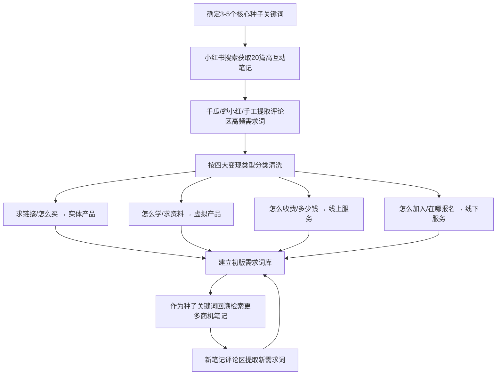
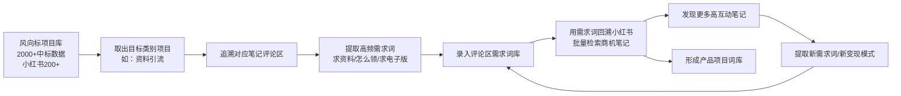
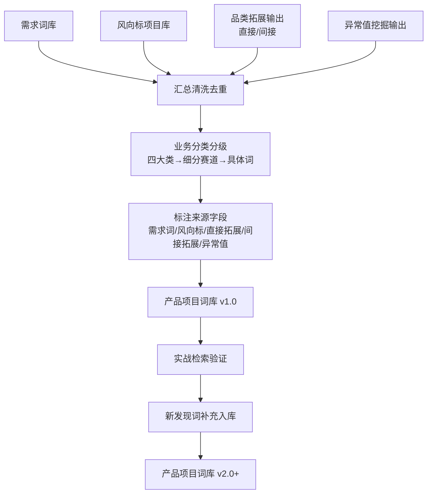
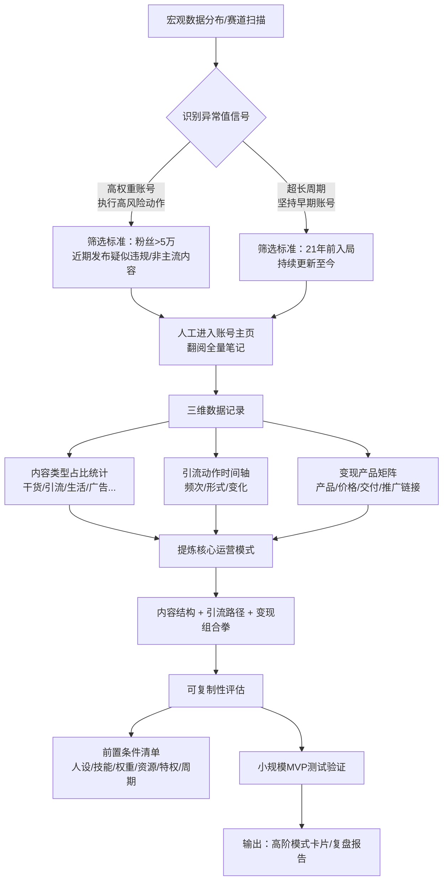
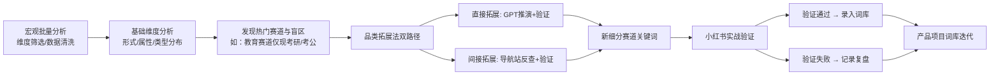
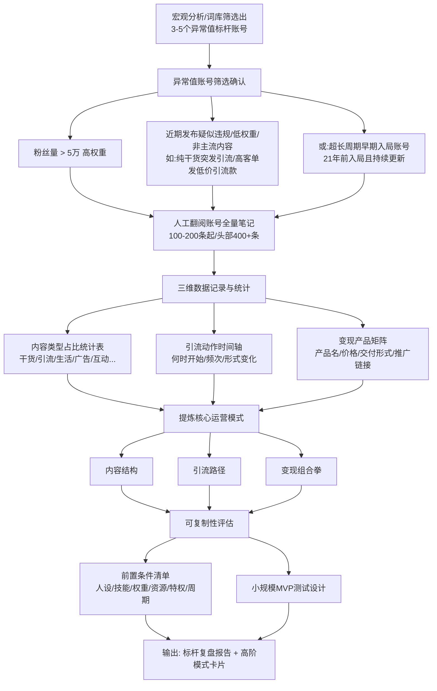
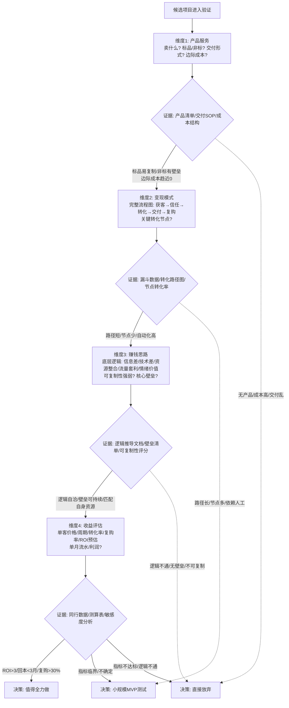
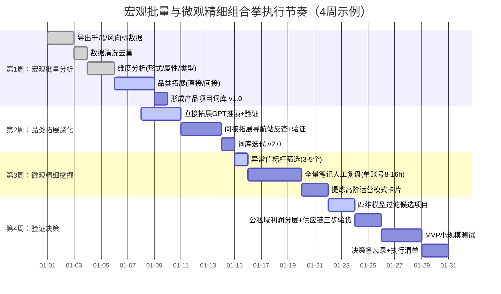
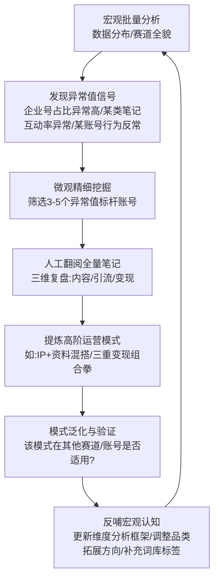

# 第 36 章 小红书赚钱项目自主挖掘法 —— 从“跟风吃剩饭”到“手握渔网捕大鱼”

## 学习目标

- 理解评论区需求词库作为商机雷达的核心逻辑与构建方法
- 掌握风向标项目库作为高质量种子池的获取与应用技巧
- 熟练运用品类拓展法（直接/间接）突破数据源盲区挖掘蓝海赛道
- 掌握异常值挖掘法：通过深度复盘反常规账号提炼高阶运营模式
- 能够使用四维项目验证模型（产品/模式/思路/收益）标准化评估项目落地性
- 理解宏观批量分析与微观精细挖掘的互补关系与执行节奏
- 认清信息差时效性与选择权悖论，建立自主挖掘能力夺回决策主动权
- **掌握供应链三步验货法（试单验证+全品亲测+自担赔付）与公私域联动利润模型（公域薄利引流、私域厚利复购），在项目验证中落地第 35 章核心风控与利润逻辑**

## 36.1 生活类比

想象项目挖掘是一场寻宝游戏。你站在茫茫大海（小红书平台）边，手里没有藏宝图，只有模糊的传说。评论区需求词是地图上闪烁的红色光点，用户直白喊出的需求——“求链接”“怎么学”“怎么收费”“怎么加入”——每一个光点都在告诉你：这里有宝，这里有真金白银的付费意愿。风向标项目库是前人留下的已验证宝藏坐标，两千多条中标数据里，小红书就有两百多条，每一条都是挖过、验过的真宝藏，省去了你盲目乱挖的时间，还能顺藤摸瓜追溯到评论区，把需求词捡回来。品类拓展法是你从一个宝藏点推演出周边埋藏规律的推理能力：直接拓展是顺着线索查，把标题喂给 ChatGPT 让它推演二十个细分子品类，再回小红书验证；间接拓展是查古籍、看地质图反推，去桔梗上网导航这种外部“全量词典”里把考试赛道所有能考的证全抠出来，再回平台反查，结果发现 MPA、公共英语、司法考试这些种子数据里完全没有的词，在小红书上居然风生水起。异常值挖掘法是发现藏宝图上标注异常的特殊符号——大佬反常操作：十二万粉的化学博主偏偏去玩“废号操作”资料引流，十四万粉的早期账号偏偏坚持了三年玩三重变现组合拳，你比大佬更变态，翻阅他们四百条笔记到底，才挖出“IP+资料混搭降维打击”“接广+引流公众号+网盘拉新”这种高阶玩法。四维验证模型是鉴宝师的标准化体检清单：这东西是真宝还是假货（产品服务）？怎么变现、流程多长（变现模式）？底层逻辑能不能复制、壁垒在哪（赚钱思路）？到底值多少钱、回本周期多久（收益评估）？**而在体检台上，必须加上两项来自第 35 章的硬指标：一是“公私域利润分层测算”——这笔买卖，公域端（小红书种草引流）到底是在薄利还是亏本获客，私域端（快团团/社群/朋友圈）能否承接高频复购撑起厚利？二是“供应链三步验货压测”——试单验证、全品亲测、自担赔付，这三关没过，再好的收益评估也是空中楼阁。**产品项目词库是你整理出的分类宝藏图鉴，下次直接按图索骥。就像寻宝：光有地图（需求词）不够，要有前人坐标（风向标），会推演规律（品类拓展），敢挖异常点（异常值），还得会鉴宝（四维验证+公私域利润分层+供应链验货），最终建立自己的图鉴（词库），才能在茫茫大海中稳赚不赔，把选择权牢牢攥在自己手里。

## 36.2 概念地图

```mermaid
mindmap
  root((小红书赚钱项目自主挖掘体系))
    核心入口
      评论区需求词库[[P001]]
        求链接 --> 实体产品
        怎么学 --> 虚拟产品
        怎么收费 --> 线上服务
        怎么加入 --> 线下服务
      风向标项目库[[P002]]
        2000+中标数据（小红书200+）
        解决冷启动种子笔记难题
    挖掘方法论
      宏观批量分析
        基础维度分析（形式/属性/类型）[[P011]]
        品类拓展法[[P005]]
          直接拓展：ChatGPT提炼+小红书验证
          间接拓展：外部导航站反查+回溯验证
      微观精细挖掘
        异常值挖掘法[[P006]]
          关注高权重账号反常操作
          人工翻阅全量笔记复盘高阶模式
    结构化产出
      产品项目词库[[P003]]
        实体产品/虚拟产品/线上服务/线下服务
        可直接检索定位具体赚钱项目
    落地评估
      四维项目验证模型[[P007]]
        产品服务（卖什么）
        变现模式（怎么卖/流程）
        赚钱思路（底层逻辑/可复制性）
        收益评估（量级/单价/ROI）
      第35章核心模型复用与落地 [[NEW]]
        公私域联动利润模型：公域薄利引流 → 私域厚利复购
        供应链三步验货法：试单验证 + 全品亲测 + 自担赔付
        个人IP驱动选品：真实痛点绑定专业身份 → 反向定品
    核心认知
      需求词即商机入口论[[P008]]
      信息差时效性与选择权悖论[[P009]]
      宏观批量与微观精细互补论[[P010]]
```

## 36.3 评论区需求词库 —— 用户显性需求变身商机雷达

### 为什么需要这个概念？

普通人不知道做什么项目赚钱，盲目跟风易被收割；传统选品靠猜，缺乏真实用户需求支撑；我们需要一个低成本、高确定性的选品切入点。

> "评论区里的关键词，是用户留下的需求。"
> 
> "【求图】【跟团】【怎么领】这些评论区里直白的需求表达，对应的不就是商机满满的笔记。"
> 
> "评论区的需求词特点，正好涵盖了全部赚钱项目类型，为我们挖掘大量项目，在客观上提供了实现的可能。"
> 
> "一顿操作猛如虎，构建起了评论区需求词库。"
> 
> ——《docs/202303/20230328_151.md》【P001】

这段话告诉我们，评论区不是垃圾场，是金矿。用户在评论区留下的"求链接""怎么买""多少钱""怎么学""在哪报名""怎么加入"，每一个都是真金白银的付费意愿信号。你不需要去猜用户要什么，用户已经把钱包打开、把需求写在评论区等你捡了。

**评论区需求词库**定义（来源：《docs/202303/20230328_151.md》【P001】）

> 从小红书笔记评论区提取的用户显性需求关键词结构化集合，覆盖四大变现类型：求链接(实体产品)、怎么学(虚拟产品)、怎么收费(线上服务)、怎么加入(线下服务)。

这个定义展示了三个核心价值：（1）来源真实——来自真实用户的真实留言，非主观臆断；（2）分类完备——一组关键词覆盖实体/虚拟/线上/线下四大商业形态；（3）可工具化批量获取——配合千瓜/蝉小红等工具可导出、清洗、分类建库。

### 构建评论区需求词库的标准化动作

```
1. 确定 3-5 个核心种子关键词，在小红书搜索找到 20 篇高互动笔记
2. 使用千瓜数据/蝉小红/手工翻阅，提取评论区高频需求词
   重点关注：求链接/怎么买/多少钱/怎么学/在哪报名/怎么加入等
3. 将提取的需求词按四大变现类型分类整理
   实体产品 / 虚拟产品 / 线上服务 / 线下服务
4. 建立初版需求词库，作为后续批量检索商机笔记的种子关键词
```

这套标准化动作将“从有感而发记一条”升级为“工具批量导出、规则清洗分类、建立可复用资产库”的工程化流程。步骤 1 解决冷启动定向问题，步骤 2 利用数据工具完成规模化采集，步骤 3 用业务映射规则（需求词→变现类型）完成语义归类，步骤 4 沉淀为可迭代的种子资产，供下一轮“词→笔记→词”飞轮复用。

### 典型映射案例

下表展示了需求词与商业模式的一一对应关系：看到"求链接"就知道是卖实物、走电商链路；看到"怎么加入"就知道是线下服务、走私域社群链路。这就是"商机雷达"的精准度。

| 需求词类型 | 对应变现品类 | 实战案例 |
|------------|--------------|----------|
| 求链接/怎么买/多少钱 | 实体产品 | 通过"求链接"找到服装营销笔记，反推服装带货项目 |
| 怎么学/求资料/求电子版 | 虚拟产品 | 通过"怎么学"找到考研资料笔记，反推资料变现项目 |
| 怎么收费/多少钱一节课 | 线上服务 | 通过"怎么收费"找到咨询/陪诊/代运营服务笔记 |
| 怎么加入/在哪报名/想跟团 | 线下服务 | 通过"怎么加入"找到线下饭局/同城聚会营销笔记 |

### 需求词提取到建库的方法演进流程



### 边界条件提醒

评论区需求词仅为线索，需追溯笔记验证商业模式可行性——有笔记不等于有生意，要看笔记能否跑通闭环；依赖平台开放评论数据，若平台限制评论可见或折叠评论则失效；需甄别真实需求与刷单/水军评论，避免被虚假繁荣误导。真实需求通常来自有头像、有作品、表达个性化的账号，且时间分散；水军特征为无头像/无作品/批量相似/时间集中。

---

## 36.4 风向标项目库 —— 高质量种子池解决冷启动

### 为什么需要这个概念？

普通人无从下手找第一个可验证的赚钱项目；盲目搜索效率低，难以区分真假项目；我们需要一个经过筛选、可追溯的高质量初始样本集。

> "生财团队汇总并且分类了 2000 多条中标的风向标，其中小红书有 200 多条。"
> 
> "这里的每一条，都是一个赚钱项目，并且也比较容易追到评论区，取得需求词。"
> 
> ——《docs/202303/20230328_151.md》【P002】

这段话揭示了冷启动的核心痛点：不是没有项目，而是没有"确信能做"的项目。风向标项目库就是生财有术社区帮你把第一关闯过去了——2000+中标数据（含小红书200+），每一条都是验证过的赚钱项目，且评论区可追溯、需求词可提取。

**风向标项目库**定义（来源：《docs/202303/20230328_151.md》【P002】）

> 生财有术社区整理的2000多条中标风向标数据，含200多条小红书项目。每一条都是经过验证的赚钱项目，且易追溯评论区获取需求词，解决冷启动找种子笔记难题。

这个定义展示了双重功能：（1）项目种子库——直接拿来验证、拆解、模仿；（2）需求词提取源——追溯评论区反向建库。一鱼两吃。

### 典型用法

```
从风向标库中取出"资料引流"类项目 
→ 追溯对应笔记的评论区 
→ 提取"求资料/怎么领/求电子版"等需求词 
→ 录入需求词库 
→ 用需求词回溯小红书检索更多同类商机笔记
```

这段伪代码展示了风向标→需求词→更多笔记→更多需求词的飞轮效应：风向标是引擎，需求词是燃料，商机笔记是里程。

### 风向标到需求词的飞轮效应流程



### 边界条件提醒

风向标项目公开时第一波红利已过，仅适合作种子而非直接跟风做（核心认知：信息差时效性）；需配合社群权限获取，非公开资源（这是社群护城河之一）；风向标是"已验证"而非"正在爆发"，入局时机需结合当下平台红利窗口判断。

---

## 36.5 产品项目词库 —— 从杂乱线索到结构化作战地图

### 为什么需要这个概念？

挖掘出的海量关键词杂乱无序，难以直接指导行动；需要将分散的产品线索整理为可检索、可迭代的知识资产；为后续批量检索、验证、复盘提供标准化索引。

> "索性把两大类四小项都一起挖了，整理成了这个产品项目词库。"
> 
> "这就是一条好鱼了，但，这鱼怎么吃？我们取产品词库里的花植艺、壁纸、公益赠书、交友活动...来分析。"
> 
> "词库链接：https://lvcj32c4z9.feishu.cn/docx/GivVdS3L5otoTMxtObVcHIsJnIh"
> 
> ——《docs/202303/20230328_151.md》【P003】

这段话揭示了词库的终极形态：不是一堆关键词的 txt 文档，而是一个分类分级、可检索、可直接指导实战的作战地图。作者把"花植艺、壁纸、公益赠书、交友活动、门挂材料包、考证资料"等数百个细分词整理进飞书文档，这就是从"捡漏"到"建制"的跃迁。

**产品项目词库**定义（来源：《docs/202303/20230328_151.md》【P003】）

> 通过挖掘流程输出的结构化成果，包含实体产品、虚拟产品、线上服务、线下服务四大类别下的数百个细分关键词，可直接用于小红书检索定位具体赚钱项目。

这个定义展示了三个关键性质：（1）直达战场——拿词去小红书搜，直接能看到正在赚钱的账号、笔记、变现路径；（2）动态迭代——挖掘新项目持续补充入库，词库越用越厚、越准；（3）连接桥梁——连接"需求词"(用户侧)与"具体项目"(供给侧)，打通商机发现闭环。

### 词库构建核心逻辑公式

```
产品项目词库 = f(需求词库, 风向标项目库, 品类拓展输出, 异常值挖掘输出)
            = 去重清洗( ∪ 来源词 )
            → 分类分级( 实体/虚拟/线上/线下 → 细分赛道 → 具体产品词 )
            → 标注来源( 需求词/风向标/直接拓展/间接拓展/异常值 )
            → 版本化迭代( v1.0 → v2.0 → ... )
```

这一公式化表达揭示了词库的本质：它是多源汇聚、去重清洗、业务分类、来源追溯、版本迭代的工程化产物，而非简单的关键词堆砌。

### 词库结构示意

```
产品项目词库
├── 实体产品
│   ├── 服装/饰品/美妆/家居/数码/母婴/宠物/户外...
│   └── 细分至：花植艺、门挂材料包、宠物零食、露营装备...
├── 虚拟产品
│   ├── 考证资料/技能教程/设计素材/模板文档/壁纸/脚本...
│   └── 细分至：事业编资料、雅思资料、AI提示词、PS笔刷...
├── 线上服务
│   ├── 咨询/陪诊/代运营/设计/编程/翻译/心理疏导...
│   └── 细分至：留学文书润色、简历优化、塔罗占卜、代写代做...
└── 线下服务
    ├── 同城聚会/研学游/相亲局/手作体验/上门服务/同城跑腿...
    └── 细分至：公益赠书、线下交友局、同城遛娃、同城拍照...
```

这个树状结构展示了词库的颗粒度：从大类到细分赛道再到具体产品词，每一层都是可执行的检索入口。

### 多源汇聚到词库迭代的产出流程



### 边界条件提醒

词库本身不等于赚钱，需配合四维验证模型落地（有词不等于有项目，要过体检）；关键词时效性随平台趋势变化，需定期更新维护（如"元宇宙""ChatGPT"等热词生命周期短）；词库是"地图"，还得自己"走路"（执行力是核心变量）。

---

## 36.6 异常值账号 —— 反常规操作藏着高阶玩法

### 为什么需要这个概念？

常规账号运营模式同质化严重，难以建立差异化优势；高权重账号敢于冒险的操作，往往经过深思熟虑，含金量高；通过观察"异类"能发现被主流忽视的蓝海打法。

> "竟然有大几万、十万的账号，在玩资料引流。要知道，这可是废号的操作，真舍得？"
> 
> "她的账号内容，实现了个人 IP 和资料号的结合...一石二鸟，骚操作不就这么通过异常值，挖掘出来了。"
> 
> "这一石三鸟，比上面的博主会玩。"
> 
> ——《docs/202303/20230328_151.md》【P006】

这段话揭示了异常值的本质：常识里的"废号操作"（大号发资料引流会被限流废号），在高手手里变成了"降维打击"（IP建信任+资料引流+高客单转化）。异常值账号就是那些"按理说不该这么干，偏偏干得风生水起"的账号。

**异常值账号**定义（来源：《docs/202303/20230328_151.md》【P006】）

> 在精细挖掘阶段发现的反常规认知的账号，特征：高粉丝量账号冒风险做资料引流、超长周期坚持的早期入局账号。通过深度复盘其运营策略提炼可复制的高阶玩法。

这个定义展示了两类典型异常值：（1）高权重账号反常操作——如12万粉化学博主搞资料引流；（2）超长周期坚持账号——如14万粉21年入局至今的早期账号。前者藏着"组合拳模式"，后者藏着"时间复利模式"。

### 深度复盘标准化动作

```
1. 进入异常值账号主页，翻阅全量笔记（如12万粉账号翻到底400条）
2. 统计分析三大核心要素：
   - 内容结构：笔记类型占比（干货/引流/生活/广告）、发布频次、封面/标题规律
   - 引流路径：引流动作频次/形式（主页/简介/评论区/私信/群聊/公众号链接）
   - 变现组合拳：变现产品/价格/路径（接广/卖课/卖货/拉新/分佣/私域高客单）
3. 提炼核心运营模式，用"内容结构+引流路径+变现组合拳"三要素描述
4. 评估对普通人的可复制性：需要什么前置条件（人设/技能/权重/资源/特权）
```

这个流程展示了微观手术刀式挖掘的标准化：不看数据看内容、不看单条看全量、不看现象看结构。

### 两大经典异常值案例深度拆解

#### 案例一：12万粉化学博主 —— "IP+资料"混搭降维打击

> "她的账号内容，实现了个人 IP 和资料号的结合...真人出镜讲化学，搭配资料笔记，混着发..."
> 
> "也给了我们启发，做 IP，可以混搭少量资料笔记，实现引流，做资料号，可以发干货内容，提升权重。"

**模式拆解：**

下表对比了该账号在内容结构、引流路径、变现组合三个维度的具体表现与核心逻辑，展示了为何"看似废号操作"实则是降维打击。

| 维度 | 具体表现 | 核心逻辑 |
|------|----------|----------|
| 内容结构 | 80%真人出镜讲化学干货(建立专业IP信任/权重) + 20%资料笔记(引流/变现) | IP建信任/权重，资料引流/变现，课程做高客单 |
| 引流路径 | 资料笔记引流私域 → 高客单化学课转化 | 利用高权重账号合规挂公众号链接特权 |
| 变现组合 | 高客单化学课(核心) + 资料单卖/会员(辅助) | 长期主义：21年入局坚持至今，时间复利显著 |

**可复制性评估：** ⭐⭐⭐（需真人出镜/专业讲课能力、高权重账号特权、长周期抗风险能力）

#### 案例二：14万粉早期入局账号 —— 三重变现组合拳

> "变现方式有三种：接广告、引流公众号拉升推文曝光赚广告费、网盘 APP 拉新返佣。"
> 
> "她们都有一个共同点，21 年就入局小红书，坚持到现在。"

**模式拆解：**

下表拆解了早期高权重账号如何利用平台宽容度与时间复利，构建一流量三吃的变现闭环。

| 维度 | 具体表现 | 核心逻辑 |
|------|----------|----------|
| 内容结构 | 早期做垂类干货积累权重，后期混合接广/引流/拉新内容 | 权重即特权：高权重账号可合规挂公众号链接、抗风险强 |
| 引流路径 | 笔记挂公众号链接(合规) → 公众号沉淀 → 广告变现/私域转化 | 利用平台对早期优质账号的宽容度(可挂外链) |
| 变现组合 | 1.接广告(流量变现) 2.引流公众号赚广告费(二次变现) 3.网盘拉新返佣(工具变现) | 一流量三吃：公域流量→私域流量→工具流量，组合拳打穿天花板 |

**可复制性评估：** ⭐⭐（依赖早期入局红利、高权重特权、多渠道资源整合能力）

### 异常值筛选与复盘提炼流程



### 边界条件提醒

异常值可能是幸存者偏差，需小规模测试验证可复制性；高权重账号的特权操作（如挂公众号链接、抗风险强）普通账号无法直接模仿；耗时极大（需人工逐条翻阅全量笔记），难以规模化，仅适合重点账号深挖；要求挖掘者具备较强业务洞察力，否则易看不懂、学不会。

---

## 36.7 品类拓展法 —— 从已知关键词挖掘未知蓝海

### 为什么需要这个概念？

只盯着已知赛道会陷入红海厮杀；需要系统性方法从单一产品词向关联赛道辐射；单纯靠直觉联想覆盖面窄、遗漏多。

> "品类拓展，又分为直接拓展和间接拓展。"
> 
> "①直接拓展：这里，用到 chatGTP，思路是通过标题，分析它可能的产品，检索相关笔记，模仿内容引流...以品类，倒推细分赛道。"
> 
> "②间接拓展：当我们发现职业考试这条赛道时...会不会有人想要考证，但是不知道有哪些证可以考？...做了一个网页，把全部可以考的证，都放在上面。"
> 
> ——《docs/202303/20230328_151.md》【P005】

这段话揭示了品类拓展的两条腿走路：直接拓展用 AI 把"已知"推演为"未知"，间接拓展用外部结构化数据把"盲区"照亮。

**品类拓展法**定义（来源：《docs/202303/20230328_151.md》【P005】）

> 在标题批量分析阶段，从已知产品关键词挖掘未知细分赛道的核心方法。包含直接拓展和间接拓展两条路径。

这个定义展示了宏观批量分析的核心手段：配合维度筛选（笔记形式/账号属性/笔记类型）、数据清洗使用，把"点状认知"拓展为"面状认知"。

### 品类拓展法双路径流程

```mermaid
flowchart TD
    A[已知种子关键词/高互动笔记标题] --> B{品类拓展双路径}
    
    subgraph 直接拓展路径
        B --> C1[投喂标题/标签给ChatGPT]
        C1 --> C2[Prompt: 分析核心产品品类<br>拓展20个细分子品类<br>输出: 子品类|目标人群|变现形式|检索建议词]
        C2 --> C3[取GPT输出关键词<br>回小红书搜索验证]
        C3 --> C4{验证标准}
        C4 -->|有高互动笔记<br>有成交案例<br>有成熟变现路径| C5[录入产品项目词库]
        C4 -->|无数据/无变现| C6[记录复盘原因/废弃]
    end
    
    subgraph 间接拓展路径
        B --> D1[发现种子数据盲区<br>如:考试赛道仅覆盖考研/考公]
        D1 --> D2[寻找垂类高质量导航站<br>桔梗上网/考试酷/考证汇总站]
        D2 --> D3[爬取/整理全量细分关键词<br>MPA/公共英语/司法考试/CPA/CFA...]
        D3 --> D4[回小红书批量检索验证<br>关键词+资料/笔记/复习/上岸]
        D4 --> D5{验证标准}
        D5 -->|有高互动/引流动作/成交案例| C5
        D5 -->|无数据/伪需求| D6[记录复盘原因/废弃]
    end
    
    C5 --> E[产品项目词库 v1.0+]
    D6 --> E
    E --> F[标注来源: 直接拓展/间接拓展-导航站来源]
```

### 宏观分析到品类拓展再到词库迭代的方法演进



### 直接拓展：ChatGPT 作为品类推演引擎

**直接拓展**标准化动作（来源：《docs/202303/20230328_151.md》【P005】）

```
1. 收集目标赛道高互动笔记的标题/标签（如"资料引流""考研资料""考公资料"）
2. 投喂给 ChatGPT，Prompt 示例：
   "以下是小红书某赛道高互动笔记标题/标签：[列表]
    请分析这些笔记对应的核心产品品类，
    并基于品类关联性向外拓展 20 个细分子品类，
    输出格式：子品类 | 目标人群 | 变现形式 | 小红书检索建议关键词"
3. 取 GPT 输出的拓展品类关键词，回小红书搜索验证：
   - 有无高互动笔记？有无成交案例？有无成熟变现路径？
4. 验证通过的品类录入产品项目词库，失败的记录复盘原因
```

这个流程展示了 AI 加速认知拓展的威力：人类靠直觉联想可能想到 5 个细分赛道，GPT 一次能给 20 个且覆盖长尾，再用小红书实战验证，极大提升了"发现蓝海"的概率。

**直接拓展实战案例（来源：《docs/202303/20230328_151.md》【P005】）**

- 输入："资料引流"相关标题
- GPT 拓展出："考研资料""考公资料""职业资格证资料""语言考试资料""教师资格证资料"等
- 小红书验证：考研/考公/教资资料引流已红海，但事业编/行政编/MPA/公共英语/司法考试资料引流风生水起且竞争相对较小

### 间接拓展：外部导航站作为"全量词典"补全盲区

**间接拓展**标准化动作（来源：《docs/202303/20230328_151.md》【P005】）

```
1. 发现种子数据覆盖盲区（如：千瓜/风向标数据中"考试"赛道仅覆盖考研/考公，缺职业考试细分）
2. 寻找该垂直领域的高质量外部导航站（如桔梗上网导航、考试酷、各类考证汇总站）
3. 从导航站爬取/手工整理全量细分关键词（如：MPA考试、公共英语、司法考试、CPA、CFA、FRM、心理咨询师、家庭教育指导师...）
4. 将全量关键词回小红书批量检索验证：
   - 搜索关键词 + "资料/笔记/复习/上岸"
   - 筛选有高互动笔记、有引流动作、有成交案例的赛道
5. 发现的新赛道录入产品项目词库，标注"间接拓展-导航站来源"
```

这个流程展示了外部结构化数据反哺平台挖掘的威力：小红书内部数据有盲区（算法分发逻辑导致长尾不显性），外部导航站是"全量词典"，用它反查平台，能发现平台内部挖掘不到的隐形长尾赛道。

**间接拓展实战铁证（来源：《docs/202303/20230328_151.md》【P016】）**

> "我们随便取【MPA 考试】【公共英语】【司法考试】，在小红书上检索，这些细分赛道做资料引流，做的风生水起。"
> 
> "而这些关键词，我们在 1000 条数据里面，都没有找出来！"

这段对话展示了数据源盲区的残酷真相：你信任的数据工具（千瓜/风向标）可能漏掉了最肥的赛道。只有掌握"间接拓展"这把键，才能打开被数据工具锁住的门。

### 边界条件提醒

直接拓展依赖 GPT 知识库边界，可能产生幻觉需小红书实战验证；间接拓展需找到高质量垂类导航站，覆盖面受限于导航站完整度；拓展出的赛道仍需四维验证模型确认可行性（有笔记不等于有生意）。

---

## 36.8 异常值挖掘法 —— 深度复盘反常规账号提炼核心打法

### 为什么需要这个概念？

批量分析只能看清赛道全貌，看不透单个项目的操盘细节；头部账号的核心打法往往隐藏在非标准化操作中；需要微观手术刀式的深度挖掘手段。

> "怎么精细挖掘，我利用的是异常值。"
> 
> "竟然有大几万、十万的账号，在玩资料引流...于是，我进入了这个 12w 粉的账号主页，她真是变态，更了 400 条，我更变态，账号翻到底。"
> 
> "也给了我们启发，做 IP，可以混搭少量资料笔记，实现引流，做资料号，可以发干货内容，提升权重。"
> 
> ——《docs/202303/20230328_151.md》【P006】

这段话揭示了微观精细挖掘的本质："她更变态，我更变态"——只有比账号主更执着地翻阅全量笔记，才能看透表象看到本质。异常值挖掘法不是看数据报表，是人工翻阅每一条笔记。

**异常值挖掘法**定义（来源：《docs/202303/20230328_151.md》【P006】）

> 在笔记精细挖掘阶段，关注数据分布中的异常点（如高权重账号执行高风险动作、超长周期坚持账号），通过人工翻阅账号全量笔记复盘其内容结构、引流路径、变现组合拳，提炼出降低风险、提升转化的高阶运营模式。

这个定义展示了微观精细挖掘的核心手段：与宏观批量分析互补，关注点极其具体——高权重账号执行高风险动作、超长周期坚持账号。

### 微观挖掘标准作业流程



### 异常值挖掘标准化作业单

```
异常值账号筛选标准：
☐ 粉丝量 > 5万（高权重）
☐ 近期发布了"疑似违规/低权重/非主流"内容
   如：纯干货账号突然发引流笔记、高客单账号发低价引流款
☐ 或：超长周期坚持的早期入局账号（如 21 年前入局至今持续更新）

复盘执行动作：
1. 人工翻阅账号全量笔记（100-200 条起，头部账号 400+ 条）
2. 记录三维数据：
   - 内容类型占比统计表（干货/引流/生活/广告/互动...）
   - 引流动作时间轴（何时开始引流、频次、形式变化）
   - 变现产品矩阵（产品名/价格/交付形式/推广笔记链接）
3. 提炼核心模式：内容结构 + 引流路径 + 变现组合拳
4. 可复制性评估：前置条件清单（人设/技能/权重/资源/特权/周期）
```

这个作业单展示了微观挖掘的工程化：不是凭感觉看几眼，而是有标准、有表格、有模板、有评估体系。

### 边界条件提醒

极度耗时（需人工翻阅全量笔记），仅适合重点账号深挖；发现的模式可能含幸存者偏差，需小规模测试验证；要求挖掘者具备较强业务洞察力，否则易看不懂、学不会；宏观发现异常值 → 微观深挖异常值，两者边界模糊、相互依赖。

---

## 36.9 四维项目验证模型 —— 落地性评估的标准化体检表

### 为什么需要这个概念？

挖掘出大量项目后，不知道哪个值得做、怎么做、能赚多少；主观判断易受情绪干扰，缺乏客观评估标准；需要一个结构化框架快速过滤伪需求、烂项目。

> "用【产品服务】【变现模式】【赚钱思路】【收益评估】的思路来分析。"
> 
> "产品服务：门挂材料包。变现模式：主打的就是 DIY...赚钱思路：做个中间商赚差价。收益评估：这个单品就卖了 3w 多。"
> 
> ——《docs/202303/20230328_151.md》【P007】

这段话展示了验证的实战口径：不聊大道理，只看四个硬指标。四维验证模型就是把"拍脑袋决策"升级为"标准化体检"。

**四维项目验证模型**定义（来源：《docs/202303/20230328_151.md》【P007】）

> 将挖掘到的具体项目进行落地性评估的标准化框架，四维度：产品服务(卖什么) → 变现模式(怎么卖/流程) → 赚钱思路(底层逻辑/可复制性) → 收益评估(量级/单价/ROI)。

这个定义展示了逻辑递进的必然性：先看有什么卖（产品），再看怎么卖（模式），再懂为什么赚钱（思路/壁垒），最后算赚多少（收益）。跳过前三维直接看收益，是韭菜必经之路。

### 四维验证逻辑递进与决策流程



### 四维验证标准化表单

下表为对挖掘到的具体项目进行结构化落地性评估的标准化工具。每个维度包含核心追问、必填证据与判断标准，帮助你从主观印象转向客观判断。使用时，对每个候选项目逐维填写，形成可比较的决策依据；若任一维度证据不足，即标记为"需补证"或"直接放弃"，避免情绪化决策。

| 维度 | 核心追问 | 必填证据 | 判断标准 |
|------|----------|----------|----------|
| **产品服务** | 核心卖什么？标品/非标？交付形式？边际成本？ | 产品清单、交付SOP、成本结构表 | 标品易复制/非标有壁垒；边际成本趋近0为佳 |
| **变现模式** | 完整流程图（获客→信任→转化→交付→复购），关键转化节点在哪？ | 漏斗数据、转化路径图、关键节点转化率 | 路径越短、节点越少、自动化程度越高越好 |
| **赚钱思路** | 底层逻辑是什么（信息差/技术差/资源整合/流量套利/情绪价值）？可复制性强弱？核心壁垒在哪？ | 逻辑推导文档、壁垒清单、可复制性评分 | 逻辑自洽、壁垒可持续、可复制性匹配自身资源 |
| **收益评估** | 单客价格/周期/转化率/复购率/ROI 预估，单月能跑多少流水/利润？ | 同行数据、测算表、敏感度分析 | ROI>3、回本周期<3个月、复购率>30%为及格线 |

### 实战验证案例：门挂材料包项目

> "产品服务：门挂材料包。变现模式：主打的就是 DIY...赚钱思路：做个中间商赚差价。收益评估：这个单品就卖了 3w 多。"
> 
> ——《docs/202303/20230328_151.md》【P007】

以下案例展示了如何用四维表单拆解一个具体项目，将模糊直感转为可比较的结构化判断依据。

**四维拆解：**

下表以门挂材料包为例，演示四维验证的实战填写与评价逻辑。

| 维度 | 实战数据 | 评价 |
|------|----------|------|
| 产品服务 | DIY门挂材料包（非标、轻量、易发货、边际成本低） | ⭐⭐⭐⭐⭐ 完美切中"虚拟化实体"甜点 |
| 变现模式 | 小红书笔记引流 → 私域/小程序成交 → 供应链代发 → 售后群维护 | ⭐⭐⭐⭐ 路径清晰、可标准化 |
| 赚钱思路 | 信息差（用户不知淘宝有/不愿自己找供应链）+ 审美筛选价值 | ⭐⭐⭐ 壁垒在审美与供应链，可持续性中等 |
| 收益评估 | 单品3万+销售额，单价约50-100元，估算月利润1-3万 | ⭐⭐⭐⭐ 现金流健康、可复投放大 |

### 关键增补：接入第 35 章核心模型的两项硬指标

在完成上述四维基础验证后，**凡涉及实体产品/实体服务的项目，必须补齐以下两项第 35 章核心模型的硬指标验证**，方可进入 MVP 测试决策。这两项指标直接对应第 35 章的“公私域联动利润模型”与“供应链三步验货法”，是实体类项目从“跑通流程”到“稳健盈利”的生死线。

#### 硬指标一：公私域利润分层测算表（对应第 35 章“公私域联动变现模型：公域薄利引流、私域厚利复购”）

> **核心逻辑**：公域端（小红书/抖音等内容平台）承担“种草引流”职能，允许低毛利甚至亏本获客；私域端（快团团/社群/朋友圈/企微）承担“高频复购”职能，必须通过高复购率、高客单价覆盖公域获客成本并产出净利润。若项目仅停留在公域单次变现，或私域无复购机制，则模型不成立。

| 测算项 | 公域端（小红书等） | 私域端（快团团/社群/朋友圈） | 判断标准 |
|--------|-------------------|-----------------------------|----------|
| **核心职能** | 种草引流、建立信任、低成本获客 | 高频复购、高客单转化、全生命周期服务 | 职能分工明确 |
| **典型动作** | 发笔记/直播 → 挂链接/引导进群/加微信 | 团单/专场/新品首发 → 社群互动/服务跟进 → 复购/裂变 | 路径可追踪 |
| **关键指标** | 单次获客成本 (CAC)、引流转化率、公域单次毛利率 | 复购率、客单价、LTV（生命周期价值）、私域毛利率 | **私域 LTV > 3× 公域 CAC**；**私域毛利率 > 30%**：**复购率 > 30%**（入门期）→ 40%（成长期）→ 50%（成熟期） |
| **盈利逻辑** | 公域薄利/持平/微亏（作为营销费用计入） | 私域厚利覆盖公域成本并产出净利 | **全链路净利率 > 15%**（扣除全链路成本后） |
| **门挂材料包实测填报示例** | CAC≈15元/人（笔记投产+人工引流），公域单次毛利≈5元（薄利引流） | 复购率≈35%（季度），客单价≈80元，LTV≈280元，私域毛利率≈40% | **通过**：LTV(280) > 3×CAC(45)；私域毛利40%>30%；全链路净利率约18% |

**决策规则**：若“私域 LTV < 3× 公域 CAC”或“私域复购率 < 30%”或“全链路净利率 < 15%”，直接标记为**“模型不成立/需重构私域复购机制/放弃”**，不得以“公域单次能赚钱”理由强行通过。

#### 硬指标二：供应链三步验货压测清单（对应第 35 章“供应链三步验货法：试单验证+全品亲测+自担赔付”）

> **核心逻辑**：第 35 章 Jing 案例确立的“试单验证 → 全品亲测 → 自担赔付”三步法，是实体产品项目在放大投流前的**必经风控关卡**。未完成三步验货的项目，严禁放大投流、严禁招募代理、严禁承诺交付时效。

| 验货步骤 | 核心动作 | 验收标准 | 门挂材料包实测填报示例 |
|----------|----------|----------|------------------------|
| **步骤1：试单验证** | 以普通买家身份下单 3-5 家候选供应链，全流程体验：下单→发货→物流→拆箱→试用→售后 | ① 发货时效达标（承诺内）② 实物与图文/视频一致度 ≥ 90%③ 包装完好率 100%④ 售后响应 < 24h | 已试单 3 家，筛选 1 家：发货 24h 内、实物一致 95%、包装精美、售后 12h 响应 |
| **步骤2：全品亲测** | 对决定合作的供应链**全部上架 SKU** 逐一实测：材质/做工/功能/安全/合规/包装/说明书 | ① 无一款存在严重缺陷（安全/功能/合规）② 差异点已记录并形成《选品避坑清单》③ 核心 SKU 已拍摄实测素材（自用内容库） | 门挂材料包共 12 款 SKU 全测：2 款胶水粘性不足已剔除，其余 10 款达标，已产出 10 条实测笔记素材 |
| **步骤3：自担赔付** | 与供应链签署《质量赔付协议》：因质量问题导致退换货/投诉/赔付，**先行由我方（项目方）垫付用户**，再向供应链追偿 | ① 协议明确赔付范围/时效/上限/追偿流程② 我方预留“赔付备用金”≥ 单月预估 GMV × 3%③ 供应链配合提供检测报告/合规资质 | 已签协议：赔付上限 5000 元/月，备用金 3000 元，供应链提供 ISO9001 及材质检测报告 |

**决策规则**：三步验货**任一步骤未闭环**，项目直接降级为“仅可小范围手工测试”，**严禁**放大投流、招募代理、承诺交付时效。只有三步全绿，方可在四维模型“收益评估”维度填入可放大的 ROI 预估。

### 四维递进迭代验证的方法演进（增补版）

```mermaid
flowchart LR
    A[候选项目池] --> B[维度1: 产品服务筛选<br>剔除无产品/高成本/交付乱]
    B --> C[维度2: 变现模式筛选<br>剔除路径长/依赖人工/节点多]
    C --> D[维度3: 赚钱思路筛选<br>剔除逻辑不通/无壁垒/不可复制]
    D --> E[维度4: 收益评估量化<br>测算ROI/回本周期/复购率]
    E --> F{实体类项目?}
    F -->|是| G[硬指标1: 公私域利润分层测算<br>私域LTV>3×公域CAC? 复购>30%?]
    F -->|否(虚拟/服务)| H[直接进入决策]
    G --> G1{通过?}
    G1 -->|否| I[决策: 重构私域/放弃]
    G1 -->|是| J[硬指标2: 供应链三步验货<br>试单/全测/自担赔付全闭环?]
    J --> J1{通过?}
    J1 -->|否| K[决策: 仅小范围测试/整改]
    J1 -->|是| F[决策: 值得全力做]
    H --> F
    I --> L[记录复盘原因]
    K --> L
    L --> M[产品项目词库标注: 需整改/暂缓]
```

### 边界条件提醒

评估结果依赖数据真实性，若源头数据造假则结论失效；无法预测平台政策突变带来的系统性风险（如突发限流、封号、禁售）；仅适用于已有雏形项目，不适用于从0到1的创新验证（创新需MVP测试而非静态评估）；**实体类项目若未补齐“公私域利润分层测算”与“供应链三步验货”，收益评估维度的 ROI 预估无效，决策默认为“直接放弃”**。

---

## 36.10 需求词即商机入口论 —— 评论区显性需求覆盖四大变现类型

### 为什么需要这个概念？

普通人找项目靠猜，缺乏确定性线索；需要一个理论支撑，证明评论区关键词挖掘的普适性与必要性。

> "评论区的需求词特点，正好涵盖了全部赚钱项目类型，为我们挖掘大量项目，在客观上提供了实现的可能。"
> 
> "图一：通过'求链接'，可以找到属实体产品服装营销笔记...图四：通过'怎么加入'，可以找到线下服务的线下饭局营销笔记。"
> 
> ——《docs/202303/20230328_151.md》【P008】

这段论断将评论区挖掘从"技巧"升级为"定律"：不是偶然有效，是结构性必然有效。因为用户的显性需求词，在逻辑上天然穷尽了商业变现的四大基本形态。

**需求词即商机入口论**定理（来源：《docs/202303/20230328_151.md》【P008】）

> 小红书评论区的显性需求词天然覆盖实体产品、虚拟产品、线上服务、线下服务四大变现类型，是发现低调赚钱项目的最高效线索。

### 映射关系铁律

下表揭示了需求词→商业模式的决定性关系：看到什么需求词，就知道对应什么供给侧结构、什么运营链路、什么核心壁垒。这就是"商机雷达"的理论地基。

| 用户显性需求词 | 映射变现类型 | 底层逻辑 |
|----------------|--------------|----------|
| 求链接 / 怎么买 / 多少钱 / 在哪买 | **实体产品** | 用户想买实物，需电商链路（选品/供应链/物流/售后） |
| 怎么学 / 求资料 / 求电子版 / 求教程 / 求网盘 | **虚拟产品** | 用户想获取知识/技能/文件，需内容生产/分发/版权链路 |
| 怎么收费 / 多少钱一节课 / 收费标准 / 咨询费 | **线上服务** | 用户想购买专业服务，需个人IP/信任建立/标准化交付链路 |
| 怎么加入 / 在哪报名 / 想跟团 / 怎么参加 | **线下服务** | 用户想参与线下体验，需同城流量/场地资源/现场运营链路 |

### 边界条件提醒

仅适用于评论区开放、用户真实表达需求的平台（小红书评论区开放度高、真实度高，是最佳适用场）；需甄别真实需求与刷单/水军评论（特征：评论账号无头像/无作品/批量相似/时间集中）；需求词是入口，非终点，后续仍需验证商业模式可行性（有需求不等于好做，要看供给侧竞争强度）。

---

## 36.11 信息差时效性与选择权悖论 —— 掌握渔夺回选择权

### 为什么需要这个概念？

很多人看到风向标就跟风做，结果吃剩饭、背风险；不理解信息公开滞后于红利期的本质规律；缺乏自主挖掘能力，选择权被他人掌握。

> "当别人把赚钱项目分享出来的时候，你已经错过第一波红利了，更重要的是，当别人告诉你什么赚钱你就去做的时候，你的选择权其实已经被没收了。"
> 
> "我真心希望，大家都拥有挖掘项目的能力，在千百条选择中，遇见最适合自己的项目...这一次，我把方法和项目都分享出来，把渔和鱼都给出来，让选择权都回到你们手上。"
> 
> ——《docs/202303/20230328_151.md》【P009】

这段话直击普通人被收割的根源：不是笨，是选择权被剥夺了。当你在等别人告诉你"做什么赚钱"时，你已经输在了起跑线上——因为告诉你的人，要么是红利期吃饱了喝饱了分享剩饭，要么是卖课收割你的培训机构。

**信息差时效性与选择权悖论**定理（来源：《docs/202303/20230328_151.md》【P009】）

> 当赚钱项目被公开分享时，第一波红利已过；盲目跟风意味着选择权被剥夺。唯有掌握自主挖掘方法(渔)，才能在千百选项中匹配适合自身的项目，夺回选择权。

这个定理揭示了三个残酷真相：（1）时间差即利润差——信息公开滞后于红利期是结构性规律；（2）跟风=丧失主动权——被动接受项目选择，本质是把决策权交给别人；（3）方法>项目——掌握挖掘方法（渔），才能在千百选项中匹配适合自己的项目。

### 选择权夺回路径

```
被动模式（丧失选择权）：
看风向标/听大佬分享/买项目教程 → 盲目跟风做 → 吃剩饭/背风险/亏本 → 怨平台/怨大佬/怨环境

主动模式（夺回选择权）：
掌握挖掘方法论(本章核心) → 自主构建需求词库/产品词库 → 宏观筛选赛道/微观深挖标杆 → 四维验证过滤(含公私域利润分层+供应链三步验货) → 匹配自身资源/能力圈 → 决策入局/放弃 → 对结果负责
```

这段伪代码展示了认知层面的防御机制：把"给鱼"升级为"授渔"，把"被动等待"升级为"主动匹配"。

### 被动跟风到主动挖掘的认知升级演进

```mermaid
flowchart LR
    A[认知阶段0: 被动等待<br>看风向标/听分享/买教程] --> B[痛点觉醒<br>吃剩饭/背风险/亏本/怨天尤人]
    B --> C[认知阶段1: 理解悖论<br>信息公开滞后于红利<br>跟风=丧失选择权]
    C --> D[认知阶段2: 掌握渔的能力<br>需求词库/风向标/品类拓展/异常值/四维验证(+公私域/供应链硬指标)]
    D --> E[认知阶段3: 主动匹配<br>自主构建词库 → 宏微结合挖掘 → 四维验证+硬指标 → 决策]
    E --> F[选择权回到手中<br>在千百选项中匹配适合自己的项目]
    F --> G[对结果负责<br>不再有甩锅对象]
```

### 边界条件提醒

掌握方法不等于必然赚钱，执行力、资源匹配度、运气等变量仍起决定作用；部分极强时效性红利（如平台补贴期、政策窗口期）即便有方法也可能来不及布局；"选择权回到手上"也意味着责任全在自己身上，不再有甩锅对象。

---

## 36.12 宏观批量与微观精细互补论 —— 看全貌更要看本质

### 为什么需要这个概念？

单一维度分析要么快但不透、要么透但不全；实战中易陷入"只见树木不见森林"或"只见森林不见树木"；需要一套组合拳方法论覆盖广度与深度。

> "批量分析，快而缺乏细节，毛大大曾经说过，要全面看问题，所以我们宏观微观一起抓，再补一刀。"
> 
> "在上面，我们完成了【笔记形式】【账号属性】【笔记类型】的基础分析...接下来，就要利用标题分析，挖掘细分赛道上的赚钱项目了...怎么精细挖掘，我利用的是异常值。"
> 
> ——《docs/202303/20230328_151.md》【P010】

这段话揭示了方法论层面的互补原则：宏观用数据清洗、维度筛选、品类拓展看全貌；微观用异常值深挖看本质。二者不是二选一，是先后结合、循环迭代。

**宏观批量与微观精细互补论**定理（来源：《docs/202303/20230328_151.md》【P010】）

> 单纯批量分析快但缺细节，单纯精细挖掘深但面窄。必须结合：宏观用数据清洗、维度筛选、品类拓展看全貌；微观用异常值深挖看本质，二者结合才能全面看清赛道格局与隐藏玩法。

### 宏微结合组合拳执行节奏（甘特图）



### 执行节奏对照表

下表对比了宏观批量分析与微观精细挖掘在核心手段、数据源、产出物、时间成本、适用阶段及新手建议等维度的差异，帮助你根据自身资源分配投入比重。

| 阶段 | 宏观批量分析（看全貌） | 微观精细挖掘（看本质） |
|------|------------------------|------------------------|
| **核心手段** | 数据清洗、维度筛选、品类拓展 | 异常值账号全量笔记复盘、高阶模式提炼 |
| **数据源** | 千瓜/蝉小红导出千条笔记/风向标库 | 筛选出的 3-5 个异常值标杆账号 |
| **产出物** | 赛道全貌报告、品类拓展清单、产品项目词库 | 标杆账号复盘报告、高阶运营模式卡片 |
| **时间成本** | 工具跑数 2-4 小时，人工清洗 4-8 小时 | 单账号深挖 8-16 小时，3-5 账号共 24-80 小时 |
| **适用阶段** | 入局前赛道扫描、定期趋势复盘 | 确定目标赛道后、投入资源前、关键决策节点 |
| **新手建议** | ✅ 必练、可工具化、标准化程度高 | ⚠️ 进阶、需业务直觉、建议有导师带或先练宏观 |

### 组合拳实战节奏

```
第1-2周：宏观批量
  - 导出千瓜/风向标数据 → 清洗去重 → 维度分析(形式/属性/类型) → 品类拓展(直接/间接) → 形成产品词库
  - 产出：赛道全貌报告 + 产品项目词库 v1.0

第3-4周：微观精细
  - 从词库/宏观报告筛选 3-5 个异常值标杆账号
  - 人工翻阅全量笔记 → 三维复盘(内容/引流/变现) → 提炼高阶模式
  - 产出：标杆复盘报告 + 可复制模式卡片

第5周：验证决策
  - 四维模型过滤候选项目 → 公私域利润分层测算 + 供应链三步验货(实体类) → MVP 小规模测试 → 决策全力/测试/放弃
  - 产出：决策备忘录 + MVP 执行清单
```

这个节奏表展示了新手可落地的执行路线图：先练宏观（工具可替代、标准化高），再进微观（需直觉、需耐心），最后用四维模型+两项硬指标决策。

### 宏观发现异常到微观深挖再反哺宏观的循环迭代



### 边界条件提醒

宏微结合极大增加工作量，需根据资源分配比重（新手建议 7:3，老手 5:5 或 3:7）；新手建议先练宏观，有经验后再加微观（宏观可工具化，微观需直觉）；两者边界模糊，异常值发现往往源于宏观数据分布（如维度分析发现企业号占比异常高、某类笔记互动率异常高）。

---

## 36.13 多源对照：资料引流赛道的实证格局与隐形长尾

本章方法论的实战验证，主要来自《docs/202303/20230328_151.md》这一份核心素材。该素材内部包含宏观数据实证、微观案例深挖、方法论推演三层证据，形成了自我闭环的验证体系。我们在此做一次结构化对照，梳理共识与分歧。

### 共识：方法论有效性的多重印证

下表汇总了宏观数据侧证、微观案例侧证与方法论推演侧证三个维度对核心方法论有效性的共同印证，形成了“数据-案例-逻辑”三角互证的闭环。

| 验证维度 | 宏观数据侧证 | 微观案例侧证 | 方法论推演侧证 |
|----------|--------------|--------------|----------------|
| **需求词有效性** | 千瓜导出1000条"求资料"笔记 → 636条去重 → 构建需求词库 | 通过"求链接"找到服装实体笔记，通过"怎么加入"找到线下饭局笔记 | 需求词覆盖四大变现类型的映射铁律 |
| **品类拓展有效性** | 基础维度分析发现教育赛道细分出雅思/事业编等非传统热门 | 间接拓展挖出MPA/公共英语/司法考试，种子数据零覆盖但实测风生水起 | 直接拓展+间接拓展双路径互补，突破数据源盲区 |
| **异常值挖掘有效性** | 企业号占比28%异常高 → 反向发现企业号合规引流新趋势 | 12万粉IP+资料混搭、14万粉三重变现组合拳 | 异常值=高权重反常操作/长周期坚持，藏高阶模式 |
| **四维验证有效性** | 数据分布显示素人/初级达人62%为主力，门槛可控 | 门挂材料包/壁纸/公益赠书/线下聚会四案例均通过四维验证 | 标准化框架将主观判断客观化、可迭代化 |

核心共识："渔>鱼"的方法论优先级——作者反复强调"把渔和鱼都给出来""让选择权回到你们手上"，所有实证服务于方法论的普适性传播。

### 分歧：实战中的张力与未解之题

下表梳理了宏观视角、微观视角与现实约束之间的张力点，标注出实战中需特别警惕的落地障碍与未解之题。

| 张力点 | 宏观视角 | 微观视角 | 现实约束 |
|--------|----------|----------|----------|
| **企业号崛起** | 数据显示企业号占比28%，引流私域违规风险低，是趋势 | 企业号需营业执照、蓝V认证、合规运营团队，个人/小团队门槛高 | 普通人如何低成本获取企业号资质？是否值得为单赛道注册公司？ |
| **IP+资料混搭** | 12万粉大号验证了"IP建信任+资料引流+高客单转化"闭环 | 需真人出镜/专业讲课能力、高权重账号特权、长周期投入，可复制性⭐⭐⭐ | 普通人无专业背景、无高权重账号，如何冷启动该模式？ |
| **间接拓展依赖导航站** | 桔梗导航补全了考证赛道盲区，发现蓝海 | 依赖高质量垂类导航站存在与维护，非通用方法 | 其他无成熟导航站的赛道如何做间接拓展？ |
| **异常值幸存者偏差** | 大号敢冒险操作，可能是特权/资源/抗风险能力的体现 | 翻阅400条笔记挖出模式，但模式是否可迁移到中小账号未验证 | 如何设计"小号版混搭模式"的MVP测试？ |
| **公私域利润分层落地** | 宏观数据未直接给出公私域利润分层证据 | 微观案例多为单一变现路径，未展示公私域分工与利润分层 | **需引入第35章量化基准（复购率/私域毛利/LTV/CAC）作为判断标尺** |
| **供应链验货实操** | 宏观数据无供应链维度信息 | 微观案例（门挂/壁纸/赠书/聚会）未展示供应链验货细节 | **需强制接入第35章“三步验货法”作为实体类项目准入红线** |

**未解之题标注与补充方向**：

1. **关于普通人低成本复制"高权重账号混搭模式"的MVP路径设计**【需要补充文献】：建议补充中小账号通过“笔记混搭+私域沉淀+低客单试水”验证IP+资料模式的低成本实验设计案例或文献。例如：新号前50条笔记仅发垂类干货建权重，第51条起夹带1条低价/免费资料引流私域，测试转化率与限流风险；或利用“图文+视频”双轨制，视频做IP人设，图文做资料引流，降低单账号风险。

2. **关于无现成导航站赛道的间接拓展替代方案**【需要补充文献】：建议补充利用公开招考公告、行业协会目录、竞品账号标签反推、关键词挖掘工具（如5118/百度指数长尾词）等替代“导航站”的间接拓展数据源获取方法论文献。例如：考证类赛道可监控人社部/各省人事考试网发布的《职业资格目录》；技能类赛道可抓取竞品账号合集标签、话题页关联词；泛知识类可跑5118长尾词挖掘“XX教程/XX资料/XX考试”模式词，再回平台验证。

3. **关于“公私域利润分层测算”与“供应链三步验货”在不同品类（虚拟产品/线上服务/线下服务）的适配性改造**【需要补充文献】：第35章模型源自实体产品（玩具/文创）与私域电商（快团团）场景，虚拟产品边际成本趋近0、线上服务无物流、线下服务重体验轻供应链，需给出差异化适配指引。

---

## 36.14 设计中的取舍

为什么不用"直接跟风风向标项目"而要"自主挖掘"？跟风风向标看似省力，实则陷入选择权悖论：项目公开时红利已过、跟风者扎堆竞争、平台算法已识别同质化内容限流、你成了"最后接盘侠"。自主挖掘虽耗时（宏观微观合计 40-100 小时），但获得三重复利：信息差红利——发现数据工具漏掉的蓝海（如MPA/司法考试资料）；模式差红利——挖掘高权重账号隐性高阶模式（如IP+资料混搭）；选择权红利——在千百选项中匹配适合自身资源/能力圈的项目，而非被动接受他人推荐。Trade-off 本质是时间成本 vs 决策主动权。用 1-2 周的系统性挖掘，换取对项目全貌的认知主动权、对赛道格局的洞察优势、对自己匹配度的客观判断。这笔账，算下来极其划算。

为什么"宏观批量"不直接用工具跑完，还要人工清洗、维度分析？工具（千瓜/蝉小红）只能给原始数据，给不了业务洞察。人工清洗去重、维度分析（形式/属性/类型）、品类拓展，是将"数据"升级为"情报"的必要认知劳动。这一步偷懒用工具一键导出报告，后续决策全是盲猜。Trade-off 本质是认知投入 vs 决策质量。宏观阶段投入 8-12 小时人工认知劳动，换取对赛道全貌的结构性理解、对细分品类的敏锐嗅觉、对异常值的精准定位能力。

为什么"微观精细"要人工翻阅全量笔记，不直接看数据指标？数据指标（点赞/评论/收藏/粉丝增量）只能告诉你"好不好"，告诉不了你"为什么好""怎么好""能不能学"。只有翻阅每一条笔记的内容结构、标题逻辑、封面设计、引流话术、变现路径，才能逆向工程出可复制的操作手册。Trade-off 本质是时间深度 vs 模式透彻度。单账号投入 8-16 小时深度复盘，换取对核心运营模式的"源码级"理解，而非"黑盒级"模仿。

**为什么四维验证模型必须强制接入“公私域利润分层”与“供应链三步验货”？** 第35章实证表明：Jing 案例中“公域薄利引流（小红书店铺破价引流）→ 私域厚利复购（快团团月销200万、复购率高）”是利润真正来源；“试单→全测→自担赔付”三步法是规模化前的生死线。本章原四维模型仅覆盖“单次交易视角”，缺失“全生命周期利润视角”与“供应链风控视角”。**Trade-off 本质是：验证维度+2、工时+8-16h，换取规模化后不暴雷、利润可持续。** 这一笔“保费”，比事后填坑便宜三个数量级。

---

## 36.15 动手练习

### 练习 1：实战演练：从零构建一个细分赛道的需求词库

**任务**：选择一个你感兴趣的小红书细分赛道（如：露营装备、考研资料、宠物用品、家居收纳），完成以下步骤：

1. 确定 3-5 个核心种子关键词，在小红书搜索找到 20 篇高互动笔记
2. 使用千瓜数据/蝉小红/手工翻阅，提取评论区高频需求词（重点关注：求链接/怎么买/多少钱/怎么学/在哪报名/怎么加入等）
3. 将提取的需求词按四大变现类型分类整理（实体产品/虚拟产品/线上服务/线下服务），建立初版需求词库
4. 选取词库中 3 个最高频需求词，回溯对应笔记，记录其账号属性、笔记形式、变现路径

**思考题**：

- 该赛道下哪类需求词对应的变现路径最清晰、门槛最低？
- 企业号在该赛道的占比如何？说明了什么？
- 如果要进入该赛道，你会优先选择词库中的哪个需求切入？为什么？

---

### 练习 2：深度复盘：异常值账号高阶玩法拆解

**任务**：在小红书搜索你感兴趣的赛道关键词，筛选粉丝量>5万、但近期发布了"疑似违规/低权重/非主流"内容的账号（如：纯干货账号突然发引流笔记、高客单账号发低价引流款、长期坚持的早期账号），选择 1 个进行深度复盘：

1. 翻阅该账号近 100-200 条笔记，统计：内容类型占比、引流动作频次/形式、变现产品/价格/路径
2. 分析其"反常规"操作背后的逻辑：是为了规避风险？提升权重？测试新模式？还是组合拳变现？
3. 尝试提炼其核心运营模式，用"内容结构+引流路径+变现组合拳"三要素描述
4. 评估该模式对普通人的可复制性：需要什么前置条件（人设/技能/权重/资源）？

**思考题**：

- 为什么高权重账号敢于做看似"废号"的操作？
- 该模式中的"IP建信任+资料引流+高客单转化"链路，哪个环节最难复制？
- 如果你是新号，能否直接模仿该模式？需要做哪些调整？

---

### 练习 3：决策演练：四维验证模型实战过滤项目（增补版）

**任务**：从你关注的风向标/社群/竞品中选取 3 个看似不错的赚钱项目（如：AI生成头像、考证资料整理、同城相亲局、闲鱼无货源、小红书代运营、门挂材料包、宠物零食），对每个项目填写四维验证表：

- 维度1 产品服务：核心卖什么？标品/非标？交付形式？边际成本？
- 维度2 变现模式：完整流程图（获客→信任→转化→交付→复购），关键转化节点在哪？
- 维度3 赚钱思路：底层逻辑是什么（信息差/技术差/资源整合/流量套利/情绪价值）？可复制性强弱？核心壁垒在哪？
- 维度4 收益评估：单客价格/周期/转化率/复购率/ROI 预估，单月能跑多少流水/利润？

**增补要求（实体类项目必填）**：
- **硬指标1 公私域利润分层测算**：填写“公私域利润分层测算表”（CAC、LTV、复购率、私域毛利、全链路净利率），判断模型是否成立
- **硬指标2 供应链三步验货清单**：填写“供应链三步验货压测清单”（试单/全测/自担赔付三步闭环情况），判断是否准入放大

**要求**：
- 每个维度必须有具体数据/事实支撑，不能只有形容词
- 完成后对比 3 个项目，标注"值得全力做/小规模测试/直接放弃"及核心理由

**思考题**：

- 哪个维度最容易让人高估项目价值？为什么？
- 如果某项目在"赚钱思路"维度讲不清，但"收益评估"看起来很美，你会怎么决策？
- 如何用这个模型快速识别"割韭菜"的培训/加盟项目？
- **若某实体项目四维基础验证全绿，但“私域LTV<3×公域CAC”且“供应链三步验货未闭环”，你会如何决策？为什么？**

---

### 练习 4：策略推演：宏观批量与微观精细的组合拳节奏设计

**场景**：你决定进入"小红书知识付费/虚拟资料"赛道，拥有每周 10 小时可投入时间，请设计一个 4 周的挖掘与验证计划：

**第 1 周（宏观批量）：完成赛道全貌扫描**
- 关键词/数据源/工具/产出物清单

**第 2 周（品类拓展）：突破种子数据盲区**
- 直接拓展/间接拓展的具体执行动作与验证标准

**第 3 周（微观精细）：锁定 2-3 个标杆账号深挖**
- 异常值筛选标准/复盘重点/模式提炼模板

**第 4 周（验证决策）：四维模型过滤+MVP测试**
- 候选项目清单/四维打分/首选项目MVP执行清单

**约束条件**：

- 每周产出必须可交付（如：词库文档/拓展赛道清单/复盘报告/决策备忘录）
- 标注每步骤依赖的工具/数据源/人力成本

**思考题**：

- 如果第 2 周间接拓展发现的新赛道在第 3 周微观挖掘中发现全是"伪需求"，你会如何调整节奏？
- 宏观分析与微观挖掘的时间分配比例多少合理？新手与老手有何不同？
- 如何判断"宏观看全貌"已经充分，可以进入"微观看本质"阶段？

---

## 36.16 本章小结

这一章中我们系统学习了小红书赚钱项目自主挖掘的完整方法论体系。首先，我们确立了评论区需求词库作为商机雷达的核心地位，它通过用户显性需求词（求链接/怎么学/怎么收费/怎么加入）天然覆盖实体/虚拟/线上/线下四大变现类型，是挖掘的起点。其次，我们引入风向标项目库作为高质量种子池，解决冷启动难题，实现"种子→需求词→更多笔记→更多需求词"的飞轮。接着，我们掌握了品类拓展法的直接/间接双路径，前者借助ChatGPT推演细分赛道，后者借助外部导航站反查补全盲区，突破数据源局限发现蓝海。然后，我们深入异常值挖掘法，通过人工翻阅高权重反常账号/长周期坚持账号的全量笔记，提炼出"IP+资料混搭""三重变现组合拳"等高阶模式。随后，我们建立了四维项目验证模型（产品/模式/思路/收益），将主观决策标准化为结构化体检。**关键增补：在四维基础验证之上，强制接入第 35 章核心模型的两项硬指标——公私域利润分层测算（公域薄利引流、私域厚利复购，私域 LTV > 3× 公域 CAC、复购率 > 30%、全链路净利率 > 15%）与供应链三步验货法（试单验证+全品亲测+自担赔付三步闭环），实体类项目未过两项硬指标严禁放大。** 最后，我们内化了三大核心认知：需求词即商机入口论、信息差时效性与选择权悖论、宏观批量与微观精细互补论，在认知层面构建防收割护城河。

本章我们一起学习了以下概念：

| 概念 | 一句话总结 |
|------|------------|
| 评论区需求词库 | 用户显性需求关键词结构化集合，覆盖实体/虚拟/线上/线下四大变现类型，是挖掘项目的起点 |
| 风向标项目库 | 生财社区整理的2000+中标数据(含小红书200+)，每条均为验证项目且易追溯评论区，解决冷启动 |
| 产品项目词库 | 挖掘流程最终输出的结构化成果，含四大类数百细分词，可直接用于小红书检索定位项目 |
| 异常值账号 | 反常规认知的高权重/长周期账号(如IP+资料混搭)，深度复盘可提炼高阶可复制运营模式 |
| 品类拓展法 | 从已知词挖掘未知赛道：直接拓展借助GPT+验证，间接拓展借助外部导航站反查补全盲区 |
| 异常值挖掘法 | 关注数据分布异常点，人工翻阅全量笔记复盘内容结构/引流路径/变现组合拳，提炼高阶玩法 |
| 四维项目验证模型 | 标准化落地评估框架：产品服务→变现模式→赚钱思路→收益评估，逻辑递进快速判断项目价值 |
| 公私域利润分层测算 | 第35章核心模型落地：公域薄利引流、私域厚利复购，硬指标私域LTV>3×公域CAC、复购>30%、全链路净利>15% |
| 供应链三步验货法 | 第35章核心风控落地：试单验证→全品亲测→自担赔付，三步未闭环严禁实体类项目放大投流 |
| 需求词即商机入口论 | 评论区需求词客观覆盖四大变现类型(求链接/怎么学/怎么收费/怎么加入)，是最高效挖掘线索 |
| 信息差时效性与选择权悖论 | 项目公开时红利已过、跟风即丧失选择权，唯有掌握自主挖掘方法(渔)才能匹配适合自己的项目 |
| 宏观批量与微观精细互补论 | 批量分析快但缺细节(看全貌)，精细挖掘深但面窄(看本质)，二者结合才能全面看清赛道格局与隐藏玩法 |
| 资料引流赛道格局 | 千瓜数据实证：图文占78%、企业号占28%(合规引流新趋势)、素人/初级达人主力、教育细分出雅思/事业编等非传统热门 |
| IP+资料混搭降维打击 | 12万粉账号真人出镜建信任混搭资料引流变现，规避废号风险；14万粉早期号三重变现组合拳(接广/引流公众号/网盘拉新) |
| AI壁纸极致低成本变现 | 单张400元无本万利，矩阵号送壁纸引流卖会员1.6万份+单张2000份+自建APP接广告，AI批量生成爆款规模化闭环 |
| 公益赠书CPS模型 | 点赞两位数评论过百(高转化)→群发海报引流微信→小程序赠书收15元邮费→阶梯佣金送超1000套获千元佣金 |
| 线下同城聚会双向收费 | 单人100元50人流水5000元净赚1-2千：线上流量获客收费+线下谈场地压价两头获利，可复制至自有线下业务放大 |
| 间接拓展法挖掘隐形长尾 | 外部导航站反查补全种子数据盲区，发现MPA/公共英语/司法考试等赛道资料引流风生水起但种子数据零覆盖 |

下一章中，我们将学习个人IP与内容变现的实战体系——如何通过"表达者红利""视觉钩子""朋友圈专栏化"等手段，建立低成本高杠杆的个人品牌资产，实现内容资产的复利增值。


