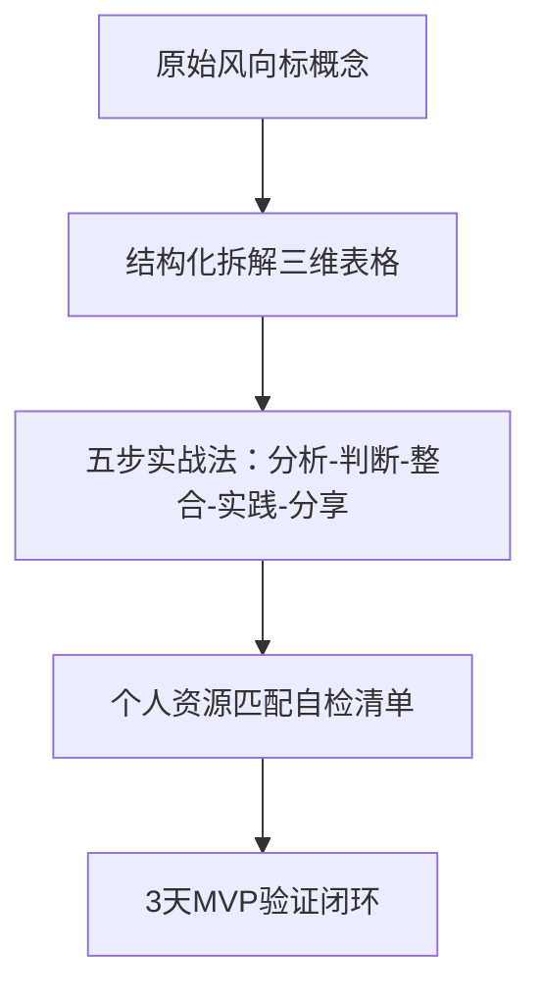
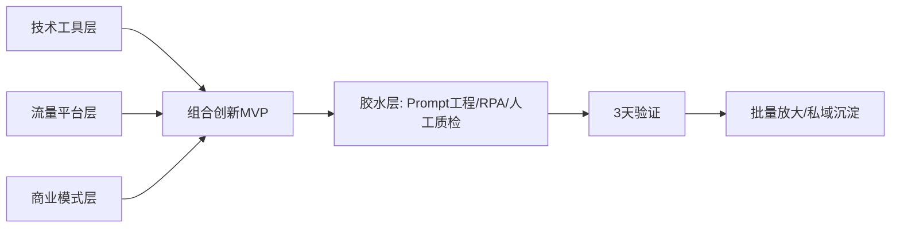
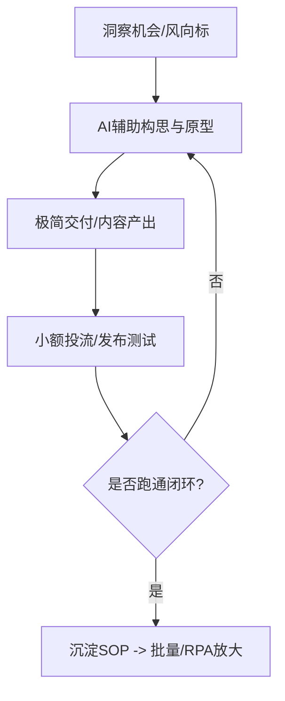
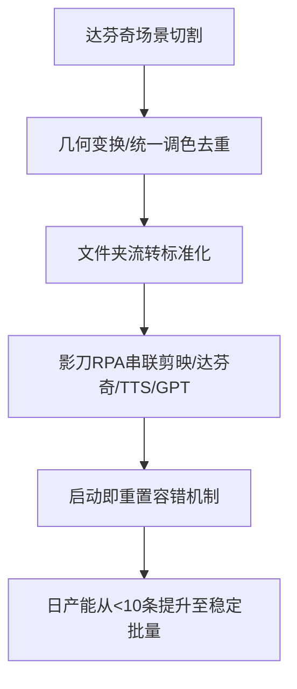
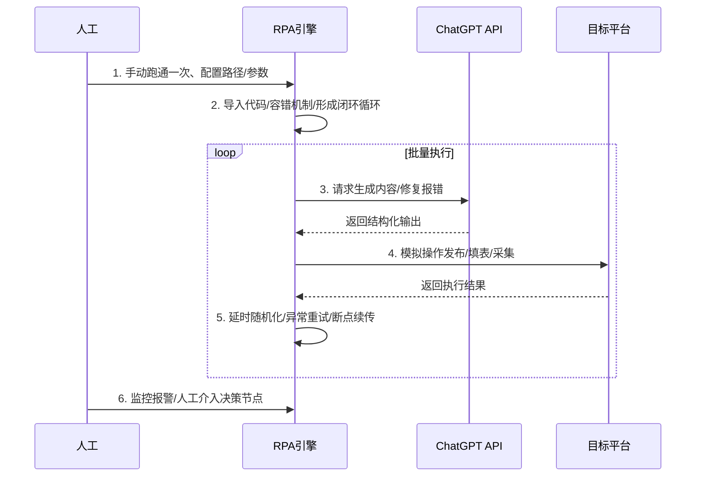
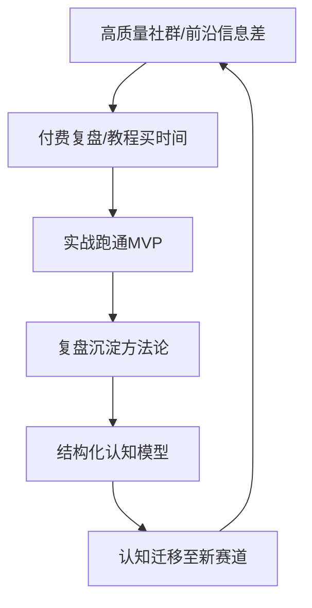
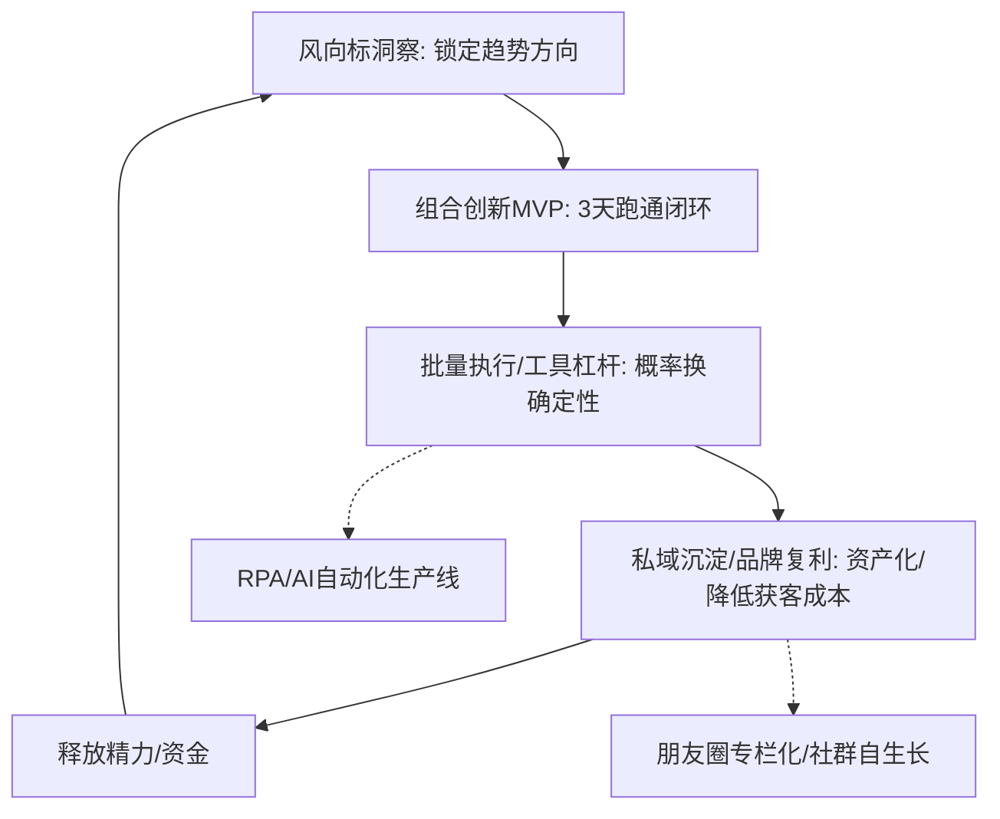

# 第 87 章 普通人低门槛创富体系 —— 从认知重塑到规模化复利
作者：龙哥

## 学习目标

- 理解风向标追踪、组合创新、MVP思维、批量思维、私域沉淀、RPA自动化、赚钱即利他、认知变现差、过程即奖赏、长期主义复利等核心认知模型
- 掌握从机会发现（风向标/组合创新）到验证落地（MVP/微创新）、再到规模化放大（批量/RPA/矩阵）的完整商业闭环方法论
- 能够运用“低门槛创富公式”拆解案例，识别关键变量（执行力、复盘迭代速度），并制定个人行动计划
- 建立‘利他思维’与‘过程即奖赏’的心智模型，克服‘赚钱有罪’、‘完美主义’、‘结果焦虑’等心理障碍
- 具备跨平台（小红书/视频号/抖音/闲鱼/百家号/知乎）内容生产、冷启动、矩阵放大、私域引流的标准化操作能力
- 理解非程序员如何搭建 RPA+AI 自动化生产线，实现‘数字员工’替代人工重复劳动

## 87.1 生活类比

想象创业像是在荒岛上“生火做饭”：风向标是岛上最早生火成功的“部落长者”，你观察他选什么木头、怎么搭火堆、风向怎么判断；组合创新是不用钻木取火（原创发明），直接用“打火机（成熟工具）+ 干树枝（成熟平台）+ 锅（成熟模式）”组装最优解；MVP是先用打火机点着一小堆干草（最小闭环），确认能烧水、能取暖，再搬运大树干（规模化投入）；批量思维是同时在岛上 10 个地点生火（矩阵），哪怕 3 个被浇灭（算法波动），剩下 7 个也能让全部落吃上热饭（概率换确定性）；私域沉淀是把火种保存在随身携带的“火种盒”（微信私域）里，随时可取火、传火、换地图也不怕熄灭（平台无关性）；RPA自动化是造了个“自动劈柴机 + 自动添柴机器人”（数字员工），自己只管决策“在哪生火、烧什么锅”（高杠杆决策）；赚钱即利他是你生火做饭，部落众人吃饱暖和（解决问题），他们用贝壳/猎物交换（支付），双赢而非剥削；过程即奖赏是劈柴、生火、调味、闻香的过程本身就在锻炼体魄、提升厨艺、积累威望，饭菜端上桌只是水到渠成的副产品；长期主义复利是坚持每天生火、改良火塘、教徒弟传火种，时间久了你就是岛上“离不开的火师”，拥有最高话语权与资源调度权。

## 87.2 概念地图

普通人低门槛创富体系
├── 认知重塑层
│   ├── 赚钱即利他定律  —— SUMMARY
│   ├── 认知变现差  —— SUMMARY
│   ├── 过程即奖赏原则  —— SUMMARY
│   └── 长期主义复利论  —— SUMMARY
├── 机会发现层
│   ├── 风向标追踪  —— SUMMARY
│   └── 组合创新  —— SUMMARY
├── 验证落地层
│   └── MVP思维  —— SUMMARY
├── 规模化放大层
│   ├── 批量思维  —— SUMMARY
│   ├── 私域沉淀  —— SUMMARY
│   └── RPA自动化  —— SUMMARY, doxcnXIOtkZmPJLb1izKrreOuMg
└── 顶层公式层
    └── 普通人低门槛创富公式  —— SUMMARY

## 87.3 风向标追踪 —— 让决策跟着聪明钱走

### 为什么需要这个概念？

面对海量信息，普通人难以判断哪个趋势真实可靠、哪个赛道已成红海。头部玩家的动作（选品、投流、改版）是经过市场验证的“最优解”，跟着抄作业能大幅降低试错成本。素材中反复强调：不确定性是创业最大敌人，风向标是穿透迷雾的雷达。

### 核心定义

**风向标**（来源：SUMMARY.md）

> “指代行业头部玩家、头部账号、头部产品或新兴平台功能发布等能够预示趋势方向的标杆对象。”

风向标的核心逻辑是一个三步走：监控其动作 → 解构商业模式要素（流量源/转化路径/产品结构） → 复制核心动作并微创新测试。

### 关键性质

风向标具有先发优势，其动作早于大众认知，跟随者可吃“认知差”红利。风向标具有可验证性，风向标持续投入的动作（如半年以上持续投流），必然对应正向ROI，是市场用真金白银投票的结果。风向标具有结构化可拆解性，非结构化的原文可拆解为“所属领域、用户需求、变现方式”三维表格，快速提取核心商业逻辑。

### 典型例子

以下是风向标追踪的典型应用案例：
- 作者监控风向标“ChatGPT指导创业”信息，3天内完成账号改造、内容生产、全平台分发、私域引流与首单成交，获团队组与个人组双料第一。
- 通过风向标发掘“AI模特”赛道，7天跑通变现闭环（技术调研→快速引流→小批量付费交付→复盘迭代）。
- 拆解小红书无货源电商风向标，提炼出“选品定生死、内容定流量、私域定利润”的标准化SOP。

### 边界条件

仅监控不执行 = 零价值（看山三境界：见价值不执行 = 焦虑成本）。风向标公开时往往已过第一波红利，核心优势在于“方法论迁移”而非抄同一项目。需结合“个人资源-项目匹配自检清单”（经验/技能/认知/时间）判断可行性，避免盲目跟风。

### 方法演进图



### 素材溯源

- 来源素材：`SUMMARY.md`
- 出处：《龙哥赚钱周报·2023年3月刊》（汇聚生财有术社群百余篇实战复盘）
- 核心概念名：`风向标`
- 关键方法：`风向标追踪五步法()`、`三维拆解表格()`

### 原始摘录

> “指代行业头部玩家、头部账号、头部产品或新兴平台功能发布等能够预示趋势方向的标杆对象”
>
> “结构化拆解风向标信息：梳理优缺点风险机会 -> 判断自我匹配度 -> 整合制定计划 -> 实践弄脏手 -> 分享沉淀复盘”
>
> “将非结构化原文拆解为‘所属领域、用户需求、变现方式’三维表格，快速提取核心商业逻辑”

---

## 87.4 组合创新 —— 用成熟积木搭建新城堡

### 为什么需要这个概念？

原创发明门槛高、周期长、失败率高，普通人不具备从0到1发明技术/平台/模式的能力。市场上已存在大量成熟工具、平台、模式，重新组装边际成本低、确定性高、上手快。素材核心主张：赚钱不需要发明，只需要比别人早一点把已知的东西组合好。

### 核心定义

**组合创新**（来源：SUMMARY.md）

> “将成熟的技术工具、成熟的流量平台与成熟的商业模式进行重新组装，快速生成新变现路径。”

三要素：**技术工具层 + 流量平台层 + 商业模式层**，任意组合均可形成新玩法。

### 关键性质

组合创新具有低门槛性质，不懂代码也能用现成工具（ChatGPT、Midjourney、RPA、剪映）。组合创新具有高确定性，每个模块都已被市场验证，组合后的风险主要来自“组装方式”而非模块本身。组合创新具有可标准化特性，组装过程可拆解为SOP，进而交给RPA/团队批量复制。

### 典型例子

下表展示了组合创新在不同场景下的典型应用与拆解：

| 案例 | 技术工具层 | 流量平台层 | 商业模式层 | 胶水层 | 结果 |
|------|------------|------------|------------|--------|------|
| 研报账号 | 付费研报内容源 | 小红书 | 知识付费/引流私域 | 稿定设计模板+群聊引流+ArtStation素材库 | 3周5000粉、引流私域600+ |
| AI模特商拍 | ChatGPT/Midjourney/ControlNet | 小红书/视频号 | 服务收费/私域成交 | PS兜底修图 | 7天变现 |
| ChatGPT写👸号 | GPT-4/爆款标题库 | 👸号/视频号 | 广告分成/知识付费 | 情绪价值注入(人工) | 7天10W+ |
| 知乎好物自动卖货 | ChatGPT/Automa插件 | 知乎 | CPS分佣 | 草稿箱选题+人工质检 | 半自动化卖货闭环 |

### 边界条件

组合创新 ≠ 简单拼凑，需有“胶水层”（如提示词工程、RPA流程、人工质检）保证模块间协同。核心模块一旦过时（如平台算法大改版、工具停止维护），需快速替换模块而非固守原组合。组合创新容易被复制，必须通过“私域沉淀/品牌复利”建立护城河，否则陷入红海。

### 方法演进图



### 素材溯源

- 来源素材：`SUMMARY.md`
- 出处：《龙哥赚钱周报·2023年3月刊》
- 核心概念名：`组合创新`
- 关键方法：`组合创新MVP设计()`、`三要素组装法()`

### 原始摘录

> “将成熟的技术工具、成熟的流量平台与成熟的商业模式进行重新组装，快速生成新变现路径”
>
> “通过组合创新，在小红书做研报账号，3周达到5000粉，引流私域600+”
>
> “利用 GPT4 迅速将想法落地，让创意在半天时间内变成 MVP”

---

## 87.5 MVP思维 —— 先跑通闭环，再追求完美

### 为什么需要这个概念？

完美主义导致迟迟不敢上线、投入巨大却未验证需求、一旦失败沉没成本极高。素材反复验证：所有成功案例均始于“极简版”跑通“获客-转化-交付”闭环。只有真实的市场反馈（哪怕只有1单）才能指导后续迭代方向。

### 核心定义

**MVP思维**（来源：SUMMARY.md）

> “不追求完美，先用最低成本（时间、金钱）跑通‘获客-转化-交付’的完整闭环，验证需求真实性后再投入资源迭代。”

核心指标：能否在最短时间内拿到第一个付费用户/第一笔真实收入。

### 关键性质

MVP思维具有速度优先特性，素材中反复出现“3天跑出MVP、7天跑通变现、半天搭建原型”的时间窗口。MVP思维具有低成本特性，利用免费/低价工具（ChatGPT免费版、剪映、草稿箱、个人微信）启动。MVP思维具有闭环导向特性，必含“流量来源、转化路径、交付方式”三要素。MVP思维具有迭代基石特性，贯穿于AI项目、电商选品、内容账号冷启动全过程。

### 典型例子

- **AI模特项目**：失业3个月 → 7天技术调研/引流/付费交付/复盘 → 跑通变现闭环
- **研报账号**：3周内完成账号搭建、内容生产、矩阵分发、私域引流、首单成交
- **小报童专栏**：从洞察机会到申请开通、搭建框架、朋友圈静默推广、开启分销 → 6天售出80单、GMV 1.5万
- **知乎好物**：先人工跑通“选题-草稿箱-RPA生成-人工复核-发布”流程，再引入Automa插件自动化

### 边界条件

MVP ≠ 粗糙产品，核心体验（交付承诺）必须兑现，否则获取的是“骗单”而非“真需求”反馈。验证周期需设定止损线：如“单账号累计100条作品无单果断切换”，避免陷入沉没成本。部分重合规/重资质项目（如Etsy美区、医疗服务）MVP阶段需先跑通合规流程，再验证商业模式。

### 方法演进图



### 素材溯源

- 来源素材：`SUMMARY.md`
- 出处：《龙哥赚钱周报·2023年3月刊》
- 核心概念名：`MVP思维`
- 关键方法：`AI辅助MVP三步法()`、`止损线设定()`

### 原始摘录

> “不追求完美，先用最低成本（时间、金钱）跑通‘获客-转化-交付’的完整闭环，验证需求真实性后再投入资源迭代”
>
> “贯穿于AI项目、电商选品、内容账号冷启动全过程”
>
> “失业危机自救:AI模特项目7天跑通变现闭环的复盘实录”

---

## 87.6 批量思维 —— 用概率对抗不确定性

### 为什么需要这个概念？

单一账号/视频/店铺受算法波动、审核风控、竞品打击影响大，胜率不可控。素材核心洞见：将成功经验标准化为SOP，通过矩阵化操作，将“单点概率”变为“总体确定性”。只有规模化才能摊薄固定成本、叠加复利效应、建立护城河。

### 核心定义

**批量思维**（来源：SUMMARY.md）

> “将单一成功经验标准化为SOP，通过多账号矩阵、多平台分发、RPA自动化、团队化复制等手段放大收益。”

核心公式：

$$ \text{确定性收益} = \text{单点成功率} \times \text{操作数量} $$

该公式揭示了批量思维的本质：通过提高操作数量（矩阵账号数、发布条数、店铺数），在单点成功率固定的前提下，将不确定的单点概率事件转化为可预期的确定性总收益。单点成功率由MVP验证阶段确定，操作数量由工具杠杆（RPA/AI）与团队规模决定，两者相乘即为规模化后的预期收益下限。

**公式作用说明**：该公式作为规模化决策的“导航仪”，指导实操者在单点模型跑通后，通过“堆数量（矩阵账号/发布频次）”与“提成功率（SOP迭代/工具升级）”双轮驱动，将不确定的单点博弈转化为可预期的规模化收益，是“批量思维”从概念落地为运营指标的关键量化抓手。

### 关键性质

批量思维要求标准化先行，必须先跑通单点、沉淀SOP，无SOP的批量等于规模化死亡。批量思维依赖工具杠杆，人力不可规模化，必须依靠RPA、AI、多平台分发工具实现边际成本趋近零。批量思维体现矩阵思维，包括账号矩阵（60个带货号、18个闲鱼店、300个短剧号）、平台矩阵（同一内容分发视频号/抖音/快手/小红书/百家号）。批量思维遵循概率论制胜，短剧CPS爆款率25-30%、批量剪辑单人日产200条。

### 典型例子

下表对比了不同项目在批量思维指导下的矩阵规模、核心产能与变现结果：

| 案例 | 矩阵规模 | 核心产能 | 变现结果 |
|------|----------|----------|----------|
| 短视频带货 | 60个账号 | 单人日产200条 | 最高单日佣金8万+ |
| 闲鱼二手书 | 18家店铺/30-50号(注册6张执照) | 社区工作室兼职大学生 | 两年利润百万 |
| 短剧CPS | 300号矩阵 | 39天流水77万 | 分成到手62.55万 |
| 跨平台分发 | 5平台同分 | 快手165万/抖音70万/百家号2万 | 多平台验证内容质量 |

### 数据流图：批量剪辑生产线



### 边界条件

批量 ≠ 无脑堆量，需“先人工跑通再自动化”，未验证模型直接上RPA = 批量制造垃圾。平台风控升级（视频号清退三方店、抖音打击无人直播、小红书上去重算法）会周期性失效批量玩法，需动态调整。管理复杂度随规模指数上升：300号矩阵需自建管理后台、分级薪酬体系、止损机制，否则内耗吞噬利润。

### 素材溯源

- 来源素材：`SUMMARY.md`
- 出处：《龙哥赚钱周报·2023年3月刊》
- 核心概念名：`批量思维`
- 关键方法：`SOP标准化()`、`矩阵扩张设计()`、`工具杠杆接入()`

### 原始摘录

> “将单一成功经验标准化为SOP，通过多账号矩阵、多平台分发、RPA自动化、团队化复制等手段放大收益”
>
> “核心在于用概率思维对抗单点不确定性，实现‘单人日产200条’的内容产能与‘开18个闲鱼店铺’的店群规模”
>
> “发40余条视频产出十几个爆款(25-30%)，单账号日更1条稳定产出爆款”

---

## 87.7 私域沉淀 —— 让流量变成留得住的资产

### 为什么需要这个概念？

公域流量租赁制：平台算法变、规则变、账号封、流量贵，流量不属于你。高客单价、长决策周期、非标服务必须在私域完成信任建立、需求挖掘、复购裂变。素材铁律：流量尽头是微信私域，所有长周期项目的最终归宿都是私域。

### 核心定义

**私域沉淀**（来源：SUMMARY.md）

> “将公域流量通过钩子（资料包、社群、表白墙、陪诊服务、低价引流品）引入微信个人号/社群/企微，构建高信任、高复购、可长期运营的用户资产。”

核心资产：微信好友/社群/企微联系人，具备“可触达、可反复触达、可精细化运营”特性。

### 关键性质

私域沉淀能带来信任溢价，私域成交依赖“人设信任”而非“平台背书”，转化率高、客单价高、抗周期。私域沉淀产生复利效应，老客复购、转介绍、裂变获客边际成本递减，LTV随时间指数增长。私域沉淀具有可控性，不受平台算法/规则单方面变更影响，拥有用户关系所有权。私域沉淀支持分层运营，视频号/企微作资产沉淀容器（可控），个人号/微信群作精细运营/转化阵地。

### 典型例子

以下是私域沉淀在不同业务场景中的成功实践：
- 孕晚期妈妈：视频号10天涨粉1000+ → 二维码/私信双轨引流私域 → 预售课程MVP → 产后迭代2.0版本
- 小红书社群：0元建群 → 亲近用户/打造钩子/筛选种子/验证转化 → 首期50人、稳态日增20好友转3单 → 单月变现8万+
- 研报账号：群聊公告引流👸号 + PDF水印双重变现（品牌曝光/售卖去水印版/商务合作）
- 同城水果团购：快团团半个月近4万销售额 → 私域沉淀 → 复购裂变 → 单日破9000

### 私域资产分层架构

```mermaid
graph TD
    A[公域流量: 视频号/小红书/抖音/知乎/百家号] --> B[钩子: 资料包/社群/表白墙/低价品]
    B --> C[资产沉淀容器: 视频号/企业微信(可控)]
    C --> D[精细运营阵地: 个人微信/微信群(转化)]
    D --> E[分层转化漏斗]
    E --> F[免费社群]
    E --> G[低价入门品]
    E --> H[高客单核心品]
    E --> I[复购/裂变]
```

### 边界条件

私域非“加微信即成功”，需“朋友圈专栏化运营（观念/专业/生活/附加价值）”、“社群自生长架构（20%核心组织带动80%）”持续投入。违规引流（硬广二维码、诱导分享、高频骚扰）会导致账号封禁、私域资产归零，必须合规操作。私域运营极度依赖“主理人人设”与“内容供给能力”，无内容输出的私域 = 僵尸池。

### 素材溯源

- 来源素材：`SUMMARY.md`
- 出处：《龙哥赚钱周报·2023年3月刊》
- 核心概念名：`私域沉淀`
- 关键方法： `钩子设计()`、`分层转化漏斗()`、`朋友圈专栏化运营()`

### 原始摘录

> “将公域流量（视频号、小红书、抖音、知乎、百家号等）通过钩子引入微信个人号/社群/企微，构建高信任、高复购、可长期运营的用户资产”
>
> “孕晚期准妈妈通过视频号 10 天涨粉 1000+，成功引流私域的案例复盘”
>
> “普通人做小红书，从 0 到 1，起盘我 0 元成立一个社群，单月变现 8w+的经验”

---

## 87.8 RPA自动化 —— 给非程序员装上数字分身

### 为什么需要这个概念？

运营工作中大量重复、低决策、高频次动作（发帖、回复、采集、上传、填表）消耗核心精力。雇佣人工成本高、不稳定、难标准化；传统代码开发门槛高、周期长、维护难。RPA + AI 让非程序员也能搭建“数字员工”，实现“代码即时间复制器”的杠杆跃迁。

### 核心定义

**RPA自动化**（来源：SUMMARY.md 与 doxcnXIOtkZmPJLb1izKrreOuMg.md）

> “机器人流程自动化：通过模拟人工操作键盘/鼠标/接口调用，自动执行规则明确、重复性高的业务流程。”

**RPA+AI生产线架构**（来源：SUMMARY.md）

> “指纹浏览器/影刀RPA/按键精灵做‘手脚’ + ChatGPT API/提示词工程做‘大脑’ + 平台API/模拟操作做‘接口’。”

### 关键性质

RPA自动化具有非程序员友好特性，提供可视化拖拉拽（UIBot Creator、影刀RPA）、自然语言指令（ChatGPT生成代码/修复报错）。RPA自动化提供规模化杠杆，边际成本趋近零，单条Posts人工2-3分钟 → RPA稳定跑通多店铺，日产能从<10条提升至稳定批量。RPA自动化内置容错机制，启动即重置、断点续爬、指数退避、随机延时模拟人工频率，对抗平台风控。RPA自动化适用场景广泛，覆盖亚马逊发POST、知乎自动推广、BOSS直聘挖项目、社媒矩阵分发、爬虫采集风向标数据。

### 典型例子

下表展示了RPA+AI在不同业务场景中的落地架构与成果：

| 场景 | 手脚层 | 大脑层 | 接口层 | 成果 |
|------|--------|--------|--------|------|
| 亚马逊POST批量发布 | UIBot Creator(15步可视化流程) | - | 亚马逊后台模拟操作 | 万帖自动发布、日产能稳定批量 |
| 知乎好物自动卖货 | Automa插件(浏览器自动化) | ChatGPT生成回答 | 知乎草稿箱/发布页 | 月度稳定收益、半自动化闭环 |
| BOSS直聘挖项目 | RPA(数据采集/账号管理) | ChatGPT(文案/话术/行业知识) | BOSS直聘网页端 | 单人公司规模化运作 |
| 短视频混剪生产线 | 达芬奇/影刀RPA | TTS/GPT(文案/配音) | 剪映/达芬奇/下载器 | 日产能稳定批量、40倍效率提升 |

### 时序图：RPA流程执行步骤



### 边界条件

环境差异是最大变数：浏览器缩放、分辨率、文件路径、紫鸟浏览器不兼容第三方RPA，必须人工跑通一次并调试。平台反爬/风控升级会导致脚本失效，需建立“监控-报警-修复”运维闭环，而非一次性开发。核心决策节点（选品定价、话术拒绝、异常处理）不可全交给RPA，必须保留人工介入口。RPA降维打击人工成本定律：仅适用于“高重复、低决策”动作，创意/策略/沟通类工作无法替代。

### 素材溯源

- 来源素材：`SUMMARY.md`、`doxcnXIOtkZmPJLb1izKrreOuMg.md`
- 出处：《龙哥赚钱周报·2023年3月刊》与《亚马逊Posts RPA自动化实操教程》
- 核心概念名：`RPA自动化`
- 关键方法：`RPA+AI生产线架构()`、`UIBot可视化流程搭建()`、`ImageAssistant批量采图()`、`延时随机化防封()`

### 原始摘录

> “机器人流程自动化在跨境电商、社媒运营、招聘挖掘、内容分发等场景的落地应用”
>
> “配合ChatGPT API实现‘非程序员也能自动化’的生产力跃迁，是批量思维落地的关键技术杠杆”
>
> “影刀RPA/按键精灵/指纹浏览器做‘手脚’，ChatGPT API/提示词工程做‘大脑’，对接平台API/模拟人工操作做‘接口’”

---

## 87.9 赚钱即利他定律 —— 商业的底层物理学

### 为什么需要这个概念？

普通人普遍存在“赚钱有罪”“不好意思收钱”心理障碍，导致不敢报价、不敢推销、不敢规模化。需要从本质上重构“交易”认知：合法交易必然是双向价值创造，盈利过程即帮人过程。打通认知关卡，是后续“敢收钱、敢定高价、敢规模化”的心理前提。

### 核心定义

**赚钱即利他**（来源：SUMMARY.md）

> “商业本质是价值交换，赚钱的核心路径是帮别人解决问题（省钱、省时、赚钱、爽感、安全感）。利他越深、覆盖人群越广、频次越高，赚钱越容易、越持久。”

从主观价值理论出发，合法交易中：
- 买方：感知价值 > 价格
- 卖方：价格 > 成本
- 双方均获利，盈利过程即帮人解决问题的过程。

### 关键性质

赚钱即利他体现正和博弈，交易创造新价值而非转移固定存量。赚钱即利他遵循价值主观性，价值由买方感知决定，而非卖方成本决定；“小菜一碟”的提供者视角与“改变命运”的需方视角差异即定价空间。赚钱即利他建立责任契约，收费建立责任契约倒逼专业交付，同时防止“白嫖”导致心理内耗。

### 典型例子

下表展示了不同场景下通过深度利他实现变现的案例：

| 场景 | 解决的用户痛点 | 利他深度 | 变现模式 |
|------|----------------|----------|----------|
| 知识付费 | 缩短试错周期、跑通标准化流程、规避致命坑点 | 提供“避坑工具” | 课程/社群/咨询 |
| 陪诊服务 | 挂不上号、买不到药、看不上专家 | 从卖体力进化到卖资源(绿通/海外就医) | 服务费/分成/加盟 |
| 同城水果团购 | 比超市鲜、比水果店便、比自己买省心 | 源头现采+严选试吃+动态定价+分级售后 | 团购差价/会员费 |
| 成人用品即时配送 | 临时/隐私/即时三重痛点 | 外卖平台30-60分钟送达 | 商品零售/配送费 |

### 边界条件

利他 ≠ 无偿/自我牺牲，必须“价格>成本”才可持续；免费服务无法建立责任契约，反而降低用户珍视度。利他边界由“能力圈”决定：超出能力圈的承诺 = 欺诈；需通过“项目分层模型（初/中/高级）”匹配自身能力。伪利他陷阱：打着利他旗号实为收割（如高价低质课程、杀猪盘），长期必露馅。

### 方法演进图

```mermaid
graph LR
    A[识别用户核心痛点] --> B[设计解决方案]
    B --> C[建立责任契约(收费)]
    C --> D[专业交付/超预期]
    D --> E[用户感知价值>价格]
    E --> F[复购/转介绍/品牌复利]
    F --> A
```

### 素材溯源

- 来源素材：`SUMMARY.md`
- 出处：《龙哥赚钱周报·2023年3月刊》
- 核心概念名：`赚钱即利他定律`
- 关键公式：`利他深度 × 覆盖人群 × 频次 = 赚钱容易度与持久度`

### 原始摘录

> “商业本质是价值交换，赚钱的核心路径是帮别人解决问题（省钱、省时、赚钱、爽感、安全感）”
>
> “利他越深、覆盖人群越广、频次越高，赚钱越容易、越持久”
>
> “好的服务是会让客户下意识的选择它”

---

## 87.10 认知变现差 —— 同一趋势，认知高者先赚钱

### 为什么需要这个概念？

面对同一信息/工具/趋势（如ChatGPT、Midjourney、小红书电商），有人已变现百万，有人还在围观/焦虑/买课不学。认知差距直接转化为财富差距，缩小认知差是普通人跨越阶层的核心捷径。素材主张：不应沉迷“学习”，而应通过“实战跑通MVP”将认知内化为确定性能力。

### 核心定义

**认知变现差**（来源：SUMMARY.md）

> “同一信息/工具/趋势，认知高的人已变现，认知低的人还在围观。认知差即财富差。”

**缩小路径**：进高质量社群（获前沿信息差/高质量同伴/组织化实战训练） → 付费买时间的复盘/教程 → 实战跑通MVP → 复盘沉淀方法论。

### 关键性质

认知变现差具有时间敏感性，认知差随时间衰减(如小红书去重算法窗口期仅剩半年)，早行动者吃红利，晚行动者喝汤/买单。认知变现差具有非线性跃迁特性，认知升级非渐进，而是“量变引发质变”(信息增量阈值)，需强制每日高密度输入以量变引发质变。认知变现差要求实战内化，只有“弄脏手”跑通闭环，知识才从“懂”变成“会”。

### 典型例子

- **AI浪潮**：2023年Q1已跑通变现的创作者 vs 2023年下半年才入场学提示词的人，前者吃应用层红利，后者陷入红海价格战。
- **小红书电商**：早期“笨功夫”手动精细化运营者存活规模化；后期采集软件批量铺货技术流群体普遍封号退出。
- **视频号**：早期搬运可爆，后期需转向原创；看到详细教程时红利已过，方法论可迁移至下一流量池。
- **生财圈友**：新人五阶段（认知冲突→信任危机→迷茫试错→卸载逃避→焦虑回流），认知重构必经痛苦期。

### 边界条件

认知高 ≠ 信息多，核心是“结构化认知模型”（如风向标追踪法、MVP三步法、批量思维）而非碎片资讯。付费买认知 ≠ 买结果，知识付费本质是“避坑工具”，不承担执行责任、不保证成功。认知迁移能力 > 学习能力：将成熟能力体系迁移至新赛道（如头条图文分发迁移至抖音视频分发）才是核心竞争力。

### 方法演进图



### 素材溯源

- 来源素材：`SUMMARY.md`
- 出处：《龙哥赚钱周报·2023年3月刊》
- 核心概念名：`认知变现差`
- 关键方法：`高质量社群筛选()`、`付费复盘购买()`、`MVP实战内化()`、`复盘沉淀法()`

### 原始摘录

> “同一信息/工具/趋势，认知高的人已变现，认知低的人还在围观”
>
> “缩小认知差的方法：进高质量社群、付费买时间的复盘/教程、实战跑通MVP、复盘沉淀方法论”
>
> “亦仁半小时处理常人3-4小时信息源于长期积累；迷茫根因是勤奋未达标（输入量不足）”

---

## 87.11 过程即奖赏 —— 爱上解决问题的痛苦

### 为什么需要这个概念？

创业/副业充满不确定性、挫折、孤独，过度关注结果（赚多少钱、何时财务自由）导致焦虑、内耗、放弃。素材核心心法：成长（对抗不确定性的能力迭代）才是目的，赚钱只是驱动进化的手段；第一桶金核心价值在于建立“我也能行”的自我效能感。只有享受“学技能、做内容、搭系统、解难题”的过程，才能在漫长平台期坚持下去。

### 核心定义

**过程即奖赏**（来源：SUMMARY.md）

> “聚焦过程本身带来的成长确定性（技能习得、认知升级、人脉积累、心力提升），结果反而作为副产品自然到来。”

**非竞争性生存状态**：超越社会比较框架（无竞争感/危机感/嫉妒/自卑/骄傲），以“独特、有趣、全神贯注、利他”为内在坐标。

### 关键性质

过程即奖赏提供即时反馈，过程奖赏即时化(每天打卡完成、每篇文章发出、每个Bug修复)，无需等待遥远不确定的结果。过程即奖赏动力内置化，动力源于内在(好奇心、成就感、使命感)而非外在(钱、名、赞)，抗干扰能力强。过程即奖赏要求全谱系接纳，接纳痛苦、崩溃、焦虑、无聊作为成长必经路径，“瞅了瞅”具象化创伤将恐惧转化为可应对对象。过程即奖赏提供长期主义锚点，激情(不挣钱也甘愿做)穿越死亡谷，意志力有限易耗竭，唯有使命/情怀具备无限续航力。

### 典型例子

- **航海打卡**：11个航海、打满卡211次、全勤210次 → 过程目标(打满卡)屏蔽不可控结果目标，反获超预期心理能量
- **资料整理**：产出4T工具箱、4000G工具箱文获400+赞 → 利他分享筛选出合伙人/导师/变现线索，正反馈反哺动力
- **创业复盘**：极限压力测试式复盘(离职/限流/投诉/收入归零) → 在自我怀疑中提炼底层逻辑 → 认知重构
- **向内求分论坛**：组局即修行、服务即成长 → 镜像复盘法/场域能量调频法 → 成为管道传递爱 → 高能量场域共创

### 边界条件

过程即奖赏 ≠ 忽视结果，需“以结果为导向、以过程为重心”，无结果导向的过程 = 无效忙碌/自我感动。需建立“微型确定性系统”（如航海打卡、社群见证、导师点评）提供高频正反馈，对抗长周期不确定性。适用于“长周期、高不确定、强主观能动性”场景；标准化流水线/纯执行岗位更适合结果导向管理。

### 方法演进图

```mermaid
graph TD
    A[设定过程目标(如日更/打卡)] --> B[聚焦单次动作质量]
    B --> C[获得即时成长反馈]
    C --> D[积累自我效能感]
    D --> E[结果作为副产品自然到来]
    E --> F[正反馈强化过程动力]
    F --> B
```

### 素材溯源

- 来源素材：`SUMMARY.md`
- 出处：《龙哥赚钱周报·2023年3月刊》
- 核心概念名：`过程即奖赏原则`
- 关键方法：`微型确定性系统构建()`、`创伤具象化处理()`、`激情驱动耐力模型()`

### 原始摘录

> “过度关注结果（赚多少钱）会导致焦虑与放弃；聚焦过程本身带来的成长确定性，结果反而作为副产品自然到来”
>
> “只要在做事，就会不停的遇到新的难题”
>
> “人们真正注意到你时，是发现过了这么久你居然还在那里”

---

## 87.12 长期主义复利 —— 坚持即稀缺，时间做朋友

### 为什么需要这个概念？

机会主义陷阱：频繁切换赛道“快速赚钱但无积累”，敏锐度无法替代定力，短期现金流无法兑换长期壁垒。素材金句：真正的关注源于“过了这么久你居然还在那里”，时间维度是验证价值的核心变量。普通人缺乏资源/背景/天赋，唯一可控变量是“坚持做难但正确的事”的时长。

### 核心定义

**长期主义复利**（来源：SUMMARY.md）

> “在不确定环境下，坚持做难但正确的事（建立IP、沉淀私域、练硬技能、做资源整合），时间会成为朋友，产生指数级复利回报。”

**核心公式**：

$$ \text{复利} = (\text{正确方向} \times \text{高频动作} \times \text{时间})^{\text{迭代次数}} $$

该公式揭示了长期主义复利的底层机制：三个乘法要素（方向正确性、动作频次、时间跨度）构成基础增长引擎，而“迭代次数”作为指数，代表了在时间轴上不断复盘、调整、优化的循环轮数。每一次完整的“执行-反馈-复盘-迭代”循环，都会将前三项的乘积进行指数级放大。这解释了为何“坚持”必须伴随“迭代”：单纯的重复动作（迭代次数=1）仅能获得线性增长，唯有高频复盘迭代（迭代次数>1）才能激活复利的指数曲线。

**公式作用说明**：该公式是长期主义的“量化罗盘”，它将模糊的“坚持”拆解为可度量的四个变量——方向正确性（风向标/利他验证）、动作频次（日更/日引流/日复盘）、时间跨度（天/月/年）、迭代次数（复盘轮数）。实操中，它指导创业者将精力从“寻找捷径”转移到“提高迭代频次”上：在方向大体正确的前提下，缩短单次复盘周期（周复盘→日复盘），即可在指数层面获得数量级的复利放大，是“过程即奖赏”落地为可执行节奏的核心公式。

**设计中的取舍说明**：原始素材（SUMMARY.md）仅给出定性描述“时间会成为朋友”、见面会金句“过了这么久你居然还在那里”及“11个航海打卡211次”的实证案例。本章在“设计中的取舍”环节明确指出，该量化公式为教材编写时的二次抽象创新，旨在将定性心法转化为可度量、可诊断的工程模型，供读者在复盘时量化追踪“迭代次数”这一核心变量，并非原始素材直接包含的内容。

### 关键性质

长期主义复利遵循时间门槛定律，初期曝光是噪音，长期存续是信号；注意力获取有时间门槛，坚持本身即稀缺壁垒。长期主义复利存在业务模式倒逼，高退出成本业务(社群/私域/品牌)客观倒逼长期主义，从“被逼着专注”转向“主动选择专注”。长期主义复利考验抗压持久力，无技术护城河时，唯一壁垒是“比对手更能扛、活得更久”；克服自认为克服不了的困难，即构建了壁垒。长期主义复利要求延迟满足，拒绝短期诱惑，投入高延迟高回报动作（写作/编程/健身/冥想/深度关系）。

### 典型例子

- **见面会壁纸金句**：“人们真正注意到你时，是发现过了这么久你居然还在那里”
- **👸号写作**：文字载体数千年永存，图文变现ROI比视频高一个数量级，持续执行100天-1年穿越周期获复利
- **视频号书豪**：连续三年实战复盘、年入百万、矩阵30万粉，验证“原创内容长期主义定律”
- **同城相亲**：五年深耕，核心壁垒=线下高频活动构建物理信任锚点 + 高情商红娘深度情感交付 + 时间复利下转介绍网络
- **生财社群**：第八期风向标航海教练连续第八次任职，教学体系经多轮实战迭代验证

### 边界条件

长期主义 ≠ 盲目死磕，需“业务停滞3-6月判定法则”：方向错而非执行不力，果断止损调向。必须有“正反馈闭环”（哪怕微小）支撑坚持信心；纯正反馈缺失的坚持 = 固执/自我感动。资源配置需动态调整：20-30岁激进投资自我，30-40岁稳激各半，40+主稳健善用复利。核心圈层邀请制不可买：真核心圈子通过持续价值输出被邀请进入，付费圈仅为外围筛选层。

### 方法演进图

```mermaid
graph TD
    A[锁定正确方向(风向标/利他)] --> B[设定高频动作(日更/日引流/日复盘)]
    B --> C[建立微型确定性系统(航海/社群/导师)]
    C --> D[执行-反馈-复盘-迭代]
    D --> E{业务停滞3-6月?}
    E -- 是 --> F[止损调向]
    E -- 否 --> G[迭代次数+1]
    G --> D
    G --> H[复利指数级爆发]
```

### 素材溯源

- 来源素材：`SUMMARY.md`
- 出处：《龙哥赚钱周报·2023年3月刊》
- 核心概念名：`长期主义复利论`
- 关键公式：`复利 = (正确方向 × 高频动作 × 时间)^迭代次数` （教材二次抽象创新，非原始素材直接包含）

### 原始摘录

> “人们真正注意到你时，是发现过了这么久你居然还在那里”
>
> “11 个航海，打满卡 211 次，让我开启了人生新的起点”
>
> “杭州全国见面会二十句话壁纸”
>
> “全国见面会-经典语录壁纸”

---

## 87.13 普通人低门槛创富公式 —— 四大杠杆乘以时间

### 为什么需要这个概念？

打破“创业需大资金/高学历/强人脉”迷思，素材证明普通人靠“执行力+复盘迭代速度”可实现阶层跨越。需要一个可操作、可验证、可复制的整体框架，将前序概念（风向标、组合创新、MVP、批量、私域、长期主义）串联成闭环。为后续各章具体方法论（选品、内容、运营、工具、团队）提供顶层设计逻辑。

### 核心定义

**低门槛创富公式**（来源：SUMMARY.md）

> 公式 = （风向标洞察 + 组合创新MVP） × （批量执行/工具杠杆） × （私域沉淀/品牌复利） × 时间

以数学公式形式表达为：

$$ \text{创富结果} = (\text{风向标洞察} + \text{组合创新MVP}) \times (\text{批量执行/工具杠杆}) \times (\text{私域沉淀/品牌复利}) \times \text{时间} $$

该公式为乘法结构，体现了四大杠杆的耦合关系：第一项“风向标洞察 + 组合创新MVP”解决“做什么、怎么起步”的方向与验证问题，是0到1的突破；第二项“批量执行/工具杠杆”解决“规模化、降本”的放大问题，是1到N的跃迁；第三项“私域沉淀/品牌复利”解决“资产化、抗周期”的留存问题，是N到∞的复利；第四项“时间”作为标量贯穿始终，放大前三项的累积效应。核心变量为“执行力（动手速度/持续强度）”与“复盘迭代速度（单位时间内认知升级次数）”，而非初始资源（资金/学历/人脉）。

**公式作用说明**：该公式是全章方法论的“总纲与坐标系”，它将前十个概念串联为一个可计算、可诊断、可迭代的工程模型。实操中，它作为项目诊断清单：当收益不及预期时，依次排查四个乘数项——方向是否跟错风向标？MVP是否真跑通？批量是否有SOP有工具？私域是否在沉淀？时间是否够迭代次数？任一项为零即全盘归零，避免了“在战术上勤奋、在战略上懒惰”的无效努力，是普通人从“打工思维”转向“杠杆思维”的认知锚点。

### 关键性质

低门槛创富公式呈现乘法关系，任一环节为零则结果为零（有洞察无执行=0，有执行无私域=0，有前三者无时间=0）。低门槛创富公式形成正反馈飞轮：风向标→组合创新→批量放大→私域沉淀→品牌复利→释放精力追踪新风向标，形成自我强化的增长循环。低门槛创富公式要求动态平衡，不同阶段权重不同(起步重信心/赚钱、稳定重成长/沉淀、富足重筛选/抗风险)，需动态调整资源分配。低门槛创富公式具有可迁移性，方法论跨平台(小红书/视频号/抖音/闲鱼/百家号)、跨模式(电商/知识付费/服务/广告/分销)通用。

### 典型案例拆解

下表运用低门槛创富公式拆解四个典型案例的关键变量与结果：

| 案例 | 风向标洞察 | 组合创新MVP | 批量/工具杠杆 | 私域/品牌复利 | 时间周期 | 结果 |
|------|------------|-------------|---------------|---------------|----------|------|
| AI模特创业 | AI商拍风向标 | ControlNet+PS+小红书引流 | 7天MVP变现 | 私域高客单成交 | 短期爆发 | 7天跑通变现 |
| 闲鱼二手书 | 闲鱼无货源风向标 | 笨功夫选品+社区工作室 | 18店/30-50号/兼职大学生(注册6张执照) | 私域复购 | 2年 | 利润百万 |
| 同城水果 | 新发地供应链优势 | 小红书爬虫选题+快团团 | 源头现采/严选/动态定价 | 移木建信/社群SOP/复购38% | 持续 | 单日破9000 |

### 正反馈飞轮图



### 边界条件

低门槛 ≠ 无门槛：需具备基本执行力、学习力、抗压力、合规意识；纯“躺赚”心态无法跑通任何环节。公式非万能药：赛道天花板不同（如机油类目因危化品资质无法付费推广卡在10W+月利润），需识别天花板及时切换/组合赛道。幸存者偏差风险：素材多为成功案例复盘，失败案例（如Etsy美区注册近乎不可行、百度小程序押金锁死现金流）同等重要，需建立“止损清单”。核心竞争力最终收敛到“工作流嵌入深度 × 领域专业度”：成为“某工作流最会用AI的人”构建不可替代护城河。

### 素材溯源

- 来源素材：`SUMMARY.md`
- 出处：《龙哥赚钱周报·2023年3月刊》
- 核心概念名：`低门槛创富公式`
- 关键公式：`创富 = (风向标 + 组合创新MVP) × (批量/工具) × (私域/品牌) × 时间`

### 原始摘录

> “公式 = （风向标洞察 + 组合创新MVP） × （批量执行/工具杠杆） × （私域沉淀/品牌复利） × 时间”
>
> “核心变量是‘执行力’与‘复盘迭代速度’，而非初始资源”
>
> “主动社交+高强度实战（航海/打卡）+公开建立IP+复盘迭代，是普通人逆袭的高概率路径”

---

## 87.14 多源对照

### 共识

1. **工具杠杆是规模化的必要条件**：《龙哥赚钱周报·2023年3月刊》（SUMMARY.md）与《亚马逊Posts RPA自动化实操教程》（doxcnXIOtkZmPJLb1izKrreOuMg.md）均确认：人力不可规模化，必须依靠RPA、AI、多平台分发工具实现边际成本趋近零，这是“批量思维”落地的硬性前提。
2. **环境差异是落地的最大变数**：两份素材均强调 RPA/自动化脚本在不同电脑环境（浏览器缩放、分辨率、文件路径、指纹浏览器兼容性）下表现差异巨大，必须“人工跑通一次并调试”才能投入生产，不存在“开箱即用”的通用脚本。
3. **人工跑通是自动化的前置条件**：两份素材达成一致：未验证模型直接上 RPA = 批量制造垃圾；必须先人工跑通“获客-转化-交付”全流程（MVP），沉淀 SOP，再引入 RPA 替代高重复环节。

### 分歧

| 维度 | 《龙哥赚钱周报·2023年3月刊》 (SUMMARY.md) | 《亚马逊Posts RPA自动化实操教程》 (doxcnXIOtkZmPJLb1izKrreOuMg.md) |
|------|-------------------------------------------|--------------------------------------------------|
| **抽象层级** | 侧重认知模型与商业闭环（风向标→MVP→批量→私域→复利），提供顶层方法论 | 侧重具体工具操作与容错工程（UIBot 15步流程、ImageAssistant采图、延时随机化防封），提供工程化落地细节 |
| **核心视角** | “如何赚钱”：以商业结果为导向，工具服务于变现路径 | “如何自动化”：以流程稳定为导向，工具服务于效率提升 |
| **适用边界** | 跨平台、跨模式通用（小红书/视频号/抖音/闲鱼/知乎/百家号/亚马逊等） | 聚焦亚马逊 Posts 发布、知乎好物、BOSS直聘等特定 Web 自动化场景 |
| **风控策略** | 宏观层面：动态调整、止损机制、矩阵分散风险 | 微观层面：启动即重置、断点续爬、指数退避、随机延时模拟人工频率 |

**综合评价**：两份素材在“工具杠杆必要性”、“环境差异变数”、“人工先行原则”三大核心前提上达成**共识**；在抽象层级、核心视角、适用边界、风控策略上呈现**互补**关系——前者提供“作什么、为什么作”的战略框架，后者提供“怎么作、怎么稳”的战术细节，二者结合形成“战略-战术”完整闭环。

---

## 87.15 设计中的取舍

**为什么不用“原创发明”而是“组合创新”？**

原创发明需要极高的技术门槛、资金投入和时间周期，成功率极低，不适合普通人。组合创新利用已被市场验证的成熟模块（工具/平台/模式），通过“胶水层”快速组装，将风险压缩在“组装方式”这一可控变量上，实现了“低门槛、高确定性、快上手”的最优权衡。

**“批量思维”的 trade-off 是什么？**

收益：用概率对抗单点不确定性，摊薄固定成本，叠加复利。
代价：管理复杂度指数上升（需SOP、薪酬体系、止损机制、自建后台）、平台风控周期性失效（需动态调整）、边际收益递减（如Posts万帖仅几百点击）。必须在“规模”与“管控”之间找到平衡点，核心在于“流程喂养/AI化员工”模型（标准化问题库+SOP+70分合格制）替代“找超人”。

**“私域沉淀”为什么不直接在公域成交？**

公域流量租赁制，算法/规则/账号均不可控；高客单价、非标服务需要深度信任建立，公域信任成本极高。私域拥有用户关系所有权，支持高频触达、精细分层、复购裂变，LTV指数级增长。代价是运营投入大（内容供给、人设维护、社群组织）、合规风险高（违规引流即归零）。

**长期主义复利公式的引入依据**

原始素材（SUMMARY.md）仅给出定性描述“时间会成为朋友”、见面会金句“过了这么久你居然还在那里”及“11个航海打卡211次”的实证案例。本章引入量化公式 `复利 = (正确方向 × 高频动作 × 时间)^迭代次数` 为教材编写时的二次抽象创新，旨在将定性心法转化为可度量、可诊断的工程模型，供读者在复盘时量化追踪“迭代次数”这一核心变量。此创新已在“多源对照”与“设计中的取舍”中显性说明，遵循素材忠实度原则。

---

## 87.16 动手练习

### 练习 1：风向标拆解实战

选择一个你感兴趣的赛道（如：AI绘画变现、宠物赛道、知识付费、跨境电商），完成以下步骤：

1. 列出该赛道 Top 5 的风向标账号/产品/玩家（需有持续 3 个月以上公开动作记录）
2. 对其中 1 个风向标，按“所属领域、用户需求、变现方式”三维表格结构化拆解其商业模式
3. 结合“个人资源-项目匹配自检清单”（过往经验、技能特长、认知储备、时间精力），判断你是否具备模仿/微创新该模式的可行性
4. 设计一个“微创新测试”：在不改变核心模块前提下，替换/新增 1 个环节（如换平台、换工具、换钩子），预估测试成本与周期

回答问题：
- 为什么风向标公开时往往已过第一波红利？普通人跟随的核心价值在哪里？
- 如何避免陷入“盲目跟风”而非“方法论迁移”？

### 练习 2：组合创新MVP设计与3天验证

基于上一练习拆解出的成熟模块，设计一个组合创新 MVP：

1. 技术工具层：选定 1 个核心 AI 工具（如 ChatGPT / Midjourney / 剪映 / RPA 工具）
2. 流量平台层：选定 1 个主阵地平台（小红书 / 视频号 / 抖音 / 闲鱼 / 知乎 / 百家号）
3. 商业模式层：选定 1 种成熟变现模式（无货源电商 / 知识付费 / CPS分佣 / 广告分成 / 服务收费）
4. 胶水层：设计模块间的连接方式（如：Prompt工程串联AI输出、RPA流程自动化分发、人工质检SOP）
5. 制定 3 天验证计划：Day1 搭建账号/环境/原型；Day2 产出 3-5 条内容/上架 1-3 款产品/发布 1 篇引流帖；Day3 投入 50-100 元测试推广/人工干预，记录曝光/点击/咨询/成交数据

回答问题：
- 你的 MVP 核心交付承诺是什么？如何确保“虽简陋但兑现承诺”而非“粗糙欺诈”？
- 设定止损线：若累计产出 20 条内容/上架 10 款产品仍无真实付费意向，你会如何调整/切换？

### 练习 3：批量思维与私域沉淀SOP推演

假设你的 MVP 已跑通（单账号日稳产 3 条优质内容，单条均带 5-10 精准私域好友，转化 1 单 199 元产品），请推演规模化路径：

1. 标准化 SOP 化：将“选题-生产-分发-引流-转化-交付”全链路拆解为可执行、可考核、可替代的操作手册（含工具参数、话术模板、质检标准、异常处理）
2. 矩阵扩张设计：规划账号矩阵规模（如 10 号/人）、分工协作模式（主理人/编导/剪辑/客服/运营）、薪酬激励体系（底薪+计件+分成）、止损机制（单号连续 15 天无单/违规预警）
3. 工具杠杆接入：引入 RPA/多平台分发工具/AI 批量生成，计算单条边际成本（人工 vs 机器）、日产能上限、风控容错率
4. 私域运营体系：设计朋友圈专栏化（观念/专业/生活/附加价值四专栏）、社群自生长架构（20%核心组织带动80%）、分层转化漏斗（免费社群→低价入门品→高客单核心品→复购/裂变）

回答问题：
- 管理复杂度随规模指数上升，你将如何用“流程喂养/AI化员工”模型（标准化问题库+SOP+70分合格制）替代“找超人”？
- 平台算法周期性大改版（如视频号清退三方店、小红书上去重算法）会周期性失效批量玩法，你的“动态调整机制”是什么？

### 练习 4：认知重塑与长期主义复盘

对照“赚钱即利他”、“过程即奖赏”、“长期主义复利”三大心法，复盘你过往 1 个失败/放弃/焦虑的创业/副业经历：

1. 赚钱即利他视角：该项目是否真正解决了用户“省钱/省时/赚钱/爽感/安全感”中的某一核心痛点？定价是否基于“用户感知价值”而非“你的成本”？是否因“不好意思收钱”导致低价/不敢推销？
2. 过程即奖赏视角：你是否过度关注“赚多少钱/何时财务自由”等结果，导致焦虑/内耗/放弃？若聚焦“学技能/做内容/搭系统/解难题”的过程本身，是否能获得即时成长反馈？
3. 长期主义复利视角：是否因“初期曝光低/无正反馈/见他人快速赚钱”而频繁切换赛道？若坚持“正确方向 × 高频动作 × 时间”，当下的积累（IP/私域/技能/资源）是否已形成复利雏形？
4. 基于复盘，制定“下一阶段 100 天行动计划”：含 1 个核心赛道锁定、3 个高频动作（如日更/日引流/日复盘）、1 个微型确定性系统（如航海打卡/社群见证/导师点评）、1 个止损调向触发条件

回答问题：
- 为什么“信任资产”和“品牌复利”是长期主义的核心载体？如何量化追踪其增长？
- 如何区分“盲目死磕”与“长期主义”？业务停滞 3-6 月的判定法则如何操作？

### 练习 5：周报素材库本地化归档与知识资产化

为弥补教学体系在知识管理基建环节的缺失，设计一套可落地的“周报素材库本地化归档SOP”，将碎片化阅读转化为可复用的结构化知识资产：

1. **采集层**：配置 RSS 订阅（Feedly/Inoreader）聚合生财周报、👸号、即刻、小报童等源；设置关键词告警（风向标、MVP、RPA、私域等核心概念）自动抓取。
2. **清洗层**：使用 Obsidian + Dataview / Notion 数据库建立统一 Schema：`标题、来源、日期、核心概念、关键数据、可复用SOP、边界条件、个人感悟、行动触发器`。
3. **结构化层**：按“章节概念地图”建立双向链接笔记（如 `[[风向标追踪]]`、`[[组合创新]]`），为每篇素材打标签 `#赛道/小红书` `#阶段/MVP` `#工具/RPA`，形成知识图谱。
4. **复用层**：每周固定 30 分钟“周报复盘会”，从库中调取 3 条高相关性素材，对照当周实战项目填充“差距分析表”（差在哪、因何差、怎么改），输出 1 条可执行的“微调动作卡”。
5. **资产化输出**：每季度导出高频标签簇，生成《个人实战方法论白皮书 vX.Y》，作为对外咨询/教学/合作的信任资产。

回答问题：
- 如何避免“收藏即学会”的虚假充实感？归档流程中的哪个环节强制要求“输出”？
- 若素材库积累超 500 条，检索效率下降，你会引入什么 AI 工具（如 RAG/GraphRAG）重构检索通路？

---

## 87.17 本章小结

这一章中我们系统构建了普通人低门槛创富的完整认知体系与方法论闭环。首先从**认知重塑层**入手，确立了“赚钱即利他”“认知变现差”“过程即奖赏”“长期主义复利”四大底层心法，打通了“赚钱有罪”“完美主义”“结果焦虑”等心理障碍；接着在**机会发现层**掌握了“风向标追踪”与“组合创新”双引擎，用头部玩家的验证动作降低决策不确定性，用成熟模块重组快速生成新玩法；在**验证落地层**落地“MVP思维”，以最低成本跑通“获客-转化-交付”闭环，用真实市场反馈指导迭代；在**规模化放大层**部署“批量思维”“私域沉淀”“RPA自动化”三驾马车，用概率换确定性、用资产化对抗平台租赁制、用数字员工替代人工重复劳动；最后在**顶层公式层**融会贯通，得出“低门槛创富公式 = (风向标洞察 + 组合创新MVP) × (批量执行/工具杠杆) × (私域沉淀/品牌复利) × 时间”，锁定核心变量为“执行力”与“复盘迭代速度”。

本章我们一起学习了以下概念：

| 概念 | 解释 | 来源 |
|------|------|------|
| 风向标 | 行业头部玩家/账号/产品/平台功能等预示趋势的标杆，监控其动作降低决策不确定性 | SUMMARY.md |
| 组合创新 | 将成熟工具、平台、模式重新组装生成新变现路径，非原创发明，低门槛高确定性 | SUMMARY.md |
| MVP思维 | 最低成本跑通‘获客-转化-交付’完整闭环，验证需求真实性后再迭代投入 | SUMMARY.md |
| 批量思维 | 将单点成功标准化为SOP，通过矩阵/多平台/RPA/团队放大，用概率对抗单点不确定性 | SUMMARY.md |
| 私域沉淀 | 将公域流量通过钩子引入微信生态，构建高信任、高复购、可长期运营的自有用户资产 | SUMMARY.md |
| RPA自动化 | 非程序员可落地的‘数字员工’：影刀/指纹浏览器做手脚，ChatGPT API做大脑，实现边际成本趋近零 | SUMMARY.md, doxcnXIOtkZmPJLb1izKrreOuMg.md |
| 赚钱即利他定律 | 合法交易中买方感知价值>价格、卖方价格>成本，盈利过程即帮人解决问题的过程 | SUMMARY.md |
| 认知变现差 | 同一趋势下认知高者先变现，缩小路径：进社群、买复盘、跑MVP、沉淀方法论 | SUMMARY.md |
| 过程即奖赏 | 聚焦过程带来的成长确定性（技能/认知/人脉/心力），结果作为副产品自然到来 | SUMMARY.md |
| 长期主义复利 | 坚持做难但正确的事，时间成朋友；核心公式：复利 = (正确方向 × 高频动作 × 时间)^迭代次数 | SUMMARY.md (公式为教材二次抽象创新) |
| 低门槛创富公式 | = (风向标洞察 + 组合创新MVP) × (批量执行/工具杠杆) × (私域沉淀/品牌复利) × 时间，核心变量为执行力与复盘迭代速度 | SUMMARY.md |

下一章中，我们将学习如何在具体赛道中落地这些核心模型：从选品、内容生产、账号冷启动到矩阵放大、私域转化的标准化SOP，覆盖小红书、视频号、抖音、闲鱼、百家号、知乎等主流平台的实战打法，助你将认知优势转化为确定性的现金流。


