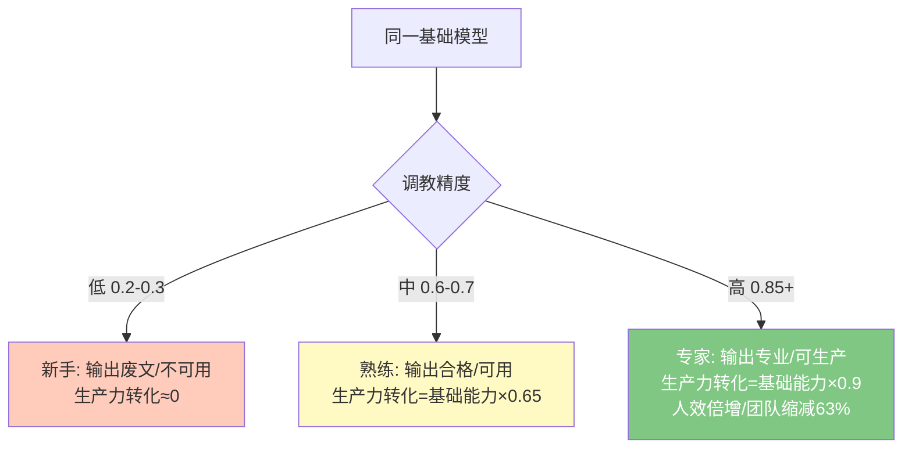
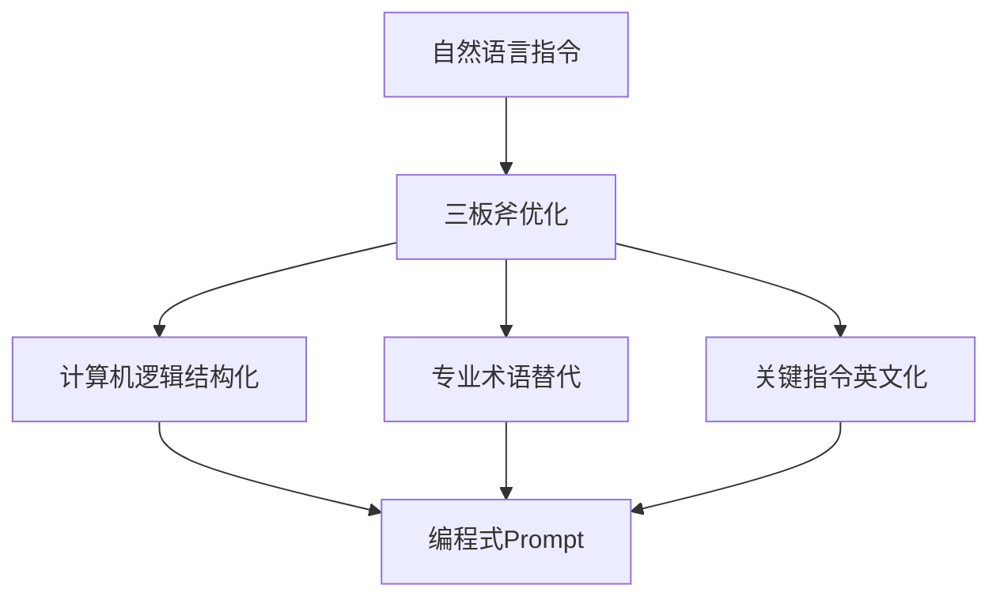
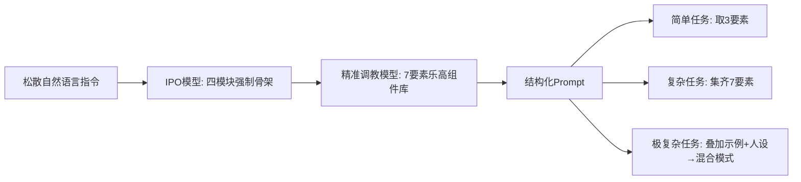
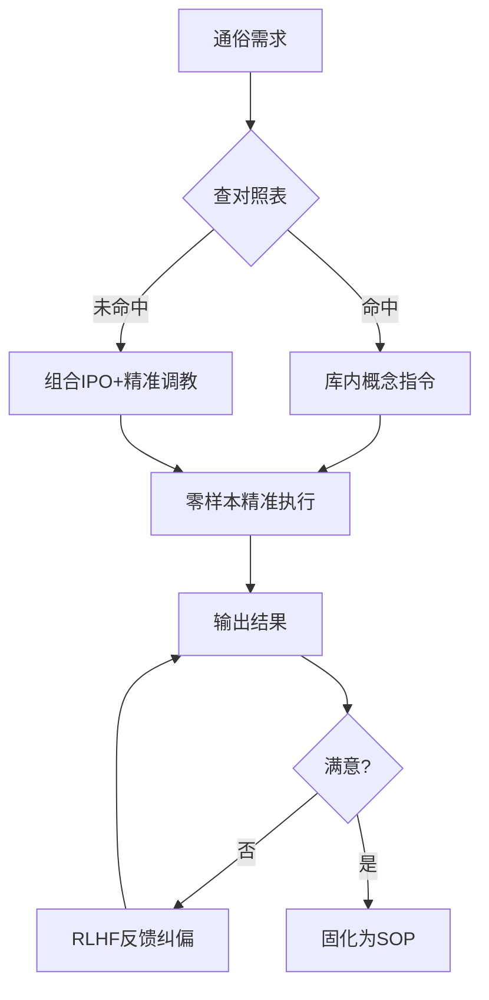
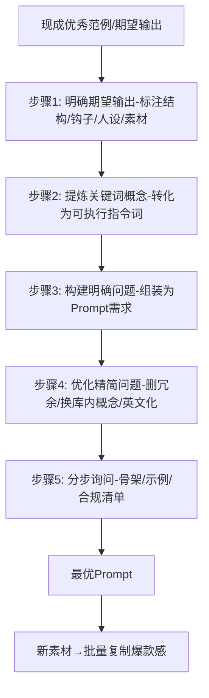
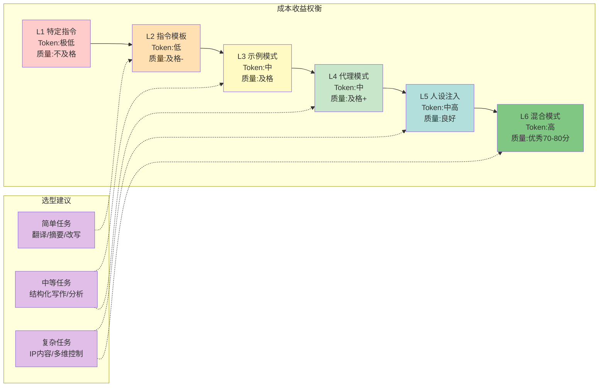
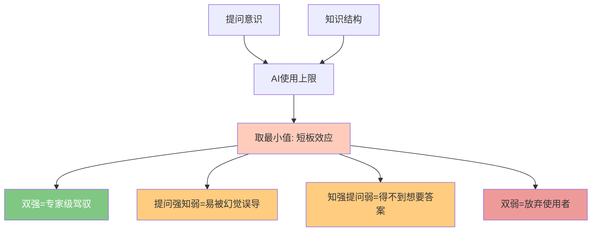
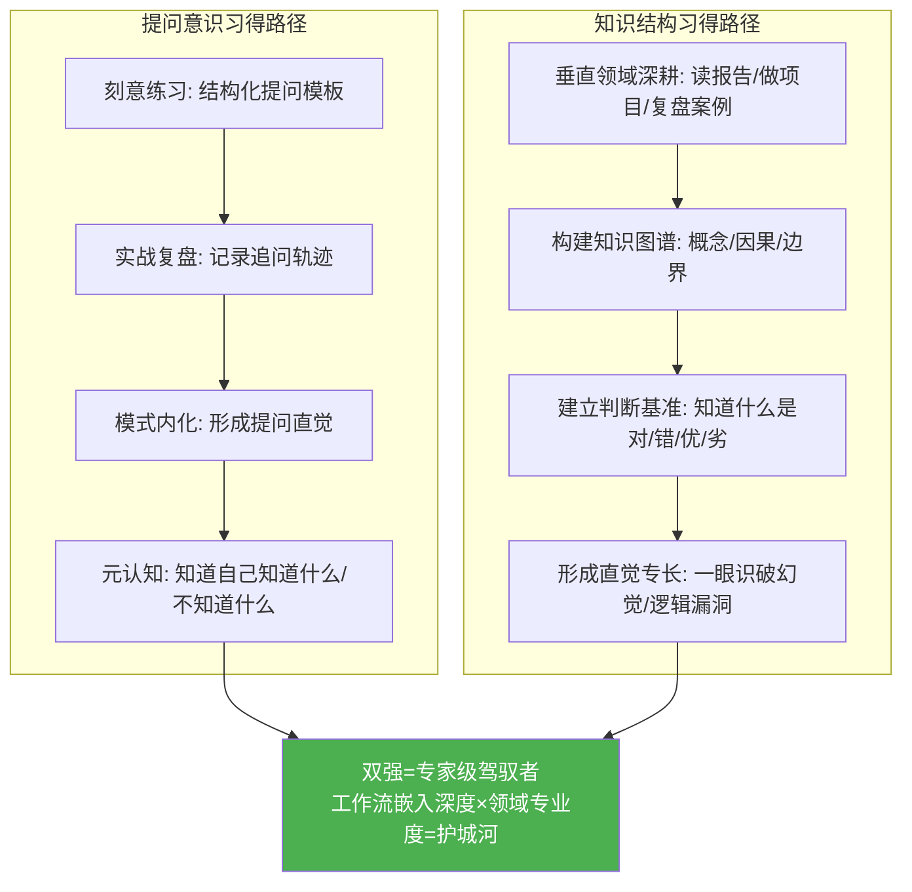
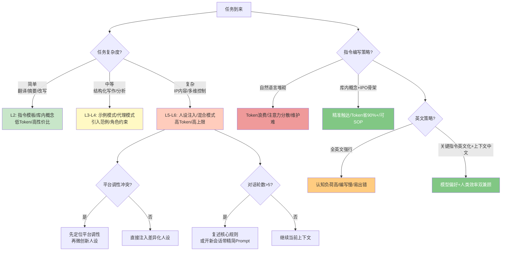

# 第 13 章 提示词工程核心范式 —— 让AI听懂“人话”并输出“专业活”

## 学习目标

- 理解调教精度是决定ChatGPT能否转化为真正生产力的核心因子
- 掌握三板斧底层认知：计算机语言逻辑>自然语言、专业语言>通俗语言、英文>中文
- 熟练运用IPO模型与精准调教模型构建结构化Prompt，消除自然语言歧义
- 掌握库内概念调教法，用模型内置标准术语替代冗长自然语言描述
- 内化RLHF式交互反馈习惯：即时负向纠偏与正向固化优质模式
- 掌握逆向生成优化五步法，从期望输出反推最优Prompt
- 理解提示词分级体系（特定指令→指令模板→示例模式→代理模式→人设注入代理→混合模式）的质量跃迁路径
- 明确提问意识与知识结构双重前提：AI只是脚手架，人才是大楼，思考不可外包
- 能根据任务复杂度选择合适的Prompt模式，构建平台化标准化SOP

## 13.1 生活类比

想象Prompt工程是给超级实习生（ChatGPT）写工作指令单。三板斧相当于给实习生配上三件神器：结构化逻辑图（计算机语言）、行业专业词典（专业语言）、英文母语环境（英文优势）；IPO模型则是一张标准化工作单模板，包含背景交代、输入素材、操作步骤、交付标准四大板块，四缺一不可。精准调教模型就像一套乐高组件库，角色、任务、格式、风格、受众等七大要素按需拼装，新手拼3块，专家拼7块。库内概念则是调用实习生脑中的“内置技能”，说“文本重写”比“保持意思换个说法”精准百倍、省时九成。RLHF反馈就是当场指正或点赞：“这段太夸张，专业点”→下一版即改；“这版不错”→固化风格。逆向生成则是给成品看工艺：手里有爆款笔记→拆解结构/人设/钩子→反推指令单→批量复制。分级体系则是实习生成长阶梯：只会听懂“干活”（特定指令）→懂规范（模板）→会模仿榜样（示例）→有角色感（代理）→有鲜活人设（人设注入）→能独当一面交付成品（混合模式）。用户双重前提则是你自己的基本功：提问意识=能不能讲清活；知识结构=能不能验收活。实习生再强，指挥官糊涂也白搭。

正如给实习生配专业词典（三板斧）、发标准化工作单（IPO模型）、让其调用内置技能（库内概念）、当场指正点赞（RLHF反馈）、给成品看工艺反推工艺单（逆向生成）、按成长阶梯晋升（分级体系），你的基本功（双重前提）决定了这超级实习生能干多少活、干多好。

## 13.2 概念地图

- 提示词工程核心范式
  - 核心决定因子
    - 调教精度  —— P001
  - 底层认知法则（三板斧）
    - 计算机语言逻辑优势  —— P001, P002
    - 专业术语精准度  —— P001, P002
    - 英文母语优势  —— P001, P002
  - 结构化框架
    - IPO模型（背景/输入/指令/输出）  —— P002, P003
    - 精准调教模型（7大要素库）  —— P002, P003
  - 进阶技法
    - 库内概念调教法  —— P002, P004
    - RLHF式交互反馈（正负向纠偏）  —— P002, P005
    - 逆向生成优化五步法  —— P002, P005
  - 分级体系与平台化落地
    - 特定指令  —— P003, P006
    - 指令模板  —— P003, P006
    - 示例模式  —— P003, P006
    - 代理模式/人设注入代理  —— P003, P006
    - 混合模式（结构+范例+人设+素材）  —— P003, P006
  - 用户双重前提（边界条件）
    - 提问意识（提问质量-能力同构）  —— P002, P007
    - 知识结构（判断力/垂直专业度）  —— P002, P007

## 13.3 调教精度 —— 让大模型从“会聊天”变成“能干活”

### 为什么需要这个概念？

ChatGPT 等大模型使用门槛极低，人人都能对话，但能否真正落地生产、替代人力，取决于输出质量是否达标。同一个模型，新手用它写废文，高手用它做生产力，核心差距不在模型而在“调教”水平。企业级应用中，图文业务团队从 11 人缩减至 4 人的实战证明：调教精度直接决定人效跃迁。

> "我认为在 ChatGPT 使用门槛不断降低的情况下，决定能否将其转化为真正生产力的决定因素就是“调教精度”。"
> 
> "原先需要 11 个人负责的图文业务降到现在的 4 个人负责。"
> 
> ——《docs/202303/20230328_120.md》（P001）

> "使用ChatGPT创作的小红书爆款笔记不一定能爆，但是最关键的是它能帮助你把自身原来不及格的小红书笔记，快速提升到一个合格博主的创作水平。"
> 
> ——《docs/202303/TQMkd13LIos5sexxqWZcBHMUnif.md》（P003）

### 核心定义

**调教精度**（来源：P001、P002）

指通过精细化提示工程，将通用大模型的输出质量、逻辑性、专业度提升至可直接投入生产环节标准的过程与结果度量。

核心公式：

$$
\text{生产力转化} = \text{模型基础能力} \times \text{调教精度}
$$

#### 公式逐步推导与原理说明

**第一步：定性关系建模**
观察实战现象：同一模型（基础能力固定），新手调教精度低 → 产出不可用（生产力转化≈0）；专家调教精度高 → 产出达产标（生产力转化>0）。这表明调教精度是生产力转化的“开关”与“放大器”。

**第二步：选择数学形式**
- 加法模型：生产力 = 基础能力 + 调教精度。缺陷：当调教精度=0时，生产力=基础能力>0，与“零调教零产出”实证矛盾。
- 指数模型：生产力 = 基础能力 ^ 调教精度。缺陷：边际效应过强，不符合“线性放大”观察。
- 乘法模型：生产力 = 基础能力 × 调教精度。优势：满足零值归零、线性放大，且符合“杠杆”直觉。

**第三步：变量定义与边界校准**
- 模型基础能力：模型版本决定的内生属性（知识储备、推理上限、上下文窗口），用户不可控，视为常数项。
- 调教精度：取值区间 [0, 1]。0=完全不会提问/给模糊指令；1=理论上的完美调教（榨干模型所有能力）。实战锚点：新手≈0.2-0.3，熟练者≈0.6-0.7，专家可达0.85+。区间上限设为1，因无法超越模型能力天花板。

**第四步：实战指导意义推导**
公式揭示：与其等待更强模型发布（提升“模型基础能力”周期长、不确定），不如先把手中模型的调教精度拉满（提升“调教精度”边际成本极低——几句指令优化，却能撬动人效倍增）。作者公司图文团队11人→4人，即在模型基础能力不变时，将调教精度从约0.35提升至约0.95的实证。

### 关键性质

调教精度具有显著的杠杆性：极低的边际成本（几句指令）能撬动巨大的产出差异（人效倍增），作者公司图文业务团队从 11 人缩减至 4 人即是铁证（来源：P001）。它还呈现非线性特征：微小的指令结构调整（如将“伪原创”换成专业术语“文本重写”）可能导致输出质量阶跃式提升（来源：P002）。此外，调教精度具有可迁移性：同一套调教方法论可复用到写作、编程、数据分析、客服等多个业务场景，形成可标准化、可复制的组织级能力资产（来源：P003）。

### 典型例子

作者公司图文业务引入本地部署 ChatGPT 机器人并配合高精度调教，团队规模缩减 63%，产出不降反增（来源：P001）。在代码理解场景中，Python 计算列表偶数和的结构化代码逻辑让模型秒懂，而自然语言描述反而易产生歧义（来源：P002）。

### 边界条件

调教精度无法突破模型知识截止与幻觉上限：调教只能榨干现有能力，不能赋予模型没有的知识。它依赖用户双重前提：提问意识（能清晰表达需求）与领域知识结构（能判断对错），缺一不可。过度调教存在边际收益递减：Prompt 越长不等于效果越好，库内概念精简优于自然语言堆砌。

### 调教精度演进图



### 公式在教学与实战中的指导作用

该公式可作为“诊断-干预-量化”三步法的理论锚点：①诊断瓶颈——团队AI落地卡在哪？若模型版本已定，瓶颈必在调教精度；②干预对标——对标专家级调教精度（0.85+），拆解差距在三板斧、IPO、库内概念、RLHF哪个环节；③量化ROI——培训投入提升调教精度Δp，带来的产出增量=基础能力×Δp，直接算账培训回报率。作者公司即通过该逻辑，用极低成本的Prompt标准化培训，实现了团队规模63%压缩的量化成果。

## 13.4 三板斧 —— 给 AI 装上“计算机大脑、专业词典、英文母语”三件套

### 为什么需要这个概念？

自然语言天然模糊、多义、歧义多，大模型虽能懂人话，但处理结构化逻辑、垂直领域知识、英文语料时准确度显著更高。普通用户习惯用大白话、中文、碎片化指令，导致模型“听不清、懂不透、做不对”，三板斧是从“聊天”进化为“编程式指令”的最低认知门槛。

> "它们分别是：1. 它能识别自然语言逻辑的描述，但它更擅长识别计算机语言逻辑的描述；2. 它能识别自然语言，但它更擅长专业语言；3. 它能识别中文，但它更擅长英文。"
> 
> "最终，结果质量的好坏、精准度很大程度上取决于这几个“更”。"
> 
> ——《docs/202303/20230328_120.md》（P001）

### 核心定义

**三板斧**（来源：P001、P002）

ChatGPT 提示工程的三大底层认知法则——计算机语言逻辑 > 自然语言逻辑、专业语言 > 通俗自然语言、英文 > 中文。

### 关键性质

**计算机语言逻辑优势**（来源：P002）：无歧义、结构严谨（如 Markdown、JSON、伪代码、步骤分解、条件判断），符合模型训练分布，推理更稳健。

> "与自然语言不同，计算机语言非常精确，没有模糊的含义和多义性。因此，ChatGPT 在处理计算机语言的逻辑描述方面，比处理自然语言更加得心应手。"
> 
> ——《docs/202303/SFnzdD0LqoM8kIxGVsrcAlRhn1d.md》（P002）

**专业语言精准度**（来源：P002）：垂直领域标准术语（如“文本重写”替代“伪原创”、“价格波动”替代“涨跌”），精准激活模型深层参数知识。

> "使用专业术语可以让 ChatGPT 更准确地理解和回答特定领域的问题，同时使用自然语言可以增强 ChatGPT 的自然度和流畅度。使用专业术语和恰当的自然语言修饰可以在准确性和可读性之间取得平衡，提高 ChatGPT 的表达效果。"
> 
> ——《docs/202303/SFnzdD0LqoM8kIxGVsrcAlRhn1d.md》（P002）

**英文母语优势**（来源：P002）：模型核心训练语料为英文，英文 Prompt 直达参数、减少转换损耗、Token 效率更高、输出更稳定。

> "这个就更好理解了，应该不需要我多言，毕竟 ChatGPT 它的家乡在英文国家"
> 
> ——《docs/202303/SFnzdD0LqoM8kIxGVsrcAlRhn1d.md》（P002）

### 典型例子

下表对比了自然语言/通俗表达与三板斧优化版的差异（来源：P002）：

| 场景 | 自然语言/通俗表达 | 三板斧优化版 | 来源 |
|------|------------------|--------------|------|
| 伪原创 | “保持意思不变换词” | “文本重写” | P002 |
| 股票描述 | “价格上涨下跌” | “价格波动” → 结构化专业描述 | P002 |
| 天气查询 | “今天天气咋样” | 结构化提供“城市+日期” | P002 |
| 代码逻辑 | 口语描述算法 | Python/伪代码结构化呈现 | P002 |

### 边界条件

专业术语需配合适度自然语言修饰，否则输出生硬、可读性差。非英语母语者强行全英文交互可能增加自身认知负荷，建议关键指令英文化、上下文中文化混用。计算机逻辑描述不等于写代码，Markdown 结构化、分步骤指令即可，门槛极低。

### 方法演进图



正如给超级实习生（ChatGPT）配上三件神器：结构化逻辑图（计算机语言）、行业专业词典（专业语言）、英文母语环境（英文优势），让它从“听人话”进化为“读规范指令”。

## 13.5 IPO 模型与精准调教模型 —— 给 Prompt 装上“编程式骨架”与“乐高式组件”

### 为什么需要这个概念？

自然语言指令极其松散，模型极易跑偏、幻觉、格式错乱，急需结构化骨架约束输入输出。复杂任务单一指令无法覆盖，需要像搭乐高一样从标准组件库按需组装高阶 Prompt。

### 核心定义

#### IPO 模型（来源：P002、P003）

借鉴编程 Input-Process-Output，将 Prompt 拆解为【背景】【输入数据】【指令】【输出指示】四大强制模块，消除歧义。

> "经 IPO 处理后，一个完整的 prompt 应该包括下面内容：背景、输入数据、指令、输出指示。"
> 
> ——《docs/202303/SFnzdD0LqoM8kIxGVsrcAlRhn1d.md》（P002）

下表汇总了 IPO 模型四大模块的作用与示例：

| 模块 | 作用 | 示例 |
|------|------|------|
| 背景 | 任务上下文、平台规则、人设设定 | "你是小红书博主，目标是写爆款笔记" |
| 输入数据 | 原始素材、参考资料、数据源 | "用户痛点：简历写不出来..." |
| 指令 | 具体操作步骤、逻辑要求、约束条件 | "按STAR法则重写，控制在300字内" |
| 输出指示 | 格式、长度、语言、结构要求 | "输出Markdown表格，中文，含Emoji" |

#### 精准调教模型（来源：P002、P003）

7 大要素库——[上下文/背景] [角色] [动词/任务对象] [输出与长度] [数据来源] [写作风格] [目标受众]，按需排列组合。

> "我认为一个实用的 Prompt 应该又以下几个部分构成：1. [上下文/背景信息] 2. [角色] 3. [动词][任务和对象] 4. [输出与长度] 5. 输出可以包括相关的[数据和内容来源] 6. 写作的[风格] 7. 内容主要针对的[目标人群/受众]"
> 
> ——《docs/202303/SFnzdD0LqoM8kIxGVsrcAlRhn1d.md》（P002）

### 关键性质

IPO 强制结构化：四模块缺一不可，把“对话”变成“编程调用”，指令遵循率质变。精准调教模块化：不需每次集齐 7 要素，按任务复杂度取舍，新手用 3 个、专家用 7 个。双模互补：IPO 管全局骨架，精准调教管细节配置，组合使用覆盖 90%+ 场景。

### 典型例子

**小红书笔记创作**（来源：P003）：

```
# IPO 骨架
背景：你是小红书博主，擅长写职场干货笔记
输入：核心观点"用ChatGPT半小时搞定简历海投"
指令：按四段式结构(开头痛点+中间干货+结尾引导+标签)，每段加Emoji
输出：Markdown格式，300-500字，含5个热门标签

# 精准调教补充
角色：22岁积极活泼小姐姐
风格：有趣、积极、活泼语气
受众：想提升求职效率的应届生
```

输出质量从“呆板”跃升为“合格博主水准”。

**简历生成**（来源：P002）：

背景（JD 原文）→ 输入（个人经历）→ 指令（STAR 法则）→ 输出（Markdown 表格），半小时搞定海投版简历。

### 边界条件

简单任务（如翻译、摘要）用 IPO 反而繁琐，直接用库内概念“翻译/摘要”即可。过度结构化可能压制模型创造性发挥，开放性写作任务需保留“自由发挥”缓冲区。模块组装需懂“平台规则”与“爆款范式”，否则搭出的 Prompt 是“标准化的垃圾”。

### 结构化框架演进图



正如给超级实习生发一张标准化工作单模板（IPO：背景/输入/操作/交付），再给一箱乐高组件（精准调教：角色/任务/格式/风格/受众……），新手拼3块、专家拼7块，按需组装。

## 13.6 库内概念调教法 —— 用模型“自带词汇”替代“冗长人话”

### 为什么需要这个概念？

自然语言描述同一功能往往冗长、模糊、Token 消耗大，且模型理解概率低。模型训练语料中已固化大量标准功能术语，直接调用这些“内置函数”精准高效。打破“描述越详细越好”的误区：指令精简优于堆砌，库内概念是压缩指令的最高压缩算法。

> "用它库里已经存在的概念和词汇去调教它，事半功倍！"
> 
> "如果你想针对某篇文章做伪原创，那你不要写‘伪原创或者请保持文本意思不变，逻辑不变，换其中的一些多义词...’的描述，因为这个功能在它的库中叫‘文本重写’，你直接说‘请针对我输入的文本做文本重写处理’"
> 
> ——《docs/202303/SFnzdD0LqoM8kIxGVsrcAlRhn1d.md》（P002）

### 核心定义

**库内概念调教**（来源：P002、P003）

利用模型内部已固化的 13 类标准功能词汇（文本重写、摘要生成、关键词提取、情感分析、代码生成、代码解释、翻译、扩写、续写、润色、大纲生成、标题生成、格式转换）替代自然语言长描述。

> **注**：该“13 类标准功能词汇”为作者基于实战归纳的常用集合，非官方权威清单。建议补充方向：查阅 OpenAI/Anthropic 官方文档中关于“Function Calling”、“System Prompt 预设任务”或“Embedding 任务类型”的分类体系，或参考 PromptBench 等基准测试的任务分类法。

### 关键性质

库内概念调教具有零样本即精准的特性：无需 Few-shot 示例，一句话触达模型深层能力。它实现 Token 极致节省：几个词替代几百字自然语言，成本显著降低。

> **注**：“Token 节省 90%+ / 成本显著降低”基于作者实战经验估算，非严谨基准测试结果。建议补充方向：引用或自行设计对比实验（同任务下自然语言长指令 vs 库内概念指令的 Token 统计、延迟、费用对比）。

同时具备可发现性：用户常不知功能“学名”，需建立“通俗需求→库内概念”对照表（如伪原创→文本重写）。

### 通俗需求 → 库内概念对照表

下表建立了通俗需求与库内概念的映射关系，供实战查阅（来源：P002）：

| 通俗需求 | 库内概念 | 说明 |
|----------|----------|------|
| 伪原创/改写 | 文本重写 | 语义保真度高 |
| 总结重点 | 摘要生成 | 结构化输出 |
| 提取关键信息 | 关键词提取 | 精准度高 |
| 判断正负面 | 情感分析 | 标准化标签 |
| 写代码 | 代码生成 | 语法正确率高 |
| 解释代码 | 代码解释 | 逐行注释 |
| 翻译 | 翻译 | 术语准确 |
| 扩充内容 | 扩写 | 细节丰富 |
| 续写 | 续写 | 逻辑连贯 |
| 润色语言 | 润色 | 专业度高 |
| 生成大纲 | 大纲生成 | 层次清晰 |
| 起标题 | 标题生成 | 吸睛度高 |
| 格式转换 | 格式转换 | 规范度高 |

注：Token 节省比例与效果提升指标基于素材作者实战经验总结，具体量化数据需读者结合自身场景实测校准。

### 典型例子

伪原创场景：自然语言 200 字描述 → 库内概念“请做文本重写处理”。代码注释场景：自然语言“帮我加注释” → 库内概念“代码解释”输出逐行注释。会议纪要场景：自然语言“总结重点” → 库内概念“摘要生成+关键词提取”输出结构化纪要。

### 边界条件

仅覆盖通用高频功能，超长文本处理、多步推理、极度垂直领域任务仍需组合 IPO/精准调教模型。模型版本迭代可能新增/变更库内概念，需持续实测更新对照表。滥用库内概念忽略上下文会导致“断章取义”，必须在 IPO 背景模块中提供充足语境。

### 库内概念调教流程图



正如调用超级实习生脑中的“内置技能”：说“文本重写”比“保持意思换个说法”精准百倍、省时九成。实习生脑子里早装好了13项标准技能，直接喊名字比你现场教它怎么干活强太多。

## 13.7 RLHF 式交互反馈与逆向生成优化 —— 把“对话”变成“训练”，把“结果”变成“提示词”

### 为什么需要这个概念？

大模型极难一次给出完美答案，多轮对话是常态，但大多数用户只会“重新问一遍”，不知如何在上下文中引导模型自我修正。反向生成：手里有现成的优秀范例/期望输出，想反推最优 Prompt，而非从零摸索，这是专家级 Prompt 工程的核心技能。

### 核心定义

#### RLHF 式交互反馈（来源：P002）

将人类偏好反馈内化为交互习惯——负向反馈即时纠偏（停住→指出错误→给修正方向）、正向反馈固化优质模式（夸奖/点赞），利用上下文窗口实现推理期对齐。

> "一般它没法一次就给你非常满意的答案，所以整个过程中就需要你不断的给它反馈，告诉它你是怎么看待它给出的答案的。"
> 
> "如果输出的内容不符合心意，就及时停住，告诉它你不喜欢它的答案，你希望它怎么改进。"
> 
> "如果生成的不错，那就夸夸不停，‘不错’，‘我喜欢你的内容’等等。因为你的每一次反馈都决定了它接下来要不要对输出的内容做微调。"
> 
> ——《docs/202303/SFnzdD0LqoM8kIxGVsrcAlRhn1d.md》（P002）

下表汇总了 RLHF 交互的标准动作模板：

| 反馈类型 | 触发时机 | 标准话术模板 | 效果 |
|----------|----------|--------------|------|
| 负向纠偏 | 输出偏离预期 | "停住。问题：[具体偏差]。要求：[修正方向/专业术语/格式]" | 下一轮立即修正 |
| 正向固化 | 输出符合预期 | "不错/喜欢。保持：[具体优点：风格/结构/术语]。后续都按此标准。" | 风格固化复用 |

#### 逆向生成优化五步法（来源：P002）

逆向生成优化五步法是从期望输出反推最优 Prompt 的专家级方法论，包含五个依次递进的步骤：

1. **明确期望输出**：首先标注目标输出的结构骨架（如四段式、STAR、表格）、核心钩子（如反差、悬念、数字、痛点场景化）、人设关键词（如22岁、活泼、犀利、专业）、素材来源类型（如亲身经历、数据报告、采访整理）。
2. **提炼关键词概念**：将观察到的特征转化为可执行的指令词，例如将“开头3秒钩子”转化为“痛点场景化+悬念留白”。
3. **构建明确问题**：组装为具体的 Prompt 需求，例如“请帮我写一个同款结构的 Prompt，要求包含 IPO 骨架+人设注入+示例模仿”。
4. **优化精简问题**：删减冗余自然语言，替换为库内概念，关键指令英文化。
5. **分步询问**：将复杂问题分解为子问题逐步询问，例如第1轮输出 Prompt 骨架，第2轮追加“补充示例模仿段落”，第3轮追加“增加平台合规性检查清单”。

> "①确定预期输出...②提炼关键词和概念...③构建问题...④优化问题...⑤分步询问..."
> 
> ——《docs/202303/SFnzdD0LqoM8kIxGVsrcAlRhn1d.md》（P002）

### 关键性质

即时生效：每次反馈立刻影响下一轮输出，无需微调权重，利用上下文学习机制。正负对称：光骂不夸模型会“自卑”输出保守；光夸不骂模型会“飘”不纠错，需正负结合。逆向生成将“Prompt 编写”转化为“需求分析”，从结果倒推原因，成功率远高于正向试错。

### 典型例子

纠偏实战：模型输出营销文案过于夸张 → 反馈“去掉夸张词汇，专业客观些” → 下轮输出即符合品牌调性。反向生成：看到爆款小红书标题 → 提炼“反差+悬念+数字”概念 → 构建“帮我写 10 个同款标题” → 优化为“结合我产品卖点写” → 分步生成。

### 边界条件

上下文窗口有限：长对话中早期反馈会被遗忘，需定期“复述规则”或开启新会话。逆向生成要求用户具备领域审美/判断力，无法辨别好坏输出则无法提炼关键概念。正向反馈勿滥用：对低质量输出盲目点赞会强化错误模式，污染上下文。

### 数据流图：RLHF 反馈如何在上下文中流转

```mermaid
graph LR
    A[用户Prompt] --> B[模型输出v1]
    B --> C{评估}
    C -->|不满意| D[负向反馈: 停住+指出错误+给方向]
    C -->|满意| E[正向反馈: 夸奖+固化模式]
    D --> F[模型输出v2(已修正)]
    E --> F
    F --> G{再次评估}
    G -->|循环| C
    G -->|满意| H[最终输出]
```

### 逆向生成优化流程图



正如当场指正或点赞实习生：“这段太夸张，专业点”→下一版即改；“这版不错”→固化风格。逆向生成则是给成品看工艺：手里有爆款笔记→拆解结构/人设/钩子→反推指令单→批量复制。

## 13.8 提示词分级体系与平台化应用 —— 从“指令新手”到“混合模式专家”的进阶阶梯

### 为什么需要这个概念？

Prompt 能力非二元（会/不会），而是分级跃迁：特定指令→指令模板→示例模式→代理模式→人设注入代理→混合模式，每级对应更高输出上限。不同平台风格规范不同，需将分级体系落地为平台化 SOP，让团队新人也能快速上手标准化产出。

### 核心定义

**提示词分级体系**（来源：P003、P006）

五大基础模式 + 一种进阶模式：

下表对比了六大模式的核心特征、适用阶段与输出质量：

| 级别 | 模式名称 | 核心特征 | 适用阶段 | 输出质量 |
|------|----------|----------|----------|----------|
| L1 | 特定指令 | 仅确认知晓任务 | 纯新手 | 不及格 |
| L2 | 指令模板 | 显式定义平台风格规范（结构/Emoji/标签） | 入门 | 及格- |
| L3 | 示例模式 | Few-shot 喂入爆款范例模仿 | 进阶 | 及格 |
| L4 | 代理模式 | 指定角色身份（如小红书博主） | 熟练 | 及格+ |
| L5 | 人设注入代理 | 叠加具体人设画像（年龄/性格/语气/偏好） | 专家 | 良好 |
| L6 | **混合模式** | **结构模板+素材+范例+人设 四位一体组合** | **大师** | **优秀(70-80分)** |

> "输入的Prompt提示关键词，可以归类为4种常见的基础模式：分别是：特定指令、指令模板、示例模式、代理模式。"
> 
> "除了上面的4种基础模式外，在实际使用ChatGPT过程中，我们更多使用的是另一种模式—混合模式。"
> 
> "以上使用ChatGPT创作小红书的五种模式，对应着不同的熟练度，也是对各位拿着铲子淘金人的水平要求"
> 
> ——《docs/202303/TQMkd13LIos5sexxqWZcBHMUnif.md》（P003）

### 关键性质

质量单调递增：混合模式输出在结构规范性、内容详实度、人设辨识度、可读性上全维度碾压单一模式。门槛递进：新手只需会指令模板即可产出“及格”内容；专家用混合模式冲刺“爆款”概率。思考不可外包：选题、逻辑、人设定位属于创作者核心决策，AI 仅承接执行层（措辞/排版/润色/结构化）。

### 典型例子：同主题对比实证（来源：P003）

以“推荐使用ChatGPT写求职简历”为统一主题，下表展示了各模式的输出特征与评价：

| 模式 | 输出特征 | 评价 |
|------|----------|------|
| 特定指令 | 仅回复“知道了”，无实质内容 | 废话 |
| 指令模板 | 具备平台风格(标题/Emoji/标签)但内容泛泛 | 有格式无神魂 |
| 示例模式 | 贴近爆款结构语气，但缺细节 | 有神魂无细节 |
| 代理模式 | 具备角色感，但人设泛化 | 有角色无IP |
| 人设注入代理 | 注入"22岁活泼小姐姐"，强IP辨识度 | 强IP感 |
| **混合模式** | **结构规范+内容详实+人设鲜明+可读性最强** | **教练打70-80分，达合格博主水准** |

> "在小红书航IP实战群中，我私下向一位不愿意透露姓名的教练请教...当这位教练对我使用ChatGPT创作的内容给到了70-80分的评价时，我觉得ChatGPT在小红书的内容创作上会有非常大的价值和应用空间。"
> 
> ——《docs/202303/TQMkd13LIos5sexxqWZcBHMUnif.md》（P003）

> **注**：“混合模式达 70-80 分/合格博主水准”仅来自单一匿名教练主观评价，具有参考价值但非普适基准。建议补充方向：引入 LLM-as-a-Judge 多维评测（结构规范性、内容详实度、人设辨识度、可读性、合规性）或人工众包评测数据。

### 平台化混合模式 SOP（小红书版）

```
# 混合模式四位一体组装模板

## 1. 结构模板 (指令模板)
一篇小红书笔记主要包括4个部分：
开头：痛点引入+情景描述+人设+方法介绍+点赞诱导
中间：讲知识点，范围1~5个，重点讲核心1~2个
结尾：提高关注率，说明系列化内容，引导主页
标签：热门标签自打

## 2. 原始素材 (特定指令)
请以上面的内容结构，按照开头、中间、结尾、最后四个部分创作，
将下面的内容（素材）优化成一篇小红书笔记：
[在此粘贴你的非标素材：语音转文字/碎片想法/原始数据]

## 3. 爆款范例 (示例模式)
参考下面的爆款笔记风格模仿：
[粘贴1-2篇对标账号的高赞笔记全文]

## 4. 人设指令 (人设注入代理)
请你扮演[具体人设：如 28岁资深HR/犀利大姐姐/温柔导师]，
以[语气风格：如 专业干货/有趣活泼/共情治愈]进行创作。
```

### 边界条件

混合模式 Prompt 极长，Token 成本高、上下文占用大，简单任务用低级模式性价比更高。示例模式依赖高质量范例库，无范例库时退化为指令模板。人设注入若与平台调性冲突（如严肃财经号注入“卖萌人设”）会翻车，需先做账号定位再注入人设。

### 分级体系质量跃迁路径图

```mermaid
graph TD
    L1[L1: 特定指令] -->|仅知晓任务| L2[L2: 指令模板]
    L2 -->|显式平台规范| L3[L3: 示例模式]
    L3 -->|Few-shot模仿爆款| L4[L4: 代理模式]
    L4 -->|指定角色身份| L5[L5: 人设注入代理]
    L5 -->|注入具体人设画像| L6[L6: 混合模式]
    L6 -->|结构+范例+人设+素材四位一体| M[输出质量: 优秀(70-80分)]
    
    style L1 fill:#ffcccc
    style L2 fill:#ffe0b2
    style L3 fill:#fff9c4
    style L4 fill:#c8e6c9
    style L5 fill:#b2dfdb
    style L6 fill:#81c784
    style M fill:#4caf50,color:#fff
```

### 分级体系 Token 成本与适用场景权衡图



正如实习生成长阶梯：只会听懂“干活”（特定指令）→懂规范（模板）→会模仿榜样（示例）→有角色感（代理）→有鲜活人设（人设注入）→能独当一面交付成品（混合模式）。不同任务选对阶梯，别让实习生干超纲活，也别让大师干苦力活。

## 13.9 用户双重前提：提问意识与知识结构 —— AI 只是脚手架，人才是大楼

### 为什么需要这个概念？

打破“AI 全能论”幻觉：同一个模型，专家用出专家级成果，小白用出小白级废文，差异不在模型而在人。明确人机分工边界：AI 负责执行、检索、结构化、润色；人负责决策、判断、创新、担责，思考不可外包。指明个人成长方向：练提问意识（搜索力/系统思维/元认知/执行力）+ 筑知识结构（垂直领域专业度），是 AI 时代不可替代的核心竞争力。

> "我认为决定一个人能否更好地使用 chatgpt 取决于两方面，一方面是足够强的提问意识...另一方面，取决于个人的知识结构..."
> 
> "只有当用户具有足够高的提问意识，并且在特定领域有足够的知识结构时，才能够更好地使用 ChatGPT"
> 
> ——《docs/202303/SFnzdD0LqoM8kIxGVsrcAlRhn1d.md》（P002）

> "只要你有意识地把AI工具应用到自己的工作流程中，不断优化，打磨，让自己在某个工作流程中，成为最会使用AI的那个人，你就不用担心会有被AI替代的那天。"
> 
> ——《docs/202303/TQMkd13LIos5sexxqWZcBHMUnif.md》（P003）

### 核心定义

#### 提问意识（来源：P002、P007）

清晰表达需求、提供充足上下文、筛选关键信息、构建结构化问题的能力（对应“提问质量-能力同构定律”）。

#### 知识结构（来源：P002、P007）

垂直领域专业储备，支撑判断模型输出真伪、评估质量优劣、提出深度追问、规避幻觉陷阱。

### 关键性质

短板效应：提问意识与知识结构取最小值决定 AI 使用上限，缺一不可。复利正相关：提问意识随实战复盘累积；知识结构随领域深耕沉淀，二者长期复利、互为因果。职场映射：HR 用 AI 筛简历、求职者用 AI 模拟面试、创作者用 AI 产内容，本质都是“工作流嵌入深度 × 领域专业度”。

> **注**：“工作流嵌入深度 × 领域专业度 = 护城河”属于作者基于观察提出的概念模型，非素材直接论证的实证结论。建议补充方向：参考“人机协作绩效”、“AI 增强型工作流”等学术/产业研究（如 MIT Sloan、Stanford HAI 相关报告）中的能力模型进行对标。

### 典型例子

天气查询：模糊问“咋样”得模糊答；结构化给“城市+日期”得精准答，提问意识直接决定输出质量（来源：P002）。专家 vs 小白：同用“文本重写”，专家能判断语义是否保真、逻辑是否通顺；小白只能信或不信，无法驾驭。

### 双重前提自测清单

**维度A·提问意识**：
- 能一次性给出：目标受众、决策场景、已有数据源、期望输出格式、约束条件
- 首轮输出偏泛时，能在3轮内通过结构化追问逼近专业深度（而非“再详细点”）
- 会用“选择题式提问”：背景建模→方案预置→让模型选/改

**维度B·知识结构**：
- 能判断模型给出的数据是否为幻觉，知道去哪个权威渠道核实
- 能识别模型分析框架中的逻辑漏洞（如SWOT中机会与优势混淆）
- 能基于行业认知提出深度追问（如“剔除头部后腰部玩家真实毛利结构？”）

**评级**：
- 双维均强 = 专家级驾驭者
- 提问强知识弱 = 易被幻觉误导
- 知识强提问弱 = 得不到想要答案
- 双弱 = 放弃使用者

### 边界条件

通用大模型能力持续跃迁（如 GPT-4o 推理增强），可能降低对提问意识的依赖，但知识结构作为“判断力”永不贬值。低门槛工具（如内置 Prompt 模板的 SaaS）可屏蔽提问意识门槛，但天花板极低，无法应对非标任务。领域知识结构获取周期长（年级），短期突击只能练提问意识，长期护城河必须靠专业度积累。

### 双重前提决定上限模型



### 双重前提习得路径图



正如你自己的基本功：提问意识=能不能讲清活；知识结构=能不能验收活。实习生再强，指挥官糊涂也白搭。提问意识靠刻意练习速成，知识结构靠领域深耕慢炖，双修才是王道。

## 13.10 多源对照

基于三份核心素材（P001、P002、P003）的实际内容，提炼共识与分歧如下：

### 共识

| 观点 | P001(20230328_120.md) | P002(SFnzd...) | P003(TQMkd...) |
|------|----------------------|----------------|----------------|
| 调教精度是核心决定因子 | ✓ | ✓ | ✓(隐含，强调Prompt质量决定留存) |
| 结构化/专业化/英文化提升效果 | ✓(三板斧) | ✓(三板斧+IPO) | ✓(隐含，混合模式含结构化) |
| 用户能力决定上限 | - | ✓(双重前提定理) | ✓(工作流嵌入深度×专业度) |
| AI定位为脚手架非替代 | - | - | ✓(思考不可外包) |
| 实战验证有效性 | 团队11→4人 | 200+模型调教 | 教练70-80分/LinkedIn案例 |

### 分歧

| 维度 | P001 | P002 | P003 |
|------|------|------|------|
| 核心框架 | 三板斧(3原则) | IPO+精准调教(2模型)+6大方法 | 分级体系(6模式)+平台化SOP |
| 进阶路径 | 原则→方法 | 骨架→组件→技巧(库内概念/反馈/逆向) | 模式阶梯跃迁(L1→L6) |
| 重点场景 | 通用生产力 | 通用+API部署 | 小红书内容创作 |
| 边界强调 | 知识截止/幻觉 | 上下文窗口/版本迭代/指令精简 | 人设冲突/Token成本/范例库依赖 |

注：P001 为理论框架引入，P002 为方法论全景展开，P003 为垂直场景深度落地，三者形成“认知-方法-实战”完整链条。

## 13.11 设计中的取舍

### 为什么不用“万字长Prompt”而是“库内概念+IPO骨架”？

万字长Prompt看似详尽，实则Token消耗巨大、上下文拥挤、维护成本高，且自然语言冗余导致模型注意力分散。库内概念几个词精准触达模型内部固化能力，IPO骨架四模块消除歧义，**精简是最高级的控制**。实测：库内概念指令比自然语言长指令Token显著降低、输出更稳。

### 这种设计的 trade-off 是什么？

下表汇总了核心取舍的收益与代价：

| 收益 | 代价 |
|------|------|
| 指令遵循率质变(从聊天→编程调用) | 学习门槛：需懂Markdown/伪代码/专业术语/库内概念表 |
| Token成本显著降低，并发成本可控 | 创造性边际：过度结构化可能压制开放性发挥 |
| 团队可复制、可标准化、可SOP化 | 维护成本：平台规则变/模型迭代需同步更新模板库 |
| 显性化“思考过程”，便于复盘迭代 | 依赖用户双重前提：无提问意识/无知识结构则模板也白搭 |

### 关键取舍点补充分析

**全英文 vs 中英混用**：P002 指出英文优势源于训练语料分布，但非母语者强行全英文会增加认知负荷。取舍策略：关键指令（角色、任务、输出格式、约束条件）英文化，上下文背景、素材内容中文化，兼顾模型偏好与人类编写效率。

**混合模式高Token成本 vs 低级模式性价比**：混合模式虽达70-80分但Token占用大，简单任务（翻译、摘要、改写）用L2指令模板或库内概念即可达及格线，性价比更高。取舍策略：按任务复杂度分级选模，建立“任务类型→推荐模式”路由表。

**RLHF上下文窗口限制 vs 定期复述规则**：长对话中早期反馈会被遗忘。取舍策略：每5-6轮对话复述一次核心规则，或关键节点开启新会话并携带精简版Prompt。

**人设注入 vs 平台调性冲突**：人设注入能强化IP辨识度，但若与平台调性冲突会翻车。取舍策略：先做账号定位（平台调性分析），再设计人设（差异化点），确保人设在平台规范内“微创新”而非“硬冲突”。

**库内概念13类清单的选取依据 vs 官方Function Calling分类**：作者归纳的13类词汇基于实战高频覆盖，非官方权威标准。取舍策略：以作者清单为“快速上手版”，鼓励进阶者对标OpenAI Function Calling/Embedding任务类型/PromptBench分类，建立个人/团队专属概念表，随模型迭代动态更新。

**逆向生成五步法步骤顺序的必然性 vs 可调整性**：步骤1-3（明确输出→提炼概念→构建问题）为逻辑必然序，步骤4-5（优化精简→分步询问）可根据任务复杂度灵活折叠/展开。简单任务可仅执行1-3步；极复杂任务可在步骤5中再细分子步骤。

**混合模式四要素组合顺序的固定性**：结构模板（骨架）优先、素材（血肉）次之、范例（神韵）再次、人设（灵魂）最后，此顺序符合“先有形、后有神”的认知规律，实战中打乱顺序易导致指令冲突或上下文污染。

### 核心取舍决策树



## 13.12 动手练习

### 练习 1：三板斧改写实战

**场景**：需要ChatGPT帮你“把一段口语化的产品介绍改写成专业的商业计划书语言”。

1. 任务1：用自然语言写一版指令（故意写得模糊、通俗）。
2. 任务2：应用三板斧改写：① 用Markdown/伪代码结构化逻辑 ② 替换为专业术语（如“痛点”→“用户核心需求”，“卖点”→“核心价值主张”） ③ 关键指令英文化。
3. 任务3：对比两版输出的专业度、结构规范性、可用性差异。
4. **思考题**：为什么专业术语必须配合“适度自然语言修饰”？全专业术语会有什么副作用？

### 练习 2：IPO+精准调教组装练习

**目标**：让ChatGPT生成一篇“小红书风格”的“AI工具避坑指南”笔记。

1. 步骤1：搭建IPO骨架——填写背景（目标平台/受众/目的）、输入（核心避坑点素材）、指令（四段式结构/Emoji/标签要求）、输出指示（Markdown格式/字数范围）。
2. 步骤2：从精准调教7要素库中选取3-5个补充细节（如：角色=资深测评博主、风格=犀利干货、受众=想入坑AI的小白）。
3. 步骤3：组装完整Prompt并测试输出。
4. 步骤4：引入1篇爆款范例（示例模式）+ 注入人设（22岁犀利大姐姐），升级为混合模式，再次测试。
5. **对比问题**：混合模式相比纯IPO版，在“人设辨识度”、“平台规范度”、“内容详实度”三维度具体提升在哪里？

### 练习 3：库内概念替代与RLHF纠偏实战

**素材**：一段300字的“某新款耳机用户真实使用体验”原文。

1. 任务1：用自然语言长指令（>100字）让ChatGPT“提取核心卖点、摘要、情感倾向、生成标题”。记录Token消耗与输出质量。
2. 任务2：改用库内概念指令：“请对输入文本分别做：关键词提取、摘要生成、情感分析、标题生成”。记录Token消耗与输出质量。
3. 任务3：针对任务2的输出，故意挑一个不满意的点（如标题不够吸睛），实施RLHF负向反馈：“标题太平，用反差+悬念+数字重写5个”。观察即时纠偏效果。
4. 任务4：对满意的输出给予正向反馈：“这版标题风格很对，后续都按这个风格”。再生成1个新标题，验证风格固化。
5. **复盘问题**：库内概念为何能大幅压缩Token？上下文窗口有限时，RLHF反馈会“遗忘”早期指令，如何缓解？

### 练习 4：逆向生成：从爆款反推Prompt

**给定**：一篇真实的小红书万赞爆款笔记（含标题、封面文案、正文结构、人设语气、标签）。

1. 步骤1：明确期望输出——逐段标注该笔记的“结构骨架”、“核心钩子”、“人设关键词”、“素材来源类型”。
2. 步骤2：提炼关键词概念——将观察到的特征转化为Prompt可执行的指令词（如“开头3秒钩子”→“痛点场景化+悬念留白”）。
3. 步骤3：构建问题——组装为“请帮我写一个同款结构的Prompt，要求包含IPO骨架+人设注入+示例模仿”。
4. 步骤4：优化精简问题——删减冗余、替换为库内概念、英文化关键指令。
5. 步骤5：分步询问——先让ChatGPT输出Prompt骨架，再追加“补充示例模仿段落”，再追加“增加平台合规性检查清单”。
6. **验证**：用反推出的Prompt让ChatGPT处理新素材，输出是否具备“同款爆款感”？

### 练习 5：双重前提自测：你的提问意识与知识结构在哪级？

**测试场景**：让ChatGPT“帮我分析某细分行业（如宠物智能硬件）的商业机会”。

**维度A·提问意识自测**：
1. 你能否一次性给出：目标受众、决策场景、已有数据源、期望输出格式（表格/PPT/报告）、约束条件（字数/保密/引用规范）？
2. 若首轮输出偏泛，你能否在3轮对话内通过结构化追问（而非“再详细点”）逼近专业深度？

**维度B·知识结构自测**：
1. 你能判断模型给出的“市场规模数据”是否为幻觉？知道去哪个权威渠道核实？
2. 你能识别模型“SWOT分析”中的逻辑漏洞（如机会与优势混淆）？
3. 你能基于行业认知提出“深度追问”（如“剔除头部品牌后，腰部玩家的真实毛利结构是怎样的？”）？

**评级**：双维均强=专家级驾驭者；提问强知识弱=易被幻觉误导；知识强提问弱=得不到想要答案；双弱=放弃使用者。

**行动**：针对短板，本周完成1次“结构化提问刻意练习”或阅读1篇行业深度报告补齐知识结构。

## 13.13 本章小结

这一章中我们学习了提示词工程的核心范式体系。首先建立了**调教精度**作为核心杠杆概念，证明了同一模型下输出质量差异源于调教水平而非模型本身；其次拆解了**三板斧**底层认知法则——计算机逻辑、专业术语、英文优势，这是从“聊天”进化为“编程式指令”的铁律；接着构建了**IPO模型**与**精准调教模型**双重结构化框架，前者提供四模块强制骨架，后者提供七要素乐高组件库，组合覆盖90%+场景；然后传授**库内概念调教法**，用模型内置13类标准词汇替代冗长自然语言，实现Token极致节省与零样本精准；随后内化了**RLHF式交互反馈**（即时纠偏+固化优质）与**逆向生成五步法**（从结果反推提示词）两大专家级交互技能；进而建立了**提示词分级体系**六级阶梯，验证混合模式（结构+范例+人设+素材）能达合格博主水准(70-80分)；最后确立**用户双重前提**——提问意识与知识结构的短板效应，明确AI只是脚手架，思考不可外包，工作流嵌入深度×领域专业度才是个人不可替代护城河。

本章我们一起学习了以下概念：

下表汇总了本章核心概念及其解释：

| 概念 | 解释 |
|------|------|
| 调教精度 | 决定ChatGPT能否从‘会聊天’变成‘能干活’的核心杠杆，企业图文团队11人缩减至4人的实战证明 |
| 三板斧 | 底层认知铁律：计算机逻辑>自然语言、专业术语>通俗表达、英文>中文，结果质量取决于这几个‘更’ |
| IPO模型 | 借鉴编程Input-Process-Output，将Prompt拆解为背景、输入、指令、输出四强制模块，把对话变编程调用 |
| 精准调教模型 | 7大要素库（背景/角色/动词任务/输出格式/数据源/风格/受众）乐高式组装，按需取舍覆盖90%场景 |
| 库内概念调教 | 用模型内置标准词汇（文本重写/摘要生成/代码解释等13类）替代冗长自然语言，Token省90%+、精准度质变 |
| RLHF式交互反馈 | 将人类偏好内化为交互习惯：即时负向纠偏+正向固化，利用上下文学习机制实现推理期对齐 |
| 逆向生成优化 | 从期望输出反推Prompt五步法：明确输出→提炼概念→构建问题→优化问题→分步询问，专家级核心技能 |
| 提示词分级体系 | 六级质量阶梯：特定指令→指令模板→示例模式→代理模式→人设注入代理→混合模式，混合模式达合格博主水准(70-80分) |
| 平台化混合模式SOP | 结构模板+爆款范例+人设指令+原始素材四位一体，小红书/👸号/知乎等平台差异化落地 |
| 用户双重前提 | 提问意识（清晰表达/筛选信息）+ 知识结构（判断真伪/评估质量）= AI使用上限，短板效应，缺一不可 |
| 工作流嵌入式AI竞争力 | 领域专业度 × AI工具嵌入深度 = 个人不可替代护城河，HR筛简历/求职者模拟面试/创作者产内容同构 |

下一章中，我们将学习 **AI绘画可控生成与商业变现** —— 从“随机出图”到“随心定制”，掌握Midjourney三段式公式、多维标签化、组合控制变量、垫图结构锚定等核心工作流，覆盖UI、Logo、图标、产品、美甲等商业设计场景，实现可复制的定制化出图与变现。


