# 第 88 章 普通人低门槛创富体系：从认知重塑到规模化放大
作者：龙哥

## 学习目标

- 理解风向标追踪与组合创新MVP设计的核心逻辑
- 掌握批量思维与RPA/AI自动化生产线的搭建方法
- 掌握私域沉淀的全链路操作：从公域引流钩子设计到高信任用户资产运营
- 理解赚钱即利他、认知变现差、过程即奖赏、长期主义复利四大底层心法
- 能根据自身资源禀赋，匹配合适的赛道与项目层级（初/中/高级）
- 掌握MVP思维与止损机制：最低成本跑通闭环、设定量化止损线
- 熟悉场景化素材库、Posts自动化、知乎好物RPA等典型实战案例的可迁移关键动作

## 88.1 生活类比

想象创业像在荒岛上生存并建立文明。你睁开眼，脚下是细沙，四周是茫茫大海，手里只有把生锈的小刀。此时，**风向标**就是岛上最早发现水源、果树、避风港的探路者，他们在沙滩上留下清晰脚印，跟着走，你不必自己去试毒草、踩雷区，直接规避了90%的生存试错成本。找到水源后，你不必自己造斧头、织布、烧砖，而是捡起岛上现成的石斧（成熟工具）、藤蔓（成熟平台）、茅草屋搭建技术（成熟模式），把它们拼装成更坚固的复合庇护所，这就是**组合创新**——用成熟积木搭建新模型，而非重造轮子。庇护所怎么盖？**MVP思维**告诉你：先用树叶搭个能遮风挡雨的棚子钻进去住下（跑通“遮风-挡雨-睡觉”闭环），哪怕漏点风也没关系，有了正反馈再慢慢盖砖房、加围墙（迭代升级），千万别上来就挖地基盖摩天大楼（完美主义），还没住进人屋就塌了。活下来后，你不会只种一棵树指望结果，而是撒一片种子（矩阵账号）、造一套自动浇水装置（RPA），用概率换确定性，这就是**批量思维**。随着物资增多，你在岛上建起部落聚会地（微信群/个人号），把路过的、留下的部落民（用户）沉淀下来，围火分享猎物、交换技能、建立信任，形成长期共生部落，这是**私域沉淀**——让流量变成可复利的资产。而那群不知疲倦帮你砍柴、挑水、守夜、整理物资的木头机器人（数字员工），就是**RPA/杠杆**——代码、软件、程序本质上是杠杆，解放你的双手，复制你的时间，你只负责决策“往哪走、盖什么”。支撑这一切运转的内功心法有四条：**利他**（帮部落民解决痛点，自己才能分到更多猎物）、**认知**（比别人早懂岛上潮汐规律、果实成熟周期）、**享受过程**（搭庇护所、造工具、种地本身就是快乐，不必等丰收那一天才高兴）、**长期主义**（时间站在你这边，坚持即稀缺）。这一套“认知-发现-执行-沉淀-放大”的完整体系，就是普通人在荒岛（现实世界）上从零建立文明（财富自由）的通关攻略。

## 88.2 概念地图

**普通人低门槛创富体系** 涵盖认知重塑、机会发现、执行放大、资产沉淀、实战验证五大层级，十余个核心概念相互咬合，形成可落地的知识骨架。

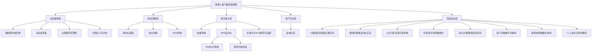

## 88.3 风向标 —— 让趋势变成可复制的行动地图

### 为什么需要这个概念？

面对海量信息，普通人无法判断什么是真机会、什么是噪音。头部玩家的动作（选品、内容、投放）已经过市场验证，跟随其轨迹可大幅降低试错成本。素材中反复强调：“进生财8个月，翻遍了所有的精华帖，盘点拆解生财的赚钱方法！”，风向标是核心认知模型。

> "如何寻找风向标"
> 
> "我是如何通过整合风向标信息 3 天跑出 MVP 并实现变现"
> 
> "通过风向标发掘机会，靠GPT辅助实现MVP最小可行性产品"
> 
> ——《SUMMARY.md》相关条目：《如何寻找风向标》《我是如何通过整合风向标信息 3 天跑出 MVP 并实现变现》《通过风向标发掘机会，靠GPT辅助实现MVP最小可行性产品》《生财有术 | 风向标精选（3.20-3.23）》

### 核心定义

**风向标** 指代行业头部玩家、头部账号、头部产品或新兴平台功能发布等能够预示趋势方向的标杆对象。通过监控其动作（选品、内容形式、推广渠道）来降低决策不确定性。

### 关键性质

- **可追踪性**：头部玩家的公开动作留下数字足迹，可被监控和分析
- **可验证性**：其商业模式已跑通闭环，具备确定性参考价值
- **时效性**：窗口期约1-3个月，需快速捕捉并微创新测试

### 典型例子

- 监控小红书无货源电商头部账号的选品和笔记结构，复制核心动作微创新
- 跟踪视频号ChatGPT赛道头部账号的直播话术和引流路径，3天跑通MVP
- 观察抖音鸡血石直播间的福利留人、拍卖建信、千川投流六阶段进化路径

### 边界条件

- 单纯模仿不等于抄袭，必须结合自身资源禀赋进行"微创新"
- 风向标失效红利消退后需及时切换，避免陷入红海竞争
- 需具备基础的商业模式拆解能力（流量源、转化路径、产品结构三要素）

### 风向标追踪法（来源：《SUMMARY.md》）

```
1. 确定赛道Top 10风向标名单
2. 设置监控频次（日/周）
3. 解构其商业模式要素（流量源、转化路径、产品结构）
4. 复制核心动作并微创新测试
```

这个方法展示了如何系统性地将模糊的"趋势"转化为可执行的行动清单：先定名单、再定频次、再拆模型、最后跑测试。它把“关注趋势”这一模糊动作，拆解为四个可执行、可检查、可迭代的标准动作，使得普通人也能像专业投资人一样建立情报系统。

### 方法演进图：从被动围观到主动情报系统

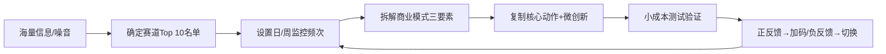

## 88.4 组合创新 —— 用成熟积木搭建新商业模型

### 为什么需要这个概念？

原创发明门槛高、周期长、失败率高，不适合普通人低成本创业。成熟工具（ChatGPT、Midjourney、RPA）、成熟平台（小红书、视频号）、成熟模式（无货源、知识付费、CPS）已验证可行。素材核心主张："通过组合创新，在小红书做研报账号，3周达到5000粉，引流私域600+"。

> "通过组合创新，在小红书做研报账号，3周达到5000粉，引流私域600+"
> 
> "利用 GPT4 迅速将想法落地，让创意在半天时间内变成 MVP"
> 
> "ChatGPT + 👸号爆文写作，从 0 开始 7 天达成阅读 10W+"
> 
> "AI模特项目 7 天跑通变现闭环的复盘实录"
> 
> ——《SUMMARY.md》相关条目：《通过组合创新，在小红书做研报账号，3周达到5000粉，引流私域600+》《利用 GPT4 迅速将想法落地，让创意在半天时间内变成 MVP》《ChatGPT + 👸号爆文写作，从 0 开始 7 天达成阅读 10W+》《AI模特项目 7 天跑通变现闭环的复盘实录》《行动起来，就会有好事发生：AI 绘画万字使用手册》

### 核心定义

**组合创新** 是非原创式发明，而是将成熟的技术工具、成熟的流量平台与成熟的商业模式进行重新组装，快速生成新的变现路径。核心公式：

```
新变现路径 = 成熟工具 × 成熟平台 × 成熟模式 + 微创新
```

### 关键性质

- **低门槛**：不需要硬核技术研发，核心是"懂业务+会提示词+会搭RPA"的应用层能力
- **高确定性**：每个组件都已跑通市场验证，组合后的不确定性大幅降低
- **可迁移性**：同一组合逻辑可跨平台、跨品类复用（如AI模特、AI批量剪辑、RPA自动发帖）

### 典型例子

- ChatGPT + 👸号爆文写作：7天达成阅读10W+
- AI模特项目：7天跑通变现闭环（Midjourney/ControlNet + 电商摄影需求 + 私域变现）
- RPA + 知乎好物：自动化卖货最小闭环（草稿箱 + RPA调用ChatGPT + 人工把关）
- 研报账号：付费研报内容源 + 稿定设计模板 + 群聊引流 + ArtStation素材库 = 3周5000粉

### 边界条件

- 组合非随意拼凑，需遵循"流量源-转化路径-产品结构"商业闭环逻辑
- 核心微创新点必须解决用户真实痛点（如AI模特解决版型准确率95%+、真人感审美）
- 避免"工具中毒"：平台只是工具，赚钱只有流量+产品两件事

### 多源对照：组合创新的不同解读

不同素材对"组合创新"的侧重点存在差异，通过对比五个典型案例可见其演进脉络：

| 素材案例 | 核心组合组件 | 微创新点 | 侧重差异 |
|---------|-------------|---------|---------|
| **研报账号** | 付费研报内容源 × 稿定设计模板 × 群聊引流 × ArtStation素材库 | 将付费研报“拆解+可视化”输出为免费高质量笔记，群聊公告+PDF水印双重变现 | **《SUMMARY.md》** 强调“工具×平台×模式”的结构化组装，侧重方法论复用性与私域闭环 |
| **AI模特商拍** | Midjourney/ControlNet × 电商摄影需求 × 私域高客单变现 | 版型准确率95%+、真人感审美、人工PS兜底补全技术短板 | 侧重**技术门槛跨越商用临界点**的时间窗口红利，强调“懂业务+会提示词”的应用层能力 |
| **ChatGPT+👸号爆文** | ChatGPT × 👸号流量分发 × 爆文结构化模板 | 半天落地MVP、7天跑通10W+阅读、提示词工程标准化 | 侧重**AI大脑+平台分发**的极速内容生产飞轮，验证“内容即产品”模式 |
| **RPA+知乎好物** | Automa插件 × 草稿箱批量管理 × ChatGPT文案生成 × 人工二次润色 | 半自动化平衡效率与账号安全/内容质量 | **《doxcnXIOtkZmPJLb1izKrreOuMg.md》** 侧重具体落地细节与容错机制，展示“RPA手脚+AI大脑”协作范式 |
| **亚马逊Posts自动化** | UIBot Creator × 无版权图库场景化素材 × 亚马逊免费流量入口 | 受众场景共鸣替代产品实拍、延时随机化防封、4.0版本多重容错 | 侧重**工程化落地与环境差异容错**，体现“先人工跑通再自动化”的工程纪律 |

**共识**：核心是利用已验证组件降低不确定性，微创新解决真痛点。

**分歧**：
- 《SUMMARY.md》强调"工具×平台×模式"的结构化组装，侧重方法论复用性
- 《doxcnXIOtkZmPJLb1izKrreOuMg.md》通过"RPA工具×Posts免费流量×场景化素材"的实战组合，侧重具体落地细节与容错机制
- 实战案例显示：研报账号组合了4个成熟组件（内容源、设计模板、引流渠道、素材库），而亚马逊Posts组合了3个核心组件，组件数量与复杂度正相关

### 组合创新决策流程图

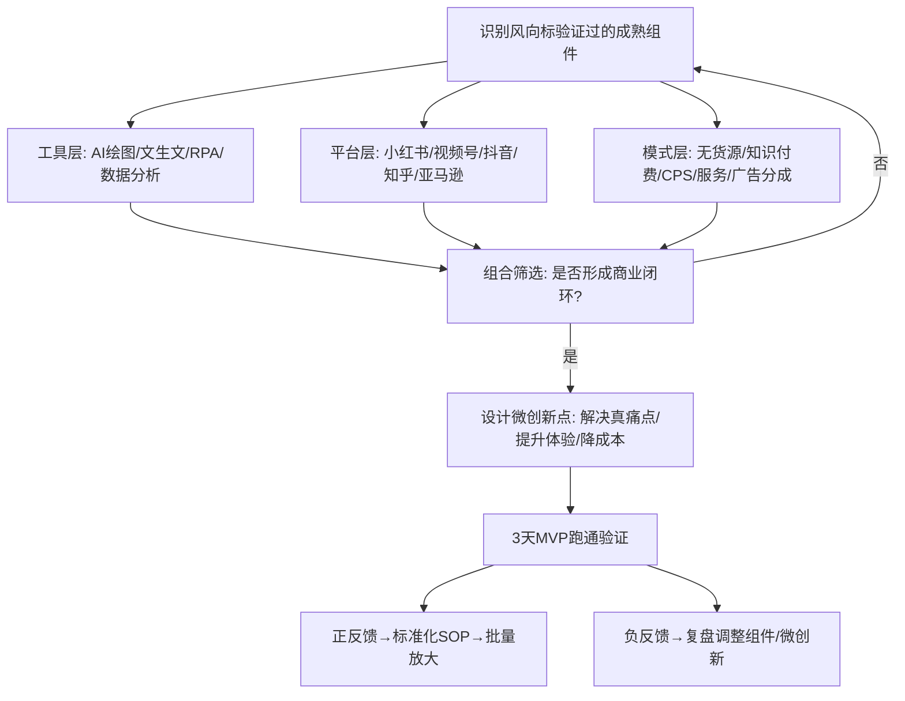

## 88.5 MVP思维 —— 用最低成本跑通商业闭环

### 为什么需要这个概念？

完美主义导致迟迟不敢启动，或投入巨大后发现需求不存在。素材反复验证："失业危机自救:AI模特项目7天跑通变现闭环的复盘实录"、"利用 GPT4 迅速将想法落地，让创意在半天时间内变成 MVP"。普通人资源有限，必须先验证"有人买单"再投入资源迭代。

> "我是如何通过整合风向标信息 3 天跑出 MVP 并实现变现"
> 
> "利用 GPT4 迅速将想法落地，让创意在半天时间内变成 MVP"
> 
> "失业危机自救:AI模特项目7天跑通变现闭环的复盘实录"
> 
> "如何通过风向标发掘机会，靠GPT辅助实现MVP最小可行性产品"
> 
> "极速MVP上线与静默交易变现：小报童专栏一日成型实录"
> 
> ——《SUMMARY.md》相关条目：《我是如何通过整合风向标信息 3 天跑出 MVP 并实现变现》《利用 GPT4 迅速将想法落地，让创意在半天时间内变成 MVP》《失业危机自救:AI模特项目7天跑通变现闭环的复盘实录》《如何通过风向标发掘机会，靠GPT辅助实现MVP最小可行性产品》《极速MVP上线与静默交易变现：小报童专栏一日成型实录》

### 核心定义

**MVP思维** 是最小可行性产品思维在赚钱项目中的实践：不追求完美，先用最低成本（时间、金钱）跑通"获客-转化-交付"的完整闭环，验证需求真实性后再投入资源迭代。核心指标：有人付费、能交付、可复制。

### 关键性质

- **速度优先**：3天跑通MVP、7天变现、半天搭建原型
- **闭环导向**：必须包含获客、转化、交付全链路，不能只有产品没有销售
- **低成本**：利用现有工具、平台红利、免费流量，避免重资产投入

### 典型例子

- AI模特：7天从技术调研到首单付费，人工PS兜底补全技术短板
- 小报童专栏：从洞察机会到上线仅1天，内测6天售出80单GMV 1.5万
- 闲鱼二手书：单号日利润20元，188元学费周回本，近1000学员验证
- 知乎好物：自动化卖货最小闭环（草稿箱+RPA+人工把关）月度稳定收益

### 边界条件

- MVP不等于简陋，核心体验必须达标（如AI模特版型准确率95%+、真人感审美）
- 必须设定明确止损线：如"单账号累计100条作品无单果断切换项目"
- 正反馈确立前不投入重资源（团队、RPA、付费流量）

### AI辅助MVP三步法（来源：《SUMMARY.md》）

```
1. 构思：用ChatGPT进行市场调研、痛点挖掘、方案生成
2. 落地：用GPT API/插件/代码解释器快速产出原型
3. 验证：小额投流/发布内容测试转化，跑通闭环后再决定是否投入RPA/团队放大
```

这三步展示了从"想法"到"验证"的最短路径：用AI做大脑想、用工具做手脚干、用市场做试金石验。它将原本需要团队协作数周的产品开发周期，压缩到个人可在半天至3天内完成的“构思-落地-验证”微循环，极大降低了试错门槛。

### MVP验证漏斗图

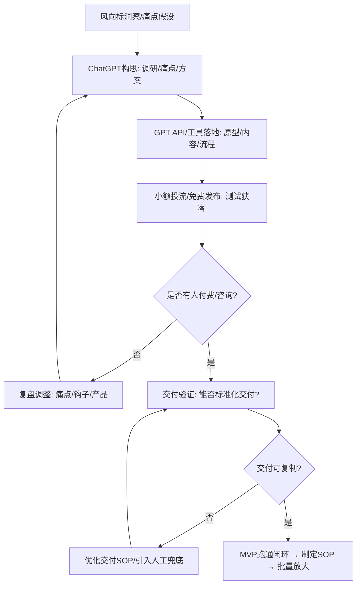

## 88.6 批量思维 —— 用概率对抗单点不确定性

### 为什么需要这个概念？

单一账号/视频/产品成功率低、波动大，受算法、竞品、运气影响过大。素材量化指标："单人日产200条"、"开18个闲鱼店铺"、"矩阵号日更9条/天顶多3小时"。核心逻辑：将单一成功经验标准化为SOP，通过多账号矩阵、多平台分发放大收益。

> "单人日产 200 条之批量思维"
> 
> "零基础也能批量产出高质量带货视频，超强视频批量剪辑软件"
> 
> "航海复盘：利用剪映+达芬奇+影刀 RPA 提高混剪效率"
> 
> "《2023年，为了让亦仁认识我，我一口气注册了6张执照，开了18个二手书闲鱼店铺》"
> 
> "代码，软件，程序本质上是杠杆，不仅解放你的双手，还能复制你的时间。"
> 
> "君子性非异也，善假于物也。"
> 
> ——《SUMMARY.md》、《doxcnXIOtkZmPJLb1izKrreOuMg.md》

### 核心定义

**批量思维** 用概率思维对抗单点不确定性：标准化SOP + 矩阵化执行 + 工具杠杆 = 确定性放大。核心公式：

```
规模化收益 = 单点成功率 × 执行量级 × 平均客单价
```

### 关键性质

- **标准化前提**：必须有可复制的SOP（如剪映六步去重法、Posts发布15步流程、短剧卡点式结构）
- **工具杠杆**：RPA、AI批量生成、多平台分发工具（蚁小二）是放大执行量级的关键
- **容错设计**：单账号/单视频失败不影响整体，通过大数定律实现收益稳定

### 典型例子

- 短视频批量剪辑：单人日产200条，60个账号矩阵，最高单日佣金8万+
- 闲鱼二手书：18个店铺矩阵，社区工作室模式（低租金+兼职大学生+按件结算）
- 短剧CPS：300号矩阵，39天流水77万，分成到手62.55万，爆款产出比近2:1
- 亚马逊Posts：RPA自动化批量发布，多店铺并行，边际成本趋近零

### 边界条件

- 无SOP不批量：业务流程必须先人工跑通验证盈利模型再引入RPA/矩阵放大
- 质量底线：批量不等于低质，需建立质检机制（如短剧沉浸式预剪辑、Posts人工跑通一次再自动化）
- 平台风控红线：矩阵操作需解决环境隔离（指纹浏览器+独立IP）、账号养号、行为模拟等防关联问题

### 方法演进图：从人工到自动化的批量化路径

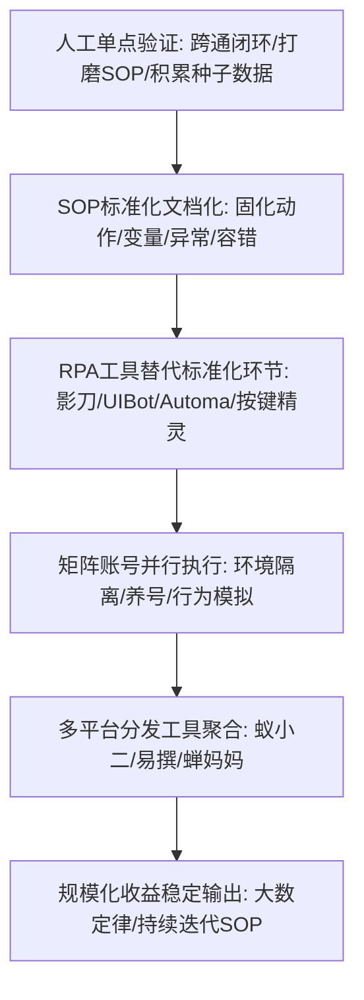

## 88.7 私域沉淀 —— 让流量变成可复利的资产

### 为什么需要这个概念？

公域流量成本递增、不可控、平台规则变动风险高，且难以承载高客单价复杂服务。素材反复强调："流量尽头是微信私域"、"私域为所有公域玩法终局归宿"。高客单价非标服务（咨询、陪诊、定制、高端课程）必须在私域完成信任构建与交付。

> "孕晚期准妈妈通过视频号 10 天涨粉 1000+，成功引流私域的案例复盘"
> 
> "普通人做小红书，从 0 到 1，起盘我 0 元成立一个社群，单月变现 8w+的经验"
> 
> "抖音直播引流私域的 6 个方法"
> 
> "通过组合创新，在小红书做研报账号，3 周达到 5000 粉，引流私域 600+"
> 
> "私域是所有公域玩法的终局归宿"
> 
> ——《SUMMARY.md》相关条目：《孕晚期准妈妈通过视频号 10 天涨粉 1000+，成功引流私域的案例复盘》《普通人做小红书，从 0 到 1，起盘我 0 元成立一个社群，单月变现 8w+的经验》《抖音直播引流私域的 6 个方法》《通过组合创新，在小红书做研报账号，3 周达到 5000 粉，引流私域 600+》《私域是所有公域玩法的终局归宿》

### 核心定义

**私域沉淀** 将公域流量（视频号、小红书、抖音、知乎、百家号等）通过钩子（资料包、社群、表白墙、陪诊服务等）引入微信个人号/社群/企微，构建高信任、高复购、可长期运营的用户资产。私域不是终点，而是高LTV（生命周期价值）变现的放大器。

### 关键性质

- **信任复利**：长期累积信任资产支撑高客单快速成交（最快20分钟成交高客单）
- **可控性**：不受平台算法波动影响，用户资产归属自我（需解决账号归属法律协议）
- **多元变现**：同一私域池可承载知识付费、实物电商、服务咨询、分销佣金等多业务线

### 典型例子

- 孕晚期妈妈：视频号10天涨粉1000+引流私域，预售课程验证需求
- 普通人小红书：0元建社群单月变现8W+，阶梯定价（499元早鸟→稳态日增20好友转3单）
- 研报账号：3周5000粉引流私域600+，群聊公告引流👸号+PDF水印双重变现
- 学生私域："韭菜大队"自嘲文化+阶梯定价（188-5888元）信任阶梯，全生命周期LTV矩阵

### 边界条件

- 引流钩子必须匹配目标用户操作能力（如中老年用户需直接发二维码图片降维操作路径）
- 私域运营核心是"利他分享"而非"硬广刷屏"，朋友圈专栏化（观念/专业/生活/附加价值四专栏）建立立体信任
- 需建立内容库预制去IP依赖化运营：创始人前置构建核心内容库，后续外包分发切片

### 私域全链路漏斗图

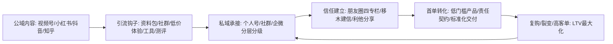

## 88.8 RPA自动化 —— 给非程序员装上"数字员工"

### 为什么需要这个概念？

高重复、低决策的运营动作（发帖、回邮件、采集数据、分发内容）消耗大量人力，边际成本高。程序员稀缺昂贵，非技术人员无法编写代码自动化，RPA填补了"想自动化但不会代码"的鸿沟。素材定律："RPA降维打击人工成本：对于高重复、低决策的运营动作，RPA自动化的边际成本趋近于零"。

> "一个工具管理上百个社媒账号？指纹浏览器使用全攻略"
> 
> "用 RPA 自动在亚马逊店铺发布 POST"
> 
> "通过 ChatGPT+RPA，帮我在知乎上自动卖货"
> 
> "通过 ChatGPT+RPA，帮我在 BOSS 直聘 + RPA 来挖掘适合普通人赚钱的项目"
> 
> 
> "代码，软件，程序本质上是杠杆，不仅解放你的双手，还能复制你的时间。"
> 
> ——《SUMMARY.md》、《doxcnXIOtkZmPJLb1izKrreOuMg.md》

### 核心定义

**RPA自动化**（机器人流程自动化）：通过可视化拖拽或录制操作，模拟人工在浏览器/客户端/UI界面的键鼠操作，实现跨系统、跨平台的业务流程自动化。素材架构：影刀RPA/按键精灵/指纹浏览器做"手脚"，ChatGPT API/提示词工程做"大脑"，对接平台API/模拟人工操作做"接口"。

### 关键性质

- **非侵入式**：无需对方系统开放API，直接操作前端界面，适配性极强
- **低门槛**：UIBot Creator可视化模式、影刀RPA拖拉拽，非程序员可上手
- **可组合**：可串联浏览器操作、API调用、文件读写、OCR识别、AI推理等多种能力

### 典型例子

- 亚马逊Posts：UIBot 15步流程自动化发布，两店铺稳定跑通，单条人工2-3分钟→RPA边际成本近零
- 知乎好物：Automa插件遍历草稿箱调用ChatGPT填充回答，人工二次润色发布
- BOSS直聘：RPA批量发布职位/沟通简历 + ChatGPT生成文案/应对面试，单人公司规模化运作
- 社媒矩阵：蚁小二一键多平台分发，解决多账号运营效率

### 边界条件

- 环境差异是最大变数：浏览器缩放、分辨率、文件路径、网络延迟均需人工跑通一次调试
- 平台反爬升级：紫鸟浏览器禁止第三方RPA、验证码/风控策略变更需持续维护容错机制
- 核心原则：先人工跑通验证盈利模型，再引入RPA替代标准化环节，不可为了自动化而自动化

### 关键方法：RPA可视化流程搭建五步通用法（来源：《doxcnXIOtkZmPJLb1izKrreOuMg.md》）

```
1. 可视化建模：使用UIBot Creator/影刀RPA等工具，以拖拉拽/录制方式绘制业务流程图，而非写代码
2. 源码导入复用：导入社区/前辈提供的成熟版本源码（如4.0版含多重容错机制），避免从零开始造轮子
3. 参数化配置：将固定路径、账号密码、延时时长、关键词等提取为变量，实现一套流程多环境复用
4. 容错机制植入：在关键节点（元素查找/网络请求/文件读写）植入重试、超时、异常分支、截图报警等容错逻辑
5. 闭环调试标准化：人工跑通一次全流程→录制基准数据→RPA回放对比→建立环境标准化清单(分辨率/缩放/路径/浏览器版本)
```

这套方法论将非程序员从“工具操作手册”层面提升到“自动化工程化”层面：不再纠结点哪个按钮，而是关注流程建模、参数化、容错、环境标准化这四个可迁移的核心动作，可复用到知乎好物、BOSS直聘、小红书发布等一切高重复低决策场景。

### 数据流图：RPA+AI自动化生产线信息流向

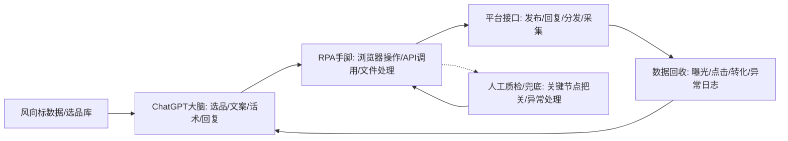

## 88.9 赚钱即利他定律 —— 商业本质的底层重构

### 为什么需要这个概念？

普通人普遍存在"赚别人钱不好意思"的道德负罪感，导致不敢报价、不敢推销、不敢规模化。误将商业视为零和博弈，忽视交易双方均获益的价值创造本质。素材核心金句："商业本质是价值交换，赚钱的核心路径是帮别人解决问题（省钱、省时、赚钱、爽感、安全感）"。

> "《赚钱就是在帮别人，就是在利他》"
> 
> "好的服务是会让客户下意识的选择它"
> 
> "以经济学方式解决家庭教育难题为例，欲望是一切目标的货币"
> 
> "知识付费本质：避坑工具而非致富门票"
> 
> "收费边界设定协议：收钱即责任与保护"
> 
> ——《SUMMARY.md》相关条目：《赚钱就是在帮别人，就是在利他》《好的服务是会让客户下意识的选择它》《以经济学方式解决家庭教育难题为例，欲望是一切目标的货币》《知识付费本质：避坑工具而非致富门票》《收费边界设定协议：收钱即责任与保护》

### 核心定义

**赚钱即利他定律**：合法交易必然是双向价值创造：买方感知价值>价格，卖方价格>成本，因此盈利过程即帮人过程。利他越深（解决核心痛点）、覆盖人群越广、频次越高，赚钱越容易、越持久。

### 关键性质

- **主观价值理论支撑**：价值源于用户主观感知而非成本，价格是价值分配的坐标
- **筛选机制**：不追求普度众生，而通过筛选"值得帮"、"适合"的用户，确保双方价值感知匹配
- **正向循环**：真正利他 → 用户获益 → 口碑传播/复购 → 更多利他机会 → 更多收益

### 典型例子

- 知识付费：核心价值在于缩短试错周期、跑通标准化流程、规避致命坑点（避坑工具而非致富门票）
- 陪诊服务：从卖体力进化到卖资源/渠道（绿通/院内制剂/海外就医），深度解决就医难题
- 同城相亲：信任>流量，服务>营销，三层产品阶梯（活动解决信任→互动群筛选→一对一红娘核心利润）
- 成人用品即时配送：解决临时/隐私/即时痛点，夜场/酒店/大学城周边核心选址

### 边界条件

- 利他不等于无偿：收费建立责任契约倒逼专业交付，同时防止"白嫖"导致心理内耗
- 必须具备领域专业知识甄别AI幻觉/控制服务质量："懂行才能把AI当实习生使"
- 避免"巨婴陷阱"：纯付费不参与/纯索取不付出均无法建立真实连接，需等价交换

### 利他-商业正向飞轮图

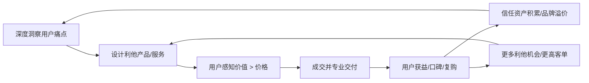

## 88.10 认知变现差 —— 认知高的人已变现，认知低的人还在围观

### 为什么需要这个概念？

同一信息/工具/趋势（如ChatGPT、Midjourney、小红书无货源），认知高的人已跑通变现，认知低的人还在焦虑/学习/犹豫。认知差是可以量化缩小的，而非天赋决定，素材提供了明确缩小路径。核心痛点："给心急 AIGC 但却感觉无法搭车的同学们的一点思路"。

> "【生财认知】"
> 
> "ChatGPT 和文心一言的影响力都被低估了"
> 
> "给心急 AIGC 但却感觉无法搭车的同学们的一点思路"
> 
> "进生财8个月，翻遍了所有的精华帖，盘点拆解生财的赚钱方法！"
> 
> "国内认知闭塞与信息差红利：核心圈层与大众认知的时间差套利"
> 
> ——《SUMMARY.md》相关条目：《【生财认知】》《ChatGPT 和文心一言的影响力都被低估了》《给心急 AIGC 但却感觉无法搭车的同学们的一点思路》《进生财8个月，翻遍了所有的精华帖，盘点拆解生财的赚钱方法！》《国内认知闭塞与信息差红利：核心圈层与大众认知的时间差套利》

### 核心定义

**认知变现差**：同一外部机会下，不同认知水平个体的变现结果差距。缩小路径四步法：进高质量社群 → 付费买时间的复盘/教程 → 实战跑通MVP → 复盘沉淀方法论。

### 关键性质

- **信息不对称的本质是认知不对称**：风向标信息公开，但能拆解出商业模式要素的认知稀缺
- **付费是最高效的认知跃迁方式**："主动付费购买见识（认知更高阶案例）是打破认知天花板、实现格局跃迁的最短路径"
- **实战是唯一检验标准**："纸上得来终觉浅，绝知此事要躬行"，只有跑通闭环才能内化为认知资产

### 典型例子

- ChatGPT发布插件功能：核心圈层即时动员抢占生态红利，大众还在围观
- 视频号ChatGPT赛道：10天速成头部账号，公私域联动变现2W+，晚入场者错过红利窗口
- AI模特商拍：技术跨越商用门槛未普及标准化时入局最优，延后面临红海价格战
- 生财圈友新人五阶段：看不懂→怀疑吹牛→迷茫试错→卸载退出→焦虑回流，认知重构必经痛苦期

### 边界条件

- 认知升级需"行为倒推认知"："行为改变（不看报告/刻意练标题/隐匿账号）倒推认知升级形成正向飞轮"
- 避免"伪勤奋"：收藏不等于掌握，囤积教程不等于会用，必须经历"回顾、记忆、实践、输出"四阶段内化
- 核心圈层与大众认知存在时间差套利："北上广核心圈层误判大众普及度，忽视下沉市场巨大认知鸿沟"

### 认知跃迁四阶段内化模型

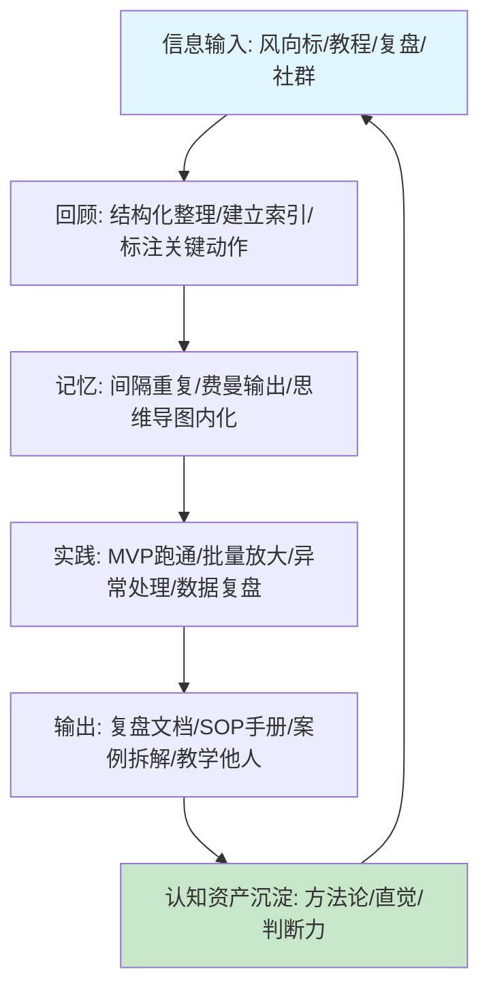

## 88.11 过程即奖赏原则 —— 聚焦过程确定性对抗结果不确定性

### 为什么需要这个概念？

过度关注结果（赚多少钱、涨多少粉）导致焦虑、内耗、遇挫折即放弃。创业/副业充满不确定性，唯有过程（学技能、做内容、搭系统、解难题）具备确定性可控性。素材金句："过去的一年虽然没 gap，却也是实打实的 self-caring year"、"只要在做事，就会不停的遇到新的难题"。

> "《过程本身就是奖赏》"
> 
> "只要在做事，就会不停的遇到新的难题"
> 
> "过去的一年虽然没 gap，却也是实打实的 self-caring year"
> 
> "体制内从 0-1 突破舒适圈，副业年赚 20W+ 的心得"
> 
> "激情驱动耐力模型与使命情怀锚点"
> 
> ——《SUMMARY.md》相关条目：《过程本身就是奖赏》《只要在做事，就会不停的遇到新的难题》《过去的一年虽然没 gap，却也是实打实的 self-caring year》《体制内从 0-1 突破舒适圈，副业年赚 20W+ 的心得》《激情驱动耐力模型与使命情怀锚点》

### 核心定义

**过程即奖赏原则**：聚焦过程本身带来的成长确定性（能力迭代、认知升级、资源积累、人脉连接），结果反而作为副产品自然到来。非竞争性生存状态：超越社会比较框架（无竞争感/危机感/嫉妒/自卑/骄傲），以"独特、有趣、全神贯注、利他"为内在坐标。

### 关键性质

- **奖赏即时化**：每一次解决难题、产出内容、跑通流程、链接高手都是即时奖赏
- **抗压持久力**："普通创业者的唯一核心壁垒是比对手更能扛、活得更久"（元气森林创始人观点）
- **激情驱动耐力**：意志力有限易耗竭，唯有"不挣钱也甘愿做"的激情/使命能穿越死亡谷

### 典型例子

- 11个航海打卡211次：过程目标（打满卡）屏蔽不可控结果目标，反获超预期心理能量
- 王永超烂牌翻盘：辍学打工→疫情居家创业→入生财认知跃迁，每个阶段聚焦当下可控动作
- 体制内副业：下班后8小时从生活兴趣切入，人人具备体验感、易产出真实内容、心理包袱最小

### 边界条件

- 不等于不关注结果：需建立关键指标看板（如储蓄率35%、生存跑道、月度双表复盘），但情绪不绑定结果
- 接纳全谱系体验：含痛苦崩溃、焦虑迷茫，"瞅了瞅"具象化创伤将恐惧转化为可应对对象
- 臣服当下：认知"无常"为常态，"一切最好安排"实现心力转化

### 过程导向 vs 结果导向 对比图

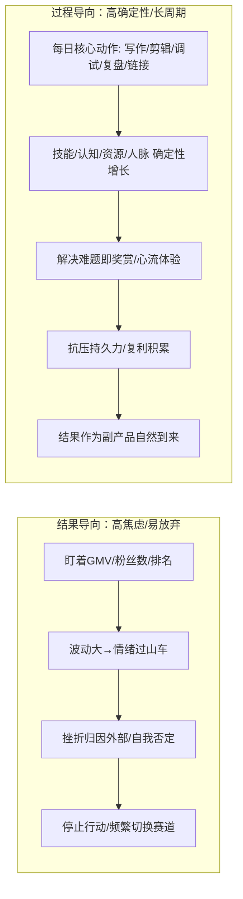

## 88.12 长期主义复利论 —— 时间是验证价值的核心变量

### 为什么需要这个概念？

机会主义频繁切换赛道导致"快速赚钱但无积累"，敏锐度无法替代定力。真正的关注源于"过了这么久你居然还在那里"，初期曝光是噪音，长期存续是信号。素材壁纸金句："人们真正注意到你时，是发现过了这么久你居然还在那里"。

> "人们真正注意到你时，是发现过了这么久你居然还在那里"
> 
> "11 个航海，打满卡 211 次，让我开启了人生新的起点"
> 
> "杭州全国见面会二十句话壁纸"
> 
> "全国见面会-经典语录壁纸"
> 
> "注意力获取的时间门槛定律：坚持即稀缺"
> 
> ——《SUMMARY.md》相关条目：《人们真正注意到你时，是发现过了这么久你居然还在那里》《11 个航海，打满卡 211 次，让我开启了人生新的起点》《杭州全国见面会二十句话壁纸》《全国见面会-经典语录壁纸》《注意力获取的时间门槛定律：坚持即稀缺》

### 核心定义

**长期主义复利论**：在不确定环境下，坚持做难但正确的事（建立IP、沉淀私域、练硬技能、做资源整合），时间会成为朋友。注意力获取的时间门槛定律：坚持即稀缺，业务模式倒逼专注（高退出成本业务客观要求长期主义）。

### 关键性质

- **从被动专注到主动专注**：被高退出成本业务"逼着专注" → 主动选择专注作为战略
- **复利三要素**：正向循环（利他→信任→复购/裂变）+ 时间维度 + 规模效应
- **业务模式决定可行性**：社群/私域/品牌等高沉没成本模式天然适配长期主义

### 典型例子

- 视频号书豪：连续3年实战复盘，年入百万、矩阵30万粉，验证"垂直IP+团队化=确定性趋势"
- 同城相亲：五年深耕，核心壁垒是线下高频活动构建物理信任锚点+时间复利下客户转介绍网络
- 个人IP建设：写作是可练技能、阅读爽文是刚需，文字载体数千年永存，跨平台迁移抗周期
- 社群赋能：生财有术提供前辈指引、结构化航海实战、人脉网络，助力作者3年入圈、2月航海、3周团队7位数收益

### 边界条件

- 坚持不等于死磕错误方向："业务停滞3-6月判定法则：方向错而非执行不力，需果断止损调向"
- 需建立动态校准机制：定期复盘（月度双表、季度战略、年度盘点），在坚持中微调方向
- 避免"长期主义借口"：用长期主义掩盖当下执行不力、产品烂、模式不通的现实问题

### 长期主义动态校准机制图

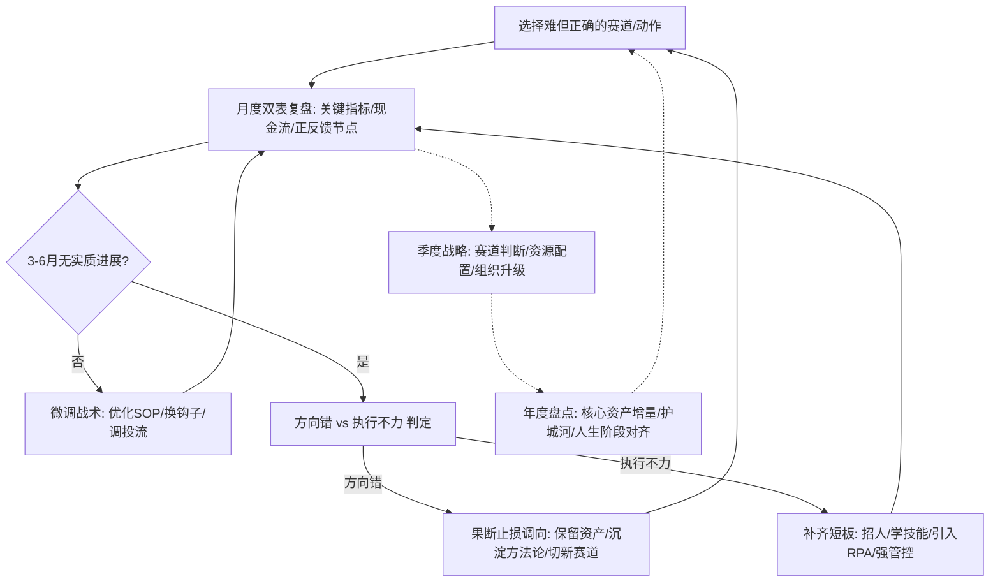

## 88.13 RPA杠杆思维 —— 代码即时间复制器

### 为什么需要这个概念？

传统认知将RPA视为技术工具，忽视其作为"杠杆"的商业本质：解放双手、复制时间。素材升华："代码，软件，程序本质上是杠杆，不仅解放你的双手，还能复制你的时间。君子性非异也，善假于物也。" 普通人最稀缺的是时间与精力，RPA将可标准化的重复劳动外包给"数字员工"。这一概念在《doxcnXIOtkZmPJLb1izKrreOuMg.md》中被显性提出，并在《SUMMARY.md》中通过大量实战案例得到改进与验证。

> "代码，软件，程序本质上是杠杆，不仅解放你的双手，还能复制你的时间。"
> 
> "君子性非异也，善假于物也。"
> 
> "几年前刚毕业还在深圳的时候，我是用按键精灵，批量自动发布售后邮件，当时几千封发送的单调动作，真是让人觉得生无可恋。"
> 
> "RPA降维打击人工成本定律"
> 
> ——《doxcnXIOtkZmPJLb1izKrreOuMg.md》（origin角色）与《SUMMARY.md》（improve角色）共同支撑

### 核心定义

**RPA杠杆思维**：将代码、软件、程序、自动化脚本视为杠杆工具，核心价值在于时间复制与杠杆放大，而非单纯的技术实现。RPA杠杆公式：

```
杠杆收益 = （人工单次耗时 - 自动化单次耗时）× 执行频次 × 时间价值
```

### 关键性质

- **边际成本趋近零**：一次开发/调试投入，无限次复用，边际成本仅为电费/服务器费
- **复制专家经验**：将高手的操作SOP（如Posts发布15步、短剧卡点式结构）固化为自动化流程
- **组合放大**：RPA + AI + 平台API = 指数级生产力（如ChatGPT生成文案 → RPA批量发布 → 平台分发）

### 典型例子

- 亚马逊Posts：人工2-3分钟/条 → RPA边际成本近零，多店铺并行，Posts成当前最优免费流量入口
- 闲鱼二手书：社区工作室模式（兼职大学生+按件结算）+ RPA工具 = 固定成本极低、利润率远超实体仓库
- 知乎好物：Automa + ChatGPT 半自动化卖货闭环，平衡效率与账号安全/内容质量
- BOSS直聘挖项目：RPA负责数据采集/账号管理/批量发布，ChatGPT负责文案/话术/知识速查

### 边界条件

- 非万能药：高决策、强创意、需情感连接的环节（如直播带货谈单、高客单咨询诊断）不适合RPA
- 维护成本隐性：平台界面变更、风控升级、反爬对抗需持续投入维护，需计入TCO
- 先人工跑通："业务流程必须先人工跑通验证盈利模型再引入RPA替代标准化环节"

### RPA杠杆投入产出模型图

```mermaid
graph TD
    A[人工单次耗时 T_h] --> C[杠杆收益计算]
    B[自动化单次耗时 T_r ≈ 0] --> C
    D[执行频次 N 次/天] --> C
    E[时间价值 V 元/小时] --> C
    C --> F[杠杆收益 = (T_h - T_r) × N × V]
    F --> G[一次性开发成本 C_dev]
    G --> H[盈亏平衡点: N_break = C_dev / ((T_h - T_r) × V)]
    H --> I[N > N_break → 持续产生净收益]
    I --> J[维护成本 C_maint/月]
    J --> K{C_maint < 月度节省成本?}
    K -->|是| L[杠杆持续有效]
    K -->|否| M[重构/放弃自动化]
```

## 88.14 场景化素材库 —— 受众共鸣大于产品实拍

### 为什么需要这个概念？

传统电商思维执着于产品实拍/修图，成本高、周期长、转化不一定好。素材反直觉发现："Posts素材的核心是'受众场景共鸣'而非'产品细节展示'"。无版权图库按人群标签检索的通用场景图，比自行拍摄产品图更高效且转化相关性强。这一概念源自《doxcnXIOtkZmPJLb1izKrreOuMg.md》的原创洞察，并在《SUMMARY.md》的更广泛实战中得到应用验证。

> "方法很简单，你不需要完全去真正拍摄或者修图所售产品，只需要找到产品同类的场景，以及对应的受众即可。"
> 
> "比如我在《蓝海产品方法论》当中所讲的几大人群：教师，司机，护士，父母等等。"
> 
> "其实这个也是潮汕牛肉丸的抖音策略，批量发布产品相关视频，反正只要有免费流量，就出现你的产品链接就好，受众尽可能精准。"
> 
> "Posts素材的核心是'受众场景共鸣'而非'产品细节展示'"
> 
> ——《doxcnXIOtkZmPJLb1izKrreOuMg.md》（origin角色）与《SUMMARY.md》（apply角色）共同支撑

### 核心定义

**场景化素材库**：不拘泥于自有产品实拍图，而是通过搜索无版权图库，按目标受众画像（教师、司机、护士、父母等）及使用场景关键词批量下载通用场景图作为营销素材。核心逻辑：用户买的是"自己在场景中使用产品的美好预期"，而非产品参数本身。

### 关键性质

- **成本极低**：无版权图库免费/低成本，配合ImageAssistant批量采图插件，素材获取边际成本近零
- **效率极高**：搜索关键词 → 筛选类型/大小 → 全选下载，标准化动作可RPA自动化
- **转化相关性强**：场景图天然承载受众痛点/渴望，引发"这就是我要的生活"共鸣，点击率/转化率更高

### 典型例子

- 亚马逊Posts：教师/司机/护士/父母等人群标签场景图，配合产品链接，免费获取精准流量
- 潮汕牛肉丸抖音策略：批量发布产品相关视频，反正只要有免费流量，就出现产品链接，受众尽可能精准
- 小红书无货源：醒图改尺寸/滤镜/镜像二创 + 剪映模板套用，素材聚合→二创→套用标准化流水线

### 边界条件

- 非标品/高客单/强视觉品类（珠宝、高定、美妆）仍需专业实拍，场景化素材适用于标品/低客单/弱视觉品类
- 素材需二创规避版权/去重：镜像、调色、裁剪、滤镜、特效、变速等组合处理
- 平台原创度算法升级需持续迭代去重策略，AI生成素材（Midjourney/Stable Diffusion）成新选项

### 场景化素材获取标准化流程图

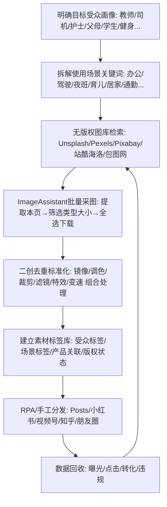

## 88.15 设计中的取舍

本节以完整段落形式阐述体系设计中的关键权衡，每个取舍都有具体案例与量化支撑。

**为什么不用原创发明而是组合创新？** 原创发明需要研发投入、技术壁垒、市场教育，周期长、风险高、普通人资源不足。以AI模特项目为例：若自研扩散模型，需算力、算法、数据三重门槛，周期以年计；而组合创新利用Midjourney/ControlNet（成熟工具）+电商摄影需求（成熟市场）+私域高客单（成熟模式），7天跑通首单，30天稳定月入5位数。组合创新将不确定性压缩到“微创新”单点（版型准确率95%+、真人感审美），成功率指数级提升。代价是竞争门槛降低，需持续微创新保持差异化——这正是“风向标追踪”持续迭代的意义。

**为什么要先MVP后批量？** 无验证的批量是赌博。闲鱼二手书案例中，作者先单号人工跑通“日利润20元、周回本”，打磨出选品、定价、发货、客服全链路SOP，验证模型盈利后，才注册6张执照开18个店铺、引入兼职大学生按件结算、上RPA工具。反向操作会放大亏损：若模型不通，18个店铺同步亏损，现金流直接断裂。代价是前期慢（人工验证期约1-4周），但换取了后期的“确定性放大”——单店模型跑通后，边际复制成本极低，规模化收益呈指数级增长。

**为什么私域是终局而非公域？** 公域流量受算法支配、成本递增、规则不可控；私域用户资产归属自我、信任可复利、承载高客单非标服务。研报账号案例：小红书公域3周涨粉5000，引流私域600+，私域转化率远超公域直接带货；同城相亲五年深耕，核心壁垒是线下高频活动构建物理信任锚点+时间复利下客户转介绍网络，私域LTV（生命周期价值）是公域单次转化的10-50倍。代价是冷启动慢、需自建信任体系、运营门槛高（朋友圈专栏化、分层运营、去IP依赖内容库），但这是建立护城河的必要投入。

**RPA与AI的分工边界在哪里？** RPA做“手脚”（确定性流程执行、界面操作、文件处理、定时触发），AI做“大脑”（非结构化理解、内容生成、决策推理、意图识别）。混用会导致：让RPA做判断→容错率低、异常频发；让AI做点击→无法操作界面、无状态记忆。知乎好物案例完美诠释分工：Automa（RPA）负责遍历草稿箱、点击发布、填充输入框、翻页循环；ChatGPT（AI）负责读取草稿内容、生成高质量回答文案、提取商品卖点。人工仅在“二次润色把关”环节介入，实现“效率×质量×安全”的三角平衡。

## 88.16 动手练习

### 练习 1：风向标拆解与MVP设计实战

选定一个你感兴趣的赛道（如：小红书宠物赛道、视频号书单、闲鱼虚拟资料），完成：

1. 列出该赛道 Top 5 风向标账号/产品
2. 拆解其商业模式三要素：流量从哪来？怎么转化？卖什么产品/服务？
3. 基于组合创新公式（成熟工具×平台×模式），设计一个你能在 3 天内跑通的 MVP 方案
4. 设定止损线：累计多少条作品/多少天无正反馈则切换项目？

回答问题：
- 你的微创新点在哪里？如何解决用户真实痛点？
- 为什么选择这个工具/平台/模式的组合？核心确定性来自哪个组件？

### 练习 2：RPA自动化流程手工跑通与代码化

选取一个你日常重复的高频操作（如：发布小红书笔记、回复特定类型私信、采集竞品数据、批量下载图片），完成：

1. 手工完整跑通一次流程，记录每一步点击、输入、等待、判断动作，计算单次耗时
2. 绘制流程图，标注：固定动作、变量输入、异常分支、容错节点
3. 使用影刀RPA/UIBot/Automa等工具尝试将流程代码化/可视化搭建
4. 运行测试 10 次，记录成功率、报错类型、环境差异影响

回答问题：
- 哪些步骤最容易因环境差异（分辨率、缩放、路径）失败？如何标准化环境？
- 引入 RPA 后，边际成本降低多少？什么时候"维护成本"会超过"节省人工成本"？

### 练习 3：私域引流钩子设计与信任资产建立

针对你当前或计划的项目，设计一套"公域内容→引流钩子→私域承接→信任建立→首单转化"的完整链路：

1. 公域平台选哪个？目标用户画像是什么？
2. 引流钩子是什么？（资料包/社群/低价体验/工具/测评），为什么目标用户"下意识选择它"？
3. 私域承接容器：个人号/社群/企微？如何分层？
4. 朋友圈专栏化规划：观念/专业/生活/附加价值四专栏各放什么内容？
5. 首单转化产品：价格、交付形式、交付周期、如何利用"利他"建立责任契约？

回答问题：
- 你的钩子成本多少？转化率预期多少？如何用"移木建信"（小承诺快兑现）加速信任？
- 如何避免"巨婴陷阱"（纯付费不参与）和"钓鱼悖论"（纯索取不付出）？

### 练习 4：个人认知变现差自测与缩小计划

针对当前热门趋势（如：AI绘图/数字人/短剧CPS/小红书无货源/视频号带货），完成：

1. 列出你已知的"风向标信息"与"已验证变现案例"
2. 自测：你在"认知-执行-结果"三阶段的卡点在哪里？（信息不知/模型不清/不敢动手/跑不通/不会放大）
3. 制定缩小认知差的 30 天行动计划：进哪个群？买哪个教程/复盘？跑通哪个 MVP？复盘产出什么文档？
4. 设定"过程目标"（如：每日打卡/周产出/月复盘）而非"结果目标"

回答问题：
- 你的"伪勤奋"行为有哪些？（收藏不看/买课不学/囤工具不用）如何用"行为倒推认知"打破？
- 核心圈层与大众认知的时间差在哪里？你如何利用这个套利窗口？

### 练习 5：长期主义复利模型压力测试

假设你投入一个项目（如：做个人IP/建私域/练硬技能/跑副业），进行压力测试：

1. 列出该项目的"难但正确"的核心动作（每日/每周必做）
2. 设定"生存跑道"：当前流动资产÷月支出=抗风险月数；若收入为零，能坚持几个月？
3. 设定"止损调向"触发条件：连续 3-6 个月无实质进展（正反馈），如何判定是"方向错"还是"执行不力"？
4. 设计"动态校准"机制：月度复盘看什么指标？季度战略调整什么？年度盘点核心资产增量？

回答问题：
- 你的"激情/使命"锚点是什么？当意志力耗竭、遭遇崩溃时，靠什么支撑继续？
- 如何区分"长期主义"与"死磕错误方向"？核心区分指标是什么？

## 88.17 本章小结

这一章中我们系统构建了普通人低门槛创富的完整知识体系。首先从认知层确立了四大底层心法：赚钱即利他重构商业本质、认知变现差指明缩小路径、过程即奖赏对抗结果焦虑、长期主义复利让时间成为朋友。其次在机会层讲授了风向标追踪降低决策不确定性、组合创新用成熟积木搭建新模型、MVP思维用最低成本跑通闭环。再次在执行层揭示批量思维用概率对抗单点风险、RPA自动化给非程序员装上数字员工、RPA杠杆思维将代码视为时间复制器、场景化素材库用受众共鸣替代产品实拍。最后在资产层确立私域沉淀作为公域流量终局归宿，构建高信任可复利的用户池。

本章我们一起学习了以下概念：

| 概念 | 解释 |
|------|------|
| 风向标 | 头部玩家动作的数字足迹，监控其选品/内容/投放可降低决策不确定性 |
| 组合创新 | 成熟工具×成熟平台×成熟模式+微创新，非原创发明，低门槛高确定性 |
| MVP思维 | 最低成本跑通获客-转化-交付闭环，验证需求真实性后再投入资源迭代 |
| 批量思维 | 标准化SOP+矩阵执行+工具杠杆，用概率对抗单点不确定性实现确定性放大 |
| 私域沉淀 | 公域流量通过钩子引入微信生态，构建高信任、高复购、可长期运营的用户资产 |
| RPA自动化 | 非侵入式模拟人工操作，配合AI做大脑，解放双手复制时间，边际成本趋近零 |
| 赚钱即利他定律 | 合法交易必然双向价值创造：买方感知价值>价格，卖方价格>成本，盈利即帮人 |
| 认知变现差 | 同一机会下认知高者已变现、认知低者还在围观，缩小路径：进群→付费买教程→实战跑通→复盘沉淀 |
| 过程即奖赏 | 聚焦过程确定性（学技能、搭系统、解难题），结果作为副产品自然到来，享受解决问题本身 |
| 长期主义复利 | 坚持做难但正确的事，时间成为朋友；注意力获取的时间门槛定律：坚持即稀缺 |
| RPA杠杆思维 | 代码/软件/程序本质是杠杆，核心价值在于解放双手、复制时间而非技术实现 |
| 场景化素材库 | Posts素材核心是受众场景共鸣而非产品细节，无版权图库按人群标签批量下载更高效 |

下一章中，我们将学习如何将本章建立的知识体系应用到具体项目中，通过"风向标拆解+MVP跑通+批量放大+私域沉淀"的标准化动作包，实现从0到1的商业闭环跑通。

