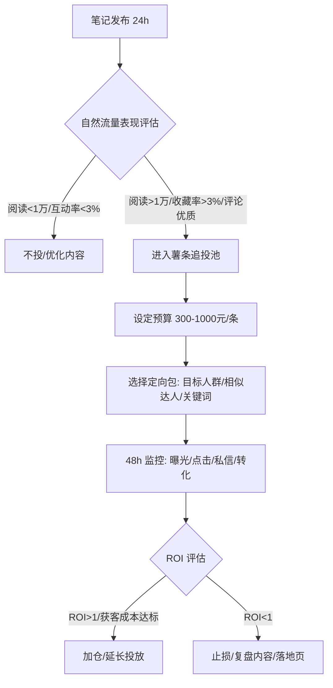
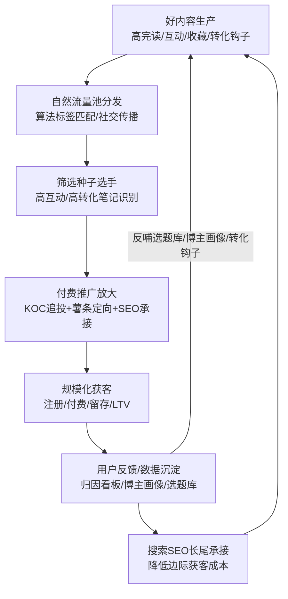

# 第 37 章 小红书品牌内容营销获客 —— 20万预算撬动30万获客、CAC 0.65元、KOC矩阵铺量、薯条杠杆放大
作者：龙哥

## 学习目标

- 理解品牌营销与效果营销在获客成本（CAC）上的数量级差异及其背后的商业逻辑
- 掌握小红书 KOC/KOL 矩阵投放模型的标准化操作流程（筛选、谈价、下单、验收、归因）
- 掌握爆款选题冲突法的叙事结构设计与冲突钩子提炼技巧
- 理解薯条杠杆放大战术的两阶段打法（达人种草+官方收割）及时机判断
- 建立多维归因统计体系，实现从阅读/互动到注册/留存的全链路 ROI 精准核算
- 确立“好内容+付费推广”双引擎驱动规模化增长的核心范式与边界条件

## 37.1 生活类比

想象小红书内容营销是一场精心策划的“口碑种草大会”：品牌营销（500万）就像在电视黄金时段砸钱买硬广，声势浩大，但没人记得广告词，更没人因此下单；效果营销（20万）则是找279位“邻家达人”（KOC）真实体验分享，成本低、信任高、像朋友推荐。爆款选题冲突法让这些达人不干巴巴说“好用”，而讲“我曾踩坑500万，靠这招翻盘”的反转故事，自带冲突感，听众爱听、爱转发。薯条杠杆则是发现某位达人分享引发围观后，官方帮忙把这段对话用大喇叭广播给更多同类人群，低成本放大声量。多维归因则是给每位达人发专属“推荐码/专属链接”，精准统计到底是谁带来了真正下单的客户。好内容+付费推广就是“精彩故事（燃料）+ 扩音器（引擎）”：没故事扩音器只传播噪音；有故事不扩音，传不远。

## 37.2 概念地图

小红书内容营销规模化获客体系
├── 核心认知：成本鸿沟与路径选择
│   ├── 品牌营销 vs 效果营销（500万亏损 vs 20万获客30万） —— P001
│   ├── 获客成本倒挂（CAC 0.65元 vs 20元，约1/60） —— P001
│   └── 优先跑通效果模型，再反哺品牌建设 —— P001
├── 投放执行：矩阵模型与组合拳
│   ├── KOC/KOL 矩阵投放模型（长尾腰部博主规模化铺量） —— P002
│   │   ├── 单月279博主、爆款率20%+、互动成本0.05元 —— P002
│   │   └── 标准化筛选指标（垂直度/互动率/报价/画像匹配） —— P002
│   ├── 爆款选题冲突法（反常识叙事钩子撬动算法） —— P003
│   │   ├── 真龙天子/天煞孤星等冲突模板库 —— P003
│   │   └── 真实人设+冲突性文字写故事，边界：不崩人设、不造假数据 —— P003
│   └── 薯条杠杆放大战术（达人自然种草+官方付费收割） —— P004
│       ├── 时机：自然流量上升期/平台期介入，非衰退期 —— P004
│       ├── 预算分配：达人费:薯条费 ≈ 7:3/6:4 —— P004
│       └── 阅读成本仅为薯条官方工具1/15 —— P004
├── 效果度量：多维归因与决策闭环
│   ├── 多维归因统计体系（UTM/专属码/薯店数据/后台埋点四层穿透） —— P005
│   │   ├── 核心指标：单博主CAC、单博主ROI、LTV/留存对比 —— P005
│   │   └── 实时性看板支持投放中途止损/加仓 —— P005
│   └── 好内容+付费推广 = 规模化增长核心动力（双引擎/相互依赖/飞轮效应） —— P006
│       ├── 内容质量阈值（完读率>30%、互动率>5%）触发付费杠杆 —— P006
│       └── 产品力为前提，团队需双轮驱动（内容生产力+投放运营力） —— P006
└── 规模化验证与边界
    ├── 累计1000+博主获客30万，助力数10家公司复制 —— P001/006
    ├── 数据脱敏声明：关注方法论而非绝对数值 —— P001
    └── 合规/平台规则/审美疲劳为动态边界条件 —— P002/003/004

## 37.3 品牌营销与效果营销的成本鸿沟 —— 500万打水漂 vs 20万获客30万

### 为什么需要这个概念？

- 传统品牌营销动辄百万投入，却难以量化获客效果，极易造成资源浪费
- 中小企业缺乏大额品牌预算，迫切需要低成本、可验证、可复制的获客路径
- 认知“品牌曝光≠有效获客”的本质差异，是从烧钱换声量转向赚钱换生存的关键转折

### 核心定义

> "我是如何在公司做品牌活动亏损 500w 的情况下，通过内容营销获客，在小红书用 20W 元获客 30W 人，帮助公司摸索出了一条正确的增长之路。"
> 
> ——《P001: 小红书品牌内容营销实战复盘》

- **品牌营销**：大额预算（如500万）追求曝光声量，链路长、难归因、ROI不确定
- **效果营销**：小额预算（如20万）追求确定性获客（CAC可测）、链路短、可复制放大
- **成本鸿沟**：同一业务下，两者获客成本（CAC）可达两个数量级差异（0.65元 vs 20元，约1/60）

### 关键性质

**优先级倒置**：应先跑通低成本效果模型（验证产品/人群/转化），再反哺品牌建设。  
**可迁移性**：效果模型的核心要素（选题/博主/转化路径）具备跨品类、跨公司的复用性。  
**规模化边际成本递减**：长尾博主矩阵投放边际成本极低，且随数据积累选品更精准。

### 典型例子

作者所在公司：品牌活动亏损500万无回音，转而投入20万小红书KOC矩阵，获客30万，CAC 0.65元。后续复用方法论协助数10家公司实现小红书低成本获客，验证跨业务适用性。

> "我们其他渠道成本最低的时候是 20 元一个，小红书渠道的成本是原来的 1/60。"
> 
> ——《P001》

这个对比展示了内容营销渠道在获客成本上的绝对优势，也是效果营销取代品牌营销成为优先选项的铁证。

### 边界条件

- 仅适用于“有产品、有转化承接能力、决策链路相对清晰”的业务（如App下载、课程、高客单服务）
- 纯品牌声量需求（如上市造势、融资背书）仍需大额品牌营销配合，不可完全替代
- 依赖平台算法红利期，随着商业化成熟，KOC报价上涨、流量分发收紧，成本优势会收窄

---

## 37.4 小红书KOC/KOL矩阵投放模型 —— 长尾腰部博主的规模化铺量艺术

### 为什么需要这个概念？

- 头部KOL报价高、排期难、单次合作风险大（一条不爆全军覆没），不适合预算有限的测试与规模化
- 平台算法偏好“真实分享”而非“硬广植入”，长尾腰部博主（KOC）人设更真实、粉丝信任度高、性价比极高
- 需要一套标准化的“筛选-谈价-下单-验收”流程，将非标内容投放变为可量化的工业化生产线

### 核心定义

> "2 月投放 279 个小红书博主，花费 4.7w 元，互动量 59w，获客 7.2w，平均获客成本 0.65 元/人。爆款率达到 20%以上，一个点赞或收藏的成本在 0.05 元左右。相当于只花了 10 块钱，在小红书被阅读了 1000 次，阅读成本是小红书官方的笔记加热工具薯条的 1/15。"
> 
> ——《P001》

- **放弃头部大号**，主攻1万-10万粉丝区间的长尾腰部/尾部博主（KOC）
- **单月投放量级化**（如279位），建立标准化筛选指标（垂直度、互动率、报价、粉丝画像匹配度）
- **目标**：以极低单价（单互动成本~0.05元）获取海量曝光与种草声量，筛选爆款后再放大

### 关键性质

**爆款率稳定**：大数定律保障，投放200+博主，爆款率（千赞以上）可稳定在20%+。  
**成本可控**：单次互动成本锚定在0.05元级别，远低于薯条官方工具（阅读成本是薯条的1/15）。  
**组合拳打法**：达人自然种草（建立信任）+ 薯条追投加热（放大声量）= 确定性规模化增长。

### 标准化筛选指标体系

以下是博主筛选的核心维度与权重建议：

| 筛选维度 | 权重 | 判定标准 | 说明 |
|----------|------|----------|------|
| 垂直度 | 30% | 近10条笔记≥8条属于目标赛道 | 确保粉丝画像精准匹配 |
| 互动率 | 25% | （点赞+收藏+评论）/粉丝数 ≥ 5% | 衡量粉丝活跃度与信任度 |
| 近期爆款率 | 20% | 近30天千赞笔记占比 ≥ 10% | 验证内容生产能力 |
| 报价性价比 | 15% | 报价/预估阅读 ≤ 行业均值 | 控制单次曝光成本 |
| 粉丝画像匹配 | 10% | 核心人群占比 ≥ 60% | 直接关联转化质量 |

### 典型例子

2月实战：投放279位博主，花费4.7万，互动量59万，获客7.2万，平均获客成本0.65元/人。单条爆款笔记阅读量破10万+，配合薯条投放后阅读量进一步跃升，形成“种草-搜索-转化”闭环。

### 边界条件

- 选品/内容必须过硬：烂内容投再多KOC也无效（ROI为负），“好内容是燃料，付费推广是引擎”
- 需建立标准化SOP：从博主名单整理、报价谈判、内容审核、发布监控到数据回收，全流程需专人/工具支撑
- 合规风险：需规避医疗/金融等强监管品类的投放限制，及软广未备案、虚假宣传等平台违规红线

---

## 37.5 爆款选题冲突法 —— 用反常识叙事钩子撬动算法大流量

### 为什么需要这个概念？

- 小红书推荐机制核心是“完读率+互动率”，平铺直叙的干货/好物分享难以在前3秒留住用户
- 普通品牌/个人缺乏天然流量IP属性，必须通过内容结构设计制造冲突感、悬念感、代入感
- 将“真实经历”包装为“高张力故事”，是零成本提升内容竞争力的核心杠杆

### 核心定义

> "真龙天子出生的时候都跟天煞孤星一样，伴随着天生异象的。现在博主都是小 ip，人设不能乱写的，大多数还是真实经历，只不过会用更冲突性文字去写自己的故事。"
> 
> ——《P001》

- **冲突钩子设计**：提炼经历中“反常识、大反差、强宿命感”的节点（如“真龙天子伴随天煞孤星”）
- **叙事结构**：真实人设（不可崩塌）+ 冲突性开头（制造钩子）+ 过程代入（细节真实）+ 结果反转/升华
- **核心逻辑**：人设真实但用更冲突性文字写故事，利用“冲突”触发算法的兴趣标签分发与社交传播

### 冲突钩子模板库

以下是常用冲突钩子类型与标题示例，供快速套用：

| 冲突类型 | 核心公式 | 适用场景 | 标题示例 |
|----------|----------|----------|----------|
| 身份反差 | 低预期身份 + 高成果/反常识行为 | 个人成长/职场/创业 | "月薪3000的行政，如何谈下百万大单？" |
| 命运逆转 | 绝境/失败开局 + 关键动作翻盘 | 逆袭/避坑/方法论 | "品牌活动亏损500万，靠小红书20万翻盘获客30万" |
| 认知颠覆 | 大众公认真相 + 亲测反证 | 选品/工具/方法论测评 | "大家都说小红书难做，我用这套SOP月入5万" |
| 宿命感/宿敌 | 天选/天赋异禀 + 艰难磨砺 | 专家人设/高客单服务 | "真龙天子伴天煞孤星：顶级投资人的逆袭之路" |

### 关键性质

**完读率杠杆**：冲突开头显著提升前3秒停留与完读率，是触发大流量池分发的核心指标。  
**互动率放大**：冲突话题天然引发评论区讨论/吐槽/共鸣，互动权重高于点赞/收藏。  
**可复制模板化**：提炼“冲突模板库”（如身份反差/命运逆转/认知颠覆），新人可套用快速产出。

### 典型例子

作者亲身经历：从“品牌活动亏损500万”到“20万获客30万”的职业逆袭，包装为“真龙天子/天煞孤星”叙事。博主实操：真实经历不编造，但用“更冲突性文字”重写标题与开头，如“月薪3千如何谈下百万单”。

### 边界条件

- **红线**：人设不崩、数据不造假、承诺不夸大（如“月入百万”需有真实佐证），否则触发平台虚假宣传封号
- **赛道差异**：知识付费/个人成长/创业赛道极适合冲突叙事；标品电商/工具类更适合“痛点-方案-实证”直给结构
- **审美疲劳**：同类冲突套路用久了用户会麻木，需持续迭代“冲突素材库”与“叙事视角”

---

## 37.6 薯条杠杆放大战术 —— 达人种草+官方收割的组合拳

### 为什么需要这个概念？

- 自然流量具有随机性与上限，优质笔记自然跑完后流量衰减快，需外力介入延长生命周期与放大声量
- 官方商业工具“薯条”定向加热成本低、操作简、可精准投放给目标人群，是放大爆款的最佳杠杆
- 解决“只会做内容不会买量”或“只会烧钱买量不懂内容”的单腿走路困境

### 核心定义

> "阅读成本是小红书官方的笔记加热工具薯条的 1/15。打破了原有认知，好内容+付费推广才是增长最大的动力。"
> 
> ——《P001》

- **两阶段打法**：第一阶段，达人矩阵铺量自然跑数据，筛选高互动/高转化笔记（种子选手）；第二阶段，对种子选手追投“薯条”，定向投放给目标人群/相似人群/关键词人群，低成本收割长尾流量
- **成本优势**：达人投放千次阅读成本约0.01元，薯条追投成本虽高于达人但远低于其他付费广告渠道，且定向精准

### 关键性质

**时机判断**：需在笔记自然流量上升期/平台期介入，而非衰退期（数据已跑不动则薯条也救不活）。  
**预算分配**：总预算中达人费:薯条费 建议 7:3 或 6:4，前期重达人测款，后期重薯条放大。  
**数据闭环**：薯条后台数据（曝光/点击/互动/点击主页/私信）需打通归因，验证放大ROI。

### 薯条投放决策流程图

### 典型例子

实战中：单条笔记自然跑出5万阅读、高收藏后，投入500元薯条定向投放，阅读量提升至20万+，直接带来注册转化。配合“薯店/商单”组件，薯条流量可直接落地商品页/表单页，缩短转化路径。

### 边界条件

- 仅适合“内容合规、账号正常、落地页转化率达标”的笔记，违规/限流/转化差的笔记投薯条即烧钱
- 薯条定向能力依赖平台标签体系成熟度，新兴细分赛道人群包可能不准，需配合关键词/相似达人粉丝定向测试
- 长期依赖薯条会掩盖内容质量下滑，需设定“自然流量占比底线”（如>30%），低于则停投优化内容

---

## 37.7 多维归因统计体系 —— 穿透“阅读-互动-转化”全链路的精准核算

### 为什么需要这个概念？

- 单一平台后台数据（阅读/互动）无法直接证明业务增长，老板/财务只认“注册用户数/付费金额/ROI”
- 多渠道并行投放时，缺乏归因体系无法判断“哪个博主/哪条笔记/哪个渠道”带来了真实用户
- 只有建立端到端归因，才能实现“砍掉无效投放、加大有效投放”的精细化运营决策

### 核心定义

> "2 个月注册用户约 40w，其中小红书渠道而来的占比 18%，也就是小红书投放花了 4.7w，带来的新用户（下载并注册）7.2w，平均单个用户的获客成本 0.65 元。精准核算单渠道/单博主ROI。"
> 
> ——《P001》

- **四层归因穿透**：
  1. **注册页UTM参数**（自动识别来源渠道/博主/笔记）
  2. **专属邀请码/链接**（博主专属，防刷量）
  3. **小红书后台“薯店/商单”数据**（平台侧转化）
  4. **自建后台埋点**（全链路行为：浏览/点击/注册/首单/留存）
- **核心指标**：单博主CAC（投放费/该博主带来注册数）、单博主ROI（该博主带来GMV/投放费）、LTV/留存对比

### 四层归因架构对照表

以下是四层归因方案的技术实现与优劣对比，供团队按资源情况择优组合：

| 归因层级 | 技术实现 | 覆盖范围 | 优势 | 局限 |
|----------|----------|----------|------|------|
| UTM参数 | 注册页URL自动拼装 | 全渠道/全博主/全笔记 | 部署快、成本低、自动化 | 依赖用户点击链接，漏掉搜索/主页进线用户 |
| 专属邀请码 | 博主专属码/链接分发 | 核心种子博主/高客单项目 | 精准防刷、强关联博主 | 需博主配合引导用户填写，转化率受损 |
| 薯店/商单数据 | 小红书后台授权同步 | 挂载薯店/商单的笔记 | 平台官方数据、含下单金额 | 仅覆盖平台内闭环交易，不含引流私域 |
| 自建后台埋点 | 事件埋点/用户ID关联 | 全链路（公域+私域） | 穿透力最强、支持LTV/留存分析 | 开发成本高、需维护、合规风险 |

### 关键性质

**实时性**：UTM+后台埋点可实现日级/小时级归因看板，支持投放中途止损/加仓。  
**穿透性**：打破平台数据壁垒，将“公域阅读”与“私域转化”强关联，量化“种草价值”。  
**迭代性**：归因数据反哺“博主画像库”与“选题模型”，下一轮投放筛选更精准。

### 典型例子

2个月累计：注册用户40万，小红书占比18%带来7.2万新用户，投放4.7万，CAC 0.65元。复盘发现：垂直领域KOC（如育儿/职场博主）带来用户LTV显著高于泛娱乐博主，后续加大垂类投放比例。

### 边界条件

- **技术门槛**：需开发/配置埋点系统、UTM自动拼装工具、博主专属链接生成系统，无技术团队可用UTM+表单/企微欢迎语简易替代
- **隐私合规**：用户行为埋点需符合《个保法》，明示授权、最小化采集、脱敏存储
- **归因窗口**：需设定合理归因窗口期（如7天/30天），避免长周期决策业务（如高客单B2B）归因失真

---

## 37.8 好内容+付费推广 = 规模化增长核心动力

### 为什么需要这个概念？

- 打破“要么靠内容自然流量、要么靠砸钱买量”的二元对立思维，揭示增长的双引擎本质
- 解决“有好内容没流量”或“有流量烂内容转化低”的单点失效困境
- 确立“内容质量可量化（完读/互动/收藏）、投放效率可优化（CAC/ROI）”的科学增长范式

### 核心定义

> "打破了原有认知，好内容+付费推广才是增长最大的动力。小红书的效果真是没得说，而且规模化能力特别强。在投放 1000+博主，小红书的获客 30w，并利用我的总结的方法论和操盘经验，帮助了数 10 家公司在小红书获客后。"
> 
> ——《P001》

- **好内容（燃料）**：高完读率、高互动率、高收藏率、强转化钩子、符合平台调性与用户心智
- **付费推广（引擎）**：KOC矩阵铺量测款 + 爆款薯条追投放大 + 搜索SEO长尾承接，形成组合拳
- **规模化增长**：在CAC可控、ROI为正的前提下，通过增加投放预算/博主数量/笔记产能，线性放大获客规模

### 双引擎飞轮效应图解

### 关键性质

**相互依赖**：无好内容，付费推广ROI为负（烧钱买水军）；无付费推广，好内容规模化受限于自然流量上限。  
**阈值效应**：内容质量需达及格线（如完读率>30%、互动率>5%），付费推广才能产生正向杠杆。  
**飞轮效应**：付费推广带来的互动/收藏/搜索，反哺自然流量权重，降低后续获客边际成本。

### 典型例子

本案：20万预算撬动30万获客，核心即“冲突法选题产出好内容”+“KOC矩阵+薯条组合拳推广”。复用验证：作者协助数10家公司复制该模型，均实现小红书渠道CAC显著低于其他渠道。

### 边界条件

- **产品必须经得起“种草-搜索-体验”验证**：产品力弱，流量越大死得越快（差评反噬）
- **团队需具备“内容生产力”与“投放运营力”双轮驱动能力**，单一能力无法跑通闭环
- **平台规则变更风险**：算法调整/商业化收紧/薯条涨价/达人报价虚高均可能打破成本模型，需持续迭代

---

## 37.9 多源对照

本章核心方法论主要基于单一实战复盘素材（P001）构建，但在以下维度存在行业共识与分歧，供你参考：

### 共识

- **KOC矩阵优于头部KOL**：行业公认长尾腰部博主性价比更高、信任度更强、抗风险能力更强（单条失败不伤大局）
- **内容质量是前提**：无论投多少钱，烂内容无法通过付费推广实现正ROI
- **归因体系必要性**：无归因即盲人骑瞎马，无法实现精细化运营与预算优化

### 分歧

以下对比展示了“重品牌/大号派”与“重效果/矩阵派”（本章立场）在核心决策维度上的根本差异：

| 维度 | 派别A：重品牌/大号 | 派别B：重效果/矩阵（本章立场） |
|------|-------------------|------------------------------|
| **投放对象** | 头部KOL（10万-100万粉），追求大声量背书 | 长尾腰部KOC（1万-10万粉），追求CAC/ROI |
| **内容形态** | 精品大片/专业测评/品牌调性片 | 真实种草/冲突叙事/人设故事/伪原创混剪 |
| **预算分配** | 单条预算大（1-50万），少数精投 | 单条预算小（100-2000元），大数量铺量 |
| **成功指标** | 曝光量/品牌声量/舆情占有率 | CAC/ROI/LTV/注册量/付费转化率 |
| **适用阶段** | 品牌成熟期/融资造势/上市冲刺 | 0-1冷启动/1-10规模化/预算受限期 |

---

## 37.10 设计中的取舍

### 为什么不直接投头部KOL或官方薯条？

**Q：预算充足时，为什么不直接买头部KOL一条龙？**  
A：头部KOL单条报价10万+，且排期不可控、内容同质化严重、粉丝广告免疫力强。一旦翻车（如数据造假、舆情风险），全盘皆输。KOC矩阵通过“大数定律”分散风险，单条成本可控，整体爆款率稳定。

**Q：为什么不直接用薯条工具投放，省去找博主的麻烦？**  
A：薯条本质是“买流量”，缺乏“信任背书”与“种草内容”。用户对官方广告天然防御，点击率/转化率远低于达人原生笔记。实测达人投放阅读成本仅为薯条的1/15，且达人笔记自带搜索SEO长尾价值，薯条停投即停，无资产沉淀。

**Q：冲突法选题会不会变成“标题党”导致人设崩塌？**  
A：核心边界是“人设真实、数据不造假、承诺不夸大”。冲突钩子只能用在“标题/开头/叙事视角”的包装上，不能编造经历、虚构数据。一旦被用户/平台识破，账号信用破产，所有投入归零。

### 这种设计的 trade-off 是什么？

以下对比梳理了采用 KOC 矩阵+冲突内容+薯条放大 组合策略所获得的优势与必须付出的代价/风险：

| 获得的优势 | 付出的代价/风险 |
|------------|-----------------|
| 极低CAC（0.65元 vs 20元） | 需建立复杂SOP/工具/团队，运营重度高 |
| 规模化可控（线性放大） | 依赖平台算法红利，商业化成熟后成本必涨 |
| 全链路归因（精准决策） | 技术/合规成本高，无技术团队需简易替代 |
| 内容资产沉淀（SEO长尾） | 内容生产压力大，需持续产出高质量冲突选题 |

---

## 37.11 动手练习

### 练习 1：设计一条冲突法选题大纲

假设你要在小红书推广一款“AI简历优化工具”，目标用户是秋招应届生。

1. 挖掘你/用户的真实经历中的“反常识/大反差”节点（如：名校学霸简历挂、双非逆袭大厂、改三版简历才过筛）。
2. 选定一个核心冲突钩子（如“被名企HR拒绝30次，靠AI工具改出‘通过率90%’的简历”）。
3. 按“冲突开头→过程代入细节→结果反转/升华→工具植入”结构写出笔记大纲（标题、前3秒钩子、正文分段、结尾引导）。

**回答问题：**
- 为什么“名校学霸简历挂”比“教你写简历”更容易爆？
- 如何避免冲突钩子变成“标题党”导致人设崩塌？

### 练习 2：KOC矩阵投放ROI测算与博主筛选

给定预算 5 万元，计划投放 50 位 KOC，单价分布：100元(10位)、300元(20位)、500元(15位)、1000元(5位)。

1. 计算平均单价与总覆盖博主数。
2. 假设爆款率 20%（千赞以上），单爆款带来注册 50 人，非爆款带来注册 5 人，计算预估总获客数与平均 CAC。
3. 若目标 CAC ≤ 1 元，需调整哪些参数？（提示：可调整单价结构、提升爆款率、优化转化路径）。

**回答问题：**
- 为什么不建议把 5 万预算全砸给 1 位 5 万粉的头部 KOL？
- 如何建立博主“画像标签库”以便下一轮投放精准筛选？

### 练习 3：多维归因体系搭建最小可行性方案（无开发资源版）

1. 设计“专属邀请码/链接”生成规则（如：KOC首字母+日期+序号），如何分发给博主并确保不泄露/不被刷量？
2. 利用“企业微信欢迎语/群聊入口”作为落地页，如何通过“来源标签”自动打标实现基础归因？
3. 建立周度复盘表格：博主/投放费/阅读/互动/加微数/成交数/CAC/ROI，设定“单博主CAC>3元暂停、ROI<1砍掉”的止损规则。

**回答问题：**
- 为什么“阅读量”不能作为核心考核指标？
- 归因窗口期设 7 天 vs 30 天，对高客单价（如 2999 元课程）与低客单价（199 元社群）决策有何不同？

### 练习 4：薯条放大实战决策模拟

某条笔记自然流量数据：发布 24h，阅读 8万，点赞 1200，收藏 3000，评论 200，点击主页 500，私信咨询 50。

1. 判断该笔记是否进入“薯条追投窗口期”？（参考：收藏率、互动质量、流量趋势）。
2. 若决定追投 500 元薯条，建议选择哪些定向包（目标人群/相似达人粉丝/关键词/地域）？理由何在？
3. 追投 48h 后，阅读增至 25万，新增私信 30，成交 5 单（客单 199元），计算薯条阶段 ROI 与综合 ROI。

**回答问题：**
- 为什么“衰退期”笔记投薯条通常“救不活”？
- 如何设定“自然流量占比底线”防止长期依赖薯条掩盖内容质量下滑？

---

## 37.12 本章小结

这一章中我们学习了如何在小红书用极低成本实现规模化、可量化的品牌获客。首先，我们拆解了品牌营销与效果营销的成本鸿沟：500万品牌曝光打水漂，而20万内容营销撬动30万获客，CAC仅0.65元，是其他渠道的1/60。其次，我们掌握了KOC/KOL矩阵投放模型：放弃头部大号，主攻长尾腰部博主，单月279位博主铺量，爆款率稳定20%+，单互动成本仅0.05元。接着，我们学会了爆款选题冲突法：用“真龙天子伴天煞孤星”等反常识叙事钩子包装真实经历，显著提升完读率与互动率。然后，我们理解了薯条杠杆放大战术：达人自然种草筛选种子选手，官方薯条定向收割长尾流量，阅读成本仅为薯条工具的1/15。最后，我们建立了多维归因统计体系：UTM+专属码+薯店数据+后台埋点四层穿透，精准核算单博主CAC/ROI/LTV，支撑动态投放决策。核心范式是“好内容+付费推广”双引擎飞轮：内容为燃料，推广为引擎，相互依赖，形成确定性规模化增长。

本章我们一起学习了以下概念：

| 概念 | 解释 |
|------|------|
| 品牌营销 vs 效果营销 | 大额曝光投入难归因 vs 小额确定性获客可复制，CAC差异达两个数量级（1/60） |
| KOC/KOL 矩阵投放模型 | 放弃头部大号，主攻长尾腰部博主规模化铺量，单互动成本~0.05元，爆款率稳定20%+ |
| 爆款选题冲突法 | 用反常识/大反差叙事钩子（如真龙天子伴天煞孤星）包装真实经历，显著提升完读率与互动率 |
| 薯条杠杆放大战术 | 达人笔记自然跑出高互动后追投官方薯条定向加热，阅读成本仅为薯条官方工具1/15 |
| 多维归因统计体系 | UTM+专属码+薯店数据+后台埋点四层穿透，精准核算单博主CAC/ROI/LTV，支撑投放动态决策 |
| 好内容+付费推广双引擎 | 内容为燃料（高完读/互动/转化钩子），推广为引擎（KOC铺量+薯条放大+SEO承接），相互依赖形成飞轮 |

下一章中，我们将学习 **第 38 章：抖音鸡血石非标品直播六阶段进化**，探讨如何在非标品赛道通过极低成本起步、实打实福利、千川精准投流、拍卖建立信任、场景人设升级实现持续稳定变现。

