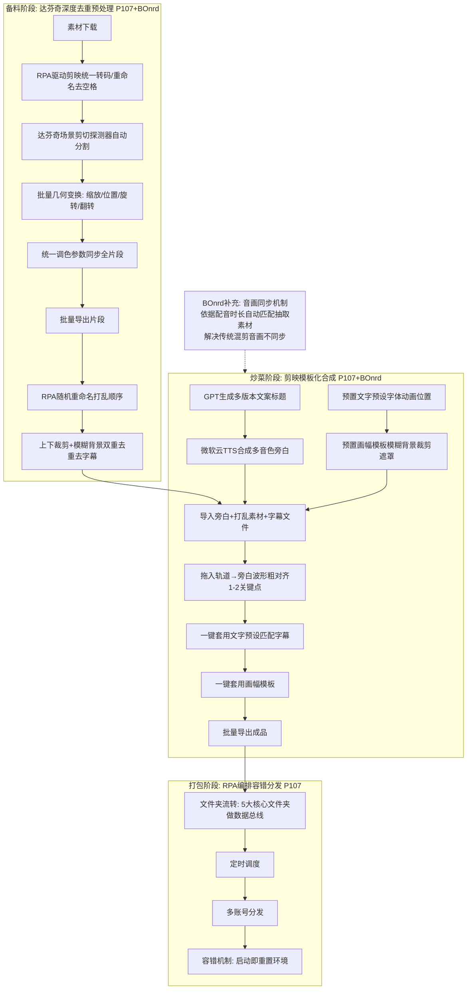
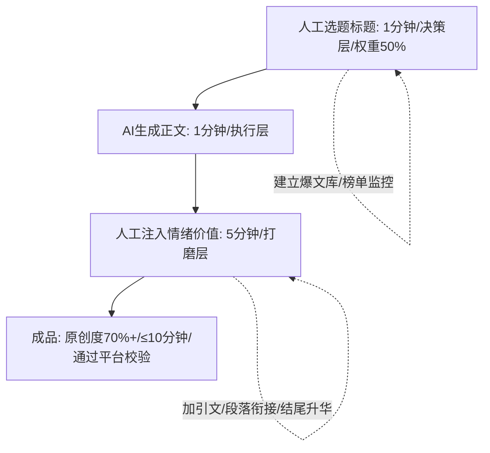
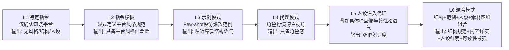
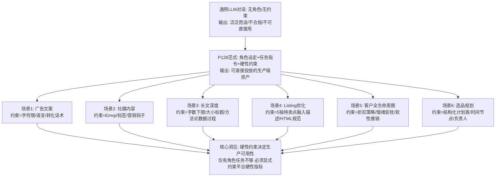
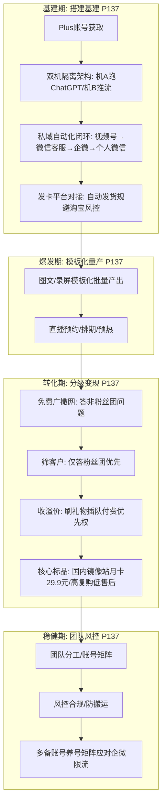
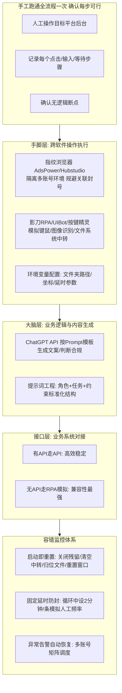

# 第 15 章 AI内容生产与自动化体系

## 学习目标

- 理解AI内容生产的核心协作范式：从"发号施令"到"人工+智能"框架的演进
- 掌握GPT-4协作写作6步标准化流程与人机分工4:6法则
- 理解批量剪辑"备料-炒菜-打包"三阶段工业化生产线的构建方法
- 掌握混剪去重核心公式与RPA跨软件编排确定性流程的实现
- 理解"人工+智能"爆文框架：选题决策权重50%+AI执行+情绪价值人工注入
- 掌握小红书Prompt分级体系从特定指令到混合模式的进阶路径
- 掌握跨境电商9大场景Prompt模板库的角色+约束标准化结构
- 理解视频号ChatGPT赛道10天速成模型：自动化引流闭环+分级直播变现+双机隔离架构
- 掌握RPA+AI自动化生产线"手脚-大脑-接口"三层架构搭建全流程

## 15.1 生活类比

想象AI内容生产是一家**米其林星级餐厅的中央厨房**。**项目方法论**是已验证的菜谱SOP，明确知晓做什么菜、怎么做、卖给谁；**发号施令范式**是主厨对学徒下达精准指令——"按这个配方、这个火候、这个摆盘做"，而非问学徒"这道菜怎么做好吃？"；**GPT-4协作写作**则是主厨设计菜单（选题/标题）→ 中央厨房预制半成品（AI生成正文）→ 主厨现场精细调味摆盘（注入情绪价值/润色）→ 端上桌；**批量剪辑生产线**对应**备料间（达芬奇场景切割/去重/调色）** → **炒菜间（剪映模板化合成/配音/字幕）** → **打包间（RPA自动化流程调度/容错/分发）**，文件夹流转是传菜电梯；**Prompt分级体系**则是学徒晋升体系：实习生（特定指令）→ 正式厨师（指令模板）→ 主管（示例模式/代理模式）→ 主厨（混合模式：结构+范例+人设）；**RPA+AI数字员工**是**手脚（RPA模拟键鼠跨软件操作）** + **大脑（GPT理解业务逻辑生成内容）** + **接口（对接平台API/模拟人工）**，不用招聘真人也能7x24小时干活。就像餐厅靠标准化SOP+中央厨房+主厨把关实现连锁规模化，AI内容生产也需方法论先行+自动化流水线+人工关键决策把关，才能实现商业级规模化变现。

## 15.2 概念地图

AI内容生产与自动化体系
├── 核心协作范式
│   ├── GPT-4协作写作流程(6步法)          —— P042
│   ├── 发号施令范式(指令vs提问)              —— P044
│   └── 人工+智能爆文框架(选题50%+AI+情绪)  —— P126
├── 自动化生产线
│   ├── 批量剪辑生产线(备料-炒菜-打包)        —— P107
│   │   ├── 场景切割去重(达芬奇)              —— P107
│   │   ├── 模板化合成(剪映)                  —— P107
│   │   └── RPA跨软件编排(影刀)               —— P107
│   └── RPA+AI数字员工生产线                   —— SUMMARY/dox
│       ├── 手脚层(RPA/指纹浏览器)             —— SUMMARY/dox
│       ├── 大脑层(ChatGPT API)               —— SUMMARY/dox
│       └── 接口层(平台API/模拟操作)           —— SUMMARY/dox
├── 平台化Prompt工程
│   ├── 小红书分级体系(5模式进阶)              —— TQM
│   │   ├── 指令模板/示例模式/代理模式/混合模式 —— TQM
│   │   └── 结构化四段式规范(开头/中间/结尾/标签) —— TQM
│   └── 跨境电商模板库(9场景角色+约束)        —— P128
│       ├── 广告/社媒/SEO/Listing/客服/选品    —— P128
│       └── 硬性约束(字数/格式/规范/卖点数)    —— P128
├── 实战验证模型
│   ├── 视频号ChatGPT速成(10天头部)           —— P137
│   │   ├── 自动化引流闭环(视频号→企微→个人)  —— P137
│   │   ├── 分级直播变现(粉丝团/插队付费)      —— P137
│   │   └── 双机隔离架构(网络/推流物理分离)     —— P137
│   └── 👸号情感赛道冷启动(7天10W+)          —— P042
└── 核心理论支柱
├── 反全自动化原则(人机分工4:6/80-20)      —— P042
├── GPT-4质量阈值定律(3.5不可用)          —— P042
├── ChatGPT非万能论(知识截止/幻觉/套路)   —— P044
├── 项目方法论先行(AI只解决执行难点)      —— P044
├── 混剪去重核心公式(切割+打乱+变换+调色)  —— P107
├── RPA价值=跨异构软件编排确定性流程      —— P109
├── AI核心价值=非标转标准(脚手架非替代)   —— TQM
└── 工作流嵌入式竞争力(专业度×嵌入深度)     —— TQM

## 15.3 GPT-4协作写作流程 —— 让AI当执笔，人当导演

### 为什么需要这个概念？

👸号情感赛道需要持续高频产出爆文，但人工全流程创作耗时长、素材易枯竭、情绪价值难把控。GPT-3.5等早期模型中文写作质量不达标，无法直接商用。追求全自动化批量生成会导致内容质量崩塌，缺乏人性化细节。

> "写作流程分为 6 个步骤：1. 调教写作风格，一次调教后可长期使用。 2. 选题。 3. 写大纲。 4. 详写各部分内容。 5. 合并内容，人工润色。 6. 写标题。"
> 
> ——《docs/202303/20230328_042.md》

### 核心定义

**GPT-4协作写作6步法**（来源：《docs/202303/20230328_042.md》）

标准化6步协作范式：风格调教 → 选题逆向工程 → 大纲确认 → 分段详写 → 人工润色合并 → 标题人工决策。

核心原则：AI负责80%文字生产（执行层），人负责20%关键决策与打磨（导演层）。

### 关键性质

**人机分工比固化为 4:6**（来源：《docs/202303/20230328_042.md》）

全流程耗时人工占40%、AI占60%；文字层面AI完成80%+生成，人工主攻删减冗余、衔接润色、标题决策。

**必须使用GPT-4模型**（来源：《docs/202303/20230328_042.md》）

> "一定要用 GPT-4。相比 3.5 提升很多，除了速度。"

这个定律揭示了模型能力是商业化成败的硬性门槛，GPT-3.5无法达到中文情感写作的质量阈值。

### 核心方法与演进

```mermaid
flowchart TD
    A[P042: 6步标准化流程<br/>风格调教→选题→大纲→分段详写→人工润色合并→标题决策] --> B[P126: 压缩为三步框架<br/>人工选题标题(决策层/50%权重)→AI生成正文(执行层)→人工注入情绪价值(打磨层)]
    B --> C[核心演进: 显性化"选题50%+情绪价值"权重分配<br/>强调平台算法红利窗口期的外部机遇]
```

上图展示了从P042的6步标准化流程到P126的三步极简框架的演进：P042侧重写作领域的工程化细节（风格调教、分段生成、润色合并），P126将其压缩为“决策-执行-打磨”三层，显性化了“选题标题占50%权重”这一核心判断，并强调平台推荐算法红利窗口期这一外部机遇。

### 典型例子

零基础新号7天产出10W+爆文（来源：《docs/202303/20230328_042.md》）

第1-6天积累权重，第7天情感文单篇阅读10W+、收益1000+。

**选题逆向工程**（来源：《docs/202303/20230328_042.md》）

> "用了这个方法，从此再也不用自己编故事了，题材取之不尽。"

输入爆款情节"相亲对象嫌我穷"，AI生成10个变体选题，人工筛选定稿"月薪3000相亲被嫌弃，半年后我买下整栋楼"。

### 核心方法

**风格调教 Prompt 工程**（来源：《docs/202303/20230328_042.md》）

将结构化方法论（爆文模板、开屏雷击）与少样本范文（Few-shot）混合注入 System Prompt 或首轮对话，建立长期有效的写作人设。

```
1. 收集平台爆文模板文档（如《航海手册》中的爆文模板、开屏雷击）
2. 找3-5篇目标风格的爆款范文
3. 一股脑喂给ChatGPT："请学习这些方法论和范文的写作风格，以后按此风格输出"
4. 验证：让其按新风格改写一段文本，满意则固化为长期Prompt
```

> 该方法通过"方法论+范文"双重喂养，完成模型的长期定向微调，避免每次都要重复喂养。一旦调教成功，后续所有写作任务均复用该人设，显著降低了单次任务的启动成本。

**迭代式选题生成法**（来源：《docs/202303/20230328_042.md》）

```
1. 从爆款文章提取核心情节（如"相亲被嫌弃穷"）
2. 喂给GPT-4："基于这个情节生成10个变体选题"
3. 人工筛选不满意项，提出具体修改意见（如"要更反转""主角要女性"）
4. GPT-4再生成 → 循环至满意 → 人工终审定稿
```

> 该伪代码展示了如何将选题从"凭灵感编"转变为"有种子、有模板、可迭代"的工业化流程。人工只需提供高层指导意见（"更反转""主角女性"），AI负责展开具体文案，实现了选题生成的分工协作。

**大纲驱动分段生成法**（来源：《docs/202303/20230328_042.md》）

```
1. 确定选题后，让GPT-4输出大纲
2. 人工审核大纲结构、节奏、冲突点，不满意让改至满意
3. 逐节点发送详写指令："写第1节，800字，重点描写心理活动和场景细节"
4. 每节生成后人工快速过目，确认无重大逻辑硬伤再进行下一节
5. 全部生成后，人工拼接合并，专项清洗"衔接生硬""冗余废话"
```

> 该流程展示了如何通过"大纲先行、分段生成、人工把关"解决长文生成的连贯性与失控问题。分段生成规避了上下文窗口限制，人工逐节把关保证了逻辑骨架的正确性，最后统一清洗解决了AI分段生成必然导致的衔接生硬、冗余废话问题。

**标题人工主导+AI辅思法**（来源：《docs/202303/20230328_042.md》）

> "人工起一个吸引人的标题。尝试过 ChatGPT 直接生成标题，但不是太满意。可以让 ChatGPT 起几个提供灵感。"

> 该方法确立了标题决策权必须在人手中，AI仅作备选灵感库，承认当前模型在"标题党"层面的短板。标题作为文章的"门面"，直接决定点击率，属于不可外包的核心决策节点。

### 边界条件

**模型推理速度是核心瓶颈**（来源：《docs/202303/20230328_042.md》）

> "一篇文章从构思到发布，耗时约 1~2 小时。主要是因为 GPT-4 速度太慢，我本人长时间处于待机状态。最好不要晚上写，速度比白天慢很多，还经常出现网络问题。"

**上下文窗口限制**（来源：《docs/202303/20230328_042.md》）

> "一般情况下，一篇爆文 1500 字，粘贴进去没问题。"

单次对话仅能容纳约1500字全文作为Few-shot样本。

**AI生成内容通病**（来源：《docs/202303/20230328_042.md》）

> "ChatGPT 不能保证每个部分衔接的非常好，经常会有多余的内容。"

分段生成必然导致段落衔接生硬、冗余废话多，必须经人工专项清洗。

**合规风险红线**（来源：《docs/202303/20230328_042.md》）

> "总感觉，这样编出来的故事，容易让人举报...网信办再次开展网络清朗行动，打击的就是这种失真内容。"

编造情感故事极易触发"网络清朗行动"风控，需隐匿账号信息、优化真实性。

### 核心口诀

**选题标题人工决（50%权重），正文AI秒出（执行层），情绪价值人工注（升华层），原创度从60%冲70%+**

## 15.4 发号施令范式 —— 别把AI当专家问，当助理使

### 为什么需要这个概念？

多数用户将ChatGPT当"全知专家"提问，得到套路化、知识截止、一本正经胡说八道的无效回答。真实业务场景中，用户已知目标与流程，仅缺执行手，需AI精准完成指定动作而非提供建议。跨语言视频制作中，翻译与配音时长错位是核心痛点，传统工具无法解决，需指令AI长度对齐。

> "这两句话看似类似，其实不一样，第一句话是你并不知道答案，你想通过提问，获得答案，就好像学生问老师...而第二句话，更像是一个助理或者手下，你已经知道了你想要的结果，你只是需要有人去完成它。"
> 
> ——《docs/202303/20230328_044.md》

### 核心定义

**发号施令范式**（来源：《docs/202303/20230328_044.md》）

范式转换：从"提问模式"（学生问老师）转为"指令模式"（老板使助理）。

核心动作：明确目标 → 拆解难点 → 下达结构化指令 → 串联工具链自动化。

### 核心方法与演进

```mermaid
flowchart TD
    A[传统痛点: 翻译+TTS配音时长错位<br/>画面对不上/语速过快/需分段微调] --> B[P044核心突破: ChatGPT语义长度对齐翻译<br/>指令:"翻译并控制输出长度与原文一致"]
    B --> C[工具链串联自动化: 剪映提字幕→ChatGPT翻译→D-ID数字人→剪辑合成<br/>单条2小时→3分钟 效率提升40倍]
    C --> D[泛化应用: 少样本风格微调(投喂10-20条文案固化人设)<br/>AI工具链组合拳(ChatGPT/D-ID/MJ/SD/文生视频)]
```

上图展示了从发现核心痛点（翻译长度错位），到发号施令解决单点难点（语义长度对齐），再到串联工具链实现端到端自动化（40倍效率提升），最后泛化为风格微调与多工具组合拳的完整演进路径。

### 关键性质

**ChatGPT非万能论**（来源：《docs/202303/20230328_044.md》）

> "chatgpt 并不是万能和无所不知的...当你向 chatgpt 提问的时候，他的回答有很明显的几个特征。1、套路化...2、知识储备有限...而且它对不知道的事情还会编故事胡说八道。"

知识截止2021年、会幻觉编造、回答模式套路化（总分总），不可作为决策依据。

**项目方法论先行原则**（来源：《docs/202303/20230328_044.md》）

> "放到 tiktok 变现，我们首先要有项目方法论，换句话说，就是你要知道要做什么项目，这个项目的是怎么实操的，项目要点在哪里，以及我们变现的整个闭环和路径。之后把难点拆解，逐一的扔给 chatgpt 去给我们完成。"

必须先有成熟项目方法论（知晓做什么、怎么做、变现闭环），AI仅解决拆解后的执行难点。

**少样本风格微调**（来源：《docs/202303/20230328_044.md》）

> "只要你把同一个风格的解说文案，不停的投喂 chatgpt，他就能很轻松的写出你想要的风格了。"

连续投喂特定风格文案，利用上下文学习能力固化人设。

### 典型例子

**TikTok影视解说自动化**（来源：《docs/202303/20230328_044.md》）

剪映提字幕 → ChatGPT长度对齐翻译 → D-ID生成数字人 → 剪辑合成，单条从2小时压缩至3分钟，效率提升40倍。

> "可以看到，翻译出来的内容，和原文的长度基本是一致的。整体的语速也很柔和，你甚至不需要去矫正画面和字幕，基本就是匹配的了。"

**文案风格训练**（来源：《docs/202303/20230328_044.md》）

投喂10条"毒舌解说"文案，AI即可模仿该风格批量产出新脚本。

### 核心方法

**影视解说 AI 化制作标准流程 (SOP)**（来源：《docs/202303/20230328_044.md》）

```
1. 剪映提取中文字幕
2. ChatGPT翻译并控制输出长度与原文一致（核心指令："翻译成英文，要求输出长度与中文原文基本一致，语速自然"）
3. D-ID生成数字人视频/配音（https://studio.d-id.com/editor）
4. 剪辑软件合成字幕、配音、画面
```

> 该SOP展示了如何将"翻译长度对齐"这一核心技术难点，通过结构化指令一次性解决，串联工具链实现端到端自动化。原本需要人工分段微调语速、剪辑点的繁琐流程，被一条精准指令彻底消解。

**少样本风格微调**（来源：《docs/202303/20230328_044.md》）

```
1. 收集10-20条目标风格文案（如"毒舌解说""温柔姐姐""专业导师"）
2. 连续在同一对话中投喂："请模仿这个风格写解说文案" + 文案1...文案N
3. 验证：给新素材，让其按固化风格输出
4. 固化为标准Prompt模板，后续复用
```

> 该方法展示了如何利用上下文学习能力，零成本完成风格迁移，替代传统微调训练。通过连续投喂10-20条同风格文案，模型在上下文中隐性习得该风格的语气、句式、修辞特征，后续即可稳定输出。

### 边界条件

**无项目方法论时指令无效**（来源：《docs/202303/20230328_044.md》）

不知"要做什么"则无法"发号施令"。

**知识型决策不可外包**（来源：《docs/202303/20230328_044.md》）

选品、定价、赛道选择等战略决策必须人工把关。

**模型幻觉风险**（来源：《docs/202303/20230328_044.md》）

涉及事实性查询（如最新政策、具体数据）时输出不可信。

### 核心口诀

**知目标、懂流程、拆难点、发指令、串工具、跑闭环；AI是执行手，人是决策脑**

## 15.5 批量剪辑自动化生产线 —— 备料、炒菜、打包三阶段工业化

### 为什么需要这个概念？

短视频带货核心瓶颈在于视频生产效率：手工混剪日产<10条、极度疲劳、无法支撑矩阵化运营。纯搬运(BY)账号存活仅2-4天即被限流，实拍成本过高，二创混剪是长期主义必经之路。达芬奇/剪映等专业软件无开放API，跨软件流程靠人工串联效率低、易出错、不可复用。

> "航海第 2 天...紧接着就被限制了...自此第一号：卒。航海第 4 天...说我账号内容质量低，让我发 10 个原创来证实我的能力，自此第二个号：虽未死，但已无能力再战。终于对 BY 产生了怀疑...那就只剩二剪和混剪这条路了...终于在第三天让我爆了个视频，爆了 10 万的播放，卖了 20 多单...我觉得混剪的方式是对的，只是效率未免太低了"
> 
> ——《docs/202303/20230328_107.md》

### 核心定义

**"备料-炒菜-打包"三阶段自动化法**（来源：《docs/202303/20230328_107.md》）

达芬奇场景切割/去重预处理(备料) → 剪映模板化合成/配音/字幕(炒菜) → RPA跨软件编排/容错/定时分发(打包)。

**文件夹流转标准化**（来源：《docs/202303/20230328_107.md》）

5大核心文件夹作为数据总线，实现素材物理隔离与自动流转。

> "在桌面或者指定盘创建 5 个文件夹，分别是原始素材夹，已处理原素材夹，账号目录夹(每个账号的登陆浏览器在里面)，账号发布夹(每个账号要发布的视频在里面)，剪辑夹(里面又有素材片段夹，字幕夹，原素材夹)。"

### 核心方法与演进



上图展示了P107与BOnrd两大素材融合后的完整三阶段生产线：备料阶段在达芬奇完成场景级切割与四重去重（几何变换+调色+打乱+裁剪模糊），炒菜阶段在剪映完成模板化合成并引入BOnrd的"音画同步机制"（依据配音时长反向抽取素材），打包阶段通过RPA实现跨软件编排、容错与分发。

### 关键性质

**混剪去重核心公式**（来源：《docs/202303/20230328_107.md》）

场景切割 + 随机打乱 + 几何变换(缩放/位移/旋转/翻转) + 统一调色。

> "好物的场景基本都是各种切换，哪怕驴唇不对马嘴，这个视频也不违和呀。进入剪辑面板，进行缩放、位置、旋转角度、翻转处理。再进入调色面板，在校色轮处，调一个不错的参数...然后每一个片段同步这个参数即可。正常导出的素材片段是按照视频顺序排序的，这样不利于我们剪辑，毕竟我们的目的是打乱，可以用流程对素材片段进行随机抽取重命名，达到打乱效果。"

这个公式展示了四重去重机制如何叠加通过平台算法层面的"原创"判定：场景级切割打破语义连贯，随机打乱重组叙事，几何变换改变特征指纹，统一调色掩盖拼接痕迹。

**RPA核心价值**（来源：《docs/202303/20230328_107.md》）

> "达芬奇里有些板块的元素不能识别，只能用鼠标按照位置自动点击...把 RPA 利用到剪辑上这个想法愈发强烈...又用了一天的时间将他们做成了一个流程...做容错，直接在流程开始来一个恢复初始状态的流程，自此算是可以稳定产出了。"

RPA价值不在"替人点鼠标"，而在"跨异构软件编排确定性流程" + "启动即重置"容错机制。

**音画同步机制**（来源：《docs/202303/BOnrd0uMWoINRrx9BcCcJEh5nRg.md》）

> "软件会随机抽取文案目录中的一个文案，然后从抽取到的文案中，随机抽取一行文本合成配音，最后根据配音时长来抽取场景视频。"

带货模式下依据配音时长自动匹配抽取素材，解决传统混剪音画不同步。

### 典型例子

**自动化上线后实测**（来源：《docs/202303/20230328_107.md》）

单条视频4000播放产出4单带货订单(转化率0.1%)，日产能从<10条提升至稳定批量。

**素材预处理SOP**（来源：《docs/202303/20230328_107.md》）

剪映统一转码/重命名 → 达芬奇场景切割/几何变换/调色同步 → 随机重命名打乱顺序。

### 核心方法

**达芬奇批量场景切割与去重预设**（来源：《docs/202303/20230328_107.md》）

```
1. 媒体面板右键素材 → 场景剪切探测器 → 添加剪切点 → 加入媒体池
2. 剪辑面板批量设置缩放/位置/旋转/翻转关键帧
3. 调色面板创建统一节点/参数 → 中键/右键应用等级/同步参数至所有片段
4. 交付面板设置渲染预设（单独剪辑/文件名含片段号） → 添加渲染队列 → 开始渲染
```

> 该预设将达芬奇专业级的场景切割、几何变换、调色功能标准化为可批量复用的操作序列，配合"单独剪辑"渲染模式实现片段级导出，为后续打乱顺序奠定物理基础。

**RPA 容错机制：启动即重置**（来源：《docs/202303/20230328_107.md》）

```
在 RPA 主流程入口前置「环境重置子流程」：
1. 关闭残留进程
2. 清空中转文件夹
3. 将已处理/待处理文件夹归位
4. 删除临时生成文件
5. 重置剪映/达芬奇窗口状态
→ 确保每次运行均从确定性初始状态开始
```

> 该伪代码展示了如何通过状态机式容错，将不可靠的手工串联转化为可复用、可扩展、可监控的工业级生产线。每次运行前强制重置环境，消除了上次运行残留的脏数据、卡死进程、窗口位置偏移等不确定性因素。

**剪映模板化合成法**（来源：《docs/202303/20230328_107.md》《docs/202303/BOnrd0uMWoINRrx9BcCcJEh5nRg.md》）

```
预置：文字预设（字体/动画/位置）、画幅/背景模板（模糊背景/裁剪遮罩）
运行时：
1. 导入旁白音频（多音色版本）+ 打乱顺序的素材片段文件夹 + 字幕文件
2. 拖入轨道 → 按旁白波形粗剪对齐 1-2 处关键点
3. 套用文字预设自动匹配字幕
4. 一键套用画幅模板（上下裁剪+模糊背景去原字幕）
5. 批量导出成品
```

> 该流程展示了如何将剪映的非标准化操作模块化为可复用模板，配合"粗对齐+自动套用"实现半自动化合成。BOnrd素材补充的"音画同步机制"（依据配音时长反向抽取素材）进一步强化了带货模式下的音画匹配精度。

**文件夹流转数据总线**（来源：《docs/202303/20230328_107.md》）

```
原始素材夹 → [RPA移动] → 剪辑夹/原素材夹 → [达芬奇处理] → 导出片段夹
→ [RPA随机重命名打乱] → 剪辑夹/素材片段夹 → [剪映合成] → 成品夹
→ [RPA分发] → 账号发布夹 → [多账号发布]
```

> 5大核心文件夹作为物理隔离的数据总线，消除了跨软件传参的复杂性，RPA仅需操作文件系统即可实现素材在达芬奇、剪映、发布环节间的自动流转。

### 边界条件

**达芬奇批量处理多规格素材易崩溃**（来源：《docs/202303/20230328_107.md》）

> "达芬奇的场景剪切探测器...进行批量处理不同分辨率的视频时会崩溃，所以就要对下载的视频进行二次处理...这一步就是利用 RPA 在剪映里处理了"

必须前置RPA驱动剪映统一预处理。

**剪映"上下裁剪+模糊背景"双重去重/去字幕实测有效**（来源：《docs/202303/20230328_107.md》）

但需人工预置模板参数。

**环境差异是RPA落地最大变数**（来源：《docs/202303/20230328_107.md》《docs/202303/doxcnXIOtkZmPJLb1izKrreOuMg.md》）

> "最后一步，如果出现任何问题，请录屏，或者最好联系我远程协助处理，因为每天电脑的浏览器和软件都不相同。电脑浏览器页面需要看得到上传按钮，如果看不到请调整到75%缩放"

浏览器缩放/分辨率/文件路径差异导致RPA失效，必须人工跑通一次并调试。

**未做容错前，单次报错需人工耗时20-30分钟恢复环境**（来源：《docs/202303/20230328_107.md》）

极大抵消自动化收益。

### 核心口诀

**备料达芬奇(切割去重调色)，炒菜剪映(模板配音字幕)，打包RPA(编排容错分发)，文件夹流转做数据总线**

## 15.6 人工+智能爆文框架 —— 选题决策权重50%，AI执行，人工注入情绪价值

### 为什么需要这个概念？

AI生成内容"标准化、程式化、缺乏人情味"(原创度仅60%)，无法适配👸号社交传播属性。选题标题决定文章上限(占50%权重)，但人工全流程写作耗时长、素材枯竭。平台推荐算法红利窗口期(👸号引入系统推荐)要求高原创度、高情绪价值内容。

> "搭了一个人工+智能爆文框架，总共 3 步：1、选题+标题，占 50%，做内容就是做选题，所谓选择大于努力 2、正文 3、情绪价值 这就是我这边的人工+智能（ChatGPT）爆文框架，人工来做 1 和 3；ChatGPT 写 2。"
> 
> ——《docs/202303/20230328_126.md》

### 核心定义

**三步协作法**（来源：《docs/202303/20230328_126.md》）

人工选题标题(1分钟，决策层) → AI生成正文(1分钟，执行层) → 人工注入情绪价值(5分钟，打磨层：引文/衔接/升华)。

总耗时≤10分钟，原创度从60%提升至70%+，通过主流平台原创校验。



### 关键性质

**选题决策权重论**（来源：《docs/202303/20230328_126.md》）

> "选题+标题，占 50%，做内容就是做选题，所谓选择大于努力"

做内容就是做选题，选择大于努力，需建立爆文库与榜单监控机制。

**情绪价值注入机制**（来源：《docs/202303/20230328_126.md》）

> "大家都知道，ChatGPT 出来的文章都有相当程度的范式，不是【 1，2，3】，就是【首先，其次，然后】，很机械化，也很程序化。但👸号爆文内容是需要充满情绪的。再用 5 分钟，也就是经过第 3 步的优化，加引文、段与段之间的起承转合、文章结尾的升华等方面的情绪价值...这时候再测原创度，已经高达 70%以上"

针对AI"首先、其次、然后"机械结构，人工添加人性化细节。

**刻意练习选题标题**（来源：《docs/202303/20230328_126.md》）

> "就拿练习起标题来说，曾经连抄了一个月的标题，每天到公司第一件事情就是打开爆文榜，抄一页 A4 纸的三段式标题，之后再总结它们的共性，类似于这些熟能生巧的办法，信手拈来的好词，融入 seo 的关键词布局"

每日抄写爆文榜单三段式标题一页A4，持续一个月内化为直觉。

### 典型例子

**实测新号产出5篇10W+文章**（来源：《docs/202303/20230328_126.md》）

单篇生产≤10分钟，单篇广告收益数千元，验证商业可行性。

**公司化矩阵化放大**（来源：《docs/202303/20230328_126.md》）

单号跑通后上人复制SOP，预期规模化收入。

### 边界条件

**AI内容合规风险高**（来源：《docs/202303/20230328_126.md》）

编造情感故事极易触发风控(限流/违规/封号)，被迫隐匿账号信息。

**写作是长期累积**（来源：《docs/202303/20230328_126.md》）

> "👸号爆文写作，这个事情，其实是一个长期累积的事情，就先从持续做这件事一百天开始，一年开始...能不能有这样的恒心，才是这个事情是否取得结果的前提。"

需持续执行100天-1年，心态急功近利是放弃核心原因。

**认知迭代靠行为倒推**（来源：《docs/202303/20230328_126.md》）

> "这里最难的是思维的调整，太难了...你的认识到并做调整，因为认知太难调整了，以至于我在 40 岁的当下，我仍然在调整...你看，随着我的行为的改变，也能倒推出认知上的提高，都是相互作用的。"

通过"不看报告、刻意练标题、隐匿账号信息"等行为改变倒推认知升级。

### 核心口诀

**选题标题人工拿捏(1分)，正文AI秒出(1分)，情绪价值人工注(5分)，十分钟出爆文，原创度破70%**

## 15.7 小红书笔记Prompt分级体系 —— 从特定指令到混合模式的进阶路径

### 为什么需要这个概念？

新手拿到ChatGPT账号不知如何提问，随意提问导致输出泛泛、呆板、无平台调性。小红书笔记有严格四段式结构规范(开头/中间/结尾/标签)，非结构化素材需标准化转化。个人IP人设差异化需注入模型，而非泛泛角色扮演。

> "输入的Prompt提示关键词，可以归类为4种常见的基础模式：分别是：特定指令、指令模板、示例模式、代理模式。除了上面的4种基础模式外，在实际使用ChatGPT过程中，我们更多使用的是另一种模式—混合模式。"
> 
> ——《docs/202303/TQMkd13LIos5sexxqWZcBHMUnif.md》

### 核心定义

**五大提示词模式阶梯**（来源：《docs/202303/TQMkd13LIos5sexxqWZcBHMUnif.md》）

特定指令(确认知晓) → 指令模板(平台风格) → 示例模式(Few-shot模仿) → 代理模式(角色扮演) → 人设注入代理(强IP辨识) → 混合模式(结构+范例+人设+素材)。

**小红书标准化结构**（来源：《docs/202303/TQMkd13LIos5sexxqWZcBHMUnif.md》《docs/202303/20230328_127.md》）

开头(痛点+情景+人设+方法+诱导) → 中间(1-5知识点重讲核心) → 结尾(提关注+强人设+引主页) → 标签(自打热门)。

### 核心方法与演进



上图展示了从L1到L6的Prompt能力进阶阶梯：每一层叠加一个控制维度（风格规范→爆款范例→角色身份→具体人设→多维组合），输出质量显著跃升，对应用户从新手到专家的熟练度成长路径。

### 关键性质

**ChatGPT核心价值=非标转标准**（来源：《docs/202303/TQMkd13LIos5sexxqWZcBHMUnif.md》）

> "ChatGPT最大的价值是将输入的非标数据变成标准化数据，指令模板是ChatGPT价值最直接的特征体现。"

将非结构化素材转化为符合平台规范的结构化输出。

**学习即模仿：示例优于指令**（来源：《docs/202303/TQMkd13LIos5sexxqWZcBHMUnif.md》）

> "指令模板很好用，但是ChatGPT给出的结果...标准不会错，但也代表着呆板没有创新。真正的学习，绝不是坐在那里听PPT，而是看看周围的人在做什么，然后你去模仿他。在这种模式下创作，ChatGPT给出的答案，相对来说效果更好。"

模型通过模仿隐性知识效果优于显性规则遵循。

**AI定位脚手架**（来源：《docs/202303/TQMkd13LIos5sexxqWZcBHMUnif.md》）

> "使用ChatGPT创作的小红书爆款笔记不一定能爆，但是最关键的是它能帮助你把自身原来不及格的小红书笔记，快速提升到一个合格博主的创作水平...内容可以外包，思考终究还是自己的。"

帮助跨越"不及格→合格"鸿沟，非包办"爆款"；思考不可外包(选题/逻辑/人设)。

**工作流嵌入式竞争力**（来源：《docs/202303/TQMkd13LIos5sexxqWZcBHMUnif.md》）

> "只要你有意识地把AI工具应用到自己的工作流程中，不断优化，打磨，让自己在某个工作流程中，成为最会使用AI的那个人，你就不用担心会有被AI替代的那天。"

领域专业度×AI嵌入深度，成为"某工作流最会用AI的人"构建护城河。

### 典型例子

**统一主题对比实验**（来源：《docs/202303/TQMkd13LIos5sexxqWZcBHMUnif.md》）

"推荐使用ChatGPT做简历"对比：混合模式输出结构规范+内容详实+人设鲜明+可读性最强，获专家70-80分评价。

**LinkedIn+ChatGPT求职实战**（来源：《docs/202303/TQMkd13LIos5sexxqWZcBHMUnif.md》）

单份简历制作压缩至半小时，海投效率提升1倍+。

### 核心方法

**指令模板法**（来源：《docs/202303/TQMkd13LIos5sexxqWZcBHMUnif.md》）

```
Prompt: "关键词：小红书的写作风格是一个很吸引人的标题，每段文字都加了emoji，并且在最后加上一些与内容相关的标签。请用小红书的写作风格，以'推荐使用ChatGPT写求职简历'为主题写一篇小红书笔记。"
```

> 通过显式定义目标平台的文体规范约束模型输出格式。该方法利用指令模板将非结构化素材标准化为符合平台规范的输出，是ChatGPT价值最直接的体现——将"非标数据"转为"标准化数据"。

**示例模式法**（来源：《docs/202303/TQMkd13LIos5sexxqWZcBHMUnif.md》）

```
Prompt: "请模仿下面这篇爆款笔记的文体/结构/语气创作：
[粘贴高质量爆款笔记全文]
主题：推荐使用ChatGPT做简历"
```

> 采用Few-shot学习范式，引导模型模仿隐性知识。该方法解决纯指令模板下"呆板无创新"的问题，模型通过模仿习得隐性知识效果优于显性规则遵循。

**人设注入代理法**（来源：《docs/202303/TQMkd13LIos5sexxqWZcBHMUnif.md》）

```
Prompt: "请你扮演积极活泼、喜欢推荐物品的22岁小姐姐，以有趣、积极、活泼的语气，用小红书的写作风格，以'推荐使用ChatGPT写求职简历'为主题，写一篇小红书笔记..."
```

> 在Role-Play基础上叠加具体人设画像。区别于普通代理模式仅指定角色身份，人设注入代理要求将人设形象具体化（年龄、性格、语气、内容偏好），使输出具备创作者独特的IP辨识度。

**结构化混合模式法**（来源：《docs/202303/TQMkd13LIos5sexxqWZcBHMUnif.md》）

```
Prompt组合：
1. 指令模板：一篇小红书笔记主要包括4个部分：开头...中间...结尾...标签...
2. 特定指令：请以上面的内容结构，按照开头、中间、结尾、最后四个部分创作，将下面的内容（素材）优化成一篇小红书笔记。
3. 示例模式：[可选] 附带1篇爆款范例
4. 代理模式：[可选] 叠加人设指令
```

> 将"平台结构模板+原始素材+爆款范例+人设指令"组合为复合Prompt。针对复杂创作任务实现结构、内容、风格、人设的多维度精准控制，输出质量显著优于单一模式。

### 边界条件

**提问质量决定留存**（来源：《docs/202303/TQMkd13LIos5sexxqWZcBHMUnif.md》）

> "一个好的提问决定了这个人是否能够长时间使用ChatGPT。好的提问，会让ChatGPT直接给出你想要的答案，让你直呼'牛X...我一定要探索'...不好的提问，会让ChatGPT搞不清楚状况，让你觉得ChatGPT被吹嘘过度...从此放在一边。"

**必须懂业务平台规则+提示词工程双重背景**（来源：《docs/202303/TQMkd13LIos5sexxqWZcBHMUnif.md》）

单纯懂技术或单纯懂业务均难产出高质量内容。

**好提问三标准**（来源：《docs/202303/TQMkd13LIos5sexxqWZcBHMUnif.md》）

不可搜索、充足背景、讨论姿态，直接折射搜索力、系统思维、元认知。

### 核心口诀

**指令定风格，示例对结构，人设赋灵魂，混合模式打组合；AI渡及格线，思考自己扛**

## 15.8 跨境电商Prompt模板库 —— 角色+约束，让通用模型秒变垂直专家

### 为什么需要这个概念？

跨境电商涉及广告投放、内容营销、Listing优化、客服邮件、选品规划等9大高频场景，通用对话无法满足专业规范要求。各平台有硬性规范(字符限制/格式/标签/卖点数量)，仅有角色任务不够，必须显式约束硬性指标。非技术人员无法微调模型，需零样本/少样本Prompt工程即插即用。

> "提示词：现在你是一名谷歌广告的编写人员... 写 10 条谷歌广告标题和谷歌广告描述... 符合谷歌的标准... 引人入胜，让人有下单的欲望。提示词：现在你是一名亚马逊的电商运营... 想出 5 个独一无二的卖点，要在产品描述中提现出来。"
> 
> ——《docs/202303/20230328_128.md》

### 核心定义

**9大场景标准化模板**（来源：《docs/202303/20230328_128.md》）

Google/FB广告、Instagram运营、Quora问答、SEO大纲、Amazon Listing、复购邮件、客服话术、选品规划。

**统一结构**（来源：《docs/202303/20230328_128.md》）

角色设定(现在你是一名[专业角色]) + 任务指令 + 硬性约束(语言/字数/格式/平台规范/卖点数量/折扣策略/回复风格)。

### 核心方法与演进



上图展示了从通用对话到P128标准化模板库的演进：核心在于显式注入"硬性约束"（字符限制、格式规范、卖点数量、营销钩子等），将模型输出从"可阅读"提升至"可直接投放"的生产级水平。9大场景虽业务各异，均遵循"角色+任务+硬性约束"统一结构。

### 关键性质

**提示词即生产力**（来源：《docs/202303/20230328_128.md》）

标准化Prompt将通用LLM瞬间转化为垂直领域中初级运营水平专家。

**输出约束决定生产可用性**（来源：《docs/202303/20230328_128.md》）

硬性指标(字数、格式、规范)是从"可阅读"变"可直接投放"的关键。

**核心痛点皆可击破**（来源：《docs/202303/20230328_128.md》）

跨境电商高频环节均可抽象为"特定角色+明确交付物+硬性约束"结构。

### 典型例子

**Google Ads生成10组标题/描述**（来源：《docs/202303/20230328_128.md》）

符合字符限制、含"Premium Quality/Free Shipping"等合规文案。

**Amazon Listing强制输出5个独特卖点**（来源：《docs/202303/20230328_128.md》）

融入描述而非简单罗列，符合A9算法转化逻辑。

**客服话术**（来源：《docs/202303/20230328_128.md》）

先安抚情绪 → 再解决问题 → 最后自然植入推销，兼顾服务与销售。

### 核心方法

**广告文案生成标准化法**（来源：《docs/202303/20230328_128.md》）

针对Google Ads与Facebook Ads不同平台字符限制与风格差异，设定专职文案角色，约束输出标题/描述数量、字符上限、语言及转化导向话术。该方法通过显式约束平台硬性规范，实现广告素材的批量合规产出。

**社媒内容运营自动化法**（来源：《docs/202303/20230328_128.md》）

设定社媒运营人员角色，结合平台特性(Instagram)要求输出带Emoji、话题标签、营销钩子的原生风格贴文。该方法将平台原生调性要求显式化为输出约束，实现内容批量产出与SEO标签布局同步进行。

**长文深度内容生成法**（来源：《docs/202303/20230328_128.md》）

针对Quora问答及SEO文章场景，设定文字工作者角色，通过字数下限、结构化大纲(大小标题)、方法论/数据/过程要素要求，生成具备权威性与搜索友好的长文本内容。该方法解决长文生成逻辑松散、深度不足的问题。

**电商Listing差异化卖点提炼法**（来源：《docs/202303/20230328_128.md》）

设定亚马逊运营角色，强制要求模型挖掘并输出5个独一无二的卖点并融入描述。该方法解决同质化竞争中差异化卖点提炼难的问题，卖点融入叙述而非罗列符合A9算法转化逻辑。

**客户全生命周期邮件/会话话术生成法**（来源：《docs/202303/20230328_128.md》）

分别设定营销型客服与服务型销售角色，注入折扣策略、情绪安抚、软性推销等心理战术约束。该方法构建"先安抚再解决后推销"的标准化沟通话术，兼顾服务体验与转化目标。

**选品与产品规划决策辅助法**（来源：《docs/202303/20230328_128.md》）

设定运营负责人角色，输入现有品类与季节性节点，输出选品建议与结构化计划表。该方法将大模型作为战略分析师辅助决策，输出可直接作为项目管理依据的结构化计划表。

### 边界条件

**模版为v1.0版本**（来源：《docs/202303/20230328_128.md》）

需根据实测反馈持续迭代优化。

**战略决策不可外包**（来源：《docs/202303/20230328_128.md》）

选品方向/预算分配不可外包，AI仅作分析师辅助输出结构化计划表。

**模型知识截止与幻觉**（来源：《docs/202303/20230328_128.md》）

最新平台政策/实时汇率等时效性信息不可信。

### 核心口诀

**角色定专业，约束定规范，任务定产出，九大场景全覆盖；输出能直接投放，才是好Prompt**

## 15.9 视频号ChatGPT赛道速成实战 —— 自动化引流闭环+直播分级变现+双机隔离架构

### 为什么需要这个概念？

新技术风口初期平台算法强分发，普通人需极速搭建标准化基建+极致执行量产内容抢占超额红利(窗口期1-3个月)。视频号生态开放(可挂企微/跳小程序/直播挂车)，公域获客→私域高客单复购ROI显著高于抖音/快手公域闭环。直播间实时演示ChatGPT面临网络环境风控，单机无法同时满足特殊网络与推流需求。

> "新技术/热点爆发初期平台算法强分发，普通人通过快速搭建标准化基建+极致执行量产内容获取超额流量红利，窗口期约1-3个月，核心竞争力是入场速度。"
> 
> ——《docs/202303/20230328_137.md》

### 核心定义

**10天头部账号模型**（来源：《docs/202303/20230328_137.md》）

基建期搭建自动化引流链路 → 爆发期模板化量产+直播预约 → 转化期分级互动/插队付费 → 稳健期团队分工/风控合规/防搬运。

**私域自动化闭环**（来源：《docs/202303/20230328_137.md》）

视频号 → 微信客服 → 企业微信 → 个人微信无人值守全链路，规避公域风控实现私域沉淀。

> "绑定企业微信开通微信客服配置自动回复欢迎语，企业微信消息太多时不回复主要回复个人微信，搭建自动化引流链路规避公域平台风控实现私域沉淀。"

**远程隔离架构**（来源：《docs/202303/20230328_137.md》）

双机物理隔离，一机登录ChatGPT解决网络，一机远程控制推流直播。

> "一台电脑隔离登录ChatGPT解决网络环境，另一台通过向日葵/ToDesk远程控制前者推流直播，应对平台对ChatGPT网络环境风控升级。"

### 核心方法与演进



上图展示了P137验证的10天速成模型四阶段演进：基建期解决"能不能播/能不能引流"的基建问题（双机隔离+私域闭环+发卡平台），爆发期解决"内容怎么产/直播怎么排"的产能问题（模板化量产+预约预热），转化期解决"流量怎么分层变现"的商业问题（分级互动+插队付费+标品月卡），稳健期解决"怎么规模化活下去"的组织问题（团队矩阵+风控合规+备用账号）。

### 关键性质

**直播分级变现机制**（来源：《docs/202303/20230328_137.md》）

仅答粉丝团问题 + 刷礼物插队付费优先权，实现流量价值分层(免费广撒网 → 筛客户 → 收溢价)。

> "流量大时ChatGPT回答速度跟不上评论提问速度，设计粉丝团优先服务机制筛选高意向用户，引入礼物插队价格机制稀释拥堵，实现流量价值分层变现：广撒网免费答非粉 → 筛客户答粉丝团 → 收溢价插队礼物。"

**多元变现路径**（来源：《docs/202303/20230328_137.md》）

国内版镜像站月卡29.9元(无网络限制/月卡制/高复购低售后)成核心标品，配合发卡平台自动发货规避淘宝风控。

> "实测变现结构：国内版镜像站月卡29.9元(无网络限制/月卡制/高复购低售后)替代官网账号成为核心标品...发卡平台自动发货(服务费3-5%)规避淘宝风控实现规模化变现。"

**异源流量差异化触达**（来源：《docs/202303/20230328_137.md》）

扫码添加发问题指南，搜索添加发企微欢迎语，避免一套话术通刷降体验。

### 典型例子

**实测数据**（来源：《docs/202303/20230328_137.md》）

入局10天涨粉9W+、单场直播峰值20W+、引流私域8000+、直接变现2W+。

> "9场直播累计场观625万涨粉33万，转化率5.28%，验证ChatGPT问答直播极强公域承接能力。"

### 边界条件

**图文截图类短视频算法权重骤降**（来源：《docs/202303/20230328_137.md》）

后期明确不友好，建议全面转型录屏问答类。

**淘宝售卖ChatGPT账号违规风险极高**（来源：《docs/202303/20230328_137.md》）

扣分/扣保证金/封店，发卡平台为更优替代。

**企微单日加好友上限触发风控**（来源：《docs/202303/20230328_137.md》）

限制私信/群聊/加好友，恢复周期3-10天，需多备账号养号矩阵。

**双机远程隔离物理切断业务风险与流量入口传导链路**（来源：《docs/202303/20230328_137.md》）

是高风控赛道生存法则。

### 核心口诀

**入场快、建基建、跑自动、分级答、插队收、双机隔、多账号、防风控；私域为终局，公域做前端**

## 15.10 RPA+AI自动化生产线 —— 非程序员的'数字员工'搭建全流程

### 为什么需要这个概念？

高重复、低决策运营动作(发Posts、发售后邮件、采集数据)人工成本高、效率低、不可规模化。非程序员不懂代码，但需跨平台自动化能力(亚马逊/知乎/BOSS直聘/社媒矩阵/爬虫)。单一软件无API、环境差异大，靠人工串联不可靠，需RPA模拟键鼠+图像识别+文件系统中转编排全链路。

> "影刀RPA/按键精灵/指纹浏览器做'手脚'，ChatGPT API/提示词工程做'大脑'，对接平台API/模拟人工操作做'接口'。"
> 
> ——《docs/202303/SUMMARY.md》

### 核心定义

**架构分层**（来源：《docs/202303/SUMMARY.md》《docs/202303/doxcnXIOtkZmPJLb1izKrreOuMg.md》）

- **手脚层**：指纹浏览器/影刀RPA/按键精灵模拟键鼠跨软件操作
- **大脑层**：ChatGPT API/提示词工程理解业务逻辑生成内容
- **接口层**：平台API/模拟人工操作对接业务系统

**核心场景**（来源：《docs/202303/SUMMARY.md》）

亚马逊POST批量发布、知乎自动推广、BOSS直聘挖项目、社媒矩阵分发、风向标数据爬虫采集。

### 核心方法与演进



上图展示了RPA+AI数字员工搭建的完整工程化路径：从手工验证起步，分层构建手脚层（指纹浏览器隔离环境+RPA模拟操作）、大脑层（ChatGPT API+标准化Prompt）、接口层（有API走API、无API走模拟），最后建立容错监控体系（启动即重置+固定延时防封+异常自动恢复），形成可复用、可扩展的自动化生产线。

### 关键性质

**RPA杠杆思维**（来源：《docs/202303/doxcnXIOtkZmPJLb1izKrreOuMg.md》）

> "代码，软件，程序本质上是杠杆，不仅解放你的双手，还能复制你的时间。君子性非异也，善假于物也。"

核心价值在于解放双手、复制时间，而非单纯技术实现。

**RPA降维打击人工成本**（来源：《docs/202303/doxcnXIOtkZmPJLb1izKrreOuMg.md》）

> "对于高重复、低决策的运营动作（如发Posts、发售后邮件），RPA自动化的边际成本趋近于零，远低于人工或外包成本，是中小卖家应对内卷的核心竞争力。"

**环境差异是最大变数**（来源：《docs/202303/doxcnXIOtkZmPJLb1izKrreOuMg.md》）

> "最后一步，如果出现任何问题，请录屏，或者最好联系我远程协助处理，因为每天电脑的浏览器和软件都不相同。"

浏览器缩放/分辨率/文件路径差异导致RPA失效，必须人工跑通一次并调试。

### 典型例子

**UIBot Creator可视化搭建**（来源：《docs/202303/doxcnXIOtkZmPJLb1izKrreOuMg.md》）

导入源码 → 配置图片上传路径 → 串联流程块形成闭环循环，15步详细操作指南。

**ImageAssistant批量采图**（来源：《docs/202303/doxcnXIOtkZmPJLb1izKrreOuMg.md》）

搜索关键词 → 提取本页图片 → 筛选类型大小 → 全选自动下载，快速建立素材库。

**Posts为亚马逊当前最优免费流量入口**（来源：《docs/202303/doxcnXIOtkZmPJLb1izKrreOuMg.md》）

品牌注册卖家专属，性价比最高流量补位手段。

### 核心方法

**RPA+AI自动化生产线搭建全流程**（来源：《docs/202303/SUMMARY.md》《docs/202303/doxcnXIOtkZmPJLb1izKrreOuMg.md》）

```
1. 手工跑通全流程一次，确认每个操作步骤可行
2. 选择指纹浏览器(AdsPower/Hubstudio)隔离多账号环境
3. 搭建RPA流程(影刀/UIBot)：
   - 录制/导入操作代码
   - 配置文件夹路径等环境变量
   - 串联流程块形成闭环循环
   - 前置"环境重置子流程"(启动即重置容错)
4. 接入ChatGPT API做大脑：
   - 配置Prompt模板(角色+任务+约束)
   - 设置调用参数(Temperature/MaxTokens)
5. 对接平台接口/模拟操作做接口：
   - 有API走API，无API走RPA模拟
6. 素材库建设：
   - ImageAssistant批量采集无版权场景图
   - 按人群标签分类存储(受众场景共鸣>产品实拍)
7. 防封策略：
   - 固定延时(2分钟/条)模拟人工频率
8. 监控与扩展：
   - 多账号矩阵调度
   - 异常告警自动恢复
```

> 该全流程将非程序员搭建数字员工的工程化路径标准化为8个步骤，核心在于"手工先跑通→分层搭建→容错前置→素材场景化→延时防封"五大工程化原则。

**UIBot Creator 可视化流程搭建**（来源：《docs/202303/doxcnXIOtkZmPJLb1izKrreOuMg.md》）

```
1. 新建流程 → 点击可视化按钮
2. 复制源代码到编辑器 → 选用4.0版本(多重容错)
3. 手动操作一次目标流程(设置图片上传文件夹路径等坐标)
4. 串联流程块：鼠标左键长按拉线连接下一块
5. 最后一块拉线回第一块形成循环
6. 点击运行 → 观察调试 → 部署定时任务
```

> 通过可视化拖拽方式将代码逻辑转化为可维护的流程图，"串联流程块形成闭环循环"实现了无人值守的持续运行，"选用4.0版本多重容错"提升了流程鲁棒性。

**ImageAssistant批量采图工作流**（来源：《docs/202303/doxcnXIOtkZmPJLb1izKrreOuMg.md》）

```
1. 打开无版权图库网站(如Unsplash/Pexels)
2. 输入关键词搜索(如"teacher working""driver driving")
3. 点击ImageAssistant插件 → "提取本页图片"
4. 筛选类型(JPG/PNG)与大小(>500KB)
5. 全选 → 自动下载到指定素材库文件夹
6. 按人群标签分类整理(教师/司机/护士/父母等)
```

> 该工作流实现了"场景化素材库"的快速建设：不拍产品实拍，而是按目标受众画像检索通用场景图，符合"受众场景共鸣>产品实拍"的转化逻辑。

**延时随机化防封策略**（来源：《docs/202303/doxcnXIOtkZmPJLb1izKrreOuMg.md》）

> "最开始我是打算设置定时发布策略的，但是后面核算下，这个真的很麻烦，还不如超级简单的，直接延时即可...我是设置了两分钟，也就是200000毫秒延后。"

> 在RPA循环中设置固定延时模拟人工发布频率，替代复杂定时策略。该策略通过简单的固定延时模拟人工操作频率，规避平台风控检测，是比定时发布更低维护成本的防封方案。

### 边界条件

**紫鸟浏览器不兼容第三方RPA**（来源：《docs/202303/doxcnXIOtkZmPJLb1izKrreOuMg.md》）

需选用AdsPower/Hubstudio等指纹浏览器。

**素材核心=受众场景共鸣>产品实拍**（来源：《docs/202303/doxcnXIOtkZmPJLb1izKrreOuMg.md》）

无版权图库按人群标签检索通用场景图比自拍产品图更高效。

**首单付费验证正向循环**（来源：《docs/202303/doxcnXIOtkZmPJLb1izKrreOuMg.md》）

> "只有付费需求才是真需求，首单收入带来正向激励支撑开发者长期迭代扩大矩阵，形成验证激励投入收益飞轮。"

赚到第一块钱获首个付费用户，是验证伪需求与真需求唯一试金石。

### 核心口诀

**RPA做手脚，GPT做大脑，接口对平台；高重复低决策，自动化替代；环境要调通，容错要做全；首单要跑通，正向循环转**

## 15.11 多源对照

### GPT-4协作写作流程 / 人工+智能爆文框架

**共识**
- AI定位执行层（生成正文），人定位决策层（选题/标题/情绪价值/合规把关）
- 必须使用GPT-4，GPT-3.5质量不达标无法商用
- 反全自动化：追求全自动批量生成会导致质量崩塌，需保留人工关键节点介入
- AI生成内容通病：段落衔接生硬、冗余废话多，需人工专项清洗

**分歧与互补**
| 维度 | P042(GPT-4写作流) | P126(人工+智能框架) | 互补关系 |
|------|-------------------|-------------------|----------|
| 流程颗粒度 | 6步法（风格调教/选题/大纲/分段详写/合并润色/标题） | 3步框架（选题标题/正文/情绪价值） | P126将P042压缩为决策-执行-打磨三层，显性化权重分配 |
| 选题方法 | 逆向工程：种子情节→AI生成变体→人工迭代筛选 | 建立爆文库/榜单监控+每日刻意练习抄写标题 | P042给具体AI协作操作，P126给长期能力建设路径 |
| 原创度提升 | 隐性体现在润色合并环节 | 显性量化：60%→70%+，通过平台校验 | P126给出了可度量的质量指标 |
| 合规风险 | 提及"网络清朗行动"风险，隐匿账号信息 | 同源风险，被迫采取防御性策略 | 双源互证合规红线的真实性 |

### 发号施令范式 / 批量剪辑生产线 / RPA+AI生产线

**共识**
- 核心理念：AI/RPA解决执行层难点，人把控决策层与流程设计
- 工具链串联：单点工具无法成事，需串联形成端到端自动化流程
- 容错机制关键：无容错自动化不可用，必须"启动即重置"保障确定性

**分歧与互补**
| 维度 | P044(发号施令) | P107(批量剪辑) | SUMMARY/dox(RPA+AI生产线) | 互补关系 |
|------|----------------|----------------|---------------------------|----------|
| 核心场景 | TikTok影视解说跨语言翻译对齐 | 短视频带货混剪去重合成 | 亚马逊POST/知乎/BOSS/社媒矩阵/爬虫 | 覆盖内容生产、分发、数据采集全谱系 |
| 关键技术突破 | ChatGPT语义长度对齐翻译 | 达芬奇场景切割+四重去重公式 | 指纹浏览器隔离+RPA跨软件编排 | 各解决一个核心工程难点 |
| 自动化深度 | 单条视频3分钟/工具链串联 | 日产<10条→稳定批量/文件夹流转总线 | 非程序员可搭建数字员工/三层架构 | 从单点突破→生产线→通用架构的演进 |

### 小红书Prompt分级 / 跨境电商Prompt模板库

**共识**
- 统一结构：角色设定 + 任务指令 + 硬性约束
- 核心价值：非标转标准（TQM）/ 可直接投放的生产级资产（P128）
- 示例优于指令：Few-shot模仿隐性知识优于显性规则遵循
- 思考不可外包：选题/逻辑/人设/战略决策必须人工把关

**分歧与互补**
| 维度 | TQM(小红书分级) | P128(跨境电商模板库) | 互补关系 |
|------|----------------|---------------------|----------|
| 组织形式 | 5层阶梯进阶（L1-L6），匹配用户熟练度成长 | 9大场景并列模板，即插即用 | TQM是能力建设脚手架，P128是业务落地工具箱 |
| 约束侧重 | 结构规范(四段式)+人设注入+范例模仿 | 平台硬性规范(字符/格式/标签/卖点数) | TQM侧重内容调性，P128侧重合规投放 |
| 典型验证 | 统一主题对比实验+专家打分70-80分 | 9大场景实测截图+社区反馈"有用" | 双轨验证：主观质量评价+客观生产可用性 |

### 核心理论支柱多源验证

| 理论支柱 | 主要来源 | 互证来源 | 核心论点 |
|----------|----------|----------|----------|
| 反全自动化原则(人机分工4:6/80-20) | P042 | P126/P044 | 质量>效率，人工兜底不可省 |
| GPT-4质量阈值定律(3.5不可用) | P042 | P044/P126隐性要求 | 模型能力是商业化硬门槛 |
| ChatGPT非万能论(知识截止/幻觉/套路) | P044 | P042/P128边界条件 | 不可作为决策依据，仅作执行工具 |
| 项目方法论先行(AI只解决执行难点) | P044 | P126躬身入局/P137基建期 | 无方法论则无法发号施令 |
| 混剪去重核心公式(切割+打乱+变换+调色) | P107 | BOnrd音画同步机制 | 四重机制叠加通过平台原创判定 |
| RPA价值=跨异构软件编排确定性流程 | P107 | SUMMARY/dox三层架构 | 非"替人点鼠标"，是工业级流程编排 |
| AI核心价值=非标转标准(脚手架非替代) | TQM | P042风格调教/P128输出约束 | 将非结构化输入转为标准化输出 |
| 工作流嵌入式竞争力(专业度×嵌入深度) | TQM | SUMMARY普通人低门槛创富/P126长期主义 | 成为"某工作流最会用AI的人"构建护城河 |

## 15.12 设计中的取舍

**问：为什么不用全自动化批量生成？**

答：因为AI生成内容存在"段落衔接生硬、冗余废话多、缺乏情绪价值、合规风险高"四大通病。全自动化会导致原创度仅60%，无法通过平台原创校验，也无法适配社交传播属性。人工40%时间投入在选题决策、情绪注入、标题创意、合规把关四个不可替代节点，这是质量与安全的底线。

**问：这种设计的 trade-off 是什么？**

答：牺牲了极致的生产效率（全自动本可日产百条），换取了商业可用的内容质量（原创度70%+）、合规安全（规避清朗行动）、平台适配性（情绪价值匹配推荐算法）。人机分工4:6是当前模型能力下的帕累托最优解：再多投入人工边际收益递减，再少投入质量崩塌。

**问：为什么RPA不用官方API而用模拟操作？**

答：因为剪映、达芬奇、亚马逊后台等核心工具均无开放API，或API权限受限（如紫鸟浏览器禁止第三方RPA）。模拟键鼠+图像识别+文件系统中转虽脆弱（怕环境差异），但兼容性最强、覆盖面最广，是"有手就行"的通用方案。配合"启动即重置"容错机制，将脆弱性控制在可接受范围内。

**问：为什么小红书Prompt要分级而非统一模板？**

答：因为用户熟练度呈阶梯分布：新手只会特定指令，进阶需指令模板，高手用示例/代理/混合模式。统一模板会导致新手用不懂（参数太多）、高手用不爽（不够灵活）。分级体系即"脚手架"，匹配用户成长路径，降低认知负荷。

## 15.13 动手练习

### 练习 1：手搓一个GPT-4协作写作流程

任务：为👸号情感赛道撰写一篇"相亲被嫌弃穷→逆袭"主题文章

1. 风格调教：准备3篇爆文范文+爆文模板方法论文档，设计System Prompt完成风格预喂养
2. 选题逆向工程：输入种子情节"月薪3000相亲被嫌弃"，让GPT-4生成10个变体选题，人工筛选定稿
3. 大纲驱动分段生成：让GPT-4产出大纲经人工确认后，逐节点发送详写指令(含字数/侧重点要求)
4. 人工润色合并：拼接AI生成片段，重点清洗"段落衔接生硬""冗余废话"两大通病，添加引文/衔接/升华
5. 标题人工决策：基于经验直觉创作核心标题，GPT-4仅提供备选灵感辅助

回答问题：
- 为什么必须用GPT-4而非GPT-3.5？质量阈值差异在哪里？
- 上下文窗口限制如何影响长文生成策略？单次对话最多容纳多少字范文？
- AI生成内容合规风险红线是什么？如何规避"网络清朗行动"风控？
- 人机分工比4:6中，人工40%时间主要花在哪些关键节点？

### 练习 2：搭建一个"发号施令"自动化视频生产演示

场景：TikTok影视解说跨语言变现，痛点是翻译与配音时长错位导致画面对不上

1. 传统流程复盘：剪映提字幕→翻译网站翻译→TTS配音→剪辑调整，单条耗时2小时+且观感差
2. 发号施令重构：明确目标"语义长度对齐翻译"，下达结构化指令"翻译并控制输出长度与原文一致"
3. 工具链串联：剪映提字幕 → ChatGPT长度对齐翻译 → D-ID生成数字人视频/配音 → 剪辑软件合成
4. 少样本风格微调：连续投喂10条"毒舌解说"文案，固化人设实现文案写手自动化

回答问题：
- 为什么ChatGPT翻译能天然实现长度对齐？底层原理是什么？
- "提问模式"与"指令模式"在Prompt设计上有何本质区别？各举一例
- 无项目方法论时为何"发号施令"无效？战略决策为何不可外包给AI？
- 模型知识截止与幻觉特征，在哪些跨境电商场景下必须人工兜底？

### 练习 3：设计一条混剪带货视频自动化SOP

目标：利用"备料-炒菜-打包"三阶段法，日产50条带货视频支撑矩阵号运营

【备料阶段-达芬奇】：
1. 素材下载→RPA驱动剪映统一转码/重命名(去空格)预处理
2. 场景切割探测器自动分割→缩放/位置/旋转/翻转几何变换→统一调色参数同步全片段
3. 批量导出→RPA随机重命名打乱顺序→上下裁剪+模糊背景双重去重/去字幕

【炒菜阶段-剪映】：
4. GPT生成多版本文案/标题 → 微软云TTS合成多音色旁白
5. 预置文字预设(字体/动画/位置)+画幅模板(模糊背景/裁剪遮罩)
6. 导入旁白+打乱素材+字幕文件 → 拖入轨道 → 旁白波形粗对齐1-2关键点
7. 一键套用文字预设匹配字幕 → 一键套用画幅模板 → 批量导出成品

【打包阶段-RPA】：
8. 影刀RPA串联全流程：文件夹流转(5大核心文件夹做数据总线) + 定时调度 + 多账号分发
9. 容错机制：流程入口前置"环境重置子流程"(关闭残留进程/清空中转/归位文件夹/重置窗口状态)

回答问题：
- 为什么达芬奇批量处理多规格素材易崩溃？前置预处理必要性何在？
- "音画同步机制"在带货模式下如何实现？依据什么自动匹配素材？
- RPA价值为何不在"替人点鼠标"而在"跨异构软件编排确定性流程"？
- 环境差异(缩放/分辨率/路径)如何导致RPA失效？"启动即重置"如何解决？

### 练习 4：从特定指令进阶到混合模式：小红书笔记Prompt实战

统一主题："推荐使用ChatGPT制作简历"

Level 1 - 特定指令：'帮我写一篇小红书笔记推荐用ChatGPT做简历' → 观察输出：仅确认知晓平台，无风格/结构/人设

Level 2 - 指令模板：显式定义'小红书写作风格=吸引人标题+每段Emoji+相关标签+四段式结构' → 观察：具备平台风格但泛泛

Level 3 - 示例模式：输入1篇高质量爆款笔记作为Few-shot范例，要求模仿文体/结构/语气 → 观察：贴近爆款但缺乏个人IP辨识

Level 4 - 人设注入代理：'扮演积极活泼22岁小姐姐，用有趣/积极/活泼语气...' → 观察：强IP辨识度但结构可能松散

Level 5 - 混合模式：组合'指令模板(结构规范)+特定指令(原始素材)+示例模式(爆款范例)+代理模式(人设指令)' → 观察：结构规范+内容详实+人设鲜明+可读性最强

回答问题：
- 为什么"学习即模仿"，示例模式优于指令模板？模型习得隐性知识vs遵循显性规则的差异？
- "人设注入代理"与普通"代理模式"本质区别是什么？如何量化IP辨识度？
- 混合模式中四个组件各自解决什么问题？缺一不可的原因？
- "AI内容创作及格线理论"如何界定AI与人类的责任边界？思考为何不可外包？

### 练习 5：跨境电商Prompt模板库实战：亚马逊Listing优化

场景：新品上架需撰写符合A9算法的Listing，要求5个独特卖点融入描述而非罗列

1. 角色设定：'现在你是一名亚马逊的电商运营...'
2. 任务指令：'写出一篇适用于亚马逊平台的产品描述...'
3. 硬性约束注入：
   - '用英文输出'
   - '想出5个独一无二的卖点，要在产品描述中体现出来(而非简单罗列)'
   - '符合亚马逊Listing字符限制与HTML标签规范'
   - '融入核心关键词自然分布，避免堆砌'
4. 少样本强化：附带1-2个高转化Listing范例作为Few-shot
5. 输出验证：检查卖点数量/融入度/合规性/关键词密度，可直接后台发布

回答问题：
- 为什么"仅有角色和任务不够，必须显式约束硬性指标"？对比有无约束的输出差异
- 9大场景中，哪些场景最依赖"格式约束"？哪些最依赖"角色人设"？
- 模版v1.0迭代优化的反馈闭环如何建立？实测数据指标有哪些？
- 战略决策(选品方向/预算分配)为何不可外包？AI仅作分析师辅助的边界在哪里？

### 练习 6：RPA+AI数字员工落地：亚马逊POST批量自动发布

背景：品牌卖家专属免费流量入口Posts，人工单条耗时2-3分钟，矩阵号运营不可行

架构分层设计：
1. 手脚层：指纹浏览器(AdsPower/Hubstudio)隔离多店铺环境 + 影刀RPA模拟键鼠操作后台
2. 大脑层：ChatGPT API按模板生成Posts文案(角色+约束) + 图片合规性判断
3. 接口层：亚马逊后台无开放API，RPA模拟人工点击'创建Post→上传图→填文案→选ASIN→发布'

标准化流程设计：
4. 文件夹流转：素材库(按人群标签检索场景图) → 待发布队列 → 已发布归档
5. 素材核心原则：'受众场景共鸣>产品实拍'，利用无版权图库按教师/司机/护士等标签检索
6. 防封策略：循环中设固定延时(2分钟/条)模拟人工频率，替代复杂定时策略
7. 容错机制：启动即重置环境，异常自动恢复无需人工干预

回答问题：
- 为什么紫鸟浏览器不兼容第三方RPA？指纹浏览器选型关键指标？
- '素材场景化>产品实拍'的转化逻辑是什么？如何按人群标签建立素材库？
- 首单付费验证正向循环为何是'验证伪需求与真需求唯一试金石'？
- RPA降维打击人工成本的量化依据：边际成本趋近零vs人工/外包成本对比

## 15.14 本章小结

这一章中我们学习了AI内容生产与自动化体系的核心方法论与实战框架。首先掌握了GPT-4协作写作6步标准化流程，确立了人机分工4:6法则与反全自动化原则；其次深入理解了发号施令范式，将AI定位为执行型助理而非知识型专家，核心在于项目方法论先行与结构化指令下达；接着拆解了批量剪辑"备料-炒菜-打包"三阶段工业化生产线，掌握了混剪去重核心公式(场景切割+随机打乱+几何变换+统一调色)与RPA跨软件编排确定性流程构建；然后解析了人工+智能爆文框架，确立选题决策50%权重与情绪价值人工注入的关键机制；随后系统讲授了小红书Prompt分级体系从特定指令到混合模式的进阶路径，以及跨境电商9大场景Prompt模板库的角色+约束标准化结构；再通过视频号ChatGPT赛道10天速成实战，验证了自动化引流闭环、分级直播变现、双机隔离架构的商业可行性；最后构建了RPA+AI自动化生产线"手脚-大脑-接口"三层架构，实现了非程序员也能搭建数字员工的全流程落地。

以下表格汇总了本章核心概念与解释：

| 概念 | 解释 |
|------|------|
| GPT-4协作写作6步法 | 风格调教→选题逆向工程→大纲确认→分段详写→人工润色合并→标题人工决策，人机分工4:6实现10分钟产出爆文 |
| 发号施令范式 | 将ChatGPT定位执行型助理而非知识型专家，项目方法论先行，拆解难点下达结构化指令串联工具链自动化 |
| 批量剪辑三阶段生产线 | 备料(达芬奇场景切割去重调色)→炒菜(剪映模板化合成配音字幕)→打包(RPA跨软件编排容错分发)，日产能从<10条提升至稳定批量 |
| 混剪去重核心公式 | 场景切割打破语义连贯+随机打乱重组叙事+几何变换改变指纹+统一调色掩盖痕迹，四者叠加通过平台原创判定 |
| 人工+智能爆文框架 | 选题标题人工决策(50%权重/1分钟)→AI生成正文(执行层/1分钟)→人工注入情绪价值(打磨层/5分钟)，原创度60%→70%+ |
| 选题决策权重论 | 做内容就是做选题，选择大于努力，需建立爆文库与榜单监控机制，每日刻意练习抄写标题内化直觉 |
| 情绪价值注入机制 | 针对AI'首先/其次/然后'机械结构，人工添加引文/衔接/升华等人性化细节，适配👸号社交传播属性 |
| 小红书Prompt分级体系 | 特定指令→指令模板→示例模式→代理模式→人设注入代理→混合模式，对应新手到专家熟练度阶梯 |
| 小红书标准化四段式 | 开头(痛点+情景+人设+方法+诱导)→中间(1-5知识点重讲核心)→结尾(提关注+强人设+引主页)→标签(自打热门) |
| AI内容创作'及格线'理论 | ChatGPT核心价值非生成爆款，而是将不及格内容快速提升至合格博主水平，作为脚手架而非替代思考 |
| 跨境电商Prompt模板库 | 9大场景(广告/社媒/SEO/Listing/客服/选品)统一结构：角色设定+任务指令+硬性约束(语言/字数/格式/规范/卖点数) |
| 输出约束决定生产可用性 | 硬性指标(字符限制/数据结构/语言风格/营销钩子)是从'可阅读'变'可直接投放'的关键 |
| 视频号ChatGPT速成模型 | 基建期(自动化引流闭环)→爆发期(模板化量产+直播预约)→转化期(分级互动/插队付费)→稳健期(团队/风控)，10天头部账号 |
| 私域自动化引流闭环 | 视频号→微信客服→企业微信→个人微信无人值守全链路，规避公域风控实现私域沉淀 |
| 直播分级变现机制 | 仅答粉丝团问题+刷礼物插队付费优先权，流量价值分层：免费广撒网→筛客户→收溢价 |
| RPA+AI自动化生产线架构 | RPA/指纹浏览器做手脚(跨软件操作) + ChatGPT API做大脑(业务逻辑/内容生成) + 平台API/模拟操作做接口 |
| RPA杠杆思维 | 代码/软件/程序是杠杆工具，核心价值在于解放双手、复制时间，高重复动作自动化边际成本趋近零 |
| 环境差异是RPA最大变数 | 浏览器缩放/分辨率/文件路径差异导致RPA失效，必须人工跑通一次并调试，启动即重置容错机制保障稳定 |
| 工作流嵌入式AI竞争力 | 个人抗风险能力 = 领域专业度 × AI工具嵌入工作流深度，成为'某工作流最会用AI的人'构建不可替代护城河 |

下一章中，我们将学习组织管理与人才体系，从业务导向组织设计到流程喂养AI化员工模型，揭示创业期组织建设的核心方法论。


