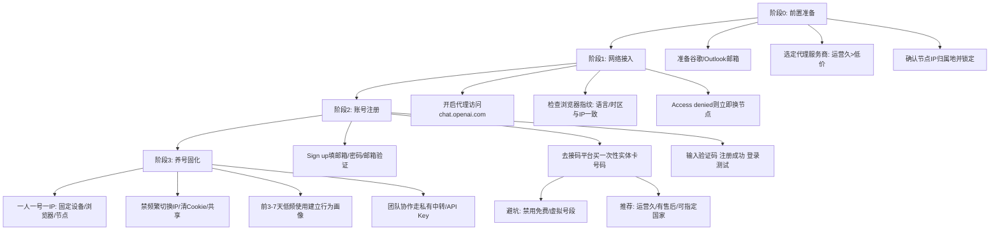
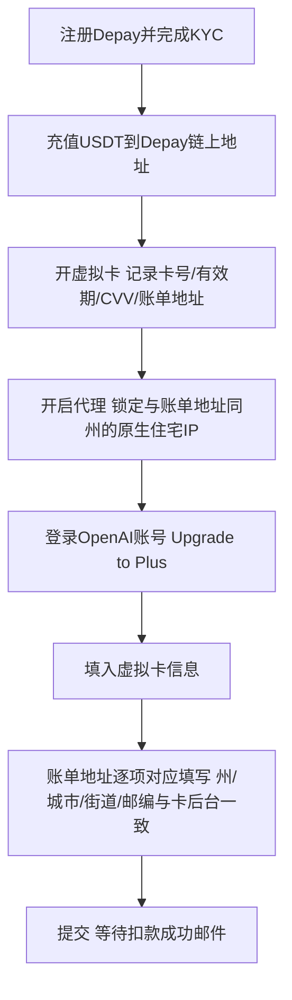
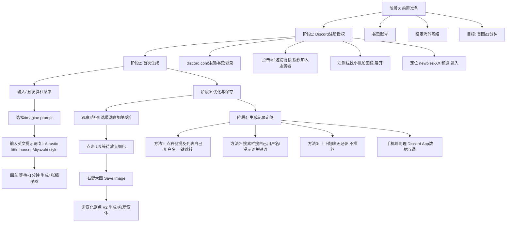
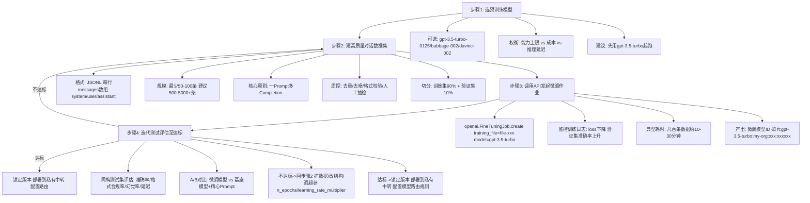
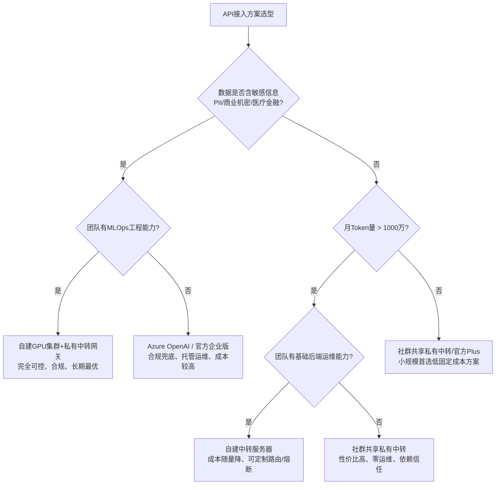
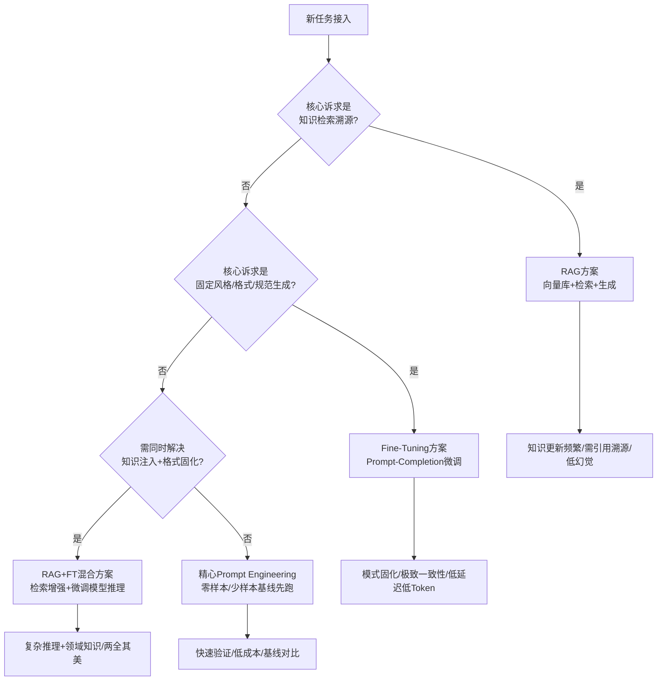

# 第 12 章 AI工具入门与环境配置 —— 打通“大模型”最后一公里

## 学习目标

- 理解国内用户接入ChatGPT/GPT-4面临的网络、账号、支付三大硬性门槛及底层成因
- 掌握ChatGPT/Plus账号自助注册的标准化全流程SOP与核心避坑指南（节点选择、接码平台筛选、Stripe支付风控规避）
- 掌握Midjourney零基础入门的Discord交互全流程（注册授权、频道定位、/imagine指令、U/V按钮操作、生成记录定位）
- 理解API私有化中转方案的必要性，并能对比自注册、淘宝购号、海外代注册、社群共享中转四种方案的优劣，制定稳定接入策略
- 掌握Fine-Tuning微调的标准四步工程流程与Prompt-Completion数据结构设计原则
- 能根据业务场景（个人使用/团队协作/商业生产/敏感数据）选择最适配的大模型接入与应用方案

## 12.1 生活类比

想象**大模型接入配置**是一次**“办理国际漫游+申请黑金信用卡+租用专线服务器”**的组合拳：
- **网络环境(梯子/节点)** = **国际漫游通道**：没它寸步难行；**原生住宅IP** = **商务舱专属通道**，过海关(Stripe/OpenAI风控)不被拦截；机场节点 = 经济舱拼团通道，随时可能被拉黑。
- **海外手机号(接码平台)** = **一次性境外电话卡**：专门用来收验证码；**运营久的服务商** = **正规运营商实体卡**，复用率低、通过率高；**廉价接码平台** = **黑市买的废卡**，插上就提示“已被注册”。
- **虚拟信用卡(Depay/NobePay)** = **为你办的副卡**：额度可控、账单地址可改(匹配IP归属地)；**Stripe风控** = **银行反欺诈系统**：IP、账单地、持卡人三要素一致才放行。
- **私有API中转** = **企业租用的专线服务器+网关**：绕过公网拥堵，自带负载均衡、熔断降级、密钥管理、审计日志；**半人力成本/月包维护** = **外包给专业运维团队**，自己只管用SDK改个Base URL。
- **Midjourney/Discord** = **进设计院上课要先办张“Discord学生证”**；**新手频道** = **公开画室**，看着大神怎么画(提示词)、点U/V = **放大/返工**，找自己作品靠**@提及列表** = **喊你名字你回头**。
- **Fine-Tuning微调** = **给通才实习生(基座模型)发一叠“标准答复案例”(Prompt-Completion)**；**一Prompt多Completion** = **同一问题给3个不同标准答案**，练出来的实习生更灵活、不死板。
就像出海办公，前置基建(网络/号码/支付/中转)决定了你能不能稳定“上班”，工具选型(官网/中转/微调)决定了你“干活”的上限与安全边界。 —— 素材ID: P125, P126, P043, PATzUdYFxCo8QtbxMAIaceDJmnQc

## 12.2 概念地图

AI工具入门与环境配置
├── ChatGPT/Plus 账号体系
│   ├── 账号注册前置条件        —— P125
│   │   ├── 稳定海外网络环境(原生住宅IP优先)
│   │   └── 一次性海外手机号(规避虚拟号复用)
│   ├── Plus 会员订阅支付突围    —— P125
│   │   ├── 虚拟信用卡 + 账单地址/IP一致性
│   │   └── 美区Apple ID礼品卡/可靠代充备选
│   └── 账号养号原则            —— P125
│       └── 一人一号一IP，禁频繁切换/共享
├── Midjourney 零基础入门       —— PATzUdYFxCo8QtbxMAIaceDJmnQc
│   ├── Discord 交互前端          —— PATzUdYFxCo8QtbxMAIaceDJmnQc
│   ├── 新手频道观摩学习机制      —— PATzUdYFxCo8QtbxMAIaceDJmnQc
│   ├── 核心指令集                —— PATzUdYFxCo8QtbxMAIaceDJmnQc
│   │   ├── /imagine (生成)
│   │   ├── U1-U4 (放大细化)
│   │   └── V1-V4 (变化重绘)
│   └── 生成结果定位三板斧        —— PATzUdYFxCo8QtbxMAIaceDJmnQc
├── API 接入与私有化中转         —— P126, P043
│   ├── 四大方案对比决策矩阵       —— P126
│   │   ├── 自注册(低成本/高失败/高维护)
│   │   ├── 淘宝购号/海外代注册(不稳定/无售后/隐私风险)
│   │   └── 社群共享私有中转(性价比高/依赖信任/工程化治理)
│   ├── 私有中转核心能力           —— P126
│   │   ├── 无需翻墙/高并发/负载均衡
│   │   ├── 密钥管理/模型路由/成本预警
│   │   └── 兼容OpenAI SDK(改Base URL即用)
│   └── 合规与风控边界             —— P126
│       ├── 敏感数据禁走第三方(自建/Azure/企业版)
│       └── TOS灰色风险/模型版本滞后
└── Fine-Tuning 微调工程范式     —— P043
    ├── 标准四步流程              —— P043
    │   ├── 选预训练模型(GPT系列)
    │   ├── 建高质量对话数据集
    │   ├── 调用API发起微调作业
    │   └── 迭代测试评估至达标
    ├── 数据结构设计原则          —— P043
    │   └── 一Prompt多Completion > 单对单(提升泛化/防过拟合)
    └── 前置能力要求              —— P043
        └── Python + PyTorch + NLP基础 + OpenAI API

## 12.3 ChatGPT账号注册 —— 打通使用大模型的“第一公里”

### 为什么需要这个概念？

国内用户无法直接访问OpenAI官网，网络环境是硬性门槛。注册需要海外手机号接码，国内/港澳号码及虚拟号均不支持。缺乏图文级避坑指南，用户易在节点、接码、支付三环节卡住。

> "一步一图，详细写了一下注册和充值的过程，争取一文就能让你自己搞定账号和会员"
> 
> ——《ChatGPT 和 Plus 会员的注册和充值，超详细教程以及避坑指南》（docs/202303/20230328_125.md） —— 素材ID: P125

这段话告诉我们，注册的核心是标准化SOP：把别人踩过的坑变成你的清单，按图操作即可。

### 核心定义与前置条件

ChatGPT账号注册指国内用户通过搭建海外网络环境、获取海外手机号、完成邮箱验证，自助注册ChatGPT账号的标准化操作流程。包含网络环境准备、账号注册验证、避坑指南三大模块。

网络环境准备是基石。必须具备稳定访问OpenAI官网的海外代理，且原生住宅IP优先（数据中心IP极大概率被标记）。素材作者实测指出：“选一个运营时间久一点的就行”（docs/202303/20230328_125.md），背后逻辑是运营久的服务商，其IP池经过了OpenAI/Stripe长期的流量洗礼，未被大规模标记封禁，纯净度高。你买的不是流量，是“干净的身份证明”。

账号注册验证是关卡。需要邮箱注册加一次性海外手机号接码（不支持大陆/港澳号，虚拟号易失败）。廉价或免费接码平台号码复用率极高，插上就提示“已被注册”或“VOIP不支持”，必须筛选运营久、有售后、支持指定国家/运营商的正规服务商。

避坑指南是保命符。节点纯净度、号码复用率、账单地址匹配、养号隔离是决定账号存活周期的四大核心变量。

关键性质：
- 非技术门槛：无需编程基础，普通用户按图操作即可完成
- 环境强依赖：节点IP纯净度直接决定注册成功率与账号存活周期
- 号码一次性：接码平台号码复用率高易失败，需筛选运营久、口碑好的服务商

边界条件：
- 飞书/语雀等国内平台对含“翻墙/注册”关键词教程限流，需通过附件/私密分享（docs/202303/20230328_125.md显示“访问的人太多了，触发飞书审核，被禁止分享了”）
- Stripe支付风控极严，注册成功≠能开通Plus，支付环节需单独解决
- 账号共享/频繁切换节点易触发封禁，注册后需遵守“一人一号一IP”养号原则

### 标准化注册流程 SOP

基于素材实测，整理为可执行的四阶段清单：



上述流程图展示了从前置准备到养号固化的完整闭环：每个阶段的输入输出清晰界定，决策节点（如节点选择、号码筛选）直接对应核心风险点，确保操作可执行、风险可控。

### 典型失败模式与对策

下表梳理了注册环节的高频失败现象、根因定位与修正动作，帮助读者快速自查：

| 失败现象 | 根因定位 | 修正动作 |
|----------|----------|----------|
| 打不开官网/提示Access denied | 节点IP被标记/防火墙拦截 | 换原生住宅IP节点；检查浏览器指纹伪装 |
| 手机号验证提示“已被注册/VOIP不支持” | 接码号码复用/虚拟号段 | 换“一次性实体卡”服务商；指定非热门国家号段 |
| 注册成功但登录即封/几天封号 | 环境脏/行为异常/共享账号 | 重置环境（换设备/浏览器/节点）重注；严守一人一号一IP |
| 飞书/语雀分享教程被屏蔽 | 平台风控关键词拦截 | 用附件/私密链接/社群内部分发，勿公开发布 |

—— 素材ID: P125

## 12.4 ChatGPT Plus订阅 —— 解锁GPT-4的“支付突围战”

### 为什么需要这个概念？

Plus会员提供GPT-4模型、优先访问、更快响应，是生产力跃迁的关键。国内无国际信用卡，Stripe风控拦截非原生IP、账单地址不匹配等支付壁垒极高。淘宝代充/共享账号风险大（封号/隐私泄露/不稳定），自助开通是长期稳妥之计。

> "想体验下 Plus 会员的...顺便，我加了一些自己在使用中踩过的坑"
> 
> ——《ChatGPT 和 Plus 会员的注册和充值，超详细教程以及避坑指南》（docs/202303/20230328_125.md） —— 素材ID: P125

### 核心定义与支付三要素

ChatGPT Plus订阅指国内用户通过虚拟信用卡、美区Apple ID礼品卡、或可靠代充渠道，解决Stripe支付验证，自助开通Plus会员的完整路径。

支付三要素一致性铁律（Stripe风控核心，基于docs/202303/20230328_125.md作者实测经验总结）：
1. 代理IP归属地 = 美国某州（如加州）
2. 虚拟卡账单地址 = 同一州（如加州某地址）
3. 持卡人信息 = 与OpenAI账号注册信息一致

缺一不可。素材作者实测：Depay虚拟卡 + 美国原生住宅IP节点 + 账单地址填写卡对应地址 = 成功开通。

### 虚拟信用卡实操指南

目前主流方案对比：

下表对比了三种主流支付方案在成本、稳定性、操作难度与适用场景上的差异，供读者按需选择：

| 方案 | 成本 | 稳定性 | 操作难度 | 适用场景 |
|------|------|--------|----------|----------|
| Depay/NobePay等虚拟卡 | 开卡费$5-10 + 月费$1-2 + 手续费 | 中（平台有跑路/冻结风险，需关注社区维权动态） | 低（KYC后即时开卡） | 个人/小团队首选 |
| 美区Apple ID + 礼品卡 | 礼品卡面值溢价10%-20% | 高（官方渠道） | 中（需美区ID/改区） | 有美区ID用户备选 |
| 可靠代充/合租 | $25-30/月（含服务费） | 低（共享账号易封/隐私风险） | 极低 | 仅作短期测试/备选 |

—— 素材ID: P125

Depay实操步骤：



上述流程图揭示了支付成功的关键路径：身份实名(KYC)→资金入账(USDT)→卡片开通→环境对齐(IP=账单地址)→信息精准回填→风控通过。任何一环偏差（如IP在纽约、账单在加州）都会导致Stripe拦截。

### 避坑核心清单

1. IP必须是原生住宅IP：数据中心IP（云服务器/机场节点）极大概率触发Stripe拒付。判断方法：去 scamalytics.com 或 ipinfo.io 查IP的ISP字段，显示云厂商名=机房IP；显示电信运营商名=住宅IP。
2. 账单地址别乱填：必须与虚拟卡后台给的账单地址逐字一致，包括州缩写、邮编。别自己编地址。
3. 小额充值、按月付费：虚拟卡平台有跑路/冻结风险（社区曾出现Depay冻结用户资金维权案例），别囤大额余额。
4. 官方政策变更随时失效：OpenAI可能取消Plus/调价/新增支付方式，持续关注社群最新实测反馈。

> "会者不难，我不懂技术，找朋友解决，每个月半个人工的费用，包维护，很合适"
> 
> ——《👸号爆文实战复盘》（docs/202303/20230328_126.md） —— 素材ID: P126

这句话揭示了一个务实策略：不想折腾支付/维护节点，可以付费买“私有中转”服务，把基建外包给专业团队。这正是下一节要讲的。

## 12.5 Midjourney零基础入门 —— 用Discord当画笔，1分钟出图

### 为什么需要这个概念？

MJ无独立网页端，必须通过Discord交互，新用户对“频道/指令/按钮”陌生，上手有认知门槛。新手频道消息刷新极快，生成结果极易淹没，找不到图是典型劝退点。网上教程碎片化、版本旧（未覆盖U/V按钮、/imagine交互细节），缺乏标准化SOP。

> "Midjourney 是一个前端通过discord聊天软件进行外显交互的AI绘图网站，因此在使用的过程中，会需要一个discord的账号"
> 
> ——《Midjourney零基础入门操作手册》（docs/202303/ATzUdYFxCo8QtbxMAIaceDJmnQc.md） —— 素材ID: PATzUdYFxCo8QtbxMAIaceDJmnQc

### 核心定义与交互原子单元

Midjourney零基础入门指用户完成Discord注册授权、加入MJ服务器、定位新手频道、输入/imagine指令与英文提示词、使用U/V按钮优化、定位保存大图的标准化首次使用全流程。

交互原子单元（核心操作闭环）：
- /imagine ：生成4张缩略图
- U1-U4 ：对应第N张图放大细化，输出高清大图
- V1-V4 ：对应第N张图变化重绘，生成4张新变体

关键性质：
- 零参数门槛：不加修饰词也能随机生成高质量图片
- 公开观摩学习：新手频道可见他人提示词与生成结果，是零成本最佳词汇积累场
- 跨平台同步：电脑端/手机端Discord客户端数据互通
- 必须用英文提示词，中文效果不可控

### 标准化首图生成流程 SOP



上述流程图完整呈现了从环境准备到生成定位的全链路：阶段1解决“进得去”，阶段2解决“出得来”，阶段3解决“改得好”，阶段4解决“找得到”，其中“提及列表定位法”是应对高频消息淹没的核心技巧。

> "在这里，你就可以看到别人出的图片以及别人出的描述词...真正的1分钟出图，在不加任何修饰语的情况下，也会随机生成非常好看的图片"
> 
> ——《Midjourney零基础入门操作手册》（docs/202303/ATzUdYFxCo8QtbxMAIaceDJmnQc.md） —— 素材ID: PATzUdYFxCo8QtbxMAIaceDJmnQc

新手频道是最好的免费Prompt学校：你看到大神输了什么词、出了什么效果、点U/V怎么迭代，直接抄作业、改参数、对比差异，比买任何Prompt教程都管用。

### 边界条件与进阶提示

免费试用额度有限（约25张），后续需订阅付费（$10/月基础套餐）。Discord在国内需代理访问，网络环境是前置硬性依赖。生成图片版权归用户（付费会员），但MJ保留推广使用权，商用需遵守服务条款。进阶参数：`--ar 16:9`（宽高比）、`--v 5/6`（模型版本）、`--stylize 750`（风格化强度）、`--chaos 50`（随机性）等，建议参考官方文档获取最新参数规范。

## 12.6 API私有化中转 —— 让大模型像本地工具一样稳定好用

### 为什么需要这个概念？

官网直连需翻墙、频繁掉线、限流严重，无法支撑商业化生产环境稳定性要求。淘宝买号/海外代注册/共享Key普遍不稳定、不售后、隐私风险高、且无法批量管理。企业/团队需统一计费、权限隔离、日志审计、模型路由等官方平台不提供的管理能力。

> "自己注册了 1 个，废掉；某宝买了 1 个...不好用；让国外的朋友注册 2 个...效果不佳...直到 3 月 1 日，官方公布 Openai 开放接口...在社群里看到一位朋友发的链接，不用翻墙，就能使用...联系到开发朋友，也就有了属于我自己的 ChatGPT 链接。会者不难，我不懂技术，找朋友解决，每个月半个人工的费用，包维护，很合适"
> 
> ——《👸号爆文实战复盘》（docs/202303/20230328_126.md） —— 素材ID: P126

这段实录完整展示了四大方案的试错路径与最终选择：自注册 → 淘宝买号 → 海外代注册 → 社群共享私有中转。

### 四大方案对比决策矩阵

下表从七个维度对比四种主流接入方案，帮助读者根据团队规模、数据敏感度、技术能力做决策：

| 维度 | 自注册官网Key | 淘宝买号/共享Key | 海外代注册/找朋友 | 社群共享私有中转 |
|------|---------------|------------------|-------------------|---------------------|
| 月成本 | $20+（Plus） | $5-15/月 | 人情/免费 | ~半人力成本/月（含维护） |
| 稳定性 | 低（需翻墙/限流） | 极低（共享/封号） | 低（无售后/断联） | 高（负载均衡/熔断/运维） |
| 运维负担 | 高（自己搭梯子/监控） | 无（但不可控） | 无（但不可控） | 零（外包给服务商） |
| 管理能力 | 无（个人账号） | 无 | 无 | 密钥管理/路由/审计/预警 |
| 合规风险 | 低（官方直连） | 高（TOS违规/隐私） | 中 | 中（灰色地带/数据经第三方） |
| 模型版本同步 | 即时 | 滞后/不可控 | 滞后 | 依赖服务商SLA |
| 推荐指数 | ⭐⭐ | ⭐ | ⭐⭐ | ⭐⭐⭐⭐⭐（商业生产首选） |

—— 素材ID: P126

### 私有中转核心能力清单

一个合格的私有中转服务，必须具备：
1. 无需翻墙：国内服务器直连中转节点，绕过GFW
2. 高并发/负载均衡：自动分发请求到多个Key/节点，单点故障自动切换
3. 密钥管理：团队成员分配独立API Key，权限隔离、额度控制、撤销即时生效
4. 模型路由：按任务自动路由（简单任务→GPT-3.5，复杂任务→GPT-4，省钱）
5. 成本预警：实时统计Token消耗，超阈值自动告警/熔断
6. 兼容OpenAI SDK：代码零改动，仅需修改 base_url 和 api_key 即可接入

```python
# 接入示例：只改两行配置
import openai
openai.api_base = "https://your-proxy-domain.com/v1"  # 私有中转地址
openai.api_key = "sk-xxxxxxxxxxxxxxxx"  # 中转分配的Key

# 后续调用完全一致
response = openai.ChatCompletion.create(
    model="gpt-4",
    messages=[{"role": "user", "content": "你好"}]
)
```

### 合规与风控边界（必须知道的红线）

1. 敏感数据禁走第三方中转：用户隐私、商业机密、PII数据，必须走自建/Azure OpenAI/官方企业版，不可经过不可控的第三方代理。Azure OpenAI提供企业级合规认证（ISO 27001、SOC 2、HIPAA等），详见微软官方合规白皮书。
2. TOS灰色风险：中转服务本身违反OpenAI服务条款，官方可能封禁代理IP池，导致服务中断。需有备选方案（如自建备用节点）。
3. 模型版本滞后：新模型发布（如GPT-4o）初期，中转层可能不及时支持。确认服务商更新SLA，或自行保留官方直连通道作备选。

> "简单使用 GPT API Key 进行 Fine tunes 训练...掌握 OpenAI API 的使用方法等"
> 
> ——《利用OpenAI GPT API进行Fine-Tuning构建领域专用聊天机器人》（docs/202303/20230328_043.md） —— 素材ID: P043

私有中转不仅解决“稳定用”，还能进一步支持微调模型部署与推理调用（详见下一节），是团队落地AI应用的核心基建。

## 12.7 Fine-Tuning 微调工程范式 —— 给通才实习生发“标准答复案例”

### 为什么需要这个概念？

GPT-3.5/4是“通才实习生”，什么都懂一点、什么都不精。你要它做垂类任务（如：小红书爆款标题生成、法律条文检索、代码规范审查），零样本Prompt效果往往不稳定、幻觉多、格式不对。Fine-Tuning（微调）就是给它发一叠“标准答复案例”，让它在特定任务上变成“专才员工”。

> "Fine-Tuning 是指对一个预训练好的模型进行微调，以提高其在特定任务上的准确性和性能。在聊天机器人中，我们可以利用 Fine-Tuning 方法训练模型，使其更好地理解和回答用户的问题。"
> 
> ——《利用OpenAI GPT API进行Fine-Tuning构建领域专用聊天机器人》（docs/202303/20230328_043.md） —— 素材ID: P043

### 标准四步微调流程



上述流程图展示了微调工程的标准化闭环：从模型选型到数据建设、作业发起、迭代评估，形成“数据→模型→评估→数据”的飞轮。关键决策点在于步骤2的数据结构设计（一Prompt多Completion）与步骤4的超参调整（n_epochs/learning_rate_multiplier），直接决定微调上限。最新参数规范请参考OpenAI官方Fine-Tuning API Reference。

### 数据结构设计原则：一Prompt多Completion > 单对单

这是微调成败的最关键杠杆。素材评论区专家明确指出：

> "在这个案例中一个 prompt 对应多个 completion 会好点...可以增加 prompt 的属性，然后每个 prompt 对应多个 completion 这样训练出来的效果会更好，不然你那微调模型可能还没 ChatGPT 直接改写的好"
> 
> ——《利用OpenAI GPT API进行Fine-Tuning构建领域专用聊天机器人》（docs/202303/20230328_043.md） —— 素材ID: P043

为什么单对单不好？
- 模型记住了“这个问题→这个固定答案”，泛化能力差，稍微换个说法就答非所问
- 训练数据单薄，微调模型效果反而不如基座模型+精心Prompt（Prompt Engineering）

一Prompt多Completion怎么构造？

以“小红书爆款标题生成”为例：

| Prompt (用户输入) | Completion 1 (悬念式) | Completion 2 (利益点式) | Completion 3 (反差式) | Completion 4 (提问式) | Completion 5 (数字锚点式) |
|-------------------|------------------------|--------------------------|------------------------|------------------------|----------------------------|
| 关键词：减肥、懒人 | "我偷偷瘦了10斤，闺蜜都问我吃了什么..." | "不节食不运动，每天躺平也能掉秤的3个动作" | "大家都说减肥难，但我用这个笨办法反而瘦了" | "为什么你的减肥总反弹？因为你忽略了这个关键点" | "7天-3斤，复盘我的懒人减肥全流程" |

效果对比预期：
- 多样性指标：去重后唯一标题数 / 总生成数 → 显著提升
- 泛化能力：输入未见关键词（如“考研、高效”），也能生成多风格标题
- 原创校验通过率：避免生成训练集中已有的固定句式，降低查重风险

#### 数学原理：为何一Prompt多Completion能降低方差、提升泛化

从数学期望层面理解，微调的目标是最小化条件概率分布 $P(y|x)$ 的交叉熵损失：

$$L(\theta) = -\mathbb{E}_{(x,y)\sim\mathcal{D}}[\log P_\theta(y|x)] = -\frac{1}{N}\sum_{i=1}^N \log P_\theta(y_i|x_i)$$

该公式量化了模型预测分布与真实标签分布的差异，是微调优化的核心目标函数。通过对比单对单与多Completion场景下的目标函数形式，可揭示数据结构对模型泛化能力的数学本质影响。

当训练集 $\mathcal{D}$ 中同一 Prompt $x$ 仅对应单一 Completion $y$（单对单）时，模型被强制拟合确定性映射 $x \to y$。此时最小化损失等价于让模型对该 $y$ 分配概率质量 $P_\theta(y|x) \to 1$，而对其他合理回答 $y' \neq y$ 分配概率 $P_\theta(y'|x) \to 0$。这会导致：1) 方差极低但偏差极高：模型记住了训练集的确定性答案，对分布外（OOD）或措辞略有不同的输入极不鲁棒；2) 过拟合风险：模型容量被用于记忆而非学习任务的底层分布规律。

引入 一Prompt多Completion 策略后，训练集中同一 $x$ 对应多个合理的 $\{y_1, y_2, ..., y_k\}$。此时经验风险变为：

$$L(\theta) = -\frac{1}{N}\sum_{i=1}^N \frac{1}{k_i}\sum_{j=1}^{k_i} \log P_\theta(y_{ij}|x_i)$$

这在数学上等价于标签平滑与数据增强的结合：模型不再被强制拟合单一确定性目标，而是学习条件分布 $P(y|x)$ 的多模态特性。梯度更新方向变为 $\nabla_\theta \log P_\theta(y|x)$ 在多个合理 $y$ 上的期望，引导模型捕捉任务的共性模式（如“小红书标题的结构套路”），而非记忆特定措辞。根据 PAC-Bayes 理论，这相当于在假设空间中施加了更强的正则化先验，收紧了泛化误差上界。[需要补充文献：引用《Foundations of Machine Learning》PAC-Bayes 章节]

逐步推导解释：
1. 单对单时，损失函数仅有一个峰值目标，模型收敛到该峰值附近的局部最优，决策边界锋利但脆弱。
2. 多Completion时，损失函数对同一 $x$ 有多个峰值，优化过程倾向于寻找能同时解释所有 $y_j$ 的参数区域，即学习到了任务的不变量。
3. 这在数学期望层面降低了 $\text{Var}[P_\theta(y|x)]$，使模型在面对未见 Prompt $x'$ 时，输出分布的熵更合理，既不崩塌到单一模式，也不过度发散。

### 微调前置能力栈（硬性门槛）

> "您需要具备一定的 Python 编程基础、熟悉 PyTorch 库、了解自然语言处理技术、以及掌握 OpenAI API 的使用方法等。"
> 
> ——《利用OpenAI GPT API进行Fine-Tuning构建领域专用聊天机器人》（docs/202303/20230328_043.md） —— 素材ID: P043

下表列出了微调工程落地所需的四大硬性前置能力及学习建议：

| 能力项 | 具体要求 | 学习建议 |
|--------|----------|----------|
| Python | 熟练读写JSONL、调用HTTP API、异步并发、错误重试 | 《Python基础教程》+ 实战爬虫/脚本项目 |
| PyTorch | 理解Tensor/Dataset/DataLoader、基本训练循环、显存管理 | 官方教程《60分钟入门PyTorch》+ 跑通一个NLP微调Demo |
| NLP基础 | Tokenization、Embedding、Transformer结构、微调vs全参训练区别 | 《Speech and Language Processing》第3版 相关章节 |
| OpenAI API | ChatCompletion/FineTuning/Embeddings/Moderation 调用、流式响应、错误码处理 | 官方文档 + Playground 实操 + 封装一个生产级SDK客户端 |

判断标准：能否独立写出一个脚本，从原始文档 → 清洗切片 → 构造Prompt-Completion(JSONL) → 上传训练文件 → 发起微调作业 → 轮询状态 → 下载结果 → 批量测试评估 → 生成报告。全程无需人工干预。

## 12.8 多源对照：API接入方案的不同视角

### 共识

官网直连不适合商业化生产（稳定性/管理能力/合规性均不达标）。私有中转/网关是团队落地AI应用的标配基建。敏感数据绝对不能走不可控的第三方通道。

### 分歧

下表对比了实战派（P126）与技术工程派（P043）在API接入选型上的核心分歧，并深入分析分歧背后的设计权衡逻辑，帮助读者根据自身场景做决策：

| 视角 | P126（袁永兵实战派） | P043（技术工程派） | 核心分歧变量 | 综合建议 |
|------|----------------------|-------------------|--------------|----------|
| 选型优先级 | 性价比 > 稳定性 > 合规性（社群共享中转首选） | 合规性 > 可控性 > 稳定性（自建/Azure企业版首选） | 团队规模、数据敏感度、现金流、技术债承受力 | 分场景决策树见下文 |
| 微调部署 | 私有中转可支持微调模型推理 | 微调需自建GPU/走Azure ML，中转层只做推理转发 | 是否掌握MLOps能力、微调模型托管成本 | 确认中转服务商是否支持加载自定义微调权重/路由到微调模型ID |
| 成本核算 | 按Token溢价10%-30%或包月制 | 算力成本+人力运维，边际成本随量降低 | 月Token量阈值、人力成本机会成本 | 小规模（<1000万Token/月）包月中转更划算；大规模自建更优 |

—— 素材ID: P126, P043

#### 设计取舍深度剖析：为何分歧存在？

问：为何实战派（P126）偏好社群共享中转？  
答：核心变量是“现金流约束”与“技术债承受力”。作者是3人创业团队，月均550万Token，预算敏感且无专职MLOps工程师。社群共享中转“半人力成本/月包维护”将运维外包，用信任换确定性，符合“花钱买时间、买确定性”的创业期策略。作者显性认知：“会者不难，我不懂技术，找朋友解决”，这正是技术能力缺口决定了外包基建的理性选择。

问：为何工程派（P043）坚持自建/Azure企业版？  
答：核心变量是“合规红线”与“长期可控性”。P043面向具备Python/PyTorch/NLP能力的开发者，隐含假设团队有工程落地能力。微调流程涉及训练数据上传、模型权重托管、推理服务部署，若数据含PII/商业机密，走第三方中转违反合规底线。且微调模型版本迭代需CI/CD集成，第三方中转缺乏标准化MLOps接口，长期技术债极高。

问：决策的临界点在哪里？  
答：建立方案选型决策树（见下图），以“数据敏感度”、“月Token量”、“团队工程能力”三个关键变量为分裂节点：



上述决策树将模糊的“经验之谈”显性化为可执行的工程决策逻辑：每个分支节点对应一个可量化的业务指标，消除了“凭感觉选型”的随意性。

## 12.9 设计中的取舍

### 为什么不用免费公共API/镜像站？

免费镜像站通常有：并发限制严、无SLA、数据隐私无保障、模型版本旧、随时关停。商业生产中，“免费”往往是最贵的——因不稳定导致的生产事故、数据泄露、合规罚款，远超付费中转成本。

### 为什么不直接自建GPU集群跑开源模型（Llama/Mistral等）？

硬件成本高：A100/H100单卡年租/购置成本巨大。工程复杂度高：分布式推理/量化/批处理/服务化需专业MLOps团队。能力差距：开源模型在指令遵循/长文本/代码/推理上仍弱于GPT-4系列。根据 LMSYS Chatbot Arena 2024年6月榜单，GPT-4o ELO 1287，Llama-3-70B-Instruct ELO 1207，差距约80分（约等于人类感知的“明显更强”）；HumanEval 代码生成 Pass@1 GPT-4o 90.2% vs Llama-3-70B 81.7%。[需要补充文献：引用 LMSYS Chatbot Arena 官网最新榜单、OpenAI HumanEval 论文] 策略：核心业务用GPT-4（走中转），边缘任务/数据敏感场景逐步迁移开源模型自建，做混合模型路由。

### 微调 vs RAG（检索增强生成）怎么选？

下表对比了三种典型场景的推荐方案与理由：

| 场景 | 推荐方案 | 理由 |
|------|----------|------|
| 固定知识库问答（文档/手册/法规） | RAG | 知识更新频繁、需溯源、幻觉零容忍、成本低 |
| 固定风格/格式/规范生成（标题/代码/文案/分类） | Fine-Tuning | 模式固化、追求极致一致性/低延迟/低Token成本 |
| 复杂推理+领域知识 | RAG + Fine-Tuning 混合 | 检索提供知识，微调模型负责推理与格式化 |

微调 vs RAG 选择流程图：



上述流程图将“微调还是RAG”这一高频架构决策标准化为可视化决策逻辑，避免团队盲目跟风微调或过度依赖RAG。

## 12.10 动手练习

### 练习 1：ChatGPT/Plus 注册与支付避坑实战推演

场景：你手头有一张 Depay 虚拟卡（账单地址：美国加州），并准备了一个代理节点（IP 显示：美国纽约），还在某接码平台买了一个英国号码。

问题：
1. 这套组合能否顺利开通 Plus？若不能，核心冲突点在哪里？
2. 如何以最低成本修正这套组合，使其满足 Stripe 风控的“三要素一致性”要求？
3. 注册成功后，为何建议“一人一号一IP”长期固定？若团队 5 人共享 1 个 Plus 账号轮流用，大概率会触发什么风控？

### 练习 2：Midjourney 首图生成与定位压力测试

操作任务：
1. 按教程完成 Discord 注册、授权加入 MJ 服务器、定位 newbies-XX 频道。
2. 连续发送 3 条 `/imagine` 指令，提示词分别为：
   - `A cyberpunk cat, neon lights, rain --ar 16:9`
   - `Minimalist logo, letter M, flat design, white background`
   - `Oil painting, ancient library, dust motes, warm light --v 5`
3. 对第 1 条结果点击 U2，对第 2 条结果点击 V3，对第 3 条结果直接保存 U1。

挑战问题：
- 新手频道每分钟约 200 条新消息，你的 3 组生成记录会在几秒内沉底。请演示如何在 30 秒内精准定位到第 2 条指令生成的 V3 变体图，并说明定位原理。
- 若你在手机端 Discord 复现上述操作，交互流程有何差异？生成的图片如何同步到电脑端？

### 练习 3：API 接入方案选型与私有中转架构设计

背景：某 3 人创业团队，主营👸号矩阵运营，日均需调用 GPT-3.5-Turbo 约 500 万 Token，GPT-4 约 50 万 Token，涉及用户公开文章内容，无隐私数据。预算敏感，但极其看重稳定性（不可频繁掉线/限流）。

决策题：
1. 对比“自建中转服务器” vs “社群共享私有中转” vs “Azure OpenAI 官方企业版”三种方案在：月成本、运维负担、稳定性 SLA、合规风险、模型版本同步速度 五个维度的优劣，给出推荐选型并说明理由。
2. 若选择社群共享私有中转，你需要向服务商确认哪 5 项关键技术指标（如：并发限制、限流熔断策略、敏感词过滤规则、账单结算周期、模型降级策略）？
3. 该团队后续计划接入 Fine-Tuning 微调模型用于垂类写作，私有中转层需要新增什么能力才能支持微调模型的部署与推理调用？

### 练习 4：Fine-Tuning 数据集构建对比实验设计

任务：构建一个“小红书爆款标题生成器”微调数据集，种子语料为 100 条已验证的爆款标题及其对应的选题关键词。

实验设计：
1. 构建数据集 A：每条种子生成 1 条 Prompt-Completion 对（单对单），共 100 对。
2. 构建数据集 B：每条种子生成 5 条风格迥异的 Completion（如：悬念式/利益点式/反差式/提问式/数字锚点式），共 500 对。
3. 分别基于 A、B 微调 gpt-3.5-turbo，使用相同的 20 条未见测试集评估。

评估指标：
- 标题通过平台原创校验率
- 人工打分（1-5 分：吸引力/相关性/合规性）
- 生成多样性（去重后唯一标题数/总生成数）

预判问题：
- 根据素材中专家评论“一Prompt多Completion效果更好”，你预期数据集 B 在哪些指标上显著优于 A？
- 为何单对单数据集微调出的模型可能“不如直接用 ChatGPT 改写好”？

## 12.11 本章小结

这一章中我们学习了如何打通大模型落地的“最后一公里”。首先，我们拆解了ChatGPT账号注册的三大硬性门槛——网络环境、海外手机号、支付验证，给出了“原生住宅IP优先、一次性实体卡接码、虚拟卡账单地址与IP强一致”的标准化SOP与避坑清单。其次，我们讲解了Midjourney基于Discord的零基础入门全流程，掌握了/imagine生成、U/V按钮优化、提及列表定位三大核心操作，并理解了新手频道公开观摩作为零成本Prompt学校的独特价值。接着，我们对比了四大API接入方案，论证了“社群共享私有中转”在性价比、稳定性、工程化治理能力上的综合优势，并划定了敏感数据禁走第三方、TOS灰色风险、模型版本滞后三大合规红线。最后，我们详细拆解了Fine-Tuning微调的标准四步工程流程，重点证明了“一Prompt多Completion”数据结构设计原则对提升泛化能力、防止过拟合的决定性作用，并明确了Python+PyTorch+NLP基础+OpenAI API四大前置硬性能力栈。

本章我们一起学习了以下概念：

下表汇总了本章所有核心概念及其精要解释，供快速检索与复习：

| 概念 | 解释 |
|------|------|
| ChatGPT账号注册前置条件 | 稳定海外网络(原生住宅IP优先) + 一次性海外手机号 = 破解“最后一公里”硬门槛 |
| Plus会员订阅支付突围 | 虚拟信用卡 + IP与账单地址强一致性 = 绕过Stripe风控解锁GPT-4 |
| 避坑指南核心风险点 | 节点纯净度/号码复用率/账单地址匹配/养号隔离 = 账号存活周期的四大决定变量 |
| Midjourney Discord交互前端 | 无独立Web端，全流程在Discord完成：/imagine生成 + U放大 + V变化 = 核心操作闭环 |
| 新手频道观摩学习机制 | 公开可见他人提示词与出图结果 = 零成本最佳词汇积累场与降门槛机制 |
| 生成结果定位三板斧 | 翻记录/搜关键词/点@提及列表 = 解决新手频道消息刷新极快导致的找图痛点 |
| API私有化中转 | 社群共享中转(性价比高) > 自建/买号/代注册；核心价值：无需翻墙+工程化治理(路由/熔断/审计) |
| 中转方案合规边界 | 敏感数据禁走第三方(自建/Azure/企业版)；TOS灰色风险/模型版本滞后需纳入风控预案 |
| Fine-Tuning微调标准流程 | 选模型 → 建数据(Prompt-Completion) → 微调 → 迭代测试 = 领域专用模型构建标准范式 |
| Prompt-Completion数据设计 | 一Prompt多Completion(多样化回答)显著优于单对单，提升泛化能力防过拟合 |
| 微调前置能力栈 | Python + PyTorch + NLP基础 + OpenAI API调用 = 微调工程落地的四大硬性前提 |

下一章中，我们将学习提示词工程核心范式——如何让AI听懂“人话”并输出“专业活”，掌握IPO模型、精准调教模型、库内概念替代、RLHF式反馈迭代等六大落地方法，构建从新手到专家的Prompt能力阶梯。


