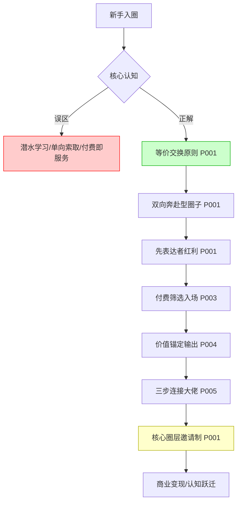
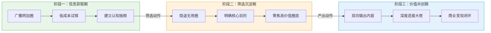
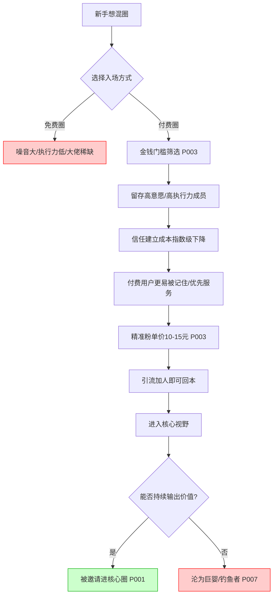
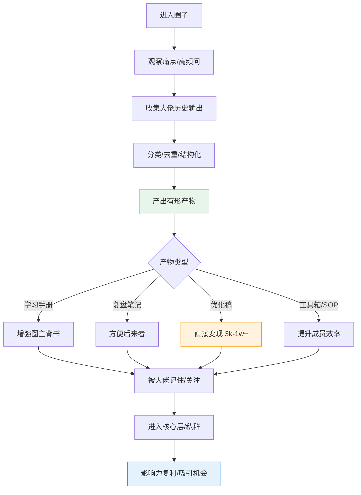
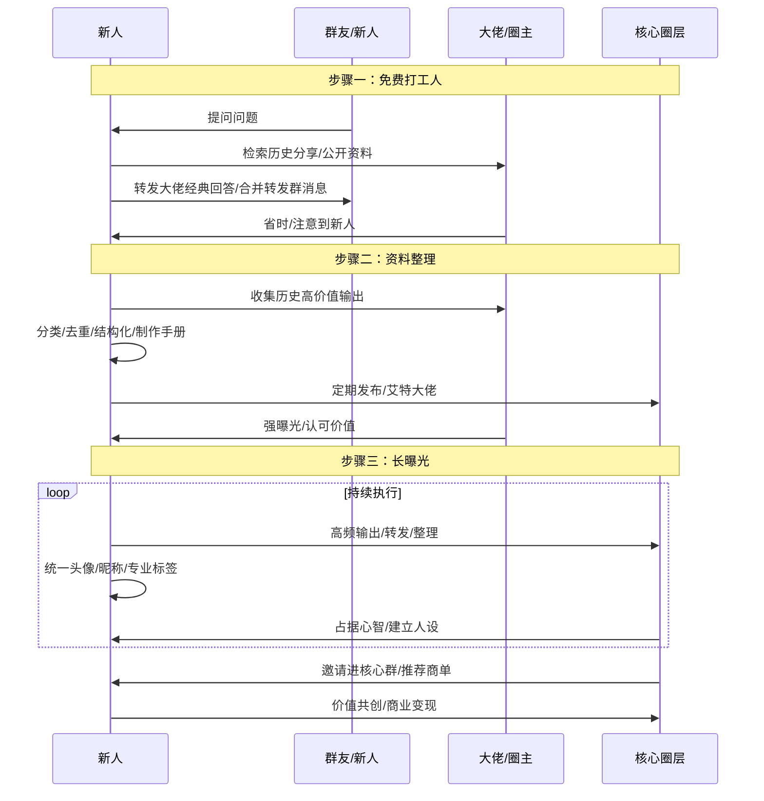
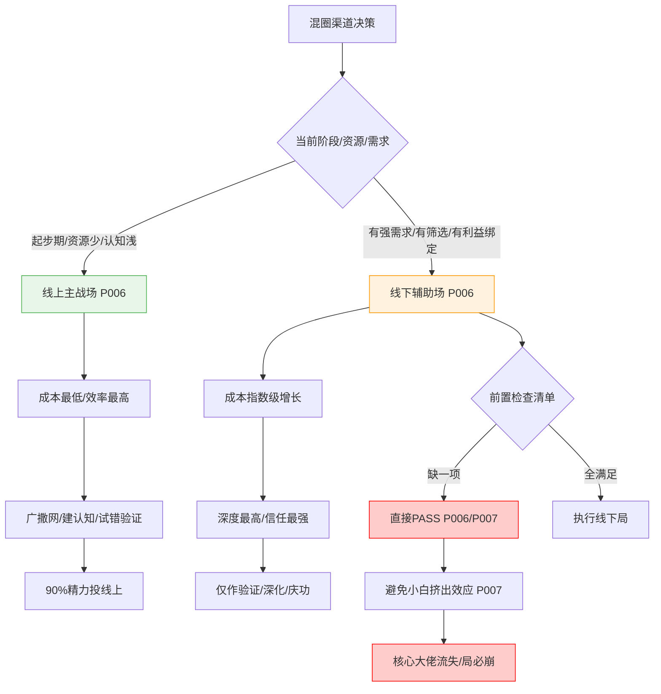
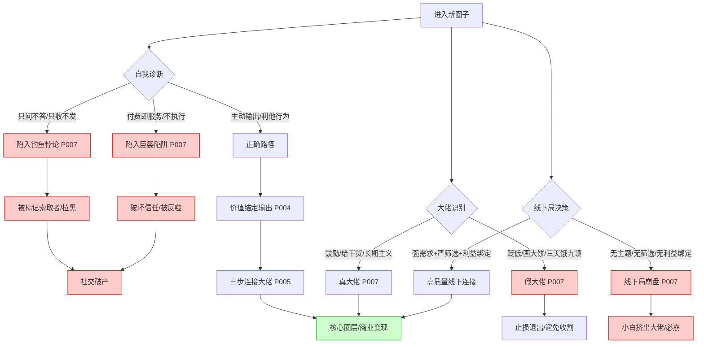

# 第 58 章 混圈与向上社交 —— 从“旁观者”到“价值提供者”

## 学习目标

- 理解混圈的本质是基于等价交换的价值连接而非单向索取
- 掌握混圈三阶段进化路径：信息获取→筛选沉淀→价值共创
- 熟练运用付费筛选机制快速进入高质量圈层
- 掌握价值锚定输出法：用有形产物（手册/复盘/工具箱）换取无形信任与商业机会
- 掌握三步连接大佬战术：免费劳务+资料整理+长曝光的零成本破圈法
- 建立线上低成本试错与线下高成本深连的渠道决策模型
- 识别并规避混圈四大死局：巨婴陷阱、钓鱼悖论、假大佬收割、线下局崩盘

## 58.1 生活类比

想象混圈是一场**高端私人健身房的会籍制运营**。

**等价交换** = 你付会费（金钱）、教练给课表（内容）、你坚持打卡（劳务） → 身体变好（回报)，三方缺一不可。

**付费筛选** = 高昂年费自动过滤‘只办卡不去/爱占器械/爱吵架’的低质会员，留下的都是‘真练/懂规矩/愿分享’的高净值人群。

**价值锚定输出** = 你不花钱请私教，而是免费帮前台整理器械摆放指南、帮教练记录会员反馈、制作‘新人避坑手册’贴在墙上 → 教练记住你、会员感激你、馆长邀你进‘核心会员群’。

**三步连接大佬** = 步骤一：见会员找器械你主动指路（免费劳务）；步骤二：把教练过往发的朋友圈干货整理成册发群里（资料整理）；步骤三：天天准点打卡、穿定制战袍、昵称叫‘健身达人XX’（长曝光）。

**线上 vs 线下** = 线上是‘云健身打卡群’（零成本/随时随地/可筛选）；线下是‘包场办派对’（万金油/易崩/仅适合已有深度信任的‘铁哥们’聚会）。

**避坑指南** = 巨婴=交了钱躺瑜伽垫上玩手机怪教练不减肥；钓鱼=进群只问‘哪练腹肌最快’从不发打卡图；假大佬=卖‘三天练出马甲线’神药；线下局崩=喊50人吃大锅饭没人买单最后AA制散场。

就像健身房靠‘会费筛选+打卡输出+干货整理’建立信任闭环，混圈也需‘付费入场+价值产出+长期曝光’才能进入核心圈层。

## 58.2 概念地图

混圈与向上社交
├── 核心本质
│   ├── 等价交换原则  —— P001
│   ├── 双向奔赴型圈子  —— P001
│   └── 先表达者红利定律  —— P001
├── 成长路径
│   ├── 混圈必经三阶段论  —— P002
│   │   ├── 阶段一：信息获取期（广撒网/不辨真伪）
│   │   ├── 阶段二：筛选沉淀期（隐退无用圈/明确目的）
│   │   └── 阶段三：价值共创期（双向输出/深度连接/变现）
│   └── 核心圈层不可买论  —— P001
├── 核心机制
│   ├── 付费筛选机制  —— P003
│   │   ├── 金钱门槛过滤低质量成员
│   │   ├── 付费用户更易被记住/优先服务
│   │   └── 精准粉单价10-15元/加几个圈即回本
│   ├── 价值锚定输出法  —— P004
│   │   ├── 整理资料/解答问题/优质内容/复盘手册
│   │   ├── 优化稿单价3000-10000+
│   │   └── 反向吸引大佬关注/进入私人群
│   └── 三步连接大佬战术  —— P005
│       ├── 步骤一：免费打工人（转发/合并/答疑）
│       ├── 步骤二：资料整理（收集/分类/结构化/手册）
│       └── 步骤三：长曝光（头像/昵称/标签高频露出）
├── 渠道决策
│   └── 线上低成本 vs 线下高成本模型  —— P006
│       ├── 线上：成本最低/效率最高/适合起步期
│       ├── 线下：成本指数级/需强需求+严筛选/纯社交必崩
│       └── 小白挤出效应：盲目组局稀释大佬密度导致核心人才流失
└── 避坑指南
├── 巨婴陷阱：纯付费不参与/以为圈子要服侍/反咬一口  —— P007
├── 钓鱼悖论：纯索取不付出/想白嫖资源/违背等价交换  —— P007
├── 假大佬识别：三天饿九顿/贬低打压/画大饼/真大佬只鼓励  —— P007
└── 线下局崩盘：无主题/无筛选/无议程/无利益绑定/小白挤出大佬  —— P007

## 58.3 混圈本质论 —— 基于等价交换的价值连接而非单向索取

### 58.3.1 为什么需要这个概念？

大量新手陷入“潜水学习/单向索取/付费即服务”的认知误区，导致社交成本高、信任建立难、商业转化率低。缺乏对社交底层逻辑的理解，将“混圈”等同于“买资源/找大腿”，忽视了价值双向流动的铁律。

### 58.3.2 核心定义

**混圈**：主动加入特定领域社群（付费/免费），通过获取信息、连接人脉、输出价值实现认知升级或商业变现的动态过程。

> "混圈，似乎是现在很有意思的一个词，很多朋友想要向上社交，但是不知道要如何向上社交，以及如何花最少的钱...混圈是多数人起步阶段必须要走过的一个阶段"
> 
> ——《docs/202303/20230328_015.md》（P001）

**等价交换原则**：世界不变的原则，混圈必须付出（金钱/内容/劳务）获得相应回报（信息/人脉/机会），优秀的人与内容永远双向奔赴。

**双向奔赴型圈子**：成员间双向提供内容/价值/资源，而非单向索取或单向输出，是高质量人脉沉淀的前提。

### 58.3.3 关键性质

- 信任建立成本随付费门槛指数级下降：金钱支持比任何东西都有用，付费用户更易被记住（P001）。
- 核心圈层具有“邀请制”属性：真核心圈子花钱也进不去，只能通过持续价值输出被邀请进入，付费圈仅为外围筛选层（P001）。
- 先表达者红利：主动、优先、持续输出内容/整理/观点者，天然占据注意力与信任红利，更易获得商业机会（P001）。

### 58.3.4 典型例子

- “七小”通过整理学习手册进入星球核心层，获商业订单（单价3k-1w+）及私群邀请，验证“资料整理+长曝光”路径高确定性（P004、P005）。
- 知识付费领域精准粉单价约10-15元，加入几个付费圈即可通过“引流加人”动作回本，验证“付费入圈获客”商业模型可行性（P003）。

### 58.3.5 边界条件

- 纯付费不参与（巨婴陷阱）：花钱以为圈子要服侍自己，破坏信任基础，最终被反噬（P007）。
- 纯索取不付出（钓鱼悖论）：违背等价交换原则，无法建立真实连接（P007）。
- 线下混圈成本指数级增长：无明确强需求+严格筛选前提下，纯社交线下局必崩，小白挤出大佬导致核心人才流失（P006、P007）。
- 大佬识别需“观察期”：真大佬鼓励而非贬低，避免“三天饿九顿”式假大佬收割（P007）。

### 58.3.6 原文驱动的深度解读

> "等价交换，这个世界不变的原则。优秀的人，优秀的内容，永远都是双向性奔赴的。"
> 
> ——《docs/202303/20230328_015.md》（P001）

这句话揭示了社交的底层物理学：**没有免费的午餐，只有双向的奔赴**。你在圈子里看到的每一个“被大佬关注/被邀请进核心群/接到商单”的案例，背后必然是该成员此前持续输出了“整理/解答/复盘/创作”等显性价值。

> "混圈，最好的办法，就是打钱，虽然听起来有点俗气，但金钱的支持，比任何东西都是要有用的。多数你可以花钱加入的圈子，那都是占了便宜。那些你花钱也进不去的圈子，才是真正的核心圈子。"
> 
> ——《docs/202303/20230328_015.md》（P001、P003）

这段话划定了混圈的**边界地图**：
- **外圈（可买）**：几百~几千元门票，买的是“环境/信息/筛选/陪跑”，性价比极高，属于“占便宜”区。
- **内圈（不可买）**：邀请制/推荐制，买不进去，只能用“持续价值输出”换入场券。

> "我理解的圈子，是双向奔赴提供内容的。双向提供输出，更容易得到一些有用的帮助、朋友、人脉、资源。若是只是做一个看客，那么大佬也不会关注你，了解到你的。"
> 
> ——《docs/202303/20230328_015.md》（P001）

**看客≠混圈成员**。大佬的注意力是稀缺资源，只会分配给“能帮我省时间/解决问题/产出价值”的人。你不产出，就没有“被看见”的资格。

> "做个资料整理的，看看这个圈内有什么优质内容，我们帮大佬去把这个资源收集起来，然后整理一下？发优质的文章...整理出来一份学习使用手册...这种优质的整合能力，在很多地方都是很少能见到的。"
> 
> ——《docs/202303/20230328_015.md》（P004）

这就是**价值锚定输出**的雏形：用“整理能力”填补大佬“精力不足”的空档，用“手册产物”沉淀圈内“隐性知识”，一举换取“被记住/被信任/被推荐”的复利红利。

> "线下混圈要付出的成本都是指数级增长的，线上混个圈子是成本最低，最低的。线下圈，若非有需求，切勿轻易拜访，切勿轻易组局。没利益的线下组局是一定会崩的！"
> 
> ——《docs/202303/20230328_015.md》（P006）

这是**渠道决策模型**的铁律：新手90%精力应投线上（建IP/做内容/跑项目/混圈子），线下仅作“验证/深化/庆功”辅助。盲目线下组局，本质是“用指数级成本换对数级深度”，且极易触发“小白挤出大佬”的崩盘机制。

### 58.3.7 方法演进图

## 58.4 混圈三阶段进化法 —— 从“广撒网获取信息”到“价值共创变现”

### 58.4.1 为什么需要这个概念？

新手缺乏判断力，无法分辨圈子质量，陷入“到处交学费/到处潜水/到处白嫖”的低效循环。需要一条清晰的成长路径，指导如何从零起步、筛选沉淀、最终实现商业闭环。

### 58.4.2 核心定义

**混圈必经三阶段论**（P002）：

以下是三阶段对照表，展示了从信息获取到价值共创的完整进化路径：

| 阶段 | 核心动作 | 心智模式 | 典型产出 |
|------|----------|----------|----------|
| **阶段一·信息获取期** | 广撒网、不辨真伪、低成本试错 | 被动接收、索取价值 | 初步认知版图、圈子名单 |
| **阶段二·筛选沉淀期** | 隐退无用圈、明确核心目的、停止无效社交 | 主动筛选、聚焦高价值圈层 | 核心圈子清单、个人定位 |
| **阶段三·价值共创期** | 双向输出、深度连接、内化方法论 | 创造价值、等价交换 | 手册/复盘/优化稿、商业变现 |

> "起步阶段，多混圈是一定的...你是没有任何能力去分辨信息是对的还是错的。我期初步入互联网加了一大堆的圈子，慢慢的对我用处不大的圈子我都慢慢隐退了。混到最后会发现，对自己有用的就只有那么几个的时候，那慢慢的会发现，自己要的东西基本都有了。"
> 
> ——《docs/202303/20230328_015.md》（P002）

这段复盘完美诠释了三阶段的**必经性与顺序性**：没人能跳过“广撒网”直接“精准筛”，也没人能跳过“筛选沉淀”直接“价值共创”。

### 58.4.3 关键性质

- 阶段跨越的核心驱动力：从“被动接收”转向“主动输出”，从“索取价值”转向“创造价值”（P002）。
- 每个阶段的核心动作不同：起步重“入”，中间重“筛”，后期重“产”（P002）。
- 阶段不可跳跃：试图跳过筛选期直接共创，必然因认知不足导致输出低质、无人买单（P002）。

### 58.4.4 典型例子

> "比如七小，他做了一件很有意义的事情，花费了自己大量的时间，整理出来一份学习使用手册...闪光点被发现，自带花香，自会吸引一波其他需要帮忙整理整合的人。优化稿，也许一篇就会给到三千到一万的收入...若是你输出的内容足够优质，还能加入大佬的私人群。"
> 
> ——《docs/202303/20230328_015.md》（P002、P004、P005）

“七小”的路径 = **阶段二产出手册（筛选沉淀期的高质量输出） → 阶段三被大佬关注进入核心层（价值共创期的深度连接） → 接单变现（商业闭环）**。这是教科书级的三阶段跃迁样本。

### 58.4.5 边界条件

- 停留在阶段一太久：陷入“知识囤积/焦虑/不敢行动”的内耗循环（P002）。
- 卡在阶段二不产出：成为“专业潜水员/评论家”，拥有认知无变现，最终因缺乏正反馈而退出（P002）。
- 阶段三产出内容质量不达标：无法触发“双向奔赴”，被核心圈层边缘化（P002、P004）。

### 58.4.6 方法演进图

## 58.5 付费筛选机制 —— 金钱门槛过滤低质量成员的最高效入场券

### 58.5.1 为什么需要这个概念？

免费圈子鱼龙混杂、信息噪音大、成员执行力低、大佬稀缺注意力难获取。新手缺乏“识人/识圈/识机会”能力，需借助外部机制快速筛选高信任度环境。

### 58.5.2 核心定义

**付费筛选机制**（P003）：利用金钱门槛过滤低意愿/低执行力人群，留存高质量成员，降低信任建立边际成本。

> "混圈，最好的办法，就是打钱，虽然听起来有点俗气，但金钱的支持，比任何东西都是要有用的。多数你可以花钱加入的圈子，那都是占了便宜。那些你花钱也进不去的圈子，才是真正的核心圈子。付费用户是更容易被记住的。"
> 
> ——《docs/202303/20230328_015.md》（P003）

### 58.5.3 关键性质

- 成本-收益非对称性：几百/几千元门票成本，可撬动数万/数十万商业机会与核心人脉（P003）。
- 筛选双向性：圈主筛选成员，成员同时筛选圈主（通过退款率/活跃度/产出质量投票）（P003）。
- 付费即承诺：支付行为本身即是“愿为结果负责/愿投入时间/愿执行落地”的强信号（P003）。

### 58.5.4 典型例子

> "市面上这些精准粉，都差不多跑到了十几块钱一个，你多加几个就是回本了。所以说，对于搞培训的人来说，加人，就算一个目的。"
> 
> ——《docs/202303/20230328_015.md》（P003）

**数据支撑**：知识付费领域精准粉单价 10-15 元，加入几个付费圈通过“引流加人”即可回本。这意味着**付费入圈的 ROI 门槛极低**，只要你能把圈子里的流量转化为私域好友，门票钱瞬间回本。

### 58.5.5 边界条件

- **付费≠买结果**：付费仅买“环境/信息/机会/陪跑”，执行与结果仍归个人，切忌“巨婴心态”（P003、P007）。
- **避开“收割型付费圈”**：承诺包赚/包教包会/无售后/无实操内容的圈子，大概率是韭菜收割机（P007）。
- **核心圈层不可买**：真正的顶层圈子（如生财合伙人/大佬私董会）为邀请制，需以“价值输出”换“入场券”（P001）。

> "当然这里还有一部分巨婴，花了钱，加了圈，以为这个圈子的人就要去服侍他，自己没去参与，最终就还来反咬一口吐槽一下。不要为了付费而去付费，要为了自己能得到什么而去付费。"
> 
> ——《docs/202303/20230328_015.md》（P003、P007）

### 58.5.6 方法演进图

## 58.6 价值锚定输出法 —— 用“有形产物”换“无形信任”与“商业机会”

### 58.6.1 为什么需要这个概念？

新手无资源、无人脉、无案例，难以通过“自我介绍/吹牛/发红包”建立专业人设。大佬时间稀缺，只关注“能帮我解决问题/节省时间/产出价值”的人，需用显性产物穿透注意力层。

### 58.6.2 核心定义

在圈子中持续产出**“整理资料、解答问题、优质内容、复盘手册、优化稿”**等有形价值产物，以“增强圈主背书+提升成员效率+沉淀隐性知识”为核心卖点，锚定“靠谱/专业/利他”人设。

产出形式包括：学习手册、工具箱、复盘笔记、标题库、选品表、SOP文档、代码模板等（P004）。

### 58.6.3 关键性质

- 复利效应：单次产出可被无限复用、转发、引用，边际成本趋近零，影响力随时间指数增长（P004）。
- 反向吸引力：优质内容是“花香”，大佬/同频者会主动找上门，无需主动推销（P004）。
- 商业化阈值：输出质量达标（如优化稿单价 3k-1w+），即可直接向圈主/大佬交付变现（P004）。

### 58.6.4 典型例子

> "做个资料整理的，看看这个圈内有什么优质内容，我们帮大佬去把这个资源收集起来，然后整理一下？发优质的文章...整理出来一份学习使用手册...对于他们星球来说，增强背书，其次，也方便了后来的人接触到他。优化稿，也许一篇就会给到三千到一万的收入，乃至更高，有价值的商业内容，是值得这个价的。若是你输出的内容足够优质，还能加入大佬的私人群，自然而然，慢慢加入更多的圈子，自己的影响力也能塑造起来！闪光点被发现，自带花香，自会吸引一波其他需要帮忙整理整合的人。"
> 
> ——《docs/202303/20230328_015.md》（P004）

这段话完整描述了**价值锚定输出的商业化飞轮**：
1. **产出手册** → 2. **增强圈主背书/方便后来者** → 3. **被大佬看到/记住** → 4. **进入核心层/接商单** → 5. **影响力复利** → 6. **吸引更多同频人/机会**。

### 58.6.5 边界条件

- 产出必须“可用/可信/可迁移”：花哨无实操/抄袭无整理/过时无更新的内容反而损害信任（P004）。
- 避免“为产出而产出”：核心是解决圈内真实痛点，而非完成打卡任务（P004）。
- 长期主义：前 3-6 个月可能无正反馈，需以“过程即奖赏”心态坚持，拒绝速成心态（P004）。

### 58.6.6 方法演进图

## 58.7 三步连接大佬战术 —— 免费劳务+资料整理+长曝光的零成本破圈法

### 58.7.1 为什么需要这个概念？

新手无钱付费、无资源置换、无案例背书，难以通过常规路径接触核心大佬。大佬痛点：群内重复答疑耗时、优质内容沉底难找、缺乏整理归档精力，新人可精准填补。

### 58.7.2 核心定义

**三步连接大佬战术**（P005）：

以下是三步战术的标准化执行表，展示了零成本破圈的完整动作包：

| 步骤 | 动作 | 角色定位 | 核心价值 |
|------|------|----------|----------|
| **步骤一·免费打工人** | 群友问问题 → 转发大佬过往分享/合并转发大佬群消息 | 活体索引/免费客服 | 替大佬省时、帮群友解惑、展示靠谱 |
| **步骤二·资料整理** | 收集大佬历史高价值输出 → 分类/去重/结构化/制作手册 → 定期发群/艾特大佬 | 知识整理师/存档管理员 | 沉淀隐性知识、提升圈子效率、强曝光 |
| **步骤三·长曝光** | 持续执行上述动作 → 头像/昵称/专业标签高频曝光 → 成大佬“得力助手/超级粉丝” | 超级连接器/品牌代言人 | 占据大佬心智、建立专业人设、反向吸引 |

> "免费打工人，资料整理收集，大佬的每一次群消息分享，发完后，你给他合并转发一下？群友问 XX 问题，刚好大佬分享过，你把之前分享过的内容转发一下？长曝光，大佬分享完，你把这个资料收集整合，你的头像，昵称，都会被看到...长期坚持，多数提问都是可以快速得到答案的。"
> 
> ——《docs/202303/20230328_015.md》（P005）

### 58.7.3 关键性质

- 零成本：仅需时间/执行力/整理能力，无需金钱/资源/人脉置换（P005）。
- 高信任：通过“利他行为”而非“利益交换”建立信任，粘性极强，抗周期性强（P005）。
- 可复制：任何圈子/任何大佬/任何新人均可执行，标准化程度高（P005）。

### 58.7.4 典型例子

> "比如七小，他做了一件很有意义的事情，花费了自己大量的时间，整理出来一份学习使用手册...闪光点被发现，自带花香，自会吸引一波其他需要帮忙整理整合的人。"
> 
> ——《docs/202303/20230328_015.md》（P005）

“七小”零成本完成了**三步战术的全流程闭环**：免费答疑（步骤一）→ 整理手册（步骤二）→ 长期曝光专业标签（步骤三）→ 被大佬记住 → 进入核心层 → 接单变现/获邀私群。

### 58.7.5 边界条件

- **执行力门槛**：需真正“花费大量时间/整理高质量/持续输出”，敷衍了事会被识别为“蹭热度/刷存在感”（P005）。
- **圈子文化兼容性**：仅适用于“鼓励分享/尊重整理/利他导向”圈子，功利/排他/封闭圈子无效（P005）。
- **避免过度服务**：保持边界感，做“价值提供者”而非“免费保姆”，核心诉求仍是“等价交换”（P005）。

### 58.7.6 方法演进图

## 58.8 线上低成本试错 vs 线下高成本深连 —— 混圈渠道的成本-收益决策模型

### 58.8.1 为什么需要这个概念？

新手易混淆“线上混圈”与“线下拜访”的边界，盲目线下组局导致成本失控、大佬流失、项目崩盘。需要根据自身阶段（资源/认知/需求）动态选择混圈渠道，避免“用线下成本解决线上能解决的问题”。

### 58.8.2 核心定义

**线上混圈**（P006）：成本最低（时间/门票/流量）、效率最高（异步/跨地域/可回放/可筛选）、适合起步期广撒网、建立认知、试错验证。

**线下混圈**（P006）：成本指数级增长（差旅/住宿/时间/礼品/机会成本）、深度最高（信任/情感/隐性知识/酒桌文化）、仅适合“有明确强需求+严格筛选”前提下的深度连接。

### 58.8.3 关键性质

- 成本-深度权衡曲线：线上边际成本递减、边际深度递增；线下边际成本指数级、边际深度对数级（P006）。
- “没利益的线下组局是一定会崩的”：纯社交无利益绑定，无法维持长期稳定关系（P006）。
- “小白挤出效应”：线下局小白占比远超大佬，盲目组局稀释大佬密度，导致核心大佬流失（伤心）（P006、P007）。

> "线下混圈要付出的成本都是指数级增长的，线上混个圈子是成本最低，最低的。线下圈，若非有需求，切勿轻易拜访，切勿轻易组局。没利益的线下组局是一定会崩的！小白一定会比大佬要多，线下组局，组圈，一定要谨慎再谨慎！线下有需求的老板自会自主连接。"
> 
> ——《docs/202303/20230328_015.md》（P006、P007）

### 58.8.4 典型例子

- 作者经验：线上混圈成本最低，线下成本指数级增长；线下有需求的老板自会自主连接，无需盲目组局（P006）。
- 生财见面会：有主题/有筛选/有议程/有复盘/有转化的“结构化线下局”才可复制，非随意聚餐（P006）。

### 58.8.5 边界条件

- **线上无法解决的场景**：极强信任需求（大额投资/核心合伙/隐私谈判）、极强隐性知识传递（手艺/心法/氛围）、极强情感绑定（生死之交/患难见真情）（P006）。
- **线下组局前置检查清单**：
  1. 是否有具体强需求？
  2. 是否有严格筛选机制？
  3. 是否有利益绑定设计？
  4. 是否有复盘沉淀输出？
  **缺一不可**（P006、P007）。
- **新手优先策略**：前 1-2 年 90% 精力投线上（建 IP/做内容/跑项目/混圈子），线下仅作“验证/深化/庆功”辅助（P006）。

### 58.8.6 方法演进图

## 58.9 混圈避坑指南 —— “巨婴陷阱/钓鱼悖论/假大佬/线下局崩盘”四大死局破解

### 58.9.1 为什么需要这个概念？

90% 新手混圈失败源于认知偏差而非执行不力，提前识别死局比事后复盘更高价值。需建立“负面清单”思维：知道不做什么，比知道做什么更关键。

### 58.9.2 核心定义：四大死局

以下是四大死局的识别对照表，帮助新手建立负面清单思维：

| 死局 | 典型行为 | 核心危害 | 识别信号 |
|------|----------|----------|----------|
| **巨婴陷阱** (P007) | 纯付费不参与，以为圈子要服侍自己，最终反咬一口吐槽圈子 | 破坏信任基础，污染圈子文化 | “我交了钱凭什么自己动手？”/“大佬不理我就是圈子垃圾” |
| **钓鱼悖论** (P007) | 纯索取不付出，想白嫖资源/人脉/方法，从不分享/整理/复盘 | 违背等价交换原则，被标记“索取者”拉黑屏蔽 | 只问“推荐圈子/给资源/拉人脉”，从不输出任何价值 |
| **假大佬收割** (P007) | 三天饿九顿/贬低打压/画大饼收割学费/无实操干货/无售后 | 收割韭菜学费，导致学员维权/圈子解散/大佬换马甲重来 | 承诺包赚/包教包会/无实操案例/不敢公开过往履历 |
| **线下局崩盘** (P007) | 无主题/无筛选/无议程/无利益绑定/无复盘的纯社交局 | 小白挤出大佬，核心人才流失，时间金钱双空 | 报名无门槛/议程模糊/主办方不露面/纯吃喝玩乐 |

### 58.9.3 关键性质

- **死局识别的启发式规则**（P007）：
  1. 看“鼓励还是贬低”辨大佬真假
  2. 看“利益绑定”定线下局生死
  3. 看“执行反馈”验付费圈质量
  4. 看“长期主义”判圈子存续
- **心理防御机制**：将“付费”重构为“买环境/买机会/买筛选”而非“买结果/买保姆/买捷径”（P003、P007）。

> "那些你花钱也进不去的圈子，才是真正的核心圈子。优秀的人，自会被邀请。在这之前，可以多观察几个大佬，就会发现是真的还是假的了。若是遇到假大佬，很有可能，带你混，三天饿九顿哈哈哈。真正厉害的大佬，他不会去贬低一个人，而是鼓励。小白一定会比大佬要多，线下组局，组圈，一定要谨慎再谨慎！没利益的线下组局是一定会崩的！线下有需求的老板自会自主连接。"
> 
> ——《docs/202303/20230328_015.md》（P007）

### 58.9.4 典型反面案例

- **巨婴案例**：花钱加圈 → 不学习/不打卡/不执行 → 怪圈子没用/怪大佬不理 → 退群骂街/差评传播（P007）。
- **钓鱼案例**：进群只问“推荐圈子/给资源/拉人脉” → 从不分享/不整理/不复盘 → 被标记“索取者”拉黑屏蔽（P007）。
- **假大佬案例**：收割“韭菜”学费 → 给通用鸡汤/过时教程/无售后 → 学员维权/圈子解散/大佬换马甲重来（P007）。

### 58.9.5 边界条件

- **新手自我诊断清单**：我是否“只问不答/只收不发/只听不练/只看不做”？是 → 立即纠偏（P007）。
- **圈子质量快速测试**：发一条“整理/复盘/提问”帖，观察 24h 内“点赞/回复/转发/大佬关注”数据，数据差 → 果断退出（P007）。
- **止损原则**：发现圈子文化/价值观/人员质量与预期严重偏离，立即隐退/退群/止损，沉没成本不可追回（P007）。

### 58.9.6 方法演进图

## 58.10 多源对照

本章核心概念均源自单一文档 `docs/202303/20230328_015.md` 的系统性拆解，暂无其他素材对同一概念给出不同解释，故无“共识与分歧”对照。

> **说明**：若后续补充材料出现对“混圈三阶段论/付费筛选/价值锚定输出”等概念的不同定义或实操路径，将在此节补充“共识/分歧”表格。

## 58.11 设计中的取舍

**为什么不用“免费蹭圈/白嫖资源”方案？**

因为**注意力是稀缺资源，大佬的时间只分配给“能帮他省时间/解决问题/产出价值”的人**。免费蹭圈者无显性价值产出，无法穿透大佬的注意力过滤层，必然沦为“看客”，长期来看社交成本极高（机会成本+认知折损）。

**这种设计的 trade-off 是什么？**

- **短期收益延迟**：前 3-6 个月可能无明显变现/正反馈，需以“过程即奖赏”心态对抗焦虑。
- **执行力门槛高**：需持续产出高质量整理/内容/手册，对时间管理/信息加工/坚持力要求高，非人人可做。
- **圈子文化依赖性强**：仅适用于“鼓励分享/尊重整理/利他导向”圈子，遇功利/排他/封闭圈子需果断止损切换。

**核心结论**：**混圈不是“社交”，是“用价值换信任、用信任换机会、用机会换变现”的商业化运营过程。** 掌握“付费筛选+价值锚定输出+三步连接大佬+线上主线下辅+四大死局规避”这套组合拳，普通人即可低成本、高确定性地完成向上社交与认知跃迁。

## 58.12 动手练习

### 练习 1：混圈现状自诊断与阶段定位

请根据过去 3 个月的社群行为，诚实回答以下问题：

1. 你加入的付费/免费圈子共有多少个？其中“每周至少打开 1 次”的有几个？
2. 你在圈子里的典型行为是：
   A) 只看不发/只收藏不整理
   B) 偶尔提问/偶尔转发
   C) 定期整理资料/输出复盘/主动解答他人问题
3. 你是否曾因“付费了就该被服务”而对圈主/大佬产生不满？是/否
4. 你是否曾“只问推荐圈子/要资源/拉人脉”，从未分享过任何有价值内容？是/否
5. 根据“混圈三阶段论”，你当前处于哪个阶段？理由是什么？
6. 制定你未来 30 天的“阶段跃迁”行动清单（如：退出 3 个低质群、产出 1 份资料手册、主动解答 5 个新人问题）。

---

### 练习 2：价值锚定输出实战：制作一份『圈子高频问题手册』

选定你正在深耕的 1 个核心付费圈子（或意向圈子），执行以下步骤：

1. **收集**：翻阅过去 6 个月群聊记录/精华帖/大佬朋友圈，收集『高频提问 TOP 20』及『大佬经典回答/操作截图/工具推荐』。
2. **整理**：按『选品/引流/转化/工具/避坑/心法』等业务模块分类，去重、结构化、加上『来源链接/适用阶段/操作难度』标签。
3. **产出**：用飞书/Notion/语雀制作《XX 圈子新人避坑&快速上手手册 V1.0》，含目录/正文/附件/更新日志。
4. **分发**：在圈内发布（艾特圈主/管理员），标题：『整理了 200 条聊天记录，做了这份手册，送给正在迷茫的同路人』。
5. **复盘**：观察 24 小时内的『点赞/转发/私信/大佬回复/加好友』数据，记录是否触发『被邀请进核心群/被大佬点名/接到商单』信号。

**回答问题**：
- 如果数据平平，是『内容质量不够』还是『分发时机/话术』问题？如何验证？
- 手册更新频率设为多少？如何建立『用户反馈→版本迭代』的飞轮？

---

### 练习 3：三步连接大佬战术：7天『免费打工人』挑战

在目标圈子连续执行 7 天，每天完成『三步动作包』：

【步骤一·免费劳务】：发现群友提问 → 3 分钟内找到大佬过往回答/公开资料 → 回复：『大佬@XXX 讲过这个，链接/截图在这里，供参考』

【步骤二·资料整理】：每晚整理当天『大佬发言/高赞讨论/工具推荐』→ 更新进『XX 圈子每日精华 Vol.XX』文档 → 群内发布/艾特大佬。

【步骤三·长曝光】：统一修改群昵称为『XX 领域·整理控·昵称』，头像统一风格，确保每次发言/转发/整理都强曝光。

第 7 天复盘记录：
- 大佬是否主动回复/点赞/艾特过你？
- 是否有群友私信感谢/索要文档/加好友？
- 你的『被记住感』是否增强？（如：新人进群艾特你问资料、大佬发言回复你的整理）

**回答问题**：
- 哪个步骤最耗时？如何用工具（如自动转发/关键词监控/模板化）压缩至单日 < 30 分钟？
- 若圈子文化不鼓励『刷屏/艾特大佬』，如何调整策略保持『利他』不被误判为『刷存在感』？

---

### 练习 4：线下混圈决策模拟器：该不该去这场局？

某行业大佬发起『线下闭门会』，票价 2999 元/人，限额 30 人，主题『AI 落地商业化』，你很想去但预算紧张。请用『线上低成本 vs 线下高成本模型』决策：

1. **强需求核验**：你当前业务中『必须线下解决』的具体难题是什么？（如：拿融资/定合伙/谈独家供应链/破信任死局）若无 → 直接 PASS。
2. **筛选机制核验**：主办方是否『审核资质/限定身份/拒绝纯小白/有黑名单机制』？若无筛选 → 大概率小白局 → PASS。
3. **利益绑定核验**：议程中是否含『资源对接/项目路演/利润分成/独家渠道』等硬利益设计？若纯分享/纯社交 → PASS。
4. **成本-收益测算**：门票 2999 + 差旅住宿 1500 + 时间成本（2 天 × 日薪）= 总成本 X。你能列出 3 个『仅线下能拿到、线上绝对拿不到』的具体收益，且预期价值 > 3X？否 → PASS。
5. **止损预案**：到场发现『小白>大佬/无议程/纯推销/大佬迟到早退』，你的离场触发条件与话术是什么？

**回答问题**：
- 若决定不去，省下的 4000 元 + 2 天时间，你将投入哪个『线上高杠杆动作』？（如：产出 1 篇优化稿/跑通 1 个 MVP/整理 1 份风向标）
- 如何用『线上动作』反向制造『被大佬邀请线下』的机会？

---

### 练习 5：混圈避坑红黑榜：建立你的『负面清单』

梳理你过去加入的所有圈子（付费/免费/线上/线下），填写下表并标记『红榜/黑榜』：

| 圈子名称 | 类型 | 门槛 | 你的投入(钱/时/力) | 核心收获 | 红/黑榜理由 | 避坑标签 |
| --- | --- | --- | --- | --- | --- | --- |
| 例：XX 训练营 | 付费 | 2999 | 2999 元/40 小时/高 | 无/仅得通用鸡汤 | 黑榜 | 巨婴陷阱/钓鱼悖论/假大佬/无复盘 |

完成填写后，回答：

1. 你的『黑榜』中，哪种避坑标签出现频率最高？这揭示了你什么认知盲区？
2. 基于红榜圈子共性，提炼你的『高性价比圈子画像』：门槛/文化/节奏/产出/大佬画像。
3. 制定『新圈子 30 天考核期 SOP』：入群前 30 天必须完成的 5 个观测动作与 3 个退出触发条件。

---

## 58.13 本章小结

这一章中我们学习了混圈与向上社交的底层逻辑与全流程实操体系。首先，我们确立了**等价交换原则**——混圈本质是双向奔赴的价值连接，而非单向索取；其次，我们拆解了**混圈三阶段进化法**——从信息获取期的广撒网，到筛选沉淀期的隐退无用圈，再到价值共创期的双向输出与变现，阶段不可跳跃；接着，我们掌握了**付费筛选机制**——用金钱门槛买环境、买筛选、买信任降级，而非买结果；然后，我们习得了**价值锚定输出法**——用手册/复盘/优化稿等有形产物锚定专业人设，反向吸引大佬与商机；之后，我们实操了**三步连接大佬战术**——免费打工人+资料整理+长曝光，零成本博取核心信任；随后，我们建立了**线上低成本 vs 线下高成本决策模型**——前 1-2 年 90% 精力投线上，线下仅作验证/深化辅助，严防“小白挤出效应”；最后，我们识别并规避了**四大死局**——巨婴陷阱、钓鱼悖论、假大佬收割、线下局崩盘，建立负面清单思维。

本章我们一起学习了以下概念：

| 概念 | 解释 |
|------|------|
| 混圈 | 主动加入社群通过获取信息、连接人脉、输出价值实现认知升级或商业变现的动态过程 |
| 等价交换原则 | 社交连接底层逻辑：必须付出（金钱/内容/劳务）获得相应回报（信息/人脉/机会），优秀的人与内容永远双向奔赴 |
| 双向奔赴型圈子 | 健康圈子核心特征：成员间双向提供价值/资源，而非单向索取或输出，是高质量人脉沉淀前提 |
| 混圈三阶段论 | 新手必经：信息获取期（广撒网）→ 筛选沉淀期（隐退无用/明确目的）→ 价值共创期（双向输出/深度连接/变现） |
| 付费筛选机制 | 利用金钱门槛过滤低质量成员，留存高意愿高执行力人群，降低信任建立成本，精准粉单价10-15元可回本 |
| 核心圈层不可买 | 真核心圈子为邀请制，无法用金钱直接购买，只能通过持续价值输出被邀请进入，付费圈仅为外围筛选层 |
| 先表达者红利 | 自媒体/互联网环境下，主动、优先、持续表达内容/观点者，天然占据注意力与信任红利，更易获商业机会 |
| 价值锚定输出法 | 持续产出整理资料/解答问题/优化稿/复盘手册等有形产物，锚定专业人设，反向吸引大佬关注与商业变现（单价3k-1w+） |
| 三步连接大佬战术 | 零成本破圈法：免费打工人（转发/合并/答疑） → 资料整理（收集/结构化/手册） → 长曝光（头像/昵称/标签高频露出） |
| 线上低成本vs线下高成本 | 线上成本最低/效率最高适合起步；线下成本指数级增长/需强需求+严筛选，纯社交无利益绑定必崩，小白挤出大佬 |
| 巨婴陷阱 | 纯付费不参与，以为圈子要服侍自己，最终反咬一口，破坏信任基础 |
| 钓鱼悖论 | 纯索取不付出，想白嫖资源/人脉/方法，违背等价交换原则，无法建立真实连接 |
| 假大佬识别法 | 观察期辨别：真大佬鼓励而非贬低；假大佬三天饿九顿/画大饼/收割学费/无实操干货 |
| 精准付费咨询法 | 求推荐资源时直接‘转账+明确预算+具体需求’，替代模糊提问，利用利益驱动专业人士高效匹配 |

下一章中，我们将学习 **知识管理与个人效能**，从“囤积焦虑”到“内化进化”，掌握实用主义知识管理范式，构建“问题导向输入→多维标签组织→分阶段沉淀→定期规整断舍离→实践输出内化”的完整方法论，让知识真正为你的行动与决策赋能。

