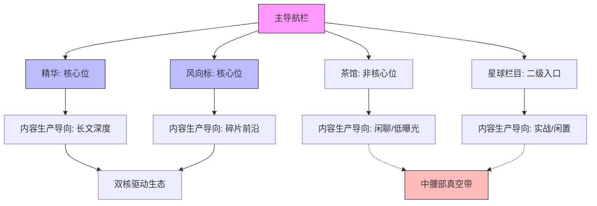
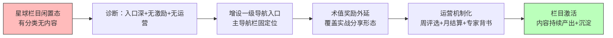
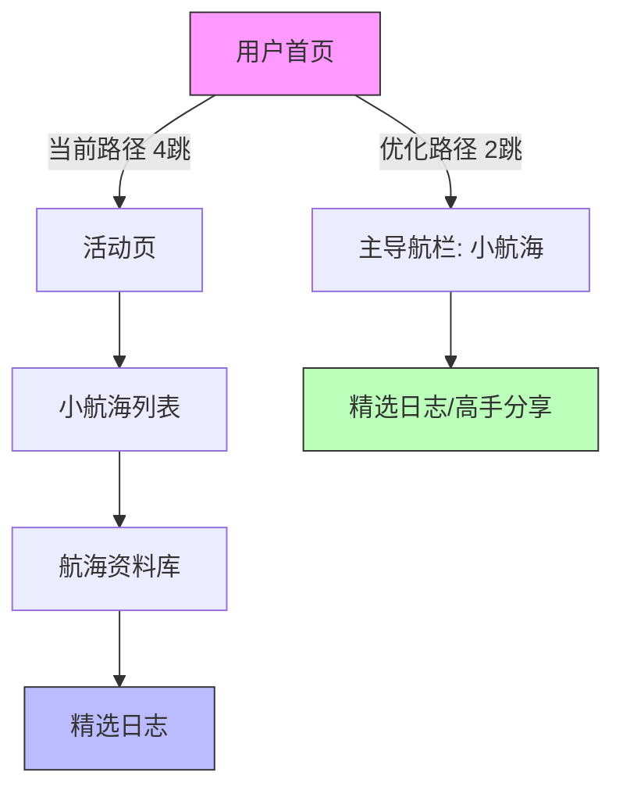
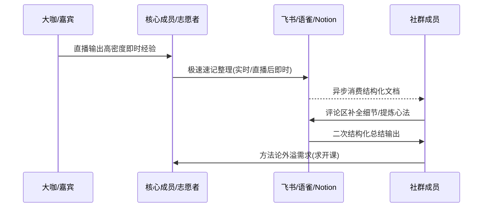
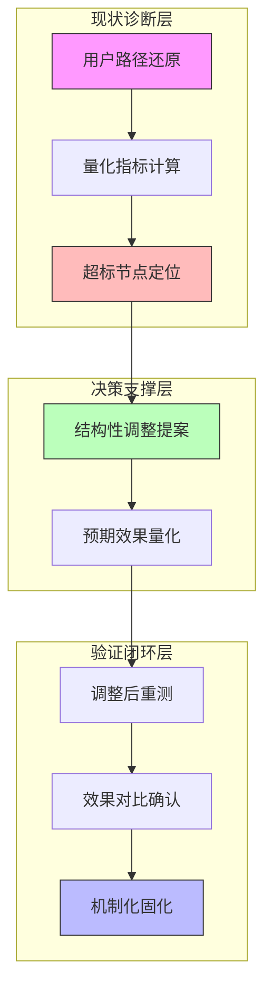
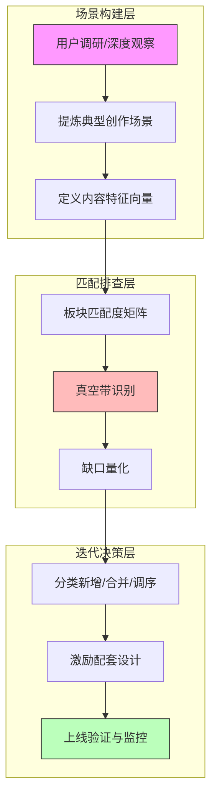
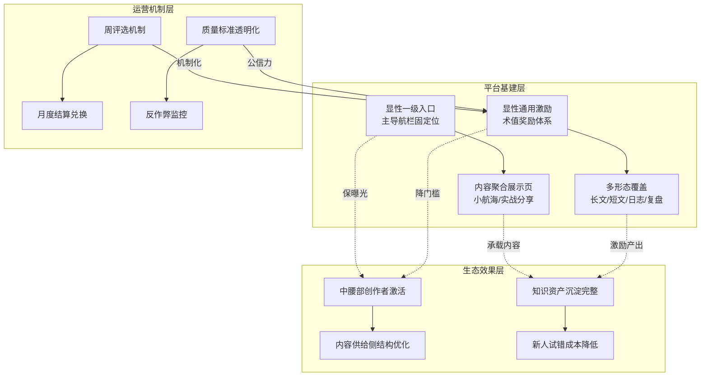

# 第 70 章 社群内容生态重构 —— 从“板块割裂”到“内容生态重构与项目孵化器”

## 学习目标

- 理解社群内容生态中导航权重如何决定内容生产分层
- 掌握关键路径节点审计法量化用户触达成本
- 掌握场景化内容归宿测试诊断分类体系完备性
- 理解实战内容沉淀需要显性入口与显性激励双驱动的公理
- 了解术值奖励外延如何覆盖多元内容形态激发生态长尾
- 掌握社群知识沉淀标准流程：速记协作与核心内容摘录策略
- 理解分类粒度与内容感知深度正相关的机制原理

## 70.1 生活类比

想象社群内容生态是一个大型图书馆的运营体系。主导航栏权重好比图书馆大厅最显眼的“新书推荐区”与“名家专栏区”位置，决定了读者进门首先看到什么，也倒逼作者只写“重磅长文”或“碎片书评”；航海内容深层嵌套好比珍贵的“实战手稿”被锁在四层地下室的角落：需穿过大厅、找到活动室、进入资料室、打开精选柜，才能触达；内容归宿真空带好比作者写了一篇“中等长度的实战笔记”，不够资格上“名家专栏”，扔在“闲杂书架”没人看，投到“碎片墙”太乱，最终无处安放；术值奖励外延好比图书馆原本只奖励“出精装书”，现扩展奖励“写读书笔记、整理避坑指南、记录复盘心得”，让普通读者也能因贡献获积分兑换权益；关键路径节点审计法好比馆长亲自体验一次“找那本实战手稿”，记录走多少步、开多少门、花多少分钟，用数据向理事会证明“必须在大厅增设实战专区”；场景化内容归宿测试好比模拟三类读者来投稿：“想出长文的专家”、“想记避坑指南的新手”、“想分享项目的实操派”，逐一测试现有书架能否收纳；双驱动公理好比要让“实战手稿”持续涌现，图书馆必须同时做两件事：在大厅显眼处立个“实战专区”招牌（显性入口）；宣布“凡投稿上架即送积分可抵会费”（显性激励），缺一不可；分类粒度与感知深度好比书架标签越细（如“短视频带货-选品-冷启动”而非泛“电商”），读者越能一眼看到深度干货，作者也越愿深耕细分写透。

## 70.2 概念地图

社群内容生态重构
├── 结构性诊断
│   ├── 主导航栏权重模型  —— P001
│   ├── 星球栏目闲置态  —— P001
│   ├── 航海内容深层嵌套  —— P002
│   └── 内容归宿真空带  —— P003
├── 激励机制改革
│   └── 术值奖励外延  —— P004
├── 沉淀协作流程
│   └── 社群知识沉淀标准流程  —— P005
├── 核心方法论
│   ├── 关键路径节点审计法  —— P006
│   └── 场景化内容归宿测试  —— P007
└── 底层定律
    ├── 导航权重决定内容生态分层定律  —— P001
    ├── 实战内容沉淀需“显性入口+显性激励”双驱动公理  —— P009
    └── 分类粒度与内容感知深度正相关性原理  —— P008

## 70.3 主导航栏权重模型 —— 导航位置决定内容生态分层

### 为什么需要这个概念？

社群内容生产方向由顶层导航栏的显性位置分配直接驱动。精华与风向标占据核心位导致内容生产高度向“长文精华”与“碎片风向标”两极聚集，中腰部实战内容（航海日志、项目短文）因缺乏入口而边缘化、沉淀困难。

### 核心定义

主导航栏权重模型指社群顶层导航栏（最新、精华、中标、风向标、赚钱周报、星球栏目）中，精华与风向标占据核心显性位置，决定了内容分发的最高曝光权重，形成了“双核驱动”的内容分发逻辑：精华承载长文深度，风向标承载碎片前沿。

> "主导航栏上主要是最新（信息流）、精华、中标、风向标、赚钱周报、星球栏目等。这些内容处于主导航栏里，打开频率也是比较高的。从精华和风向标的位置也可以看出来，它俩的权重是最高的。"
> 
> ——《docs/202303/20230328_024.md》

### 关键性质

权重分配固化：导航位置一旦固定，内容生产激励随之锁定，难以自发纠偏。两极分化效应：高门槛长文与低门槛碎片共存，中间地带真空。用户感知偏差：广度有余、深度不显，优质实战内容被淹没在信息流中。

### 典型例子

生财有术社群：精华帖以长文为主，风向标内容碎片化且无分类，导致用户“东一榔头西一棒槌”式浏览体验。星球栏目下“航海的日常”“生财实战派”虽设分类但长期闲置（停留在2022年），与“主打小航海实战”战略严重背离。

> "精华帖目前主要还是以长文存在... 而‘生财茶馆’所处的位置也很尴尬... 打开率受到了很大的影响。... 风向标的内容过于庞杂... 生财现有的文章质量做到了广度，但是深度还是有所欠缺，或者深度是有，但是没有被用户很方便的感知出来。"
> 
> ——《docs/202303/20230328_024.md》

> "其中‘航海的日常’‘生财实战派’等栏目目前基本处于闲置状态，可以看到它们这些栏目最新的更新时间还停留在 2022 年。"
> 
> ——《docs/202303/20230328_024.md》

### 数据流图：导航权重对内容生产分层的驱动机制



这个图展示了主导航栏权重分配如何通过双核驱动（精华+风向标）将内容生产推向两极，导致中腰部实战内容陷入真空带。

### 边界条件

仅适用于以导航栏为主要内容分发入口的平台型社群。当平台引入算法推荐或搜索作为主流分发时，导航权重影响力减弱。需配合激励机制（如术值奖励）才能有效引导内容生产方向。

## 70.4 星球栏目闲置态 —— 战略意图与执行现实的结构性失配

### 核心定义

星球栏目闲置态指星球栏目下细分板块（如“航海的日常”、“生财实战派”）虽设立但长期无内容更新，最新停留在2022年，形成“有分类无内容”的结构性失配。

> "其中‘航海的日常’‘生财实战派’等栏目目前基本处于闲置状态，可以看到它们这些栏目最新的更新时间还停留在 2022 年。"
> 
> ——《docs/202303/20230328_024.md》

### 关键性质

战略脱节：社群对外宣称“主打小航海实战”，核心实战承载板块却处于休眠。资产沉睡：本应沉淀高价值实战内容的容器废弃，导致内容流失无处归集。信号混淆：新成员看到闲置栏目会误判社群活跃度与战略重心。

### 典型例子

生财有术星球栏目下“航海的日常”“生财实战派”两大核心实战导向板块，最新更新时间停留在2022年，处于完全闲置状态，与“主打小航海实战”的社群战略严重背离。

### 方法演进图：星球栏目从闲置到激活的路径



这个图展示了星球栏目从闲置态走向激活的完整演进路径，核心在于入口前置与激励配套的双重干预。

### 边界条件

仅当社群设有二级栏目且明确战略导向时适用。若栏目定位模糊或战略已转型，闲置可能为合理收敛。需配合“一级导航入口+激励机制”双重复苏才能激活。

## 70.5 航海内容深层嵌套 —— 优质实战内容被四级入口淹没

### 为什么需要这个概念？

高价值航海精选日志隐藏在极深路径下，导致发现成本极高、复用率极低。社群核心交付产品“航海”产出的优质内容未能有效沉淀为资产。成员无法低成本获取前车之鉴，重复造轮子、试错成本高。

### 核心定义

航海内容深层嵌套指小航海优质内容（精选日志、复盘）隐藏在“活动页→小航海→资料库→精选日志”四级入口下的现象，路径过长导致优质内容“被淹没”，验证了沉淀机制失效。

> "这些内容过于分散，一些优质的精华日志以及航海好事等内容都被淹没了。如果想找到这些航海日志，我们需要经历的步骤有：找到航海实战的活动页面，进入某个小航海，进入航海资料库，进入精选日志，然后才能看到这些日志列表。"
> 
> ——《docs/202303/20230328_024.md》

### 关键性质

认知负荷过高：用户需经历4次页面跳转才能触达核心内容。沉淀断层：活动周期结束后，内容随入口深度增加而逐渐失效。资产流失：大量实战经验未转化为社群可复用的结构化知识库。

### 典型例子

生财有术社群：想找航海日志需“找到航海实战的活动页面，进入某个小航海，进入航海资料库，进入精选日志”，路径极长。对比：若在主导航栏增设“小航海”一级分类，可将高手分享、精选日志直接曝光，大幅降低触达成本。

> "我想，生财是否可以在主导航栏里增加小航海的分类，把一些高手分享、精选日志等内容放在里面，同时在航海期间以及航海结束后，星球成员们都可以在该栏目里发帖..."
> 
> ——《docs/202303/20230328_024.md》

### 数据流图：内容触达路径对比



这个图展示了当前四级嵌套路径与优化后一级导航直达路径的对比，优化路径将跳转次数从4次压缩至2次，显著降低用户认知负荷。

### 边界条件

仅适用于多层级页面嵌套的社群/知识库结构。若内容量极小或用户极其高粘，深层路径影响可忽略。解决方案需配合一级导航入口建设与内容聚合展示机制。

## 70.6 内容归宿真空带 —— 中短实战分享无处安放

### 为什么需要这个概念？

成员产出的“中短篇幅、非长文但具项目实战价值”内容找不到合适分类容器。精华门槛高（长文为主）、茶馆曝光低（位置尴尬）、风向标无序（未分类）、项目库滞后（更新停滞），导致大量可复用实战经验流失，社群知识资产积累不完整。

### 核心定义

内容归宿真空带指介于“长文精华”与“碎片化茶馆/风向标”之间，缺乏承载“中短篇幅、非长文但具项目实战价值”内容的标准化分类容器。成员想发项目分享：不够长文进精华、放茶馆曝光低、放风向标不合适、项目库不更新，最终无处安放。

> "某成员可能想发布一篇自己的项目分享，但是他觉得自己的内容还不足以胜任长文，放在‘生财茶馆’里似乎也不合适……放在‘风向标’里也不合适。他找不到存放自己项目分享的分类了。"
> 
> ——《docs/202303/20230328_024.md》

### 关键性质

分类体系不完备：现有分类要么门槛太高、要么曝光太低、要么秩序太乱、要么更新太慢。创作动力受挫：成员找不到归宿，要么不发、要么降级发茶馆/风向标，价值稀释。知识资产缺口：最具实操参考价值的“中腰部内容”系统性缺失。

### 典型例子

生财成员场景：“某成员可能想发布一篇自己的项目分享，但是他觉得自己的内容还不足以胜任长文，放在‘生财茶馆’里似乎也不合适……放在‘风向标’里也不合适。他找不到存放自己项目分享的分类了。”

> "精华帖目前主要还是以长文存在... 而‘生财茶馆’所处的位置也很尴尬... 风向标的内容过于庞杂... 项目库里面的很多内容依然停留在 2022 年..."
> 
> ——《docs/202303/20230328_024.md》

### 对比表：四大板块对中短实战内容的适配度

下表展示了现有四大板块对中短实战内容的适配情况，来源于素材中对精华、茶馆、风向标、项目库四大板块的实测观察。

| 板块 | 门槛 | 曝光 | 秩序 | 时效性 | 适配中短实战 |
|------|------|------|------|--------|--------------|
| 精华 | 高(长文) | 高 | 高 | 高 | ❌ 门槛过高 |
| 茶馆 | 低 | 低(位置尴尬) | 中 | 中 | ❌ 曝光不足 |
| 风向标 | 低 | 高 | 低(未分类) | 高 | ❌ 秩序混乱 |
| 项目库 | 中 | 中 | 高 | 低(停滞) | ❌ 更新滞后 |

这个表格展示了现有四大板块均无法完美承载中短实战分享，形成结构性真空带。

### 边界条件

仅存在于分类体系粗糙、激励机制单一（仅奖励长文）的社群。需同时满足：有大量中腰部创作者、有实战分享需求、现有分类无法覆盖。解决需“显性入口（一级导航）+显性激励（术值奖励外延）”双驱动。

## 70.7 术值奖励外延 —— 从单一长文激励向多元内容形态覆盖

### 为什么需要这个概念？

现有精华/风向标奖励机制单一导向长文，忽视短小精悍实战分享、航海日志等高价值形态。创作门槛过高，普通成员难以参与，导致内容生产者结构单一、生态活力不足。需利用术值作为通用激励媒介，降低创作门槛，激发生态长尾活力。

### 核心定义

术值奖励外延建议将现有精华/风向标的单一长文导向奖励机制，扩展至短小精悍实战分享、航海日志等多元内容形态。利用术值作为通用激励媒介，对优质内容（不限长短）进行奖励，形成“产出价值→获术值→提升权益”的正向循环。

> "同时生财星球也可以考虑对一些优质的内容进行术值奖励。"
> 
> ——《docs/202303/20230328_024.md》

### 关键性质

形态中立：不限制内容长度/形式，只考核价值密度与实战参考性。覆盖长尾：激励“中短实战分享”填补内容归宿真空带。降维打击：普通成员也能通过“记录一次复盘、分享一个避坑指南”获得正向反馈。

### 典型例子

生财有术：官方回复确认“内容更好的展现和分类是第七期重点要优化的”，且“提到的风向标分类目前在飞书有一个分类，可以先过渡看看”。评论区用户建议“引入GPT接口增强搜索的语义联想能力”，侧面印证对智能化内容分发与激励的期待。

> "大愉 : 感谢反馈呀，提的点都很好，你说的有些点都有在考虑中，部分也在做。内容更好的展现和分类是第七期重点要优化的，你提到的风向标分类目前在飞书有一个分类，可以先过渡看看..."
> 
> ——《docs/202303/20230328_024.md》

> "古月良仔 : 其实搜索这块引入 GPT 接口，产生更多信息联想，比单纯找关键词好些"
> 
> ——《docs/202303/20230328_024.md》

### 方法演进图：激励机制演进路径


这个图展示了激励机制从单一长文导向向多元形态覆盖的演进路径，最终实现生态供给侧的结构性优化。

### 边界条件

需社群已有成熟积分体系（术值）且可兑换实权益（如续费抵扣、特权购买）。奖励标准需透明化、标准化，避免人为操作导致公信力丧失。需配合内容分类体系重构，否则奖励分发无依据、考核无抓手。

## 70.8 社群知识沉淀标准流程 —— 速记协作与核心内容摘录

### 为什么需要这个概念？

直播/语音等高密度即时经验极难直接沉淀为可检索资产。依赖自发整理效率极低、覆盖率低、质量参差不齐。需建立标准化协作流程：核心输出→极速速记→异步消费→互动补全。

### 核心定义

社群知识沉淀标准流程：大咖直播输出 → 核心成员/志愿者极速速记整理 → 发布至飞书/语雀等知识库供圈友异步消费 → 评论区互动补全细节。核心内容摘录策略：评论区成员主动提炼核心心法（如“清点资源，通过曝光，对接需求”），触发二次结构化总结。

> "简单发一下今晚的直播速记 《生财圈友关心的 20 个问题（杨涛、亦仁）230329》 https://n3q1lff0vz.feishu.cn/docx/TZZwdy53eofCYQxu2xucdoV1nod"
> 
> ——《docs/202303/20230328_034.md》

> "评论区：陈真 : 牛 辰安 : 您这速度，这也太效率了 杨昌 : [鼓掌][鼓掌][鼓掌] 北辰 : 速度真快 易从容 : 清点资源，通过曝光，对接需求 小吴同学🤙🤙🤙 : 速记有没有什么秘诀窍门的，求开课[呲牙] Murstin : 牛逼啊哥"
> 
> ——《docs/202303/20230328_034.md》

### 关键性质

时效性极强：直播结束即产出结构化文档，抢占“首发价值”。协作分工明确：核心成员负责“记”，圈友负责“补/用”，形成生产-消费闭环。技能外溢价值：速记方法论本身成为可教学、可变现的稀缺技能（圈友求开课）。

### 典型例子

生财有术2023.3.29直播《生财圈友关心的20个问题》：方糖呐极速速记发布飞书文档，评论区赞誉“速度真快、这也太效率了”，易从容补录核心心法。圈友小吴同学显性提出“速记有没有什么秘诀窍门的，求开课”，验证方法论外溢需求。

### 时序图：知识沉淀协作流程



这个时序图展示了从直播输出到结构化沉淀、再到圈友互动补全、最终触发方法论外溢的完整闭环。

### 边界条件

依赖核心成员/志愿者的高执行力与责任感，难以完全制度化强制。适用于高密度、高价值、结构化程度高的直播/分享场景。需配合成熟的知识库工具（飞书/语雀/Notion）支持协作与检索。

## 70.9 关键路径节点审计法 —— 还原用户路径量化入口深度

### 为什么需要这个概念？

主观感受“入口深”无法说服决策者，需量化路径长度与认知负荷作为证据。只有还原真实用户操作路径，才能精准定位阻断节点、支撑结构性调整提案。

### 核心定义

关键路径节点审计法通过还原用户寻找目标内容（如航海精选日志）的完整操作路径，量化入口深度（跳转次数）与认知负荷（决策点数），以此为证据支撑结构性调整。核心指标：页面跳转数、点击决策点、时间成本、成功率。

> "如果想找到这些航海日志，我们需要经历的步骤有：找到航海实战的活动页面，进入某个小航海，进入航海资料库，进入精选日志，然后才能看到这些日志列表。"
> 
> ——《docs/202303/20230328_024.md》

> "我想，生财是否可以在主导航栏里增加小航海的分类，把一些高手分享、精选日志等内容放在里面..."
> 
> ——《docs/202303/20230328_024.md》

### 关键性质

客观可复现：任何用户按相同路径操作，结果一致，便于对比验证。诊断精准：能区分“入口不显性”“层级过深”“标签不明确”等不同病因。改进可验证：调整后可重测路径，量化效果（如从4级降为1级）。

### 典型例子

生财有术：获取航海精选日志需“活动页→小航海→资料库→精选日志”4次跳转，路径过长导致优质内容被淹没。改进提案：在主导航栏增设“小航海”一级分类，将路径压缩为“主导航→小航海→精选日志”2-3级。

### 伪代码：路径审计标准化流程

```
1. 确定目标内容类型（如：航海精选日志、项目复盘、工具测评）
2. 确定典型用户起点（通常为社群首页/主导航栏）
3. 记录完整操作路径：
   - 每次页面跳转计数 +1
   - 每次需主观判断的点击决策点计数 +1
   - 记录总耗时
   - 记录是否成功到达
4. 计算核心指标：
   - 路径深度 = 页面跳转数
   - 认知负荷 = 决策点数
   - 触达效率 = 成功率 / (路径深度 × 认知负荷)
5. 对比基准：
   - 核心高频内容：路径深度 ≤ 2，认知负荷 ≤ 1
   - 重要中频内容：路径深度 ≤ 3，认知负荷 ≤ 2
6. 输出诊断报告：
   - 超标节点定位
   - 优化建议（入口前置/层级扁平/标签明确）
   - 预期改进量化
```

这个伪代码展示了如何将主观的“入口深”转化为可量化、可对比、可验证的工程化指标体系。

### 架构分层图：路径审计在决策链路中的定位



这个架构图展示了关键路径节点审计法如何从现状诊断支撑决策，再通过验证闭环实现机制化固化。

### 边界条件

适用于Web/App多页面跳转场景，不适用于单页应用或对话式交互。需明确“目标内容”与“典型用户起点”，否则路径不具备代表性。审计结果需结合用户行为数据（点击率、到达率、跳出率）综合判断。

## 70.10 场景化内容归宿测试 —— 用典型场景排查分类体系完备性

### 为什么需要这个概念？

分类体系看似完善，实则可能无法覆盖真实创作场景。只有代入典型用户场景逐一排查匹配度，才能发现“内容归宿真空带”。避免拍脑门设计分类，导致建好无人用、内容无处放。

### 核心定义

场景化内容归宿测试构建典型用户发帖场景（如：项目分享、非长文、需曝光），在现有板块体系中逐一排查匹配度。匹配维度：门槛是否达标、曝光是否充足、秩序是否有序、更新是否及时。反证法：若典型场景无合适归宿，则分类体系不完备。

> "试想一个这样的场景：某成员可能想发布一篇自己的项目分享，但是他觉得自己的内容还不足以胜任长文，放在‘生财茶馆’里似乎也不合适……放在‘风向标’里也不合适。他找不到存放自己项目分享的分类了。"
> 
> ——《docs/202303/20230328_024.md》

> "生财现有的文章质量做到了广度，但是深度还是有所欠缺，或者深度是有，但是没有被用户很方便的感知出来。因为没有好的细分，导致产出的内容大量汇集在信息流和精华、风向标里..."
> 
> ——《docs/202303/20230328_024.md》

### 关键性质

以用户为中心：不看管理员怎么想分类，看创作者怎么找归宿。场景具体化：场景越具体（如“想分享一个踩坑避雷的短文案”），排查越精准。可迭代：新场景出现时可复用该方法持续验证分类体系健康度。

### 典型例子

生财有术：成员想发“项目分享短文”，精华门槛高、茶馆曝光低、风向标无序、项目库滞后 → 无处安放 → 证明分类体系不完备。对比：若增设“实战分享”分类+术值奖励，该场景即获完美归宿。

### 方法对照表：三类典型场景在现有板块的匹配度

下表基于素材中典型用户场景构建，展示三类创作场景在现有板块体系下的真实匹配情况。

| 场景 | 内容特征 | 精华匹配度 | 茶馆匹配度 | 风向标匹配度 | 项目库匹配度 | 综合判定 |
|------|----------|------------|------------|--------------|--------------|----------|
| A: 新手避坑指南 | 短文、实战、需曝光 | ❌ 门槛高 | ⚠️ 曝光低 | ⚠️ 秩序乱 | ❌ 更新慢 | **无处安放** |
| B: 项目0-1复盘 | 中文、结构化、需沉淀 | ⚠️ 篇幅不够 | ❌ 曝光低 | ❌ 秩序乱 | ⚠️ 更新慢 | **降级发布** |
| C: 行业底层逻辑 | 长文、理论、需背书 | ✅ 完美匹配 | ❌ 不适配 | ❌ 不适配 | ⚠️ 更新慢 | **仅精华可用** |

这个表格展示了不同创作场景在现有板块体系下的真实生存状态，场景A和B正是内容归宿真空带的典型受害者。

### 架构分层图：场景化测试驱动分类体系迭代



这个架构图展示了场景化内容归宿测试如何从场景构建、匹配排查，最终驱动分类体系的迭代决策与验证。

### 边界条件

需基于真实用户调研或深度观察构建场景，而非臆造。场景数量需覆盖核心用户群（如新人/老手/高产/低产）的典型需求。测试结果需转化为具体的分类新增/合并/调序/激励配套动作。

## 70.11 分类粒度与内容感知深度正相关性原理 —— 细分决定深度被感知

### 为什么需要这个概念？

内容广度不等于深度，无细分聚合的深度内容会被淹没在海量信息流中。用户注意力有限，无法在混杂内容中低成本感知垂直深度价值。细分分类是深度内容被发现、被复用、被激励的前置条件。

### 核心定义

分类粒度与内容感知深度正相关性原理：内容分类粒度不足（如风向标未分类、项目库停滞、星球栏目闲置）会导致“广度有余、深度不显”。海量异质内容挤占有限注意力，用户难以低成本感知到垂直领域的深度实战干货，进而抑制优质内容生产的长尾动力。

> "生财现有的文章质量做到了广度，但是深度还是有所欠缺，或者深度是有，但是没有被用户很方便的感知出来。因为没有好的细分，导致产出的内容大量汇集在信息流和精华、风向标里，大量的不同种类的文章汇聚在一起，也可能对用户产生一些困扰。"
> 
> ——《docs/202303/20230328_024.md》

> "大愉 : 感谢反馈呀... 内容更好的展现和分类是第七期重点要优化的..."
> 
> ——《docs/202303/20230328_024.md》

### 关键性质

正相关性：分类粒度越细、越垂直，深度内容被感知概率越高。双向驱动：细分分类促进深度内容产出，深度内容沉淀反哺分类价值。阈值效应：粗糙分类下，深度内容边际曝光趋近零；细分后边际曝光显性跃升。

### 典型例子

生财有术：风向标内容“东一榔头西一棒槌”，用户全看太乱、只看中标怕漏；项目库停留在2022年，无法承载最新实战。官方确认“内容更好的展现和分类是第七期重点要优化的”，承认分类粒度不足是核心痛点。

### 公式化表达：感知深度函数

$$
\text{PerceivedDepth} = \frac{\text{ContentQuality} \times \text{CategoryGranularity}}{\text{AttentionCompetition} + \epsilon}
$$

其中：
- $\text{ContentQuality}$：内容本身的实战价值密度
- $\text{CategoryGranularity}$：分类粒度系数（1=无分类，10=极细垂直分类）
- $\text{AttentionCompetition}$：同分类下竞争内容数量（注意力稀缺度）
- $\epsilon$：平滑常数

### 作用解释

这个公式展示了在内容质量固定时，细分分类能线性提升被感知深度；反之，若分类粗糙（CategoryGranularity→1），海量异质内容挤占注意力（AttentionCompetition↑），深度内容感知度趋近于零。变量ContentQuality代表内容内在价值，CategoryGranularity代表分类体系对该内容的聚合能力，AttentionCompetition代表同分类下争夺用户注意力的竞品内容数量。工程意义在于：提升感知深度不靠提高内容质量（存量难动），而靠细化分类粒度（增量可控）降低注意力竞争强度，这是平台侧可操作的结构性杠杆。

### 边界条件

仅当内容总量超过用户单次消费认知带宽时生效（小社群/小内容库无需过度细分）。细分需配合激励与入口，单纯加标签无入口无激励等于无效。过度细分会导致分类稀疏、维护成本高，需平衡“广度覆盖”与“深度聚焦”。

## 70.12 实战内容沉淀需“显性入口+显性激励”双驱动公理

### 为什么需要这个概念？

高质量实战内容产出成本高，仅靠内在动力不可持续。平台若不提供显性入口保曝光、显性激励降门槛，内容沉淀必然断层。单一维度（仅有入口无激励/仅有激励无入口）均无法形成正向循环。

### 核心定义

实战内容沉淀需“显性入口+显性激励”双驱动公理：高质量实战内容（如航海日志）的持续产出与沉淀，必须由平台提供：1. 显性一级入口（主导航固定位）保证曝光与被发现概率；2. 显性通用激励（术值奖励）覆盖非长文形态，降低创作门槛。双驱动缺一不可：入口解决“被看见”，激励解决“想写/敢写/持续写”。

> "我想，生财是否可以在主导航栏里增加小航海的分类，把一些高手分享、精选日志等内容放在里面，同时在航海期间以及航海结束后，星球成员们都可以在该栏目里发帖... 同时生财星球也可以考虑对一些优质的内容进行术值奖励。... 如何把小航海的内容沉淀下来，激发大家下场实战积极互动，我想这都是生财团队可以思考的地方。"
> 
> ——《docs/202303/20230328_024.md》

> "大愉 : 感谢反馈呀，提的点都很好，你说的有些点都有在考虑中，部分也在做。内容更好的展现和分类是第七期重点要优化的..."
> 
> ——《docs/202303/20230328_024.md》

### 关键性质

系统性：入口与激励是平台基建层面的结构性安排，非运营层面的临时活动。普惠性：激励需覆盖长文/短文/日志/复盘/避坑指南等多元形态，而非仅奖励“精华长文”。长期性：需机制化运行（如每周评选、月度结算），而非一次性活动。

### 典型例子

生财有术：建议“增设小航海一级导航”解决入口问题，“术值奖励外延至短小精悍内容”解决激励问题。官方回应确认优化方向，飞书文档已临时提供风向标分类过渡方案。

### 架构分层图：双驱动公理的系统化落地



这个架构图展示了双驱动公理如何从平台基建层（入口+激励），通过运营机制层（评选+标准），最终作用于生态效果层（创作者激活+资产沉淀）。

### 边界条件

适用于以UGC/PGC为主、依赖成员主动产出内容的社群/平台。需社群有成熟积分/权益体系支撑激励兑换，否则激励失效。入口设置需权衡导航栏稀缺性，核心高频入口通常不超过5-7个。

## 70.13 多源对照

### 共识

不同素材对社群内容生态问题的诊断高度一致：
1. **导航权重决定生产导向**：P001与P005均指出顶层导航栏位置分配直接驱动内容生产方向
2. **沉淀机制失效**：P001指出航海内容四级嵌套导致淹没，P005验证速记协作流程可有效解决高密度经验沉淀
3. **激励单一导致结构扭曲**：P001建议术值奖励外延，P005实测评论区互动补全可触发二次结构化总结
4. **分类粒度不足**：P001详述风向标无分类、项目库滞后导致深度不显，P008给出正相关性原理支撑

### 分歧

| 维度 | P001(孤月大叔建议) | P005(方糖呐速记实践) | P009(第七期战略方向) |
|------|-------------------|---------------------|---------------------|
| **核心抓手** | 结构性调整：增设一级导航+重构分类体系 | 协作流程优化：速记+摘录+互动补全 | 战略转型：项目孵化泛化，日落地数百项目 |
| **激励视角** | 术值奖励外延，覆盖多元形态 | 隐性激励：荣誉/技能外溢/被看见 | 显性激励：项目落地即变现，SOP复制放大 |
| **工具依赖** | 飞书文档过渡+GPT搜索增强 | 飞书文档作为知识库载体 | 内部资源库建设+AI赋能 |
| **时间周期** | 即时生效的结构性改革 | 长期运行的协作机制 | 第七期战略周期(中长期) |

**综合洞察**：结构性调整（P001）提供骨架，协作流程（P005）提供血肉，战略转型（P009）提供演进方向。三者互补而非替代，共同指向“内容生态重构与项目孵化器”的目标。

## 70.14 设计中的取舍

为什么不直接用算法推荐替代导航栏重构？算法推荐虽能缓解入口深问题，但存在“冷启动不友好”“长尾内容曝光不稳定”“创作者无法预期分发结果”三大缺陷。导航栏作为确定性分发通道，能给创作者稳定的曝光预期，配合激励机制形成显性契约。算法应作为导航栏的补充而非替代，解决“千人千面”的个性化分发。

术值奖励外延会不会导致内容质量下降？风险存在，但可通过三层防御化解：质量标准透明化——明确“价值密度与实战参考性”评价维度，而非单纯看长度/互动；社群共治——引入专家评审+社群投票双轨制，利用圈友专业度甄别水文；长尾复利分——奖励随时间衰减，仅持续产生价值的内容能获长期收益，倒逼创作者维护内容质量。

为什么不合并“茶馆”“风向标”“项目库”而是增设新板块？合并会破坏现有用户心智模型（茶馆=闲聊、风向标=前沿、项目库=档案），迁移成本高、风险大。增设“小航海/实战分享”作为新物种，可平滑承接真空带内容，原有板块各司其职，演进平滑。

## 70.15 动手练习

### 练习 1：社群导航栏权重审计实战

以某个你熟悉的付费社群/知识星球/论坛为对象：

1. 绘制其主导航栏结构图，标注每个入口的层级（一级/二级/三级）与显性位置（首屏可见/需下拉/需跳转）
2. 选取3类核心内容（如：长文深度、碎片资讯、实战复盘），实测从首页触达各类内容的：跳转次数、点击决策点数、耗时
3. 统计近30天各类内容的产出量、阅读量、互动量，分析导航权重与内容生产分布的相关性

回答问题：
- 哪类内容因入口过深导致“产出高但沉淀低”？
- 若你是运营方，会调整哪个入口到一级导航？预期会如何改变内容生态？

### 练习 2：内容归宿真空带场景化排查

针对同一社群，构建3个典型创作者场景：

场景A：新手想分享‘踩坑避雷的3条经验’（短文、实战、需曝光）
场景B：进阶者想发布‘某项目0-1复盘’（中文、结构化、需长期沉淀）
场景C：高手想沉淀‘行业底层逻辑长文’（长文、理论、需权威背书）

逐一在现有板块体系中排查：
1. 每个场景最合适的发布位置是哪个板块？门槛是否达标？曝光是否充足？
2. 是否存在‘无处安放’或‘降级发布’的情况？
3. 若增设一个新板块解决真空带，命名为何？设为一级还是二级入口？配套何种激励？

回答问题：
- 场景B最可能面临的困境是什么？如何用‘双驱动公理’破解？
- 为什么单纯增加板块而不配套激励会导致‘建好无人用’？

### 练习 3：社群知识沉淀协作演练

模拟一次‘高密度直播速记与沉淀’全流程：
1. 找一段30-60分钟的商业/技术直播回放（或高质量播客）
2. 组建3人小组：速记员(1人)、结构化整理员(1人)、补全员(1人)，或独自完成三角色
3. 速记阶段：实时记录核心观点、金句、案例、数据（不求全求准）
4. 整理阶段：按‘问题-结论-论据-行动建议’结构化输出飞书/Notion文档
5. 补全阶段：补充直播中未展开但关键的背景知识、链接、工具名
6. 发布至某社群/群组，引导成员在评论区‘补全一个细节/提炼一个心法’

回答问题：
- 速记员的核心压力点在哪？如何用工具/分工缓解？
- 评论区补全机制为何能触发‘二次结构化总结’？如何设计钩子提高参与率？
- 该流程标准化后，哪些环节可AI替代？哪些必须人工把关？

### 练习 4：术值奖励体系设计推演

假设你是某社群运营负责人，现有‘精华奖励’仅针对长文（>3000字），导致中短实战分享极少。请设计‘术值奖励外延’方案：
1. 定义3-5类新纳入奖励的内容形态（如：避坑指南、工具测评、复盘日志、模版分享、短视频脚本）及各自的最低质量标准
2. 设计术值积分规则：基础分/质量加分/互动加分/长尾复利分，并给出兑换权益清单（如：续费抵扣、专属群入场、线下局优先权、实体周边）
3. 制定‘周评选+月结算’运营SOP：征集→初筛→社群投票/专家评审→公示→发放

回答问题：
- 如何防止‘刷分/水文’？需引入哪些反作弊机制？
- 奖励标准‘透明化’与‘灵活性’如何平衡？
- 该体系上线后，预期3个月内中短实战分享量增长多少倍？核心杠杆是什么？

## 70.16 本章小结

这一章中我们学习了社群内容生态重构的完整诊断与重塑体系。首先，我们通过主导航栏权重模型揭示了顶层导航位置如何直接决定内容生产的两极分化；其次，航海内容深层嵌套与内容归宿真空带两大现象，量化了优质实战内容被淹没与无处安放的结构性缺陷；接着，术值奖励外延与社群知识沉淀标准流程给出了激励侧与协作侧的双重解法；然后，关键路径节点审计法与场景化内容归宿测试提供了两大可落地的工程化诊断工具；最后，导航权重决定内容生态分层定律、实战内容沉淀双驱动公理、分类粒度与内容感知深度正相关性原理三大底层定律，为社群内容生态的长期演进提供了确定性导航。

本章我们一起学习了以下概念：

| 概念 | 解释 |
|------|------|
| 主导航栏权重模型 | 顶层导航栏显性位置分配直接驱动内容分发权重，精华与风向标占核心位形成双核驱动，导致中腰部内容边缘化 |
| 星球栏目闲置态 | 战略核心板块长期无内容更新，形成有分类无内容的结构性失配 |
| 航海内容深层嵌套 | 优质实战内容隐藏在四级入口下，认知负荷过高导致沉淀断层与资产流失 |
| 内容归宿真空带 | 中短实战分享介于长文精华与碎片风向标之间，现有分类体系无法覆盖 |
| 术值奖励外延 | 将单一长文激励扩展至多元内容形态，利用通用积分媒介降低创作门槛激发生态长尾 |
| 社群知识沉淀标准流程 | 大咖输出→极速速记→知识库发布→评论区互动补全，形成生产-消费闭环 |
| 关键路径节点审计法 | 还原用户操作路径，量化跳转数与决策点，以客观数据支撑结构性调整 |
| 场景化内容归宿测试 | 构建典型创作场景逐一排查板块匹配度，反证分类体系完备性 |
| 导航权重决定内容生态分层定律 | 导航位置分配直接决定内容生产主流形态：核心位聚集长文与碎片，中间地带真空 |
| 实战内容沉淀双驱动公理 | 高质量实战内容持续产出需显性一级入口保曝光+显性通用激励降门槛，双驱动缺一不可 |
| 分类粒度与内容感知深度正相关性原理 | 分类越细垂直，深度内容被感知概率越高；粗糙分类导致海量异质内容挤占注意力 |

下一章中，我们将学习个人理财与财务自由操作指南 —— 从“月光焦虑”到“高产低债量化跃迁”，探索如何将商业变现所得转化为可持续的财富体系。

感谢你读到了这里，恭喜你，你已经完成了第 70 章的学习，掌握了社群内容生态重构的系统性方法论！

