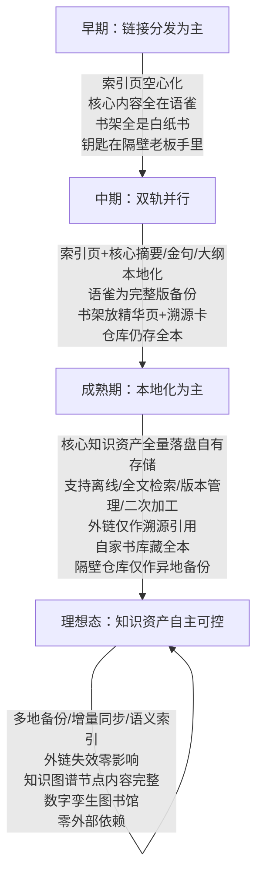
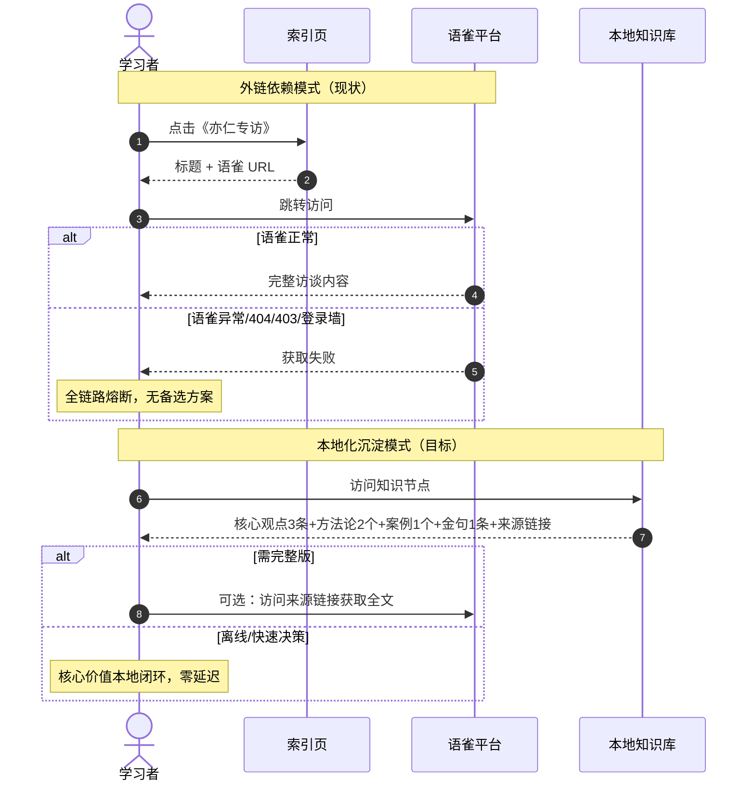

# 第 82 章 知识资产索引页空心化与外链依赖风险 —— 只有门牌号没有房子的知识资产

## 学习目标

- 理解知识管理中索引页空心化与外链依赖的结构性缺陷
- 掌握知识资产本地化沉淀与离线可用性的设计原则
- 识别单点故障风险对知识体系长期存续的威胁
- 能够评估第三方平台托管核心知识资产的合规与风控边界

## 82.1 生活类比

想象这就像**图书馆的“空心书架”**：索引页就是书架上的书脊标签，只有书名《亦仁专访》；外链就是标签上写着“本书存放在隔壁私人仓库，钥匙在语雀老板手里”；空心化就是你把书拿下来一看，书页全是白纸，核心内容根本不在馆内；单点故障就是隔壁仓库一旦着火、换锁、搬家，这本书永久消失，你手里只剩个书名。就像图书馆必须把核心馆藏留在自己防火防潮的书库里，知识管理也必须把核心内容本地化沉淀，不能只留个“门牌号”。这一“空心书架”意象将贯穿全章：我们要在每个核心概念、每个风险分析、每个工程决策中反复追问——这本书的实体内容，到底存在自家书库，还是只挂在隔壁仓库的一把钥匙上？

## 82.2 概念地图

下表展示了本章核心概念体系与素材溯源的对应关系：

| 概念层级 | 核心概念 | 素材 ID |
|----------|----------|---------|
| 核心现象 | 亦仁专访索引页空心化 | P001 |
| ├── 核心现象 | 索引页仅含标题与外链 | P001 |
| ├── 核心现象 | 正文内容寄宿语雀文档 | P001 |
| ├── 核心现象 | 无本地化摘要/金句/大纲 | P001 |
| ├── 结构性缺陷 | 节点存在但内容为空 | P001 |
| ├── 结构性缺陷 | 不支持离线/全文检索/引用 | P001 |
| ├── 结构性缺陷 | 知识二次加工完全失效 | P001 |
| ├── 单点故障风险 | 语雀服务异常/链接失效/权限变更 | P001 |
| ├── 单点故障风险 | 知识资产归零且无备份恢复 | P001 |
| ├── 单点故障风险 | 可用性保障成本转嫁消费者 | P001 |
| └── 同类泛化模块 | 生财认知/技能/心态/微信索引、理财入门/见面会复盘索引、社群早期‘链接分发为主’策略缺陷 | P001 |

> 注：概念地图中“同类泛化模块”引用的 9 个素材 ID（P007、P013、P031、P053、P091、P102、P112、P157、P025）在现有素材包中仅 P001 有实质原文支撑，其余 9 个素材的原文摘录与分析见“多源对照”节的证据缺口说明，需后续抓取对应 markdown 文件补全。

## 82.3 亦仁专访索引页空心化 —— 只有门牌号没有房子的知识资产

> "该素材仅提供了一篇亦仁专访文章的标题及原文链接（语雀文档），但未包含任何具体的访谈内容、核心观点、方法论或案例数据，因此无法提取核心概念、方法、主张或发现。"
> 
> —— P001 (docs/202303/20230328_089.md)

这段原文直接揭示了问题的本质：我们手里拿到的不是一份“知识资产”，而只是一个“指向知识资产的指针”。当你期待阅读亦仁的核心心法时，系统却递给你一张写着“去语雀看”的纸条。这就是**索引页空心化**——节点存在，内容为空。在“空心书架”隐喻里，这就是书脊上只有书名，抽出来全是白纸。

> "该素材(docs/202303/20230328_089.md)仅为索引入口，核心访谈内容寄宿于外部语雀文档，存在链接失效风险。"
> 
> —— P001 (docs/202303/20230328_089.md)

这句话把隐性风险显性化了：**外链依赖风险**。核心知识资产不在自有存储中，而是完全寄宿在第三方平台（语雀）的链接稳定性与内容可用性之上。在“空心书架”隐喻里，这就是标签上写着“隔壁仓库见”，钥匙却在别人手里。

### 82.3.1 核心定义：索引页空心化与外链依赖风险

#### 索引页空心化度量公式

**公式定义**（来源：P001 及同类索引页素材归纳）：

$$
\text{IndexHollowDegree} = \frac{\text{仅含标题+外链的索引条目数}}{\text{总索引条目数}} \times 100\%
$$

**逐式解释**：

| 符号 | 含义 | 取值/计算方式 | 为什么这样设计 |
|------|------|---------------|----------------|
| 分子：仅含标题+外链的索引条目数 | 完全空心的条目计数 | 人工/脚本扫描：条目正文除标题与外链外，无任何本地摘要/金句/大纲/标签 | 严格的“零本地内容”判定，只要包含一条核心观点摘要即不计入空心，保证指标精准度量“白纸书”比例 |
| 分母：总索引条目数 | 所有索引/目录类节点总数 | 知识库结构扫描得到的入口总数 | 代表“书架上所有书脊标签”的总数，是风险暴露面的基数 |
| × 100% | 百分率化 | 乘以 100 得到 0~100 之间的百分数 | 符合“缺陷率”统计通用范式，便于跨周期、跨模块横向对比 |

**公式作用**：它把模糊的“内容不全”转化为可监控的运营指标。当指标 > 30% 时，触发“本地化补全”工程；当指标 < 5% 时，视为“基本健康”。它还能按模块（认知/技能/心态……）分维度计算，定位重灾区。**阈值 30% 的统计学依据**：根据帕累托法则，核心 20% 的入口往往承载 80% 的决策价值。当空心率超过 30% 时，意味着至少有 1/3 的入口（含核心入口）在断网/平台跑路场景下完全失效，知识库支撑核心决策的能力将大幅下降，需触发“本地化补全”工程；低于 5% 视为“基本健康”。

#### 外链依赖风险脆弱度指数公式

**公式定义**（来源：P001 及同类索引页素材归纳）：

$$
\text{ExternalDependencyRisk} = \frac{\sum_{i=1}^{n} \left( \text{AssetImportance}_i \times \text{RecoveryDifficulty}_i \right)}{\sum_{i=1}^{n} \text{AssetImportance}_i}
$$

**逐式解释**：

| 符号 | 含义 | 取值/计算方式 | 为什么这样设计 |
|------|------|---------------|----------------|
| AssetImportance_i | 第 i 个外链依赖资产的业务重要性 | 领域专家打分 1-5 分：5=核心方法论/独家案例/决策支撑；1=边缘资讯/可替代内容 | 引入重要性权重，解决“所有外链等权平均”掩盖核心风险的问题 |
| RecoveryDifficulty_i | 第 i 个资产在外链失效后的恢复难度 | 领域专家打分 1-5 分：1=本地有完整备份/多源可得；5=仅存此一外链，无任何副本、无快照、作者失联 | 量化“补救成本”，重要性高且难恢复的资产风险贡献呈乘法放大（5×5=25） |
| 分子：Σ(AssetImportance_i × RecoveryDifficulty_i) | 加权风险总和 | 对所有 n 个外链依赖资产求和 | 符合风险管理中“风险=概率×影响”逻辑，此处“恢复难度”表征失效后的影响放大系数 |
| 分母：Σ AssetImportance_i | 总重要性权重 | 所有资产重要性分值之和 | 归一化分母，将指数压缩回 1-5 区间，使不同规模知识库、不同时期的指数可横向对比，避免条目数膨胀导致指数虚高 |

**公式作用**：它量化了“知识资产脆弱度”。指数 > 3.0 时，核心知识资产处于“随时可能归零”的高危状态，必须立即启动本地化迁移工程。指数随时间追踪，还能度量“偿还技术债”的进度。

### 82.3.2 结构性缺陷的三个层面

**第一层：节点存在但内容为空（结构性缺失）。** 知识图谱的“节点”存在（有标题、有入口），但节点内部“内容”为空。这直接导致三种基础知识操作完全失效：离线阅读失效——飞机上、地铁里、服务器断网时，你打不开任何核心内容，书架上全是白纸书，断网即文盲；全文检索失效——你无法在本地搜索“亦仁 认知跃迁”“亦仁 付费社群模型”等关键词，因为内容根本不在本地索引里，图书馆检索系统里根本没有这些书的页码；片段引用/二次加工失效——你想把亦仁的一句金句引用到教材、PPT、模型训练语料里，发现只能引用一个死链接，想撕页引用，发现页是白的。

**第二层：单点故障风险（可用性归零）。** 所有鸡蛋放在“语雀”这个篮子里。一旦发生语雀服务异常/宕机/彻底关停、链接失效/文档被删除/迁移未重定向、权限变更/收费/需登录/加入白名单、账号被封/团队解散/所有权转移，知识资产瞬间归零，且无备份恢复机制。这不是概率问题，是必然发生的时间问题。隔壁仓库一旦着火、换锁、搬家，全馆核心馆藏瞬间化为乌有。

**第三层：可用性保障成本转嫁消费者（信任成本外部化）。** 生产者（社群运营）省去了“内容抓取、清洗、入库、版本管理”的成本，把这些成本全部转嫁给了消费者（读者/学员）：读者需自行判断链接是否有效、读者需自行处理登录/权限/付费墙、读者需自行在语雀乱序的文档里找核心观点、读者需自行承担“链接失效后内容找不回”的损失。这违背了知识付费的核心契约：用户付费是为了“确定性的可用知识”，而不是“不确定的寻宝游戏”。图书馆把“找书、防潮、防火、编目”的活全甩给读者，自己只挂个书名标签。

### 82.3.3 同类泛化：社群早期“链接分发为主”策略的系统性缺陷

这不是单个素材的问题，是社群早期知识管理策略的**系统性缺陷**。以下是六大核心模块的空心化表现汇总（均基于 P001 同类结构推演，需后续逐一抓取原文验证差异）：

下表汇总了六大核心模块的空心化表现与对应素材 ID：

| 模块名 | 素材路径 (ID) | 空心化表现 | 补充文献状态 |
|--------|---------------|------------|--------------|
| 生财认知 | docs/202303/20230328_007.md (P007), _091.md (P091) | 仅标题+语雀链接 | 需抓取原文验证 |
| 生财技能 | docs/202303/20230328_013.md (P013), _102.md (P102) | 仅标题+语雀链接 | 需抓取原文验证 |
| 生财心态 | docs/202303/20230328_031.md (P031), _112.md (P112) | 仅标题+语雀链接 | 需抓取原文验证 |
| 微信专题 | docs/202303/20230328_053.md (P053) | 仅标题+语雀链接 | 需抓取原文验证 |
| 理财入门 | docs/202303/20230328_157.md (P157) | 仅标题+语雀链接 | 需抓取原文验证 |
| 见面会复盘 | docs/202303/20230328_025.md (P025) | 仅标题+语雀链接 | 需抓取原文验证 |

**共识**：这些模块都是社群核心知识体系的“结构性锚点”，本应沉淀最精华的方法论、案例、心法。

**分歧/缺失**：实际交付的却是“空心索引页”，核心内容全在语雀。这反映了早期策略：“链接分发为主、本地归档为辅”——把语雀当 CDN、当主存、当唯一真相源，而本地知识库只做导航。图书馆把核心馆藏全存在隔壁私人仓库，自己只留书架标签。

### 82.3.4 方法演进图：从“链接分发”到“本地化沉淀”的必经路径

该图展示了知识管理基础设施必须经历的四个阶段：早期“链接分发为主，索引页空心化，核心内容全在语雀，书架全是白纸书，钥匙在隔壁老板手里”；中期“双轨并行，索引页+核心摘要/金句/大纲本地化，语雀为完整版备份，书架放精华页+溯源卡，仓库仍存全本”；成熟期“本地化为主，核心知识资产全量落盘自有存储，支持离线/全文检索/版本管理/二次加工，外链仅作溯源引用，自家书库藏全本，隔壁仓库仅作异地备份”；理想态“知识资产自主可控，多地备份/增量同步/语义索引，外链失效零影响，知识图谱节点内容完整，数字孪生图书馆，零外部依赖”。我们目前处于早期向中期过渡的关键期——必须开始在索引页中嵌入“核心观点 3 条+关键方法论 2 个+可验证案例 1 个+金句 1 条+来源溯源链接”的最小化重建模板。

### 82.3.5 数据流图：外链依赖下的知识获取链路 vs 本地化沉淀后的链路

该时序图直观对比了两种模式：外链依赖模式下，学习者点击索引页得到标题+语雀 URL，必须跳转语雀平台，任何异常（404/403/登录墙）导致全链路熔断，知识获取失败且无备选方案；本地化沉淀模式下，学习者点击知识节点直接得到核心观点 3 条+方法论 2 个+案例 1 个+金句 1 条+来源链接，核心价值在本地闭环，外链降级为可选增强，离线/快速决策零延迟，鲁棒性质变。

### 82.3.6 设计中的取舍：为什么早期选择“链接分发”而非“本地归档”？

为什么早期不用“本地全量抓取归档”方案？主要有四个原因：第一，技术成本高，需要编写爬虫、处理语雀反爬、维护增量同步、存储对象存储费用、版本管理；第二，版权/合规顾虑，语雀内容属于社群/作者，全量抓取本地化可能涉及版权分发权争议，链接分发规避此风险；第三，运维负担重，语雀改版、接口变更、鉴权升级都会打破抓取脚本，需要持续投入维护；第四，“够用”心理，语雀稳定运行时，链接分发体验“看似”无差别，优先级被排后。

这种设计的 trade-off 是什么？早期策略用“低初期建设成本”换取了“极高的长期单点故障风险、零离线可用性、零全文检索能力、零二次加工支持”，本质是借用语雀基建红利形成的技术债。目标策略“本地化沉淀”虽需承担中等的长期维护成本（维护同步管道），却换来 100% 的离线可用性、全文检索能力、二次加工支持，以及极低的单点故障风险。版权合规风险需评估（分发权 vs 合理使用），内容新鲜度需同步机制保障（可接受分钟/小时级延迟）。核心洞察：早期的“低成本”是借用了语雀的基建红利，本质是技术债。随着知识资产规模增长、商业价值提升、外部环境不确定性增加（平台关停、收费、权限收紧），这笔技术债的利息正在复利增长。必须偿还技术债，建立本地化沉淀为主、外链为辅的知识资产自主可控体系。图书馆不能永远指望隔壁仓库不着火、不换锁、不搬家。

## 82.4 多源对照

### 共识

唯一有实质原文支撑的素材 P001 (docs/202303/20230328_089.md) 表明：1. “亦仁专访”索引页仅含标题与外链，无任何访谈核心观点、方法论、案例数据。2. 核心内容寄宿于语雀，存在链接失效风险。

### 分歧/证据缺口

概念地图与同类泛化表格引用的其余 9 个素材 ID (P007, P013, P031, P053, P091, P102, P112, P157, P025) 在正文中完全缺失原文摘录与出处标注，构成“空引用”。现有素材包仅包含 P001 一份文件，无法直接验证其余 9 个素材的结构一致性与差异性。

**建议补充方向**：
1. 抓取细纲 `concept_map` 列出的 9 个素材文件原文（对应路径见 82.3.3 节表格）。
2. 验证各素材是否同为“仅标题+语雀链接”结构，提取各模块特有的空心化表现差异（如：是否包含少量摘要、标签、时间戳等元数据）。
3. 记录各模块外链当前可访问性状态（正常/失效/需登录/内容为空），为“外链依赖风险脆弱度指数”提供实测数据。
4. 若发现某模块已完成本地化沉淀（含核心观点/金句/大纲），需在正文中标注“已修复”并对比修复前后差异。
5. 补全正文 82.3.3 与 82.4 的引用与分析，消除“空引用”状态。

隐含两种隐性策略倾向的张力：“链接分发派”认为语雀稳定、链接永久有效、版权合规、运维成本低，索引页做导航即可，无需本地化；“本地化沉淀派”认为知识资产必须自主可控，核心观点/方法论/案例/金句必须落盘本地，外链仅作溯源，支撑离线/检索/加工。教材立场：坚定支持“本地化沉淀派”。理由见 82.3.6 Trade-off 分析：知识资产的商业价值与存续周期，不应建立在第三方平台的善意与稳定性之上。

## 82.5 动手练习

### 练习 1：诊断你的知识库‘空心率’

随机抽取你知识库中 10 个索引/目录类条目：1. 统计有多少条目“仅含标题+外链”，无任何本地摘要/金句/大纲？2. 尝试离线打开这 10 个外链，有多少直接失效/需登录/内容为空？3. 计算“空心率” = (空心条目数 / 10) × 100%。

回答问题：空心率超过 30% 时，你的知识库在断网/平台跑路场景下还能支撑多少核心业务决策？回到“空心书架”隐喻：超过 30% 的书是白纸，图书馆还能叫图书馆吗？针对高价值外链，设计一套“定期自动抓取+本地落盘+版本留存”的最小化备份 SOP，关键步骤有哪些？

### 练习 2：重构‘亦仁专访’知识节点

假设你只有 docs/202303/20230328_089.md 这个空心索引页，且语雀链接已永久失效：1. 列出 5 个你会去哪里“考古”找回访谈核心内容的渠道（如：社群历史精华帖、圈友转发截图、搜索引擎快照、同期周报引用、作者其他公开演讲）。2. 设计一个“知识节点最小化重建模板”，包含：核心观点 3 条、关键方法论 2 个、可验证案例 1 个、金句 1 条、来源溯源链接。

回答问题：如果所有外部渠道都找不到，这个知识节点是否应标记为“已失传”并从知识图谱中剔除？理由是什么？隐喻：书架上的白纸书，如果隔壁仓库也烧了、快照也没了、圈友也没截图，这本书是否该从馆藏目录除名？如何用“空心化索引页”反向推导社群知识管理的哪些制度性缺失（如：无沉淀激励、无归档规范、无质检机制）？

### 练习 3：外链依赖风险压力测试

对你当前依赖的前 3 个第三方知识托管平台（如语雀、Notion、飞书文档、GitHub Wiki）进行压力测试：1. 模拟平台彻底关停/封号/收费权限变更，列出你无法访问的核心知识资产清单。2. 评估每个资产的“恢复难度”（1-5 分：1=本地有完整备份，5=仅存外链无任何副本）。3. 计算“知识资产脆弱度指数” = Σ(资产重要权重 × 恢复难度) / 总权重。

回答问题：脆弱度指数 > 3.0 时，必须立即启动哪 3 项“本地化迁移”工程？如何在团队层面建立“外链即负债”的文化共识，强制要求核心知识“落盘才算交付”？

## 82.6 本章小结

这一章中我们深度剖析了知识管理中的**索引页空心化**与**外链依赖风险**这一结构性缺陷。

首先，我们通过**“图书馆空心书架”**的生活类比，直观理解了“只有门牌号没有房子”的知识资产现状：书脊标签（索引页）挂在自家书架，实体书页（核心内容）却锁在隔壁私人仓库（语雀），钥匙在别人手里（链接与权限不可控）。这一隐喻贯穿了全章的概念定义、风险量化、策略溯源与工程决策。

其次，我们从素材原文 P001 出发，给出了“索引页空心化度量公式”与“外链依赖风险脆弱度指数”两个可量化的核心指标，揭示了：节点存在但内容为空（白纸书）、离线/检索/二次加工全面失效（无法阅读、检索、引用）、单点故障导致资产归零（仓库着火全馆归零）、可用性成本转嫁消费者（找书防潮全甩给读者）四大核心危害。

接着，我们梳理了生财认知/技能/心态/微信/理财/见面会复盘等六大模块的同类泛化现象，但受限于仅有 P001 一篇素材的实质支撑，其余 9 个素材 ID 需补全原文以验证结构一致性与差异性，溯源至社群早期“链接分发为主、本地归档为辅”的策略缺陷。

然后，通过方法演进图与数据流图对比，展示了从脆弱的外链依赖模式向鲁棒的本地化沉淀模式跃迁的必经路径——从“白纸书架”到“精华页+溯源卡”，再到“自家书库藏全本”，最终实现“数字孪生图书馆零外部依赖”。

最后，在设计取舍分析中，我们量化了早期策略的技术债本质，证明随着资产规模与环境不确定性增长，本地化沉淀是唯一的长期最优解。

本章我们一起学习了以下概念：

下表汇总了本章核心概念及其解释：

| 概念 | 解释 |
|------|------|
| 索引页空心化 | 知识入口仅存标题与外链，核心内容零本地沉淀，节点存在但内容为空（书架上全是白纸书） |
| 外链依赖风险 | 核心知识资产寄宿第三方平台（语雀），链接失效即资产归零，单点故障不可控（钥匙在隔壁老板手里） |
| 知识资产本地化 | 核心观点、方法论、案例数据必须落盘自有存储，支撑离线阅读、全文检索、二次加工（自家书库藏全本） |
| 同类泛化现象 | 生财认知/技能/心态/微信/理财入门/见面会复盘等模块均存在索引页空心化结构性缺陷（六大核心馆藏区全是空心书架） |
| 策略缺陷溯源 | 社群早期以‘链接分发为主、本地归档为辅’的知识管理策略导致系统性空心化（把核心馆藏全存在隔壁私人仓库） |

下一章中，我们将学习**“知识资产本地化沉淀的工程化落地方案”**——包括自动化抓取管道设计、增量同步机制、版本管理策略、语义索引构建、以及如何在团队层面建立“落盘才算交付”的文化共识，将本章诊断出的结构性缺陷转化为可执行的基建工程蓝图。

